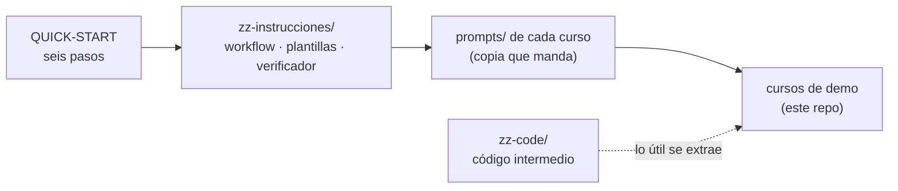

# 🏭 Generador de cursos con Claude

> **Qué es este repositorio:** el **generador de cursos** de
> [`zz-instrucciones/`](zz-instrucciones/README.md): la maquinaria para diseñar, preparar y escribir
> cursos en Markdown con asistencia de un LLM (Claude Code), con el flujo de etapas E0–E9, los prompts
> que abren cada etapa, las plantillas de `prompts/` y el verificador de corpus.
> **Los cursos son de demo:** muestran lo que produce el generador (y de ellos se destiló). Son copias
> de cursos que se producen y mantienen en otros repositorios; aquí sirven de ejemplo y de banco de
> pruebas, no se siguen desarrollando. Cada carpeta de curso es independiente y tiene su propio
> `README.md`.

---

## 🚀 Por dónde empezar

| Si quieres… | Lee |
|---|---|
| crear un curso nuevo ya, sin leer todo | [`zz-instrucciones/QUICK-START.md`](zz-instrucciones/QUICK-START.md) — un curso nuevo en seis pasos |
| entender la maquinaria completa | [`zz-instrucciones/README.md`](zz-instrucciones/README.md) — el mapa: workflow, tipos de curso, prompts de etapa, plantillas y herramientas |
| saber dónde va el código de prueba de cada sesión | [`zz-code/README.md`](zz-code/README.md) |
| preparar el `CLAUDE.md` de un repositorio de cursos | [`zz-code/CLAUDE-sample-en.md`](zz-code/CLAUDE-sample-en.md) (versión para leer en español: [`CLAUDE-ejemplo-es.md`](zz-code/CLAUDE-ejemplo-es.md)) |
| saber cómo trabaja Claude Code en este repositorio | [`CLAUDE.md`](CLAUDE.md) — el de este repo, adaptado del ejemplo: propósito, comandos del verificador y reglas de sesión |

---

## 📚 Los cursos de demo, por bloque

Cada curso tiene su `prompts/` (guía, plan, verificador) salvo donde se indica. El **tipo** es el de
[`zz-instrucciones/01-tipos-de-curso.md`](zz-instrucciones/01-tipos-de-curso.md). Los marcados
⏳ son cursos **pendientes para ser creados**: su carpeta existe vacía (solo un `.gitkeep`) para fijar
la numeración.

### 🐳 Contenedores, cloud e infraestructura — [`cursos-contenedores-cloud-infra/`](cursos-contenedores-cloud-infra/)

| Curso | Tipo | De qué va |
|---|---|---|
| [Docker Legacy Node](cursos-contenedores-cloud-infra/docker-container-legacy/README.md) | legacy | Laboratorio de contenedores para resucitar proyectos JavaScript de 2018 (Debian Buster, Node 10–16), en amd64 y arm64. |
| [Laboratorio de contenedores y Kubernetes local](cursos-contenedores-cloud-infra/lab-docker-kubernetes/README.md) | completo | La plataforma completa —contenedor, orquestador y alrededores— construyendo cuatro microservicios en cuatro lenguajes sobre un Kubernetes local. |

### 🧑‍💻 Lenguajes para devs Java — [`cursos-lenguajes/`](cursos-lenguajes/)

| Curso | Tipo | De qué va |
|---|---|---|
| [C# para desarrolladores Java senior](cursos-lenguajes/c-sharp-for-java-devs/README.md) | completo | C# idiomático mientras se decide, con números, qué parte de un sistema heredado se migra, se envuelve o se deja quieta. |
| [Go para desarrolladores Java senior](cursos-lenguajes/go-for-java-devs/README.md) | completo | Go que un gopher reconocería como suyo, no Java con otras llaves; sobre la plataforma ficticia Meridian. |
| [Python para desarrolladores Java senior](cursos-lenguajes/python-for-java-devs/README.md) | completo | Elegir el registro correcto de Python (script, herramienta o aplicación), con una pista paralela de ciencia de datos. |

### 🏛️ Repaso para entrevistas · Arquitectura — [`repaso-entrevistas/arquitectura/`](repaso-entrevistas/arquitectura/README.md)

| Curso | Tipo | De qué va |
|---|---|---|
| [Bases de arquitectura](repaso-entrevistas/arquitectura/01-bases/README.md) | repaso | El troncal: bases, eventos, datos, seguridad y banca, con simulaciones y solucionarios aparte. |
| [Monolito y monolito distribuido](repaso-entrevistas/arquitectura/02-monolito/README.md) | repaso | Qué debe seguir unido y cuándo compensa distribuir; talleres opcionales. |
| [Arquitectura hexagonal](repaso-entrevistas/arquitectura/03-hexagonal/README.md) | repaso | Política frente a detalle y el costo de la frontera; talleres opcionales. |
| [Microservicios](repaso-entrevistas/arquitectura/04-microservicios/README.md) | repaso | Con qué se implementa cada patrón y qué cambia entre plataformas; talleres opcionales. |

Los módulos `05`–`10` (event-driven, serverless, CQRS, SOA, reactiva, cell multi-región) no vienen en
este demo; el [índice de arquitectura](repaso-entrevistas/arquitectura/README.md) los cita por nombre,
sin enlace.

### 🧮 Repaso para entrevistas · Bases — [`repaso-entrevistas/bases/`](repaso-entrevistas/bases/)

| Curso | Tipo | De qué va |
|---|---|---|
| [Bases: algoritmos y estructuras de datos](repaso-entrevistas/bases/01-bases/README.md) | repaso | Fundamentos para entrevistas en ocho bloques más uno opcional de implementaciones. |
| [Algoritmos y estructuras de datos a fondo](repaso-entrevistas/bases/02-algoritmos-estructuras-de-datos/README.md) | repaso | Por qué un algoritmo es correcto y cuánto cuesta, en C++, Java y Python, con programación competitiva. |
| [POO y patrones de diseño](repaso-entrevistas/bases/03-poo-y-patrones/README.md) | repaso | GoF, Fowler, DDD táctico, concurrencia y antipatrones, en C++ y Java con contraste políglota. |
| [APIs y protocolos](repaso-entrevistas/bases/04-apis-protocolos/README.md) | repaso | HTTP, semántica de métodos, codificación, TLS y versiones del protocolo, con simulación. |
| [Bases de datos](repaso-entrevistas/bases/05-bases-datos/README.md) | repaso | Qué hace el motor por dentro y cómo defender una decisión de datos en voz alta. |

### ☁️ Repaso para entrevistas · Cloud — [`repaso-entrevistas/cloud/`](repaso-entrevistas/cloud/)

| Curso | Tipo | De qué va |
|---|---|---|
| [AWS Core Refresh](repaso-entrevistas/cloud/01-aws/README.md) | repaso + labs | Repaso para entrevistas y laboratorio práctico en una cuenta real, con destrucción verificada. |
| [GCP Core Refresh](repaso-entrevistas/cloud/02-gcp/README.md) | repaso + labs | Repaso y serie práctica con gcloud y Terraform: encender, romper, diagnosticar y destruir. |
| [Azure Core Refresh](repaso-entrevistas/cloud/03-azure/README.md) | repaso + labs | Repaso y serie práctica con az y Bicep. |
| `04-oracle-cloud/` | — | ⏳ Pendiente para ser creado (carpeta vacía, solo `.gitkeep`). |

### 🌱 Repaso para entrevistas · Frameworks — [`repaso-entrevistas/frameworks/`](repaso-entrevistas/frameworks/)

| Curso | Tipo | De qué va |
|---|---|---|
| [Spring Core Refresh](repaso-entrevistas/frameworks/01-spring-boot/README.md) | repaso + labs | Spring y Spring Boot para Backend Senior / Tech Lead, con labs locales de lo que solo se entiende viéndolo fallar. |
| `02-spring-webflux/` | — | ⏳ Pendiente para ser creado (carpeta vacía, solo `.gitkeep`). |

### ❓ Bancos de preguntas de entrevista — [`preguntas-entrevista/`](preguntas-entrevista/)

| Banco | Tipo | De qué va |
|---|---|---|
| [POO, SOLID y patrones](preguntas-entrevista/01-poo-solid-patrones.md) | banco de entrevista | 100 preguntas nivel senior / arquitecto, con dificultad 🟢🟡🟠🔴. |
| [Patrones enterprise](preguntas-entrevista/02-patrones-enterprise.md) | banco de entrevista | |
| [Java 11–17](preguntas-entrevista/04-java-11-17.md) | banco de entrevista | |
| [Microservicios](preguntas-entrevista/05-microservicios.md) | banco de entrevista | |
| [Patrones de microservicios](preguntas-entrevista/06-patrones-microservicios.md) | banco de entrevista | |
| [Spring Boot](preguntas-entrevista/springboot/00-springboot-general.md) | banco de entrevista | General y núcleo IoC / beans. |

### 🤖 IA: solo la base — [`cursos-ia-solo-plan/`](cursos-ia-solo-plan/)

> ⚠️ **Esto es un curso donde solo está la base.** Aquí está la estructura (currículo, guías,
> carpetas por unidad con su `README.md`), pero **no el contenido escrito**: sirve para ver de qué
> parte un curso antes de pasar por las etapas de producción de
> [`zz-instrucciones/`](zz-instrucciones/README.md). No tiene `prompts/` ni verificador.

| Curso | De qué va |
|---|---|
| [Maestría IA](cursos-ia-solo-plan/maestria-ia-solo-READMES/README.md) | Currículo autodidacta de especialización en IA (~30–34 meses a 6 h/semana) en dos pistas: A, el eje secuencial (matemáticas → ML → deep learning → producción), y B, temas aplicados (agentes, MCP, modelos locales, fine-tuning). |
| [Tutorial RAG](cursos-ia-solo-plan/tutorial-rag-solo-READMES/README.md) | Tres documentos maestros sobre Retrieval-Augmented Generation: un curso largo por proyectos, uno corto de diez semanas y los *trade-offs* entre ambos. |

---

## 🗂️ Carpetas de soporte

| Carpeta o archivo | Qué guarda |
|---|---|
| [`zz-instrucciones/`](zz-instrucciones/README.md) | **El generador**: la maquinaria genérica para producir cursos. Nada de aquí se publica: se copia al `prompts/` del curso nuevo. Hoy es idéntica a la copia de los repositorios donde se producen los cursos. |
| [`zz-code/`](zz-code/README.md) | El código intermedio con que cada sesión prueba las ideas de un curso; un directorio por sesión, más `nuevo.py`, `limpiar.py`, `regenerar-rescates.py` y los `CLAUDE-*` de ejemplo. Nunca se publica. Sus `salidas/` y bitácoras son registro histórico: sus enlaces apuntan al curso tal como estaba. |
| [`CLAUDE.md`](CLAUDE.md) | Las instrucciones de Claude Code para este repositorio. |
