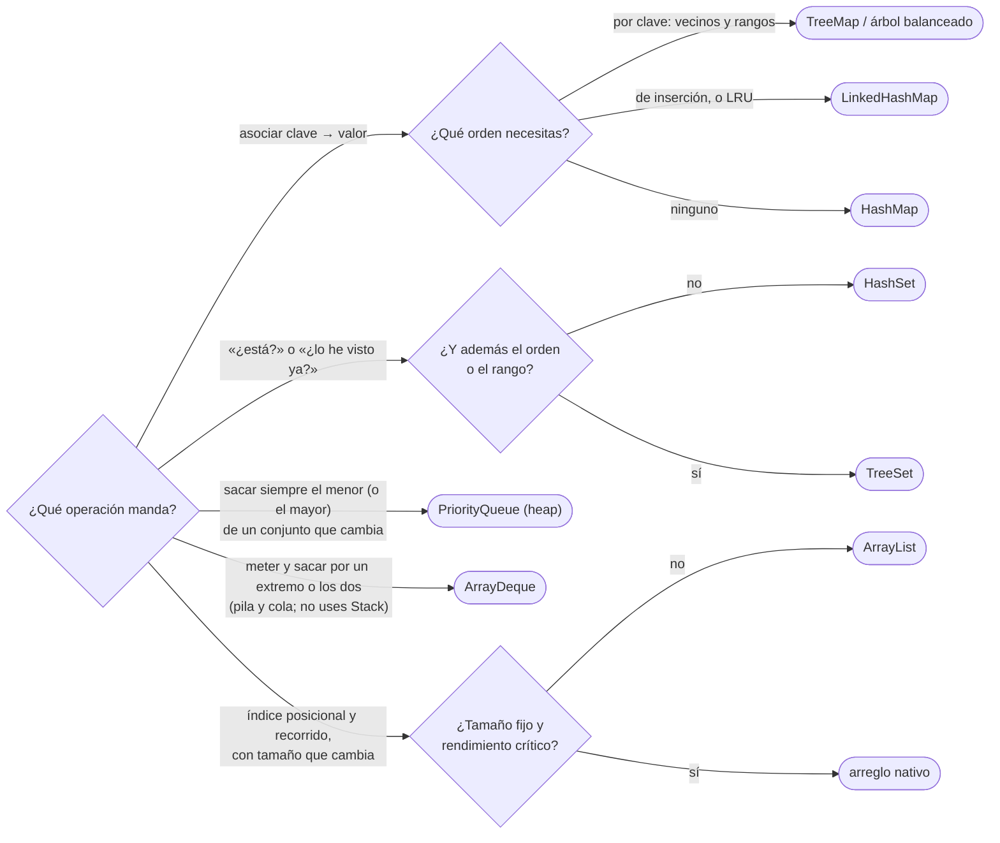

# 02 — TDAs: contrato e implementación

> La distinción que ordena todo el temario: el TDA es el **contrato** (qué operaciones hay),
> la estructura de datos es la **implementación** (cuánto cuesta cada una). Los siete TDAs
> que se preguntan, sus implementaciones reales en los cinco lenguajes, y el árbol de
> decisión que responde "¿qué estructura usarías?".
> Asume leído [`01` — Complejidad y O grande](01-complejidad-y-o-grande.md).
>
> **Vigencia:** 2026-09-18.

---

## 1. 🎯 El problema

La pregunta *"¿qué estructura de datos usarías aquí?"* se falla casi siempre por el mismo
motivo: el candidato responde con una **implementación** cuando le preguntaron por un
**contrato**, o al revés.

Un ejemplo real. Te piden llevar el historial de navegación de una aplicación, con "atrás" y
"adelante". Hay dos respuestas:

```text
Mala:   "un ArrayList"          ← implementación, sin decir qué operaciones necesitas
Buena:  "dos pilas"             ← contrato: LIFO en ambos extremos del historial
        "y las implemento con ArrayDeque, no con Stack, porque Stack está obsoleta"
```

La segunda respuesta contesta dos preguntas: qué comportamiento necesitas y qué clase lo da
más barato. Es la estructura de toda buena respuesta en este tema, y separar los dos niveles
es lo único que hay que aprender de este capítulo.

> **Regla mental:** el TDA responde *"¿qué puedo hacer?"*. La estructura responde *"¿cuánto
> me cuesta hacerlo?"*. Nombra los dos, en ese orden.

---

## 2. 🧱 Qué es un TDA

**Qué es.** Un tipo de dato abstracto (TDA) es un conjunto de operaciones con su semántica,
**sin decir cómo se implementan**. "Una pila es algo donde metes por arriba y sacas por
arriba" es un TDA completo: no dice si por dentro hay un arreglo o nodos enlazados.

**Cómo va.** En Java la separación está en el lenguaje y es visible: las **interfaces** de
`java.util` son los TDAs y las **clases** son las implementaciones.

```java
// El tipo declarado es el contrato; el constructor elige el coste.
List<Producto> catalogo = new ArrayList<>();
Deque<String> historial = new ArrayDeque<>();
Map<ProductoId, Money> precios = new HashMap<>();
```

- Declarar por la interfaz y no por la clase es lo que te permite cambiar de
  implementación tocando una línea: es la razón práctica de la regla, no purismo.
- **La excepción real:** `ArrayDeque` no admite `null` y `LinkedList` sí. Si tu código mete
  `null`, cambiar la implementación rompe en ejecución, no en compilación. El contrato de la
  interfaz no lo captura todo.

**Cuánto cuesta.** Nada en tiempo de ejecución: es una decisión de tipos. Cuesta en
disciplina, y se paga sola.

**Cuándo sí.** Siempre en firmas de métodos y campos.

**Cuándo no.** Cuando necesitas un método que solo está en la clase concreta —los
`descendingMap()` de `TreeMap`, el `getFirst()` de `LinkedList` antes de Java 21—. Ahí
declaras la clase y lo justificas con un comentario.

> **Veredicto:** en entrevista, responder con el TDA y después con la implementación
> demuestra que entiendes por qué existen las dos capas. Responder solo con la clase suena a
> haber memorizado nombres.

---

## 3. 🧱 Los siete TDAs que se preguntan

| TDA | Contrato en una línea | Operación que lo define |
|---|---|---|
| **Lista** | Secuencia con orden posicional y duplicados | `get(i)`, `add(i, x)` |
| **Pila** (stack) | LIFO: lo último que entra es lo primero que sale | `push`, `pop` |
| **Cola** (queue) | FIFO: lo primero que entra es lo primero que sale | `offer`, `poll` |
| **Deque** | Cola con dos extremos; contiene a pila y cola | `addFirst`, `addLast` |
| **Conjunto** (set) | Pertenencia sin duplicados y sin orden posicional | `add`, `contains` |
| **Mapa** (map) | Asociación clave → valor, claves únicas | `put`, `get` |
| **Cola de prioridad** | Saca siempre el mínimo (o el máximo), no el primero | `offer`, `poll` |

Dos precisiones que se preguntan seguido:

- **Un mapa no es un TDA "de colección"** en el sentido estricto: en Java `Map` no extiende
  `Collection`, precisamente porque su elemento es un par y no un valor.
- **La cola de prioridad no es una cola.** Comparte la interfaz `Queue` en Java y rompe su
  intuición: el `poll()` no devuelve el que lleva más tiempo, devuelve el menor. Se desarrolla
  entera en [`04-arboles-grafos/02`](../04-arboles-grafos/02-monticulos-y-colas-de-prioridad.md).

**El octavo que a veces aparece: la bolsa (multiset)**, un conjunto que cuenta repeticiones.
Java no lo trae; se emula con `Map<T, Integer>` y `merge(k, 1, Integer::sum)`. Python sí lo
trae, y se llama `collections.Counter`. Saber esa asimetría es de las cosas que se preguntan
en una entrevista políglota.

---

## 4. ⏱️ La tabla de costes

Los costes reales de las implementaciones de `java.util`, con la columna que decide de verdad:

| Estructura | Acceso | Buscar | Insertar | Borrar | Lo que la tabla no dice |
|---|---|---|---|---|---|
| `ArrayList` | O(1) | O(n) | O(1)* | O(n) | * amortizado al final; insertar en medio desplaza |
| `LinkedList` | O(n) | O(n) | O(1)† | O(1)† | † solo **si ya tienes el nodo**; llegar a él es O(n) |
| `ArrayDeque` | — | O(n) | O(1)* | O(1)* | El más rápido para pila y cola. No admite `null` |
| `HashMap` | — | O(1)‡ | O(1)‡ | O(1)‡ | ‡ amortizado y con buen `hashCode`; degenerado O(log n) |
| `LinkedHashMap` | — | O(1)‡ | O(1)‡ | O(1)‡ | Mantiene orden de inserción por ~8 bytes más por entrada |
| `TreeMap` | — | O(log n) | O(log n) | O(log n) | Ordenado, y con `subMap`/`floorKey` que ningún hash da |
| `HashSet` | — | O(1)‡ | O(1)‡ | O(1)‡ | Es un `HashMap` con un valor centinela. Literalmente |
| `TreeSet` | — | O(log n) | O(log n) | O(log n) | Es un `TreeMap`. Mismo truco |
| `PriorityQueue` | O(1) al mínimo | O(n) | O(log n) | O(log n) | `contains` y `remove(Object)` son lineales |

> ⏱️ **Coste.** Las tres notas de la tabla —amortizado, "si tienes el nodo", "con buen
> `hashCode`"— son exactamente las tres cosas que distinguen una respuesta de nivel senior de
> una de nivel junior. Las tres se desarrollan: la primera en
> [`01` §6](01-complejidad-y-o-grande.md#6--coste-amortizado), la segunda en
> [`03`](03-arrays-listas-y-secuencias.md), la tercera en
> [`03-orden-busqueda/04`](../03-orden-busqueda/04-hashing-y-tablas-hash.md).

---

## 5. ⚖️ El mismo TDA, dos implementaciones

Aquí es donde el capítulo se gana el sueldo: **elegir mal la implementación de un TDA
correcto es el error más caro y el más frecuente.**

**`List`: `ArrayList` contra `LinkedList`.** La tabla de arriba dice que `LinkedList` inserta
en O(1) y `ArrayList` en O(n), y aun así **`ArrayList` gana casi siempre**. El motivo es de
hardware y no de algoritmia: el arreglo es contiguo en memoria y la caché del procesador lo
trae por bloques; la lista enlazada persigue punteros por todo el montón. El argumento
completo está en [`03` §2](03-arrays-listas-y-secuencias.md#2--el-arreglo-y-la-caché).

**`Map`: `HashMap` contra `TreeMap` contra `LinkedHashMap`.** La única pregunta que decide es
**si necesitas orden, y qué orden**:

```text
¿Sin orden, lo más rápido?         → HashMap
¿Orden de inserción o LRU?         → LinkedHashMap
¿Orden por clave, rangos, vecinos? → TreeMap
```

`LinkedHashMap` tiene un uso que casi nadie conoce y que es oro en entrevista: con el
constructor de `accessOrder = true` y sobrescribiendo `removeEldestEntry`, **es una caché LRU
en cinco líneas**. Es la respuesta a "implementa una LRU" sin escribir una lista doblemente
enlazada a mano.

**`Deque`: `ArrayDeque` contra `Stack` contra `LinkedList`.** `Stack` extiende `Vector`, está
sincronizada desde 1997 y su iteración va del fondo hacia arriba, que es al revés de lo que
todo el mundo espera. La documentación de Java recomienda `ArrayDeque` explícitamente.

> **Veredicto:** el TDA lo eliges por las operaciones que necesitas; la implementación, por el
> patrón de acceso. Si no sabes el patrón de acceso, `ArrayList` y `HashMap` son los defectos
> correctos y decirlo así no es pereza: es criterio.

---

## 6. ⚖️ Los cinco lenguajes

La comparación que ningún libro de algoritmos trae, y la que decide si te sales del guion en
una entrevista políglota. El orden es el fijo del corpus.

| Lenguaje | Lista | Mapa y conjunto | El detalle que muerde |
|---|---|---|---|
| **Java** | `ArrayList`, `LinkedList` | `HashMap`, `TreeMap`, `HashSet` | Interfaces separadas de clases; es el único de los cinco donde el TDA es visible en el tipo |
| **Python** | `list` (es un arreglo dinámico), `deque` | `dict`, `set`; no hay mapa ordenado por clave en la stdlib | `dict` conserva **orden de inserción** desde 3.7, por especificación. `list.insert(0, x)` es O(n) |
| **JavaScript** | `Array` | `Map`, `Set`, y el objeto plano | `Map` conserva orden de inserción y admite cualquier clave; el objeto plano convierte las claves a string |
| **TypeScript** | Igual que JS | Igual que JS | Aporta `Map<K, V>` tipado y `ReadonlyArray`; `readonly` es de compilación, no congela nada en runtime |
| **Go** | `slice` | `map`; no hay `set` | **El recorrido de un `map` es aleatorio a propósito**, para que nadie dependa del orden. Un `set` se emula con `map[T]struct{}` |

Tres asimetrías que se preguntan:

- **Nadie más tiene `TreeMap`.** Python, JavaScript y Go no traen un mapa ordenado por clave
  en su biblioteca estándar. En Python se resuelve con `sortedcontainers` (externa) o con un
  `list` ordenado más `bisect`; en Go, con un slice ordenado más `sort.Search`.
- **Solo Java y Python traen deque de verdad.** En JavaScript, `Array.shift()` es O(n) porque
  reindexa el arreglo entero; simular una cola con `push`/`shift` sobre un millón de elementos
  es cuadrático, y es un bug real y frecuente.
- **El orden de iteración está especificado en tres de los cinco.** `dict` de Python y `Map`
  de JS garantizan orden de inserción; el `map` de Go garantiza lo contrario, que es
  aleatorio; `HashMap` de Java no garantiza nada, que es distinto de garantizar aleatoriedad.

> 💡 **Truco.** Si te preguntan por qué Go aleatoriza el recorrido del `map`, la respuesta es
> de diseño de lenguaje, no de rendimiento: **para que ningún programa dependa de un orden que
> el runtime no promete**. Es el equipo de Go convirtiendo un bug latente en un fallo
> inmediato.

---

## 7. 🧭 Cómo se elige

El árbol que responde "¿qué estructura usarías?" en el 90 % de los casos:



La frase que acompaña al árbol en voz alta:

> **Regla de entrevista:** nombra el TDA, nombra la implementación y **nombra la operación que
> te hizo elegirla**. Tres frases. La tercera es la que casi nadie dice.

---

## 8. 🔭 Dónde aparece de verdad

- **La pila de llamadas** de la JVM es literalmente una pila, y su desbordamiento es el
  `StackOverflowError` de [`04`](04-recursion-y-backtracking.md).
- **La cola de mensajes** de un broker es el TDA cola con durabilidad encima. Un consumidor
  que hace `poll` está usando exactamente esta interfaz.
- **El pool de conexiones** de HikariCP es una cola con préstamo y devolución; su tamaño
  máximo es el mecanismo de bulkhead del que habla
  [`repaso-arquitectura-entrevistas/01-bases/09`](../../../arquitectura/01-bases/01-bases/09-resiliencia.md).
- **El caché de segundo nivel** de Hibernate y el caché de Spring son mapas con política de
  expulsión; la política de expulsión es lo que convierte un `HashMap` en un caché.
- **El índice de una base de datos** es un B+tree, que es la implementación de disco del TDA
  mapa ordenado. Se ve en [`04-arboles-grafos/01`](../04-arboles-grafos/01-arboles.md).

---

## ⚠️ Errores frecuentes

| Se dice | Lo preciso |
|---|---|
| "`LinkedList` es mejor para insertar" | Solo si ya tienes el nodo. Con índice, `ArrayList` gana casi siempre |
| "Uso `Stack` para una pila" | `Stack` extiende `Vector`, está sincronizada y itera al revés. Usa `ArrayDeque` |
| "`HashMap` no tiene orden, así que es aleatorio" | No garantiza orden, que no es lo mismo que garantizar aleatoriedad. El `map` de Go sí la garantiza |
| "Un `Set` es una `List` sin duplicados" | No tiene orden posicional ni `get(i)`: es otro contrato, no una lista podada |
| "En JS uso `array.shift()` para hacer una cola" | Es O(n): reindexa el arreglo. Con muchos elementos, el bucle es cuadrático |
| "`PriorityQueue` está ordenada" | Solo garantiza el mínimo en la cabeza. Iterarla no da orden, y `toString` tampoco |
| "Declaro `ArrayList` porque es lo que uso" | Declara `List`; el tipo es el contrato y te deja cambiar la implementación en una línea |

---

## 📚 Para profundizar

- **Libro** — Sedgewick y Wayne, *Algorithms*, 4ª ed. (Addison-Wesley, 2011). Capítulo 1.3,
  "Bags, Queues, and Stacks". **Si solo lees un capítulo de este tema, lee este**: construye
  los tres TDAs desde cero en Java y con las dos implementaciones cada uno.
- **Libro** — Bloch, *Effective Java*, 3ª ed. (Addison-Wesley, 2018). Ítem 64, "Refer to
  objects by their interfaces", que es la regla de §2 con su justificación completa.
- [The Java Tutorials — Collections Interfaces](https://docs.oracle.com/javase/tutorial/collections/interfaces/index.html):
  el mapa oficial de qué interfaz cubre qué contrato.
- [Java 21 API — `ArrayDeque`](https://docs.oracle.com/en/java/javase/21/docs/api/java.base/java/util/ArrayDeque.html):
  la recomendación explícita de usarla en lugar de `Stack` y de `LinkedList` está en el primer
  párrafo de la documentación.
- [Java 21 API — `LinkedHashMap`](https://docs.oracle.com/en/java/javase/21/docs/api/java.base/java/util/LinkedHashMap.html):
  `accessOrder` y `removeEldestEntry`, la caché LRU en cinco líneas.
- [Python — `collections`](https://docs.python.org/3/library/collections.html): `deque`,
  `Counter`, `defaultdict` y `OrderedDict`, con la nota de qué quedó redundante cuando `dict`
  pasó a conservar el orden.
- [The Go Blog — Go maps in action](https://go.dev/blog/maps): incluye por qué el recorrido es
  deliberadamente aleatorio.
- **Video** — Coursera, Sedgewick, *Algorithms Part I*, semana 2: pilas, colas y el análisis
  del redimensionado.

---

## 🧠 Preguntas

Sin respuestas aquí. Todas, con enunciado literal y respuesta en tres capas, en
[`07` — Respuestas](07-respuestas.md).

1. ¿Qué diferencia hay entre un TDA y una estructura de datos? 🟢
2. ¿Qué operación define a una pila y cuál a una cola? 🟢
3. ¿Qué garantiza un conjunto que no garantiza una lista? 🟢
4. ¿Por qué `Map` no extiende `Collection` en Java? 🟢
5. ¿Qué complejidad tiene `get(i)` en `ArrayList` y en `LinkedList`? 🟢
6. ¿Qué estructura usarías para un historial con "atrás" y "adelante"? 🟢
7. ¿Por qué se declara `List<T> x = new ArrayList<>()` y no `ArrayList<T> x = ...`? 🟡
8. ¿Qué diferencia a `HashMap` de `LinkedHashMap` y qué cuesta la diferencia? 🟡
9. ¿Cuándo prefieres `TreeMap` a `HashMap`? Da dos operaciones que solo el primero ofrece. 🟡
10. ¿Por qué `Stack` está desaconsejada y qué se usa en su lugar? 🟡
11. ¿Qué es un multiset y cómo se emula en Java? 🟡
12. ¿En qué se parecen `HashSet` y `HashMap` por dentro? 🟡
13. ¿`PriorityQueue` está ordenada? ¿Qué devuelve iterarla? 🟡
14. ¿Qué pasa si metes `null` en un `ArrayDeque` y por qué se diseñó así? 🟡
15. ¿Conserva `dict` de Python el orden de inserción? ¿Desde cuándo y con qué garantía? 🟡
16. ¿Por qué el recorrido de un `map` en Go es aleatorio? 🟠
17. ¿Cómo implementas una caché LRU en Java sin escribir una lista doblemente enlazada? 🟠
18. ¿Por qué `array.shift()` en JavaScript no sirve para implementar una cola grande? 🟠
19. Ninguno de los otros cuatro lenguajes tiene `TreeMap`. ¿Cómo resuelves "dame las claves
    entre A y B" en Python y en Go? 🟠
20. ¿Por qué `contains` es O(n) en `PriorityQueue` si `poll` es O(log n)? 🟠
21. Tienes que elegir entre `HashSet` y `TreeSet` para 10 millones de IDs de los que solo
    consultas pertenencia. Elige y di qué pagas. 🟠
22. ¿En qué caso concreto `LinkedList` sí gana a `ArrayList`, y por qué casi nunca se da? 🟠
23. Diseña la estructura para un ranking en vivo de los 10 mejores de un millón de
    jugadores, con actualizaciones constantes. Nombra TDA e implementación. 🔴
24. Te dan un método que recibe `ArrayList` en la firma y hace `remove(0)` dentro de un
    bucle. Explica el problema y propón dos arreglos distintos. 🔴
25. Diseña la estructura de un carrito de compras que necesita: orden de agregado, acceso por
    `ProductoId`, y total acumulado. Justifica cada elección. 🔴

---

**Anterior:** [`01` — Complejidad y O grande](01-complejidad-y-o-grande.md) ·
**Siguiente:** [`03` — Arrays, listas y secuencias](03-arrays-listas-y-secuencias.md) ·
**Relacionado:** [`03-orden-busqueda/04` — Hashing](../03-orden-busqueda/04-hashing-y-tablas-hash.md)
