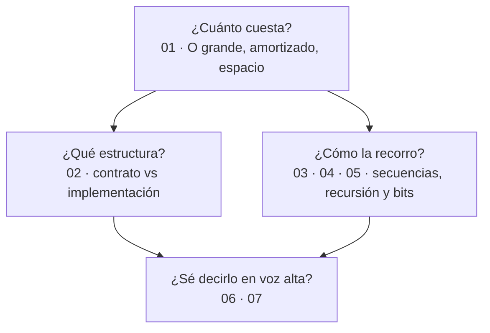

# 01 — Fundamentos

> El bloque troncal de `repaso-bases-entrevistas`. Cubre lo que se pregunta en **toda**
> entrevista técnica antes de llegar a los algoritmos con nombre propio: cómo se mide el
> coste, qué estructura resuelve qué, cómo se ataca una secuencia y qué cuesta de verdad una
> recursión.
>
> **Vigencia:** 2026-09-18. · **Guía editorial:** [`prompts/guia-de-estilo-y-convenciones.md`](../prompts/guia-de-estilo-y-convenciones.md)

---

## Qué es esto

Material de **repaso para entrevista**, no un curso de algoritmos. La diferencia manda sobre
todo el contenido:

```text
Un curso de algoritmos → te enseña a demostrar la cota.
Este repaso            → te enseña a elegir la estructura, decir qué te cuesta,
                         y escribirla sin bug de índice delante de alguien.
```

Por eso cada estructura cierra con un **veredicto**, todo algoritmo viene con su **coste en
tiempo y en espacio**, y las preguntas **no llevan la respuesta al lado**: viven en
[`07-respuestas.md`](07-respuestas.md), para que no puedas verlas sin querer.

---

## Orden de lectura

| # | Documento | Qué cubre |
|---|---|---|
| `01` | [Complejidad y O grande](01-complejidad-y-o-grande.md) | O, Ω, Θ, caso peor y medio, coste amortizado, espacio, recurrencias, por qué el cronómetro engaña en la JVM |
| `02` | [TDAs: contrato e implementación](02-tdas-contrato-e-implementacion.md) | Los siete TDAs, la tabla de costes del JCF, `HashMap` vs `TreeMap`, los cinco lenguajes |
| `03` | [Arrays, listas y secuencias](03-arrays-listas-y-secuencias.md) | Localidad de caché, arreglo dinámico, dos punteros, ventana deslizante, sumas de prefijos, pila monótona |
| `04` | [Recursión y backtracking](04-recursion-y-backtracking.md) | Pila de llamadas, recursión de cola, divide y vencerás, memoización, elegir–explorar–deshacer |
| `05` | [Bits y aritmética binaria](05-bits-y-aritmetica-binaria.md) | Complemento a dos, desbordamiento silencioso, `>>` vs `>>>`, máscaras y `EnumSet` |
| `06` | [Simulación de entrevista](06-simulacion-de-entrevista.md) | 36 preguntas transversales + 5 problemas de pizarra |
| `07` | [Respuestas](07-respuestas.md) | Solucionario completo del bloque, en tres capas |

**Si el calendario aprieta**, el orden de prioridad es `01`, `02` y después `03`. Esos tres
cubren la mayor parte de lo preguntable; `04` solo hace falta entero si el proceso incluye una
prueba de código, y `05` es el más corto y el que más bugs reales explica por página.

---

## Cómo se estudia

```text
1. Lee el capítulo entero, sin saltarte los veredictos ni la tabla de costes.
2. Contesta las preguntas EN VOZ ALTA, cronometrado a 2 minutos.
3. Solo entonces abre 07-respuestas.md.
4. Lo que supiste pero no pudiste articular en 2 minutos, cuenta como fallo: vuelve.
5. Los problemas de pizarra de `06` se TECLEAN, no se leen.
```

La estructura de las respuestas está pensada para esto:

- **⏱️ 30 segundos** — lo que dices primero, sin que te lo pidan. Casi siempre, la complejidad.
- **🗣️ 2 minutos** — lo que añades cuando dicen "cuéntame más".
- **🔬 El detalle** — para estudiar, no para recitar.

---

## Mapa mental del bloque



`01` es dueño único de la notación de complejidad: los bloques `02` a `05` la usan y no la
redefinen.

---

## Qué NO está aquí

- **Strings, algoritmos de cadenas y expresiones regulares** → bloque [`02-texto`](../02-texto/).
- **Ordenación, búsqueda y hashing** → bloque [`03-orden-busqueda`](../03-orden-busqueda/).
- **Árboles, heaps y grafos** → bloque [`04-arboles-grafos`](../04-arboles-grafos/).
- **Programación dinámica y voraces** → bloque [`05-dp-y-tecnicas`](../05-dp-y-tecnicas/).
- **El código implementado en los cinco lenguajes** → bloque opcional
  [`09-implementaciones`](../09-implementaciones/), que está **fuera del hilo principal**: no
  hace falta para aprobar una entrevista.
- **Concurrencia, JVM y detalles del lenguaje Java** → no son de este corpus. Están en
  [`preguntas-entrevista/04-java-11-17.md`](../../../../preguntas-entrevista/04-java-11-17.md).
