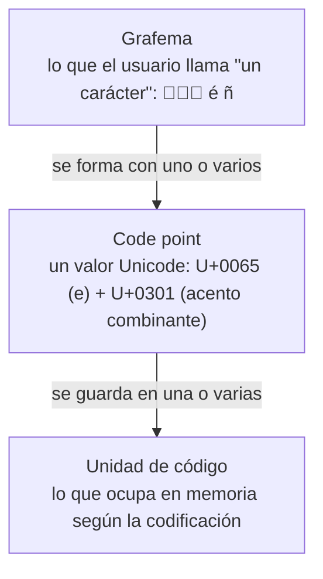

# 01 — Strings: el modelo y sus diferencias entre lenguajes

> Temario breve y comparativo: qué es realmente un string en cada uno de los cinco lenguajes,
> cuál es su unidad de indexación, por qué concatenar en un bucle es cuadrático en todos, y
> qué pasa cuando el texto trae acentos o emojis. Es el capítulo que explica por qué el mismo
> código da tres respuestas distintas a "¿cuántos caracteres tiene?".
> Asume leído [`01-fundamentos/01` — Complejidad](../01-fundamentos/01-complejidad-y-o-grande.md).
>
> **Vigencia:** 2026-09-18.

---

## 1. 🎯 El problema

Dos bugs que salen de la misma ignorancia y que aparecen en producción con años de
diferencia.

El primero es de rendimiento. Un proceso arma un informe concatenando 100 000 líneas con `+=`
dentro de un bucle. Tarda minutos. El motivo es que **el string es inmutable**: cada `+=`
crea uno nuevo y copia todo lo anterior, así que el bucle es O(n²) en tiempo y genera 100 000
objetos que el recolector tiene que limpiar.

El segundo es de corrección. Un campo de nombre limitado a 20 caracteres acepta un emoji, el
validador cuenta 2 y el usuario ve 1. Peor: alguien hace `nombre.substring(0, 20)` y parte un
carácter por la mitad, dejando media pareja sustituta que se muestra como un rombo negro y
que rompe la serialización aguas abajo.

```text
"José"  con é precompuesta   → 4 unidades
"José"  con e + acento       → 5 unidades, y los dos se ven igual
"👨‍👩‍👧" familia               → 8 unidades en Java, 1 grafema para el usuario
```

Ninguno de los dos bugs es exótico. Ambos salen de no saber **qué cuenta un string cuando
cuenta**.

> **Regla de entrevista:** cuando te pregunten "¿cuántos caracteres tiene?", la respuesta
> correcta empieza por otra pregunta: *"¿unidades de código, code points o grafemas?"*.

---

## 2. 🧱 Inmutabilidad, y por qué

**Qué es.** En Java, Python, JavaScript, TypeScript y Go, un string **no se puede modificar**
una vez creado. Cualquier "modificación" crea uno nuevo.

**Cómo va.** `texto += "x"` no añade nada: reserva un string nuevo del tamaño de la suma,
copia el viejo, copia la `x` y descarta el original.

**Cuánto.** Una concatenación es O(n). En un bucle de n iteraciones, **O(n²)** en tiempo y
O(n²) en basura generada.

**Por qué se diseñó así**, que es la pregunta de seguimiento habitual:

- **Seguridad.** Un `String` con una ruta de archivo o una cadena de conexión no puede
  cambiar entre que se valida y que se usa. Si fuera mutable, cualquier código con una
  referencia podría alterarlo tras la comprobación.
- **Caché del hash.** Java guarda el `hashCode` calculado dentro del objeto. Solo es seguro
  porque el contenido no cambia, y es lo que hace barato usar strings como claves de mapa.
- **Compartir sin copiar.** Dos referencias al mismo literal pueden apuntar al mismo objeto
  sin riesgo. De ahí el *string pool*.
- **Concurrencia.** Un objeto inmutable es seguro entre hilos sin sincronización alguna.

**Cuándo no** es una ventaja: cuando construyes texto pieza a pieza. Para eso existe el
constructor mutable de cada lenguaje, que es la sección 4.

> **Veredicto:** la inmutabilidad del string compra seguridad, hash cacheado y concurrencia, y
> se paga con una copia en cada modificación. Saber nombrar las cuatro razones es lo que
> distingue la respuesta de "porque sí".

---

## 3. 🧱 La unidad de indexación

Aquí está la diferencia real entre los cinco lenguajes, y es donde nacen los bugs de la
sección 1. Hay **tres niveles** y cada lenguaje indexa por uno distinto:



| Lenguaje | `longitud` cuenta | Indexar da | Recorrer con `for` da |
|---|---|---|---|
| **Java** | Unidades UTF-16 | `char` (16 bits) | `char`, partiendo emojis |
| **Python** | **Code points** | Un str de 1 code point | Code points |
| **JavaScript** | Unidades UTF-16 | Un str de 1 unidad | `for...of` da **code points** |
| **TypeScript** | Igual que JS | Igual que JS | Igual que JS |
| **Go** | **Bytes** (UTF-8) | Un `byte` | `range` da **runes** (code points) |

- **Java y JavaScript indexan por UTF-16.** Todo carácter fuera del plano básico —emojis,
  algunos ideogramas, símbolos matemáticos— ocupa **dos** unidades, llamadas pareja
  sustituta. Por eso `"👍".length()` es 2.
- **Python 3 indexa por code point**, y su representación interna se adapta al contenido: 1,
  2 o 4 bytes por carácter según el máximo que haya. `len("👍")` es 1.
- **Go indexa por byte.** `len("é")` es 2 porque en UTF-8 la é ocupa dos bytes. Pero `for i,
  r := range s` entrega runes, así que el recorrido idiomático sí es por carácter.
- **Ninguno de los cinco indexa por grafema.** La familia `👨‍👩‍👧` es un grafema y varios code
  points unidos por caracteres de ancho cero; contarla como 1 requiere una biblioteca (`ICU`,
  `grapheme` en Go, `Intl.Segmenter` en navegadores modernos).

> ⚠️ **Advertencia.** `substring` y el corte por índice son inseguros en Java, JavaScript y Go
> si el texto puede traer caracteres no ASCII: parten parejas sustitutas o secuencias UTF-8 y
> producen texto corrupto. En Java, la forma segura de contar es `codePointCount()`, y la de
> recorrer es `codePoints()`.

---

## 4. 🧱 Construir cadenas sin pagar el cuadrático

Cada lenguaje tiene su salida al problema de la concatenación en bucle, y todas consisten en
lo mismo: **un búfer mutable que crece amortizado**.

```java
StringBuilder sb = new StringBuilder();
for (LineaPedido linea : lineas) {
    sb.append(linea.descripcion()).append('\n');   // O(1) amortizado por append
}
String informe = sb.toString();                    // una sola copia final
```

- `StringBuilder` es un `char[]` que duplica su capacidad al llenarse: el mismo coste
  amortizado del `ArrayList` de
  [`01-fundamentos/01` §6](../01-fundamentos/01-complejidad-y-o-grande.md#6--coste-amortizado).
- Pasa de O(n²) a **O(n)** en el bucle completo, y de n objetos a uno.
- `StringBuffer` es su versión sincronizada. No se usa: la sincronización solo cuesta.

Los equivalentes, por lenguaje:

| Lenguaje | Cómo se construye | El detalle que muerde |
|---|---|---|
| **Java** | `StringBuilder` | El compilador ya convierte `a + b` suelto en `StringBuilder`, pero **no** dentro de un bucle |
| **Python** | `"".join(lista)` | Es el idioma. Concatenar con `+=` en bucle funciona por una optimización frágil de CPython que no está garantizada |
| **JavaScript** | `array.join("")` | Los motores optimizan `+=` con *ropes*, así que el cuadrático a veces no aparece. No es garantía |
| **TypeScript** | Igual que JS | Sin diferencia en runtime |
| **Go** | `strings.Builder` | `+=` en bucle es cuadrático y sin optimización que lo salve. `Builder` evita además una copia final |

> 💡 **Truco.** En Java, `a + b + c` en una sola expresión ya usa `StringBuilder` por debajo:
> reescribirlo a mano no mejora nada y solo lo afea. El problema es **exclusivamente el bucle**,
> donde el compilador crea un `StringBuilder` nuevo en cada vuelta. Decir esa distinción es lo
> que separa a quien lo entendió de quien lo memorizó.

---

## 5. 🧱 Comparar, normalizar y ordenar

Tres operaciones que parecen triviales y tienen trampa.

**Comparar.** En Java, `==` compara referencias y `equals` compara contenido. El *string pool*
hace que los literales iguales compartan objeto, así que `"hola" == "hola"` es `true` y
`new String("hola") == "hola"` es `false`. Funciona hasta que el string viene de la red o de
la base de datos, y entonces falla en producción y no en test.

**Normalizar.** `"José"` puede venir con la `é` precompuesta (U+00E9) o como `e` más acento
combinante (U+0065 U+0301). Se ven idénticas, y `equals` dice que no lo son. La solución es
normalizar a una forma canónica antes de comparar o de almacenar:

```java
String normalizado = Normalizer.normalize(entrada, Normalizer.Form.NFC);
```

- **NFC** compone: es la forma habitual para almacenar y comparar.
- **NFD** descompone: útil para quitar acentos, filtrando los caracteres combinantes.
- Los sistemas de archivos de macOS entregan NFD y los de Linux NFC, lo que convierte esto en
  un bug real al mover archivos entre plataformas.

**Ordenar.** El orden natural de un string es por valor de code point, que **no es el orden
alfabético de ningún idioma**: `"Zoe"` va antes que `"ángel"` porque las mayúsculas ASCII van
antes que los acentos. Para orden humano hace falta un colador sensible a la configuración
regional: `Collator` en Java, `Intl.Collator` en JavaScript, `locale.strxfrm` en Python.

> **Veredicto:** comparar texto de usuario sin normalizar es un bug latente, y ordenarlo sin
> `Collator` produce listas que el usuario percibe como desordenadas. Ambas cosas se dicen en
> una frase y casi nadie las dice.

---

## 6. ⏱️ La tabla de costes

| Operación | Coste | Lo que la tabla no dice |
|---|---|---|
| `longitud` | O(1) en Java, JS y Go; O(1) en Python | En Go cuenta **bytes**, no caracteres: contar runes es O(n) |
| Indexar `s[i]` | O(1) en los cinco | En Go da un byte; a mitad de un carácter multibyte devuelve basura |
| Concatenar dos | O(n + m) | Copia ambos. El coste es la copia, no la operación |
| Concatenar en bucle | **O(n²)** | El bug clásico. `StringBuilder` lo baja a O(n) |
| `substring` | O(n) en Java 7+ | **Antes era O(1)** compartiendo el arreglo, y eso causaba fugas de memoria |
| `equals` | O(n), con salida rápida por longitud | `hashCode` está cacheado en Java: comparar por hash primero es casi gratis |
| `contains` / `indexOf` | O(n·m) ingenuo | Las implementaciones reales no usan KMP; para eso está [`02`](02-algoritmos-de-cadenas.md) |
| Normalizar | O(n) | No es gratis: no se hace en cada comparación, se hace al entrar el dato |

> 📝 **Contexto.** Hasta Java 6, `substring` era O(1) porque devolvía una vista sobre el mismo
> arreglo de caracteres. Se cambió en Java 7 porque un `substring` de 10 caracteres sobre un
> documento de 10 MB mantenía vivos los 10 MB. Es el ejemplo canónico de que una optimización
> de tiempo puede ser una fuga de memoria, y sigue apareciendo en entrevistas.

---

## 7. ⚖️ Los cinco lenguajes, en una tabla

La comparación completa, para repasar de un vistazo:

| Lenguaje | Representación interna | `len("👍")` | `len("é")` UTF-8 | Construcción |
|---|---|---|---|---|
| **Java** | `byte[]` con codificación latin-1 o UTF-16 (compact strings, desde 9) | 2 | 1 | `StringBuilder` |
| **Python** | Ancho variable: 1, 2 o 4 bytes por code point | 1 | 1 | `"".join()` |
| **JavaScript** | UTF-16 | 2 | 1 | `array.join("")` |
| **TypeScript** | Igual que JS | 2 | 1 | Igual que JS |
| **Go** | `[]byte` UTF-8 inmutable | **4** | **2** | `strings.Builder` |

- **Go es el único que cuenta bytes**, y por eso sus números son distintos en las dos últimas
  columnas. Es coherente con su filosofía: el string es datos, y la interpretación es
  explícita.
- **Java cambió su representación interna en 9** con *compact strings*: si todos los
  caracteres caben en latin-1, guarda un byte por carácter en vez de dos. Ahorró memoria en
  casi todas las aplicaciones sin cambiar la API ni la semántica de `length()`.
- **TypeScript no aporta nada aquí**, y declararlo es más honesto que rellenar la fila: los
  tipos de TypeScript no cambian el runtime de JavaScript.

---

## 8. 🧭 Cómo se elige

```text
¿Construyes texto en un bucle?          → StringBuilder / join / strings.Builder
¿Una sola expresión con dos o tres +?   → déjalo, el compilador ya lo hace

¿El texto viene de un usuario?          → normaliza a NFC al entrar, no al comparar
¿Lo vas a ordenar para mostrarlo?       → Collator con locale, no orden natural
¿Vas a cortarlo por longitud?           → cuenta code points, no unidades de código

¿Buscas una subcadena una vez?          → indexOf / contains, y no te compliques
¿La buscas miles de veces en el mismo texto? → índice o autómata (ver `02`)
```

> **Regla de entrevista:** "¿cuántos caracteres tiene?" y "¿son iguales?" son preguntas
> ambiguas sobre texto real. Pedir la aclaración —unidades o grafemas, normalizado o no— es
> mejor respuesta que contestar rápido.

---

## 9. 🔭 Dónde aparece de verdad

El corte de un campo a 20 caracteres que parte un emoji y rompe la serialización JSON aguas
abajo; el `==` entre strings que funciona en test con literales y falla en producción con
datos de la base; el nombre con acento que existe dos veces en la tabla porque uno vino en NFC
y otro en NFD; el informe que tarda minutos por concatenar en bucle; y el listado de clientes
que el usuario percibe desordenado porque se ordenó por code point y no con `Collator`. Los
cinco son incidentes reales y los cinco caben en este capítulo.

---

## ⚠️ Errores frecuentes

| Se dice | Lo preciso |
|---|---|
| "`length()` da los caracteres" | Da unidades UTF-16 en Java y JS, bytes en Go, code points en Python |
| "Concatenar con `+` es igual de rápido" | En una expresión sí; **en un bucle es O(n²)** |
| "`==` compara strings en Java" | Compara referencias. Funciona con literales por el pool y falla con datos externos |
| "Dos textos que se ven igual son iguales" | No si uno está en NFC y el otro en NFD. Hay que normalizar |
| "Ordeno strings con `sort` y ya" | El orden natural es por code point: `"Zoe"` antes que `"ángel"` |
| "`substring` es barato" | Es O(n) desde Java 7. Antes era O(1) y producía fugas de memoria |
| "En Go `len(s)` cuenta caracteres" | Cuenta bytes. Para runes, `utf8.RuneCountInString` |

---

## 📚 Para profundizar

- **Libro** — Bloch, *Effective Java*, 3ª ed. (Addison-Wesley, 2018). Ítem 63, sobre la
  concatenación de strings, con la medición del cuadrático. **El más directo al grano de este
  capítulo.**
- **Libro** — Sedgewick y Wayne, *Algorithms*, 4ª ed. (Addison-Wesley, 2011). Sección 5.1,
  sobre el modelo de coste de las operaciones de string en Java.
- [Java 21 API — `String`](https://docs.oracle.com/en/java/javase/21/docs/api/java.base/java/lang/String.html):
  el contrato de `length()`, `codePointCount()` y `substring`, con la nota sobre parejas
  sustitutas.
- [Java 21 API — `StringBuilder`](https://docs.oracle.com/en/java/javase/21/docs/api/java.base/java/lang/StringBuilder.html):
  la capacidad, el crecimiento y por qué `StringBuffer` quedó relegada.
- [Python — Unicode HOWTO](https://docs.python.org/3/howto/unicode.html):
  la mejor explicación disponible de code points, codificaciones y normalización, útil aunque
  no programes en Python.
- [The Go Blog — Strings, bytes, runes and characters](https://go.dev/blog/strings):
  por qué `len` cuenta bytes y qué hace realmente `range` sobre un string.
- [Unicode — UAX #15: Normalization Forms](https://www.unicode.org/reports/tr15/):
  la fuente primaria de NFC, NFD, NFKC y NFKD.
- [MDN — `String.prototype.normalize()`](https://developer.mozilla.org/en-US/docs/Web/JavaScript/Reference/Global_Objects/String/normalize):
  el equivalente en JavaScript, con ejemplos de las cuatro formas.

---

## 🧠 Preguntas

Sin respuestas aquí. Todas, con enunciado literal y respuesta en tres capas, en
[`05` — Respuestas](05-respuestas.md).

1. ¿Por qué el `String` de Java es inmutable? Da al menos tres razones. 🟢
2. ¿Qué complejidad tiene concatenar con `+=` dentro de un bucle de n iteraciones? 🟢
3. ¿Cuál es la diferencia entre un grafema, un code point y una unidad de código? 🟢
4. ¿Qué devuelve `"👍".length()` en Java y por qué? 🟢
5. ¿Qué cuenta `len(s)` en Go? 🟢
6. ¿Qué hace `StringBuilder` para evitar el coste cuadrático? 🟢
7. ¿Por qué `==` entre strings funciona en test y falla en producción en Java? 🟡
8. ¿Qué es el *string pool* y qué problema resuelve? 🟡
9. ¿Por qué `"José"` puede no ser igual a `"José"` aunque se vean idénticos? 🟡
10. ¿Qué diferencia hay entre NFC y NFD, y cuál usarías para almacenar? 🟡
11. ¿Por qué `substring` dejó de ser O(1) en Java 7? 🟡
12. ¿Qué es una pareja sustituta y qué operación la rompe? 🟡
13. ¿Qué indexa Python cuando haces `s[3]`, y en qué se diferencia de Java? 🟡
14. ¿Qué entrega `for i, r := range s` en Go y en qué se diferencia de `s[i]`? 🟡
15. ¿Por qué `StringBuffer` no se usa aunque exista? 🟡
16. ¿Qué son las *compact strings* de Java 9 y qué cambiaron? 🟡
17. ¿Por qué ordenar strings con el orden natural produce listas que el usuario ve
    desordenadas? 🟠
18. En Java, `a + b + c` en una sola línea, ¿es un problema de rendimiento? Justifica. 🟠
19. Te piden truncar un nombre a 20 caracteres. ¿Qué preguntas antes de escribir el código? 🟠
20. ¿Por qué concatenar con `+=` en un bucle en Python "parece" funcionar bien y aun así no se
    escribe? 🟠
21. ¿Por qué ninguno de los cinco lenguajes indexa por grafema, y qué haces si lo necesitas? 🟠
22. ¿Dónde normalizas el texto de un usuario: al entrar, al comparar o al guardar? Justifica. 🟠
23. Un usuario aparece dos veces en la tabla con el mismo nombre visible. Da tres hipótesis en
    orden de probabilidad. 🔴
24. Diseña la validación de un campo "nombre, máximo 30 caracteres" que funcione con acentos,
    emojis y texto en árabe. Di qué cuentas y dónde cortas. 🔴
25. Un informe que concatena 100 000 líneas tarda tres minutos. Explica la causa, da la
    solución y estima la mejora. 🔴

---

**Siguiente:** [`02` — Algoritmos de cadenas](02-algoritmos-de-cadenas.md) ·
**Relacionado:** [`03` — Expresiones regulares](03-expresiones-regulares.md) ·
[`01-fundamentos/03` — Secuencias](../01-fundamentos/03-arrays-listas-y-secuencias.md)
