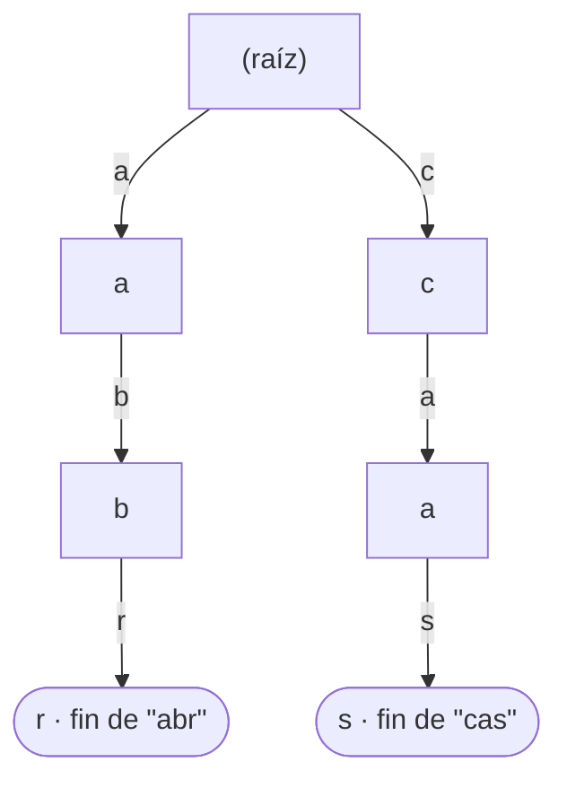

# 02 — Algoritmos de cadenas

> Buscar un patrón dentro de un texto: la versión ingenua y por qué basta casi siempre, KMP y
> su tabla de prefijos, Rabin-Karp con hash rodante, Boyer-Moore y por qué es el que usan las
> herramientas reales, el trie para prefijos y la distancia de edición para "parecido".
> Asume leído [`01` — Strings](01-strings-entre-lenguajes.md).
>
> **Vigencia:** 2026-09-18.

---

## 1. 🎯 El problema

Buscar `"abra"` dentro de `"abracadabra"` parece trivial, y la solución obvia funciona: pruebas
en cada posición y comparas. El problema es cuánto trabajo repites.

```text
texto:   a b r a c a d a b r a
patrón:  a b r a                    ✓ en 0
           a b r a                  falla en la 1ª letra
             a b r a                falla en la 1ª letra
                 ...
                     a b r a        ✓ en 7
```

Con este texto no se nota. Con `"aaaaaaaaaa…a"` buscando `"aaaaab"`, la ingenua compara casi
todo el patrón en cada posición antes de fallar: **O(n·m)**, y con un texto de un millón y un
patrón de mil, son mil millones de comparaciones.

La observación que da origen a todo el capítulo es esta: **cuando el patrón falla en la
posición k, ya sabes qué hay en las k-1 primeras letras del texto**. Tirar esa información y
volver a empezar una posición más adelante es lo que hace lenta a la ingenua.

> **Regla de entrevista:** empieza por la ingenua, di que es O(n·m) y di **cuándo basta**.
> Saltar directamente a KMP sin haber justificado que hace falta es una señal de haber
> estudiado para el examen.

---

## 2. 🧱 La búsqueda ingenua, y por qué casi siempre basta

**Qué es.** Probar el patrón en cada una de las n-m+1 posiciones del texto.

**Cuánto.** O(n·m) en el peor caso, pero **O(n) en el caso medio con texto natural**: el
primer carácter falla casi siempre, así que el bucle interno casi nunca avanza.

**Cuándo sí.** Casi siempre. Es lo que hay detrás de `String.indexOf` en Java, y no es un
descuido: con alfabetos grandes y texto real, el caso peor no se da. La implementación de la
JDK es ingenua con una optimización de primer carácter.

**Cuándo no.** Con alfabetos pequeños y mucha repetición —ADN con cuatro letras, cadenas
binarias, logs con patrones repetidos— donde el peor caso sí aparece; o cuando buscas el mismo
patrón en muchos textos, o muchos patrones en el mismo texto.

> **Veredicto:** la ingenua es la respuesta correcta por defecto y la referencia contra la que
> se justifica cualquier otra. Decir "`indexOf` es ingenuo y está bien" demuestra que has
> mirado la implementación, no que no conoces KMP.

---

## 3. 🧱 KMP y la tabla de prefijos

**Qué es.** Knuth-Morris-Pratt: precalcula, para cada posición del **patrón**, cuánto puede
saltar sin volver a mirar el texto. El puntero del texto **nunca retrocede**.

**Cómo va.** La tabla responde: *"si fallo aquí, ¿cuál es el prefijo más largo de lo que
llevo que es también sufijo de lo que llevo?"*. Sobre `"abra"`:

```text
patrón:   a  b  r  a
índice:   0  1  2  3
tabla:    0  0  0  1     ← la 'a' final coincide con la 'a' inicial
```

- Si fallas en el índice 3 —llevas `"abr"` bien y la cuarta letra no cuadra— la tabla dice 0:
  vuelves al principio del patrón sin mover el texto.
- Si fallas **después** de haber consumido `"abra"`, la tabla dice 1: ya tienes una `a`
  válida, así que sigues desde el índice 1 del patrón. Ese 1 es lo que permite encontrar la
  ocurrencia en 7 sin releer nada.
- La tabla se construye en O(m) con el propio patrón comparado consigo mismo, que es la parte
  que cuesta entender y la que preguntan.

**Cuánto.** O(n + m) en tiempo garantizado, O(m) en espacio. Sin caso peor.

**Cuándo sí.** Alfabetos pequeños con repetición, garantías de peor caso, procesamiento en
flujo donde no puedes retroceder sobre el texto.

**Cuándo no.** En texto natural, donde no gana nada a la ingenua y cuesta cincuenta líneas más
que hay que mantener y probar.

> ⚠️ **Advertencia.** Casi todo el mundo "sabe" KMP y casi nadie sabe construir la tabla bajo
> presión. Si vas a nombrarlo, prepara la construcción de la tabla sobre `"abra"` o sobre
> `"aabaaa"`: es exactamente lo que te van a pedir después de nombrarlo.

---

## 4. 🧱 Rabin-Karp y el hash rodante

**Qué es.** Comparar **hashes** en vez de cadenas. El truco está en que el hash de la ventana
siguiente se calcula a partir del anterior en O(1).

**Cómo va.** Un hash polinómico donde quitar el carácter que sale y añadir el que entra es
aritmética simple:

```text
hash("abr") = a·B² + b·B + r
hash("bra") = (hash("abr") - a·B²)·B + a     ← O(1), no O(m)
```

- Es la misma idea de la ventana deslizante de
  [`01-fundamentos/03`](../01-fundamentos/03-arrays-listas-y-secuencias.md): no recalcules,
  actualiza.
- **Un hash igual no garantiza cadenas iguales**: hay que verificar carácter a carácter cuando
  coinciden. Esa verificación es lo que hace que el peor caso siga siendo O(n·m).
- El módulo primo grande es lo que hace raras las colisiones. Con un módulo mal elegido, un
  adversario puede provocarlas y degradar el algoritmo a propósito.

**Cuánto.** O(n + m) esperado, O(n·m) en el peor caso por colisiones.

**Cuándo sí.** Su ventaja real no es buscar un patrón: es buscar **muchos patrones a la vez**
—metes todos sus hashes en un conjunto y recorres el texto una sola vez— y detectar
duplicados o plagio comparando huellas de bloques.

**Cuándo no.** Para un solo patrón con garantía de peor caso: para eso está KMP, que no
depende de la suerte.

> **Veredicto:** Rabin-Karp gana cuando hay muchos patrones o cuando lo que quieres es una
> huella reutilizable del contenido. Para "busca esta palabra", es más maquinaria de la
> necesaria.

---

## 5. 🧱 Boyer-Moore, el que usan las herramientas de verdad

**Qué es.** Comparar el patrón **de derecha a izquierda** y usar el fallo para saltar varias
posiciones de golpe.

**Cómo va.** Dos heurísticas, y con la primera basta para explicarlo:

- **Carácter malo.** Si el carácter del texto que no cuadra **no está en el patrón**, puedes
  saltar el patrón entero: ninguna alineación que lo incluya puede funcionar.
- **Sufijo bueno.** Si la parte del final que sí coincidía aparece en otro sitio del patrón,
  alinéala ahí.

```text
texto:   a b r a c a d a b r a
patrón:  a b r a
              ↑ compara la última primero: 'a' vs 'c' → 'c' no está en "abra"
                → salta 4 posiciones de una vez
```

**Cuánto.** O(n/m) en el caso mejor —**sublineal**, no mira todos los caracteres—, O(n + m) en
el medio con la variante Boyer-Moore-Horspool, O(n·m) en el peor sin la heurística de sufijo.

**Cuándo sí.** Patrones largos y alfabetos grandes: cuanto más largo el patrón, más saltas.
Es lo que hay detrás de `grep`, y la razón de que buscar una frase larga en un archivo enorme
sea instantáneo.

**Cuándo no.** Patrones cortos, donde el salto máximo es pequeño y no compensa el
precálculo.

> 🧠 **Modelo mental.** KMP nunca retrocede en el texto; Boyer-Moore **se salta** trozos del
> texto sin mirarlos. Esa frase distingue los dos y es la respuesta a "¿en qué se diferencian?".

---

## 6. 🧱 Trie, para prefijos

**Qué es.** Un árbol donde cada arista es un carácter y cada camino desde la raíz es un
prefijo. Buscar una palabra es bajar por sus letras.



**Cuánto.** Búsqueda, inserción y borrado en **O(longitud de la palabra)**, independientemente
de cuántas palabras haya. Espacio: alto, un nodo por prefijo distinto.

**Cuándo sí.** Autocompletado, corrección ortográfica, enrutamiento por prefijo de IP,
diccionarios con consultas de prefijo, y el algoritmo de Aho-Corasick para buscar muchos
patrones a la vez.

**Cuándo no.** Cuando solo necesitas pertenencia exacta: un `HashSet` es O(1) y ocupa mucho
menos. Y para autocompletar unas pocas miles de entradas, un `TreeMap` con `subMap(prefijo,
prefijo + '￿')` te da el rango sin escribir una sola clase.

> **Veredicto:** el trie es la respuesta correcta a "autocompletar sobre millones de términos"
> y una sobreingeniería sobre miles. Nombrar la alternativa de `TreeMap` antes de
> implementarlo es lo que demuestra criterio.

---

## 7. 🧱 Distancia de edición

**Qué es.** El número mínimo de operaciones —insertar, borrar, sustituir— para convertir una
cadena en otra. También se llama distancia de Levenshtein.

**Cómo va.** Una matriz de (n+1) × (m+1) donde cada celda se calcula de tres vecinas:

```text
           ""  c  a  s  a
       ""   0  1  2  3  4
        c   1  0  1  2  3
        o   2  1  1  2  3
        s   3  2  2  1  2
        a   4  3  3  2  1     ← "cosa" → "casa" = 1 sustitución
```

- Si los caracteres coinciden, se copia la diagonal; si no, es 1 + el mínimo de las tres
  vecinas (arriba, izquierda, diagonal).
- Es **programación dinámica** de manual, y su desarrollo completo está en
  [`05-dp-y-tecnicas/01`](../05-dp-y-tecnicas/01-programacion-dinamica.md).

**Cuánto.** O(n·m) en tiempo y O(n·m) en espacio, reducible a **O(mín(n, m))** guardando solo
dos filas — a costa de no poder reconstruir las operaciones.

**Cuándo sí.** Sugerencias de "¿quisiste decir…?", deduplicación de nombres, corrección de
OCR, comparación difusa de registros de clientes.

**Cuándo no.** Contra un diccionario grande, calcularla contra cada palabra es inviable:
ahí se usa un índice por trie con poda, o un BK-tree.

> 💡 **Truco.** Para comparar nombres de personas, la distancia de edición pura da malos
> resultados con apellidos compuestos y con acentos. En la práctica se combina con
> normalización (capítulo [`01`](01-strings-entre-lenguajes.md)), con umbral relativo a la
> longitud y a veces con algoritmos fonéticos como Soundex o Metaphone.

---

## 8. ⏱️ La tabla de costes

| Algoritmo | Preproceso | Búsqueda | Espacio | Lo que la tabla no dice |
|---|---|---|---|---|
| **Ingenua** | — | O(n·m) peor, O(n) medio | O(1) | Es lo que usa `String.indexOf`, y está bien |
| **KMP** | O(m) | **O(n + m) garantizado** | O(m) | Nunca retrocede en el texto: sirve en flujo |
| **Rabin-Karp** | O(m) | O(n + m) esperado | O(1) | Su ventaja real es **muchos patrones**, no uno |
| **Boyer-Moore** | O(m + alfabeto) | O(n/m) mejor, sublineal | O(m + alfabeto) | El único que no mira todos los caracteres. Es `grep` |
| **Trie** | O(total de letras) | O(longitud de la palabra) | Alto | Independiente del número de palabras almacenadas |
| **Distancia de edición** | — | O(n·m) | O(mín(n, m)) optimizado | Reducir espacio impide reconstruir las operaciones |

---

## 9. ⚖️ Los cinco lenguajes

| Lenguaje | Buscar subcadena | Qué implementa por dentro | El detalle que muerde |
|---|---|---|---|
| **Java** | `indexOf`, `contains` | Ingenua con optimización de primer carácter | No hay KMP en la stdlib. Para trie y Aho-Corasick, biblioteca externa |
| **Python** | `in`, `str.find` | Una mezcla de Boyer-Moore-Horspool y otras heurísticas | `in` sobre strings es notablemente rápido; `difflib` trae comparación difusa |
| **JavaScript** | `includes`, `indexOf` | Depende del motor; V8 usa varias estrategias por longitud | Sin utilidades de distancia de edición en la stdlib |
| **TypeScript** | Igual que JS | Igual que JS | Sin diferencia en runtime |
| **Go** | `strings.Contains`, `strings.Index` | Rabin-Karp para patrones largos, ingenua para cortos | Es el único de los cinco que documenta su algoritmo en el código fuente |

Dos conclusiones que valen como respuesta de entrevista:

- **Ninguno de los cinco expone KMP en su biblioteca estándar.** Si lo necesitas, lo escribes.
  Eso mismo es la señal de que casi nunca hace falta.
- **Todos han optimizado la búsqueda por debajo sin cambiar la API.** La forma correcta de
  usarlos es la evidente, y las optimizaciones a mano suelen perder contra la implementación
  nativa.

---

## 10. 🧭 Cómo se elige

```text
¿Buscar una subcadena, una vez, en texto natural?     → indexOf. No lo pienses más
¿Alfabeto pequeño con mucha repetición (ADN, bits)?   → KMP, por la garantía
¿No puedes retroceder sobre el texto (flujo)?         → KMP
¿Muchos patrones distintos en el mismo texto?         → Rabin-Karp, o Aho-Corasick sobre trie
¿Patrón largo en un archivo enorme?                   → Boyer-Moore (lo que hace grep)
¿Consultas por prefijo, autocompletado?               → trie … o TreeMap.subMap si son pocas
¿"Se parece a"?                                       → distancia de edición con umbral
```

> **Regla de entrevista:** nombra la ingenua, di su coste, y justifica el cambio con el caso
> concreto que la rompe. Un algoritmo sofisticado sin ese caso concreto es sobreingeniería con
> nombre propio.

---

## ⚠️ Errores frecuentes

| Se dice | Lo preciso |
|---|---|
| "`indexOf` usa KMP" | Usa búsqueda ingenua optimizada. Ningún lenguaje de los cinco trae KMP |
| "KMP es siempre mejor" | En texto natural no gana nada y cuesta código. Gana con alfabetos pequeños |
| "Rabin-Karp encuentra el patrón si el hash coincide" | Hay que verificar: un hash igual no implica cadenas iguales |
| "Boyer-Moore y KMP hacen lo mismo" | KMP no retrocede en el texto; Boyer-Moore **se salta** trozos sin mirarlos |
| "Un trie es siempre mejor que un `HashSet`" | Para pertenencia exacta pierde: más memoria y sin ventaja |
| "La distancia de edición sirve para buscar en un diccionario" | Contra cada palabra es inviable. Hace falta un índice con poda |
| "Los anagramas se detectan ordenando" | Funciona, es O(n log n); contar frecuencias es O(n) |

---

## 📚 Para profundizar

- **Libro** — Sedgewick y Wayne, *Algorithms*, 4ª ed. (Addison-Wesley, 2011). Capítulo 5:
  tries, KMP, Boyer-Moore y Rabin-Karp con el código en Java y con el análisis medido.
  **Si solo lees uno de este bloque, lee este.**
- **Libro** — Cormen, Leiserson, Rivest y Stein, *Introduction to Algorithms*, 4ª ed. (MIT
  Press, 2022). Capítulo 32, con la demostración de la corrección de KMP.
- **Libro** — Skiena, *The Algorithm Design Manual*, 3ª ed. (Springer, 2020). Secciones 21.3 y
  21.4, sobre cuándo cada algoritmo de cadenas se justifica de verdad.
- [cp-algorithms — Prefix function (KMP)](https://cp-algorithms.com/string/prefix-function.html):
  la construcción de la tabla explicada paso a paso, que es la parte difícil.
- [cp-algorithms — Rabin-Karp](https://cp-algorithms.com/string/rabin-karp.html):
  el hash rodante con la elección de módulo y base.
- [cp-algorithms — Aho-Corasick](https://cp-algorithms.com/string/aho_corasick.html):
  el trie con enlaces de fallo, para buscar muchos patrones en una pasada.
- [Go — `strings.Index`](https://pkg.go.dev/strings): la documentación del paquete cuyo código
  fuente explica qué algoritmo elige según la longitud del patrón.
- **Video** — WilliamFiset, la serie sobre estructuras de datos de texto (trie, Aho-Corasick),
  con las animaciones que hacen que los enlaces de fallo se entiendan.

---

## 🧠 Preguntas

Sin respuestas aquí. Todas, con enunciado literal y respuesta en tres capas, en
[`05` — Respuestas](05-respuestas.md).

1. ¿Cuál es la complejidad de la búsqueda ingenua en el peor caso y en el medio? 🟢
2. ¿Qué algoritmo usa `String.indexOf` de Java? 🟢
3. ¿Qué complejidad garantiza KMP? 🟢
4. ¿Qué operación hace O(1) el hash rodante de Rabin-Karp? 🟢
5. ¿Qué complejidad tiene buscar una palabra en un trie? 🟢
6. ¿Qué responde la tabla de prefijos de KMP en cada posición? 🟡
7. ¿Por qué KMP nunca retrocede sobre el texto? 🟡
8. ¿Por qué Rabin-Karp tiene que verificar carácter a carácter aunque el hash coincida? 🟡
9. ¿En qué se diferencian KMP y Boyer-Moore en una frase? 🟡
10. ¿Por qué Boyer-Moore puede ser sublineal? 🟡
11. ¿Qué complejidad tiene la distancia de edición y cómo se reduce su espacio? 🟡
12. Construye la tabla de prefijos de KMP para el patrón `"abra"` y explica cada valor. 🟠
13. ¿Por qué la búsqueda ingenua basta en texto natural y falla con ADN? 🟠
14. ¿Cuál es la ventaja real de Rabin-Karp, si para un solo patrón KMP es mejor? 🟠
15. ¿Cuándo un `TreeMap` sustituye a un trie, y cuándo no? 🟠
16. ¿Por qué ningún lenguaje de los cinco trae KMP en su biblioteca estándar? 🟠
17. Detectar si dos palabras son anagramas: da dos soluciones con distinta complejidad. 🟠
18. ¿Cómo comprobarías si una cadena es palíndromo ignorando acentos y mayúsculas? ¿Qué
    capítulo anterior tienes que aplicar? 🟠
19. Te piden "¿quisiste decir…?" sobre un diccionario de 300 000 palabras. ¿Por qué no sirve
    calcular la distancia de edición contra todas? 🟠
20. ¿Por qué reducir el espacio de la distancia de edición a dos filas impide reconstruir las
    operaciones? 🟠
21. ¿Qué pasa si eliges mal el módulo en Rabin-Karp y alguien lo sabe? 🟠
22. Explica el precálculo de Boyer-Moore y por qué el tamaño del alfabeto aparece en su
    complejidad de espacio. 🟠
23. Diseña el autocompletado de un buscador de productos con 2 millones de términos y
    respuesta en menos de 50 ms. Elige estructura y justifica el coste. 🔴
24. Te dan un proceso que busca 5 000 palabras prohibidas en cada mensaje de un chat con
    10 000 mensajes por segundo. Diseña la solución. 🔴
25. Implementa la búsqueda de `"abra"` en `"abracadabra"` con KMP y traza el valor de los dos
    punteros en cada paso. 🔴

---

**Anterior:** [`01` — Strings](01-strings-entre-lenguajes.md) ·
**Siguiente:** [`03` — Expresiones regulares](03-expresiones-regulares.md) ·
**Relacionado:** [`04-arboles-grafos/01` — Árboles](../04-arboles-grafos/01-arboles.md)
