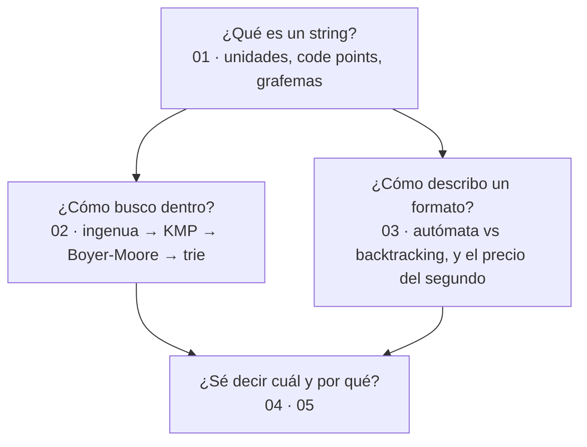

# 02 — Texto

> El bloque de strings, búsqueda de patrones y expresiones regulares. Es el más **comparativo**
> de los cinco: casi todas sus preguntas tienen cinco respuestas distintas según el lenguaje, y
> ahí está su valor frente a cualquier libro de algoritmos.
>
> **Vigencia:** 2026-09-18. · **Guía editorial:** [`prompts/guia-de-estilo-y-convenciones.md`](../prompts/guia-de-estilo-y-convenciones.md)

---

## Qué es esto

Tres capítulos que responden a tres preguntas que parecen triviales y no lo son: **qué es un
string**, **cómo se busca dentro de él** y **cuánto puede costar una expresión regular**.

```text
Un curso de algoritmos → te enseña KMP y su demostración.
Este repaso            → te enseña por qué indexOf no usa KMP, y cuándo eso deja de bastar.
```

Las preguntas **no llevan la respuesta al lado**: viven en [`05-respuestas.md`](05-respuestas.md).

---

## Orden de lectura

| # | Documento | Qué cubre |
|---|---|---|
| `01` | [Strings: el modelo y sus diferencias entre lenguajes](01-strings-entre-lenguajes.md) | Inmutabilidad, unidad de indexación, grafemas y code points, `StringBuilder`, normalización, `Collator` |
| `02` | [Algoritmos de cadenas](02-algoritmos-de-cadenas.md) | Ingenua, KMP, Rabin-Karp, Boyer-Moore, trie, distancia de edición |
| `03` | [Expresiones regulares](03-expresiones-regulares.md) | Backtracking vs autómata, greedy/lazy/posesivo, **ReDoS**, cuándo no usar regex |
| `04` | [Simulación de entrevista](04-simulacion-de-entrevista.md) | 32 preguntas transversales + 4 problemas de pizarra |
| `05` | [Respuestas](05-respuestas.md) | Solucionario completo del bloque, en tres capas |

**Si el calendario aprieta**, `01` y `03` son los que más aparecen en una entrevista de backend:
el primero porque sus bugs son diarios, el tercero porque el ReDoS es una pregunta de seguridad
además de una de algoritmos. `02` es el que más se parece a un examen de universidad y el que
menos se pregunta fuera de las empresas que hacen prueba de código.

---

## Mapa mental del bloque



---

## Las tres cosas que este bloque deja claras

1. **"Cuántos caracteres" es una pregunta ambigua.** Java y JavaScript cuentan unidades UTF-16,
   Python code points, Go bytes, y ninguno cuenta lo que el usuario ve.
2. **`indexOf` es ingenuo y está bien.** Lo que hay que saber justificar es cuándo deja de
   bastar, y el criterio es el tamaño del alfabeto, no el del texto.
3. **Una regex tiene peor caso exponencial** en cuatro de los cinco lenguajes. Go es la
   excepción, y perdió las retrorreferencias a cambio.

---

## Qué NO está aquí

- **Complejidad, TDAs y técnicas sobre secuencias** → bloque
  [`01-fundamentos`](../01-fundamentos/), que este asume leído.
- **El trie desarrollado como estructura de árbol** → se introduce aquí para prefijos y se
  desarrolla en [`04-arboles-grafos`](../04-arboles-grafos/).
- **La distancia de edición como programación dinámica** → aquí se usa; la técnica está en
  [`05-dp-y-tecnicas`](../05-dp-y-tecnicas/).
- **El código implementado en los cinco lenguajes** → bloque opcional
  [`09-implementaciones`](../09-implementaciones/).
- **Internacionalización, locales y formateo de fechas** → no son de este corpus.
