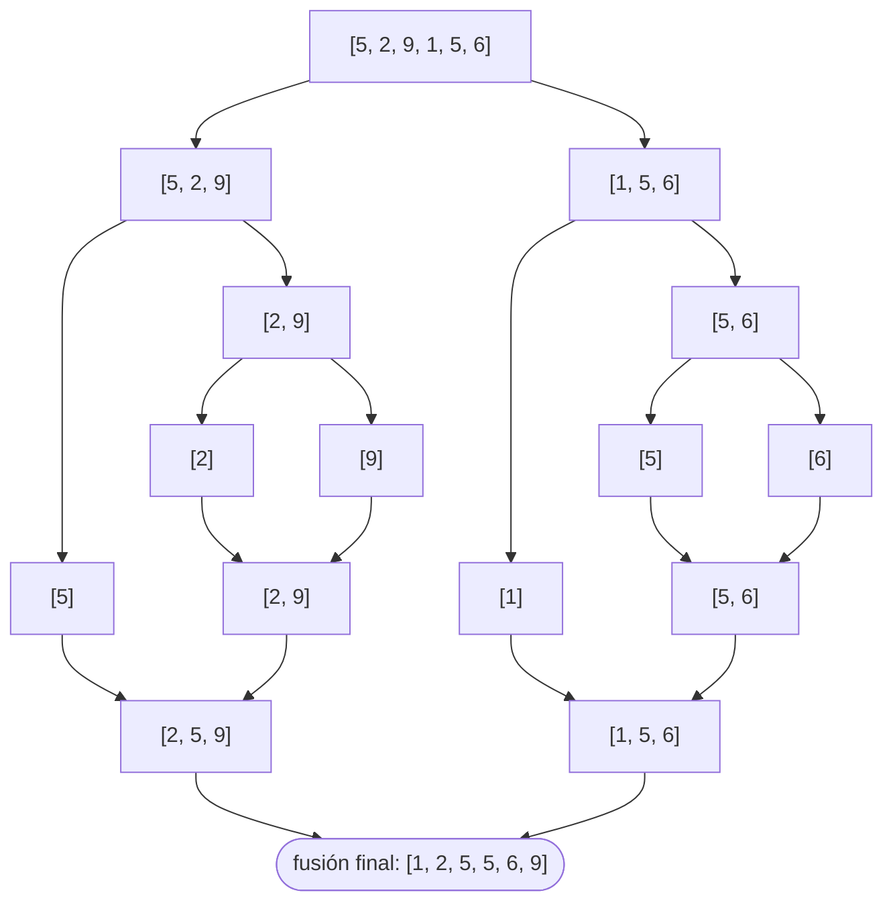
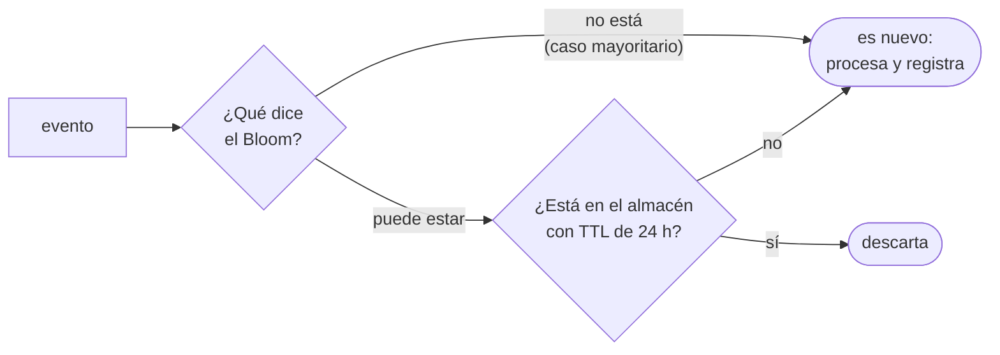
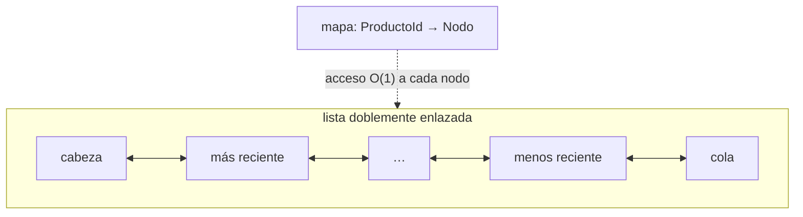

# 08 — Respuestas

> Solucionario centralizado del bloque `03-orden-busqueda`. Cada respuesta en tres capas:
> **⏱️ 30 segundos**, **🗣️ 2 minutos** y **🔬 El detalle**. Los enunciados están copiados
> literalmente de su capítulo.
>
> **Vigencia:** 2026-09-18.

**Salto rápido:**
[01](#01--ordenación) · [02](#02--comparadores-y-orden-total) · [03](#03--búsqueda) ·
[04](#04--hashing-y-tablas-hash) · [05](#05--intervalos-y-barrido-de-eventos) ·
[06](#06--algoritmos-sobre-flujos) ·
[07 — transversales](#07--simulación-preguntas-transversales) ·
[07 — pizarra](#07--simulación-problemas-de-pizarra)

---

# 01 — Ordenación

**01 → 1. ¿Qué significa que un algoritmo de ordenación sea estable?**

⏱️ Que los elementos con la misma clave conservan su orden relativo original.
🗣️ Es lo que permite ordenar por varios criterios en pasadas sucesivas: ordenas por importe y
después por fecha, y dentro de cada fecha los importes siguen en orden. Sin estabilidad, la
segunda pasada destruye el trabajo de la primera.
🔬 Es también lo que hace funcionar a radix sort: cada pasada por un dígito tiene que preservar
el orden que estableció la anterior. Sin estabilidad, radix sort simplemente no ordena.

**01 → 2. ¿Qué significa in-place y qué algoritmo lo cumple estrictamente?**

⏱️ Que usa O(1) de espacio auxiliar. Heapsort lo cumple estrictamente; quicksort no del todo.
🗣️ Quicksort no reserva arreglos, pero consume O(log n) de pila de recursión, así que la
convención de llamarlo in-place es laxa. Heapsort construye el heap dentro del mismo arreglo y
extrae in situ, sin recursión.
🔬 Decir ese matiz antes de que te lo busquen es lo que puntúa: *"quicksort es in-place salvo por
la pila de recursión, que es O(log n) si las particiones están equilibradas"*.

**01 → 3. ¿Cuál es la complejidad de merge sort en el mejor, medio y peor caso?**

⏱️ Θ(n log n) en los tres. Es su característica: no tiene caso malo.
🗣️ La división es siempre por la mitad, independientemente de los datos, y la fusión siempre
recorre los n elementos. Por eso no hay variación entre casos, a diferencia de quicksort.
🔬 El precio es O(n) de espacio auxiliar, que sí es constante y no se puede evitar de forma
barata. Existen merge sorts in-place, pero con constantes tan malas que nadie los usa.

**01 → 4. ¿Cuál es el peor caso de quicksort y qué entrada lo provoca con el pivote ingenuo?**

⏱️ O(n²), y lo provoca un arreglo **ya ordenado** si el pivote es el primer o el último
elemento.
🗣️ Con ese pivote, la partición deja n-1 elementos a un lado y ninguno al otro, así que la
recursión tiene profundidad n en vez de log n. La ironía es que el caso más frecuente en
producción —datos que llegan casi ordenados— es el peor caso del algoritmo.
🔬 Las tres defensas históricas: mediana de tres, que elimina ese caso concreto; pivote
aleatorio, que lo hace imposible de provocar a propósito; e introsort, que cambia a heapsort si
la recursión se pasa de 2·log n y convierte el peor caso en O(n log n) garantizado.

**01 → 5. ¿Qué algoritmo usa `Arrays.sort` sobre un `int[]`? ¿Y sobre un `Object[]`?**

⏱️ Dual-Pivot Quicksort para primitivos, TimSort para objetos.
🗣️ La diferencia es la estabilidad: dos `int` con el mismo valor son indistinguibles, así que la
estabilidad no significa nada y se puede usar el algoritmo más rápido. Dos objetos que un
comparador considera iguales **sí** pueden ser distinguibles, así que hace falta preservar su
orden.
🔬 Es de las mejores respuestas que se pueden dar en este tema porque explica una decisión de
diseño, no un dato memorizado. Y explica de paso un comportamiento que la gente descubre por
accidente: que `Arrays.sort` tiene dos garantías distintas según lo que le pases.

**01 → 6. ¿Por qué insertion sort sigue usándose?**

⏱️ Porque es O(n) con datos casi ordenados y tiene una constante minúscula con pocos elementos.
🗣️ Ambas condiciones se dan **dentro** de otros algoritmos: TimSort lo usa para extender los
tramos cortos hasta 32–64 elementos, y las implementaciones de quicksort cambian a él por debajo
de un umbral. Se ejecuta cientos de veces por segundo sin que nadie lo llame directamente.
🔬 Bubble sort y selection sort no tienen ningún caso donde ganen: insertion los domina en todos
los escenarios. La respuesta correcta sobre ellos es exactamente esa.

**01 → 7. ¿Por qué merge sort es el algoritmo de la ordenación externa?**

⏱️ Porque la fusión solo necesita leer **secuencialmente**, que es lo único barato en disco.
🗣️ Fusionar k secuencias ordenadas requiere mantener una cabeza de cada una y avanzar: lectura
secuencial pura, sin saltos. Quicksort particiona, lo que exige saltar por todo el arreglo, y en
disco cada salto cuesta órdenes de magnitud más que una lectura contigua.
🔬 El algoritmo completo de la ordenación externa es: leer bloques que quepan en memoria,
ordenarlos en memoria y escribirlos como tramos; después fusionar los tramos de k en k con un
heap de cabezas. Es lo que hace un `ORDER BY` cuando el conjunto no cabe en `work_mem`.

**01 → 8. ¿Qué tres propiedades tiene TimSort que lo hacen la elección por defecto?**

⏱️ Estable, O(n log n) garantizado, y **O(n) cuando los datos ya están casi ordenados**.
🗣️ La tercera es la que lo hace ganar en la práctica: Tim Peters partió de la observación de que
los datos reales casi nunca están desordenados del todo. TimSort busca tramos ya ordenados,
extiende los cortos con insertion sort y fusiona con merge sort.
🔬 El precio es O(n) de espacio, heredado del merge sort. Y por eso Java no lo usa con
primitivos: ahí la estabilidad no aporta nada y el espacio sí cuesta.

**01 → 9. ¿Por qué heapsort es más lento que quicksort si ambos son O(n log n)?**

⏱️ Por la localidad de caché: el heap salta entre las posiciones i, 2i+1 y 2i+2, que están muy
separadas.
🗣️ Quicksort recorre el arreglo secuencialmente durante la partición, así que la caché le sirve
casi todos los accesos. Heapsort, con un arreglo grande, falla en caché constantemente. La
complejidad es la misma y la constante no.
🔬 Es el mismo fenómeno del arreglo contra la lista enlazada de
`01-fundamentos/03`: el modelo de coste de O grande asume que todos los accesos a memoria valen
lo mismo, y en hardware real no es así.

**01 → 10. ¿Por qué counting sort no incumple la cota Ω(n log n)?**

⏱️ Porque esa cota solo aplica a los algoritmos que ordenan **comparando pares**, y counting
sort no compara: usa el valor como índice.
🗣️ El argumento de la cota es de teoría de la información: hay n! ordenaciones posibles y cada
comparación aporta un bit, así que hacen falta log₂(n!) ≈ n log n comparaciones. Counting sort
juega a otro juego y por eso no le aplica.
🔬 El precio es que solo funciona con claves que se puedan usar como índice y en un rango
acotado: O(n + k), y con k grande el término del rango domina. Ordenar enteros de 32 bits
arbitrarios exigiría un arreglo de 4 000 millones de posiciones.

**01 → 11. ¿Por qué radix sort necesita que counting sort sea estable?**

⏱️ Porque cada pasada ordena por un dígito y tiene que **preservar** el orden que establecieron
las pasadas anteriores.
🗣️ Radix sort procesa del dígito menos significativo al más significativo. Cuando ordena por las
decenas, los números que empatan en decenas deben quedar en el orden que les dio la pasada de
las unidades. Sin estabilidad, esa información se pierde y el resultado es incorrecto.
🔬 Es el mejor ejemplo de que la estabilidad no es una comodidad sino un requisito funcional de
otro algoritmo. Cuando alguien pregunta "¿para qué sirve la estabilidad?", radix sort es la
respuesta que no admite discusión.

**01 → 12. ¿Qué es introsort y qué problema resuelve?**

⏱️ Un híbrido que empieza con quicksort y cambia a heapsort si la recursión se pasa de 2·log n.
🗣️ Resuelve el peor caso de quicksort sin renunciar a su velocidad media. Mientras las
particiones son razonables, corre quicksort; cuando detecta que están degenerando, el heapsort
garantiza O(n log n) para el resto.
🔬 Es el algoritmo de `std::sort` en C++ y la idea que está detrás de las protecciones de
`Arrays.sort` en Java 14+ y de pdqsort en Go y Rust. El patrón general —empezar con lo rápido y
tener un plan B garantizado— aparece también en las tablas hash con la treeification.

**01 → 13. ¿Por qué Java usa un algoritmo distinto para primitivos y para objetos?**

⏱️ Porque la estabilidad solo significa algo con objetos.
🗣️ Dos `int` con valor 5 son indistinguibles: da igual cuál quede antes, así que se puede usar el
algoritmo más rápido y sin memoria extra, que es Dual-Pivot Quicksort. Dos objetos que el
comparador considera iguales pueden diferir en otros campos, y el usuario espera que su orden
relativo se preserve.
🔬 Hay un segundo motivo, de memoria: TimSort necesita O(n) auxiliar, y sobre un `int[]` de
millones de elementos eso es un coste real que no compra nada. Nombrar los dos motivos es la
respuesta completa.

**01 → 14. ¿Existe un algoritmo estable, in-place y O(n log n)? Responde con matiz.**

⏱️ Existe en teoría, no en la práctica: las constantes lo hacen inútil.
🗣️ Hay merge sorts estables e in-place publicados (block sort, WikiSort), con complejidad
correcta. Pero su constante es tan alta que pierden contra TimSort con O(n) de memoria en
cualquier caso realista, así que ninguna biblioteca estándar los usa.
🔬 La consecuencia práctica es que **elegir es obligatorio**: o pagas O(n) de memoria para tener
estabilidad, o renuncias a la estabilidad para tener memoria constante. Reconocer que es un
compromiso real y no una carencia de las bibliotecas es lo que demuestra criterio.

**01 → 15. ¿Por qué el pivote aleatorio es mejor que la mediana de tres, si ambos evitan el peor caso?**

⏱️ Porque la mediana de tres es **determinista**: un adversario que conozca la implementación
puede construir la entrada que la rompe.
🗣️ La mediana de tres elimina el caso del arreglo ordenado, que es el accidental. No elimina el
caso deliberado: existen generadores que construyen entradas cuadráticas para cualquier regla
fija de elección de pivote. El pivote aleatorio hace que el peor caso dependa de una moneda que
el atacante no controla.
🔬 Es el mismo razonamiento que la aleatorización del hash de los strings en Python, y que el
recorrido aleatorio de los mapas en Go: **cuando la entrada puede ser hostil, la
imprevisibilidad es una propiedad de seguridad**. En un sistema que ordena datos internos, la
mediana de tres basta.

**01 → 16. Te dan un millón de edades para ordenar. Elige el algoritmo y justifica.**

⏱️ Counting sort: el rango es 0–120, minúsculo, y da O(n + k) lineal.
🗣️ Con k = 121, el arreglo de conteos ocupa nada y el algoritmo hace dos pasadas sobre el millón
de elementos. Cualquier algoritmo por comparación haría 20 millones de comparaciones; counting
sort hace dos millones de operaciones simples.
🔬 El detalle que hay que confirmar: si lo que se ordena son **personas por edad** y no edades
sueltas, hay que usar la versión estable de counting sort —con sumas acumuladas, recorriendo al
revés— o el orden relativo dentro de cada edad se pierde. Y si el campo pudiera traer valores
sucios, hay que acotar el rango antes de indexar, o el arreglo se desborda.

**01 → 17. Te dan un millón de nombres de clientes para ordenar. Elige y justifica la diferencia con la anterior.**

⏱️ El `sort` de la biblioteca —TimSort—, con un `Collator` como comparador.
🗣️ Aquí no hay rango acotado ni clave numérica: counting sort no aplica. Y el orden correcto no
es el natural por code point, que pone `"Zoe"` antes que `"ángel"`: hace falta un colador con
locale, que es lo que espera el usuario.
🔬 El coste del `Collator` es real —es varias veces más lento que `compareTo`— y por eso conviene
el patrón decorar-ordenar-desdecorar: calcular una vez la `CollationKey` de cada nombre y
ordenar por ella. Con un millón de elementos, eso convierte n log n llamadas caras en n llamadas
caras más n log n comparaciones baratas.

**01 → 18. ¿Qué devuelve `[10, 9, 1].sort()` en JavaScript y por qué?**

⏱️ `[1, 10, 9]`, porque sin comparador convierte los elementos a string y ordena
lexicográficamente.
🗣️ `"10" < "9"` porque compara carácter a carácter y `'1' < '9'`. Está en la especificación desde
el principio, así que no es un bug del motor. La forma correcta es `sort((a, b) => a - b)`.
🔬 Además `sort()` **muta el arreglo original** y devuelve la misma referencia, lo que sorprende a
quien viene de lenguajes con colecciones inmutables. Desde ES2023 existe `toSorted()`, que
devuelve una copia. Y desde ES2019 la ordenación está garantizada como estable por
especificación; antes dependía del motor y del tamaño del arreglo.

**01 → 19. ¿Por qué `slices.Sort` de Go no es estable y qué haces si necesitas que lo sea?**

⏱️ Porque usa pdqsort, una variante de quicksort. Para estabilidad, `slices.SortStableFunc`.
🗣️ Go eligió por defecto el algoritmo más rápido y sin memoria extra, y ofrece la versión estable
como función aparte. Es lo contrario de Java, que decide por ti según el tipo.
🔬 La consecuencia práctica: si ordenas por un criterio y después por otro esperando conservar el
primero, `slices.Sort` te dará un resultado distinto en cada ejecución potencialmente. La
alternativa idiomática en Go no es ordenar dos veces, es **un solo comparador con `cmp.Or`** que
incluya los dos criterios.

**01 → 20. Ordenas por importe y después por fecha, en dos pasadas, y el resultado sale mal. Explica la causa.**

⏱️ El algoritmo de la segunda pasada no es estable, así que destruyó el orden por importe dentro
de cada fecha.
🗣️ La técnica de ordenar en pasadas sucesivas —de menos importante a más importante— solo
funciona si todas las pasadas son estables. Con una pasada inestable, los elementos que empatan
en fecha quedan en un orden arbitrario que ya no refleja el importe.
🔬 La corrección tiene dos formas: usar un `sort` estable, o —mejor— **un solo comparador
encadenado**, `comparing(Pedido::fecha).thenComparing(Pedido::importe)`, que no depende de la
estabilidad en absoluto y hace una sola pasada. La segunda es preferible porque expresa la
intención y no un detalle del algoritmo.

**01 → 21. ¿Cuándo NO deberías ordenar aunque el enunciado diga "ordena"?**

⏱️ Cuando solo necesitas los k mayores o el k-ésimo elemento.
🗣️ Ordenar es O(n log n). Un heap acotado a k da el top-K en O(n log k), y quickselect da el
k-ésimo en O(n) esperado. Con n = 10 millones y k = 100, la diferencia es de dos órdenes de
magnitud.
🔬 También cuando lo que quieres es el mínimo o el máximo —un recorrido es O(n)—, o cuando la
estructura que consume el resultado no necesita orden total. La mitad de los problemas que
parecen de ordenación son de **selección**, y preguntarlo en voz alta antes de elegir el
algoritmo es lo que puntúa.

**01 → 22. ¿Qué pasa si tu comparador no es transitivo y llamas a `Collections.sort`?**

⏱️ Java lanza `IllegalArgumentException: Comparison method violates its general contract!`, con
listas de más de 32 elementos.
🗣️ TimSort se apoya en la coherencia del comparador para fusionar tramos. Cuando detecta una
contradicción, prefiere fallar a devolver una lista mal ordenada en silencio. Con menos de 32
elementos usa insertion sort, que no comprueba nada, y por eso el bug no aparece en test.
🔬 Se desarrolla entero en [`02`](02-comparadores-y-orden-total.md). Lo importante es que Java es
el único de los cinco lenguajes que **avisa**: Python, JavaScript y Go ordenan mal sin decir
nada.

**01 → 23. Diseña la ordenación de un archivo de 100 GB de registros en una máquina con 8 GB de RAM. Describe las fases y su coste.**

⏱️ Ordenación externa por fusión: fase de tramos ordenados, y fase de fusión múltiple con un
heap.
🗣️ Fase 1: leer bloques de unos 4 GB, ordenarlos en memoria con el `sort` de la plataforma y
escribirlos a disco como tramos. Salen unos 25 tramos. Fase 2: fusionar los 25 tramos leyendo un
búfer de cada uno y usando un **min-heap de 25 cabezas** para elegir siempre el menor.

```text
Fase 1:  100 GB / 4 GB = 25 tramos      →  lectura + ordenación + escritura = O(n log m)
Fase 2:  fusión de 25 vías con heap     →  O(n log 25), una pasada
Total:   2 lecturas y 2 escrituras de 100 GB. El tiempo es de E/S, no de CPU
```

🔬 Los detalles que preguntan después. **Por qué un heap y no comparar 25 cabezas linealmente**:
25 comparaciones por elemento contra log₂(25) ≈ 5. **Por qué no fusionar de dos en dos**: serían
log₂(25) ≈ 5 pasadas completas sobre 100 GB en vez de una. **Cuántas vías como máximo**: las que
permitan un búfer de lectura decente por tramo; con demasiadas vías, cada búfer es minúsculo y
la lectura deja de ser secuencial, que era todo el punto. Y la observación final: esto es
exactamente lo que hace un `ORDER BY` cuando el conjunto no cabe en `work_mem`, y lo que `sort`
de GNU coreutils hace con `-S`.

**01 → 24. Te piden los 100 productos más vendidos de un catálogo de 10 millones. Da dos soluciones con distinta complejidad y elige.**

⏱️ Ordenar todo y tomar 100, O(n log n); o un min-heap acotado a 100, O(n log 100). Elijo el
heap.
🗣️ Con el heap: recorres los 10 millones una vez; si el heap tiene menos de 100 elementos,
insertas; si no, comparas con la cabeza —el peor de los cien— y solo insertas si lo supera,
expulsando la cabeza. Son 10 millones de comparaciones y como mucho unas pocas inserciones
logarítmicas.

```text
ordenar:  10⁷ · log(10⁷) ≈ 2,3 · 10⁸ operaciones, y O(n) de memoria si hay que copiar
heap:     10⁷ · log(100) ≈ 6,6 · 10⁷ operaciones, y O(100) de memoria
```

🔬 Lo contraintuitivo que hay que explicar: para los **mayores** se usa un **min**-heap, porque
la cabeza tiene que ser el candidato a expulsar. Y la tercera opción, que conviene nombrar:
**quickselect** encuentra el elemento en la posición 100 en O(n) esperado y particiona el
arreglo, lo que da los 100 mayores sin ordenarlos entre sí; si además hay que ordenarlos, se
ordenan esos 100 en tiempo despreciable. Quickselect gana si los datos están en memoria; el heap
gana si llegan como un flujo, porque no necesita tenerlos todos.

**01 → 25. Traza merge sort sobre `[5, 2, 9, 1, 5, 6]` y señala en qué paso se decide la estabilidad.**

⏱️ La estabilidad se decide en la comparación de la fusión: `<=` en vez de `<` al elegir el de la
izquierda.



🗣️ En la fusión final, las cabezas son 2 (izquierda) y 1 (derecha) → sale 1; después 2 → sale 2;
después 5 (izquierda) y 5 (derecha): **aquí se decide**. Si la comparación es `izq <= der`, sale
primero el 5 de la izquierda, que era el que estaba antes en el arreglo original: estable. Si es
`izq < der`, sale el de la derecha y el orden relativo se invierte.
🔬 Ese único carácter es literalmente toda la diferencia entre un merge sort estable y uno que no
lo es, y es la mejor demostración de que la estabilidad no es una propiedad mágica del
algoritmo, sino una decisión concreta en una línea. En el arreglo de juguete de este corpus el
duplicado está ahí precisamente para que esta traza se pueda hacer.

---

# 02 — Comparadores y orden total

**02 → 1. ¿Qué diferencia hay entre `Comparable` y `Comparator`?**

⏱️ `Comparable` define el orden natural del tipo, dentro de la clase; `Comparator` define un
orden concreto, fuera de ella.
🗣️ Un tipo solo puede tener un orden natural y debería tenerlo únicamente si es obvio: un
identificador, una fecha, un importe. Los criterios de negocio —por fecha, por importe, por
cliente— son `Comparator`, y puedes tener tantos como necesites.
🔬 Meter en la clase un orden que depende del contexto convierte una decisión de presentación en
una propiedad del dominio. Si dudas de cuál es "el" orden natural, la respuesta es que no hay y
toca `Comparator`.

**02 → 2. ¿Cuáles son las tres propiedades de un orden total?**

⏱️ Antisimetría, transitividad y coherencia de los empates.
🗣️ Antisimetría: `signo(compare(a,b)) == -signo(compare(b,a))`. Transitividad: si a > b y b > c,
entonces a > c. Coherencia: si `compare(a,b) == 0`, entonces a y b se comparan igual frente a
cualquier tercero.
🔬 Las tres se rompen con errores concretos y frecuentes: la primera con la resta que desborda,
la segunda con el "son parecidos si difieren en menos de X", y la tercera con comparadores que
devuelven 0 por criterios parciales.

**02 → 3. ¿Por qué `(a, b) -> a - b` es un comparador peligroso?**

⏱️ Porque la resta **desborda** con valores extremos y el signo sale al revés.
🗣️ Con `a = Integer.MIN_VALUE` y `b = 1`, la resta desborda y devuelve un positivo, así que el
comparador afirma que el mínimo entero es mayor que 1. Eso rompe la antisimetría y con ella todo
el orden.
🔬 La corrección es `Integer.compare(a, b)`, que cuesta exactamente lo mismo y no puede
desbordar. Es el ítem 14 de *Effective Java* y uno de los errores más repetidos en código real,
porque con datos normales funciona durante años.

**02 → 4. ¿Qué excepción lanza Java cuando un comparador incumple su contrato?**

⏱️ `IllegalArgumentException: Comparison method violates its general contract!`
🗣️ La lanza TimSort cuando, al fusionar tramos, encuentra una contradicción entre comparaciones
previas. Prefiere fallar a devolver una lista mal ordenada.
🔬 Solo aparece con más de 32 elementos, porque por debajo TimSort usa insertion sort y no
comprueba nada. Es la razón de que este bug se manifieste en producción y no en test, y de que
Java sea el único de los cinco lenguajes que avisa.

**02 → 5. ¿Cómo encadenas dos criterios de ordenación en Java moderno?**

⏱️ `Comparator.comparing(...).thenComparing(...)`.
🗣️ Se lee como el `ORDER BY` de SQL y no tiene los errores de transitividad que aparecen al
escribir `if` anidados a mano. Admite `reversed()` para invertir todo y una sobrecarga para
invertir solo un criterio.

```java
Comparator.comparing(Pedido::fecha)
          .thenComparing(Pedido::importe, Comparator.reverseOrder());
```

🔬 Cuidado con `reversed()` al final: invierte **todo el comparador encadenado**, no solo el
último criterio. Para invertir un solo criterio hay que pasarle su propio comparador, como en el
ejemplo. Es un error frecuente y silencioso.

**02 → 6. ¿Por qué un comparador roto no falla en test con listas pequeñas?**

⏱️ Porque con menos de 32 elementos TimSort usa insertion sort, que no valida nada.
🗣️ La validación ocurre en la fase de fusión de tramos, que solo se ejecuta cuando hay varios
tramos que fusionar. Con veinte elementos hay un solo tramo y el comparador roto simplemente
produce un orden incorrecto que nadie comprueba.
🔬 La lección general es que **el umbral de un algoritmo híbrido es también un umbral de
detección de bugs**. Si quieres que tus tests cubran este riesgo, tienen que usar listas de
más de 32 elementos, y conviene decirlo en la revisión de código.

**02 → 7. ¿Qué pasa si `compareTo` devuelve 0 para objetos que `equals` considera distintos?**

⏱️ Que las colecciones ordenadas los tratan como el mismo elemento y los deduplican.
🗣️ `TreeSet` y `TreeMap` usan `compareTo`, no `equals`. Si tu comparador solo mira la fecha, un
`TreeSet<Pedido>` se queda con un pedido por fecha y descarta el resto sin avisar.
🔬 Es un contrato **recomendado pero no obligatorio**, y `BigDecimal` lo rompe a propósito:
`new BigDecimal("1.0").equals(new BigDecimal("1.00"))` es `false` y su `compareTo` devuelve 0,
porque la escala es información significativa para `equals` y no para el orden.

**02 → 8. ¿Por qué `new BigDecimal("1.0")` y `new BigDecimal("1.00")` dan tamaños distintos en un `HashSet` y en un `TreeSet`?**

⏱️ Porque `HashSet` pregunta a `equals` —que distingue la escala— y `TreeSet` pregunta a
`compareTo` —que no—.
🗣️ El `HashSet` acaba con dos elementos y el `TreeSet` con uno, a partir de los mismos objetos.
Es el ejemplo canónico de qué ocurre cuando los dos métodos no coinciden, y está documentado en
la propia API de `BigDecimal`.
🔬 La consecuencia práctica no es académica: si guardas importes en un `Set` para deduplicar,
elegir uno u otro cambia el resultado del negocio. La salida limpia es normalizar la escala antes
de meterlos, o usar un tipo de dinero propio con `equals` y `compareTo` coherentes.

**02 → 9. ¿Qué hace `Comparator.nullsLast` y qué envuelve exactamente?**

⏱️ Envuelve **otro comparador** y coloca los nulos al final, delegando en él para los no nulos.
🗣️ Lo importante es qué envuelve: en `Comparator.comparing(Pedido::fechaEntrega,
Comparator.nullsLast(naturalOrder()))`, el `nullsLast` se aplica al comparador **de la clave
extraída**, no al del pedido. Es la sobrecarga de `comparing` con dos argumentos, y casi nadie
la recuerda.
🔬 La alternativa correcta muchas veces es **no permitir nulos**: si un pedido sin fecha de
entrega no tiene sentido, el problema está aguas arriba y el comparador no es el sitio para
parchearlo.

**02 → 10. ¿Por qué meter un cálculo dentro del comparador es un problema de rendimiento?**

⏱️ Porque el comparador se invoca **n log n veces**, no n veces.
🗣️ Con un millón de elementos son unos 20 millones de invocaciones. Una normalización Unicode, un
`String.format` o —peor— una consulta a base de datos ahí dentro convierte una ordenación de
milisegundos en una de minutos.
🔬 La corrección es el patrón **decorar-ordenar-desdecorar**: calcular la clave una vez por
elemento, ordenar por la clave y descartarla. Es literalmente lo que hace el parámetro `key` de
`sorted()` en Python, y la razón de que exista.

**02 → 11. ¿Cuándo un tipo debería implementar `Comparable` y cuándo no?**

⏱️ Cuando tiene un orden natural obvio y único; no cuando el orden depende del contexto.
🗣️ `ProductoId`, `LocalDate`, `Money` lo tienen. `Pedido` no: ¿por fecha, por importe, por
cliente? Implementar `Comparable` ahí obliga a elegir uno arbitrariamente y confunde a quien lea
el código después.
🔬 Y hay una consecuencia técnica: los tipos `Comparable` se benefician de la treeification de
`HashMap` cuando un bucket se satura, porque el árbol necesita un orden. Es un motivo adicional,
menor, para implementarlo en los tipos que sí tienen orden natural.

**02 → 12. ¿Por qué Python 3 eliminó el parámetro `cmp` y dejó solo `key`?**

⏱️ Por dos motivos: hace imposible escribir un comparador incoherente, y calcula la clave una
sola vez por elemento.
🗣️ Con `key`, tú extraes un valor y Python ordena por el orden natural de ese valor, que ya es
total por construcción. No hay forma de romper la transitividad. Y la extracción se hace n
veces, no n log n.
🔬 Es un buen ejemplo de una API que **elimina una clase entera de errores por diseño** en vez de
documentarlos. Cuando el orden necesita varios criterios, se devuelve una tupla desde `key`, y
las tuplas se comparan lexicográficamente: `key=lambda p: (p.fecha, -p.importe)`.

**02 → 13. ¿Qué es el patrón decorar-ordenar-desdecorar y qué problema resuelve?**

⏱️ Calcular la clave de ordenación una vez por elemento, ordenar por ella y descartarla. Resuelve
el coste del cálculo repetido dentro del comparador.
🗣️ Se "decora" cada elemento con su clave formando un par, se ordena por la clave, y se
"desdecora" quedándose con los elementos. De n log n cálculos se pasa a n.

```java
// Con Collator, que es caro: se calcula la CollationKey una sola vez por nombre
clientes.sort(Comparator.comparing(c -> collator.getCollationKey(c.nombre())));
```

🔬 En Java moderno, `Comparator.comparing` con un extractor **no** implementa por sí solo este
patrón: llama al extractor en cada comparación. Para el patrón real hay que materializar los
pares, o usar `CollationKey`, que es precisamente la clase que existe para esto. En Python, `key`
lo hace de serie.

**02 → 14. Un comparador devuelve 0 cuando dos pesos difieren en menos de 0.01. ¿Qué propiedad rompe y con qué ejemplo concreto?**

⏱️ Rompe la transitividad. Ejemplo: 1.000, 1.005 y 1.011.
🗣️ El comparador dice que 1.000 y 1.005 son iguales (difieren 0.005), y que 1.005 y 1.011 son
iguales (difieren 0.006), pero que 1.000 y 1.011 **no** lo son (difieren 0.011). Si a = b y
b = c, entonces a debería ser igual a c, y no lo es.
🔬 Es el segundo error clásico de este capítulo, y el más difícil de convencer a su autor de que
está mal, porque "tiene sentido" en el dominio. La salida correcta es **redondear los valores
antes de comparar** —lo que convierte la tolerancia en una clave discreta y sí es transitivo— en
vez de meter la tolerancia en la comparación.

**02 → 15. ¿Por qué `TreeSet` puede "perder" elementos que `HashSet` conserva?**

⏱️ Porque deduplica según el comparador, y un comparador parcial considera iguales objetos que
`equals` distingue.
🗣️ Si ordenas pedidos por fecha y los metes en un `TreeSet` con ese comparador, te quedas con un
pedido por fecha. El `TreeSet` no está roto: está haciendo exactamente lo que le pediste, porque
para él "orden" e "igualdad" son la misma relación.
🔬 La corrección es que el comparador **desempate hasta ser total**: añadir el identificador como
último criterio con `thenComparing(Pedido::id)` garantiza que dos pedidos distintos nunca
comparen 0. Es la misma regla que hace falta en una paginación estable.

**02 → 16. Ordenas por fecha y dentro de cada fecha por importe descendente. Escribe el comparador y di qué pasa si el `sort` no es estable.**

⏱️ `comparing(Pedido::fecha).thenComparing(Pedido::importe, reverseOrder())`. Con un comparador
encadenado, **la estabilidad deja de importar**.

```java
Comparator<Pedido> orden = Comparator
        .comparing(Pedido::fecha)
        .thenComparing(Pedido::importe, Comparator.reverseOrder());
```

🗣️ Ese es justamente el punto: al expresar los dos criterios en un solo comparador, el resultado
no depende de una propiedad del algoritmo. Si en cambio ordenaras en dos pasadas —primero por
importe, después por fecha—, necesitarías obligatoriamente estabilidad, y en Go con
`slices.Sort` no la tendrías.
🔬 El detalle que muerde: `reversed()` al final del encadenamiento invertiría **los dos**
criterios, no solo el importe. Por eso el `reverseOrder()` va como segundo argumento de
`thenComparing`, aplicado solo a esa clave.

**02 → 17. ¿Por qué el orden de una columna de base de datos puede no coincidir con el de tu comparador Java, y qué consecuencias tiene?**

⏱️ Porque la base ordena según la **colación** de la columna y Java según `compareTo` o el
`Collator` que le pongas, y no tienen por qué coincidir.
🗣️ Una columna con colación `es_ES` pone `"ñu"` después de `"nube"`; el `compareTo` de Java lo
pone al final del alfabeto, después de la `z`. Y muchas colaciones son insensibles a mayúsculas
y a acentos, mientras que `compareTo` no lo es en absoluto.
🔬 La consecuencia real y difícil de diagnosticar es la **paginación**: si la primera página la
ordena la base y el código reordena en memoria, o si distintos nodos aplican criterios distintos,
un registro puede aparecer en dos páginas o en ninguna. La regla práctica es **ordenar en un
solo sitio**, y si es en la base, no reordenar después.

**02 → 18. ¿Qué diferencia hay entre `slices.Sort` y `slices.SortStableFunc` en Go, y cuándo importa?**

⏱️ La primera usa pdqsort y no es estable; la segunda garantiza estabilidad a cambio de ser más
lenta y usar memoria.
🗣️ Importa cuando ordenas por un criterio esperando conservar un orden previo, que es el patrón
de las pasadas sucesivas. En Go ese patrón es frágil por defecto, y el idioma local es distinto:
un solo comparador con todos los criterios, encadenados con `cmp.Or`.
🔬 Es la decisión opuesta a la de Java, que elige por ti según el tipo. Go prefiere que el
programador declare lo que necesita: por defecto lo rápido, y la estabilidad como función aparte
con nombre explícito. Ninguna de las dos filosofías es mejor, y saber nombrarlas como filosofías
distintas es lo que puntúa.

**02 → 19. Un listado paginado muestra el mismo registro en dos páginas. ¿Qué hipótesis tienes?**

⏱️ El orden no es total: hay empates, y cada consulta los resuelve de forma distinta.
🗣️ Con `ORDER BY fecha` y varios registros de la misma fecha, la base no garantiza ningún orden
entre ellos. La consulta de la página 1 y la de la página 2 son dos ejecuciones distintas, y
pueden ordenar los empates al revés: un registro se cuela en las dos y otro desaparece.
🔬 La corrección es **añadir un desempate único** al `ORDER BY`, típicamente la clave primaria:
`ORDER BY fecha, id`. Y la corrección estructural, para listados grandes, es la paginación por
cursor (*keyset pagination*) en vez de `OFFSET`, que además evita que la página 5000 tenga que
descartar 50 000 filas. Las dos hipótesis secundarias, menos probables: datos que cambian entre
consultas, y nodos con colaciones distintas.

**02 → 20. Te dan un comparador con cuatro `if` anidados que "funciona". ¿Cómo compruebas que cumple el contrato sin leerlo entero?**

⏱️ Con una prueba que genere tríos aleatorios y verifique antisimetría y transitividad, y con una
ordenación de más de 32 elementos.
🗣️ La verificación por propiedades es la adecuada aquí: generas muchos tríos de objetos del
dominio y compruebas las tres reglas mecánicamente. Es mucho más fiable que leer el código, y
encuentra los casos que nadie pensó.

```java
// para cada trío (a, b, c) generado:
assert signum(cmp(a,b)) == -signum(cmp(b,a));                       // antisimetría
if (cmp(a,b) > 0 && cmp(b,c) > 0) assert cmp(a,c) > 0;              // transitividad
if (cmp(a,b) == 0) assert signum(cmp(a,c)) == signum(cmp(b,c));     // coherencia
```

🔬 Y después, la reescritura: cuatro `if` anidados casi siempre se convierten en
`comparing().thenComparing()`, que **no puede** romper el contrato si cada criterio individual lo
cumple. El valor de la prueba no es solo detectar el bug, es dar confianza para refactorizar. Con
jqwik o similar, esto son quince líneas y se queda en la suite para siempre.

**02 → 21. Diseña el comparador de una cola de prioridad de tareas con prioridad, fecha de creación y desempate estable, y explica cómo evitas la inanición.**

⏱️ Prioridad descendente, después fecha ascendente, y un contador de secuencia como desempate
final para que el orden sea total.

```java
record Tarea(int prioridad, Instant creada, long secuencia) { }

Comparator<Tarea> orden = Comparator
        .comparingInt(Tarea::prioridad).reversed()   // mayor prioridad primero
        .thenComparing(Tarea::creada)                // a igual prioridad, la más antigua
        .thenComparingLong(Tarea::secuencia);        // desempate total: nunca devuelve 0
```

🗣️ El `secuencia` —un contador atómico asignado al encolar— es lo que garantiza que dos tareas
distintas nunca comparen 0. Sin él, `PriorityQueue` devolvería empates en orden arbitrario, y si
en vez de una cola usaras un `TreeSet`, directamente perderías tareas.
🔬 **La inanición es otro problema y el comparador no la resuelve.** Con este orden, una tarea de
prioridad baja nunca se ejecuta si siguen llegando de prioridad alta. Las dos soluciones
habituales: envejecimiento —la prioridad efectiva sube con el tiempo de espera, lo que obliga a
reinsertar en la cola porque cambiar la clave de un elemento dentro de un heap no es seguro—; o
**varias colas con reparto garantizado**, procesando por ejemplo tres de alta por cada una de
baja, que es más simple de razonar y de operar. Nombrar que el comparador no basta es la parte de
la respuesta que distingue.

**02 → 22. Producción lanza `Comparison method violates its general contract!` con 3 000 elementos y nunca con 20. Da tu diagnóstico completo y la corrección.**

⏱️ El comparador incumple la transitividad o la antisimetría; con 20 elementos TimSort usa
insertion sort y no comprueba nada.
🗣️ El diagnóstico se ordena así: localizar el comparador por la traza; buscar los dos patrones
culpables —una resta de enteros, o un `return 0` condicionado a una tolerancia—; reproducir con
una lista de más de 32 elementos; y confirmar con una prueba de propiedades sobre tríos.

```text
sospechoso 1:  (a, b) -> a.importe() - b.importe()        → desborda, rompe antisimetría
sospechoso 2:  if (Math.abs(x - y) < tol) return 0;       → rompe transitividad
sospechoso 3:  comparador que depende de estado mutable   → cambia entre comparaciones
```

🔬 La corrección según el caso: `Integer.compare` para el primero; redondear la clave antes de
comparar para el segundo, lo que convierte la tolerancia en una discretización transitiva; y
hacer inmutable lo que el comparador consulta para el tercero. La parada de emergencia que
conviene **no** usar: `-Djava.util.Arrays.useLegacyMergeSort=true` desactiva la comprobación y
devuelve a un algoritmo que no valida. Oculta el síntoma y deja la lista mal ordenada, que es
peor que la excepción. Solo se justifica como parche de horas mientras se despliega la
corrección real, y se documenta como deuda con fecha.

---

# 03 — Búsqueda

**03 → 1. ¿Cuál es la complejidad de la búsqueda binaria y cuál su requisito?**

⏱️ O(log n) en tiempo, O(1) en espacio si es iterativa. Requiere datos **ordenados** y acceso
aleatorio.
🗣️ Cada paso descarta la mitad del espacio de búsqueda, así que con mil millones de elementos
bastan 30 comparaciones. El requisito de acceso aleatorio es tan importante como el de orden: sin
él, calcular el elemento central ya cuesta O(n).
🔬 Escrita recursiva consume O(log n) de pila, y no hay ningún motivo para escribirla así: el
bucle es igual de claro y no gasta marcos.

**03 → 2. ¿Por qué `mid = (lo + hi) / 2` es un bug?**

⏱️ Porque `lo + hi` puede desbordar `int` cuando ambos son grandes, y el índice sale negativo.
🗣️ Con arreglos de más de mil millones de elementos, la suma supera `Integer.MAX_VALUE` y el
resultado es negativo: `ArrayIndexOutOfBoundsException`. La forma correcta es
`lo + (hi - lo) / 2`, que nunca desborda porque la resta siempre cabe.
🔬 Este bug estuvo **nueve años** en `java.util.Arrays.binarySearch` y se corrigió en 2006. Es el
ejemplo canónico de que el código "obviamente correcto" puede no serlo, y de por qué este
algoritmo se pregunta tanto.

**03 → 3. ¿Qué devuelve `Arrays.binarySearch` cuando el elemento no está?**

⏱️ `-(punto de inserción) - 1`.
🗣️ El punto de inserción es el índice donde habría que insertar el elemento para mantener el
orden. Devolverlo negado permite distinguir "encontrado en el índice i" de "no encontrado, iría
en i" con un solo valor de retorno.
🔬 El `-1` extra existe porque el punto de inserción puede ser 0, y `-0` no se distingue de `0`.
Para recuperarlo: `int insercion = -(resultado) - 1`. Es una API que se usa mal constantemente
por errores de signo, y el contraste con `bisect` de Python es instructivo.

**03 → 4. ¿Qué vale `lo` cuando el bucle de la búsqueda binaria termina sin encontrar?**

⏱️ El punto de inserción: la posición donde iría el objetivo para mantener el orden.
🗣️ Es el resultado más útil que la mayoría de la gente descarta. Equivale a "cuántos elementos
son menores que el objetivo", que responde de paso a las consultas de rango.
🔬 De ahí salen las dos fronteras: `lowerBound` devuelve exactamente ese valor, y con
`upperBound` se cuenta cuántas veces aparece el objetivo restando ambos.

**03 → 5. ¿Qué hace `lowerBound` y en qué se diferencia de la búsqueda canónica?**

⏱️ Devuelve el índice del **primer** elemento mayor o igual que el objetivo; la canónica devuelve
**alguno** de los iguales.
🗣️ Con `[1, 2, 5, 5, 6, 9]` y objetivo 5, la canónica puede devolver el índice 2 o el 3 según cómo
caiga el `mid`. `lowerBound` devuelve siempre el 2. Cuando hay duplicados, casi siempre lo que
quieres es la frontera, no una coincidencia cualquiera.
🔬 La diferencia de código es una línea: `hi = mid` en vez de `hi = mid - 1`, porque `mid` sigue
siendo candidato a ser la respuesta. Ese cambio obliga además a usar el convenio de `hi`
exclusivo y `while (lo < hi)`.

**03 → 6. ¿Cómo cuentas cuántas veces aparece un valor en un arreglo ordenado, en O(log n)?**

⏱️ `upperBound(x) - lowerBound(x)`.
🗣️ `lowerBound` da el primer índice con valor ≥ x y `upperBound` el primero con valor > x. La
diferencia es exactamente el número de elementos iguales a x, y cuesta dos búsquedas binarias:
O(log n).
🔬 En Python son `bisect_left` y `bisect_right`, y la documentación trae esta receta
explícitamente. En Java hay que escribirlas: `Arrays.binarySearch` no ofrece fronteras, que es
una carencia real de esa API.

**03 → 7. ¿Qué cambia entre el convenio de `hi` inclusivo y `hi` exclusivo?**

⏱️ La inicialización, la condición del bucle y las actualizaciones. Los tres van juntos.
🗣️ Con `hi` **inclusivo** (`length - 1`): `while (lo <= hi)`, y `hi = mid - 1`. Con `hi`
**exclusivo** (`length`): `while (lo < hi)`, y `hi = mid`. Mezclar una parte de un convenio con
otra produce bucles infinitos o elementos no encontrados.
🔬 La regla práctica: la canónica de igualdad se escribe cómoda con inclusivo; las fronteras
`lowerBound`/`upperBound` se escriben cómodas con exclusivo. Declarar cuál usas antes de escribir
es la mejor defensa contra el off-by-one, y decirlo en voz alta en una entrevista demuestra que
sabes dónde está el riesgo.

**03 → 8. ¿Por qué `hi = mid` y no `hi = mid - 1` en `lowerBound`?**

⏱️ Porque `mid` **puede ser la respuesta**: si `datos[mid] >= objetivo`, ese índice es candidato y
no se puede descartar.
🗣️ En la búsqueda canónica, cuando `datos[mid]` es mayor que el objetivo, `mid` seguro que no es
la respuesta, así que se descarta con `mid - 1`. En la frontera buscamos el primero que cumple, y
`mid` cumple: solo sabemos que la respuesta no está a su derecha.
🔬 De ahí que el bucle tenga que ser `while (lo < hi)` y no `<=`: con `hi = mid` y `<=`, si
`lo == hi == mid` el bucle no avanzaría nunca. Los tres detalles —inicialización, condición y
actualización— forman un conjunto coherente que no se puede mezclar.

**03 → 9. ¿Qué pasa si llamas a `Arrays.binarySearch` sobre un arreglo sin ordenar?**

⏱️ Devuelve un resultado **arbitrario**, sin lanzar ninguna excepción.
🗣️ El algoritmo asume el orden para descartar mitades; sin él, descarta la mitad equivocada y
puede no encontrar un elemento que está presente. No hay forma barata de detectarlo: comprobar
que está ordenado costaría O(n) y anularía la ventaja.
🔬 Es un contrato que el compilador no puede verificar, igual que el de `equals`/`hashCode`. La
documentación de Java lo declara explícitamente: *"the results are undefined"*. En código real,
la defensa es que la estructura garantice el orden por construcción —un `TreeMap`, una lista que
solo se llena ordenada— en vez de confiar en que nadie la desordene.

**03 → 10. ¿Por qué buscar binariamente en una `LinkedList` es peor que recorrerla?**

⏱️ Porque `get(i)` es O(n) en una lista enlazada, así que la búsqueda binaria sale O(n log n).
🗣️ La binaria hace log n accesos por índice, y cada uno recorre la lista desde un extremo. El
resultado es peor que el recorrido lineal, que es O(n) y además con mejor localidad.
🔬 `Collections.binarySearch` lo sabe: si la lista no implementa `RandomAccess`, cambia
automáticamente a una búsqueda con iterador, que sigue siendo O(n) pero al menos no es O(n log
n). Es un detalle de la JDK que demuestra que el problema es conocido y que la interfaz
`RandomAccess` existe exactamente para esto.

**03 → 11. ¿Qué requisito imprescindible tiene la búsqueda binaria sobre la respuesta?**

⏱️ **Monotonía**: si una respuesta X es viable, todas las mayores (o todas las menores) también
lo son.
🗣️ Sin monotonía, descartar media mitad del rango no está justificado: la respuesta podría estar
en la parte que acabas de tirar. Es el equivalente exacto de que el arreglo esté ordenado en la
búsqueda clásica.
🔬 Comprobar la monotonía es el trabajo intelectual del problema, y suele ser evidente cuando se
enuncia bien: "si puedo repartir con carga máxima 100, obviamente puedo con 101". Decir esa frase
en voz alta es lo que justifica la técnica ante el entrevistador.

**03 → 12. ¿Por qué en Java el valor de retorno lleva un `-1` extra además del signo?**

⏱️ Porque el punto de inserción puede ser 0, y `-0` es indistinguible de `0`.
🗣️ Si solo se negara, un elemento que va al principio devolvería `-0`, que es `0`, y se
confundiría con "encontrado en el índice 0". Restando uno, el rango de valores negativos empieza
en `-1` y no hay ambigüedad.
🔬 Es un buen ejemplo de una API que codifica dos informaciones en un `int` y paga el precio en
legibilidad. Go lo resuelve mejor devolviendo `(índice, encontrado)`, y Python devolviendo solo el
punto de inserción y dejando la comprobación al llamante.

**03 → 13. ¿Por qué la API de `bisect` de Python es más difícil de usar mal que la de Java?**

⏱️ Porque devuelve directamente el punto de inserción, sin codificar dos cosas en un solo número.
🗣️ `bisect_left(lista, x)` devuelve dónde iría `x`, y el llamante comprueba `lista[i] == x` si
quiere saber si está. No hay signos que interpretar ni `-1` que restar, y las dos funciones
—`bisect_left` y `bisect_right`— **son** las dos fronteras, que es lo que más se necesita en la
práctica.
🔬 Java optimizó para el caso "¿está o no está?" y escondió la frontera en un valor codificado;
Python expuso la frontera y dejó la igualdad al llamante. La segunda API cubre más casos con
menos errores, y es un buen ejemplo para una conversación de diseño de APIs.

**03 → 14. Escribe `upperBound` a partir de `lowerBound` y di qué cambia exactamente.**

⏱️ Cambia un solo carácter: `<` pasa a `<=`.

```java
// lowerBound: primer índice con valor >= objetivo
if (datos[mid] <  objetivo) lo = mid + 1; else hi = mid;

// upperBound: primer índice con valor >  objetivo
if (datos[mid] <= objetivo) lo = mid + 1; else hi = mid;
```

🗣️ Con `<=`, los elementos iguales al objetivo se tratan como "todavía no he llegado", así que el
puntero izquierdo los pasa de largo y la frontera cae después del último igual. Con `<`, los
iguales cuentan como "ya llegué" y la frontera cae antes del primero.
🔬 Es la mejor prueba de que las dos variantes no son dos algoritmos distintos, sino **el mismo
algoritmo con distinto predicado**. Si piensas la búsqueda binaria como "encuentra la frontera
donde el predicado pasa de falso a verdadero", las dos salen solas y dejas de memorizarlas.

**03 → 15. ¿Cómo buscas en un arreglo ordenado y rotado, y qué complejidad tiene?**

⏱️ En cada paso, una de las dos mitades está ordenada; se comprueba cuál y si el objetivo cae
dentro. Sigue siendo O(log n).
🗣️ Comparando `datos[lo]` con `datos[mid]` se sabe si la mitad izquierda está ordenada. Si lo
está y el objetivo está entre `datos[lo]` y `datos[mid]`, se busca ahí; si no, en la otra mitad.
El mismo razonamiento simétrico si la ordenada es la derecha.
🔬 La observación que lo hace posible es que **al rotar un arreglo ordenado, al menos una de las
dos mitades de cualquier partición sigue ordenada**. Con duplicados deja de funcionar: si
`datos[lo] == datos[mid]` no se puede decidir qué mitad está ordenada, hay que avanzar `lo` de
uno en uno, y el peor caso degenera a O(n).

**03 → 16. ¿Por qué la búsqueda en un arreglo rotado **con duplicados** degenera a O(n)?**

⏱️ Porque con extremos iguales no se puede decidir qué mitad está ordenada, y hay que avanzar de
uno en uno.
🗣️ Con `[2, 2, 2, 3, 2]`, comparar `datos[lo]` y `datos[mid]` no dice nada: ambos valen 2 y la
parte desordenada puede estar en cualquiera de los dos lados. La única salida segura es descartar
un elemento y reintentar.
🔬 En el peor caso —todos los elementos iguales menos uno— eso da O(n). Es un buen ejemplo de que
una precondición ligeramente más débil (permitir duplicados) puede destruir la complejidad de un
algoritmo, y de por qué conviene preguntar por los duplicados antes de empezar.

**03 → 17. En una matriz con filas y columnas ordenadas por separado, ¿por qué se empieza por la esquina superior derecha?**

⏱️ Porque es el único punto desde el que cada comparación descarta una fila **o** una columna
entera.
🗣️ En la esquina superior derecha, el elemento es el mayor de su fila y el menor de su columna. Si
es mayor que el objetivo, toda la columna sobra; si es menor, toda la fila sobra. Cada paso
elimina una línea completa: O(filas + columnas).
🔬 La esquina inferior izquierda funciona igual por simetría. Las otras dos no sirven: desde la
superior izquierda, el elemento es el menor de todo y ninguna comparación descarta nada útil. Y
si además el primer elemento de cada fila fuera mayor que el último de la anterior, la matriz
sería un arreglo ordenado disfrazado y se buscaría binariamente sobre `filas × columnas` en
O(log(f·c)).

**03 → 18. ¿Cuándo gana un arreglo ordenado a un `TreeMap`, y cuándo pierde?**

⏱️ Gana si los datos **no cambian**; pierde en cuanto hay inserciones.
🗣️ El arreglo es contiguo, así que la búsqueda binaria aprovecha la caché y su constante es mucho
mejor que la del árbol, que persigue punteros. Pero insertar en un arreglo ordenado es O(n) por
el desplazamiento, mientras que el árbol inserta en O(log n).
🔬 El punto de equilibrio depende de la proporción entre lecturas y escrituras. Con datos
estáticos —una tabla de configuración, un índice cargado al arrancar— el arreglo es claramente
mejor y además ocupa mucho menos. Es exactamente el razonamiento que lleva a los LSM-trees:
segmentos ordenados inmutables que se fusionan por lotes, en vez de un árbol mutable.

**03 → 19. ¿Qué es la búsqueda exponencial y cuándo la usarías?**

⏱️ Duplicar el índice hasta pasarse del objetivo y después hacer binaria en el último intervalo.
Se usa cuando no conoces el tamaño.
🗣️ Empiezas en 1, 2, 4, 8, 16… hasta que el valor en esa posición supera el objetivo; entonces
sabes que está entre la posición anterior y esta, y buscas binariamente ahí. Son O(log n) pasos
en cada fase, así que el total sigue siendo O(log n).
🔬 Dónde aparece de verdad: una API paginada de la que no sabes cuántas páginas hay, un flujo
ilimitado, o un archivo cuyo tamaño no quieres consultar. Y tiene una segunda ventaja: si el
objetivo está cerca del principio, encuentra el intervalo en muy pocos pasos, así que es más
rápida que la binaria clásica cuando las consultas están sesgadas hacia valores pequeños.

**03 → 20. ¿Por qué el logaritmo de la búsqueda sobre la respuesta es del rango de valores y no del número de elementos?**

⏱️ Porque el espacio que se divide en dos no son los datos: es el intervalo de respuestas
posibles.
🗣️ Si buscas la carga máxima mínima y el rango va de 1 a 10 millones, haces log₂(10⁷) ≈ 24
iteraciones, tengas 100 o 100 000 pedidos. El número de elementos aparece en la **comprobación**
de cada iteración, que suele ser O(n). Total: O(n · log(rango)).
🔬 Es la parte que desconcierta la primera vez, y decirla bien es lo que demuestra que entendiste
la técnica y no la copiaste. También tiene una consecuencia práctica: acotar bien el rango
inicial —del máximo elemento al total de la suma, por ejemplo— ahorra iteraciones y evita
desbordamientos.

**03 → 21. ¿Cuándo es correcto usar búsqueda lineal aunque los datos estén ordenados?**

⏱️ Con pocos elementos —del orden de 100 o menos— y sobre estructuras sin acceso aleatorio.
🗣️ El recorrido lineal es secuencial y la caché lo sirve entero; la binaria salta por el arreglo y
falla en caché en cada paso. Con 50 elementos, la lineal suele ganar en tiempo real pese a hacer
más comparaciones.
🔬 Es la misma razón por la que TimSort usa insertion sort por debajo de 32 elementos y por la
que los B-trees existen: agrupar en nodos grandes que se recorren linealmente es más rápido que
saltar por un árbol binario. Decir "uso lineal a propósito porque n < 100" es una respuesta con
criterio, no una excusa.

**03 → 22. Escribe la búsqueda binaria completa y di, línea a línea, por qué cada una es como es.**

⏱️ Convenio inclusivo, `mid` sin desbordamiento, y retorno con punto de inserción codificado.

```java
int buscar(int[] datos, int objetivo) {
    int lo = 0, hi = datos.length - 1;       // hi INCLUSIVO: el último índice válido
    while (lo <= hi) {                       // <= porque lo == hi es un intervalo de 1 elemento
        int mid = lo + (hi - lo) / 2;        // no desborda; (lo+hi)/2 sí
        if (datos[mid] < objetivo) lo = mid + 1;      // mid descartado: es menor
        else if (datos[mid] > objetivo) hi = mid - 1; // mid descartado: es mayor
        else return mid;                     // encontrado
    }
    return -(lo + 1);                        // lo es el punto de inserción; -1 evita el -0
}
```

🗣️ El invariante es: *si el objetivo está en el arreglo, está en el intervalo `[lo, hi]`*. Cada
iteración lo mantiene y reduce el intervalo al menos a la mitad, así que termina en O(log n). Al
salir, el intervalo está vacío y `lo` ha quedado justo donde el objetivo debería estar.
🔬 Los tres puntos que preguntan después. **Por qué `mid + 1` y `mid - 1`**: porque `mid` ya se
comparó y se descarta; sin el ±1, con un intervalo de dos elementos el bucle no avanzaría y se
colgaría. **Qué pasa con el arreglo vacío**: `hi = -1`, el bucle no entra, devuelve `-1`, que
decodifica a punto de inserción 0. Correcto. **Qué pasa con duplicados**: devuelve alguno
arbitrario, y por eso existen las fronteras.

**03 → 23. "Reparte 10 000 pedidos entre 8 repartidores minimizando la carga del más cargado." Diseña la solución y di su complejidad.**

⏱️ Búsqueda binaria sobre la respuesta: el rango es la carga máxima posible, y la comprobación es
un reparto voraz lineal.
🗣️ El predicado "¿se puede repartir con carga máxima X?" es monótono: si se puede con X, se puede
con cualquier valor mayor. Se busca binariamente la X más pequeña que lo cumple, y en cada
iteración se comprueba recorriendo los pedidos y abriendo repartidor nuevo cuando se pasa de X.

```text
lo = peso del pedido más pesado      (nadie puede llevar menos que eso)
hi = suma de todos los pesos         (un solo repartidor lo lleva todo)

viable(X):  recorre pedidos, acumula; si acumulado + peso > X → repartidor++, acumulado = peso
            return repartidor <= 8

while (lo < hi): mid = lo + (hi-lo)/2; if viable(mid) hi = mid; else lo = mid + 1
respuesta = lo
```

🔬 La complejidad es **O(n · log(suma de pesos))**, no O(n log n): el logaritmo es del rango de
valores. Con pesos que sumen 10 millones son 24 iteraciones de un recorrido de 10 000 elementos:
240 000 operaciones, instantáneo. Los detalles que preguntan: el `lo` inicial tiene que ser el
**máximo** y no 0, o el algoritmo puede devolver una respuesta imposible; el voraz es óptimo aquí
porque los tramos son contiguos y no se puede reordenar; y si los pedidos se pudieran reordenar,
el problema sería otro —empaquetado en contenedores, que es NP-difícil y se resuelve con
heurísticas—. Esa última observación es la que más puntúa.

**03 → 24. Un método encuentra a veces el elemento y a veces no, sobre los mismos datos. Da tres hipótesis en orden de probabilidad.**

⏱️ El arreglo no está realmente ordenado; el comparador es incoherente; o los datos se modifican
concurrentemente.
🗣️ La primera es la más probable: alguien insertó sin mantener el orden, o el orden se estableció
con un criterio distinto al de la búsqueda —ordenado por nombre y buscando por id—. La segunda
aparece cuando la búsqueda usa un `Comparator` propio que no coincide con el que ordenó. La
tercera, cuando otro hilo escribe mientras se busca.
🔬 Cómo se distingue cada una barato: para la primera, un `assert` que recorra el arreglo
comprobando el orden en el entorno de pruebas; para la segunda, comparar el comparador de la
ordenación con el de la búsqueda, que es una lectura de dos minutos; para la tercera, mirar si la
estructura es compartida y si hay sincronización. Y la corrección de fondo casi siempre es
estructural: que el orden sea una invariante de la estructura —un `TreeMap`, una lista inmutable
ordenada al construirse— en vez de una convención que cualquiera puede romper.

**03 → 25. Diseña la búsqueda de "el primer despliegue que introdujo el error" sobre 4 000 commits, sabiendo que cada comprobación tarda 10 minutos. ¿Cuánto tardas?**

⏱️ Búsqueda binaria sobre el historial: log₂(4000) ≈ 12 comprobaciones, unas **dos horas**.
🗣️ El predicado "¿este commit tiene el error?" es monótono si el error se introdujo una vez y no
se arregló por el camino: todos los commits anteriores están bien y todos los posteriores mal. Se
busca la frontera. Lineal serían 4 000 comprobaciones, o sea 27 días.

```text
4 000 commits → 12 comprobaciones × 10 min ≈ 2 horas
Es exactamente lo que hace `git bisect`, y por eso existe el comando.
```

🔬 Los matices que hacen buena la respuesta. **La monotonía puede fallar**: si el error se
introdujo, se arregló y se reintrodujo, la binaria encuentra *una* frontera, no necesariamente la
primera, y hay que saberlo. **Los commits que no compilan** rompen el predicado, y `git bisect
skip` existe para eso. **Se puede automatizar** con `git bisect run <script>`, que es la forma
correcta si la comprobación es programable: dejas el script y vuelves en dos horas. Y si cada
comprobación cuesta diez minutos por un despliegue manual, la pregunta previa —y la respuesta más
valiosa— es si se puede abaratar la comprobación, porque reducirla a un minuto convierte dos
horas en doce minutos.

---

# 04 — Hashing y tablas hash

**04 → 1. ¿Cuál es el contrato entre `equals` y `hashCode`?**

⏱️ Si dos objetos son iguales según `equals`, **deben** tener el mismo `hashCode`. Al revés no
hace falta.
🗣️ Además, el `hashCode` debe ser estable mientras el objeto esté dentro de una colección basada
en hash. Dos objetos distintos pueden compartir hash: eso es una colisión y es normal, se resuelve
comparando con `equals` dentro del bucket.
🔬 Es un contrato que el compilador no verifica y que se rompe con una facilidad enorme: basta con
sobrescribir uno y no el otro. Los `record` de Java 16+ generan los dos coherentes, y es la razón
práctica más fuerte para usarlos como claves.

**04 → 2. ¿Qué pasa si sobrescribes `equals` y no `hashCode`?**

⏱️ El objeto se vuelve **inalcanzable** dentro de un `HashMap` o un `HashSet`.
🗣️ Al insertar, se calcula el bucket con el `hashCode` heredado de `Object`, que depende de la
identidad. Al buscar con otro objeto igual pero distinto, se calcula otro bucket y no se
encuentra nada. `mapa.get(clave)` devuelve `null` para una clave que está dentro.
🔬 Lo insidioso es que `equals` funciona perfectamente y las comparaciones directas dan `true`. El
bug solo aparece al usar el objeto en una colección de hash, que puede ser meses después de
escribir la clase.

**04 → 3. ¿Qué es el factor de carga y cuál es el de Java por defecto?**

⏱️ La proporción `elementos / capacidad` a partir de la cual la tabla se redimensiona. En Java es
**0.75**.
🗣️ Con capacidad 16 y factor 0.75, el `HashMap` duplica su capacidad al insertar el elemento 13.
El redimensionado recalcula la posición de todas las entradas: O(n).
🔬 El 0.75 es un equilibrio empírico: por debajo se desperdicia memoria, por encima las colisiones
crecen muy rápido. Python usa 2/3 y Go alrededor de 6.5 entradas por bucket, porque su diseño de
buckets es distinto.

**04 → 4. ¿Qué es una colisión y por qué es normal?**

⏱️ Dos claves distintas que caen en el mismo bucket. Es inevitable porque el hash reduce un
espacio infinito a uno finito.
🗣️ Por el principio del palomar, con más claves posibles que buckets tiene que haber colisiones.
La tabla no las evita: las gestiona, con encadenamiento o con direccionamiento abierto, y las
resuelve comparando con `equals`.
🔬 Lo que sí importa es que sean **pocas y repartidas**. Un `hashCode` que devuelve una constante
es válido según el contrato y convierte el mapa en una lista enlazada: O(n) por operación.

**04 → 5. ¿Por qué `HashMap` no garantiza orden de iteración?**

⏱️ Porque el orden depende de los hashes y de la capacidad, que cambia con los redimensionados.
🗣️ El recorrido va bucket por bucket, y en qué bucket cae cada clave depende de su hash y del
tamaño actual del arreglo. Al redimensionar, todo se reorganiza y el orden cambia.
🔬 "No garantiza" es distinto de "garantiza que no hay": un `HashMap` pequeño con claves enteras
pequeñas **parece** ordenado, y hay código que depende de eso sin saberlo y se rompe al crecer.
Go aleatoriza a propósito para que ese código falle inmediatamente; `LinkedHashMap` es la forma de
pedir la garantía en Java.

**04 → 6. ¿En qué se diferencian encadenamiento y direccionamiento abierto?**

⏱️ El encadenamiento guarda una lista por bucket; el direccionamiento abierto busca otro hueco
dentro del propio arreglo.
🗣️ Java usa encadenamiento: sencillo, tolera factores de carga altos y borrar es trivial, a costa
de un objeto de nodo por entrada y peor localidad. Python y Go usan direccionamiento abierto:
mucho mejor localidad de caché porque los sondeos leen posiciones contiguas, y se degrada mal con
factores de carga altos.
🔬 La diferencia práctica más visible es el borrado: en direccionamiento abierto hay que dejar una
marca de borrado, porque eliminar sin más rompe la cadena de sondeo y hace inalcanzables los
elementos que venían detrás.

**04 → 7. ¿Por qué borrar es más complicado en direccionamiento abierto?**

⏱️ Porque un hueco vacío corta la secuencia de sondeo y los elementos que estaban después dejan de
encontrarse.
🗣️ Si A y B colisionan y B acabó en el siguiente hueco, borrar A deja ese hueco vacío. Al buscar
B, el sondeo encuentra el hueco, concluye que B no existe y se detiene. La solución es marcar la
posición como "borrada" en vez de "vacía": el sondeo la atraviesa pero la inserción la reutiliza.
🔬 El coste es que las marcas se acumulan y degradan las búsquedas con el tiempo, lo que obliga a
una reconstrucción periódica. Es el mismo patrón que el borrado lógico y la compactación de un
LSM-tree o de un índice de base de datos.

**04 → 8. ¿Qué pasa si mutas un objeto que ya es clave de un `HashSet`?**

⏱️ Queda **inalcanzable**: no se encuentra, no se puede borrar, y ocupa memoria hasta que muere el
conjunto.
🗣️ El objeto está físicamente en el bucket que le correspondía con el hash antiguo. Al buscarlo,
se calcula el hash nuevo, se va a otro bucket y no está. Ni `contains` ni `remove` funcionan, y
sin embargo el iterador sí lo devuelve.
🔬 Por eso las claves deben ser **inmutables** en los campos que participan en el hash. Si la
clave es una entidad, la clave correcta es su identificador, no la entidad. Y si el identificador
se genera al persistir, tienes el mismo problema una vez: es el caso de JPA.

**04 → 9. ¿Por qué el factor de carga por defecto es 0.75 y no 0.9?**

⏱️ Porque las colisiones crecen mucho más rápido de lo que la intuición sugiere al acercarse al
lleno.
🗣️ El 0.75 es el punto de equilibrio empírico entre memoria desperdiciada y longitud de las
cadenas. Con 0.9, las cadenas se alargan lo suficiente como para que las búsquedas empiecen a
degradarse de forma medible; con 0.5, la tabla ocupa el doble sin ganar apenas.
🔬 El razonamiento de fondo es el de la paradoja del cumpleaños: con n buckets, las colisiones
aparecen mucho antes de tener n elementos. Java documenta el 0.75 como "un buen compromiso entre
coste en tiempo y en espacio", que es exactamente lo que es: una constante empírica, no un
resultado teórico.

**04 → 10. ¿Qué hace Java 8 cuando un bucket acumula más de ocho entradas, y por qué?**

⏱️ Lo convierte en un árbol rojo-negro, lo que baja el peor caso de O(n) a O(log n).
🗣️ Se hizo por **seguridad**, no por rendimiento general: era la defensa contra los ataques de
inundación de hash, donde alguien envía miles de claves que colisionan a propósito —campos de un
JSON, parámetros de una petición— para convertir cada búsqueda en un recorrido lineal y tumbar el
servicio.
🔬 Requiere que las claves sean `Comparable`, porque el árbol necesita un orden; si no lo son, el
bucket sigue siendo una lista y la protección no aplica. Además la conversión solo ocurre si la
capacidad de la tabla es de al menos 64, porque con tablas pequeñas lo correcto es redimensionar,
no arbolar.

**04 → 11. ¿Por qué la capacidad de un `HashMap` es siempre una potencia de dos?**

⏱️ Para poder calcular el bucket con `hash & (capacidad - 1)` en vez de con el módulo, que es
mucho más lento.
🗣️ Con capacidad potencia de dos, `capacidad - 1` es una máscara de bits a 1, y el `AND` se queda
con los bits bajos del hash. Es una sola instrucción frente a una división.
🔬 El efecto secundario es que **solo influyen los bits bajos**, así que dos claves que difieran
únicamente en los bits altos colisionarían siempre. Por eso Java aplica antes un paso de mezcla,
`h ^ (h >>> 16)`, que lleva información de los bits altos a los bajos. Sin esa línea, muchos
`hashCode` razonables se comportarían pésimamente.

**04 → 12. ¿Qué garantiza y qué no garantiza un filtro de Bloom?**

⏱️ Garantiza que **no hay falsos negativos**. No garantiza que no haya falsos positivos.
🗣️ Si dice "no está", seguro que no está. Si dice "puede estar", hay que comprobarlo de verdad. Esa
asimetría es lo que lo hace útil: sirve para **descartar** barato, no para confirmar.
🔬 Tampoco permite borrar —quitar los bits de un elemento podría quitar los de otro; hay variantes
con contadores— ni recuperar los elementos almacenados. Y la tasa de falsos positivos se
sintoniza con el número de bits por elemento: unos 10 bits dan alrededor del 1 %.

**04 → 13. ¿Por qué `new HashMap<>(1000)` no evita el redimensionado si vas a meter 1000 entradas?**

⏱️ Porque el argumento es la **capacidad**, no el número de entradas, y con factor 0.75 redimensiona
al llegar a 750.
🗣️ La fórmula correcta es `new HashMap<>((int) (esperados / 0.75f) + 1)`, es decir unos 1 334 para
1 000 entradas. Java además redondea la capacidad a la potencia de dos siguiente.
🔬 Desde Java 19 existe `HashMap.newHashMap(numeroDeEntradas)`, que hace la cuenta por ti y
elimina este error. Es un buen ejemplo de una API que se añadió precisamente porque el parámetro
original se malinterpretaba de forma sistemática.

**04 → 14. ¿Por qué recorrer un `HashMap` poco lleno puede ser más lento de lo esperado?**

⏱️ Porque la iteración recorre **todos los buckets**, incluidos los vacíos: es O(capacidad), no
O(elementos).
🗣️ Un mapa creado con capacidad para un millón de entradas y con solo diez dentro tarda en
recorrerse lo mismo que si tuviera un millón. Es un problema real en código que preasigna
generosamente "por si acaso".
🔬 `LinkedHashMap` no tiene este problema: mantiene una lista doblemente enlazada de las entradas y
la iteración la recorre a ella, que es O(elementos). Es una ventaja poco conocida y una razón
legítima para elegirlo aunque no necesites el orden.

**04 → 15. ¿Qué es un ataque de inundación de hash y cómo se defienden Java y Python, cada uno a su manera?**

⏱️ Enviar muchas claves que colisionan a propósito para convertir el mapa en una lista. Java
arbola los buckets; Python aleatoriza el hash.
🗣️ El vector típico es un JSON o un formulario con miles de campos cuyos nombres colisionan. Sin
defensa, cada inserción recorre la cadena entera y el servidor se queda sin CPU con una sola
petición. Java 8 convierte el bucket en árbol rojo-negro a partir de 8 entradas: O(log n) garantizado.
Python aleatoriza la semilla del hash de los strings por proceso (`PYTHONHASHSEED`), así que el
atacante no puede precalcular las colisiones.
🔬 Son dos filosofías distintas: Java **limita el daño** y Python **impide construir el ataque**.
La defensa de Java funciona solo si las claves son `Comparable`; la de Python no ayuda si el
atacante puede observar el comportamiento del proceso. En ambos casos, la defensa de aplicación
sigue siendo acotar el número de campos aceptados, que es de todos modos buena práctica.

**04 → 16. ¿Por qué usar una entidad JPA como clave de un `HashSet` es peligroso?**

⏱️ Porque su `id` suele generarse al persistir, así que su `hashCode` cambia después de meterla en
el conjunto.
🗣️ Añades la entidad con `id == null`, se calcula un hash; haces `flush`, la base asigna el `id`, y
el `hashCode` pasa a ser otro. La entidad queda en el bucket antiguo y ya no se encuentra. Es el
caso 8 de este capítulo con un disparador que el programador no controla.
🔬 Las salidas, en orden de preferencia: basar `equals`/`hashCode` en una **clave de negocio**
estable —el número de documento, el código de producto—; o asignar un UUID en el constructor, antes
de persistir; o, si nada de eso es posible, no usar entidades en colecciones de hash y trabajar con
sus identificadores. Devolver una constante desde `hashCode`, que es lo que recomiendan algunos
tutoriales viejos, "funciona" al precio de convertir todos los conjuntos en listas.

**04 → 17. ¿Qué problema resuelve el hashing consistente que `hash % N` no resuelve?**

⏱️ Que al añadir o quitar un servidor solo se remapee **K/N** de las claves, en vez de casi todas.
🗣️ Con `hash % N`, pasar de 4 a 5 servidores cambia el destino de alrededor del 80 % de las claves:
un caché distribuido se invalida entero y la base recibe toda la carga de golpe. Con el anillo de
hashing consistente, cada clave va al servidor siguiente en el anillo, así que añadir uno solo
afecta al arco que le toca.
🔬 Los nodos virtuales —colocar cada servidor en varios puntos del anillo— corrigen el reparto
desigual que aparece con pocos servidores, y permiten ponderar por capacidad dando más puntos a
las máquinas grandes. Es el mecanismo de particionado de Cassandra y DynamoDB, y el del reparto de
un clúster de Memcached.

**04 → 18. ¿Por qué Go no deja usar un slice como clave de un mapa, y qué ventaja tiene esa restricción?**

⏱️ Porque un slice no es comparable con `==`, y Go lo rechaza **en compilación**.
🗣️ Un slice es una vista sobre un arreglo: comparar dos slices por contenido exigiría recorrerlos, y
comparar por referencia no sería lo que nadie espera. Go decide no elegir y prohíbe el caso.
🔬 La ventaja es que el error se detecta antes de ejecutar nada. Java acepta cualquier objeto como
clave y te deja descubrir en producción que su `hashCode` era el heredado de `Object`. Es el mismo
patrón que el recorrido aleatorio de los mapas: Go prefiere convertir un bug latente en un fallo
inmediato, y aquí lo lleva hasta el compilador.

**04 → 19. ¿Cuándo prefieres un `TreeMap` a un `HashMap` aunque sea O(log n)?**

⏱️ Cuando necesitas orden: recorrer ordenado, consultas de rango, o el vecino más cercano.
🗣️ `subMap`, `floorKey`, `ceilingKey`, `firstKey` y la iteración ordenada no existen en un mapa de
hash y no se pueden emular sin recorrerlo entero. Con n = un millón, log n son 20 comparaciones:
un precio pequeño si de verdad usas esas operaciones.
🔬 Y hay un caso menos obvio: cuando el orden de iteración **tiene que ser determinista** por
requisitos de reproducibilidad —generar un fichero, calcular una firma, escribir un log
comparable—. Ahí `TreeMap` o `LinkedHashMap` no son una preferencia, son un requisito.

**04 → 20. ¿Por qué un `record` es una buena clave de mapa?**

⏱️ Porque genera `equals` y `hashCode` coherentes entre sí, y sus componentes son `final`.
🗣️ Los dos requisitos del contrato se cumplen por construcción: coherencia, porque los genera el
compilador a partir de los mismos componentes; e inmutabilidad, porque los campos no se pueden
reasignar. Es exactamente lo que se pide de una clave.
🔬 El matiz honesto: un `record` es **superficialmente** inmutable. Si un componente es una `List`
mutable, alguien puede modificar su contenido y cambiar el `hashCode`. Para que la garantía sea
real, los componentes deben ser inmutables también: primitivos, `String`, `List.copyOf`, otros
`record`.

**04 → 21. Te dan diez mil millones de URLs y 2 GB de memoria: ¿cómo compruebas si una está?**

⏱️ Filtro de Bloom, aceptando falsos positivos y comprobando después contra el almacén real.
🗣️ Guardar 10¹⁰ URLs de 50 bytes serían 500 GB. Un filtro de Bloom con 10 bits por elemento ocupa
unos 12 GB, que sigue sin caber; con 1,6 bits por elemento cabe en 2 GB a cambio de una tasa de
falsos positivos alta. La forma de que cuadre es **particionar**: un filtro por rango de hash,
cargando en memoria solo el que toca.

```text
memoria = elementos × bits_por_elemento / 8
10¹⁰ × 10 bits / 8 = 12,5 GB   → ~1 % de falsos positivos
10¹⁰ ×  1,6 / 8    =  2 GB     → tasa muy alta, hay que particionar o aceptar más comprobaciones
```

🔬 Lo que hay que decir junto a la respuesta: **qué se hace con el falso positivo**. El filtro
descarta barato el 99 % de las consultas negativas; las que pasan se verifican contra el almacén
real, que es lento pero se consulta poquísimas veces. Si no existe ese almacén de verificación, el
filtro no sirve y hay que cambiar de enfoque. Y la alternativa que conviene nombrar: si se puede
tolerar una estructura en disco, un LSM-tree con filtros de Bloom por segmento es exactamente esta
arquitectura, ya implementada.

**04 → 22. Un `mapa.get(clave)` devuelve `null` para una clave que está en el mapa. Da tres hipótesis en orden de probabilidad.**

⏱️ `equals` sobrescrito sin `hashCode`; la clave se mutó después de insertarla; o el valor asociado
es literalmente `null`.
🗣️ La primera es la más frecuente con diferencia, sobre todo tras añadir un campo a una clase de
dominio. La segunda aparece con claves mutables. La tercera es la tonta y hay que descartarla
primero: `get` devuelve `null` tanto si la clave no está como si su valor es `null`, y
`containsKey` las distingue.
🔬 El diagnóstico barato para las dos primeras: comparar `clave.hashCode()` con el de la clave que
sí está dentro, iterando el mapa. Si los hashes difieren y `equals` dice `true`, es el caso uno; si
coinciden con un objeto reconstruido pero no con el guardado, es el caso dos. La cuarta hipótesis,
menos probable: acceso concurrente sin sincronización sobre un `HashMap`, que puede dejar la
estructura en un estado inconsistente.

**04 → 23. Un endpoint se degrada a segundos por petición cuando recibe un JSON con 50 000 campos. Explica el mecanismo y la defensa.**

⏱️ Ataque de inundación de hash: los nombres de campo colisionan a propósito y el mapa se convierte
en una lista.
🗣️ El deserializador construye un `Map` con los nombres de los campos como claves. Si el atacante
elige nombres cuyo `hashCode` coincide, todos caen en el mismo bucket y cada inserción recorre la
cadena entera: 50 000 inserciones se vuelven 1 250 millones de comparaciones. Una sola petición
consume una CPU durante segundos.
🔬 Las defensas, en capas. **De plataforma**: Java 8 arbola el bucket y baja el peor caso a O(log
n), lo que mitiga mucho pero no elimina —el ataque sigue siendo más caro que el tráfico normal—.
**De aplicación**: limitar el tamaño del cuerpo de la petición y el número de campos aceptados, que
es la defensa que siempre funciona y que además es buena práctica. **De diseño**: deserializar a
un tipo concreto con campos conocidos en vez de a un `Map` genérico, con lo que los campos
desconocidos se descartan sin llegar a ninguna tabla. La tercera es la que resuelve el problema de
raíz.

**04 → 24. Diseña la deduplicación de eventos por identificador para un flujo de 100 000 eventos por segundo, con ventana de 24 horas.**

⏱️ Un conjunto con expiración por tiempo, distribuido, y un filtro de Bloom delante para descartar
barato.
🗣️ En 24 horas son 8 640 millones de eventos. Guardar todos los identificadores en memoria es
inviable, y consultar una base por cada evento tampoco aguanta. La arquitectura es por capas: un
filtro de Bloom local descarta los que seguro no se han visto; los que pasan se consultan contra un
almacén con expiración —Redis con TTL, o el estado de una ventana de un procesador de flujos—.



🔬 Los puntos que preguntan después. **Por qué el Bloom no basta solo**: sus falsos positivos
descartarían eventos legítimos, y aquí un falso positivo significa perder un evento, que es
inaceptable — por eso siempre hay verificación detrás. **La ventana**: un Bloom clásico no expira,
así que se usan varios rotativos (uno por hora, y se consulta el conjunto de las últimas 24) o un
Bloom con contadores. **La partición**: se particiona por hash del identificador, lo que además
hace que el mismo identificador caiga siempre en el mismo nodo y evita coordinación. Y la
observación de arquitectura: esto es **idempotencia**, y la alternativa más barata suele ser hacer
la operación idempotente aguas abajo —una clave única en la base— en vez de deduplicar aguas
arriba.

**04 → 25. Diseña el reparto de un caché de 12 nodos de forma que añadir un nodo no invalide todo. Explica el mecanismo y qué pasa con el reparto desigual.**

⏱️ Hashing consistente con nodos virtuales: añadir el nodo 13 solo remapea alrededor de 1/13 de las
claves.
🗣️ Se coloca un anillo de 0 a 2³²; cada nodo se sitúa en varias posiciones calculadas hasheando
`nodo#réplica`; cada clave va al primer nodo que encuentra avanzando por el anillo. Al añadir un
nodo, sus puntos se intercalan y solo se lleva las claves de los arcos que ocupa.

```text
hash % 12 → hash % 13   : se remapea ~92 % de las claves. El caché muere.
anillo con 12 → 13      : se remapea ~1/13 ≈ 8 %. El resto sigue acertando.
```

🔬 **El reparto desigual es el problema real** y la razón de existir de los nodos virtuales: con
solo 12 puntos en el anillo, los arcos salen de tamaños muy distintos y un nodo puede acabar con el
triple de carga que otro. Con 100–200 réplicas por nodo, la varianza baja a unos pocos puntos
porcentuales. Los detalles que completan la respuesta: las réplicas se guardan en una estructura
ordenada —un `TreeMap` con `ceilingKey`, que es exactamente la operación que un `HashMap` no
puede dar— y la búsqueda del nodo es O(log(nodos × réplicas)); ponderar por capacidad es dar más
réplicas a las máquinas grandes; y al quitar un nodo, sus claves se reparten entre varios vecinos
en vez de caer todas sobre uno, que era otro defecto del anillo sin réplicas.

---

# 05 — Intervalos y barrido de eventos

**05 → 1. ¿Qué significa el convenio semiabierto `[inicio, fin)`?**

⏱️ Que el inicio está dentro del intervalo y el fin está fuera.
🗣️ Es el convenio de `subMap(desde, true, hasta, false)`, de `bisect_left`, del `for (i = 0; i < n;
i++)` y del corte de slices en Python y Go. Hace que dos intervalos consecutivos encajen sin solapar
y sin hueco.
🔬 Su ventaja aritmética: la longitud es `fin - inicio` sin sumar uno, y concatenar es trivial. Con
fechas, significa guardar como fin **el primer instante no cubierto**, lo que elimina toda la
aritmética de "menos un día" que se rompe en los cambios de mes.

**05 → 2. Escribe la condición de que dos intervalos solapen.**

⏱️ `a.inicio < b.fin && b.inicio < a.fin`.
🗣️ Sale de negar el caso fácil: **no** solapan si uno termina antes de que el otro empiece, o sea
`a.fin <= b.inicio || b.fin <= a.inicio`. Negando esa disyunción se obtiene la conjunción de arriba.
🔬 Es simétrica y cubre los cinco casos —contención en ambos sentidos, solapamiento parcial por
ambos lados e identidad— sin enumerar ninguno. Con intervalos **cerrados** los operadores pasan a
`<=`, y ahí es donde el convenio deja de ser un detalle.

**05 → 3. ¿Por qué se ordena por inicio para fusionar?**

⏱️ Porque así los candidatos a fusionarse quedan contiguos: solo hay que comparar cada intervalo con
el último acumulado.
🗣️ Si están ordenados por inicio, cualquier intervalo que solape con uno anterior solapa con el
último que hayas fusionado, porque su inicio es mayor o igual que todos los anteriores. Eso convierte
el problema en un recorrido de una pasada.
🔬 **Es el criterio contrario al de la selección de actividades**, que ordena por **fin**. Son dos
problemas distintos y confundir los criterios es el error clásico del tema: fusionar responde "qué
está cubierto" y seleccionar responde "cuántos caben".

**05 → 4. ¿Qué es una línea de barrido?**

⏱️ Descomponer cada intervalo en dos eventos —entrada +1 y salida −1—, ordenarlos por instante y
recorrerlos con un acumulador.
🗣️ El acumulador en cada momento es cuántos intervalos están activos. Su máximo es el solapamiento
máximo simultáneo, que responde "cuántas salas necesito" o "cuántas conexiones hubo a la vez".
🔬 El mismo esqueleto sirve para más: con `delta` igual al peso en vez de ±1 suma cargas, y buscando
dónde el acumulado llega a cero encuentra los huecos. O(n log n), dominado por la ordenación.

**05 → 5. ¿Qué complejidad tiene fusionar una lista de intervalos?**

⏱️ O(n log n) por la ordenación; el recorrido posterior es O(n).
🗣️ Si los intervalos **ya llegan ordenados** —muy frecuente cuando vienen de una consulta con
`ORDER BY inicio`— el coste baja a O(n), y decirlo demuestra que piensas en el sistema y no solo en
el algoritmo.
🔬 El espacio es O(n) para el resultado, o O(1) adicional si se fusiona in-place sobre la lista ya
ordenada.

**05 → 6. ¿Por qué el semiabierto elimina casos borde con fechas consecutivas?**

⏱️ Porque `[10:00, 11:00)` y `[11:00, 12:00)` no solapan y tampoco dejan hueco: el instante 11:00
pertenece a uno solo.
🗣️ Con intervalos cerrados hay que decidir qué pasa a las 11:00 exactas, y esa decisión se olvida o
se toma distinta en dos partes del sistema. Con semiabierto no hay nada que decidir.
🔬 El caso donde más se nota es el fin de mes: una tarifa "vigente hasta el 31 de diciembre"
almacenada como `fin = 1 de enero` se compara con `fecha < fin` sin restar días, sin mirar cuántos
días tiene el mes y sin depender del huso horario. La alternativa produce el bug clásico del 31 de
diciembre a las 23:59.

**05 → 7. ¿Por qué la condición de solapamiento se escribe negando la de no solapamiento?**

⏱️ Porque la de no solapamiento tiene **dos casos obvios** y la de solapamiento tiene cinco no
obvios.
🗣️ "Uno termina antes de que el otro empiece" se ve de un vistazo y es fácil convencerse de que está
completa. Enumerar los solapamientos exige pensar en contención, solapamiento por la izquierda, por
la derecha, identidad y bordes, y ahí es donde la gente se deja uno.
🔬 Es una técnica general: cuando la condición positiva tiene muchos casos y la negativa pocos, se
escribe la negativa y se niega. Aparece igual en validaciones y en condiciones de guarda.

**05 → 8. Al fusionar, ¿por qué hay que tomar el máximo de los dos finales?**

⏱️ Porque el intervalo siguiente puede estar **contenido** en el acumulado, y quedarse con su fin lo
acortaría.
🗣️ Estando ordenados por inicio, el siguiente empieza después, pero nada garantiza que termine
después: `[9, 18)` seguido de `[10, 11)` fusiona a `[9, 18)`, no a `[9, 11)`.
🔬 Es el bug más frecuente de la fusión y el que los tests con datos "bonitos" —intervalos que se
encadenan sin contenerse— nunca detectan. El caso de prueba obligatorio es un intervalo
completamente dentro de otro.

**05 → 9. En el barrido, ¿por qué las salidas se procesan antes que las entradas al coincidir?**

⏱️ Porque con el convenio semiabierto, una reunión que acaba a las 11 y otra que empieza a las 11 **no
solapan**.
🗣️ Si se procesa primero la entrada, el acumulador sube a 2 en ese instante y el algoritmo reporta
una sala de más. Ordenando por instante y, a igualdad, por `delta` ascendente, el −1 va primero.
🔬 Es el desempate del comparador del capítulo `02` aplicado aquí, y demuestra que el orden total no
es una formalidad: con intervalos **cerrados** el criterio sería el contrario, porque entonces sí
comparten ese instante. El convenio decide el comparador.

**05 → 10. ¿En qué se diferencia fusionar intervalos de seleccionar el máximo número compatible?**

⏱️ Fusionar ordena por **inicio** y produce la cobertura; seleccionar ordena por **fin** y produce el
mayor subconjunto sin solapes.
🗣️ Responden preguntas distintas: "qué periodos están cubiertos" frente a "cuántas reuniones caben en
una sala". La primera no descarta nada; la segunda descarta todo lo que solape.
🔬 La selección es el voraz de `05-dp-y-tecnicas/02`, con su justificación por intercambio: terminar
antes deja el máximo margen. Ordenar por inicio ahí sería incorrecto, y ordenar por fin al fusionar
también. Tener claro cuál es cuál es la mitad del capítulo.

**05 → 11. ¿Por qué `floorEntry` no basta para saber en qué tramo cae una fecha?**

⏱️ Porque devuelve el tramo que **empezó** antes, y ese tramo puede haber **terminado** ya.
🗣️ Si hay un hueco entre tramos, una fecha dentro del hueco devuelve alegremente el tramo anterior.
Hay que comprobar además `fecha < tramo.fin()`.
🔬 Es el caso borde que la respuesta de `04-arboles-grafos/01 → 23` ya anticipaba al hablar de
tarifas con fecha de fin. Y si los tramos **sí** pueden solaparse, `floorEntry` deja de valer del
todo: hace falta un interval tree.

**05 → 12. ¿Qué devuelve un barrido que no devuelve un heap de finales, y al revés?**

⏱️ El barrido devuelve **cuántos** simultáneos; el heap devuelve además **cuál** va en cada recurso.
🗣️ Ambos son O(n log n). El barrido solo mantiene un contador, así que es más simple y más barato en
memoria. El heap de finales mantiene un recurso por sala ocupada, lo que permite asignar: al llegar
una reunión, si el final más temprano ya pasó se reutiliza esa sala, y si no se abre una nueva.
🔬 La elección depende de la pregunta real: para dimensionar —"¿cuántas salas compro?"— basta el
barrido; para operar —"¿en qué sala va esta reunión?"— hace falta el heap. Preguntar cuál de las dos
quieren antes de escribir es lo que puntúa.

**05 → 13. ¿Cómo detectas huecos en una secuencia de tramos de tarifa?**

⏱️ Fusionando y comprobando que cada intervalo fusionado empieza donde termina el anterior.
🗣️ Tras fusionar, la lista está ordenada y sin solapes. Si `fusionados[i].inicio > fusionados[i-1].fin`,
hay un hueco entre esos dos instantes, y el hueco es exactamente ese rango.
🔬 Con el barrido se detecta igual: **los instantes donde el acumulador llega a 0** entre el primer y
el último evento son los huecos. Y la decisión de negocio que hay que confirmar antes de programar
nada es si un hueco es un error —debe haber tarifa siempre— o es legítimo —el producto no se vendía
en ese periodo—, porque el código es el mismo y la reacción es opuesta.

**05 → 14. ¿Cómo cambia el problema si los tramos pueden solaparse entre sí?**

⏱️ La búsqueda del tramo que contiene un punto deja de ser una binaria: hace falta un **interval
tree**.
🗣️ Con tramos disjuntos, el orden por inicio implica el orden por fin y una sola búsqueda binaria
basta. Con solapes esa implicación se rompe: puede haber muchos tramos que contengan el punto, y el
que empieza más tarde no es necesariamente el relevante.
🔬 Un interval tree es un árbol balanceado aumentado con el **máximo fin del subárbol**, lo que
permite podar ramas al buscar: O(log n + k) para los k tramos que contienen el punto. Está declarado
fuera del alcance de este corpus, y la respuesta correcta en una entrevista es nombrarlo y decir que
usarías una biblioteca —`Range`/`RangeSet` de Guava— en vez de implementarlo.

**05 → 15. ¿Cómo calcularías el tiempo total de caída a partir de incidentes que se solapan?**

⏱️ Fusionando los intervalos y sumando las duraciones de los fusionados.
🗣️ Sumar las duraciones sin fusionar contaría dos veces los minutos en que dos incidentes estaban
abiertos a la vez, lo que infla el tiempo caído y estropea el cálculo de disponibilidad. Fusionar
primero es lo que da la **unión** real.
🔬 Los detalles que preguntan después: si dos incidentes afectan a **servicios distintos**, la unión
no es lo que quieres —hay que calcular por servicio y ponderar—; si el SLA se mide en minutos
hábiles, hay que intersecar con el calendario laboral, que es otra operación de intervalos; y los
incidentes abiertos sin cerrar necesitan un fin ficticio en "ahora". El algoritmo es trivial y las
decisiones de negocio no.

**05 → 16. ¿Cómo adaptarías el barrido para sumar cargas en vez de contar elementos?**

⏱️ Cambiando el `delta` de ±1 por `+carga` y `−carga`.
🗣️ El acumulador pasa de "cuántos hay activos" a "cuánta carga hay activa", y su máximo es el pico de
carga simultánea. Es exactamente el mismo bucle.
🔬 Sirve para dimensionar: ancho de banda de descargas concurrentes, memoria de sesiones activas,
potencia de consumos solapados. Y admite otra variante útil: guardar el acumulado en cada instante,
no solo el máximo, lo que da el **perfil de carga** completo para graficar o para encontrar la
ventana de mantenimiento más barata.

**05 → 17. ¿Por qué en Go no puedes comparar dos `time.Time` con `<`, y qué ventaja tiene?**

⏱️ Porque `time.Time` es un struct, y Go no permite `<` sobre structs. Hay que usar `Before`, `After`
o `Equal`.
🗣️ La ventaja es que **no compila** en lugar de compilar y hacer algo raro. En otros lenguajes,
comparar fechas con operadores puede acabar comparando referencias, cadenas o milisegundos con
husos distintos.
🔬 Y hay una razón más profunda: `time.Time` lleva dentro un **reloj monótono** además del de pared,
y `Equal` sabe compararlas correctamente mientras que una comparación campo a campo no. Es un caso
donde la restricción del lenguaje protege de un bug sutil, y conecta con el capítulo de tiempo de
[`06-numeros-tiempo-concurrencia`](../06-numeros-tiempo-concurrencia/).

**05 → 18. Un sistema de reservas acepta dos reservas solapadas de vez en cuando. Da tres hipótesis.**

⏱️ Condición de carrera entre comprobar y reservar; condición de solapamiento mal escrita; o dos
partes del sistema con convenios de intervalo distintos.
🗣️ La primera es la más probable con diferencia y la más difícil de ver en el código: dos peticiones
comprueban a la vez que la sala está libre, ambas ven que sí, y ambas insertan. El código es correcto
en un solo hilo y falla bajo concurrencia.
🔬 Cómo se distingue cada una: la de carrera aparece **solo bajo carga** y con reservas casi
simultáneas —se confirma mirando las marcas de tiempo de las dos filas—; la condición mal escrita
falla de forma **determinista** con un caso concreto, casi siempre la contención o los bordes
exactos; el choque de convenios produce solapes **de exactamente un instante** en los bordes. Y la
corrección de la primera no es algorítmica: es una **restricción de exclusión en la base de datos**
—Postgres lo hace con `EXCLUDE USING gist` sobre un rango— o un bloqueo sobre el recurso, porque
comprobar y escribir tiene que ser atómico.

**05 → 19. Diseña el cálculo de "cuántas conexiones simultáneas hubo como máximo" sobre 50 millones de registros de sesión al día.**

⏱️ Barrido de eventos: 100 millones de eventos, ordenar y recorrer. O(n log n).

```text
por cada sesión → dos eventos: (inicio, +1) y (fin, -1)
ordenar por instante, desempatando con el -1 primero
recorrer acumulando; el máximo del acumulado es la respuesta
```

🗣️ Ordenar 100 millones de eventos no cabe en memoria, así que es ordenación externa —la de
`01 → 23`— o, mejor, se delega en la base: `SELECT instante, SUM(delta) ... ORDER BY instante` sobre
una tabla de eventos, o directamente una función de ventana.
🔬 Las tres mejoras que preguntan después. **Discretizar**: si basta la granularidad de un minuto, se
agregan los eventos por minuto y el problema baja de 10⁸ eventos a 1440 cubetas, que cabe en
memoria y es instantáneo — esta es casi siempre la respuesta correcta y la que demuestra criterio.
**Incremental**: si se recalcula cada día, se puede mantener el acumulado en streaming en vez de
reprocesar. **Sesiones abiertas** al cruzar la medianoche, que hay que decidir si cuentan en el día
que empiezan, en el que acaban o en ambos. La decisión de granularidad es de negocio, no técnica.

**05 → 20. Te dan tramos de tarifa de 10 años con solapes y huecos. Diseña la normalización y di qué decisiones de negocio hay que confirmar antes.**

⏱️ Ordenar por inicio, detectar solapes y huecos, y **no resolverlos hasta que el negocio diga cómo**.

```text
1. ordenar por inicio
2. recorrer comparando con el anterior:
     inicio > anterior.fin  → HUECO   [anterior.fin, inicio)
     inicio < anterior.fin  → SOLAPE  [inicio, min(fin, anterior.fin))
3. producir un informe de anomalías ANTES de tocar ningún dato
```

🗣️ El algoritmo es una fusión con instrumentación: en vez de fusionar a ciegas, registra cada
anomalía con su rango exacto. Es O(n log n) y sobre diez años de tarifas es instantáneo.
🔬 **Las decisiones de negocio son el verdadero contenido de la pregunta**, y son cuatro. ¿Un hueco
es un error o significa "producto no vendible"? ¿En un solape, gana la tarifa más reciente por fecha
de alta, la más barata, o es un error que bloquea la carga? ¿Las tarifas ya facturadas se pueden
reescribir, o hay que conservar el histórico tal cual y corregir solo a futuro? ¿El fin es inclusivo
o exclusivo en el formato de origen? Ninguna la puede tomar quien escribe el código, y **normalizar
antes de preguntarlas destruye información de forma irreversible**. La respuesta que puntúa empieza
por producir el informe y termina por proponer la conversión a semiabierto en la frontera, una vez
acordadas las reglas.

---

# 06 — Algoritmos sobre flujos

**06 → 1. ¿Cuáles son las tres restricciones del modelo de flujo?**

⏱️ Una sola pasada, memoria sublineal y tiempo constante por elemento.
🗣️ Las tres a la vez. Cualquiera de ellas por separado es manejable; juntas hacen **imposible** la
respuesta exacta para casi cualquier pregunta interesante, y por eso todas las estructuras del
capítulo aproximan.
🔬 De ahí que la conversación correcta no sea "qué estructura" sino "qué error tolero y en qué
dirección". Es lo que convierte una lista de nombres en una decisión de ingeniería.

**06 → 2. ¿Qué responde un HyperLogLog?**

⏱️ **Cuántos elementos distintos** hay, con un error de alrededor del 2 % y unos 12 KB de memoria.
🗣️ Es cardinalidad, no pertenencia: no puede decir si un elemento concreto estaba. Redis lo trae
nativo con `PFADD`, `PFCOUNT` y `PFMERGE`.
🔬 Su propiedad más valiosa en sistemas distribuidos es que **se fusiona**: el máximo registro a
registro de dos HLL es el HLL de la unión. Eso permite calcular por nodo o por hora y agregar
después sin volver a ver los datos.

**06 → 3. ¿Qué responde un filtro de Bloom y en qué se diferencia del anterior?**

⏱️ Responde **pertenencia** —"¿puede estar?"—, no cardinalidad. Nunca da falsos negativos.
🗣️ Bloom dice *"seguro que no está"* o *"probablemente sí"*; HyperLogLog dice *"hay unos N
distintos"*. Son preguntas opuestas y se confunden constantemente.
🔬 Ninguno de los dos permite recuperar los elementos ni iterarlos. Si necesitas eso, ninguna
estructura probabilística sirve y hay que guardar los datos. El filtro de Bloom está desarrollado en
[`04` §6](04-hashing-y-tablas-hash.md#6--dos-derivados-que-se-preguntan).

**06 → 4. ¿Qué memoria necesita el muestreo de reservorio?**

⏱️ O(k): exactamente el tamaño de la muestra, independientemente de la longitud del flujo.
🗣️ Y O(1) de tiempo por elemento. Es lo que permite muestrear un flujo infinito sin conocer su
longitud.
🔬 Es la única estructura del capítulo cuyo coste no depende de ninguna negociación de error: k es lo
que pediste, ni más ni menos.

**06 → 5. ¿En qué dirección se equivoca un Count-Min Sketch?**

⏱️ **Solo sobreestima**: nunca devuelve menos que el conteo real.
🗣️ Cada celda puede haber sido incrementada por otros elementos que colisionaron en ese hash, así que
toda celda es mayor o igual que el conteo verdadero. Tomar el mínimo de las `d` filas elige la menos
contaminada, pero sigue siendo una cota superior.
🔬 Es la misma clase de asimetría que la del filtro de Bloom —falsos positivos sí, negativos no— y
por el mismo motivo: las colisiones solo pueden añadir presencia, nunca quitarla. Enunciar la
dirección del error es lo que demuestra que entiendes la estructura.

**06 → 6. ¿Por qué el reservorio se considera exacto y no aproximado?**

⏱️ Porque la distribución es exactamente uniforme: cada elemento entra con probabilidad k/n, sin
error.
🗣️ No aproxima ninguna magnitud: simplemente no sabes **cuál** te va a tocar. Las demás estructuras
del capítulo devuelven un número con error; el reservorio devuelve una muestra con la distribución
correcta.
🔬 Verificado empíricamente con 10 elementos, k=3 y 300 000 ensayos: todas las frecuencias observadas
caen entre 0.2984 y 0.3017 frente al 0.3 esperado. Esa distinción entre "aproximado" y "aleatorio
pero exacto en distribución" es sutil y se pregunta.

**06 → 7. ¿Por qué el elemento i-ésimo entra con probabilidad k/i?**

⏱️ Porque es exactamente la probabilidad que hace que al final todos hayan tenido k/n.
🗣️ El elemento i entra con probabilidad k/i. Para seguir dentro al final, tiene que sobrevivir a
todas las sustituciones posteriores, y cada elemento posterior lo expulsa con probabilidad 1/i'. El
producto de "entrar" por "sobrevivir a todas" se telescopia y da exactamente k/n.
🔬 La demostración formal es por inducción sobre la longitud del flujo. En una entrevista basta con
la intuición —"la probabilidad de entrar baja al mismo ritmo que la de ser expulsado"— y el
experimento: la verificación empírica de la pregunta 6 convence más que el álgebra.

**06 → 8. ¿Por qué el Count-Min Sketch toma el **mínimo** de las celdas?**

⏱️ Porque toda celda sobreestima, y el mínimo es la que menos contaminación ha acumulado.
🗣️ El elemento incrementó una celda por fila. Cada una de esas celdas pudo recibir además
incrementos de otros elementos que colisionaron en esa fila, pero **ninguna pudo recibir menos**. El
mínimo es por tanto la cota superior más ajustada disponible.
🔬 Por eso más filas —mayor `d`— reducen la probabilidad de que **todas** estén muy contaminadas, y
más columnas —mayor `w`— reducen las colisiones dentro de cada fila. Los dos parámetros controlan
cosas distintas: `w` el error y `d` la confianza.

**06 → 9. ¿Por qué HyperLogLog usa la media armónica?**

⏱️ Porque amortigua los valores atípicos, que son exactamente lo que estropea la estimación.
🗣️ La estimación se basa en el máximo de ceros iniciales observado, y un único hash con muchos ceros
por casualidad dispara la estimación hacia arriba. La media aritmética se dejaría arrastrar por él;
la armónica pondera mucho menos los valores grandes.
🔬 Es la diferencia entre el algoritmo original (LogLog) y su versión buena: la misma idea con otra
media, y el error baja lo suficiente como para hacerlo práctico. Es un buen ejemplo de que la
elección de un estadístico cambia la utilidad de un algoritmo entero.

**06 → 10. ¿Qué propiedad comparten HyperLogLog y t-digest que los hace útiles en sistemas distribuidos?**

⏱️ Son **fusionables**: dos estructuras parciales se combinan en la del conjunto.
🗣️ Eso permite calcular por nodo, por partición o por ventana de tiempo, y agregar después sin volver
a leer los datos originales. Sin esa propiedad habría que centralizar todo el flujo, que es
justamente lo que no se puede hacer.
🔬 En HyperLogLog la fusión es el máximo registro a registro; en t-digest es combinar los centroides.
El filtro de Bloom también se fusiona —con un OR— siempre que ambos tengan el mismo tamaño y las
mismas funciones hash. Es la propiedad que convierte una estructura de streaming en una estructura
distribuida.

**06 → 11. ¿Por qué los dos heaps no sirven para el p99 de un flujo grande?**

⏱️ Porque usan **O(n) de memoria**: guardan todos los elementos repartidos entre los dos montículos.
🗣️ La técnica de la mediana con dos heaps es exacta y elegante para flujos moderados, pero su coste
en memoria crece con el número de muestras. Con millones de muestras por segundo, no cabe.
🔬 Además solo da bien la **mediana**, que es el punto donde se juntan los dos heaps; para el p99
habría que desequilibrarlos en proporción 99:1, lo que funciona pero no mejora la memoria. Para
percentiles a escala se usa t-digest o HdrHistogram, con memoria fija.

**06 → 12. ¿Cuánta memoria necesita HyperLogLog y con qué error?**

⏱️ Del orden de **12 KB** para un error típico de alrededor del **2 %**, sobre cardinalidades de miles
de millones.
🗣️ La relación es la que lo hizo célebre: kilobytes para contar miles de millones. El error depende
del número de registros `2^p`; más registros, menos error y más memoria, con una relación de raíz
cuadrada.
🔬 La implementación de Redis usa 16 384 registros y declara un error estándar del 0.81 %, ocupando
unos 12 KB. El detalle que conviene tener: el error es **relativo**, así que el número absoluto de
usuarios mal contados crece con la cardinalidad.

**06 → 13. ¿Por qué no se pueden promediar los percentiles de varios nodos?**

⏱️ Porque el percentil no es una función lineal: la media de los p99 no es el p99 del conjunto.
🗣️ Un nodo con poco tráfico y latencias altas pesa igual que uno con mucho tráfico y latencias bajas,
lo que distorsiona el resultado en cualquier dirección. Y ni siquiera ponderar por número de
peticiones lo arregla: el p99 global depende de la **forma** de las distribuciones, no solo de sus
percentiles.
🔬 La forma correcta es **agregar las estructuras** —fusionar los t-digest o los histogramas— y
calcular el percentil sobre el resultado. Es uno de los errores de observabilidad más extendidos, y
decirlo en una entrevista de arquitectura vale más que conocer los algoritmos: significa que has
mirado un panel de métricas con desconfianza.

**06 → 14. ¿Cuándo prefieres muestreo por hash en vez de reservorio?**

⏱️ Cuando el muestreo debe ser **reproducible** o **consistente entre nodos**.
🗣️ `hash(id) % 100 < 1` selecciona el mismo 1 % en cada ejecución y en cada máquina, sin
coordinación. El reservorio da una muestra distinta cada vez y depende de haber visto el flujo
entero.
🔬 El caso canónico es el *sampling* de trazas distribuidas: si cada servicio decide por su cuenta,
te quedas con trozos de trazas distintas y ninguna completa. Decidiendo por hash del identificador de
traza, **todos los servicios toman la misma decisión** y las trazas muestreadas están completas. Es
la razón por la que el muestreo por hash domina en observabilidad.

**06 → 15. ¿Por qué los elementos poco frecuentes se pierden en un Count-Min Sketch?**

⏱️ Porque el error es proporcional al **total** del flujo, no al conteo del elemento.
🗣️ Si el flujo tiene mil millones de eventos y el error típico es de unos miles, un elemento que
apareció tres veces queda sepultado bajo el ruido de las colisiones con los elementos frecuentes: su
estimación puede ser mil veces su valor real.
🔬 Por eso la estructura se usa para *heavy hitters* —los que superan un umbral— y no para conteos
individuales. Si necesitas los raros, la pregunta cambia y probablemente necesites los datos
exactos, o una estructura distinta como un sketch de mínimos.

**06 → 16. ¿Cuándo NO debes usar ninguna de estas estructuras?**

⏱️ Cuando el número tiene consecuencias contables, contractuales o legales.
🗣️ Facturar por usuarios únicos con un 2 % de error no es un problema técnico: es una disputa con el
cliente y potencialmente con el regulador. Lo mismo con conteos que alimenten un informe financiero
o un indicador comprometido en un contrato.
🔬 El otro caso, mucho más prosaico: **cuando cabe en memoria**. Un `HashSet` exacto de cien mil
elementos es trivial, y proponer HyperLogLog para eso es sobreingeniería. La pregunta previa siempre
es "¿cuántos elementos distintos hay de verdad?", y muchas veces la respuesta hace desaparecer el
problema.

**06 → 17. El top-K usa un heap acotado de O(k). ¿Por qué eso no basta sobre un flujo con cien millones de elementos distintos?**

⏱️ Porque el heap es O(k), pero el **mapa de frecuencias que lo alimenta** es O(elementos
distintos).
🗣️ Para saber si un producto entra en el top 100 hay que conocer su conteo, y eso exige un contador
por producto distinto. Con cien millones de productos, ese mapa es el que no cabe, no el heap.
🔬 La solución completa combina las dos estructuras del corpus: **Count-Min Sketch** para las
frecuencias aproximadas en memoria acotada, y **heap acotado a k** sobre esas estimaciones. Es
exactamente el algoritmo *heavy hitters*, y funciona bien porque el sketch se equivoca poco
precisamente con los elementos frecuentes, que son los únicos candidatos al top. Cerrar así el hueco
que dejó el capítulo `04-arboles-grafos/02` es la respuesta que se busca.

**06 → 18. ¿Qué garantías te está dando Prometheus cuando le pides un p99?**

⏱️ Depende del tipo de métrica: con un *histogram* es una **interpolación lineal dentro de una
cubeta**; con un *summary*, un cuantil calculado en el cliente y **no agregable**.
🗣️ Con `histogram_quantile`, la precisión depende por completo de dónde estén los límites de las
cubetas: si tu p99 real cae en una cubeta que va de 1 s a 10 s, el valor devuelto es una
interpolación dentro de ese rango y puede estar muy lejos. Con `summary`, el cuantil lo calcula cada
instancia y **no se puede agregar entre instancias**, que es el problema de la pregunta 13.
🔬 Las consecuencias prácticas: los *buckets* hay que elegirlos **sabiendo** dónde esperas la cola, y
revisarlos cuando la latencia cambie; y un p99 de un `summary` agregado entre diez pods no significa
nada. Saber cuál de los dos tipos estás usando y qué implica es la diferencia entre medir y creer
que mides.

**06 → 19. Diseña el conteo de usuarios únicos por campaña y por día, para 200 campañas y 500 millones de eventos diarios.**

⏱️ Un HyperLogLog por (campaña, día): 200 × 12 KB ≈ **2,4 MB al día**, frente a los cientos de GB de
guardar los identificadores.

```text
por evento:  PFADD hll:{campaña}:{día}  {usuarioId}          O(1)
consulta:    PFCOUNT hll:{campaña}:{día}                     ~2 % de error
por semana:  PFMERGE de los 7 días  → NO es la suma de los diarios
por todas:   PFMERGE de las 200 campañas del día
```

🗣️ La propiedad que lo hace viable es la fusión: **no hay que reprocesar nada** para obtener
agregados por semana, por mes o por conjunto de campañas. Redis lo trae nativo, así que no hay que
implementar la estructura.
🔬 Los cuatro detalles que preguntan. **La suma no vale**: sumar los únicos diarios cuenta varias
veces al usuario que vuelve; hay que fusionar, y esa es toda la gracia. **La cardinalidad baja**:
Redis usa una representación dispersa y exacta por debajo de unos cientos de elementos, así que las
campañas pequeñas salen exactas gratis. **La retención**: los HLL diarios ocupan tan poco que se
pueden guardar años, lo que permite recalcular históricos sin los datos originales. Y **el límite**:
si alguien pide "dame la lista de esos usuarios", HyperLogLog no puede, y ahí hay que haber guardado
los datos —o aceptar que esa pregunta no se responde—.

**06 → 20. Te piden facturar a un cliente según sus usuarios únicos mensuales. ¿Usarías HyperLogLog? Justifica.**

⏱️ **No.** Un 2 % de error sobre una factura es una disputa comercial, no un detalle de
implementación.
🗣️ Con un millón de usuarios facturables, el 2 % son 20 000 usuarios de diferencia en cada dirección.
Si cobras de más, el cliente lo detecta y pierdes la confianza; si cobras de menos, pierdes dinero
sistemáticamente. Y no hay forma de defender el número ante una auditoría: el algoritmo es
deliberadamente aproximado.
🔬 Lo que sí haría, que es la respuesta completa: **HyperLogLog para el panel en tiempo real** —donde
el 2 % es irrelevante y la velocidad importa— y un **cálculo exacto por lotes** para la facturación,
con los identificadores persistidos y un `COUNT(DISTINCT)` o una agregación en el almacén analítico.
Son dos consumidores con requisitos distintos sobre los mismos datos, y darles la misma respuesta es
el error. Esa separación —aproximado para operar, exacto para facturar— es un patrón general y es lo
que se está evaluando.

---

# 07 — Simulación: preguntas transversales

Las `S#` que ya están cubiertas por una pregunta de capítulo no se repiten: se remite.

**07 → S1. Te preguntan "¿cómo ordenarías esto?". ¿Qué tres cosas dices en la respuesta?**

⏱️ Complejidad, **estabilidad** y espacio.
🗣️ "Uso el `sort` de la plataforma: O(n log n), estable con objetos porque es TimSort, y O(n) de
memoria auxiliar." Con esas tres, la mitad de las repreguntas ya están contestadas. La del medio
es la que casi nadie dice y la que más veces decide en un caso real.
🔬 Y una cuarta cosa que sube la nota: preguntar si de verdad hace falta ordenar, porque si solo se
quieren los k mayores la respuesta correcta es otra.

**07 → S2. ¿Qué ejecuta realmente `Arrays.sort` y por qué depende del tipo?**

Cubierta por **01 → 5** y **01 → 13**.

**07 → S3. ¿Qué es la estabilidad y en qué caso real decide?**

Cubierta por **01 → 1** y **01 → 20**.

**07 → S4. ¿Por qué quicksort sigue siendo el más rápido si su peor caso es O(n²)?**

⏱️ Porque su bucle interno es simple y su acceso es secuencial: la caché le sirve casi todo.
🗣️ La partición recorre el arreglo de los extremos hacia dentro, que es el patrón que el
prefetcher predice perfectamente. Merge sort copia a un arreglo auxiliar y heapsort salta entre
posiciones lejanas; ambos pagan en fallos de caché lo que no pagan en complejidad.
🔬 Y el peor caso está resuelto en la práctica: introsort cambia a heapsort cuando la recursión se
descontrola, así que las implementaciones reales tienen la velocidad media de quicksort con la
garantía de heapsort. La respuesta completa nombra esa combinación.

**07 → S5. ¿Cuándo eliges merge sort sabiendo que cuesta O(n) de memoria?**

Cubierta por **01 → 3** y **01 → 7**.

**07 → S6. ¿Cuándo NO deberías ordenar aunque el enunciado diga "ordena"?**

Cubierta por **01 → 21**.

**07 → S7. Te dan 100 GB para ordenar y 8 GB de RAM. Explica el plan.**

Cubierta por **01 → 23**.

**07 → S8. ¿Cuáles son las tres propiedades de un orden total?**

Cubierta por **02 → 2**.

**07 → S9. ¿Por qué `(a, b) -> a - b` es peligroso?**

Cubierta por **02 → 3**.

**07 → S10. ¿Por qué un comparador roto falla en producción y no en test?**

Cubierta por **02 → 6**.

**07 → S11. ¿Qué pasa si `compareTo` y `equals` no coinciden?**

Cubierta por **02 → 7** y **02 → 8**.

**07 → S12. Un listado paginado repite un registro en dos páginas. ¿Qué hipótesis tienes?**

Cubierta por **02 → 19**.

**07 → S13. ¿Por qué Python eliminó `cmp` y dejó `key`? ¿Qué dos problemas resuelve eso?**

Cubierta por **02 → 12**.

**07 → S14. ¿Cuál es el requisito de la búsqueda binaria y cuál su complejidad?**

Cubierta por **03 → 1**.

**07 → S15. ¿Por qué `mid = (lo + hi) / 2` es un bug?**

Cubierta por **03 → 2**.

**07 → S16. ¿Qué devuelve `Arrays.binarySearch` si el elemento no está, y por qué es útil?**

Cubierta por **03 → 3** y **03 → 4**.

**07 → S17. ¿Qué es `lowerBound` y para qué sirve la diferencia con `upperBound`?**

Cubierta por **03 → 5** y **03 → 6**.

**07 → S18. ¿Qué es la búsqueda binaria sobre la respuesta y qué requisito tiene?**

Cubierta por **03 → 11** y **03 → 23**.

**07 → S19. ¿Cuándo un arreglo ordenado gana a un `TreeMap` y cuándo pierde?**

Cubierta por **03 → 18**.

**07 → S20. Te dicen "el método a veces encuentra el elemento y a veces no". ¿Por dónde empiezas?**

Cubierta por **03 → 24**.

**07 → S21. ¿Cuál es el contrato `equals`/`hashCode`?**

Cubierta por **04 → 1**.

**07 → S22. ¿Qué complejidad tiene `HashMap.get` y con cuántos matices?**

⏱️ O(1) amortizado, con tres matices: buen `hashCode`, el redimensionado, y el peor caso.
🗣️ El primero es que la constante depende por completo de tu función hash: una mala reparte todo en
un bucket. El segundo es que "amortizado" esconde una inserción O(n) que rompe el p99. El tercero
es que el peor caso es O(n), u O(log n) desde Java 8 si las claves son `Comparable`.
🔬 Decir los tres seguidos es la respuesta de nivel senior a una pregunta que parece de nivel
junior. Y la cuarta capa, si insisten: el recorrido es O(capacidad), no O(elementos).

**07 → S23. ¿Por qué una clave mutable es un error?**

Cubierta por **04 → 8** y **04 → 16**.

**07 → S24. ¿Qué hace Java 8 con un bucket saturado y por qué se hizo?**

Cubierta por **04 → 10** y **04 → 15**.

**07 → S25. ¿Qué problema resuelve el hashing consistente?**

Cubierta por **04 → 17** y **04 → 25**.

**07 → S26. ¿Cuándo usarías un filtro de Bloom y qué aceptas al usarlo?**

Cubierta por **04 → 12** y **04 → 21**.

**07 → S27. Un `get` devuelve `null` para una clave que está en el mapa. Diagnostica.**

Cubierta por **04 → 22**.

**07 → S28. Ordenado contra hash contra árbol: da el criterio de elección en tres frases.**

⏱️ Hash si solo preguntas por clave exacta; árbol si preguntas por orden, rangos o vecinos;
arreglo ordenado si los datos no cambian.
🗣️ El hash es O(1) y destruye el orden. El árbol es O(log n) y lo conserva, con inserciones
baratas. El arreglo ordenado es O(log n) para buscar con mejor constante que el árbol —es
contiguo— pero O(n) para insertar.
🔬 La pregunta que decide es siempre la misma: **¿vas a preguntar alguna vez "qué hay entre A y
B"?**. Si la respuesta es no, el hash gana; si es sí, el hash no puede responderla sin recorrerlo
todo, por rápido que sea.

**07 → S29. ¿Qué garantiza cada uno de los cinco lenguajes sobre el orden de iteración de su mapa?**

⏱️ Python y JavaScript garantizan orden de inserción; Go garantiza que es aleatorio; Java no
garantiza nada.
🗣️ TypeScript hereda el de JavaScript. La distinción importante es entre "no garantiza" y
"garantiza que no": en Java un código que dependa del orden puede funcionar años y romperse al
crecer el mapa o al cambiar de versión; en Go falla en la primera ejecución.
🔬 `LinkedHashMap` es la forma de pedir la garantía explícitamente en Java, y tiene además la
ventaja de que su iteración es O(elementos) y no O(capacidad). En Go, si necesitas orden
determinista, se extraen las claves a un slice y se ordena: es explícito por diseño.

**07 → S30. ¿Qué devuelve `[10, 9, 1].sort()` en JavaScript y qué dice eso del diseño de la API?**

Cubierta por **01 → 18**. Sobre el diseño: dice que un valor por defecto elegido para el caso
equivocado —ordenar como texto— produce un error silencioso que sobrevive treinta años por
compatibilidad, y que la corrección llega como API nueva (`toSorted`) en vez de como cambio.

**07 → S31. ¿Por qué Go rechaza en compilación una clave de mapa no comparable, y qué opina Java de eso?**

Cubierta por **04 → 18**.

**07 → S32. "Nunca he tenido que implementar un `sort`, ¿para qué me sirve esto?" Responde.**

⏱️ Para **elegir** bien, y para diagnosticar cuando algo se degrada.
🗣️ Nadie escribe un TimSort, y sin embargo alguien decide si el índice va por hash o por árbol, si
ese `ORDER BY` cabe en memoria, si el comparador que acaba de escribir va a tumbar producción con
3 000 elementos, y si la lista de resultados hay que ordenarla entera o basta con el top 20. Todas
son decisiones de este bloque.
🔬 Y hay una segunda mitad honesta: **sí hay que implementarlo en la entrevista**, porque es lo que
se usa para ver cómo piensas bajo presión. Reconocer que el ejercicio es artificial y hacerlo bien
igualmente es mejor respuesta que discutir su utilidad.

**07 → S33. El entrevistador insiste en que tu solución con `HashMap` es O(n). ¿Cómo lo resuelves?**

⏱️ Preguntando en qué caso: si se refiere al peor caso con colisiones, **tiene razón**, y conviene
decirlo antes de defenderse.
🗣️ `HashMap.get` es O(1) amortizado con buen `hashCode` y O(n) en el peor caso —o O(log n) desde
Java 8 con claves `Comparable`—. Si el entrevistador está pensando en un `hashCode` degenerado o
en un ataque de colisiones, su afirmación es correcta y la mía era incompleta.
🔬 La forma de resolverlo sin ceder ni discutir: enunciar las dos complejidades y preguntar cuál
le preocupa. Muchas veces la afirmación es deliberadamente discutible para ver si distingues caso
medio de caso peor, o si sostienes una respuesta memorizada frente a la presión. Reconocer el
matiz rápido y con precisión es lo que puntúa, no ganar la discusión.

**07 → S34. ¿Cuál es el bug más difícil que has diagnosticado relacionado con una colección?**

⏱️ Es una pregunta de experiencia: responde con el síntoma, el método de diagnóstico y la
corrección estructural.
🗣️ Los casos más creíbles de este bloque son cuatro: un `equals` sin `hashCode` que hacía
desaparecer objetos de un `Set`; un comparador que reventaba solo con listas grandes; un
`HashMap` compartido entre hilos que se corrompía bajo carga; y una paginación que repetía
registros por un orden no total. Los cuatro tienen la misma forma: funcionan en pequeño y fallan en
grande.
🔬 Lo que se evalúa no es el bug, es el método: si mediste o adivinaste, si reprodujiste antes de
arreglar, y si la corrección fue estructural —hacer la clave inmutable, hacer el orden total— o un
parche. Una respuesta que termina en "y añadimos un test que lo habría detectado" vale más que
cualquier anécdota.

---

# 07 — Simulación: problemas de pizarra

**07 → P1. Los dos que suman.**

**Fuerza bruta.** Dos bucles anidados probando cada par: O(n²), O(1) de espacio. Se dice primero.

**La restricción oculta.** Piden **índices**, no valores. Eso descarta la solución de ordenar y
aplicar dos punteros, porque ordenar destruye las posiciones originales — salvo que guardes pares
(valor, índice) antes de ordenar, que ya cuesta O(n) de memoria y O(n log n) de tiempo.

**Solución.** Un mapa de valor a índice, en una sola pasada:

```java
Map<Integer, Integer> vistos = new HashMap<>();
for (int i = 0; i < datos.length; i++) {
    Integer j = vistos.get(objetivo - datos[i]);   // ¿ya vi el complemento?
    if (j != null) return new int[]{j, i};
    vistos.put(datos[i], i);                       // se guarda DESPUÉS de consultar
}
```

- El orden importa: se consulta **antes** de guardar. Si se guardara primero, con `objetivo = 10`
  y `datos[i] = 5` el elemento se emparejaría consigo mismo.

**Complejidad.** O(n) en tiempo, O(n) en espacio. Frente a O(n log n) y O(n) de la versión
ordenada, gana en las dos.

**La repregunta: "¿y si hay duplicados?"** Esta solución los maneja bien para **un** par: con
`[3, 3]` y objetivo 6, al llegar al segundo 3 encuentra el primero. Lo que no maneja es devolver
**todos** los pares: para eso hay que contar ocurrencias con un `Map<valor, cuenta>` y tratar
aparte el caso `valor == objetivo - valor`, donde el número de pares es combinatorio y no lineal.
Preguntar si quieren un par o todos, antes de escribir, es parte de la respuesta.

**Casos borde.** Arreglo vacío o de un elemento; ningún par que sume; desbordamiento en
`objetivo - datos[i]` si los valores son extremos, que se evita con `long`.

**07 → P2. La búsqueda binaria completa.**

**Solución.**

```java
// lowerBound: primer índice cuyo valor es >= objetivo. Si ninguno lo es, devuelve datos.length
int lowerBound(int[] datos, int objetivo) {
    int lo = 0, hi = datos.length;            // hi EXCLUSIVO
    while (lo < hi) {                          // < porque hi no es un índice válido
        int mid = lo + (hi - lo) / 2;
        if (datos[mid] < objetivo) lo = mid + 1;   // mid es menor: descartado
        else hi = mid;                             // mid cumple: sigue siendo candidato
    }
    return lo;                                 // lo == hi: la frontera
}
```

**El invariante.** *Todos los índices menores que `lo` tienen valor < objetivo, y todos los
mayores o iguales a `hi` tienen valor ≥ objetivo.* Cada iteración lo mantiene y reduce el
intervalo, así que al terminar `lo == hi` es exactamente la frontera.

**El convenio.** `hi` exclusivo obliga a `while (lo < hi)` y a `hi = mid`. Con `hi` inclusivo y
`hi = mid`, si `lo == hi == mid` el bucle no avanzaría y se colgaría. Los tres detalles van juntos
y no se pueden mezclar.

**Qué devuelve si todos son menores.** `datos.length`, que es un índice fuera del arreglo. Es
correcto y deliberado: significa "iría al final". Quien lo use tiene que comprobar
`lo < datos.length` antes de indexar, y ese es el error más frecuente al consumir esta función.

**La repregunta: `upperBound` y contar.** Cambia un carácter —`<` pasa a `<=`— y con las dos:

```java
int repeticiones = upperBound(datos, x) - lowerBound(datos, x);   // O(log n)
```

Sobre `[1, 2, 5, 5, 6, 9]` con x = 5: `lowerBound` = 2, `upperBound` = 4, repeticiones = 2. Y con
x = 7, que no está: ambos devuelven 4 y la resta da 0, que también es correcto sin ningún caso
especial. Que la misma fórmula funcione para elementos ausentes es la mejor señal de que el diseño
por frontera es el correcto.

**07 → P3. La caché LRU.**

**La respuesta corta, que se dice primero.** `LinkedHashMap` con `accessOrder = true` y
`removeEldestEntry`: cinco líneas, y demuestra que conoces la plataforma antes de reinventarla.

**La implementación a mano.** Un `HashMap` de clave a nodo, más una lista **doblemente** enlazada
con centinelas:



```text
get(k):   nodo = mapa.get(k); si existe → mover al frente; devolver valor
put(k,v): si existe → actualizar y mover al frente
          si no     → crear nodo al frente; si size > max → borrar el anterior a la cola
```

- **Doblemente** enlazada, y esto es lo que preguntan: para desenlazar un nodo en O(1) hace falta
  su anterior. Con lista simple, cada movimiento sería O(n) y la estructura pierde su razón de
  ser.
- Los **centinelas** de cabeza y cola eliminan todos los casos borde: lista vacía, un solo
  elemento, borrar el primero o el último. Sin ellos, la mitad del código son comprobaciones de
  nulo, y ahí es donde aparecen los bugs.
- El nodo guarda **también la clave**, no solo el valor: al expulsar por la cola hay que borrar la
  entrada del mapa, y para eso hace falta saber su clave.

**Complejidad.** `get` y `put` en O(1); memoria O(capacidad).

**La repregunta: "¿y si tiene que ser segura entre hilos?"** `Collections.synchronizedMap` no
basta, porque `get` **muta** la estructura al mover el nodo al frente: dos lecturas concurrentes
corrompen la lista. Las opciones reales, en orden: un bloqueo único, que serializa incluso las
lecturas y suele bastar; segmentar la caché por hash de la clave, con un bloqueo por segmento; o
—lo que se hace de verdad— usar **Caffeine**, que aproxima el LRU con un búfer de accesos que se
drena por lotes, y por eso no necesita bloquear en cada lectura. Nombrar que el `get` mutante es
el problema es la parte que distingue la respuesta.

**07 → P4. La carga del repartidor.**

**Por qué es búsqueda binaria.** No hay nada ordenado que buscar, pero el predicado *"¿se puede
repartir con carga máxima X?"* es **monótono**: si se puede con X, se puede con cualquier valor
mayor. El espacio de búsqueda es el rango de respuestas posibles.

**Solución.**

```java
long lo = maximo(pesos);              // nadie puede llevar menos que el pedido más pesado
long hi = suma(pesos);                // un solo repartidor lo lleva todo
while (lo < hi) {
    long mid = lo + (hi - lo) / 2;
    if (viable(pesos, mid, 8)) hi = mid; else lo = mid + 1;
}
return lo;

// viable: recorrido voraz. Abre repartidor nuevo cuando el tramo se pasaría de max.
boolean viable(int[] pesos, long max, int repartidores) {
    int usados = 1; long acumulado = 0;
    for (int p : pesos) {
        if (acumulado + p > max) { usados++; acumulado = p; } else acumulado += p;
    }
    return usados <= repartidores;
}
```

- El voraz es **óptimo aquí** porque los tramos son contiguos y el orden no se puede alterar: dado
  un límite, llenar cada tramo todo lo posible antes de abrir el siguiente nunca usa más
  repartidores de los necesarios.
- El `lo` inicial tiene que ser el **máximo**, no 0: con 0 el algoritmo podría converger a una
  respuesta imposible, porque `viable` nunca aceptaría un valor menor que el pedido más pesado y
  la binaria lo descartaría igual, pero acotar bien ahorra iteraciones y evita confusiones.

**Complejidad.** **O(n · log(suma de pesos))**. Con 10 000 pedidos y una suma de 10 millones son
24 iteraciones de un recorrido de 10 000: instantáneo.

**La repregunta: "¿por qué el logaritmo no es de 10 000?"** Porque lo que se divide en dos no son
los pedidos: es el **intervalo de respuestas**, que va del peso máximo a la suma total. Los 10 000
elementos aparecen en el coste de cada comprobación, no en el número de comprobaciones. Es la parte
que desconcierta la primera vez y la que demuestra que entendiste la técnica.

**Y la extensión que suelen añadir:** si los pedidos **se pudieran reordenar**, el problema deja
de ser este y pasa a ser empaquetado en contenedores, que es NP-difícil; ahí la respuesta correcta
es una heurística (primer ajuste decreciente) con su cota de aproximación, no un algoritmo exacto.
Detectar ese cambio de familia vale más que resolver el original.

**07 → P5. El `hashCode` del dominio.**

**Lo que se escribe.**

```java
@Override public boolean equals(Object o) {
    if (this == o) return true;
    if (!(o instanceof Cliente otro)) return false;
    return Objects.equals(correo, otro.correo);       // el correo es la identidad de negocio
}
@Override public int hashCode() { return Objects.hash(correo); }
```

- Se elige **un solo campo con significado de identidad**, no todos: incluir `fechaDeAlta` haría
  que dos referencias al mismo cliente fueran distintas si una se recargó con otra fecha.
- `Objects.hash` y `Objects.equals` manejan los nulos y son coherentes entre sí.

**Lo que sigue estando mal aunque se escriba bien.** `correo` es **mutable**. Si alguien llama a
`cliente.setCorreo(...)` mientras el objeto es clave de un `HashMap` de sesiones, esa sesión queda
inalcanzable: no se encuentra, no se puede cerrar, y ocupa memoria hasta que el mapa muera. El
contrato exige que el `hashCode` sea estable mientras el objeto esté en la colección, y una clase
con setters no puede garantizarlo.

**La corrección real, que es de diseño.** No usar la entidad como clave:

```java
Map<ClienteId, Sesion> sesiones = new HashMap<>();   // clave inmutable, sin sorpresas
```

Un `record ClienteId(UUID valor)` es inmutable, tiene `equals` y `hashCode` generados y coherentes,
y no puede mutar. La entidad se queda como valor, donde su mutabilidad no rompe nada.

**La repregunta: "¿y si es una entidad JPA con `id` generado?"** Empeora: el `id` es `null` antes
de persistir y tiene valor después, así que el `hashCode` **cambia solo**, sin que nadie llame a
ningún setter, en el `flush`. Si la entidad entró en un `HashSet` antes de guardarse, después ya no
está donde debería. Las salidas, en orden: `equals`/`hashCode` sobre una clave de negocio estable
—el número de documento, el correo—; o asignar un UUID **en el constructor**, antes de persistir,
que es lo que recomienda el modelo de DDD para las identidades; o no meter entidades en colecciones
de hash. La opción que hay que rechazar explícitamente es devolver una constante desde `hashCode`,
que algunos tutoriales viejos proponen: "funciona" al precio de convertir todos los conjuntos en
listas enlazadas.

---

**Vuelta a:** [`07` — Simulación de entrevista](07-simulacion-de-entrevista.md) ·
**README del bloque:** [`03-orden-busqueda`](README.md)

---

**Anterior:** [`07` — Simulación de entrevista](07-simulacion-de-entrevista.md) ·
**Bloque:** [README](README.md)
