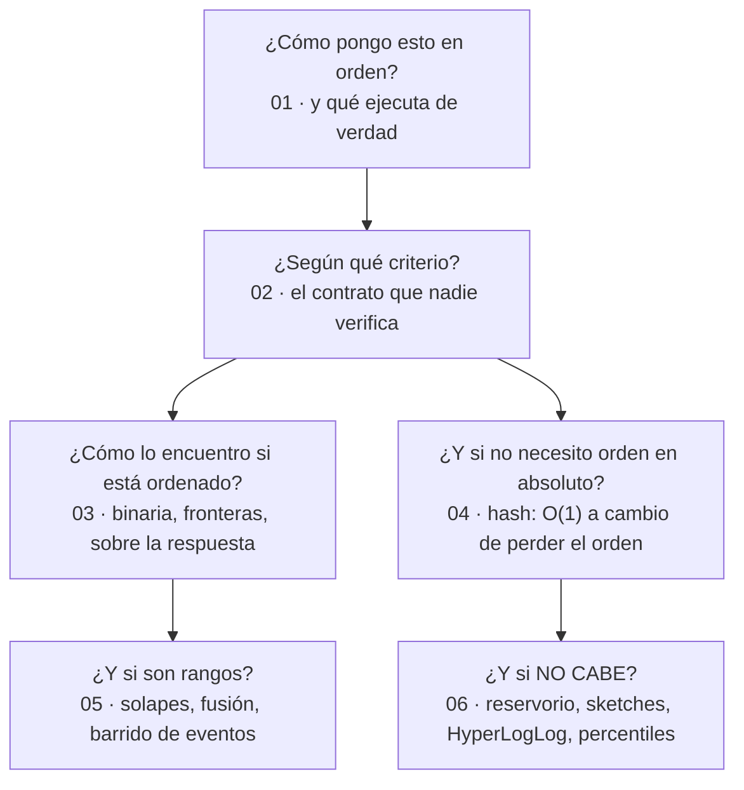

# 03 — Ordenación, búsqueda y hashing

> El bloque de los tres algoritmos que todo backend ejecuta cientos de veces por segundo sin
> escribirlos: el `sort` de la plataforma, la búsqueda binaria de un índice y el `HashMap`. Es
> también el bloque con más **contratos que el compilador no verifica**, y por tanto con los
> bugs más silenciosos del corpus.
>
> **Vigencia:** 2026-09-18. · **Guía editorial:** [`prompts/guia-de-estilo-y-convenciones.md`](../prompts/guia-de-estilo-y-convenciones.md)

---

## Qué es esto

Seis capítulos que responden a lo que de verdad se pregunta: **qué ejecuta tu `sort`**, **qué
contrato firma tu comparador**, **cómo se escribe una búsqueda binaria sin off-by-one**, **qué se
rompe cuando `equals` y `hashCode` no coinciden**, **cómo se tratan los intervalos** y **qué haces
cuando los datos no caben**.

```text
Un curso de algoritmos → te enseña quicksort y su demostración.
Este repaso            → te enseña que Java usa dual-pivot con int[] y TimSort con Object[],
                         y por qué esa decisión es correcta.
```

Las preguntas **no llevan la respuesta al lado**: viven en [`08-respuestas.md`](08-respuestas.md).

---

## Orden de lectura

| # | Documento | Qué cubre |
|---|---|---|
| `01` | [Ordenación](01-ordenacion.md) | Insertion, merge, quick, heap, counting, radix; estable e in-place; **TimSort y Dual-Pivot**, que es lo que ejecutas |
| `02` | [Comparadores y orden total](02-comparadores-y-orden-total.md) | El contrato, `Comparable` vs `Comparator`, coherencia con `equals`, nulos, `IllegalArgumentException` |
| `03` | [Búsqueda](03-busqueda.md) | Binaria sin off-by-one, `lowerBound`/`upperBound`, **binaria sobre la respuesta**, rotado y matriz |
| `04` | [Hashing y tablas hash](04-hashing-y-tablas-hash.md) | `equals`/`hashCode`, colisiones, factor de carga, treeification, hashing consistente, filtro de Bloom |
| `05` | [Intervalos y barrido de eventos](05-intervalos-y-barrido.md) | Convenio semiabierto, condición de solapamiento, fusión, línea de barrido |
| `06` | [Algoritmos sobre flujos](06-algoritmos-sobre-flujos.md) | Reservorio, Count-Min Sketch, HyperLogLog, percentiles con t-digest |
| `07` | [Simulación de entrevista](07-simulacion-de-entrevista.md) | 34 preguntas transversales + 5 problemas de pizarra |
| `08` | [Respuestas](08-respuestas.md) | Solucionario completo del bloque, en tres capas |

**Si el calendario aprieta**, el orden de prioridad es `04`, `03` y `01`. El hashing es el que
más aparece en entrevistas de backend —porque su contrato se rompe en producción—, la búsqueda
binaria es la que más veces hay que **teclear**, y la ordenación es la que más se pregunta de
memoria.

---

## Mapa mental del bloque



`01` y `02` van juntos: un algoritmo de ordenación sin un comparador correcto no ordena, ordena
mal. `03` y `04` son la misma pregunta con dos respuestas: **orden o velocidad**, y elegir es
obligatorio.

---

## Las cinco cosas que este bloque deja claras

1. **Nadie ejecuta los algoritmos del libro.** Java usa TimSort y Dual-Pivot Quicksort, Go usa
   pdqsort, y todos cambian de estrategia a mitad de camino.
2. **Estabilidad es una palabra que decide casos reales**, y no aparece en ninguna tabla de
   complejidades.
3. **La búsqueda binaria no busca un valor**: busca la frontera de un predicado monótono. Por eso
   también sirve cuando no hay ningún arreglo.
4. **El `HashMap` es O(1) con tres asteriscos**: con buen `hashCode`, amortizado, y con peor caso
   O(log n) desde Java 8.
5. **Cuando los datos no caben, la exactitud es lo primero que se negocia**, y hay que saber en qué
   dirección se equivoca cada estructura.

---

## Qué NO está aquí

- **Complejidad, TDAs y técnicas sobre secuencias** → bloque
  [`01-fundamentos`](../01-fundamentos/), que este asume leído.
- **Strings y algoritmos de cadenas** → bloque [`02-texto`](../02-texto/).
- **El heap como estructura, y los árboles de búsqueda por dentro** → bloque
  [`04-arboles-grafos`](../04-arboles-grafos/). Aquí se usan; allí se explican.
- **El código implementado en los cinco lenguajes** → bloque opcional
  [`09-implementaciones`](../09-implementaciones/).
- **Índices, planes de ejecución y diseño de esquema** → son de
  [`repaso-arquitectura-entrevistas`](../../../arquitectura/01-bases/). Aquí se enlaza,
  no se duplica.
