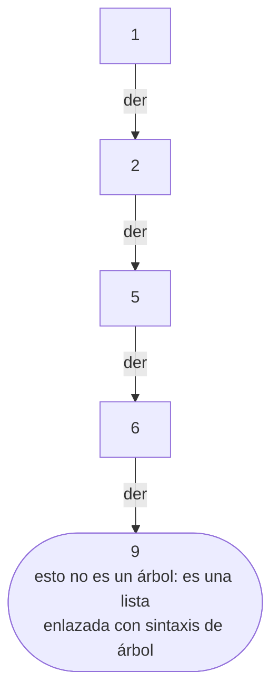
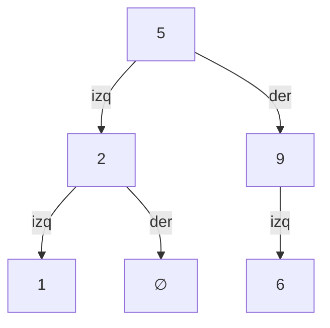

# 01 — Árboles

> Los cuatro recorridos y qué resuelve cada uno, por qué un BST sin balanceo se convierte en una
> lista enlazada con los datos más habituales del mundo, en qué se diferencian AVL y rojo-negro,
> y por qué el índice de tu base de datos es un B+tree y no un árbol binario.
> Asume leídos [`01-fundamentos/04` — Recursión](../01-fundamentos/04-recursion-y-backtracking.md)
> y [`03-orden-busqueda/03` — Búsqueda](../03-orden-busqueda/03-busqueda.md).
>
> **Vigencia:** 2026-09-18.

---

## 1. 🎯 El problema

Implementas un índice en memoria con un árbol binario de búsqueda y lo pruebas con datos
aleatorios: perfecto, O(log n). En producción lo cargas leyendo la tabla de clientes **ordenada
por identificador**, que es como sale de cualquier `SELECT ... ORDER BY id`.

El árbol que construyes es este:



Cada inserción va a la derecha, la altura es n en vez de log n, y todas las operaciones pasan de
O(log n) a O(n). Además, un recorrido recursivo sobre un millón de nodos así **desborda la pila**.

El caso de entrada más común del mundo —datos ya ordenados— es el peor caso del BST sin
balanceo. Es exactamente el mismo patrón que el peor caso de quicksort de
[`03-orden-busqueda/01`](../03-orden-busqueda/01-ordenacion.md), y la lección es la misma: **los
datos reales no son aleatorios**.

> **Regla de entrevista:** cuando digas "árbol binario de búsqueda", di en la misma frase si está
> balanceado. Sin balanceo, la complejidad que acabas de prometer no se cumple.

---

## 2. 🧱 Vocabulario y los cuatro recorridos

El vocabulario mínimo, sin el cual las respuestas se vuelven vagas: **raíz**, **hoja**, **altura**
(aristas del camino más largo hasta una hoja), **profundidad** (distancia desde la raíz), **grado**
(número de hijos) y **subárbol**.

Los cuatro recorridos, sobre el mismo árbol de juguete:



| Recorrido | Orden de visita | Resultado | Para qué sirve |
|---|---|---|---|
| **Preorden** | raíz → izq → der | 5, 2, 1, 9, 6 | Copiar el árbol, serializar |
| **Inorden** | izq → raíz → der | 1, 2, 5, 6, 9 | **Sale ordenado** si es un BST |
| **Postorden** | izq → der → raíz | 1, 2, 6, 9, 5 | Liberar recursos, evaluar expresiones |
| **Por niveles** (BFS) | nivel a nivel | 5, 2, 9, 1, 6 | Imprimir por niveles, camino más corto |

- **El inorden de un BST sale ordenado.** Es la propiedad que define al BST y la forma de
  comprobar que un árbol lo es de verdad: recorrerlo en inorden y verificar que la secuencia
  crece.
- Los tres primeros son recorridos **en profundidad** y usan una pila —la de recursión o una
  explícita—. El cuarto usa una **cola**, y esa es toda la diferencia entre DFS y BFS, aquí y en
  los grafos de [`03`](03-grafos-representacion-y-recorridos.md).
- Postorden es el orden correcto para liberar: no puedes destruir un nodo antes que sus hijos.

> 💡 **Truco.** El nombre dice cuándo se visita la **raíz**: *pre*orden antes, *in*orden en medio,
> *post*orden después. Los hijos siempre van izquierda antes que derecha. Con esa regla no hace
> falta memorizar las tres secuencias.

---

## 3. 🧱 El árbol binario de búsqueda

**Qué es.** Un árbol binario con un invariante: todo lo del subárbol izquierdo es menor que el
nodo, y todo lo del derecho es mayor.

**Cómo va.** Buscar es comparar y bajar por un lado, descartando el otro: es la búsqueda binaria
convertida en estructura.

**Cuánto.** O(altura) para buscar, insertar y borrar. Y ahí está todo el problema: **la altura es
log n solo si el árbol está equilibrado**, y O(n) si degenera.

**El borrado** es la operación que se pregunta, porque tiene tres casos y el tercero no es obvio:

```text
Hoja           → se elimina y ya
Un hijo        → el hijo ocupa su lugar
Dos hijos      → se sustituye por su SUCESOR en inorden (el mínimo del subárbol derecho),
                 y se borra ese sucesor, que como mucho tiene un hijo
```

- El sucesor en inorden es el menor de los mayores: el único valor que puede ocupar esa posición
  sin romper el invariante. También vale el predecesor, el máximo del subárbol izquierdo.
- Ese sucesor **nunca tiene hijo izquierdo** —si lo tuviera, no sería el mínimo—, así que borrarlo
  cae siempre en uno de los dos casos fáciles. La recursión termina en un paso.

**Cuándo sí.** Cuando necesitas orden y los datos cambian: rangos, vecinos, recorrido ordenado.

**Cuándo no.** Sin balanceo, nunca en producción. Y si solo necesitas pertenencia exacta, un
`HashSet` es O(1) y ocupa menos.

> **Veredicto:** el BST puro es una estructura didáctica. Lo que se usa es su versión balanceada,
> y la diferencia entre ambas es la única razón por la que este capítulo existe.

---

## 4. 🧱 Balanceo: AVL contra rojo-negro

**El problema.** Mantener la altura en O(log n) pase lo que pase con el orden de inserción. Ambos
lo consiguen con **rotaciones**: reorganizaciones locales de tres nodos que preservan el invariante
del BST y reducen la altura.

| | **AVL** | **Rojo-negro** |
|---|---|---|
| Invariante | Alturas de los subárboles difieren en ≤ 1 | Ningún camino es más del doble de largo que otro |
| Altura máxima | ~1.44 · log n | ~2 · log n |
| Búsquedas | **Más rápidas** (más equilibrado) | Algo más lentas |
| Inserción y borrado | **Más rotaciones** | Menos rotaciones |
| Se usa en | Índices de solo lectura, bases en memoria | `TreeMap`, `TreeSet`, `HashMap` arbolado, C++ `std::map` |

- **La regla de elección es la proporción lectura/escritura**: AVL si dominan las búsquedas,
  rojo-negro si hay muchas modificaciones. Como la mayoría de las estructuras de propósito general
  reciben ambas, las bibliotecas eligen rojo-negro.
- Un árbol rojo-negro es más fácil de mantener pero **más difícil de explicar**: sus cinco reglas
  de color no son intuitivas. En entrevista basta con saber qué garantiza y cuándo se prefiere;
  nadie razonable pide las rotaciones de memoria.
- Hay más familias —árboles B, treaps, splay trees— y su mención tiene sentido solo si aportan
  algo concreto al caso.

> ⚠️ **Advertencia.** "Un BST es O(log n)" es falso sin la palabra **balanceado**. Y el caso que
> lo rompe no es exótico: es insertar datos ya ordenados, que es lo que sale de cualquier consulta
> con `ORDER BY`.

---

## 5. 🧱 `TreeMap`: el árbol que sí usas

En Java no escribes árboles: usas `TreeMap` y `TreeSet`, que son árboles rojo-negro con una API
mucho más rica de lo que la gente aprovecha.

```java
TreeMap<LocalDate, Pedido> porFecha = new TreeMap<>();

porFecha.subMap(desde, true, hasta, false);   // rango semiabierto: O(log n) + tamaño
porFecha.floorKey(fecha);                     // la fecha existente más cercana por abajo
porFecha.ceilingEntry(fecha);                 // la primera entrada a partir de esa fecha
porFecha.firstKey();  porFecha.lastKey();     // extremos, O(log n)
porFecha.descendingMap();                     // vista invertida, sin copiar
```

- **Todas esas operaciones son imposibles en O(1) sobre un `HashMap`**, porque el hash destruye el
  orden por diseño. Son la única razón para pagar el O(log n).
- Las vistas —`subMap`, `headMap`, `descendingMap`— están **respaldadas por el mapa original**: no
  copian, y modificarlas modifica el original. Es eficiente y sorprende a quien no lo espera.
- `floorKey` y `ceilingKey` son las que más se olvidan y las que resuelven "el precio vigente en
  esta fecha", "el tramo de tarifa que aplica" y "el bucket de tiempo más cercano". Son consultas
  de negocio muy comunes escritas en una línea.

**Cuándo no.** Si nunca preguntas por orden, rangos ni vecinos, `TreeMap` solo te está cobrando:
más memoria por nodo y O(log n) en cada operación.

> **Veredicto:** `TreeMap` no es "el mapa lento". Es el mapa que responde preguntas que el otro no
> puede responder, y si no haces ninguna de esas preguntas, estás pagando por nada.

---

## 6. 🧱 B-tree y B+tree: el árbol del disco

**El problema.** Un árbol binario con un millón de claves tiene 20 niveles. Si cada nodo está en
disco, son **20 accesos a disco** por búsqueda. A 10 ms cada uno, 200 ms por consulta.

**La idea.** Si cada acceso a disco trae una página de 8 KB de todos modos, **aprovéchala**: mete
cientos de claves en cada nodo en vez de una.

```text
Árbol binario, 10⁶ claves:  log₂(10⁶)   = 20 niveles  → 20 lecturas
B+tree con 200 claves/nodo: log₂₀₀(10⁶) ≈ 2,6 niveles →  3 lecturas
```

- El **factor de ramificación** alto es todo el truco. Dentro de cada nodo se busca
  binariamente, pero eso ocurre en memoria y es gratis comparado con una lectura de disco.
- En un **B+tree**, todos los datos están en las hojas y **las hojas están enlazadas entre sí**.
  Por eso un `WHERE fecha BETWEEN` es tan barato: se localiza el inicio con una bajada logarítmica
  y después se recorre la lista de hojas secuencialmente, sin volver a subir.
- Los nodos internos solo guardan claves de navegación, lo que permite meter más por página y
  reducir aún más la altura.

**Cuándo sí.** Siempre que el almacenamiento tenga bloques: índices de base de datos, sistemas de
archivos, almacenes de clave-valor en disco.

**Cuándo no.** En memoria pura, donde no hay páginas que aprovechar y un árbol binario o un hash
son más simples.

> 🧠 **Modelo mental.** El B+tree existe porque **el coste dominante no son las comparaciones,
> son los accesos a disco**. Es el mejor ejemplo del corpus de que el algoritmo correcto depende
> del modelo de coste de la máquina, no solo de la O grande.

---

## 7. 🧱 Trie

**Qué es.** Un árbol donde cada arista es un carácter y cada camino desde la raíz es un prefijo.
Se introdujo en [`02-texto/02`](../02-texto/02-algoritmos-de-cadenas.md) y aquí se ve como
estructura de árbol.

**Cuánto.** O(longitud de la palabra) para buscar, insertar y borrar, **independientemente de
cuántas palabras contenga**. Espacio alto: un nodo por prefijo distinto.

**Cuándo sí.** Autocompletado sobre muchos términos, enrutamiento por prefijo de IP, y como base
de Aho-Corasick para buscar muchos patrones en una pasada.

**Cuándo no.** Para pertenencia exacta, donde un `HashSet` gana en todo. Y para pocos miles de
términos, donde `TreeMap.subMap(prefijo, prefijo + '￿')` da el mismo resultado sin escribir
una clase.

**La variante que se nombra:** el **radix tree** o trie compacto, que fusiona las cadenas de nodos
con un solo hijo. Reduce mucho la memoria y es lo que usan las tablas de enrutamiento reales.

---

## 8. ⏱️ La tabla de costes

| Estructura | Buscar | Insertar | Rango | Espacio | Lo que la tabla no dice |
|---|---|---|---|---|---|
| **BST sin balanceo** | O(altura) | O(altura) | O(altura + k) | O(n) | La altura es n con datos ordenados. No usar |
| **AVL** | O(log n) | O(log n) | O(log n + k) | O(n) | Más equilibrado: mejores búsquedas, más rotaciones |
| **Rojo-negro** | O(log n) | O(log n) | O(log n + k) | O(n) | Es `TreeMap`. Menos rotaciones: mejor con escrituras |
| **B+tree** | O(log_b n) | O(log_b n) | O(log_b n + k) | O(n) | Mide **accesos a disco**, no comparaciones. 3 niveles para 10⁶ |
| **Trie** | O(longitud) | O(longitud) | O(longitud + k) | Alto | Independiente del número de palabras |
| **Tabla hash** | O(1) | O(1) | **imposible** | O(n) | Gana en todo salvo en la columna que decide |

---

## 9. ⚖️ Los cinco lenguajes

| Lenguaje | Árbol balanceado en la stdlib | El detalle que muerde |
|---|---|---|
| **Java** | `TreeMap`, `TreeSet` (rojo-negro) | El único de los cinco que lo trae. Con `NavigableMap` completo |
| **Python** | **No hay** | Se usa `sortedcontainers` (externa, listas por bloques) o `list` ordenada + `bisect` |
| **JavaScript** | **No hay** | Ni árbol ni mapa ordenado. Se ordenan las claves o se usa una biblioteca |
| **TypeScript** | Igual que JS | Sin diferencia en runtime |
| **Go** | **No hay** | Slice ordenado + `sort.Search`, o una implementación propia |

Esta es la asimetría más grande de todo el corpus: **Java es el único que trae un mapa ordenado**,
y los otros cuatro resuelven el problema con un arreglo ordenado más búsqueda binaria. La
consecuencia práctica: en esos lenguajes, un conjunto ordenado que cambia mucho es caro —cada
inserción es O(n) por el desplazamiento— y `sortedcontainers` existe precisamente porque el
problema es real.

---

## 10. 🧭 Cómo se elige

```text
¿Solo pertenencia o acceso por clave exacta?      → tabla hash
¿Rangos, vecinos, mínimo, máximo, orden?          → árbol balanceado (TreeMap)
¿Datos que NO cambian y caben en memoria?         → arreglo ordenado + binaria (mejor constante)
¿Datos en disco o por bloques?                    → B+tree (lo hace tu base de datos)
¿Consultas por prefijo sobre millones de cadenas? → trie, o radix tree si la memoria aprieta
¿Consultas por prefijo sobre unos miles?          → TreeMap.subMap, y no escribas nada
```

> **Regla de entrevista:** la pregunta que decide entre hash y árbol es siempre la misma:
> **"¿vas a preguntar alguna vez qué hay entre A y B?"**. Si no, el hash gana; si sí, el hash no
> puede responder sin recorrerlo todo, por rápido que sea.

---

## 11. 🔭 Dónde aparece de verdad

En el índice de cualquier base de datos relacional, que es un B+tree y explica por qué un índice
sirve para `=`, `<`, `BETWEEN` y `ORDER BY` pero no para `LIKE '%algo'`; en el sistema de archivos
—ext4, NTFS y APFS usan variantes de B-tree—; en el `HashMap` de Java 8, cuyos buckets saturados se
convierten en árboles rojo-negro; en las tablas de enrutamiento IP, que son tries comprimidos por
prefijo; y en el índice invertido de un buscador, donde el diccionario de términos es un árbol o un
autómata y las listas de publicación cuelgan de él.

---

## ⚠️ Errores frecuentes

| Se dice | Lo preciso |
|---|---|
| "Un BST es O(log n)" | Solo **balanceado**. Con datos ordenados degenera a O(n) |
| "El inorden da el preorden al revés" | El inorden de un BST sale **ordenado**; es su propiedad definitoria |
| "AVL y rojo-negro son lo mismo" | AVL equilibra más (mejores lecturas); rojo-negro rota menos (mejores escrituras) |
| "Uso `TreeMap` porque es más ordenado" | Se usa por `subMap`, `floorKey` y el recorrido ordenado. Si no los usas, solo cuestas |
| "El índice de la base es un árbol binario" | Es un B+tree: cientos de claves por nodo, para minimizar accesos a disco |
| "Un trie siempre gana para buscar palabras" | Para pertenencia exacta pierde contra un `HashSet` en tiempo y en memoria |
| "Borrar en un BST es como buscar" | Con dos hijos hay que sustituir por el sucesor en inorden |

---

## 📚 Para profundizar

- **Libro** — Sedgewick y Wayne, *Algorithms*, 4ª ed. (Addison-Wesley, 2011). Capítulo 3.2 y 3.3:
  BST y árboles rojo-negro, con el código en Java y las visualizaciones del balanceo. **Si solo
  lees uno de este tema, lee este.**
- **Libro** — Cormen, Leiserson, Rivest y Stein, *Introduction to Algorithms*, 4ª ed. (MIT
  Press, 2022). Capítulos 12 (BST), 13 (rojo-negro) y 18 (B-trees), con las demostraciones de las
  cotas de altura.
- **Libro** — Kleppmann, *Designing Data-Intensive Applications* (O'Reilly, 2017). Capítulo 3, con
  la comparación B-tree contra LSM-tree: es el capítulo que conecta este temario con la
  arquitectura real.
- [Java 21 API — `TreeMap`](https://docs.oracle.com/en/java/javase/21/docs/api/java.base/java/util/TreeMap.html):
  el contrato de `NavigableMap`, las vistas respaldadas y la garantía de O(log n).
- [Java 21 API — `TreeSet`](https://docs.oracle.com/en/java/javase/21/docs/api/java.base/java/util/TreeSet.html):
  y la nota de que el orden lo define el comparador, no `equals` — que es
  [`03-orden-busqueda/02`](../03-orden-busqueda/02-comparadores-y-orden-total.md).
- [VisuAlgo — Binary Search Tree](https://visualgo.net/en): la visualización interactiva de las
  rotaciones AVL, que enseña más en dos minutos que dos páginas de texto.
- **Tutorial** — Baeldung, «Balanced Binary Trees»: AVL y rojo-negro en Java, con las rotaciones
  escritas.
- **Video** — MIT OpenCourseWare, *Introduction to Algorithms* (6.006), las clases de árboles
  balanceados y de B-trees.

---

## 🧠 Preguntas

Sin respuestas aquí. Todas, con enunciado literal y respuesta en tres capas, en
[`06` — Respuestas](06-respuestas.md).

1. ¿Cuáles son los cuatro recorridos de un árbol binario? 🟢
2. ¿Qué propiedad tiene el recorrido inorden de un BST? 🟢
3. ¿Cuál es el invariante de un árbol binario de búsqueda? 🟢
4. ¿Qué diferencia hay entre altura y profundidad? 🟢
5. ¿Qué estructura usa un recorrido en profundidad y cuál uno por niveles? 🟢
6. ¿Qué implementación de árbol balanceado usa `TreeMap`? 🟢
7. ¿Por qué un BST se degenera y qué entrada lo provoca? 🟡
8. ¿En qué se diferencian AVL y rojo-negro, y cuándo prefieres cada uno? 🟡
9. ¿Cómo se borra un nodo con dos hijos en un BST? 🟡
10. ¿Por qué el sucesor en inorden nunca tiene hijo izquierdo? 🟡
11. ¿Qué operaciones ofrece `TreeMap` que un `HashMap` no puede ofrecer? 🟡
12. ¿Por qué el índice de una base de datos es un B+tree y no un árbol binario? 🟡
13. ¿Qué diferencia hay entre un B-tree y un B+tree? 🟡
14. ¿Cuándo un trie pierde contra un `HashSet`? 🟡
15. ¿Cómo comprobarías que un árbol binario es realmente un BST? 🟠
16. ¿Por qué las vistas de `TreeMap` (`subMap`, `descendingMap`) no copian, y qué riesgo tiene? 🟠
17. ¿Por qué un recorrido recursivo sobre un BST degenerado desborda la pila y sobre un `TreeMap`
    no? 🟠
18. ¿Qué gana un B+tree al enlazar sus hojas entre sí? 🟠
19. ¿Por qué un índice de base de datos sirve para `LIKE 'algo%'` y no para `LIKE '%algo'`? 🟠
20. Ninguno de los otros cuatro lenguajes trae un árbol balanceado. ¿Cómo resuelves un conjunto
    ordenado que cambia mucho en Python y en Go? 🟠
21. ¿Por qué `HashMap` de Java 8 convierte buckets en árboles rojo-negro y no en AVL? 🟠
22. ¿Qué es un radix tree y qué problema del trie resuelve? 🟠
23. Diseña la estructura para responder "cuál era el precio vigente de este producto en esta
    fecha" sobre 10 años de cambios de tarifa. 🔴
24. Escribe el recorrido inorden iterativo de un árbol binario y explica por qué es más difícil
    que el preorden. 🔴
25. Te dan un árbol de categorías de producto que en producción provoca `StackOverflowError`. Da
    tres hipótesis y la corrección estructural. 🔴

---

**Siguiente:** [`02` — Montículos y colas de prioridad](02-monticulos-y-colas-de-prioridad.md) ·
**Relacionado:** [`03-orden-busqueda/04` — Hashing](../03-orden-busqueda/04-hashing-y-tablas-hash.md)
