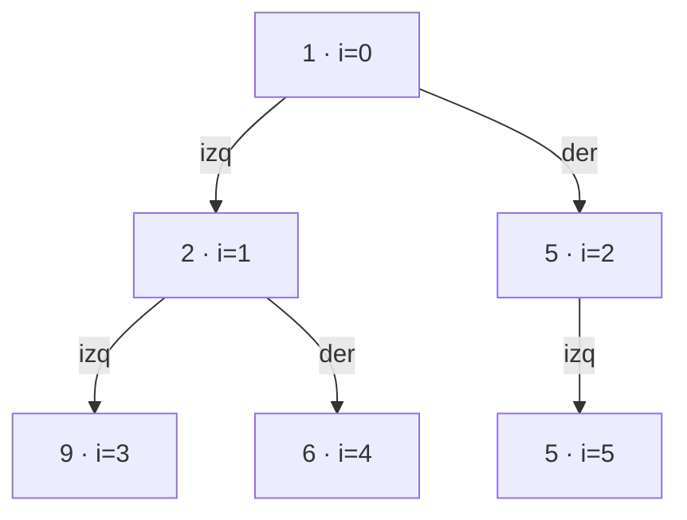

# 02 — Montículos y colas de prioridad

> El heap binario guardado en un arreglo sin punteros, por qué construirlo entero cuesta O(n) y
> no O(n log n), las tres trampas de `PriorityQueue` que nadie lee en la documentación, y los dos
> patrones que resuelve mejor que ninguna otra estructura: el top-K y la mediana en streaming.
> Asume leídos [`01` — Árboles](01-arboles.md) y
> [`03-orden-busqueda/01` — Ordenación](../03-orden-busqueda/01-ordenacion.md).
>
> **Vigencia:** 2026-09-18.

---

## 1. 🎯 El problema

Te piden los 100 productos más vendidos de un catálogo de 10 millones. La respuesta refleja es
ordenar y coger los primeros cien: O(n log n), unos 230 millones de operaciones, y hace falta
tener los 10 millones en memoria a la vez.

Ahora te lo piden sobre un **flujo continuo** de eventos que no termina nunca. Ordenar deja de ser
una opción: no hay un "todos" que ordenar.

```text
ordenar y cortar:   O(n log n), memoria O(n),  necesita el conjunto completo
heap acotado a k:   O(n log k), memoria O(k),  funciona sobre un flujo infinito
```

Con n = 10⁷ y k = 100, `log k` es 7 y `log n` es 23: más de tres veces menos trabajo y cien mil
veces menos memoria. Y sobre todo, funciona en un caso donde la otra solución **no existe**.

El heap es la estructura que hace posible esa diferencia, y su idea central es que **mantener el
orden total es caro y casi nunca hace falta**: basta con saber cuál es el mínimo.

> **Regla de entrevista:** si el enunciado dice "los k mejores", "el siguiente por prioridad" o
> "en cada paso el menor", es un heap. Ordenar entero para quedarte con unos pocos es tirar
> trabajo, y decirlo así puntúa.

---

## 2. 🧱 El heap binario, y por qué no tiene punteros

**Qué es.** Un árbol binario **completo** —todos los niveles llenos salvo el último, que se llena
de izquierda a derecha— con un invariante local: **cada padre es menor o igual que sus hijos**
(min-heap).

**Cómo va.** Como el árbol es completo, se puede guardar en un arreglo sin ningún puntero:



```text
índice:  0  1  2  3  4  5
arreglo: 1  2  5  9  6  5

hijos de i:  2i+1 y 2i+2
padre de i:  (i-1)/2
```

- **No hay nodos, ni referencias, ni sobrecarga de objetos.** Un heap de un millón de enteros es
  un `int[]` de un millón: contiguo, y la caché lo agradece.
- El invariante es **local y débil**: solo relaciona padre con hijos. No dice nada entre hermanos
  ni entre ramas, y por eso el heap no está ordenado.
- Esa debilidad es exactamente lo que lo hace barato: mantener un orden total costaría O(n log n);
  mantener solo "el padre es menor" cuesta O(log n) por operación.

**Cuánto.** `peek` del mínimo en O(1); insertar y extraer en O(log n); construir desde un arreglo
en **O(n)**; buscar un elemento cualquiera en O(n).

> ⚠️ **Advertencia.** *"El heap está ordenado"* es falso y se pregunta mucho. Solo garantiza el
> mínimo en la raíz. Iterarlo devuelve el arreglo interno, que parece desordenado —y lo está—, y
> `toString()` de una `PriorityQueue` desconcierta a todo el mundo la primera vez.

---

## 3. 🧱 `siftUp` y `siftDown`

Las dos únicas operaciones del heap. Todo lo demás se construye con ellas.

**`siftUp` (insertar).** Se pone el elemento al final del arreglo y se intercambia con su padre
mientras sea menor:

```text
insertar 0 en [1, 2, 5, 9, 6, 5]
[1, 2, 5, 9, 6, 5, 0]   0 al final, padre (índice 2) = 5 → intercambia
[1, 2, 0, 9, 6, 5, 5]   padre (índice 0) = 1 → intercambia
[0, 2, 1, 9, 6, 5, 5]   raíz: termina
```

**`siftDown` (extraer).** Se devuelve la raíz, se pone el último elemento en su lugar y se
intercambia con **el menor de sus hijos** mientras sea mayor.

- Con el **menor** de los dos hijos, no con el primero que sea menor: si se intercambia con el
  mayor, el invariante se rompe entre el nuevo padre y el otro hijo. Es el bug clásico al
  implementarlo.
- Ambas recorren como mucho la altura del árbol, que es log n porque el árbol es completo:
  **O(log n) garantizado**, sin peor caso.

**Cuándo no** basta con estas dos: cuando hay que **cambiar la prioridad** de un elemento que ya
está dentro. Eso exige localizarlo, que es O(n) en un heap plano. Se ve en la sección 5.

---

## 4. 🧱 `heapify` en O(n): la sorpresa

**El problema.** Convertir un arreglo cualquiera en un heap. La forma obvia es insertar los n
elementos uno a uno: n × O(log n) = O(n log n).

**Cómo va la buena.** Recorrer el arreglo **desde el último nodo con hijos hacia la raíz**
aplicando `siftDown`. Eso cuesta **O(n)**, no O(n log n), y es contraintuitivo.

**Por qué.** Porque la mayoría de los nodos están cerca del fondo y apenas bajan:

```text
nivel        nodos       altura máxima a bajar      trabajo
último        n/2                  0                   0
penúltimo     n/4                  1                 n/4
...
raíz            1               log n               log n

suma: n · Σ (h / 2^h) → converge a 2n   →   O(n)
```

- La mitad de los nodos son hojas y no hacen **nada**. Solo el nodo raíz baja log n niveles, y
  solo hay uno.
- La serie `Σ h/2^h` converge a 2, y de ahí sale el factor constante. Es el mismo tipo de
  argumento que el del coste amortizado del `ArrayList`.
- Insertar uno a uno es peor porque **la mitad de las inserciones ocurren cuando el árbol ya está
  casi completo**, y esas sí suben log n niveles.

**La consecuencia práctica:** en Java, `new PriorityQueue<>(coleccion)` usa `heapify` y es O(n);
crear la cola vacía y hacer `addAll` es O(n log n). Es una diferencia real y gratuita.

> 💡 **Truco.** "Construir un heap es O(n)" es de las respuestas que más impresionan porque casi
> todo el mundo dice O(n log n). Si la dices, prepara el argumento de "la mitad de los nodos son
> hojas y no se mueven": es la justificación que van a pedir a continuación.

---

## 5. 🧱 `PriorityQueue` y sus tres trampas

La implementación de Java es un min-heap sobre un arreglo, y tiene tres comportamientos que
sorprenden y que se preguntan.

**Trampa 1: no está ordenada.** `iterator()`, `toString()` y `stream()` devuelven el arreglo
interno, no el orden de prioridad. Para recorrerla en orden hay que ir haciendo `poll()`, lo que
la vacía y cuesta O(n log n).

**Trampa 2: `contains` y `remove(Object)` son O(n).** El invariante local no permite descartar
ramas, así que hay que recorrer el arreglo entero. Si necesitas borrar por clave con frecuencia,
la estructura correcta es un heap **más un mapa de posiciones**, o marcar como borrado y descartar
al hacer `poll` —la técnica de *lazy deletion*—.

**Trampa 3: los empates no tienen orden definido.** Dos elementos con la misma prioridad salen en
un orden arbitrario. Si el orden entre iguales importa —y casi siempre importa: FIFO dentro de la
misma prioridad—, hay que **añadir un contador de secuencia como último criterio** del comparador.

```java
record Tarea(int prioridad, long secuencia) { }

new PriorityQueue<>(Comparator
        .comparingInt(Tarea::prioridad)
        .thenComparingLong(Tarea::secuencia));   // desempate estable y total
```

- Sin esa segunda línea, la cola es correcta y **no reproducible**: dos ejecuciones con la misma
  entrada pueden procesar en distinto orden.
- Es el mismo requisito de orden total de
  [`03-orden-busqueda/02`](../03-orden-busqueda/02-comparadores-y-orden-total.md), aplicado aquí.

**Y una cuarta, de diseño:** `PriorityQueue` implementa `Queue`, y su `poll()` **no** devuelve el
que lleva más tiempo esperando. Hereda la interfaz y rompe la intuición del nombre.

> **Veredicto:** `PriorityQueue` es excelente para "dame el siguiente" y mala para todo lo demás.
> Si te descubres llamando a `contains` o `remove(Object)`, la estructura no es la adecuada.

---

## 6. 🧱 Los dos patrones que resuelve

**Top-K con heap acotado.** Para los **k mayores** se usa un **min**-heap de tamaño k, y esto es lo
contraintuitivo:

```text
por cada elemento:
   si heap.size() < k        → heap.offer(elemento)
   si no si elemento > heap.peek() → heap.poll(); heap.offer(elemento)
```

- La cabeza es **el peor de los que están dentro**, que es justamente el candidato a expulsar.
  Con un max-heap habría que recorrerlo entero para saber a quién echar.
- Coste: O(n log k) en tiempo y **O(k) en memoria**, independientemente de n. Funciona sobre un
  flujo infinito.
- Para los k **menores**, al revés: max-heap de tamaño k.

**Mediana en streaming con dos heaps.** Un max-heap con la mitad baja y un min-heap con la mitad
alta:

```text
max-heap (mitad baja)   |   min-heap (mitad alta)
      ... 1, 2  ←cabeza | cabeza→  5, 6, 9 ...

mediana = cabeza del mayor, o la media de las dos cabezas si los tamaños son iguales
```

- Cada inserción coloca el elemento en el heap que corresponde y después **reequilibra** para que
  los tamaños no difieran en más de uno: O(log n).
- Consultar la mediana es O(1). Es la estructura correcta para percentiles aproximados en tiempo
  real, y la respuesta esperada a "dame la mediana de un flujo".

**Un tercer patrón que aparece:** **fusionar k listas ordenadas** con un heap de k cabezas, que es
la fase de fusión de la ordenación externa de
[`03-orden-busqueda/01`](../03-orden-busqueda/01-ordenacion.md). O(n log k) en vez de O(n·k).

---

## 7. ⏱️ La tabla de costes

| Operación | Coste | Lo que la tabla no dice |
|---|---|---|
| `peek` (mínimo) | **O(1)** | Es todo lo que el heap garantiza |
| `offer` (insertar) | O(log n) | `siftUp`; sin peor caso, el árbol siempre está completo |
| `poll` (extraer) | O(log n) | `siftDown`; hay que bajar por el **menor** de los hijos |
| Construir desde arreglo | **O(n)** | Contraintuitivo. Insertar uno a uno sería O(n log n) |
| `contains`, `remove(Object)` | **O(n)** | El invariante local no permite descartar ramas |
| Cambiar la prioridad | O(n) + O(log n) | Localizar es lo caro. Hace falta un mapa de posiciones |
| Top-K | O(n log k), O(k) memoria | Con **min**-heap para los mayores. Sirve sobre flujos |
| Heapsort | O(n log n), O(1) espacio | Garantizado, y más lento que quicksort por la caché |

---

## 8. ⚖️ Los cinco lenguajes

| Lenguaje | Qué trae | El detalle que muerde |
|---|---|---|
| **Java** | `PriorityQueue` (min-heap) | Para max-heap, `Comparator.reverseOrder()`. `contains` es O(n) |
| **Python** | `heapq` sobre una `list` | **Solo min-heap**: para max se niegan las claves. `heapify` es O(n) y está expuesto |
| **JavaScript** | **No hay** | Ausencia notoria. Se implementa a mano o se usa una biblioteca |
| **TypeScript** | Igual que JS | Sin diferencia en runtime |
| **Go** | `container/heap` | Es una **interfaz**, no una estructura: implementas 5 métodos y Go pone los algoritmos |

Dos observaciones que valen como respuesta:

- **`heapq` de Python opera sobre una lista normal**, no sobre un tipo propio: `heappush`,
  `heappop` y `heapify` reciben la lista. Es minimalista y expone `nlargest`/`nsmallest`, que
  implementan el top-K acotado directamente.
- **Go pide que tú aportes la estructura** implementando `Len`, `Less`, `Swap`, `Push` y `Pop`, y
  el paquete aporta los algoritmos. Es más ceremonia, y a cambio funciona sobre cualquier
  representación tuya sin copiar.

---

## 9. 🧭 Cómo se elige

```text
¿Necesitas el mínimo (o el máximo) repetidamente, y el conjunto cambia?   → heap
¿Los k mejores de muchos, o de un flujo?                                  → heap acotado a k
   (min-heap para los MAYORES: la cabeza es el que hay que expulsar)
¿La mediana o percentiles de un flujo?                                    → dos heaps
¿Fusionar k secuencias ordenadas?                                         → heap de k cabezas
¿Necesitas también buscar o borrar por clave?                             → heap + mapa de posiciones
¿Necesitas recorrer todo en orden?                                        → NO es un heap: es un árbol
¿El conjunto es fijo y lo quieres todo ordenado?                          → ordena y ya
```

> **Regla de entrevista:** heap para "el siguiente"; árbol para "todos en orden"; hash para
> "¿está?". Tres estructuras, tres preguntas distintas, y confundirlas es el error de elección más
> común.

---

## 10. 🔭 Dónde aparece de verdad

En el planificador de tareas de cualquier sistema operativo y en el `ScheduledThreadPoolExecutor`
de Java, que es literalmente una cola de prioridad por tiempo de ejecución; en Dijkstra y en Prim,
que son el capítulo [`04`](04-caminos-minimos-y-expansion-minima.md) y no funcionan sin heap; en la
fase de fusión de la ordenación externa y de la compactación de un LSM-tree; en el `ORDER BY ...
LIMIT k` de una base de datos, donde el motor usa un top-K con heap en vez de ordenar todo; y en
las colas de reintentos con backoff, donde la prioridad es el instante en que toca reintentar.

---

## ⚠️ Errores frecuentes

| Se dice | Lo preciso |
|---|---|
| "El heap está ordenado" | Solo garantiza el mínimo en la raíz. Iterarlo no da orden |
| "Construir un heap es O(n log n)" | Es **O(n)** con `heapify`: la mitad de los nodos son hojas |
| "Para los k mayores uso un max-heap" | Al revés: **min**-heap de tamaño k, la cabeza es el que se expulsa |
| "`PriorityQueue.remove(x)` es O(log n)" | Es O(n): localizarlo exige recorrer el arreglo |
| "Los empates salen en orden de llegada" | Salen arbitrariamente. Hace falta un contador de secuencia |
| "El heap necesita punteros como un árbol" | Se guarda en un arreglo: hijos en 2i+1 y 2i+2 |
| "Ordeno el millón y cojo los diez primeros" | O(n log n) para algo que un heap acotado hace en O(n log 10) |

---

## 📚 Para profundizar

- **Libro** — Cormen, Leiserson, Rivest y Stein, *Introduction to Algorithms*, 4ª ed. (MIT
  Press, 2022). Capítulo 6 completo: heaps, `heapify` con la **demostración del O(n)**, y
  heapsort. Si solo lees uno de este capítulo, este.
- **Libro** — Sedgewick y Wayne, *Algorithms*, 4ª ed. (Addison-Wesley, 2011). Sección 2.4: colas
  de prioridad con el código en Java y la comparación de implementaciones.
- **Libro** — Skiena, *The Algorithm Design Manual*, 3ª ed. (Springer, 2020). Sección 4.3, sobre
  cuándo la cola de prioridad es la estructura correcta frente a ordenar.
- [Java 21 API — `PriorityQueue`](https://docs.oracle.com/en/java/javase/21/docs/api/java.base/java/util/PriorityQueue.html):
  las tres trampas están todas documentadas, incluido que el iterador no garantiza orden.
- [Python — `heapq`](https://docs.python.org/3/library/heapq.html): la nota de que solo es
  min-heap, el truco de negar las claves, y `nlargest`/`nsmallest`, que son el top-K hecho.
- [Go — `container/heap`](https://pkg.go.dev/container/heap): la interfaz de cinco métodos y el
  ejemplo de cola de prioridad con actualización de prioridad, que es el caso difícil.
- [VisuAlgo — Binary Heap](https://visualgo.net/en): la visualización de `siftUp`, `siftDown` y
  `heapify`, que hace evidente por qué la construcción es O(n).
- **Video** — WilliamFiset, la serie sobre *Priority Queues*: incluye la implementación con mapa
  de posiciones para poder cambiar prioridades, que casi nadie explica.

---

## 🧠 Preguntas

Sin respuestas aquí. Todas, con enunciado literal y respuesta en tres capas, en
[`06` — Respuestas](06-respuestas.md).

1. ¿Cuál es el invariante de un min-heap? 🟢
2. ¿Cómo se guarda un heap binario en un arreglo? 🟢
3. ¿Qué complejidad tienen `peek`, `offer` y `poll`? 🟢
4. ¿Está ordenado un heap? ¿Qué devuelve iterarlo? 🟢
5. ¿Qué complejidad tiene construir un heap a partir de un arreglo? 🟢
6. ¿Por qué el heap no necesita punteros y un BST sí? 🟡
7. ¿Por qué `siftDown` debe intercambiar con el **menor** de los dos hijos? 🟡
8. ¿Por qué `contains` es O(n) en una `PriorityQueue` si `poll` es O(log n)? 🟡
9. ¿Qué pasa con los empates en una `PriorityQueue` y cómo se arregla? 🟡
10. ¿Por qué para los k **mayores** se usa un **min**-heap? 🟡
11. ¿Cómo se obtiene un max-heap en Java y en Python? 🟡
12. ¿Por qué `new PriorityQueue<>(coleccion)` es más barato que crear vacía y hacer `addAll`? 🟡
13. ¿Por qué construir un heap es O(n) y no O(n log n)? Da el argumento. 🟠
14. ¿Cómo calculas la mediana de un flujo continuo en O(log n) por elemento? 🟠
15. ¿Cómo cambias la prioridad de un elemento que ya está en el heap? 🟠
16. ¿Por qué heapsort es O(n log n) garantizado y aun así más lento que quicksort? 🟠
17. ¿Cómo fusionas k listas ordenadas y qué complejidad tiene? 🟠
18. ¿Qué es el borrado perezoso en un heap y cuándo lo prefieres al mapa de posiciones? 🟠
19. ¿Por qué `PriorityQueue` implementa `Queue` si rompe su intuición? 🟠
20. Te dan los 100 mayores de un flujo de 10 millones. Compara ordenar contra heap con
    números. 🟠
21. Diseña la cola de reintentos de un consumidor de mensajes, con backoff exponencial y hasta
    cinco intentos. 🔴
22. Diseña el ranking en vivo de los 10 mejores de un millón de jugadores con actualizaciones
    constantes, y explica por qué `PriorityQueue` sola no basta. 🔴
23. Un planificador con cola de prioridad deja tareas de baja prioridad sin ejecutar nunca.
    Explica el mecanismo y da dos correcciones con su coste. 🔴
24. Diseña la estructura para los "k elementos más cercanos" que hay que recalcular cada vez que
    llega un punto nuevo. Di qué eliges, su coste y cuándo deja de servir. 🔴

---

**Anterior:** [`01` — Árboles](01-arboles.md) ·
**Siguiente:** [`03` — Grafos: representación y recorridos](03-grafos-representacion-y-recorridos.md) ·
**Relacionado:** [`04` — Caminos mínimos](04-caminos-minimos-y-expansion-minima.md)
