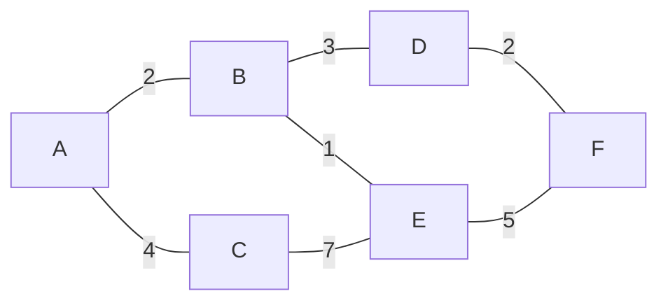

# 03 — Grafos: representación y recorridos

> Matriz contra lista de adyacencia y cuándo cambia la respuesta, BFS y DFS como el mismo
> algoritmo con distinta estructura, el orden topológico que arranca tus beans de Spring, y
> Union-Find, que resuelve conectividad en tiempo prácticamente constante.
> Asume leídos [`01-fundamentos/04` — Recursión](../01-fundamentos/04-recursion-y-backtracking.md)
> y [`01-fundamentos/02` — TDAs](../01-fundamentos/02-tdas-contrato-e-implementacion.md).
>
> **Vigencia:** 2026-09-18.

---

## 1. 🎯 El problema

Casi todo lo que un backend modela es un grafo, y casi nunca se llama así:

```text
dependencias entre módulos de Maven      → grafo dirigido acíclico
llamadas entre microservicios            → grafo dirigido, y sus ciclos son bugs
orden de arranque de beans de Spring     → orden topológico
categorías de producto con subcategorías → árbol... salvo cuando alguien crea un ciclo
permisos heredados entre roles           → grafo, y su recorrido decide si entras
transferencias entre cuentas             → grafo, y sus ciclos son fraude
```

La pregunta de entrevista casi nunca dice "grafo". Dice *"¿cómo detectarías una dependencia
circular?"*, *"¿en qué orden arrancas los servicios?"* o *"¿cómo sabes si dos usuarios están
conectados?"*. **Reconocer que el problema es de grafos es la mitad de la respuesta**, y la otra
mitad casi siempre es BFS, DFS o Union-Find.

Este capítulo usa un grafo de juguete fijo, el mismo para todos los ejemplos:



> **Regla de entrevista:** antes de elegir algoritmo, di en voz alta si el grafo es dirigido o no,
> si tiene pesos, si puede tener ciclos y cuántos nodos y aristas hay. Esas cuatro respuestas
> determinan el algoritmo, y preguntarlas demuestra método.

---

## 2. 🧱 Vocabulario mínimo

**Nodo** (o vértice) y **arista**; **dirigido** si las aristas tienen sentido; **ponderado** si
tienen peso; **grado** de un nodo es cuántas aristas toca —en un dirigido se separa en grado de
entrada y de salida—.

Dos familias que hay que distinguir porque cambian los algoritmos:

- **DAG** (grafo dirigido acíclico): dirigido y sin ciclos. Es el de las dependencias, y el único
  donde existe el orden topológico.
- **Grafo denso contra disperso**: denso si el número de aristas se acerca a n², disperso si es del
  orden de n. Casi todos los grafos reales son **dispersos** —un microservicio llama a cinco, no a
  quinientos—, y eso decide la representación.

Dos medidas que aparecen en todas las complejidades: **V** (vértices) y **E** (aristas). Escribir
O(V + E) en vez de O(n) es la notación esperada y se nota cuando no se usa.

---

## 3. ⚖️ Matriz contra lista de adyacencia

Es la primera decisión y la que más veces se pregunta.

```text
Matriz de adyacencia              Lista de adyacencia
    A B C D E F                   A → [B(2), C(4)]
  A 0 2 4 0 0 0                   B → [A(2), D(3), E(1)]
  B 2 0 0 3 1 0                   C → [A(4), E(7)]
  C 4 0 0 0 7 0                   D → [B(3), F(2)]
  D 0 3 0 0 0 2                   E → [B(1), C(7), F(5)]
  E 0 0 7 0 0 5                   F → [D(2), E(5)]
  F 0 0 0 2 5 0
```

| | **Matriz** | **Lista** |
|---|---|---|
| Espacio | O(V²), siempre | **O(V + E)** |
| ¿Hay arista A→B? | **O(1)** | O(grado de A) |
| Recorrer vecinos de A | O(V) | **O(grado de A)** |
| Añadir arista | O(1) | O(1) |
| Cuándo gana | Grafo **denso**, consultas de existencia | Grafo **disperso**, recorridos |

- **La lista gana casi siempre**, porque los grafos reales son dispersos y lo que se hace con
  ellos es recorrerlos. Con 10 000 nodos y 30 000 aristas, la matriz ocupa 100 millones de celdas
  y la lista 40 000 entradas.
- En Java, la lista se representa con `Map<Nodo, List<Arista>>` o, si los nodos son enteros
  consecutivos, con un `List<List<Integer>>`, que es más rápido y más compacto.
- La matriz sigue ganando en grafos pequeños y densos, y cuando la pregunta dominante es
  "¿existe esta arista?" en un bucle caliente.

> **Veredicto:** por defecto, lista de adyacencia. Elegir matriz exige justificar densidad o
> consultas de existencia, y decir esa justificación es lo que puntúa.

---

## 4. 🧱 BFS: el recorrido por capas

**Qué es.** Recorrer por niveles desde el origen, visitando primero todo lo que está a distancia
1, después a distancia 2, y así. Usa una **cola**.

```java
Deque<Nodo> cola = new ArrayDeque<>();
Set<Nodo> visitados = new HashSet<>();
cola.add(origen); visitados.add(origen);      // marcar AL ENCOLAR, no al desencolar
while (!cola.isEmpty()) {
    Nodo actual = cola.poll();
    for (Nodo vecino : grafo.vecinos(actual)) {
        if (visitados.add(vecino)) cola.add(vecino);   // add devuelve false si ya estaba
    }
}
```

- **Marcar al encolar y no al desencolar** es el detalle que más se falla: si marcas al
  desencolar, un nodo con varios predecesores entra varias veces en la cola y el algoritmo deja de
  ser lineal.
- `visitados.add(vecino)` devuelve `false` si ya estaba: combina comprobación y marca en una
  línea, y evita el clásico `if (!visitados.contains(x)) { visitados.add(x); ... }`.

**Cuánto.** O(V + E) en tiempo y O(V) en espacio.

**Cuándo sí.** **El camino más corto en número de aristas** —y solo BFS lo garantiza, en grafos
sin pesos—; el recorrido por niveles; "a cuántos saltos está".

**Cuándo no.** Con pesos: ahí BFS da el camino con menos aristas, que **no** es el más barato. Eso
es Dijkstra, y está en [`04`](04-caminos-minimos-y-expansion-minima.md).

> 🧠 **Modelo mental.** BFS y DFS son el mismo algoritmo con distinta estructura: **cola** para
> BFS, **pila** para DFS. Cambiar `ArrayDeque.poll()` por `pop()` convierte uno en el otro. Decir
> esa frase resuelve de golpe la pregunta "¿en qué se diferencian?".

---

## 5. 🧱 DFS: el recorrido en profundidad

**Qué es.** Bajar todo lo posible por una rama antes de retroceder. Se escribe recursivo o con una
pila explícita.

**Cuánto.** O(V + E) en tiempo; espacio O(V), del que **la pila de recursión es O(profundidad)** y
puede desbordar en grafos grandes — es el aviso de
[`01-fundamentos/04`](../01-fundamentos/04-recursion-y-backtracking.md).

**Cuándo sí.** Detección de ciclos, orden topológico, componentes conexas, backtracking sobre
grafos, y cualquier problema donde importe el camino completo desde el origen.

**Cuándo no.** Para el camino más corto: DFS encuentra **un** camino, no el corto. Es un error
frecuente y fácil de detectar.

**Los tres colores**, que son el vocabulario de la detección de ciclos:

```text
BLANCO  no visitado
GRIS    en la pila de recursión ahora mismo (se está explorando)
NEGRO   terminado, con todos sus descendientes explorados
```

- **Encontrar un nodo GRIS desde otro GRIS significa ciclo**: has vuelto a un nodo que está en el
  camino actual. Encontrar uno NEGRO no significa nada malo: es un camino alternativo a algo ya
  resuelto.
- Con un solo conjunto de "visitados" **no se puede detectar un ciclo en un grafo dirigido**,
  porque no distingues "ya lo exploré" de "estoy dentro de él". Ese es el bug clásico y la pregunta
  de seguimiento más habitual.
- En un grafo **no dirigido** basta con un conjunto de visitados más el padre: si llegas a un
  visitado que no es tu padre, hay ciclo.

---

## 6. 🧱 Orden topológico

**Qué es.** Una ordenación lineal de los nodos de un **DAG** tal que toda arista va de antes hacia
después. Es "el orden en que se pueden hacer las cosas respetando las dependencias".

**Cómo va.** Dos algoritmos equivalentes, y conviene saber los dos por motivos distintos:

- **Kahn (BFS).** Se calcula el grado de entrada de cada nodo, se encolan los de grado 0, y al
  sacar uno se decrementa el grado de sus vecinos, encolando los que lleguen a 0. **Si al terminar
  quedan nodos sin procesar, hay un ciclo** — y esa es la forma más limpia de detectarlo.
- **DFS con postorden.** Se hace DFS y se apila cada nodo **al terminarlo**; el orden topológico es
  la pila invertida. Más corto de escribir, y detecta el ciclo con los tres colores.

```text
Sobre un DAG de dependencias:   config → base-de-datos → repositorios → servicios → controladores
```

**Cuánto.** O(V + E) los dos.

**Cuándo sí.** Orden de arranque, resolución de dependencias, planificación de tareas,
recompilación incremental, orden de aplicación de migraciones.

**Cuándo no.** Si el grafo tiene ciclos **no existe** ningún orden topológico, y el algoritmo debe
reportarlo en vez de devolver un resultado parcial. Kahn lo hace de forma natural.

> 💡 **Truco.** "¿Cómo detectas una dependencia circular?" y "¿en qué orden arrancas esto?" son la
> **misma pregunta**: el algoritmo que responde una detecta la otra. Decirlo así ahorra media
> respuesta y demuestra que ves la estructura.

---

## 7. 🧱 Conectividad: componentes y Union-Find

**Componentes conexas.** En un grafo no dirigido, los grupos de nodos alcanzables entre sí. Se
calculan con un BFS o DFS por cada nodo no visitado: O(V + E).

**Componentes fuertemente conexas.** En un dirigido, los grupos donde **todos alcanzan a todos**.
Se calculan con Tarjan o Kosaraju, ambos O(V + E). Es lo que detecta los ciclos de dependencia
entre microservicios: una componente fuertemente conexa de tamaño mayor que 1 **es** un ciclo.

**Union-Find (conjuntos disjuntos).** La estructura para responder "¿están conectados?" y "únelos"
sin recorrer nada.

```text
find(x)      → representante del conjunto de x
union(x, y)  → fusiona los dos conjuntos
```

- Dos optimizaciones, y hay que nombrar las dos: **compresión de caminos** —cada `find` reengancha
  los nodos del camino directamente a la raíz— y **unión por rango o tamaño** —se cuelga el árbol
  pequeño del grande—.
- Con ambas, el coste amortizado es **O(α(n))**, la inversa de la función de Ackermann, que para
  cualquier n del universo real es menor que 5. Se dice "prácticamente constante".
- **No permite deshacer una unión** ni recorrer los elementos de un conjunto: solo responde
  pertenencia al mismo grupo.

**Cuándo sí.** Kruskal para el árbol de expansión mínima; detección de ciclos en no dirigidos;
"¿estos dos usuarios están en la misma red?"; agrupación incremental.

**Cuándo no.** Cuando las conexiones se **quitan**: Union-Find solo une. Ahí hay que recalcular, o
procesar las operaciones al revés, que es el truco habitual.

---

## 8. ⏱️ La tabla de costes

| Algoritmo | Tiempo | Espacio | Lo que la tabla no dice |
|---|---|---|---|
| BFS | O(V + E) | O(V) | El **único** que da el camino mínimo en aristas sin pesos |
| DFS recursivo | O(V + E) | O(V) + pila | La pila es O(profundidad): desborda en grafos grandes |
| Orden topológico | O(V + E) | O(V) | Kahn detecta el ciclo sin esfuerzo extra |
| Componentes conexas | O(V + E) | O(V) | Un recorrido por cada nodo no visitado |
| Fuertemente conexas | O(V + E) | O(V) | Tarjan o Kosaraju. Una componente > 1 **es** un ciclo |
| Union-Find | **O(α(n))** amortizado | O(V) | Prácticamente constante. **No** admite deshacer uniones |
| Matriz de adyacencia | — | **O(V²)** | Con 10 000 nodos son 100 millones de celdas |

---

## 9. ⚖️ Los cinco lenguajes

| Lenguaje | Qué trae la stdlib | El detalle que muerde |
|---|---|---|
| **Java** | **Nada** de grafos | Se modela con `Map<Nodo, List<Nodo>>`. JGraphT es la biblioteca si hace falta más |
| **Python** | **`graphlib.TopologicalSorter`** | El único de los cinco con orden topológico en la stdlib. Para el resto, `networkx` |
| **JavaScript** | Nada | Se modela con `Map` y arreglos |
| **TypeScript** | Nada | Aporta tipar los nodos y evitar mezclar identificadores, que es un bug real |
| **Go** | Nada | Se modela con `map[string][]string`; el recorrido aleatorio del mapa obliga a ordenar si el resultado debe ser determinista |

Dos observaciones útiles:

- **Python es el único con algo de grafos en la stdlib**, y es justamente el orden topológico
  —`graphlib.TopologicalSorter`, desde 3.9—, porque es el caso que más aparece en herramientas de
  construcción. Para lo demás, `networkx` es el estándar de facto.
- **El recorrido aleatorio del mapa de Go** tiene una consecuencia concreta aquí: dos ejecuciones
  del mismo BFS pueden visitar los vecinos en distinto orden y devolver caminos distintos, ambos
  correctos. Si el resultado tiene que ser reproducible, hay que ordenar los vecinos
  explícitamente.

---

## 10. 🧭 Cómo se elige

```text
¿Camino más corto en número de saltos, sin pesos?    → BFS
¿Con pesos?                                          → Dijkstra (ver `04`)
¿Hay ciclo en un grafo dirigido?                     → DFS con tres colores, o Kahn
¿En qué orden se puede hacer esto?                   → orden topológico (y es la misma pregunta)
¿Están estos dos conectados? ¿Únelos?                → Union-Find
¿Cuántos grupos aislados hay?                        → componentes conexas con BFS/DFS
¿Qué servicios se llaman en círculo?                 → componentes fuertemente conexas (Tarjan)

¿Grafo disperso, lo vas a recorrer?                  → lista de adyacencia
¿Grafo denso, preguntas por existencia de arista?    → matriz
```

> **Regla de entrevista:** BFS si la palabra clave es "mínimo número de pasos"; DFS si es "existe
> un camino", "hay un ciclo" o "en qué orden"; Union-Find si es "conectados" o "agrupar". Tres
> señales léxicas que cubren casi todos los enunciados.

---

## 11. 🔭 Dónde aparece de verdad

En el arranque de Spring, que resuelve el grafo de dependencias entre beans con un orden
topológico y te avisa con `BeanCurrentlyInCreationException` cuando hay un ciclo; en Maven y
Gradle, que hacen lo mismo con los módulos; en el `git log --graph` y en el cálculo del ancestro
común para un `merge`; en el mapa de llamadas entre microservicios de una herramienta de trazas,
donde una componente fuertemente conexa señala un acoplamiento circular; en el motor de permisos
con roles heredados, que es un recorrido de grafo en cada petición; y en la detección de fraude
por ciclos de transferencias entre cuentas.

---

## ⚠️ Errores frecuentes

| Se dice | Lo preciso |
|---|---|
| "DFS da el camino más corto" | Da **un** camino. El más corto sin pesos es BFS |
| "Marco el nodo como visitado al sacarlo de la cola" | Hay que marcarlo **al encolarlo**, o entra varias veces |
| "Con un conjunto de visitados detecto ciclos dirigidos" | Hacen falta tres estados: hay que distinguir "en la pila" de "terminado" |
| "BFS sirve con pesos" | Da el camino con menos aristas, no el más barato. Eso es Dijkstra |
| "Uso una matriz de adyacencia" | Con grafos dispersos desperdicias O(V²). La lista es O(V + E) |
| "Union-Find también desune" | Solo une. Quitar conexiones exige recalcular o procesar al revés |
| "Si hay ciclo, el orden topológico sale incompleto" | No existe ningún orden: hay que reportar el ciclo, no devolver un resultado parcial |

---

## 📚 Para profundizar

- **Libro** — Sedgewick y Wayne, *Algorithms*, 4ª ed. (Addison-Wesley, 2011). Capítulo 4.1 y 4.2:
  grafos no dirigidos y dirigidos, con BFS, DFS, orden topológico y componentes fuertemente
  conexas, todo en Java. **Si solo lees uno de este bloque, lee este.**
- **Libro** — Cormen, Leiserson, Rivest y Stein, *Introduction to Algorithms*, 4ª ed. (MIT
  Press, 2022). Capítulos 20 y 21: recorridos con los tres colores, orden topológico, y conjuntos
  disjuntos con el análisis de la función de Ackermann inversa.
- **Libro** — Skiena, *The Algorithm Design Manual*, 3ª ed. (Springer, 2020). Capítulos 7 y 8: el
  mejor tratamiento de **cómo reconocer** que un problema es de grafos, que es la parte difícil.
- [cp-algorithms — Breadth-first search](https://cp-algorithms.com/graph/breadth-first-search.html):
  BFS con la reconstrucción del camino, que es lo que casi siempre piden después.
- [cp-algorithms — Depth-first search](https://cp-algorithms.com/graph/depth-first-search.html):
  la clasificación de aristas y la detección de ciclos con colores.
- [cp-algorithms — Topological sorting](https://cp-algorithms.com/graph/topological-sort.html):
  las dos formulaciones, Kahn y DFS.
- [cp-algorithms — Disjoint Set Union](https://cp-algorithms.com/data_structures/disjoint_set_union.html):
  Union-Find con las dos optimizaciones y el análisis del α(n).
- [Python — `graphlib`](https://docs.python.org/3/library/graphlib.html): `TopologicalSorter`, con
  el modo estático y el iterativo para planificar en paralelo.

---

## 🧠 Preguntas

Sin respuestas aquí. Todas, con enunciado literal y respuesta en tres capas, en
[`06` — Respuestas](06-respuestas.md).

1. ¿Qué estructura usa BFS y cuál DFS? 🟢
2. ¿Qué complejidad tienen BFS y DFS con lista de adyacencia? 🟢
3. ¿Qué es un DAG? 🟢
4. ¿Qué espacio ocupa una matriz de adyacencia frente a una lista? 🟢
5. ¿Cuál de los dos recorridos da el camino más corto y bajo qué condición? 🟢
6. ¿Qué es un orden topológico y sobre qué tipo de grafo existe? 🟢
7. ¿Por qué hay que marcar el nodo como visitado al **encolarlo** y no al sacarlo? 🟡
8. ¿Por qué un solo conjunto de visitados no detecta ciclos en un grafo dirigido? 🟡
9. ¿Qué significan los tres colores de un DFS? 🟡
10. ¿En qué se diferencian el algoritmo de Kahn y el orden topológico por DFS? 🟡
11. ¿Qué es una componente fuertemente conexa y qué indica encontrar una de tamaño mayor que
    uno? 🟡
12. ¿Qué dos optimizaciones hacen que Union-Find sea casi O(1)? 🟡
13. ¿Por qué BFS no sirve para el camino más barato en un grafo con pesos? 🟡
14. ¿Cuándo eliges matriz de adyacencia en vez de lista? 🟠
15. ¿Por qué "detectar dependencias circulares" y "decidir el orden de arranque" son la misma
    pregunta? 🟠
16. ¿Cómo detectas un ciclo en un grafo **no** dirigido, y por qué es más fácil? 🟠
17. ¿Qué limitación tiene Union-Find que obliga a cambiar de enfoque? 🟠
18. ¿Por qué un DFS recursivo puede desbordar la pila en un grafo real y cómo lo evitas? 🟠
19. ¿Cómo reconstruyes el camino y no solo la distancia en un BFS? 🟠
20. ¿Por qué el recorrido aleatorio del mapa de Go afecta al resultado de un BFS? 🟠
21. ¿Qué significa O(V + E) y por qué no se escribe O(n)? 🟠
22. Spring lanza `BeanCurrentlyInCreationException`. ¿Qué problema de grafos es y cómo lo
    resuelves? 🟠
23. Diseña la detección de ciclos de transferencias entre cuentas sobre 50 millones de
    movimientos al día. 🔴
24. Te piden el "grado de separación" entre dos usuarios de una red de 100 millones. Diseña la
    solución y di por qué el BFS ingenuo no sirve. 🔴
25. Traza BFS y DFS sobre el grafo de juguete partiendo de A, y di en qué orden visita cada uno.
    🔴

---

**Anterior:** [`02` — Montículos y colas de prioridad](02-monticulos-y-colas-de-prioridad.md) ·
**Siguiente:** [`04` — Caminos mínimos y expansión mínima](04-caminos-minimos-y-expansion-minima.md) ·
**Relacionado:** [`01` — Árboles](01-arboles.md)
