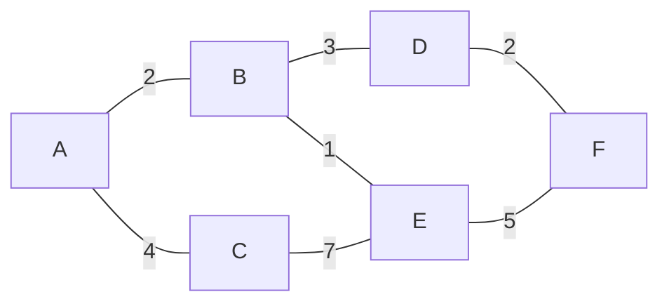
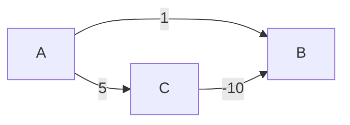

# 04 — Caminos mínimos y expansión mínima

> Dijkstra con su heap y la razón exacta por la que falla con pesos negativos, Bellman-Ford y lo
> que compra a cambio de ser más lento, Floyd-Warshall en cinco líneas, A* como Dijkstra con
> pista, y los dos algoritmos de árbol de expansión mínima con su criterio de elección.
> Asume leído [`03` — Grafos](03-grafos-representacion-y-recorridos.md) y
> [`02` — Montículos](02-monticulos-y-colas-de-prioridad.md).
>
> **Vigencia:** 2026-09-18.

---

## 1. 🎯 El problema

BFS te da el camino con **menos aristas**. Sobre el grafo de juguete, de A a F por menos saltos
son dos: A→B→D→F son tres aristas y A→C→E→F son tres también, pero A→B→E→F son tres aristas con
coste 2+1+5 = 8, mientras que A→B→D→F cuesta 2+3+2 = 7.



```text
menos aristas:  A→B→D→F  o  A→B→E→F  (3 aristas cada uno)
menos coste:    A→B→D→F  =  7        (A→B→E→F = 8)
```

En cuanto las aristas tienen peso —kilómetros, latencia, dinero, tiempo— "el camino más corto"
deja de significar "el que tiene menos saltos" y BFS deja de servir. Ese es todo el motivo de
existir de este capítulo.

Y hay una segunda familia de problemas que se confunde con la primera: **conectar todo al mínimo
coste**, que no es lo mismo que **ir de A a F al mínimo coste**. Un árbol de expansión mínima no
contiene necesariamente los caminos mínimos entre pares, y saber distinguirlas es una pregunta
frecuente.

> **Regla de entrevista:** "más corto" es ambiguo hasta que preguntas si hay pesos. Sin pesos,
> BFS y ya. Con pesos no negativos, Dijkstra. Con negativos, Bellman-Ford. Esa cadena de tres
> respuestas es la estructura de toda la conversación.

---

## 2. 🧱 Dijkstra

**Qué es.** El camino mínimo desde **un origen** a todos los demás nodos, en un grafo con pesos
**no negativos**.

**Cómo va.** Un voraz con cola de prioridad: se saca siempre el nodo no cerrado con menor
distancia conocida, se cierra, y se **relajan** sus aristas.

```java
PriorityQueue<Nodo> cola = new PriorityQueue<>(comparingInt(dist::get));
dist.put(origen, 0);
cola.add(origen);
while (!cola.isEmpty()) {
    Nodo actual = cola.poll();
    if (!cerrados.add(actual)) continue;             // entrada obsoleta: descártala
    for (Arista a : grafo.aristas(actual)) {
        int nueva = dist.get(actual) + a.peso();
        if (nueva < dist.getOrDefault(a.destino(), MAX)) {
            dist.put(a.destino(), nueva);
            previo.put(a.destino(), actual);         // para reconstruir el camino
            cola.add(a.destino());                   // se AÑADE, no se actualiza
        }
    }
}
```

- **Relajar** una arista es la operación central: *"si llego a este vecino pasando por el nodo
  actual, ¿mejoro la distancia que tenía?"*.
- El `if (!cerrados.add(actual)) continue` resuelve el problema práctico de que `PriorityQueue`
  no deja **cambiar la prioridad** de un elemento ya dentro (trampa 2 de
  [`02`](02-monticulos-y-colas-de-prioridad.md)). Se insertan entradas duplicadas y se descartan
  las obsoletas al sacarlas. Es la técnica estándar y hay que saber explicarla.
- `previo` es lo que permite **reconstruir el camino** y no solo la distancia. Se olvida
  constantemente y es la primera repregunta.

**Cuánto.** O((V + E) log V) con heap binario. Con un heap de Fibonacci sería O(E + V log V), y
eso es teoría: sus constantes lo hacen perder en la práctica y nadie lo implementa.

**Cuándo sí.** Pesos no negativos, un origen, muchos destinos: rutas, latencia de red, coste
mínimo de una cadena de conversiones.

**Cuándo no.** Con **pesos negativos**, y esa es la siguiente sección.

---

## 3. 🧱 Por qué Dijkstra falla con pesos negativos

**El invariante que usa.** Cuando Dijkstra cierra un nodo, da su distancia por **definitiva**. Eso
solo es válido si ningún camino futuro puede mejorarla, y con pesos no negativos es cierto:
cualquier camino alternativo pasa por nodos de distancia mayor o igual, y solo puede sumar.

**Qué lo rompe.** Una arista negativa permite que un camino más largo acabe siendo más barato:



```text
A → B (1)       Dijkstra cierra B con 1 (es el menor)
A → C (5)       después llega a C con 5, relaja C→B: 5 + (-10) = -5
C → B (-10)     pero B ya está CERRADO: la mejora nunca se aplica
```

- El resultado es **silenciosamente incorrecto**: no lanza error, devuelve un número mal.
- La corrección no es "quitar el cierre": sin él, el algoritmo puede reprocesar
  exponencialmente. Lo correcto es cambiar de algoritmo.

> ⚠️ **Advertencia.** *"Dijkstra no funciona con pesos negativos"* es la mitad de la respuesta. La
> completa dice **por qué**: porque cierra nodos asumiendo que su distancia es final, y una arista
> negativa puede mejorarla después. Sin ese porqué, la respuesta suena memorizada, y es
> exactamente lo que la repregunta busca.

**Dónde aparecen pesos negativos de verdad:** arbitraje de divisas —donde el "peso" es el
logaritmo del tipo de cambio y un ciclo negativo es una oportunidad de beneficio—, sistemas de
créditos y descuentos, y cualquier modelo donde una arista represente una ganancia.

---

## 4. 🧱 Bellman-Ford

**Qué es.** Camino mínimo desde un origen **admitiendo pesos negativos**, y con la capacidad de
**detectar ciclos negativos**.

**Cómo va.** Relaja **todas** las aristas, V-1 veces.

```text
repetir V-1 veces:
    para cada arista (u, v, peso):
        si dist[u] + peso < dist[v]:  dist[v] = dist[u] + peso

una pasada más:
    si alguna arista todavía mejora → hay un CICLO NEGATIVO
```

- **Por qué V-1 veces**: un camino mínimo sin ciclos tiene como mucho V-1 aristas, y cada pasada
  garantiza que se resuelve al menos una arista más del camino. Es la justificación que piden.
- **La pasada extra es la joya**: si después de V-1 rondas algo sigue mejorando, hay un ciclo cuyo
  peso total es negativo, y entonces "el camino mínimo" **no existe** —siempre se puede dar otra
  vuelta y bajar más—.

**Cuánto.** O(V·E), bastante peor que Dijkstra. Con 10 000 nodos y 50 000 aristas son 500 millones
de operaciones frente a unos pocos millones.

**Cuándo sí.** Pesos negativos, o cuando **detectar el ciclo negativo es el objetivo** —que es el
caso del arbitraje—. También cuando el grafo es pequeño y la simplicidad del código vale más.

**Cuándo no.** Con pesos no negativos: Dijkstra es mucho más rápido y da lo mismo.

> **Veredicto:** Bellman-Ford no es "el Dijkstra lento". Es el que responde una pregunta que
> Dijkstra no puede responder: si existe un ciclo que te hace ganar dando vueltas.

---

## 5. 🧱 Floyd-Warshall y A*

**Floyd-Warshall.** Camino mínimo entre **todos los pares**, en cinco líneas y con programación
dinámica:

```text
para cada k (nodo intermedio):
    para cada i, para cada j:
        dist[i][j] = min(dist[i][j], dist[i][k] + dist[k][j])
```

- El bucle de `k` va **fuera**: es el nodo intermedio permitido, y ese orden es el que hace
  correcta la DP. Ponerlo dentro es el error clásico y produce resultados incorrectos.
- O(V³) en tiempo y O(V²) en espacio. Con 500 nodos son 125 millones de operaciones: viable. Con
  5 000 son 125 mil millones: no.
- Admite pesos negativos, y detecta ciclos negativos mirando si algún `dist[i][i]` queda negativo.

**Cuándo sí.** Grafos pequeños y densos donde hacen falta todos los pares: matrices de distancias
entre ciudades, tablas de enrutamiento pequeñas, cálculo de la clausura transitiva.

**Cuándo no.** Con muchos nodos: V³ crece muy rápido. Para todos los pares en un grafo grande y
disperso, es más barato ejecutar Dijkstra desde cada nodo: O(V·(V+E) log V).

**A*.** Dijkstra con una **heurística** que estima lo que falta hasta el destino. En vez de
expandir por `distancia recorrida`, expande por `distancia recorrida + estimación restante`.

- La heurística debe ser **admisible**: nunca sobreestimar lo que falta. Si sobreestima, A* puede
  devolver un camino que no es el mínimo.
- El ejemplo canónico es la distancia en línea recta en un mapa: nunca es mayor que la distancia
  por carretera, así que es admisible.
- Con heurística 0, A* **es** Dijkstra. Con una heurística perfecta, va directo al destino sin
  explorar nada más.

**Cuándo sí.** Un solo destino conocido y una estimación geométrica disponible: navegación,
videojuegos, planificación de rutas.

**Cuándo no.** Sin heurística razonable —un grafo de dependencias no tiene geometría— A* no aporta
nada sobre Dijkstra.

---

## 6. 🧱 Árbol de expansión mínima: Kruskal y Prim

**Qué es.** El subconjunto de aristas que **conecta todos los nodos** con coste total mínimo y sin
ciclos. Es otra pregunta distinta de la del camino mínimo.

```text
Sobre el grafo de juguete, el árbol de expansión mínima usa:
   B–E (1), A–B (2), D–F (2), B–D (3), E–F (5)... y se descarta el que cerraría ciclo
Coste total mínimo para que todo quede conectado, NO el camino más barato entre A y F.
```

**Kruskal.** Ordena todas las aristas por peso y las va añadiendo si no cierran ciclo, usando
**Union-Find** para comprobarlo. O(E log E), dominado por la ordenación.

**Prim.** Crece desde un nodo, añadiendo siempre la arista más barata que sale del árbol actual,
con una **cola de prioridad**. O(E log V).

| | **Kruskal** | **Prim** |
|---|---|---|
| Estructura clave | Union-Find | Cola de prioridad |
| Ordena | Todas las aristas, una vez | No ordena: extrae mínimos |
| Gana con | Grafos **dispersos** | Grafos **densos** |
| Construye | Bosque que se va fusionando | Un único árbol que crece |

- Ambos son voraces y ambos son correctos por la misma propiedad: **la arista más ligera que cruza
  cualquier corte del grafo pertenece a algún árbol de expansión mínima**.
- Si hay pesos repetidos, puede haber **varios** árboles de expansión mínima distintos con el mismo
  coste total. Los dos algoritmos encuentran uno válido, no necesariamente el mismo.

> 🧠 **Modelo mental.** Camino mínimo responde *"¿cómo voy de A a F más barato?"*; árbol de
> expansión mínima responde *"¿cómo conecto todo gastando lo mínimo?"*. Son preguntas distintas y
> el árbol mínimo **no** contiene necesariamente los caminos mínimos. Decirlo así evita el error
> más común del capítulo.

---

## 7. ⏱️ La tabla de costes

| Algoritmo | Tiempo | Pesos negativos | Qué responde | Lo que la tabla no dice |
|---|---|---|---|---|
| **BFS** | O(V + E) | — | Mínimos saltos desde un origen | Solo sirve **sin** pesos |
| **Dijkstra** | O((V+E) log V) | ❌ | Mínimo coste desde un origen | Falla en silencio con negativos, no avisa |
| **Bellman-Ford** | O(V·E) | ✅ | Ídem, y **detecta ciclos negativos** | La pasada extra es su verdadero valor |
| **Floyd-Warshall** | O(V³) | ✅ | **Todos los pares** | Cinco líneas; el bucle de `k` va fuera |
| **A\*** | Depende de la heurística | ❌ | Mínimo coste a **un** destino | Con heurística no admisible, devuelve mal |
| **Kruskal** | O(E log E) | ✅ | Árbol de expansión mínima | Necesita Union-Find; mejor en dispersos |
| **Prim** | O(E log V) | ✅ | Ídem | Necesita heap; mejor en densos |

---

## 8. ⚖️ Los cinco lenguajes

| Lenguaje | Qué trae | El detalle que muerde |
|---|---|---|
| **Java** | **Nada** | Se escribe con `PriorityQueue` y `HashMap`. JGraphT si el proyecto lo justifica |
| **Python** | **Nada** en la stdlib | `networkx` trae Dijkstra, Bellman-Ford, A* y MST, y es el estándar de facto |
| **JavaScript** | Nada | Ni heap ni grafos: hay que construir las dos cosas |
| **TypeScript** | Nada | Aporta tipar nodos y pesos, que evita confundir identificadores con índices |
| **Go** | Nada, pero sí `container/heap` | Con el heap puesto, Dijkstra son unas 40 líneas |

La observación que vale como respuesta: **ninguno de los cinco trae algoritmos de grafos en su
biblioteca estándar**, y eso no es casualidad. Un grafo real casi nunca es un grafo genérico: tiene
atributos, restricciones y pesos que cambian según el contexto, así que las bibliotecas prefieren
dar los ladrillos —heap, mapa, cola— y dejar el algoritmo al dominio. Es lo contrario de lo que
pasa con la ordenación, que sí está resuelta para todo el mundo.

---

## 9. 🧭 Cómo se elige

```text
¿Sin pesos?                                      → BFS
¿Pesos no negativos, un origen?                  → Dijkstra
¿Hay pesos negativos?                            → Bellman-Ford
¿Necesitas saber si hay un ciclo negativo?       → Bellman-Ford (es lo único que lo detecta)
¿Todos los pares y el grafo es pequeño?          → Floyd-Warshall
¿Todos los pares y el grafo es grande y disperso?→ Dijkstra desde cada nodo
¿Un destino concreto y tienes una estimación?    → A*, con heurística admisible
¿Conectar todo al mínimo coste?                  → Kruskal (disperso) o Prim (denso)
```

> **Regla de entrevista:** la primera pregunta no es qué algoritmo, es **si hay pesos y si pueden
> ser negativos**. Las dos respuestas determinan el algoritmo, y hacerlas tú antes de empezar vale
> más que recitar los cinco.

---

## 10. 🔭 Dónde aparece de verdad

En el enrutado de paquetes —OSPF usa Dijkstra sobre el estado de los enlaces, y BGP resuelve
caminos entre sistemas autónomos—; en el cálculo de rutas de un mapa, que es A* con heurística
geométrica y contracción de jerarquías encima; en el **arbitraje de divisas**, donde un ciclo
negativo con pesos logarítmicos es una oportunidad de beneficio y Bellman-Ford es el algoritmo
exacto; en el diseño de una red física —cableado, tuberías, topología de un clúster— que es un
árbol de expansión mínima; y en la planificación de la ruta de reparto, que empieza pareciendo
camino mínimo y acaba siendo el problema del viajante, que es NP-difícil y se resuelve con
heurísticas.

---

## ⚠️ Errores frecuentes

| Se dice | Lo preciso |
|---|---|
| "Dijkstra da el camino más corto" | El de **menor coste**, no el de menos aristas, y solo con pesos no negativos |
| "Con negativos Dijkstra da un error" | No: devuelve un resultado **incorrecto en silencio** |
| "Bellman-Ford es Dijkstra pero lento" | Detecta ciclos negativos, que Dijkstra no puede |
| "El árbol de expansión mínima da los caminos mínimos" | Son problemas distintos: conectar todo ≠ ir de A a F |
| "Floyd-Warshall con el bucle de `k` dentro" | El nodo intermedio va en el bucle **externo**, o la DP es incorrecta |
| "A* siempre es mejor que Dijkstra" | Solo con heurística admisible; con una mala, devuelve un camino que no es mínimo |
| "Dijkstra devuelve el camino" | Devuelve distancias: para el camino hay que guardar el nodo previo |

---

## 📚 Para profundizar

- **Libro** — Sedgewick y Wayne, *Algorithms*, 4ª ed. (Addison-Wesley, 2011). Capítulos 4.3 y 4.4:
  árboles de expansión mínima y caminos mínimos, con Kruskal, Prim, Dijkstra y Bellman-Ford en
  Java y con las mediciones. **Si solo lees uno de este capítulo, lee este.**
- **Libro** — Cormen, Leiserson, Rivest y Stein, *Introduction to Algorithms*, 4ª ed. (MIT
  Press, 2022). Capítulos 21 a 23, con la demostración de la corrección de Dijkstra, que es la que
  explica por qué los pesos negativos lo rompen.
- **Libro** — Skiena, *The Algorithm Design Manual*, 3ª ed. (Springer, 2020). Capítulo 8 y el
  catálogo de la parte II, para reconocer cuál de estos problemas tienes delante.
- [cp-algorithms — Dijkstra](https://cp-algorithms.com/graph/dijkstra.html): las dos variantes,
  con y sin cola de prioridad, y la reconstrucción del camino.
- [cp-algorithms — Bellman-Ford](https://cp-algorithms.com/graph/bellman_ford.html): la detección
  del ciclo negativo y cómo extraer el ciclo concreto.
- [cp-algorithms — Floyd-Warshall](https://cp-algorithms.com/graph/all-pair-shortest-path-floyd-warshall.html):
  las cinco líneas, con la advertencia sobre el orden de los bucles.
- [cp-algorithms — Kruskal](https://cp-algorithms.com/graph/mst_kruskal.html) y
  [Prim](https://cp-algorithms.com/graph/mst_prim.html): los dos con su análisis y su criterio de
  elección.
- [networkx — Shortest paths](https://networkx.org/documentation/stable/reference/algorithms/shortest_paths.html):
  la implementación de referencia en Python, útil para comprobar tus resultados.

---

## 🧠 Preguntas

Sin respuestas aquí. Todas, con enunciado literal y respuesta en tres capas, en
[`06` — Respuestas](06-respuestas.md).

1. ¿Qué devuelve Dijkstra y cuál es su restricción? 🟢
2. ¿Qué significa "relajar" una arista? 🟢
3. ¿Qué complejidad tiene Dijkstra con cola de prioridad? 🟢
4. ¿Qué detecta Bellman-Ford que Dijkstra no puede detectar? 🟢
5. ¿Qué responde un árbol de expansión mínima? 🟢
6. ¿Qué estructura usa Kruskal y cuál Prim? 🟢
7. ¿Por qué Dijkstra falla con pesos negativos? Explica el mecanismo, no solo el hecho. 🟡
8. ¿Por qué Bellman-Ford relaja exactamente V-1 veces? 🟡
9. ¿Qué indica que en la pasada V de Bellman-Ford todavía mejore alguna arista? 🟡
10. ¿Por qué el bucle de `k` en Floyd-Warshall va en el exterior? 🟡
11. ¿Qué es una heurística admisible y qué pasa si no lo es? 🟡
12. ¿Qué relación hay entre A* y Dijkstra? 🟡
13. ¿Cuándo prefieres Kruskal a Prim? 🟡
14. ¿Por qué BFS no sirve con pesos, si también encuentra caminos? 🟡
15. ¿Cómo reconstruyes el camino y no solo la distancia en Dijkstra? 🟠
16. ¿Por qué se insertan entradas duplicadas en la cola de Dijkstra en vez de actualizar la
    prioridad? 🟠
17. ¿Por qué el árbol de expansión mínima no contiene necesariamente los caminos mínimos? 🟠
18. ¿Cuándo es mejor ejecutar Dijkstra desde cada nodo que usar Floyd-Warshall? 🟠
19. ¿Por qué el heap de Fibonacci mejora la cota de Dijkstra y nadie lo usa? 🟠
20. ¿Qué pasa si hay varias aristas con el mismo peso en un árbol de expansión mínima? 🟠
21. ¿Dónde aparecen pesos negativos en un problema de negocio real? 🟠
22. ¿Por qué ningún lenguaje de los cinco trae algoritmos de grafos en su stdlib? 🟠
23. Diseña la detección de arbitraje entre 200 divisas con sus tipos de cambio. Di qué algoritmo
    usas y cómo modelas los pesos. 🔴
24. Te piden la ruta más rápida entre dos puntos de una ciudad con 2 millones de intersecciones,
    en menos de 100 ms. Diseña la solución. 🔴
25. Traza Dijkstra sobre el grafo de juguete desde A y di el orden en que cierra los nodos y la
    distancia final a F. 🔴

---

**Anterior:** [`03` — Grafos: representación y recorridos](03-grafos-representacion-y-recorridos.md) ·
**Siguiente:** [`05` — Simulación de entrevista](05-simulacion-de-entrevista.md) ·
**Relacionado:** [`02` — Montículos](02-monticulos-y-colas-de-prioridad.md)
