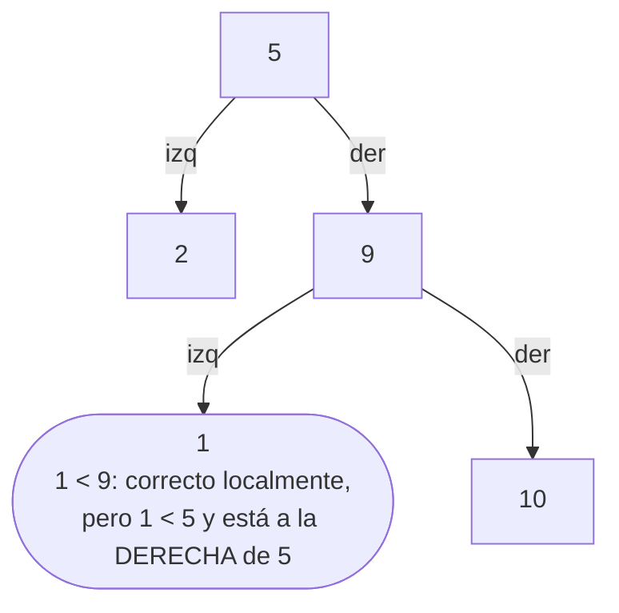
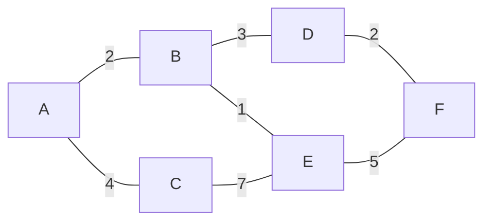
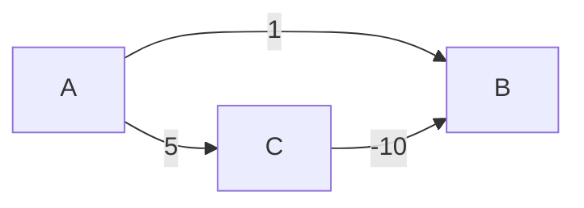

# 06 — Respuestas

> Solucionario centralizado del bloque `04-arboles-grafos`. Cada respuesta en tres capas:
> **⏱️ 30 segundos**, **🗣️ 2 minutos** y **🔬 El detalle**. Los enunciados están copiados
> literalmente de su capítulo.
>
> **Vigencia:** 2026-09-18.

**Salto rápido:**
[01](#01--árboles) · [02](#02--montículos-y-colas-de-prioridad) ·
[03](#03--grafos-representación-y-recorridos) ·
[04](#04--caminos-mínimos-y-expansión-mínima) ·
[05 — transversales](#05--simulación-preguntas-transversales) ·
[05 — pizarra](#05--simulación-problemas-de-pizarra)

---

# 01 — Árboles

**01 → 1. ¿Cuáles son los cuatro recorridos de un árbol binario?**

⏱️ Preorden, inorden, postorden y por niveles.
🗣️ Los tres primeros son en profundidad y se distinguen por cuándo visitan la raíz: antes de los
hijos, entre medias, o después. El cuarto es en anchura y recorre nivel por nivel.
🔬 El nombre lo dice todo: *pre*orden visita la raíz primero, *in*orden en medio, *post*orden al
final; los hijos siempre van izquierda antes que derecha. Con esa regla no hace falta memorizar
las secuencias.

**01 → 2. ¿Qué propiedad tiene el recorrido inorden de un BST?**

⏱️ **Sale ordenado**.
🗣️ Es la propiedad que define al BST y la forma correcta de comprobar si un árbol lo es: recorrerlo
en inorden y verificar que la secuencia crece estrictamente.
🔬 Comprobar solo "nodo > hijo izquierdo y nodo < hijo derecho" **no basta**: un nodo puede cumplir
eso con sus hijos y violar el invariante respecto a un abuelo. El inorden lo detecta todo.

**01 → 3. ¿Cuál es el invariante de un árbol binario de búsqueda?**

⏱️ Todo lo del subárbol izquierdo es menor que el nodo, y todo lo del derecho es mayor.
🗣️ "Todo el subárbol", no "el hijo": es la parte que se falla. El invariante es global respecto al
nodo, no local respecto a sus dos hijos inmediatos.
🔬 De él sale la búsqueda: comparar y descartar un lado entero, que es la búsqueda binaria
convertida en estructura. Y de él sale también el inorden ordenado.

**01 → 4. ¿Qué diferencia hay entre altura y profundidad?**

⏱️ La altura se mide hacia abajo, hasta la hoja más lejana; la profundidad hacia arriba, desde la
raíz.
🗣️ La altura de un nodo es la longitud del camino más largo hasta una hoja; su profundidad es su
distancia a la raíz. La altura del árbol es la del nodo raíz.
🔬 Importa porque **la complejidad de las operaciones es O(altura)**, no O(n). Y porque la
profundidad máxima es lo que consume la pila de un recorrido recursivo.

**01 → 5. ¿Qué estructura usa un recorrido en profundidad y cuál uno por niveles?**

⏱️ Profundidad usa una **pila** —la de recursión o una explícita—; por niveles usa una **cola**.
🗣️ Es la misma distinción que separa DFS de BFS en grafos: el algoritmo es idéntico y solo cambia
de dónde sacas el siguiente nodo. Cambiar `pop()` por `poll()` convierte uno en el otro.
🔬 Y tiene una consecuencia práctica: el recorrido por niveles nunca desborda la pila, porque no
usa recursión. El recorrido en profundidad sobre un árbol degenerado sí.

**01 → 6. ¿Qué implementación de árbol balanceado usa `TreeMap`?**

⏱️ Un árbol rojo-negro.
🗣️ Garantiza que ningún camino de la raíz a una hoja es más del doble de largo que otro, lo que
mantiene la altura en O(log n) con menos rotaciones que un AVL.
🔬 Es también lo que usa `HashMap` desde Java 8 cuando un bucket se satura, y `std::map` de C++.
Se eligió por el mismo motivo en los tres casos: es la estructura de propósito general que mejor
equilibra lecturas y escrituras.

**01 → 7. ¿Por qué un BST se degenera y qué entrada lo provoca?**

⏱️ Porque insertar en orden creciente hace que cada nodo vaya a la derecha del anterior: el árbol
se convierte en una lista enlazada. La entrada son **datos ya ordenados**.
🗣️ La altura pasa de log n a n, y con ella todas las operaciones de O(log n) a O(n). Lo grave es
que la entrada que lo provoca es la más común del mundo: cualquier `SELECT ... ORDER BY id`.
🔬 Es exactamente el mismo patrón que el peor caso de quicksort con el pivote ingenuo, y la lección
es la misma: **los datos reales no son aleatorios**. La solución no es esperar que no pase: es
usar un árbol balanceado.

**01 → 8. ¿En qué se diferencian AVL y rojo-negro, y cuándo prefieres cada uno?**

⏱️ AVL equilibra más —mejores búsquedas— y rota más; rojo-negro rota menos —mejores inserciones y
borrados—.
🗣️ AVL exige que las alturas de los subárboles difieran en como mucho 1, lo que da altura ~1.44·log
n. Rojo-negro solo exige que ningún camino sea más del doble que otro: altura ~2·log n. La regla
de elección es la proporción entre lecturas y escrituras.
🔬 Como las estructuras de propósito general reciben ambas, las bibliotecas eligen rojo-negro: es el
compromiso razonable. AVL gana en índices que se construyen una vez y se consultan mucho.

**01 → 9. ¿Cómo se borra un nodo con dos hijos en un BST?**

⏱️ Se sustituye por su **sucesor en inorden** —el mínimo del subárbol derecho— y se borra ese
sucesor.
🗣️ El sucesor es el menor de los valores mayores: el único que puede ocupar esa posición sin
romper el invariante. También vale el predecesor, el máximo del subárbol izquierdo, y algunas
implementaciones alternan para no desequilibrar siempre hacia el mismo lado.
🔬 Los otros dos casos son triviales: una hoja se elimina, y un nodo con un solo hijo se sustituye
por él. El caso de dos hijos es el único que necesita explicación, y por eso es el que se
pregunta.

**01 → 10. ¿Por qué el sucesor en inorden nunca tiene hijo izquierdo?**

⏱️ Porque si lo tuviera, ese hijo sería menor, y entonces el sucesor no sería el mínimo del
subárbol derecho.
🗣️ Es una contradicción directa con su definición. La consecuencia práctica es que **borrar el
sucesor cae siempre en uno de los dos casos fáciles** —hoja o un solo hijo—, así que la recursión
del borrado termina en un paso y no se encadena.
🔬 Es el tipo de razonamiento corto que demuestra que entiendes la estructura en vez de haber
memorizado el procedimiento. Y es exactamente la repregunta que sigue a la pregunta 9.

**01 → 11. ¿Qué operaciones ofrece `TreeMap` que un `HashMap` no puede ofrecer?**

⏱️ `subMap`, `headMap`, `tailMap`, `floorKey`, `ceilingKey`, `firstKey`, `lastKey`,
`descendingMap` y la iteración ordenada.
🗣️ Todas son consultas de **orden**: rangos, vecinos y extremos. Un hash destruye el orden por
diseño, así que no puede responder ninguna sin recorrerse entero, que es O(n).
🔬 Las más infravaloradas son `floorKey` y `ceilingKey`: resuelven "el precio vigente en esta
fecha", "el tramo de tarifa que aplica" y "el bucket de tiempo más cercano" en una línea. Son
consultas de negocio muy comunes que mucha gente implementa recorriendo una lista.

**01 → 12. ¿Por qué el índice de una base de datos es un B+tree y no un árbol binario?**

⏱️ Porque el coste dominante son los **accesos a disco**, y un B+tree mete cientos de claves por
nodo para minimizarlos.
🗣️ Un árbol binario con un millón de claves tiene 20 niveles: 20 lecturas de disco por búsqueda. Un
B+tree con 200 claves por nodo tiene 3 niveles: 3 lecturas. Dentro de cada nodo se busca
binariamente, pero eso ocurre en memoria y es gratis en comparación.
🔬 La clave es que el disco lee **páginas** de 8 o 16 KB de todos modos: si vas a traer 8 KB,
aprovecha los 8 KB. Es el mejor ejemplo del corpus de que el algoritmo correcto depende del modelo
de coste de la máquina, no solo de la O grande.

**01 → 13. ¿Qué diferencia hay entre un B-tree y un B+tree?**

⏱️ En un B+tree **todos los datos están en las hojas**, y las hojas están **enlazadas entre sí**.
🗣️ En un B-tree, los nodos internos también guardan datos. En un B+tree solo guardan claves de
navegación, lo que permite meter más por página y reducir la altura. Y el enlace entre hojas es lo
que hace baratos los recorridos de rango.
🔬 Por eso un `WHERE fecha BETWEEN` es tan eficiente: se baja una vez hasta la primera hoja y
después se recorre la lista enlazada de hojas secuencialmente, sin volver a subir ni a bajar. Es
la razón por la que casi todos los índices reales son B+tree y no B-tree.

**01 → 14. ¿Cuándo un trie pierde contra un `HashSet`?**

⏱️ Para pertenencia exacta: el `HashSet` es O(1) y ocupa mucho menos.
🗣️ El trie cuesta un nodo por prefijo distinto, y cada nodo lleva un mapa o arreglo de hijos. Para
responder "¿está esta palabra?", eso es memoria pagada por una capacidad —los prefijos— que no
estás usando.
🔬 Y hay un caso intermedio que conviene nombrar: para consultas de prefijo sobre unos pocos miles
de términos, `TreeMap.subMap(prefijo, prefijo + '￿')` da el mismo resultado sin escribir una
sola clase. El trie se justifica con millones de términos o cuando hace falta Aho-Corasick.

**01 → 15. ¿Cómo comprobarías que un árbol binario es realmente un BST?**

⏱️ Recorriéndolo en inorden y verificando que la secuencia es estrictamente creciente.
🗣️ La alternativa es un recorrido recursivo pasando un intervalo `(mínimo, máximo)` permitido a cada
nodo y estrechándolo al bajar. Ambas son O(n) y O(altura) de espacio.
🔬 El error clásico es comprobar solo la relación local: *"cada nodo es mayor que su hijo izquierdo
y menor que su derecho"*. Eso no basta, y el contraejemplo mínimo es un nodo que cumple con su
padre y viola el invariante con su abuelo:



**01 → 16. ¿Por qué las vistas de `TreeMap` (`subMap`, `descendingMap`) no copian, y qué riesgo tiene?**

⏱️ Porque están **respaldadas** por el mapa original: son una ventana, no una copia. El riesgo es
que modificar una modifica el otro.
🗣️ Es eficiente —obtener un rango es O(log n) y no O(k)— y sorprende: borrar de un `subMap` borra
del `TreeMap`, y añadir al `TreeMap` dentro del rango aparece en el `subMap`. También significa que
una vista puede lanzar `IllegalArgumentException` si intentas insertar fuera de su rango.
🔬 Y hay un riesgo de concurrencia añadido: la vista no es una instantánea, así que iterarla
mientras otro hilo modifica el mapa lanza `ConcurrentModificationException`. Si necesitas una
copia de verdad, `new TreeMap<>(vista)`.

**01 → 17. ¿Por qué un recorrido recursivo sobre un BST degenerado desborda la pila y sobre un `TreeMap` no?**

⏱️ Porque el espacio de la recursión es O(altura), y un BST degenerado tiene altura n mientras que
un `TreeMap` la tiene acotada en ~2·log n.
🗣️ Con un millón de claves insertadas en orden, un BST sin balanceo tiene un millón de niveles y la
recursión agota los ~10 000 marcos de la JVM enseguida. El árbol rojo-negro del `TreeMap` nunca
pasa de unos 40 niveles.
🔬 Es la conexión directa entre este capítulo y
`01-fundamentos/04`: el balanceo no es solo una cuestión de velocidad, es lo que hace que la
recursión sea **segura**. Sin balanceo, el mismo código que funciona en test revienta en
producción.

**01 → 18. ¿Qué gana un B+tree al enlazar sus hojas entre sí?**

⏱️ Los recorridos de rango se vuelven secuenciales: se baja una vez y se avanza por la lista de
hojas.
🗣️ Sin ese enlace, recorrer un rango exigiría volver a subir al padre y bajar por la siguiente
rama, una y otra vez: muchos más accesos a disco y sin localidad. Con el enlace, después de
localizar el inicio, todo el rango es lectura secuencial.
🔬 Es la razón concreta de que un índice sirva para `BETWEEN`, `ORDER BY` y `LIMIT` con paginación
por cursor. Y es también por lo que un índice ordenado por la columna de un `WHERE` de rango vale
mucho más que uno ordenado por otra cosa.

**01 → 19. ¿Por qué un índice de base de datos sirve para `LIKE 'algo%'` y no para `LIKE '%algo'`?**

⏱️ Porque el índice está ordenado por prefijo: `'algo%'` es un rango contiguo; `'%algo'` no lo es.
🗣️ Buscar todo lo que empieza por "algo" es buscar el rango `['algo', 'algp')`, que en un B+tree es
una bajada y un recorrido secuencial. Buscar lo que **termina** en "algo" no corresponde a ningún
rango: las coincidencias están repartidas por todo el índice y hay que recorrerlo entero.
🔬 Las salidas para el segundo caso: un índice sobre la columna **invertida** —que convierte el
sufijo en prefijo—, un índice de trigramas (`pg_trgm` en Postgres), o un motor de búsqueda de
texto completo. Es exactamente la misma razón por la que `ORDER BY` aprovecha el índice solo si
coincide con su orden.

**01 → 20. Ninguno de los otros cuatro lenguajes trae un árbol balanceado. ¿Cómo resuelves un conjunto ordenado que cambia mucho en Python y en Go?**

⏱️ En Python, con `sortedcontainers`; en Go, implementándolo o usando un slice ordenado si las
escrituras son pocas.
🗣️ La solución de la stdlib en ambos es un arreglo ordenado con búsqueda binaria —`bisect` en
Python, `sort.Search` en Go—, que da búsqueda en O(log n) y **inserción en O(n)** por el
desplazamiento. Con muchas escrituras, eso no aguanta.
🔬 `sortedcontainers` de Python resuelve el problema sin árboles: mantiene una lista de listas
—bloques de unos mil elementos— de modo que insertar solo desplaza dentro de un bloque. Es más
rápido que un árbol en la práctica por localidad de caché, y es un buen ejemplo de que la
estructura teóricamente correcta no siempre gana. En Go no hay estándar de facto y cada proyecto
implementa el suyo, que es una carencia real del ecosistema.

**01 → 21. ¿Por qué `HashMap` de Java 8 convierte buckets en árboles rojo-negro y no en AVL?**

⏱️ Porque en un bucket hay inserciones y borrados constantes, y rojo-negro rota menos.
🗣️ El árbol de un bucket es pequeño y muy dinámico: se llena, se vacía, se reconvierte en lista
cuando baja de 6 entradas. AVL daría búsquedas marginalmente mejores a cambio de más rotaciones en
cada modificación, que es justo lo contrario de lo que conviene.
🔬 Hay un segundo motivo, de implementación: la JDK ya tenía el código de árbol rojo-negro probado
en `TreeMap`. Y un tercero: el objetivo de la treeification no es optimizar el caso normal —un
bucket con 8 entradas ya es patológico— sino **acotar el daño** de un ataque de colisiones, y para
eso basta con la garantía de O(log n).

**01 → 22. ¿Qué es un radix tree y qué problema del trie resuelve?**

⏱️ Un trie que fusiona las cadenas de nodos con un solo hijo. Resuelve el consumo de memoria.
🗣️ En un trie normal, la palabra "internacionalizacion" crea veinte nodos, casi todos con un único
hijo. El radix tree los comprime en un solo nodo que guarda la subcadena entera, lo que reduce
drásticamente el número de nodos y mejora la localidad.
🔬 Es lo que usan las tablas de enrutamiento IP reales y varios índices de bases de datos en
memoria. El precio es que insertar puede requerir **partir** un nodo existente en dos, que es la
operación que complica la implementación y la razón de que no se enseñe en los cursos básicos.

**01 → 23. Diseña la estructura para responder "cuál era el precio vigente de este producto en esta fecha" sobre 10 años de cambios de tarifa.**

⏱️ Un `Map<ProductoId, TreeMap<LocalDate, Money>>`, y la consulta es `floorEntry(fecha)`.
🗣️ Por cada producto, un `TreeMap` con la fecha de entrada en vigor como clave. `floorEntry(fecha)`
devuelve la entrada con la mayor fecha **menor o igual** que la consultada, que es exactamente la
tarifa vigente. O(log n) por consulta.

```java
TreeMap<LocalDate, Money> tarifas = tarifasPorProducto.get(productoId);
Map.Entry<LocalDate, Money> vigente = tarifas.floorEntry(fecha);
Money precio = (vigente == null) ? null : vigente.getValue();   // null: antes de la 1ª tarifa
```

🔬 Lo que preguntarán después. **Por qué no un `HashMap` de fecha a precio**: porque solo
respondería si esa fecha exacta tuvo un cambio, y la pregunta es por la vigencia, no por el
cambio. **El caso nulo**: una fecha anterior a la primera tarifa no tiene precio vigente, y hay que
decidir si es error o si se asume un precio por defecto. **Si además hay fecha de fin**, el modelo
cambia a intervalos y conviene guardar el fin explícito para detectar huecos, porque `floorEntry`
devolvería una tarifa ya expirada sin avisar. Y si esto vive en base de datos, es una tabla con
índice `(producto_id, fecha_vigencia)` y la consulta es `ORDER BY fecha_vigencia DESC LIMIT 1` con
`WHERE fecha_vigencia <= ?`: exactamente el mismo `floorEntry`, hecho por el B+tree.

**01 → 24. Escribe el recorrido inorden iterativo de un árbol binario y explica por qué es más difícil que el preorden.**

⏱️ Hay que bajar por la izquierda apilando, y al desapilar visitar y saltar al hijo derecho.

```java
Deque<Nodo> pila = new ArrayDeque<>();
Nodo actual = raiz;
while (actual != null || !pila.isEmpty()) {
    while (actual != null) { pila.push(actual); actual = actual.izquierdo; }  // baja apilando
    actual = pila.pop();
    visitar(actual);                                                          // visita al subir
    actual = actual.derecho;                                                  // salta a la derecha
}
```

🗣️ Es más difícil que el preorden porque en preorden **visitas el nodo en cuanto lo sacas** y
apilas sus hijos: el trabajo termina ahí. En inorden tienes que visitar el nodo **entre** sus dos
hijos, así que hay que recordar que un nodo está a medio procesar, y eso es lo que el bucle
interno de bajada representa.
🔬 El postorden iterativo es todavía peor, porque hay que saber si vuelves del hijo izquierdo o del
derecho: se resuelve con dos pilas, o haciendo un preorden modificado —raíz, derecha, izquierda— y
dando la vuelta al resultado. Si te piden "iterativo" sin especificar cuál, preguntar **cuál**
puntúa: preorden es el fácil y conviene decir que lo sabes.

**01 → 25. Te dan un árbol de categorías de producto que en producción provoca `StackOverflowError`. Da tres hipótesis y la corrección estructural.**

⏱️ Un ciclo en los datos; profundidad legítima mayor que en pruebas; o una pila más pequeña en el
hilo del servidor.
🗣️ La primera es con diferencia la más probable: un proceso de importación permitió que una
categoría fuera descendiente de sí misma, y el "árbol" ya no es un árbol. La traza lo confirma:
miles de líneas con los mismos dos o tres métodos repetidos. La segunda se distingue porque la
traza muestra una bajada real y variada. La tercera aparece cuando el código corre en un hilo de
un pool configurado con menos pila que el principal.
🔬 **La corrección estructural tiene tres capas.** Primero, validar al insertar: antes de asignar
un padre, comprobar que el nodo no es ancestro de sí mismo —un recorrido hacia arriba, O(altura)—
y rechazar la operación. Esa es la corrección de fondo, porque impide que el dato malo exista.
Segundo, defender el recorrido: llevar un conjunto de visitados o un límite de profundidad
explícito, de modo que un dato corrupto produzca un error de negocio claro en vez de un
`StackOverflowError`. Tercero, si la jerarquía puede ser legítimamente profunda, convertir el
recorrido en iterativo con una pila explícita. Lo que **no** es una corrección es subir `-Xss`:
retrasa el fallo y deja el ciclo en la base de datos.

---

# 02 — Montículos y colas de prioridad

**02 → 1. ¿Cuál es el invariante de un min-heap?**

⏱️ Cada padre es menor o igual que sus hijos, y el árbol es **completo**.
🗣️ El invariante es **local**: relaciona padre con hijos y no dice nada entre hermanos ni entre
ramas. Esa debilidad es lo que lo hace barato: mantener un orden total costaría mucho más.
🔬 "Completo" significa que todos los niveles están llenos salvo el último, que se llena de
izquierda a derecha. Esa propiedad es la que permite guardarlo en un arreglo sin huecos y sin
punteros.

**02 → 2. ¿Cómo se guarda un heap binario en un arreglo?**

⏱️ Los hijos del índice `i` están en `2i+1` y `2i+2`; su padre, en `(i-1)/2`.
🗣️ No hacen falta nodos ni referencias: el árbol está implícito en la aritmética de los índices. Un
heap de un millón de enteros es un `int[]` de un millón, contiguo en memoria.
🔬 Eso lo distingue de un BST, que sí necesita punteros porque no es completo y no se puede
direccionar aritméticamente. Y explica por qué el heap tiene mucha mejor localidad de caché en los
niveles superiores, aunque la pierda en los inferiores.

**02 → 3. ¿Qué complejidad tienen `peek`, `offer` y `poll`?**

⏱️ `peek` es O(1); `offer` y `poll` son O(log n).
🗣️ `peek` mira la raíz, que está en el índice 0. `offer` hace `siftUp` y `poll` hace `siftDown`, y
ambos recorren como mucho la altura, que es log n porque el árbol es completo.
🔬 No hay peor caso: la altura está garantizada por la forma del árbol, no por la suerte con los
datos. Es una diferencia importante frente al BST, cuya complejidad depende del orden de
inserción.

**02 → 4. ¿Está ordenado un heap? ¿Qué devuelve iterarlo?**

⏱️ No. Iterarlo devuelve el arreglo interno, que no está en orden de prioridad.
🗣️ El invariante solo garantiza el mínimo en la raíz. `iterator()`, `toString()` y `stream()` de
`PriorityQueue` recorren el arreglo tal cual, y el resultado parece desordenado porque lo está.
🔬 Para recorrerlo en orden hay que ir haciendo `poll()`, lo que lo vacía y cuesta O(n log n) —que
es, de hecho, heapsort—. Si necesitas recorrer en orden con frecuencia, la estructura correcta no
es un heap: es un árbol.

**02 → 5. ¿Qué complejidad tiene construir un heap a partir de un arreglo?**

⏱️ **O(n)** con `heapify`, no O(n log n).
🗣️ Se recorre desde el último nodo con hijos hacia la raíz aplicando `siftDown`. Como la mayoría de
los nodos están cerca del fondo y apenas bajan, el trabajo total converge a 2n.
🔬 En Java, `new PriorityQueue<>(coleccion)` usa `heapify` y es O(n); crear la cola vacía y hacer
`addAll` inserta uno a uno y es O(n log n). Es una diferencia real y gratuita que casi nadie
conoce.

**02 → 6. ¿Por qué el heap no necesita punteros y un BST sí?**

⏱️ Porque el heap es un árbol **completo** y el BST no.
🗣️ Al estar completo, la posición de cada nodo en el arreglo es predecible: no hay huecos, así que
la aritmética `2i+1` siempre apunta al hijo correcto. Un BST tiene una forma que depende de los
datos insertados, con ramas de distinta longitud, y no se puede direccionar así sin desperdiciar
memoria.
🔬 Un BST guardado como arreglo necesitaría 2^altura posiciones, que con un árbol degenerado es
absurdo. El heap paga esa comodidad con una restricción: **no puedes elegir la forma del árbol**,
y por eso no puede mantener un orden total.

**02 → 7. ¿Por qué `siftDown` debe intercambiar con el **menor** de los dos hijos?**

⏱️ Porque si intercambia con el mayor, el invariante se rompe entre el nuevo padre y el otro hijo.
🗣️ Si el nodo que sube es el mayor de los dos hijos, queda por encima del menor, que ahora es su
hermano... y su hijo. El invariante "padre ≤ hijos" deja de cumplirse inmediatamente, y el heap
queda corrupto sin que nada avise.
🔬 Es el bug clásico al implementarlo a mano, y se detecta con un heap de tres elementos: raíz 9,
hijos 2 y 5. Intercambiando con el 5, queda 5 arriba con 2 debajo y el invariante está roto en un
solo paso.

**02 → 8. ¿Por qué `contains` es O(n) en una `PriorityQueue` si `poll` es O(log n)?**

⏱️ Porque el invariante es local: no permite descartar ramas al buscar un elemento cualquiera.
🗣️ En un BST, comparar con el nodo descarta medio árbol. En un heap, saber que el padre es menor no
dice nada sobre en cuál de los dos subárboles está el elemento que buscas: hay que mirar los dos, y
eso es recorrerlo entero.
🔬 Lo mismo afecta a `remove(Object)`: O(n) para localizarlo más O(log n) para restaurar el
invariante. Si necesitas borrar o actualizar por clave con frecuencia, el patrón correcto es un
heap **más un mapa de posiciones**, o el borrado perezoso.

**02 → 9. ¿Qué pasa con los empates en una `PriorityQueue` y cómo se arregla?**

⏱️ Salen en orden **arbitrario**. Se arregla añadiendo un contador de secuencia como último
criterio del comparador.
🗣️ El heap no conserva el orden de llegada entre elementos de la misma prioridad, así que dos
ejecuciones con la misma entrada pueden procesar en distinto orden. Si la semántica esperada es
FIFO dentro de cada prioridad —y casi siempre lo es—, hay que hacerla explícita.
🔬 El contador se asigna al encolar, con un `AtomicLong`, y se añade con `thenComparingLong`. Eso
además hace el orden **total**, lo que evita que dos tareas distintas comparen 0 — requisito
imprescindible si en algún momento la estructura pasa a ser un `TreeSet`.

**02 → 10. ¿Por qué para los k **mayores** se usa un **min**-heap?**

⏱️ Porque la cabeza tiene que ser el **peor** de los que están dentro: el candidato a expulsar.
🗣️ Con un min-heap de tamaño k, la raíz es el menor de los k mayores vistos hasta ahora. Cuando
llega un elemento, basta compararlo con la raíz en O(1): si no la supera, se descarta sin tocar
nada; si la supera, se extrae la raíz y se inserta el nuevo.
🔬 Con un max-heap habría que recorrerlo entero para encontrar a quién echar, que es O(k) en cada
inserción. Para los k **menores**, al revés: max-heap. Es contraintuitivo y es exactamente lo que
comprueba la pregunta.

**02 → 11. ¿Cómo se obtiene un max-heap en Java y en Python?**

⏱️ En Java, `new PriorityQueue<>(Comparator.reverseOrder())`. En Python, negando las claves.
🗣️ `heapq` de Python **solo** implementa min-heap, así que el idioma es insertar `-valor` y negar
al extraer, o insertar tuplas `(-prioridad, elemento)`. Java permite pasar cualquier comparador y
resuelve el caso limpiamente.
🔬 El truco de negar tiene una trampa con `float('inf')` y con valores no numéricos, y otra más
sutil: al usar tuplas, si las prioridades empatan Python compara el **segundo** elemento, y si ese
elemento no es comparable lanza `TypeError`. El idioma seguro es `(-prioridad, contador,
elemento)`, que es el mismo desempate de la pregunta 9.

**02 → 12. ¿Por qué `new PriorityQueue<>(coleccion)` es más barato que crear vacía y hacer `addAll`?**

⏱️ Porque el constructor con colección usa `heapify`, que es O(n); `addAll` inserta uno a uno, que
es O(n log n).
🗣️ Con un millón de elementos, la diferencia es entre un millón de operaciones y unos veinte
millones. No cambia la clase de complejidad del programa, pero es gratis.
🔬 El detalle de implementación: el constructor solo aplica `heapify` si el argumento **no** es ya
una `PriorityQueue` o un `SortedSet`; en esos casos puede copiar directamente porque el orden ya
sirve. Es una de esas optimizaciones documentadas que nadie lee.

**02 → 13. ¿Por qué construir un heap es O(n) y no O(n log n)? Da el argumento.**

⏱️ Porque la mitad de los nodos son hojas y no se mueven, y solo un nodo baja log n niveles.
🗣️ El trabajo de `siftDown` sobre un nodo está acotado por su **altura**, no por la del árbol. En
el último nivel hay n/2 nodos con altura 0; en el penúltimo, n/4 con altura 1; y así. La suma es
`n · Σ (h / 2^h)`, y esa serie converge a 2.

```text
nivel        nodos     altura   trabajo
último        n/2         0        0
penúltimo     n/4         1       n/4
antepenúlt.   n/8         2       n/4
...
raíz            1      log n    log n
                                 ────
                              total ≈ 2n  →  O(n)
```

🔬 Insertar uno a uno es peor por la razón simétrica: las inserciones tardías ocurren cuando el
árbol ya está casi completo, y esas **sí** suben log n niveles. La mitad de las n inserciones caen
en ese caso, de ahí el O(n log n). Es el mismo tipo de argumento que el coste amortizado del
`ArrayList`, y decirlo así conecta los dos.

**02 → 14. ¿Cómo calculas la mediana de un flujo continuo en O(log n) por elemento?**

⏱️ Con dos heaps: un max-heap con la mitad baja y un min-heap con la mitad alta.
🗣️ Cada elemento entra en el heap que corresponde según su valor, y después se reequilibra para que
los tamaños no difieran en más de uno. La mediana es la cabeza del heap más grande, o la media de
las dos cabezas si empatan.

```text
max-heap (mitad baja)   |   min-heap (mitad alta)
       ... 1, 2 ←cabeza | cabeza→ 5, 6, 9 ...
inserción: O(log n)     |   consulta de la mediana: O(1)
```

🔬 Los detalles que preguntan: el reequilibrio se hace moviendo la cabeza de un heap al otro, y hay
que hacerlo **después** de insertar, no antes. Con un número par de elementos la mediana es la
media de las dos cabezas, lo que con enteros obliga a decidir si se redondea. Y para percentiles
que no sean el 50 %, esta estructura no se generaliza bien: ahí se usa t-digest o HdrHistogram,
que es lo que usan de verdad los sistemas de métricas.

**02 → 15. ¿Cómo cambias la prioridad de un elemento que ya está en el heap?**

⏱️ Con un mapa auxiliar de elemento a posición, o con borrado perezoso.
🗣️ El problema es localizarlo: `PriorityQueue` no lo permite en menos de O(n). Con un
`Map<Elemento, Integer>` que se actualiza en cada intercambio de `siftUp` y `siftDown`, localizarlo
es O(1) y después basta con un `siftUp` o `siftDown` desde esa posición: O(log n).
🔬 La alternativa, mucho más simple y la que se usa en la práctica, es el **borrado perezoso**:
insertar una entrada nueva con la prioridad nueva y, al extraer, descartar las entradas obsoletas
comprobando contra un mapa de estado. Es exactamente lo que hace la implementación habitual de
Dijkstra, y por eso `if (!cerrados.add(nodo)) continue;` aparece en todas partes. Cuesta memoria
—la cola puede tener varias entradas por nodo— y ahorra toda la complejidad del mapa de
posiciones.

**02 → 16. ¿Por qué heapsort es O(n log n) garantizado y aun así más lento que quicksort?**

⏱️ Por la localidad de caché: los saltos a `2i+1` y `2i+2` están muy separados en memoria.
🗣️ Quicksort recorre el arreglo secuencialmente durante la partición y el prefetcher lo predice
perfectamente. Heapsort, con un arreglo grande, falla en caché en casi cada `siftDown`. Misma
complejidad, constante mucho peor.
🔬 Por eso heapsort casi nunca se usa solo, y sí aparece como **plan B** dentro de introsort:
cuando quicksort degenera, heapsort garantiza la cota sin haber pagado su constante en el caso
normal. Es un buen ejemplo de que la complejidad no basta para elegir.

**02 → 17. ¿Cómo fusionas k listas ordenadas y qué complejidad tiene?**

⏱️ Con un heap de k cabezas: O(n log k), siendo n el total de elementos.
🗣️ Se mete la primera cabeza de cada lista en el heap. En cada paso se extrae el mínimo global —que
está en la raíz—, se añade al resultado, y se inserta en el heap el siguiente elemento de la lista
de la que salió.
🔬 La alternativa ingenua —comparar las k cabezas linealmente— es O(n·k). Con k = 25, son 25
comparaciones por elemento contra log₂(25) ≈ 5. Es exactamente la fase de fusión de la ordenación
externa de `03-orden-busqueda/01`, y la razón de que fusionar de 25 en 25 sea mejor que hacer 5
pasadas fusionando de 2 en 2.

**02 → 18. ¿Qué es el borrado perezoso en un heap y cuándo lo prefieres al mapa de posiciones?**

⏱️ Insertar una entrada nueva en vez de actualizar, y descartar las obsoletas al extraerlas. Se
prefiere casi siempre por simplicidad.
🗣️ Al extraer, se comprueba contra una fuente de verdad —un conjunto de procesados, o el valor
actual en un mapa— si esa entrada sigue siendo válida; si no, se descarta y se sigue. El heap puede
llegar a tener varias entradas por elemento.
🔬 El precio es memoria: la cola crece hasta O(E) en Dijkstra en vez de O(V). A cambio, elimina
toda la complejidad de mantener un mapa de posiciones sincronizado con cada intercambio, que es
código delicado y fácil de romper. El mapa de posiciones se justifica cuando la memoria está
ajustada o cuando las actualizaciones son muchísimas respecto a las inserciones.

**02 → 19. ¿Por qué `PriorityQueue` implementa `Queue` si rompe su intuición?**

⏱️ Porque comparte el contrato de operaciones —`offer`, `poll`, `peek`— aunque cambie la política
de selección.
🗣️ `Queue` en Java no promete FIFO: promete una colección diseñada para insertar por un lado y
extraer por otro, con una política de ordenación que cada implementación define. `ArrayDeque` es
FIFO; `PriorityQueue` es por prioridad. La documentación lo declara explícitamente.
🔬 Es un caso discutible de diseño de API: el nombre de la interfaz sugiere una garantía que no
existe, y mucha gente asume FIFO al ver el tipo declarado. Es un buen ejemplo para una conversación
sobre el principio de sustitución de Liskov, porque técnicamente lo cumple y en la práctica
sorprende.

**02 → 20. Te dan los 100 mayores de un flujo de 10 millones. Compara ordenar contra heap con números.**

⏱️ Ordenar: 2,3 · 10⁸ operaciones y O(n) de memoria. Heap acotado: 6,6 · 10⁷ y O(100) de memoria.

```text
ordenar:   10⁷ · log₂(10⁷) ≈ 10⁷ · 23 ≈ 2,3 · 10⁸    memoria: los 10⁷ elementos
heap k=100: 10⁷ · log₂(100) ≈ 10⁷ · 7  ≈ 6,6 · 10⁷    memoria: 100 elementos
```

🗣️ Más de tres veces menos trabajo y cien mil veces menos memoria. Y el argumento que zanja la
discusión: sobre un **flujo** que no termina, ordenar no es una opción peor, es que **no existe**
—no hay un "todos" que ordenar—.
🔬 En la práctica el heap es todavía mejor de lo que dicen los números, porque la mayoría de los
elementos **no entran**: se comparan con la cabeza en O(1) y se descartan. Solo los que superan el
umbral pagan el log k. Con datos realistas, eso ocurre en una fracción minúscula de los casos.
La tercera opción, si todo está en memoria, es quickselect: O(n) esperado.

**02 → 21. Diseña la cola de reintentos de un consumidor de mensajes, con backoff exponencial y hasta cinco intentos.**

⏱️ Una cola de prioridad ordenada por **instante de reintento**, con el número de intento en el
mensaje.
🗣️ Al fallar un mensaje, se calcula `reintentarEn = ahora + base · 2^intento` y se encola con esa
marca de tiempo como prioridad. Un hilo consumidor mira la cabeza: si su instante ya pasó, la
procesa; si no, espera hasta entonces. Al quinto intento, va a la cola de mensajes muertos.

```java
record Reintento(Instant cuando, int intento, Mensaje mensaje) { }

PriorityQueue<Reintento> cola = new PriorityQueue<>(
        Comparator.comparing(Reintento::cuando).thenComparingLong(r -> r.mensaje().secuencia()));
```

🔬 Los cuatro detalles que preguntan. **Jitter**: sin aleatoriedad, todos los mensajes que fallaron
por la misma causa reintentan a la vez y repiten la avalancha; hay que sumar un desplazamiento
aleatorio. **Desempate**: el `thenComparing` por secuencia evita el orden arbitrario entre mensajes
con el mismo instante. **Durabilidad**: una `PriorityQueue` en memoria pierde todo si el proceso
cae, así que en producción esto es una tabla con índice por `reintentar_en`, o la funcionalidad de
mensajes retrasados del broker; la estructura en memoria solo vale si la pérdida es aceptable.
**Idempotencia**: reintentar exige que la operación sea idempotente, o los reintentos duplican
efectos — y eso es una decisión de arquitectura, no de estructura de datos.

**02 → 22. Diseña el ranking en vivo de los 10 mejores de un millón de jugadores con actualizaciones constantes, y explica por qué `PriorityQueue` sola no basta.**

⏱️ `HashMap` de jugador a puntuación más un `TreeSet` ordenado por `(puntuación, id)`. Una
`PriorityQueue` no basta porque no permite **borrar** al jugador que mejora.
🗣️ El problema: cuando un jugador que **ya está en el top** mejora su puntuación, hay que sacarlo y
volverlo a meter con el valor nuevo. `PriorityQueue.remove(Object)` es O(n), así que cada
actualización de un jugador del top costaría recorrer la estructura.

```text
mapa:  JugadorId → puntuación          O(1), la fuente de verdad
orden: TreeSet<(puntuacion, id)>       O(log n) para insertar, borrar y leer los 10 primeros

actualizar(jugador, puntos):
    vieja = mapa.put(jugador, puntos)
    si vieja != null → orden.remove(new Entrada(vieja, jugador))   // O(log n), no O(n)
    orden.add(new Entrada(puntos, jugador))
```

🔬 El `(puntuación, id)` es obligatorio: sin el `id` como desempate, dos jugadores con la misma
puntuación comparan 0 y el `TreeSet` **descarta uno** — es el problema de
`03-orden-busqueda/02`. Lo que preguntarán después: con un millón de jugadores en memoria esto
funciona, pero en un sistema real el ranking vive en un **sorted set de Redis** (`ZADD`,
`ZREVRANGE`), que es exactamente esta estructura distribuida y persistente, con actualización en
O(log n) y lectura del top en O(log n + k). Y si solo hiciera falta el top sin actualizaciones de
miembros existentes —un flujo de eventos independientes— entonces sí basta el min-heap acotado a
10, que es mucho más barato. Distinguir los dos casos es la respuesta completa.

---

**02 → 23. Un planificador con cola de prioridad deja tareas de baja prioridad sin ejecutar nunca. Explica el mecanismo y da dos correcciones con su coste.**

⏱️ Es inanición: mientras entren tareas de prioridad alta más rápido de lo que se consumen, las bajas
nunca llegan a la cabeza del montículo.
🗣️ La cola de prioridad no tiene noción de tiempo de espera: solo compara prioridades. Si el flujo de
entrada de alta prioridad es sostenido, una tarea de prioridad baja puede esperar indefinidamente sin
que ninguna invariante se rompa — el planificador está funcionando exactamente como se pidió.
🔬 Las dos correcciones y su coste. **(1) Envejecimiento**: la prioridad efectiva incorpora el tiempo
de espera, por ejemplo `prioridad - k × espera`. Cuesta que la clave deje de ser estable, así que hay
que reinsertar o recalcular periódicamente, y el `siftUp`/`siftDown` deja de ser `O(log n)` amortizado
si se hace en masa. **(2) Colas separadas con reparto garantizado**: una cola por nivel y un consumidor
que toma, por ejemplo, 9 de alta por cada 1 de baja. Cuesta perder el orden global estricto —una baja
puede adelantar a una alta— a cambio de una garantía de progreso, y es lo que hacen los planificadores
reales. La segunda es más simple de razonar y de operar; la primera conserva una sola estructura.

**02 → 24. Diseña la estructura para los "k elementos más cercanos" que hay que recalcular cada vez que llega un punto nuevo. Di qué eliges, su coste y cuándo deja de servir.**

⏱️ Un montículo **máximo** de tamaño k: se compara el nuevo con la raíz y se sustituye si es mejor.
`O(log k)` por punto y `O(k)` de memoria.
🗣️ La intuición que hay que decir en voz alta es contraria a la esperada: para quedarse con los **k
menores** se usa un montículo de **máximos**, porque lo que hay que poder mirar y expulsar barato es
el peor de los que llevas. Si el nuevo punto es peor que la raíz, se descarta sin tocar nada; si es
mejor, se sustituye la raíz y se hunde.
🔬 El coste total sobre n puntos es `O(n log k)`, frente a `O(n log n)` de ordenarlo todo — y con k
pequeño y n grande la diferencia es enorme, además de que la memoria es `O(k)` y no `O(n)`, que suele
ser lo que decide. **Cuándo deja de servir:** cuando k se acerca a n, porque entonces ordenar es igual
de bueno y más simple; cuando hay que soportar borrados arbitrarios, porque el montículo no los hace
en `O(log k)` sin un mapa de posiciones; y cuando la "cercanía" es en varias dimensiones y el volumen
crece, que es el momento de pasar a un índice espacial —árbol k-d o similar— porque el montículo
seguiría examinando todos los puntos.

# 03 — Grafos: representación y recorridos

**03 → 1. ¿Qué estructura usa BFS y cuál DFS?**

⏱️ BFS usa una **cola**; DFS usa una **pila** —la de recursión o una explícita—.
🗣️ Es la única diferencia entre los dos: el algoritmo es idéntico y solo cambia de dónde sacas el
siguiente nodo. Cambiar `poll()` por `pop()` sobre un `ArrayDeque` convierte uno en el otro.
🔬 De ahí salen sus propiedades: la cola visita por capas y garantiza el mínimo número de aristas;
la pila baja hasta el fondo de una rama y sirve para ciclos, orden topológico y componentes.

**03 → 2. ¿Qué complejidad tienen BFS y DFS con lista de adyacencia?**

⏱️ O(V + E) en tiempo y O(V) en espacio, los dos.
🗣️ Cada nodo se visita una vez y cada arista se recorre una vez —dos en un grafo no dirigido, que
sigue siendo O(E)—. El espacio es el conjunto de visitados más la cola o la pila.
🔬 Con **matriz** de adyacencia sería O(V²), porque recorrer los vecinos de un nodo exige mirar
toda su fila aunque esté casi vacía. Es el argumento cuantitativo a favor de la lista en grafos
dispersos.

**03 → 3. ¿Qué es un DAG?**

⏱️ Un grafo dirigido acíclico: con sentido en las aristas y sin ciclos.
🗣️ Es el modelo de las dependencias —módulos, tareas, beans, migraciones— y el **único tipo de
grafo donde existe un orden topológico**. Si hay ciclo, no es un DAG y no hay orden posible.
🔬 Aparece por todas partes sin ese nombre: el historial de Git es un DAG, un pipeline de datos es
un DAG, y el plan de ejecución de una consulta también.

**03 → 4. ¿Qué espacio ocupa una matriz de adyacencia frente a una lista?**

⏱️ Matriz O(V²) siempre; lista O(V + E).
🗣️ Con 10 000 nodos y 30 000 aristas, la matriz son 100 millones de celdas y la lista unas 40 000
entradas. Como los grafos reales son casi siempre dispersos, la lista gana por varios órdenes de
magnitud.
🔬 La matriz sigue teniendo una ventaja concreta: responder "¿existe la arista A→B?" en O(1), frente
a O(grado de A) en la lista. Si esa es la operación dominante y el grafo es denso, la matriz es la
elección correcta.

**03 → 5. ¿Cuál de los dos recorridos da el camino más corto y bajo qué condición?**

⏱️ BFS, y solo en grafos **sin pesos** —o con todos los pesos iguales—.
🗣️ BFS visita por capas, así que la primera vez que alcanza un nodo lo hace por el camino con menos
aristas. DFS encuentra **un** camino, no el corto, y puede dar uno arbitrariamente largo.
🔬 Con pesos, "más corto" significa "de menor coste" y BFS deja de servir: eso es Dijkstra. Decir
"BFS da el mínimo en **saltos**" en vez de "el más corto" es la precisión que evita el malentendido.

**03 → 6. ¿Qué es un orden topológico y sobre qué tipo de grafo existe?**

⏱️ Una ordenación lineal de los nodos tal que toda arista va de antes hacia después. Existe solo
sobre un **DAG**.
🗣️ Es "el orden en que se pueden hacer las cosas respetando las dependencias": arrancar servicios,
compilar módulos, aplicar migraciones, resolver el grafo de beans.
🔬 No es único: un DAG suele admitir muchos órdenes topológicos válidos. Y si el grafo tiene un
ciclo, **no existe ninguno**: el algoritmo debe reportarlo, no devolver un resultado parcial.

**03 → 7. ¿Por qué hay que marcar el nodo como visitado al **encolarlo** y no al sacarlo?**

⏱️ Porque si se marca al sacarlo, un nodo con varios predecesores entra varias veces en la cola.
🗣️ Entre que se encola y se desencola pueden pasar muchas iteraciones, y cada vecino que lo
descubra lo volverá a encolar. El algoritmo sigue siendo correcto pero deja de ser lineal: la cola
puede crecer hasta O(E) y el trabajo se multiplica.
🔬 El idioma limpio en Java es `if (visitados.add(vecino)) cola.add(vecino);`, aprovechando que
`Set.add` devuelve `false` si el elemento ya estaba. Combina comprobación y marca en una línea y
hace imposible el error.

**03 → 8. ¿Por qué un solo conjunto de visitados no detecta ciclos en un grafo dirigido?**

⏱️ Porque no distingue "ya lo exploré y terminé" de "estoy dentro de él ahora mismo".
🗣️ Llegar a un nodo ya visitado puede significar dos cosas muy distintas: que hay un camino
alternativo hacia algo ya resuelto —perfectamente normal— o que has vuelto sobre tus pasos, que es
un ciclo. Con un solo conjunto, ambas se ven igual y el algoritmo reporta ciclos donde no los hay.
🔬 Hacen falta **tres estados**: blanco (no visitado), gris (en la pila de recursión) y negro
(terminado). Encontrar un gris desde otro gris es ciclo; encontrar un negro no es nada. En un grafo
**no** dirigido sí basta con visitados más el padre, porque toda arista se recorre en los dos
sentidos.

**03 → 9. ¿Qué significan los tres colores de un DFS?**

⏱️ Blanco: no visitado. Gris: en la pila de recursión ahora mismo. Negro: terminado, con todos sus
descendientes explorados.
🗣️ El gris es el estado que importa: significa "este nodo está en el camino que estoy recorriendo".
Una arista que apunta a un gris es una **arista de retroceso** y equivale exactamente a un ciclo.
🔬 La clasificación completa de aristas de un DFS —árbol, retroceso, avance y cruce— es el
vocabulario de CLRS y sirve para más cosas: las de retroceso detectan ciclos, y el orden de
finalización (cuándo un nodo pasa a negro) da el orden topológico invertido.

**03 → 10. ¿En qué se diferencian el algoritmo de Kahn y el orden topológico por DFS?**

⏱️ Kahn es BFS con grados de entrada; el otro es DFS apilando al terminar. Ambos O(V + E).
🗣️ Kahn encola los nodos de grado de entrada 0, y al procesar uno decrementa el grado de sus
vecinos, encolando los que lleguen a 0. **Si al terminar quedan nodos sin procesar, hay ciclo**, y
esa detección sale gratis. El de DFS apila cada nodo al terminarlo y devuelve la pila invertida.
🔬 Kahn tiene una ventaja práctica para planificación: los nodos que están simultáneamente en la
cola **se pueden ejecutar en paralelo**, porque no dependen entre sí. Eso convierte el algoritmo en
un planificador por niveles sin esfuerzo extra, y es la razón de que `graphlib` de Python lo
exponga así.

**03 → 11. ¿Qué es una componente fuertemente conexa y qué indica encontrar una de tamaño mayor que uno?**

⏱️ Un grupo de nodos de un grafo dirigido donde **todos alcanzan a todos**. Una de tamaño mayor que
uno **es** un ciclo.
🗣️ Se calculan con Tarjan o Kosaraju, ambos O(V + E). Sobre el mapa de llamadas entre
microservicios, una componente fuertemente conexa con tres servicios significa que los tres se
llaman en círculo, directa o indirectamente.
🔬 Es la herramienta correcta para auditar acoplamiento circular, porque no solo dice que hay un
ciclo: dice **quiénes** están dentro. Y contraer cada componente en un solo nodo convierte
cualquier grafo dirigido en un DAG, que es el paso previo para poder ordenarlo topológicamente.

**03 → 12. ¿Qué dos optimizaciones hacen que Union-Find sea casi O(1)?**

⏱️ Compresión de caminos y unión por rango (o por tamaño).
🗣️ La compresión reengancha, en cada `find`, todos los nodos del camino directamente a la raíz, lo
que aplana el árbol. La unión por rango cuelga siempre el árbol más pequeño del más grande, lo que
evita crear cadenas largas.
🔬 Con **las dos** juntas, el coste amortizado es O(α(n)), la inversa de la función de Ackermann,
que para cualquier n imaginable es menor que 5. Con solo una de las dos, la cota es peor —O(log n)—
aunque en la práctica se note poco. Nombrar las dos y decir "prácticamente constante" es la
respuesta completa.

**03 → 13. ¿Por qué BFS no sirve para el camino más barato en un grafo con pesos?**

⏱️ Porque BFS minimiza el **número de aristas**, no la suma de los pesos.
🗣️ Sobre el grafo de juguete, A→B→E→F tiene tres aristas y cuesta 8; A→B→D→F tiene tres aristas y
cuesta 7. BFS los considera equivalentes porque solo cuenta saltos.
🔬 Hay un caso donde sí sirve: si todos los pesos son **iguales**, minimizar saltos es minimizar
coste. Y una variante útil: con pesos que solo valen 0 o 1, un BFS con deque —`0-1 BFS`— resuelve
el problema en O(V + E) sin necesidad de Dijkstra.

**03 → 14. ¿Cuándo eliges matriz de adyacencia en vez de lista?**

⏱️ Con grafos **densos** y cuando la operación dominante es "¿existe esta arista?".
🗣️ La matriz responde esa pregunta en O(1) frente a O(grado) de la lista, y con E cercano a V² su
espacio deja de ser un desperdicio. También gana en grafos pequeños donde V² es irrelevante y la
simplicidad del código vale.
🔬 Y hay un tercer caso: algoritmos que **están escritos** sobre matriz, como Floyd-Warshall, cuya
formulación de tres bucles anidados asume acceso O(1) a cualquier par. Ahí la matriz no es una
preferencia, es un requisito del algoritmo.

**03 → 15. ¿Por qué "detectar dependencias circulares" y "decidir el orden de arranque" son la misma pregunta?**

⏱️ Porque el algoritmo que calcula el orden topológico detecta el ciclo como subproducto.
🗣️ Con Kahn: si al terminar quedan nodos sin procesar, esos nodos forman el ciclo. Con DFS: una
arista hacia un nodo gris es el ciclo. En ambos casos no hay trabajo extra: **la detección es la
condición de fallo del mismo algoritmo**.
🔬 Tiene sentido conceptual además de práctico: un orden topológico existe **si y solo si** el grafo
es acíclico. Preguntar por uno es preguntar por el otro, y decirlo así ahorra media respuesta.

**03 → 16. ¿Cómo detectas un ciclo en un grafo **no** dirigido, y por qué es más fácil?**

⏱️ Con visitados más el nodo padre: si llegas a un visitado que no es tu padre, hay ciclo.
🗣️ Es más fácil porque en un grafo no dirigido **toda arista se recorre en los dos sentidos**, así
que volver al padre no significa nada y hay que excluirlo explícitamente. Cualquier otro nodo ya
visitado sí es un ciclo genuino.
🔬 La alternativa, y a menudo mejor, es **Union-Find**: procesas las aristas una a una y si los dos
extremos ya están en el mismo conjunto, esa arista cierra un ciclo. Es exactamente lo que hace
Kruskal para descartar aristas, y es O(α(n)) por arista.

**03 → 17. ¿Qué limitación tiene Union-Find que obliga a cambiar de enfoque?**

⏱️ **No admite deshacer una unión**: solo une.
🗣️ La compresión de caminos destruye la información de cómo se formó el árbol, así que separar dos
conjuntos previamente fusionados exigiría reconstruirlo todo. Tampoco permite recorrer los
elementos de un conjunto sin una estructura auxiliar.
🔬 El truco habitual cuando el problema quita conexiones es **procesar las operaciones al revés**:
partir del estado final y aplicar las eliminaciones como si fueran uniones, invirtiendo el
resultado al terminar. Existe también un Union-Find con retroceso, sin compresión de caminos, que
paga O(log n) por operación a cambio de poder deshacer.

**03 → 18. ¿Por qué un DFS recursivo puede desbordar la pila en un grafo real y cómo lo evitas?**

⏱️ Porque la profundidad puede llegar a V, y la JVM aguanta del orden de diez mil marcos.
🗣️ En un grafo con un camino largo —una cadena de dependencias, una lista disfrazada de grafo— la
recursión baja tantos niveles como nodos tenga la cadena. Con 50 000 nodos en línea,
`StackOverflowError`.
🔬 La conversión a iterativo con una pila explícita (`ArrayDeque`) elimina el problema y mueve el
consumo al montón, que es mucho mayor. El detalle que muerde al convertir: **el orden de los hijos
se invierte**, porque el último que apilas es el primero que sacas; si el orden importa, hay que
apilarlos al revés.

**03 → 19. ¿Cómo reconstruyes el camino y no solo la distancia en un BFS?**

⏱️ Guardando, por cada nodo, **de quién viniste**: un `Map<Nodo, Nodo> previo`.
🗣️ Al descubrir un vecino por primera vez, se anota `previo.put(vecino, actual)`. Al terminar, se
parte del destino y se sigue la cadena de `previo` hasta el origen, y se invierte la lista
resultante.
🔬 Es la misma técnica en Dijkstra y en cualquier algoritmo de caminos, y es la primera repregunta
después de "escribe BFS". Un detalle: si hay varios caminos mínimos, esta técnica devuelve **uno**,
el que descubrió primero el destino; para contarlos todos hace falta otra estructura.

**03 → 20. ¿Por qué el recorrido aleatorio del mapa de Go afecta al resultado de un BFS?**

⏱️ Porque el orden en que se visitan los vecinos cambia entre ejecuciones, y con él el camino
concreto que se devuelve.
🗣️ Si dos caminos tienen la misma longitud, cuál se encuentra primero depende del orden de los
vecinos. En Go, iterar un `map[string][]string` da las claves en orden aleatorio, así que dos
ejecuciones con la misma entrada pueden devolver caminos distintos —ambos correctos y de la misma
longitud—.
🔬 Si el resultado tiene que ser **reproducible** —un test, un informe, una firma— hay que ordenar
los vecinos explícitamente antes de recorrerlos. Es el mismo principio que hace falta en cualquier
lenguaje cuyo mapa no garantice orden: en Java tampoco está garantizado, solo que allí suele ser
estable por accidente, que es peor.

**03 → 21. ¿Qué significa O(V + E) y por qué no se escribe O(n)?**

⏱️ V son los vértices y E las aristas: son **dos** medidas independientes del tamaño del grafo.
🗣️ Un grafo con 1 000 nodos puede tener 999 aristas o 500 000, y el coste de recorrerlo es muy
distinto. Escribir O(n) esconde cuál de las dos domina, que es justamente lo que decide entre
matriz y lista.
🔬 En un grafo **disperso**, E ≈ V y O(V + E) es efectivamente lineal en el número de nodos. En uno
**denso**, E ≈ V² y el mismo algoritmo es cuadrático. La notación con dos variables es la que
permite decir eso, y usarla se nota.

**03 → 22. Spring lanza `BeanCurrentlyInCreationException`. ¿Qué problema de grafos es y cómo lo resuelves?**

⏱️ Un ciclo en el grafo de dependencias entre beans: Spring está haciendo un orden topológico y no
puede.
🗣️ Spring construye el grafo de dependencias y lo resuelve en orden topológico. Cuando A necesita B
para construirse y B necesita A, no hay orden posible y el contenedor lo reporta con esa excepción,
que es la detección de ciclo del algoritmo.
🔬 Las salidas, de peor a mejor. `@Lazy` en uno de los dos, que rompe el ciclo inyectando un proxy y
retrasando la construcción: funciona y esconde el problema. Inyección por campo en vez de por
constructor, que Spring tolera pero es peor por otras razones. Y la correcta: **el ciclo casi
siempre señala una frontera mal puesta**, y se resuelve extrayendo lo compartido a un tercer
componente o invirtiendo una de las dos dependencias con un evento. Es una decisión de
arquitectura, no un ajuste de configuración.

**03 → 23. Diseña la detección de ciclos de transferencias entre cuentas sobre 50 millones de movimientos al día.**

⏱️ Grafo dirigido de cuentas con las transferencias como aristas, y componentes fuertemente conexas
con Tarjan: O(V + E).
🗣️ Un ciclo de transferencias —A paga a B, B a C, C a A— es exactamente una componente fuertemente
conexa de tamaño mayor que uno. Tarjan las encuentra todas en un solo DFS, y devuelve **quiénes**
están en cada una, que es lo que el analista necesita.

```text
nodos:   cuentas implicadas en el periodo   (V, del orden de millones)
aristas: transferencias agregadas por par   (E, agregar reduce mucho el tamaño)
salida:  componentes fuertemente conexas de tamaño > 1, ordenadas por importe total
```

🔬 Los puntos que preguntan. **Agregar las aristas por par** antes de correr el algoritmo reduce 50
millones de movimientos a un número mucho menor de pares distintos, y es el paso que hace viable el
problema. **La ventana temporal** importa: un ciclo a lo largo de un año no significa lo mismo que
uno en una hora, así que se ejecuta por ventanas deslizantes, no sobre todo el histórico. **El DFS
recursivo desborda** con millones de nodos: Tarjan hay que escribirlo iterativo. Y la observación
honesta: esto detecta ciclos, no fraude; la salida es una lista de candidatos que alguien tiene que
revisar, y el valor del sistema está tanto en priorizarlos por importe como en encontrarlos.

**03 → 24. Te piden el "grado de separación" entre dos usuarios de una red de 100 millones. Diseña la solución y di por qué el BFS ingenuo no sirve.**

⏱️ **BFS bidireccional**: expandir desde los dos extremos a la vez y parar cuando las fronteras se
tocan.
🗣️ El BFS ingenuo desde un extremo explora, a profundidad d, del orden de `ramificación^d` nodos.
Con una ramificación media de 200 amigos y seis saltos, eso son 200⁶ = 6·10¹³ nodos: inviable. El
bidireccional explora `2 · ramificación^(d/2)`, o sea 2·200³ = 1,6·10⁷: **seis órdenes de magnitud
menos**.

```text
BFS normal:        200⁶  ≈ 6 · 10¹³ nodos
bidireccional:  2 · 200³ ≈ 1,6 · 10⁷ nodos
```

🔬 Lo que preguntarán después. **Cuándo parar**: en cuanto un nodo aparece en las dos fronteras; hay
que tener cuidado porque el primer encuentro puede no dar el camino mínimo si se expanden niveles
completos de forma desigual, así que se expande siempre la frontera **más pequeña**. **Los
supernodos**: una cuenta con diez millones de seguidores hace explotar la frontera, y conviene
tratarlos aparte o acotar su expansión. **Que no cabe en memoria**: el grafo se particiona por
hash de usuario entre nodos y el BFS se vuelve distribuido, con una ronda de mensajes por nivel
—que es el modelo Pregel, y es literalmente para esto—. Y el atajo práctico: como el 99 % de las
consultas son de distancia ≤ 4, se puede precalcular un índice de vecinos a dos saltos y resolver
la mayoría sin recorrer nada.

**03 → 25. Traza BFS y DFS sobre el grafo de juguete partiendo de A, y di en qué orden visita cada uno.**

⏱️ BFS: A, B, C, D, E, F. DFS: A, B, D, F, E, C.
🗣️ BFS visita por capas: primero A, después sus vecinos B y C, después los vecinos de esos que
faltan —D y E—, y por último F. DFS baja por la primera rama hasta el fondo antes de retroceder.



```text
vecinos en orden alfabético
A → [B, C]   B → [A, D, E]   C → [A, E]
D → [B, F]   E → [B, C, F]   F → [D, E]

BFS desde A:  cola [A] → visita A, encola B,C
                   [B,C] → visita B, encola D,E
                   [C,D,E] → visita C (E ya encolado)
                   [D,E] → visita D, encola F
                   [E,F] → visita E, luego F
              orden: A, B, C, D, E, F      (niveles: A | B,C | D,E | F)

DFS desde A:  A → B (primer vecino) → D → F → E → C, y retrocede
              orden: A, B, D, F, E, C
```

🔬 Tres observaciones que se piden después. **El orden depende de cómo estén guardados los
vecinos**: con la lista de adyacencia en otro orden, ambos recorridos dan secuencias distintas y
todas correctas — por eso el recorrido aleatorio del mapa de Go importa. **BFS da las distancias en
saltos**: A→F son 3 en ambos caminos posibles, y BFS lo garantiza mientras que DFS llegó a F por
casualidad en su primera rama. **Los pesos no intervienen**: ninguno de los dos los mira, y por eso
el camino A→B→D→F que encuentra el DFS cuesta 7 por suerte y no por criterio. Eso es el capítulo
[`04`](04-caminos-minimos-y-expansion-minima.md).

---

# 04 — Caminos mínimos y expansión mínima

**04 → 1. ¿Qué devuelve Dijkstra y cuál es su restricción?**

⏱️ Las distancias mínimas desde **un origen** a todos los nodos. Requiere pesos **no negativos**.
🗣️ Devuelve distancias, no caminos: para el camino hay que guardar el nodo previo de cada uno. Y la
restricción no es un detalle: con un solo peso negativo, el resultado puede ser incorrecto sin que
nada avise.
🔬 Si solo necesitas la distancia a **un** destino, se puede parar en cuanto ese nodo se cierra, lo
que ahorra bastante en grafos grandes. Es una optimización que casi nadie menciona y que el
entrevistador agradece.

**04 → 2. ¿Qué significa "relajar" una arista?**

⏱️ Comprobar si llegar al vecino pasando por el nodo actual mejora la distancia que ya tenías, y
actualizarla si es así.
🗣️ `si dist[actual] + peso < dist[vecino]: dist[vecino] = dist[actual] + peso`. Es la operación
central de Dijkstra, Bellman-Ford y Floyd-Warshall: los tres son estrategias distintas para decidir
**en qué orden** relajar.
🔬 El nombre viene de la analogía de una goma elástica que se va aflojando hasta su longitud real: la
estimación empieza en infinito y solo baja. Esa monotonía —las distancias nunca suben— es la que
permite razonar sobre la corrección.

**04 → 3. ¿Qué complejidad tiene Dijkstra con cola de prioridad?**

⏱️ O((V + E) log V) con heap binario.
🗣️ Cada nodo entra y sale del heap, y cada arista puede provocar una inserción: de ahí los dos
términos, cada uno multiplicado por el log de las operaciones del heap.
🔬 Con un heap de Fibonacci la cota baja a O(E + V log V), que es mejor en teoría. Nadie lo
implementa: sus constantes son tan altas que pierde en la práctica salvo en grafos enormes y muy
densos. Es un buen ejemplo de que la mejor cota no gana automáticamente.

**04 → 4. ¿Qué detecta Bellman-Ford que Dijkstra no puede detectar?**

⏱️ Los **ciclos negativos**.
🗣️ Después de las V-1 rondas de relajación, hace una más: si alguna arista todavía mejora, existe un
ciclo cuyo peso total es negativo. En ese caso el camino mínimo **no existe**, porque siempre se
puede dar otra vuelta y bajar más.
🔬 Es la razón de existir del algoritmo en la práctica: el arbitraje de divisas es exactamente esto,
y ningún otro algoritmo de los del capítulo lo responde. Dijkstra no puede ni siquiera manejar la
arista negativa, mucho menos detectar el ciclo.

**04 → 5. ¿Qué responde un árbol de expansión mínima?**

⏱️ "¿Cómo conecto todos los nodos gastando lo mínimo?" — no "¿cómo voy de A a F más barato?".
🗣️ Es un subconjunto de aristas sin ciclos que deja todo el grafo conectado con coste total mínimo.
Tiene siempre exactamente V-1 aristas.
🔬 **No contiene necesariamente los caminos mínimos entre pares.** Es el error conceptual más común
del capítulo: el camino de A a F dentro del árbol de expansión mínima puede ser más caro que el
camino mínimo real en el grafo completo.

**04 → 6. ¿Qué estructura usa Kruskal y cuál Prim?**

⏱️ Kruskal usa **Union-Find**; Prim usa una **cola de prioridad**.
🗣️ Kruskal ordena todas las aristas y las añade si no cierran ciclo, y Union-Find es lo que responde
"¿estos dos ya están conectados?" en tiempo casi constante. Prim hace crecer un único árbol
añadiendo siempre la arista más barata que sale de él, y el heap es lo que la encuentra.
🔬 De ahí su criterio de elección: Kruskal es O(E log E), dominado por la ordenación, y gana en
grafos **dispersos**; Prim es O(E log V) y gana en **densos**, donde ordenar todas las aristas
sería carísimo.

**04 → 7. ¿Por qué Dijkstra falla con pesos negativos? Explica el mecanismo, no solo el hecho.**

⏱️ Porque cuando cierra un nodo da su distancia por definitiva, y una arista negativa puede
mejorarla después.
🗣️ El invariante de Dijkstra es que el nodo con menor distancia tentativa ya tiene su distancia
final, porque cualquier camino alternativo pasa por nodos más lejanos y **solo puede sumar**. Con
pesos negativos eso deja de ser cierto: un camino más largo puede acabar siendo más barato.



```text
A → B (1)       cierra B con 1 (es el menor)
A → C (5)       llega a C con 5, relaja C→B: 5 + (-10) = -5
C → B (-10)     pero B ya está CERRADO: la mejora nunca se aplica
```

🔬 Lo peligroso es que **no lanza error**: devuelve un número incorrecto. Y la corrección no es
quitar el cierre —sin él, el algoritmo puede reprocesar exponencialmente— sino cambiar de
algoritmo. Explicar el mecanismo es lo que separa esta respuesta de "no funciona con negativos".

**04 → 8. ¿Por qué Bellman-Ford relaja exactamente V-1 veces?**

⏱️ Porque un camino mínimo sin ciclos tiene como mucho V-1 aristas.
🗣️ Cada ronda de relajación garantiza que se resuelve correctamente al menos una arista más de cada
camino mínimo, empezando por la primera. Después de V-1 rondas, el camino más largo posible ya está
completamente resuelto.
🔬 Si un camino mínimo tuviera V aristas o más, repetiría algún nodo, y eso es un ciclo; como los
ciclos de peso no negativo solo empeoran, el mínimo nunca los incluye. Ese razonamiento es también
la base de la detección: si en la ronda V algo mejora, el ciclo implicado tiene que ser negativo.

**04 → 9. ¿Qué indica que en la pasada V de Bellman-Ford todavía mejore alguna arista?**

⏱️ Que hay un **ciclo negativo** alcanzable desde el origen.
🗣️ Después de V-1 rondas, todo camino mínimo sin ciclos ya está resuelto. Que algo siga mejorando
significa que existe un recorrido que baja el coste dando vueltas, y eso solo puede ocurrir si el
ciclo suma negativo.
🔬 Para extraer el ciclo concreto y no solo saber que existe: se marca el nodo que mejoró en esa
pasada, se retrocede V veces por los predecesores para caer seguro dentro del ciclo, y desde ahí se
sigue hasta volver al mismo nodo. Es el paso extra que convierte una detección en un resultado
accionable, y es lo que el arbitraje necesita.

**04 → 10. ¿Por qué el bucle de `k` en Floyd-Warshall va en el exterior?**

⏱️ Porque `k` es el **conjunto de nodos intermedios permitidos**, y la DP se construye ampliándolo
de uno en uno.
🗣️ El estado real del algoritmo es "distancia mínima de i a j usando solo los nodos 1..k como
intermedios". Al pasar a k+1, se decide si merece la pena pasar por el nodo nuevo. Ese orden es el
que garantiza que, al usar `dist[i][k]` y `dist[k][j]`, ambas ya estén resueltas para el conjunto
anterior.
🔬 Con el bucle de `k` dentro, las dependencias de la DP se rompen y el resultado es incorrecto —no
solo subóptimo—. Es un error que produce números plausibles y por eso pasa desapercibido; es
exactamente por lo que se pregunta.

**04 → 11. ¿Qué es una heurística admisible y qué pasa si no lo es?**

⏱️ Una que **nunca sobreestima** lo que falta hasta el destino. Si sobreestima, A* puede devolver un
camino que no es el mínimo.
🗣️ A* expande por `coste recorrido + estimación restante`. Si la estimación es optimista, nunca
descarta prematuramente un camino que podría ser mejor. Si es pesimista, puede cerrar el destino por
una ruta peor y no volver a mirar.
🔬 El ejemplo canónico admisible es la distancia en línea recta en un mapa: nunca es mayor que la
distancia por carretera. Y hay una propiedad más fuerte, la **consistencia** (o monotonía), que
además garantiza que un nodo cerrado no necesita reabrirse; sin ella, A* sigue siendo correcto pero
puede tener que reexpandir nodos.

**04 → 12. ¿Qué relación hay entre A* y Dijkstra?**

⏱️ A* **es** Dijkstra con una heurística sumada a la prioridad. Con heurística 0, son el mismo
algoritmo.
🗣️ Dijkstra expande por `dist[nodo]`; A* expande por `dist[nodo] + h(nodo, destino)`. Esa suma
sesga la exploración hacia el destino en vez de expandir en círculos concéntricos.
🔬 Con una heurística perfecta —la distancia real restante— A* va directo al destino sin explorar
nada más. Con una heurística inútil, degenera exactamente en Dijkstra. Decir que son el mismo
algoritmo con distinta función de prioridad es la respuesta que demuestra que lo entiendes.

**04 → 13. ¿Cuándo prefieres Kruskal a Prim?**

⏱️ En grafos **dispersos**; Prim gana en densos.
🗣️ Kruskal ordena todas las aristas: O(E log E). Con E pequeño, eso es barato. En un grafo denso con
E ≈ V², ordenar medio millón de aristas es mucho peor que extraer mínimos de un heap de V nodos,
que es lo que hace Prim.
🔬 Hay un segundo criterio práctico: Kruskal funciona sobre una **lista de aristas**, que es el
formato en que suelen llegar los datos de un archivo o de una consulta; Prim necesita la lista de
adyacencia. Si los datos ya vienen como lista de aristas, Kruskal ahorra una conversión.

**04 → 14. ¿Por qué BFS no sirve con pesos, si también encuentra caminos?**

Cubierta por **03 → 13**.

**04 → 15. ¿Cómo reconstruyes el camino y no solo la distancia en Dijkstra?**

⏱️ Guardando un `Map<Nodo, Nodo> previo` y actualizándolo cada vez que una relajación mejora la
distancia.
🗣️ Al final se parte del destino y se sigue la cadena de `previo` hacia atrás hasta el origen,
invirtiendo la lista resultante. Es la misma técnica que en BFS.
🔬 El detalle: `previo` se actualiza **dentro del `if` de la relajación**, no al encolar. Si se
actualiza al encolar, queda apuntando a un camino que después resultó peor. Y si hay varios caminos
mínimos, esta técnica devuelve uno arbitrario, el de la última relajación que ganó.

**04 → 16. ¿Por qué se insertan entradas duplicadas en la cola de Dijkstra en vez de actualizar la prioridad?**

⏱️ Porque `PriorityQueue` no permite cambiar la prioridad de un elemento ya dentro en menos de
O(n).
🗣️ La técnica es insertar una entrada nueva con la distancia mejorada y, al extraer, descartar las
obsoletas: `if (!cerrados.add(nodo)) continue;`. El nodo se procesa la primera vez que sale —que es
con su mejor distancia— y las demás entradas se ignoran.
🔬 El coste es memoria: la cola crece hasta O(E) en vez de O(V), y la complejidad pasa de
O((V+E) log V) a O(E log E), que es lo mismo asintóticamente. La alternativa —un heap indexado con
mapa de posiciones— ahorra memoria y cuesta bastante más código delicado. En una entrevista, usar
el borrado perezoso y **explicar por qué** es la respuesta correcta.

**04 → 17. ¿Por qué el árbol de expansión mínima no contiene necesariamente los caminos mínimos?**

⏱️ Porque optimiza el **coste total de conectar todo**, no la distancia entre pares concretos.
🗣️ Son dos objetivos distintos y a veces incompatibles: el árbol mínimo puede elegir un camino largo
entre A y F si eso ahorra en el total global. Un ejemplo con tres nodos basta: con aristas A-B=1,
B-C=1 y A-C=1.9, el árbol mínimo usa A-B y B-C (total 2), pero el camino mínimo de A a C es la
arista directa de 1.9.
🔬 La estructura que **sí** contiene los caminos mínimos desde un origen es el **árbol de caminos
mínimos** que construye Dijkstra con su mapa `previo`. Es también un árbol de expansión, pero no
necesariamente el de coste total mínimo. Distinguir los dos árboles es lo que la pregunta busca.

**04 → 18. ¿Cuándo es mejor ejecutar Dijkstra desde cada nodo que usar Floyd-Warshall?**

⏱️ En grafos grandes y **dispersos**.
🗣️ Floyd-Warshall es O(V³) siempre, sin importar cuántas aristas haya. V Dijkstras son
O(V · (V + E) log V), que con E ≈ V es aproximadamente O(V² log V): mucho mejor que V³ para V
grande.
🔬 Los puntos de corte prácticos: con V ≤ 500 y grafo denso, Floyd-Warshall gana por su simplicidad
—cinco líneas, sin estructuras auxiliares, con excelente localidad de caché—. Con V = 10 000 y
grafo disperso, V³ son 10¹² operaciones y Floyd-Warshall queda descartado. Y Floyd-Warshall tiene
una ventaja que Dijkstra no: **admite pesos negativos**.

**04 → 19. ¿Por qué el heap de Fibonacci mejora la cota de Dijkstra y nadie lo usa?**

⏱️ Porque hace la operación de "disminuir clave" en O(1) amortizado, pero sus constantes son tan
altas que pierde en la práctica.
🗣️ Dijkstra hace hasta E disminuciones de clave y V extracciones. Con heap binario, ambas cuestan
log V: O((V+E) log V). Con Fibonacci, la disminución es O(1) amortizada y la extracción O(log V):
O(E + V log V), mejor en teoría.
🔬 El heap de Fibonacci usa varios punteros por nodo, listas circulares y consolidación perezosa: la
constante y los fallos de caché se comen la ventaja asintótica salvo en grafos enormes y muy
densos. Es el ejemplo más citado de estructura "óptima en el papel e inútil en la práctica", y
saberlo decir con ese matiz vale más que conocerla.

**04 → 20. ¿Qué pasa si hay varias aristas con el mismo peso en un árbol de expansión mínima?**

⏱️ Que puede haber **varios** árboles de expansión mínima distintos, todos con el mismo coste total.
🗣️ Kruskal y Prim encuentran uno válido, no necesariamente el mismo: depende del orden en que se
procesen las aristas empatadas. El coste total es idéntico, la forma no.
🔬 Tiene una consecuencia práctica si el resultado debe ser **reproducible** —un test, un diseño de
red que se compara entre ejecuciones—: hay que desempatar de forma determinista, por ejemplo por
identificador de arista. Es el mismo requisito de orden total de
`03-orden-busqueda/02`, aplicado aquí.

**04 → 21. ¿Dónde aparecen pesos negativos en un problema de negocio real?**

⏱️ En arbitraje de divisas, en sistemas de créditos y descuentos, y en cualquier modelo donde una
arista represente una ganancia.
🗣️ El caso canónico es el cambio de divisas: si el peso de la arista es `-log(tipo de cambio)`, un
ciclo cuya suma sea negativa es una secuencia de cambios que te devuelve **más** dinero del que
empezaste. Bellman-Ford lo detecta exactamente.
🔬 Otros: rutas con bonificaciones o reembolsos por tramo; planificación donde ciertas transiciones
liberan recursos; y el cálculo de holgura en un grafo de tareas, donde las aristas pueden
representar tiempo ganado. En todos, el ciclo negativo es la señal interesante, no un caso borde.

**04 → 22. ¿Por qué ningún lenguaje de los cinco trae algoritmos de grafos en su stdlib?**

⏱️ Porque un grafo real casi nunca es genérico: tiene atributos, restricciones y pesos que dependen
del dominio.
🗣️ Ordenar es universal —dados dos elementos y una comparación, el algoritmo es el mismo para
todos—. Un grafo, en cambio, se representa de formas muy distintas según el problema, y el
algoritmo hay que adaptarlo a esa representación. Las bibliotecas prefieren dar los ladrillos —heap,
mapa, cola— y dejar el algoritmo al dominio.
🔬 La excepción que confirma la regla es `graphlib.TopologicalSorter` de Python, que existe porque
el orden topológico **sí** tiene una forma canónica y aparece constantemente en herramientas de
construcción. Y en los ecosistemas donde el caso es frecuente, hay estándares de facto: `networkx`
en Python, JGraphT en Java.

**04 → 23. Diseña la detección de arbitraje entre 200 divisas con sus tipos de cambio. Di qué algoritmo usas y cómo modelas los pesos.**

⏱️ Grafo completo de 200 nodos con peso `-log(tipo de cambio)`, y Bellman-Ford buscando ciclos
negativos.
🗣️ El truco está en el modelado. Encadenar cambios **multiplica** tipos, y hay arbitraje si el
producto de un ciclo es mayor que 1. Los algoritmos de caminos **suman**, así que se aplica
logaritmo, que convierte productos en sumas, y se niega, que convierte "mayor que 1" en "menor que
0".

```text
producto de tipos > 1                    ← hay arbitraje
log(producto) > 0                        ← aplicando logaritmo
Σ log(tipo) > 0                          ← el log convierte producto en suma
Σ -log(tipo) < 0                         ← negando: es un CICLO NEGATIVO
```

🔬 Los detalles que preguntan. **Por qué Bellman-Ford y no Dijkstra**: porque hay pesos negativos y
porque lo que se busca **es** el ciclo, que solo él detecta. **La complejidad**: V=200 y E≈40 000
(grafo completo), así que O(V·E) son 8 millones de operaciones: milisegundos, y se puede ejecutar
continuamente. **Extraer el ciclo concreto**, no solo saber que existe, es imprescindible aquí: se
retrocede V veces por los predecesores desde el nodo que mejoró en la pasada extra. **Los costes
reales** —comisiones, diferencial entre compra y venta, latencia— se incorporan al peso, y son
justamente los que hacen que la mayoría de los arbitrajes teóricos no sean rentables. Decir eso
último es lo que convierte una respuesta de algoritmos en una de ingeniería.

**04 → 24. Te piden la ruta más rápida entre dos puntos de una ciudad con 2 millones de intersecciones, en menos de 100 ms. Diseña la solución.**

⏱️ A* con heurística de distancia en línea recta, y **precálculo** si eso no basta.
🗣️ Dijkstra puro sobre 2 millones de nodos explora en círculos concéntricos y visita gran parte del
grafo: demasiado para 100 ms. A* con la distancia euclídea al destino —admisible, porque en línea
recta nunca se tarda más que por carretera— sesga la búsqueda hacia el destino y reduce los nodos
explorados en uno o dos órdenes de magnitud.

```text
Dijkstra:  explora en círculo alrededor del origen
A*:        explora una elipse estirada hacia el destino
```

🔬 Lo que los sistemas reales añaden encima, y conviene nombrar. **Bidireccional**: A* desde los dos
extremos, que vuelve a dividir el trabajo. **Jerarquías de contracción**: se precalcula un orden de
importancia de los nodos y atajos entre ellos, de modo que la consulta sube a "autopistas", cruza y
baja; es lo que hace que un planificador continental responda en milisegundos. **El peso no es la
distancia**: es el tiempo estimado, que depende del tráfico y cambia; con pesos dinámicos, el
precálculo hay que poder actualizarlo por capas. Y la observación de ingeniería: con tráfico en
tiempo real, la heurística tiene que seguir siendo admisible, así que se usa la distancia dividida
por la **velocidad máxima posible**, no por la media.

**04 → 25. Traza Dijkstra sobre el grafo de juguete desde A y di el orden en que cierra los nodos y la distancia final a F.**

⏱️ Cierra A(0), B(2), C(4), E(3)… en orden de distancia: A, B, E, C, D, F. La distancia a F es 7.


```text
paso  cierra   dist conocidas tras relajar
 1     A(0)    B=2, C=4
 2     B(2)    D=5 (2+3), E=3 (2+1), C=4
 3     E(3)    C=min(4, 3+7=10) → 4 ;  F=8 (3+5)
 4     C(4)    no mejora nada
 5     D(5)    F=min(8, 5+2=7) → 7
 6     F(7)    fin

orden de cierre: A, B, E, C, D, F        dist(A→F) = 7    camino: A→B→D→F
```

🗣️ El paso que demuestra que entendiste el algoritmo es el **5**: F ya tenía distancia 8 por
E, y al cerrar D se relaja a 7. Si Dijkstra hubiera cerrado F cuando lo descubrió con 8, habría
dado la respuesta equivocada; lo cierra cuando es el menor pendiente, y para entonces ya vale 7.
🔬 Tres observaciones. **BFS habría dado otro resultado**: A→B→E→F y A→B→D→F tienen ambos 3 aristas,
así que BFS los considera equivalentes y podría devolver el de coste 8. **El orden de cierre no es
el orden de descubrimiento**: E se descubre después que C y se cierra antes, porque su distancia es
menor. **La entrada obsoleta**: F entra en la cola dos veces, con 8 y con 7; al sacar la de 8
después de haber cerrado F con 7, el `if (!cerrados.add(f)) continue` la descarta. Ese es el
borrado perezoso de la pregunta 16 visto en funcionamiento.

---

# 05 — Simulación: preguntas transversales

Las `S#` que ya están cubiertas por una pregunta de capítulo no se repiten: se remite.

**05 → S1. ¿Cuál es el invariante de un BST y qué recorrido lo comprueba?**

Cubierta por **01 → 3** y **01 → 15**.

**05 → S2. ¿Por qué un BST se degenera, y con qué entrada de lo más normal?**

Cubierta por **01 → 7**.

**05 → S3. ¿En qué se diferencian AVL y rojo-negro, y cuál usa `TreeMap`?**

Cubierta por **01 → 6** y **01 → 8**.

**05 → S4. ¿Qué operaciones justifican pagar `TreeMap` en vez de `HashMap`?**

Cubierta por **01 → 11**.

**05 → S5. ¿Por qué el índice de tu base de datos es un B+tree?**

Cubierta por **01 → 12** y **01 → 13**.

**05 → S6. ¿Por qué un índice sirve para `LIKE 'algo%'` y no para `LIKE '%algo'`?**

Cubierta por **01 → 19**.

**05 → S7. Cuatro de los cinco lenguajes no traen árbol balanceado. ¿Qué hacen en su lugar?**

Cubierta por **01 → 20**.

**05 → S8. ¿Qué garantiza un heap y qué **no** garantiza?**

Cubierta por **02 → 1** y **02 → 4**.

**05 → S9. ¿Por qué construir un heap es O(n) y no O(n log n)?**

Cubierta por **02 → 13**.

**05 → S10. ¿Por qué para los k mayores se usa un min-heap?**

Cubierta por **02 → 10**.

**05 → S11. ¿Qué tres cosas hace mal `PriorityQueue` que hay que saber antes de usarla?**

⏱️ No está ordenada al iterarla; `contains` y `remove(Object)` son O(n); y los empates salen en
orden arbitrario.
🗣️ Las tres están documentadas y casi nadie las lee. La primera sorprende al depurar, la segunda
convierte en cuadrático un bucle que parecía logarítmico, y la tercera hace el comportamiento no
reproducible entre ejecuciones.
🔬 Y una cuarta, de diseño: implementa `Queue`, así que el tipo declarado sugiere FIFO y su `poll()`
no devuelve el que lleva más tiempo esperando. Si te descubres llamando a `contains` o a
`remove(Object)`, la estructura no es la adecuada.

**05 → S12. ¿Cómo calculas la mediana de un flujo?**

Cubierta por **02 → 14**.

**05 → S13. Te piden el top 100 de 10 millones. Compara las dos soluciones con números.**

Cubierta por **02 → 20**.

**05 → S14. ¿Qué estructura usa BFS y cuál DFS, y qué consecuencia tiene?**

Cubierta por **03 → 1**.

**05 → S15. ¿Cuál de los dos da el camino más corto y bajo qué condición?**

Cubierta por **03 → 5**.

**05 → S16. ¿Por qué un solo conjunto de visitados no detecta ciclos dirigidos?**

Cubierta por **03 → 8** y **03 → 9**.

**05 → S17. ¿Por qué "detectar dependencias circulares" y "decidir el orden de arranque" son la misma pregunta?**

Cubierta por **03 → 15**.

**05 → S18. ¿Qué es Union-Find, qué lo hace casi O(1) y qué **no** puede hacer?**

Cubierta por **03 → 12** y **03 → 17**.

**05 → S19. ¿Cuándo eliges matriz de adyacencia?**

Cubierta por **03 → 14**.

**05 → S20. Spring lanza `BeanCurrentlyInCreationException`. Traduce el problema a grafos.**

Cubierta por **03 → 22**.

**05 → S21. ¿Cuál es la cadena de decisión entre BFS, Dijkstra y Bellman-Ford?**

⏱️ Sin pesos, BFS. Con pesos no negativos, Dijkstra. Con negativos, Bellman-Ford.
🗣️ Las dos preguntas que hay que hacer antes de elegir son **si hay pesos** y **si pueden ser
negativos**. Todo lo demás —A*, Floyd-Warshall— son variantes según si hay un destino concreto o si
hacen falta todos los pares.
🔬 Y un cuarto caso que conviene tener a mano: si los pesos solo valen 0 o 1, un BFS con deque
—`0-1 BFS`— resuelve el problema en O(V + E) sin necesidad de heap. Nombrarlo demuestra que la
cadena no es una lista memorizada.

**05 → S22. ¿Por qué Dijkstra falla con pesos negativos? Explica el mecanismo.**

Cubierta por **04 → 7**.

**05 → S23. ¿Qué detecta Bellman-Ford que ningún otro detecta, y para qué sirve en negocio?**

Cubierta por **04 → 4** y **04 → 21**.

**05 → S24. ¿En qué se diferencia un árbol de expansión mínima de un conjunto de caminos mínimos?**

Cubierta por **04 → 5** y **04 → 17**.

**05 → S25. ¿Qué es una heurística admisible y qué pasa si no lo es?**

Cubierta por **04 → 11**.

**05 → S26. ¿Por qué en Dijkstra se insertan duplicados en la cola en vez de actualizar?**

Cubierta por **04 → 16**.

**05 → S27. Hash, árbol o heap: da el criterio en tres frases.**

⏱️ Hash para "¿está?"; árbol para "todos en orden" y rangos; heap para "dame el siguiente".
🗣️ Son tres preguntas distintas y cada estructura responde bien solo la suya. El hash es O(1) y no
sabe nada de orden. El árbol conserva el orden y cuesta O(log n). El heap solo conoce el mínimo, y
por eso es más barato que un árbol para lo único que hace.
🔬 El error de elección más común es usar un heap cuando hace falta también buscar o borrar por
clave —`contains` es O(n)— y usar un `TreeMap` cuando nunca se pregunta por orden, que es pagar
log n por nada. La pregunta que decide entre hash y árbol es siempre "¿vas a preguntar qué hay
entre A y B?".

**05 → S28. ¿Por qué ningún lenguaje de los cinco trae algoritmos de grafos en su stdlib?**

Cubierta por **04 → 22**.

**05 → S29. ¿Qué trae Python que los otros cuatro no traen, y por qué justamente eso?**

⏱️ `graphlib.TopologicalSorter`, desde 3.9. Porque el orden topológico es el caso de grafos que más
aparece en herramientas de construcción y empaquetado.
🗣️ Es el único algoritmo de grafos con una forma canónica y sin variantes de dominio: dados unos
nodos y sus dependencias, el resultado está definido. Por eso cabe en una biblioteca estándar, y por
eso el resto no.
🔬 Su API expone además el modo iterativo —`get_ready()` / `done()`—, que devuelve **todos los nodos
listos a la vez**, lo que permite ejecutarlos en paralelo. Es el algoritmo de Kahn expuesto tal
cual, y es más útil que devolver una lista plana.

**05 → S30. ¿Cómo afecta el recorrido aleatorio del mapa de Go al resultado de un BFS?**

Cubierta por **03 → 20**.

**05 → S31. "Los grafos son para entrevistas, en mi trabajo no aparecen." Responde.**

⏱️ Aparecen constantemente, solo que no se llaman así.
🗣️ El orden de arranque de los beans de Spring, las dependencias de Maven, el historial de Git, los
permisos heredados entre roles, el mapa de llamadas entre microservicios, el árbol de categorías
con su ciclo accidental, el plan de ejecución de una consulta. Todos son grafos, y los problemas
que dan —ciclos, orden, alcanzabilidad— son los de este bloque.
🔬 Lo que sí es cierto de esa afirmación: **casi nunca escribes el algoritmo**, porque Spring, Maven
o la base ya lo hacen. Lo que necesitas es reconocer el problema cuando falla y entender el mensaje
de error. `BeanCurrentlyInCreationException` es una detección de ciclo, y quien lo sabe lo arregla
en minutos en vez de probar anotaciones al azar.

**05 → S32. El entrevistador te pide implementar Dijkstra y no recuerdas la relajación. ¿Qué haces?**

⏱️ Reconstruirlo desde la idea, en voz alta, en vez de intentar recordar el código.
🗣️ La idea es: mantener una distancia tentativa por nodo, sacar siempre el más cercano no cerrado, y
para cada vecino comprobar si llegar por aquí mejora lo que tenía. Esa última frase **es** la
relajación, y sale sola si narras el algoritmo en vez de teclear de memoria.
🔬 Lo que se está evaluando en ese momento no es la memoria: es si puedes derivar algo a partir de
principios cuando el recuerdo falla. Decir "no me sé el código de memoria, déjame reconstruirlo
desde la idea" y hacerlo bien puntúa **más** que haberlo escrito de carrerilla, porque demuestra
exactamente lo que se busca en un senior. Y si empiezas por el caso sin pesos —BFS— y explicas qué
hay que cambiar para admitirlos, el camino es todavía más claro.

**05 → S33. ¿Cuándo has modelado algo como grafo sin que nadie lo llamara así?**

⏱️ Es una pregunta de experiencia: responde con el problema, el momento en que viste el grafo, y qué
cambió al verlo.
🗣️ Los casos más creíbles y frecuentes: un orden de ejecución de tareas con dependencias que alguien
resolvía con una lista ordenada a mano y que era un orden topológico; una jerarquía de permisos o
categorías con un ciclo accidental; un conjunto de reglas de negocio encadenadas cuyo orden de
aplicación importaba; o una migración de datos con dependencias entre tablas.
🔬 Lo que se evalúa es la **traducción**: si sabes convertir un enunciado de negocio en un modelo
conocido, porque eso es lo que permite reutilizar un algoritmo probado en vez de inventar uno. Una
respuesta que incluye "y entonces el problema pasó a ser un orden topológico, que ya estaba
resuelto" vale mucho más que una que describe la solución ad hoc.

**05 → S34. Te piden optimizar un recorrido de grafo que tarda 40 segundos sobre 50 000 nodos. ¿Dónde buscas?**

⏱️ Si el algoritmo es O(V + E), 50 000 nodos deberían ser milisegundos: el tiempo **no está en el
algoritmo**.
🗣️ Los sospechosos, en orden: una consulta a base de datos por nodo dentro del recorrido, que es el
N+1 disfrazado de grafo; una representación con matriz de adyacencia, que hace cada expansión O(V)
y convierte el recorrido en O(V²); una comprobación de visitados con `List.contains` en vez de
`HashSet`, que también lo hace cuadrático; y objetos pesados por nodo con `equals`/`hashCode` caros.
🔬 El diagnóstico barato: contar cuántas veces se ejecuta el cuerpo del bucle interno y compararlo
con V + E. Si el número es del orden de V², la causa es estructural —matriz o `contains` lineal—. Si
coincide con V + E pero cada iteración tarda milisegundos, la causa es externa: E/S dentro del
recorrido. En ese caso la solución no es algorítmica, es **cargar el grafo entero antes** y
recorrerlo en memoria.

---

# 05 — Simulación: problemas de pizarra

**05 → P1. El orden de arranque.**

**Reconocer el grafo.** 200 módulos con sus dependencias son un grafo dirigido; "en qué orden
arrancarlos" es un orden topológico; "qué pasa si hay un ciclo" es la condición de fallo del mismo
algoritmo.

**Solución (Kahn).**

```java
Map<String, Integer> gradoEntrada = new HashMap<>();          // cuántas dependencias le faltan
Map<String, List<String>> dependientes = new HashMap<>();     // quién depende de cada uno

Deque<String> listos = new ArrayDeque<>();
gradoEntrada.forEach((modulo, grado) -> { if (grado == 0) listos.add(modulo); });

List<String> orden = new ArrayList<>();
while (!listos.isEmpty()) {
    String modulo = listos.poll();
    orden.add(modulo);
    for (String dependiente : dependientes.getOrDefault(modulo, List.of())) {
        if (gradoEntrada.merge(dependiente, -1, Integer::sum) == 0) listos.add(dependiente);
    }
}
if (orden.size() != gradoEntrada.size()) throw new CicloDeDependencias(pendientes(gradoEntrada));
```

**Complejidad.** O(V + E), con V = 200 módulos y E = número total de dependencias.

**Qué hace con un ciclo.** La comprobación final es la detección: si quedan módulos sin procesar,
ninguno llegó a grado 0, y eso solo puede pasar si se esperan entre sí. **Los módulos pendientes son
exactamente los implicados en el ciclo**, así que el mensaje de error puede nombrarlos, que es lo
que convierte un fallo de arranque en un diagnóstico útil.

**La repregunta: "¿y si quieres arrancar en paralelo?"** Kahn ya da la respuesta: **todos los
módulos que están simultáneamente en la cola son independientes entre sí** y se pueden arrancar a la
vez. Se procesa por niveles: se saca la cola entera, se arrancan en paralelo, se espera a que
terminen, y se recalculan los grados. Es el mismo algoritmo con una línea distinta, y es
exactamente lo que expone `graphlib.TopologicalSorter` de Python con `get_ready()`/`done()`.

**Casos borde.** Un módulo que depende de uno inexistente —hay que decidir si es error o se ignora—;
un módulo sin dependencias ni dependientes, que debe aparecer igualmente; y dependencias duplicadas,
que descuadran el grado de entrada si no se deduplican al construir el grafo.

**05 → P2. El grado de separación.**

**Solución.** BFS desde el origen, con un mapa `previo` para reconstruir la cadena:

```java
Map<Usuario, Usuario> previo = new HashMap<>();
Deque<Usuario> cola = new ArrayDeque<>();
cola.add(origen); previo.put(origen, null);
while (!cola.isEmpty()) {
    Usuario actual = cola.poll();
    if (actual.equals(destino)) return reconstruir(previo, destino);
    for (Usuario amigo : amigos(actual)) {
        if (previo.putIfAbsent(amigo, actual) == null) cola.add(amigo);   // marca al encolar
    }
}
return List.of();   // no conectados
```

- `previo.putIfAbsent(...) == null` hace tres cosas de una vez: comprueba si ya se visitó, lo marca,
  y guarda de quién viene. Evita mantener un `Set` aparte.
- **Marcar al encolar**, no al desencolar: si no, un usuario con muchos amigos comunes entra varias
  veces en la cola.

**Complejidad.** O(V + E), y devuelve el camino **mínimo en saltos**, que es lo que "grado de
separación" significa.

**Qué pasa con 100 millones de usuarios.** El BFS ingenuo explora `ramificación^d` nodos. Con 200
amigos de media y 6 saltos, son 200⁶ ≈ 6·10¹³: no termina nunca. **La solución es BFS
bidireccional**: expandir desde los dos extremos y parar cuando las fronteras se tocan, lo que
explora 2·200³ ≈ 1,6·10⁷ — seis órdenes de magnitud menos.

**La repregunta: "¿cómo lo harías si no cabe en memoria?"** El grafo se particiona por hash de
usuario entre varios nodos, y el BFS pasa a ser distribuido: una ronda de mensajes por nivel, donde
cada máquina expande los usuarios que le tocan y envía los descubiertos a quien corresponda. Es el
modelo Pregel, y es literalmente para esto. Detalles que suben la nota: expandir siempre **la
frontera más pequeña** de las dos; tratar aparte los supernodos, porque una cuenta con diez millones
de seguidores hace explotar la frontera; y aprovechar que el 99 % de las consultas son de distancia
≤ 4 para precalcular un índice de vecinos a dos saltos.

**05 → P3. El top-K del flujo.**

**Solución.** Un `HashMap` de conteos más un min-heap acotado a 100:

```java
Map<ProductoId, Long> ventas = new HashMap<>();
PriorityQueue<ProductoId> top = new PriorityQueue<>(comparingLong(ventas::get));  // MIN-heap

void registrar(ProductoId producto) {
    long total = ventas.merge(producto, 1L, Long::sum);
    if (top.contains(producto)) { top.remove(producto); top.offer(producto); }   // ver la repregunta
    else if (top.size() < 100) top.offer(producto);
    else if (total > ventas.get(top.peek())) { top.poll(); top.offer(producto); }
}
```

**Complejidad.** O(log 100) por evento en el caso bueno, que es constante en la práctica, y **O(100)
de memoria para el top**. El mapa de conteos sí crece con el número de productos distintos, no con
el de eventos.

**Por qué min-heap.** La cabeza es el peor de los cien que están dentro: el candidato a expulsar.
Con un max-heap habría que recorrerlo entero para saber a quién echar.

**La repregunta: "¿y si un producto que ya está en el top vende más?"** Es el punto débil de la
solución y hay que reconocerlo: `top.contains(producto)` y `top.remove(producto)` son **O(n)** en una
`PriorityQueue`, así que esa rama arruina el coste. Las tres salidas, en orden: **(a)** sustituir el
heap por un `TreeSet<(ventas, productoId)>`, donde borrar e insertar son O(log n) y el desempate por
id hace el orden total —es la solución correcta—; **(b)** borrado perezoso, insertando una entrada
nueva y descartando las obsoletas al hacer `poll`, comprobando contra el mapa; **(c)** en un sistema
real, un **sorted set de Redis** con `ZINCRBY` y `ZREVRANGE`, que es exactamente esta estructura,
distribuida y persistente. Detectar que la actualización de un miembro existente es el caso difícil
—y que el heap no lo cubre— es lo que se está evaluando.

**05 → P4. El precio vigente.**

Cubierta en detalle por **01 → 23**. En resumen: `Map<ProductoId, TreeMap<LocalDate, Money>>` y
`floorEntry(fecha)`, que devuelve la última tarifa con fecha menor o igual a la consultada, en
O(log n).

**La repregunta: "¿y con un `HashMap` de fecha a precio?"** No sirve, y explicar por qué es la mitad
del ejercicio: un `HashMap` solo responde si **esa fecha exacta** tuvo un cambio de tarifa. La
pregunta no es "¿hubo un cambio el 3 de marzo?" sino "¿qué precio estaba vigente el 3 de marzo?", y
eso exige el **vecino por abajo**, que es una consulta de orden. Un hash destruye el orden por
diseño, así que la única forma de responder con él es recorrer todas las fechas del producto y
quedarse con la mayor que no pase de la consultada: O(n) por consulta en vez de O(log n).

**Casos borde.** Una fecha anterior a la primera tarifa —`floorEntry` devuelve `null` y hay que
decidir si es error o precio por defecto—; dos cambios el mismo día, que el `TreeMap` colapsa en uno
y obliga a usar `LocalDateTime` si el negocio lo permite; y las tarifas con fecha de fin, que
convierten el modelo en intervalos y exigen comprobar la vigencia además de la cercanía, porque
`floorEntry` devolvería alegremente una tarifa expirada.

**05 → P5. El arbitraje.**

Cubierta en detalle por **04 → 23**. En resumen: grafo completo de 200 divisas con peso
`-log(tipo de cambio)`, y Bellman-Ford buscando ciclos negativos: O(V·E) ≈ 8 millones de
operaciones, milisegundos.

**La repregunta: "¿por qué logaritmos?"** Porque encadenar cambios **multiplica** tipos y los
algoritmos de caminos **suman**. El logaritmo es la función que convierte productos en sumas, y la
negación convierte "producto mayor que 1" —que es lo que define el arbitraje— en "suma menor que
0", que es lo que Bellman-Ford detecta:

```text
producto de tipos > 1   →   Σ log(tipo) > 0   →   Σ -log(tipo) < 0   →   ciclo negativo
```

Es el ejemplo más limpio de **modelar el peso para que el algoritmo estándar responda tu pregunta**,
y es exactamente lo que se está evaluando: no conocer Bellman-Ford, sino saber transformar el
problema hasta que encaje en él. La observación de cierre que conviene añadir: en un mercado real
hay comisiones y diferencial entre compra y venta, que se incorporan al peso y son justamente los
que hacen que casi todos los arbitrajes teóricos no sean rentables.

---

**Vuelta a:** [`05` — Simulación de entrevista](05-simulacion-de-entrevista.md) ·
**README del bloque:** [`04-arboles-grafos`](README.md)

---

**Anterior:** [`05` — Simulación de entrevista](05-simulacion-de-entrevista.md) ·
**Bloque:** [README](README.md)
