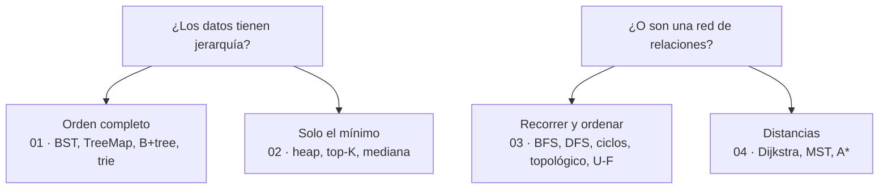

# 04 — Árboles, montículos y grafos

> El bloque de las estructuras jerárquicas y en red. Es el que más aparece en una entrevista de
> backend **sin que el enunciado use la palabra**: dependencias, permisos, rutas, ciclos y
> rankings son todos este temario.
>
> **Vigencia:** 2026-09-18. · **Guía editorial:** [`prompts/guia-de-estilo-y-convenciones.md`](../prompts/guia-de-estilo-y-convenciones.md)

---

## Qué es esto

Cuatro capítulos que cubren las dos familias: **árboles** —incluido el B+tree de tu índice y el
heap de tu cola de prioridad— y **grafos** —recorridos, orden topológico y caminos mínimos—.

```text
Un curso de algoritmos → te enseña a implementar un árbol rojo-negro.
Este repaso            → te enseña por qué `TreeMap` lo usa, cuándo pagarlo, y por qué el
                         índice de tu base de datos no es un árbol binario.
```

Las preguntas **no llevan la respuesta al lado**: viven en [`06-respuestas.md`](06-respuestas.md).

---

## Orden de lectura

| # | Documento | Qué cubre |
|---|---|---|
| `01` | [Árboles](01-arboles.md) | Recorridos, BST y su degeneración, AVL vs rojo-negro, `TreeMap`, **B+tree**, trie |
| `02` | [Montículos y colas de prioridad](02-monticulos-y-colas-de-prioridad.md) | Heap en un arreglo, `heapify` en O(n), las trampas de `PriorityQueue`, top-K y mediana |
| `03` | [Grafos: representación y recorridos](03-grafos-representacion-y-recorridos.md) | Matriz vs lista, BFS y DFS, ciclos con tres colores, orden topológico, Union-Find |
| `04` | [Caminos mínimos y expansión mínima](04-caminos-minimos-y-expansion-minima.md) | Dijkstra, Bellman-Ford, Floyd-Warshall, A\*, Kruskal y Prim |
| `05` | [Simulación de entrevista](05-simulacion-de-entrevista.md) | 34 preguntas transversales + 5 problemas de pizarra |
| `06` | [Respuestas](06-respuestas.md) | Solucionario completo del bloque, en tres capas |

**Si el calendario aprieta**, `02` y `03` son los que más rinden: el heap porque el top-K aparece en
cualquier conversación de diseño, y los recorridos porque el orden topológico está detrás de
problemas que vas a reconocer de tu propio trabajo. `04` es el más "de libro" y el que menos se
pregunta fuera de las empresas que hacen prueba de código.

---

## Mapa mental del bloque



`01` y `02` son dos formas de organizar lo mismo con objetivos distintos: el árbol mantiene el
**orden total** y el heap solo el **mínimo**, y por eso el segundo es más barato. `03` y `04` son la
misma estructura con dos preguntas: **cómo llego** y **cuánto cuesta llegar**.

---

## Las cuatro cosas que este bloque deja claras

1. **Un BST sin balanceo se degenera con la entrada más común del mundo**: datos ya ordenados.
2. **Construir un heap es O(n)**, no O(n log n), y casi todo el mundo contesta mal.
3. **BFS y DFS son el mismo algoritmo** con una cola o una pila; y "detectar ciclos" y "decidir el
   orden" son la misma pregunta.
4. **Dijkstra falla con pesos negativos en silencio**, y el porqué —cierra nodos asumiendo que su
   distancia es final— es lo que distingue la respuesta.

---

## Qué NO está aquí

- **Complejidad, recursión y TDAs** → bloque [`01-fundamentos`](../01-fundamentos/), que este asume
  leído. En particular, la pila de recursión y el `StackOverflowError`.
- **El trie como algoritmo de cadenas** → se usa aquí como estructura; su papel en la búsqueda de
  patrones está en [`02-texto`](../02-texto/).
- **Ordenación, comparadores y hashing** → bloque
  [`03-orden-busqueda`](../03-orden-busqueda/). El heapsort y el contrato de `compareTo` viven
  allí.
- **Programación dinámica sobre grafos** → bloque [`05-dp-y-tecnicas`](../05-dp-y-tecnicas/).
  Floyd-Warshall se presenta aquí y su naturaleza de DP se explica allí.
- **El código implementado en los cinco lenguajes** → bloque opcional
  [`09-implementaciones`](../09-implementaciones/).
- **Diseño de índices, particionado y modelo de datos** → son de
  [`repaso-arquitectura-entrevistas`](../../../arquitectura/01-bases/).
