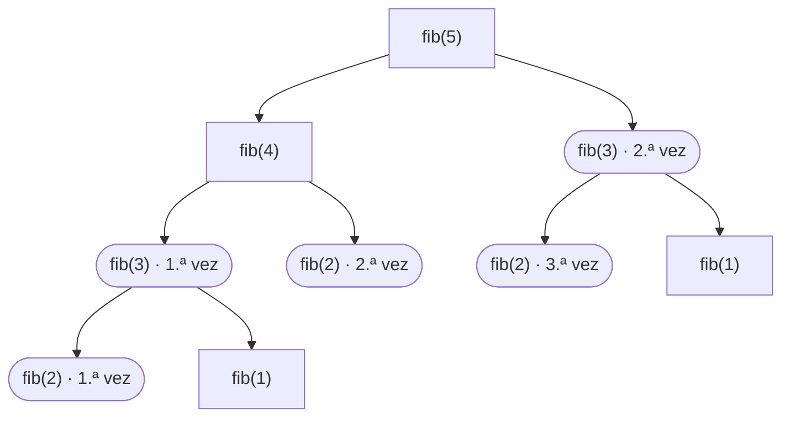

# 01 — Programación dinámica

> Las dos condiciones que hay que comprobar antes de decir "esto es DP", la diferencia real entre
> memoizar y tabular, los cuatro problemas que se preguntan —mochila, LCS, cambio de monedas y
> subsecuencia creciente—, y el truco que baja el espacio de O(n·W) a O(W) y que casi nadie
> explica bien.
> Asume leído [`01-fundamentos/04` — Recursión y backtracking](../01-fundamentos/04-recursion-y-backtracking.md).
>
> **Vigencia:** 2026-09-18.

---

## 1. 🎯 El problema

El Fibonacci recursivo ingenuo hace más de dos mil millones de llamadas para `fib(40)`. No porque
el problema sea difícil, sino porque **recalcula lo mismo una y otra vez**:



Guardar cada resultado la primera vez que se calcula lo convierte de O(2ⁿ) a **O(n)**. Ese es todo
el contenido de la programación dinámica: **no hay un algoritmo, hay una observación**.

Y la observación tiene una forma reconocible. Cuando un problema pide "el máximo", "el mínimo", "de
cuántas formas" o "es posible", y la solución obvia es probar todas las combinaciones, y esas
combinaciones **comparten trabajo**, es DP. Reconocer esas tres señales juntas es lo que separa
resolver el problema de quedarse mirándolo.

> **Regla de entrevista:** antes de decir "DP", comprueba en voz alta las **dos condiciones**:
> subestructura óptima y subproblemas solapados. Si solo se cumple la primera, es divide y
> vencerás; si no se cumple ninguna, es fuerza bruta o voraz.

---

## 2. 🧱 Las dos condiciones

**Subestructura óptima.** La solución óptima del problema se construye con soluciones óptimas de
subproblemas. El camino mínimo de A a C pasando por B contiene el camino mínimo de A a B: si
hubiera uno mejor, lo sustituirías y mejorarías el total.

**Subproblemas solapados.** Los mismos subproblemas aparecen muchas veces. Fibonacci los solapa
masivamente; merge sort **no** —cada mitad es distinta— y por eso merge sort es divide y vencerás y
no DP.

```text
Subestructura óptima  +  subproblemas solapados   →  programación dinámica
Subestructura óptima  +  subproblemas disjuntos   →  divide y vencerás
Subestructura óptima  +  elección local segura    →  voraz  (ver `02`)
Ninguna de las dos                                →  fuerza bruta / backtracking
```

**Cuándo falla la subestructura óptima**, que es el caso que conviene saber nombrar: el **camino
más largo sin repetir nodos** en un grafo general no la tiene. El camino más largo de A a C no
contiene necesariamente el más largo de A a B, porque usar los nodos "buenos" en el primer tramo
puede impedirte usarlos después. Por eso el camino mínimo es fácil y el máximo es NP-difícil, y es
una de las respuestas más elegantes que se pueden dar sobre este tema.

> **Veredicto:** DP no es una técnica que se aplica, es una propiedad que se detecta. Las dos
> condiciones son la comprobación, y decirlas antes de escribir código es lo que demuestra
> método.

---

## 3. 🧱 Memoización contra tabulación

Son las dos formas de implementar lo mismo, y la diferencia importa más de lo que parece.

**Memoización (descendente).** Escribes la recursión natural y guardas resultados en un mapa o
arreglo. Solo se calculan los subproblemas que **hacen falta**.

**Tabulación (ascendente).** Llenas una tabla desde los casos base hacia arriba, con bucles. Se
calculan **todos** los estados, aunque no se usen.

| | **Memoización** | **Tabulación** |
|---|---|---|
| Forma | Recursión + caché | Bucles + tabla |
| Calcula | Solo lo necesario | Todos los estados |
| Pila | **O(profundidad)** | Ninguna |
| Optimizar espacio | No se puede | **Sí**, a O(1) o O(W) |
| Escribir | Más fácil: sale de la recursión | Más difícil: hay que ordenar los estados |

- **La tabulación no gasta pila**, y por eso es la única viable cuando la profundidad es grande: la
  memoización de Fibonacci hasta n = 100 000 desborda.
- **Solo la tabulación permite la optimización de espacio** de la sección 6, porque para tirar
  filas viejas hay que saber en qué orden se llenan.
- **La memoización gana cuando el espacio de estados es enorme y solo se visita una parte pequeña.**
  Es el caso de muchos problemas con restricciones fuertes.

```java
// Tabulación con espacio O(1): el estado i solo depende de i-1 e i-2
long anterior = 0, actual = 1;
for (int i = 2; i <= n; i++) { long siguiente = anterior + actual; anterior = actual; actual = siguiente; }
```

- Fíjate en que **no hay tabla**: cuando la recurrencia solo mira hacia atrás dos posiciones, dos
  variables bastan. De O(n) de espacio a O(1).

> 💡 **Truco.** En una entrevista, escribe primero la **memoización**: sale directamente de la
> recursión y es más difícil equivocarse. Después di *"y esto se puede tabular para quitar la pila,
> y además reducir el espacio a una fila"*. Dices las dos y solo escribes una.

---

## 4. 🧱 Cómo se ataca un problema de DP

El método, en cinco pasos, y funciona para los cuatro problemas de la sección 5:

```text
1. Define el ESTADO.        "dp[i][w] = el mejor valor usando los i primeros y capacidad w"
2. Escribe la RECURRENCIA.  ¿cómo se construye dp[i][w] a partir de estados menores?
3. Fija los CASOS BASE.     dp[0][*] = 0
4. Decide el ORDEN.         ¿en qué orden se llenan para que las dependencias estén listas?
5. Extrae la RESPUESTA.     ¿está en dp[n][W], o hay que buscar el máximo de una fila?
```

- **El estado es el 80 % del trabajo.** Casi todos los problemas de DP que parecen imposibles se
  vuelven mecánicos cuando encuentras la definición correcta del estado. Y casi todos los fallos
  vienen de un estado que no captura toda la información necesaria.
- **La recurrencia siempre tiene la misma forma**: una elección. *"En cada paso decido entre A y
  B, y me quedo con el mejor"*. En la mochila, incluir o no el objeto; en LCS, avanzar en una
  cadena o en la otra.
- **La respuesta no siempre está en la última celda.** En la subsecuencia creciente más larga hay
  que buscar el máximo de todo el arreglo, y olvidarlo es un error frecuente.

---

## 5. 🧱 Los cuatro que se preguntan

**Mochila 0/1.** n objetos con peso y valor, capacidad W, maximizar el valor sin pasarse.

```text
dp[i][w] = max( dp[i-1][w],                          no incluir el objeto i
                dp[i-1][w - peso[i]] + valor[i] )    incluirlo, si cabe

Complejidad: O(n·W) en tiempo y espacio
```

- Es **pseudopolinómica**, no polinómica: W es el **valor** de la capacidad, no el tamaño de la
  entrada. Con W = 10⁹ la tabla no cabe, y decir eso es la respuesta cara.
- La variante **ilimitada** —puedes repetir objetos— cambia `dp[i-1]` por `dp[i]` en el segundo
  término, y es el cambio de una línea que conviene saber explicar.

**Cambio de monedas.** El mínimo número de monedas para una cantidad. Es la mochila ilimitada con
valor 1 por moneda.

- **El voraz falla** con sistemas de monedas arbitrarios: con `{1, 3, 4}` y objetivo 6, el voraz da
  4+1+1 = 3 monedas y el óptimo es 3+3 = 2. Con el sistema del euro sí funciona, y esa diferencia
  es el ejemplo canónico de [`02`](02-algoritmos-voraces.md).

**LCS — subsecuencia común más larga.** Entre dos cadenas, la subsecuencia —no contigua— más larga
que comparten.

```text
si a[i] == b[j]:  dp[i][j] = dp[i-1][j-1] + 1
si no:            dp[i][j] = max(dp[i-1][j], dp[i][j-1])
```

- Es el algoritmo detrás de `diff` y de `git diff`. Y es primo hermano de la **distancia de
  edición** de [`02-texto/02`](../02-texto/02-algoritmos-de-cadenas.md): la misma matriz con otra
  recurrencia.

**Subsecuencia creciente más larga (LIS).** O(n²) con DP directa, y **O(n log n)** con una variante
que mantiene un arreglo de colas y usa búsqueda binaria. Es el problema donde la DP obvia no es la
mejor solución, y saberlo es un buen detalle.

---

## 6. 🧱 La optimización de espacio

**El problema.** La mochila con n = 1 000 y W = 100 000 son 10⁸ celdas: 400 MB en `int`. No cabe.

**Cómo va.** Si `dp[i]` solo depende de `dp[i-1]`, no hace falta guardar todas las filas: basta
una, **recorrida al revés**.

```java
int[] dp = new int[capacidad + 1];
for (int i = 0; i < objetos.length; i++) {
    for (int w = capacidad; w >= objetos[i].peso(); w--) {   // AL REVÉS: esa es la clave
        dp[w] = Math.max(dp[w], dp[w - objetos[i].peso()] + objetos[i].valor());
    }
}
```

- **Por qué al revés.** Al recorrer descendiendo, `dp[w - peso]` todavía contiene el valor de la
  fila **anterior**, que es lo que la recurrencia 0/1 necesita. Recorriendo hacia delante ya estaría
  actualizado con la fila actual, y estarías permitiendo usar el objeto **dos veces**.
- **Ese detalle es la diferencia entre la mochila 0/1 y la ilimitada.** Mismo código, distinto
  sentido del bucle: adelante para la ilimitada, atrás para la 0/1. Es de las cosas que mejor
  demuestran que entendiste la recurrencia y no la copiaste.

**Lo que se pierde.** Con una sola fila **no se puede reconstruir la solución**: sabes el valor
máximo, no qué objetos lo componen. Si hace falta la lista, hay que mantener la matriz completa, o
usar el algoritmo de Hirschberg, que reconstruye en O(mín(n, m)) de espacio a costa de duplicar el
tiempo.

> ⚠️ **Advertencia.** Reducir el espacio es una optimización con precio, no una mejora gratuita.
> Antes de aplicarla, pregunta si hace falta **el valor** o **la solución**. Es la pregunta que el
> entrevistador hará justo después.

---

## 7. ⏱️ La tabla de costes

| Problema | Tiempo | Espacio | Espacio optimizado | Lo que la tabla no dice |
|---|---|---|---|---|
| Fibonacci | O(n) | O(n) | **O(1)** | Sin memoizar es O(2ⁿ): la diferencia es el tema entero |
| Mochila 0/1 | O(n·W) | O(n·W) | **O(W)** | Pseudopolinómica: W es el valor, no el tamaño de la entrada |
| Cambio de monedas | O(n·cantidad) | O(cantidad) | — | El voraz falla con sistemas arbitrarios |
| LCS | O(n·m) | O(n·m) | O(mín(n,m)) | Optimizar impide reconstruir la subsecuencia |
| Distancia de edición | O(n·m) | O(n·m) | O(mín(n,m)) | Misma matriz que LCS, otra recurrencia |
| LIS | O(n²) con DP | O(n) | — | **O(n log n)** con colas + binaria: la DP no es lo óptimo |
| DP sobre máscaras | O(2ⁿ · n) | O(2ⁿ) | — | Aguanta hasta n ≈ 20. Es backtracking memoizado |

---

## 8. ⚖️ Los cinco lenguajes

| Lenguaje | Memoización | El detalle que muerde |
|---|---|---|
| **Java** | `HashMap` a mano | `computeIfAbsent` con recursión dentro **lanza excepción** desde Java 9 |
| **Python** | **`@functools.cache`** | Una línea sobre la función recursiva. Pero el límite de recursión es 1 000 |
| **JavaScript** | `Map` a mano | Sin decoradores en el lenguaje base; la pila aguanta ~10 000 |
| **TypeScript** | Igual que JS | Los tipos ayudan a no confundir índices de estado, que es un bug real |
| **Go** | `map` a mano | Pila que crece: la memoización profunda es viable donde en Java revienta |

La diferencia práctica más grande es Python: `@functools.cache` convierte una recursión exponencial
en lineal **añadiendo una línea**, sin tocar el cuerpo de la función. Es el ejemplo más claro de
todo el corpus de "el lenguaje trae la técnica hecha", y la contrapartida —el límite de recursión de
mil niveles— obliga a tabular exactamente cuando el problema crece.

En Java, el error que hay que evitar está documentado en
[`01-fundamentos/04`](../01-fundamentos/04-recursion-y-backtracking.md): `computeIfAbsent` con una
llamada recursiva dentro modifica el mapa mientras lo tiene bloqueado y lanza
`ConcurrentModificationException`. Hay que consultar y guardar en dos pasos.

---

## 9. 🧭 Cómo se elige

```text
¿Los subproblemas se repiten?                       → DP. Si no, no es DP
¿Hay que ENUMERAR todas las soluciones?             → backtracking, no DP (la salida es exponencial)
¿Hay que CONTAR u OPTIMIZAR?                        → DP casi siempre
¿Una elección local es demostrablemente segura?     → voraz, que es más barato (ver `02`)

¿Escribes en una entrevista?                        → memoización primero, y menciona la tabulación
¿La profundidad puede ser grande?                   → tabulación, o desbordas la pila
¿El espacio no cabe?                                → una fila, recorrida al revés para 0/1
¿Necesitas la solución y no solo el valor?          → NO optimices el espacio
```

> **Regla de entrevista:** empieza por la fuerza bruta recursiva y dila en voz alta con su
> complejidad. Añadir un mapa encima es **una línea**, y ese camino —bruta → memoizada → tabulada →
> espacio optimizado— es exactamente la narración que el entrevistador quiere oír.

---

## 10. 🔭 Dónde aparece de verdad

En `git diff` y en cualquier herramienta de comparación, que son LCS; en el corrector ortográfico y
en la deduplicación de clientes, que son distancia de edición; en el optimizador de consultas de una
base de datos, que elige el orden de los *joins* con DP sobre subconjuntos de tablas —y por eso
Postgres cambia a una heurística genética a partir de 12 tablas—; en el alineamiento de secuencias
de ADN, que es el mismo algoritmo con otra matriz de puntuación; y en la planificación de recursos
con presupuesto, que es la mochila con otro nombre.

---

## ⚠️ Errores frecuentes

| Se dice | Lo preciso |
|---|---|
| "Esto es DP porque es recursivo" | Hace falta que los subproblemas **se repitan**. Si no, es divide y vencerás |
| "La mochila es polinómica" | Es **pseudopolinómica**: O(n·W) con W el valor de la capacidad |
| "El voraz resuelve el cambio de monedas" | Solo con sistemas canónicos. Con `{1,3,4}` y 6 falla |
| "Memoizar y tabular es lo mismo" | Solo la tabulación evita la pila y permite optimizar el espacio |
| "Reduzco el espacio a una fila y ya" | Pierdes la capacidad de reconstruir **qué** compone la solución |
| "Recorro la capacidad hacia delante" | En la mochila 0/1 hay que ir **al revés**, o usas el objeto dos veces |
| "El camino más largo es como el más corto" | No tiene subestructura óptima: es NP-difícil |

---

## 📚 Para profundizar

- **Libro** — Cormen, Leiserson, Rivest y Stein, *Introduction to Algorithms*, 4ª ed. (MIT
  Press, 2022). Capítulo 14 completo: las dos condiciones, la mochila, LCS y la reconstrucción de
  la solución. **Si solo lees un capítulo de este tema, lee este.**
- **Libro** — Skiena, *The Algorithm Design Manual*, 3ª ed. (Springer, 2020). Capítulo 10: el mejor
  tratamiento de **cómo encontrar el estado**, que es la parte difícil y la que los demás libros
  dan por sabida.
- **Libro** — Aziz, Lee y Prakash, *Elements of Programming Interviews in Java* (2018). Su capítulo
  de DP está calibrado para entrevista y trae la progresión bruta → memoizada → tabulada.
- [cp-algorithms — Knapsack problem](https://cp-algorithms.com/dynamic_programming/knapsack.html):
  las variantes 0/1 e ilimitada con la optimización de espacio y el sentido del bucle explicado.
- [Python — `functools`](https://docs.python.org/3/library/functools.html): `cache` y `lru_cache`,
  con la diferencia entre ambos y sus límites.
- [Java 21 API — `HashMap`](https://docs.oracle.com/en/java/javase/21/docs/api/java.base/java/util/HashMap.html):
  la advertencia sobre modificación reentrante en `computeIfAbsent`, que es el bug de este capítulo.
- **Tutorial** — Baeldung, «Dynamic Programming in Java»: la progresión con código, útil para ver
  las cuatro variantes seguidas.
- **Video** — MIT OpenCourseWare, *Introduction to Algorithms* (6.006), las cuatro clases de
  programación dinámica: son las que mejor explican el paso de la recursión a la tabla.

---

## 🧠 Preguntas

Sin respuestas aquí. Todas, con enunciado literal y respuesta en tres capas, en
[`05` — Respuestas](05-respuestas.md).

1. ¿Cuáles son las dos condiciones para que un problema sea de programación dinámica? 🟢
2. ¿Qué complejidad tiene Fibonacci con y sin memoización? 🟢
3. ¿Qué diferencia hay entre memoización y tabulación? 🟢
4. ¿Cuál es el estado de la mochila 0/1 y cuál su recurrencia? 🟢
5. ¿Qué complejidad tiene la mochila 0/1? 🟢
6. ¿Qué problema real resuelve el algoritmo de LCS? 🟢
7. ¿Por qué merge sort no es programación dinámica si es recursivo? 🟡
8. ¿Por qué la mochila es pseudopolinómica y no polinómica? 🟡
9. ¿Qué gana la tabulación frente a la memoización? Da dos cosas. 🟡
10. ¿Cuándo gana la memoización frente a la tabulación? 🟡
11. ¿Por qué el voraz falla en el cambio de monedas con `{1, 3, 4}` y objetivo 6? 🟡
12. ¿Qué relación hay entre LCS y la distancia de edición? 🟡
13. ¿Cuál es el paso más difícil al atacar un problema de DP? 🟡
14. ¿Por qué el camino más largo en un grafo no se resuelve con DP como el más corto? 🟠
15. ¿Por qué en la mochila 0/1 con una sola fila hay que recorrer la capacidad al revés? 🟠
16. ¿Qué cambia entre la mochila 0/1 y la ilimitada en el código? 🟠
17. ¿Qué pierdes al reducir el espacio de una DP a una sola fila? 🟠
18. ¿Por qué `computeIfAbsent` con recursión dentro falla en Java 9+ y cómo se memoiza bien? 🟠
19. ¿Por qué la subsecuencia creciente más larga tiene una solución mejor que la DP obvia? 🟠
20. ¿Cuándo un problema que parece de DP es en realidad de backtracking? 🟠
21. ¿Qué es la DP sobre máscaras de bits y hasta qué tamaño de entrada aguanta? 🟠
22. ¿Por qué Postgres deja de usar DP para ordenar los *joins* a partir de 12 tablas? 🟠
23. Diseña la solución para "con un presupuesto de X, qué combinación de mejoras maximiza el
    rendimiento", y di qué devuelves además del valor. 🔴
24. Escribe la recurrencia de LCS, trázala sobre `"casa"` y `"cosa"`, y di dónde está la
    respuesta. 🔴
25. Te dan un problema de DP con 10⁶ estados y memoización recursiva que desborda la pila. Da la
    conversión y su coste. 🔴

---

**Siguiente:** [`02` — Algoritmos voraces](02-algoritmos-voraces.md) ·
**Relacionado:** [`01-fundamentos/04` — Recursión](../01-fundamentos/04-recursion-y-backtracking.md)
