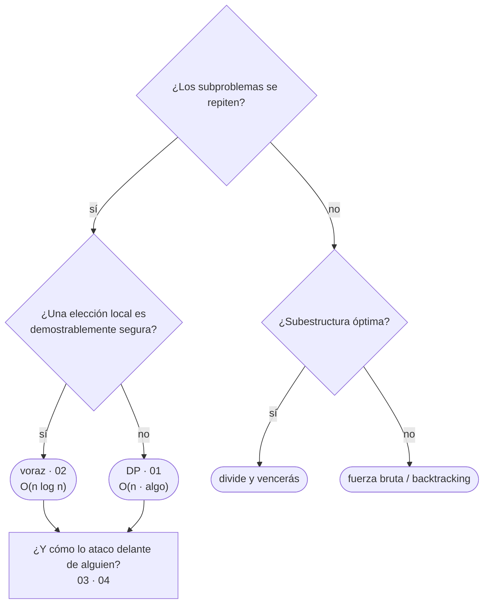

# 05 — Programación dinámica, voraces y protocolo

> El bloque de cierre. Las dos técnicas que deciden entre "probar todo" y "elegir y seguir", y el
> capítulo que convierte todo el corpus en un procedimiento: qué preguntas, en qué orden, y cómo se
> traduce un enunciado en una técnica.
>
> **Vigencia:** 2026-09-18. · **Guía editorial:** [`prompts/guia-de-estilo-y-convenciones.md`](../prompts/guia-de-estilo-y-convenciones.md)

---

## Qué es esto

Dos capítulos de técnica y uno de método. Los dos primeros responden a "¿pruebo todas las opciones o
elijo una?"; el tercero responde a "¿qué hago los primeros cinco minutos?", que es lo que más veces
decide el resultado de una entrevista.

```text
Un curso de algoritmos → te enseña la recurrencia de la mochila.
Este repaso            → te enseña a detectar que el sprint que estás planificando ES la mochila,
                         y que el voraz que usa todo el mundo no es óptimo.
```

Las preguntas **no llevan la respuesta al lado**: viven en [`05-respuestas.md`](05-respuestas.md).

---

## Orden de lectura

| # | Documento | Qué cubre |
|---|---|---|
| `01` | [Programación dinámica](01-programacion-dinamica.md) | Las dos condiciones, memoizar vs tabular, mochila, LCS, cambio de monedas, LIS, optimización de espacio |
| `02` | [Algoritmos voraces](02-algoritmos-voraces.md) | Cuándo es óptimo, el argumento de intercambio, los cinco casos buenos y los dos contraejemplos |
| `03` | [Protocolo de pizarra](03-protocolo-de-pizarra.md) | Los siete pasos, las seis preguntas, **el mapa de señales**, las cuatro plantillas, los casos borde |
| `04` | [Simulación de entrevista](04-simulacion-de-entrevista.md) | **El examen final del corpus**: 30 preguntas + 5 problemas sin pista de técnica |
| `05` | [Respuestas](05-respuestas.md) | Solucionario completo del bloque, en tres capas |

**Si el calendario aprieta**, lee `03` **primero**, aunque rompa el orden. El mapa de señales y los
siete pasos son lo que más rinde por minuto de todo el corpus, y funcionan aunque no hayas terminado
los bloques anteriores.

---

## Mapa mental del bloque



---

## Las cuatro cosas que este bloque deja claras

1. **DP no es una técnica que se aplica, es una propiedad que se detecta**: subestructura óptima más
   subproblemas solapados.
2. **El voraz es la técnica más peligrosa del temario**: parece correcta casi siempre y lo es casi
   nunca. Se propone con su justificación o con su contraejemplo.
3. **Quince filas del mapa de señales cubren casi todos los enunciados** de una entrevista de
   backend. Reconocer la fila vale más que saberse un algoritmo más.
4. **El silencio es lo único que penaliza siempre.** Lo que se evalúa es cómo trabajas cuando no
   sabes la respuesta todavía.

---

## Qué NO está aquí

- **Todo lo anterior**, que este bloque asume leído: complejidad y recursión
  ([`01-fundamentos`](../01-fundamentos/)), texto ([`02-texto`](../02-texto/)), ordenación y hashing
  ([`03-orden-busqueda`](../03-orden-busqueda/)), árboles y grafos
  ([`04-arboles-grafos`](../04-arboles-grafos/)).
- **La distancia de edición como algoritmo de cadenas** → se usa aquí como ejemplo de DP; su papel en
  la búsqueda de patrones está en [`02-texto`](../02-texto/).
- **Dijkstra, Kruskal y Prim** → se mencionan aquí como voraces; sus mecanismos están en
  [`04-arboles-grafos`](../04-arboles-grafos/).
- **El código implementado en los cinco lenguajes** → bloque opcional
  [`09-implementaciones`](../09-implementaciones/).
- **Flujo máximo, geometría computacional y DP sobre árboles** → fuera del alcance declarado del
  corpus: son de competitive programming, no de una entrevista de backend senior.
