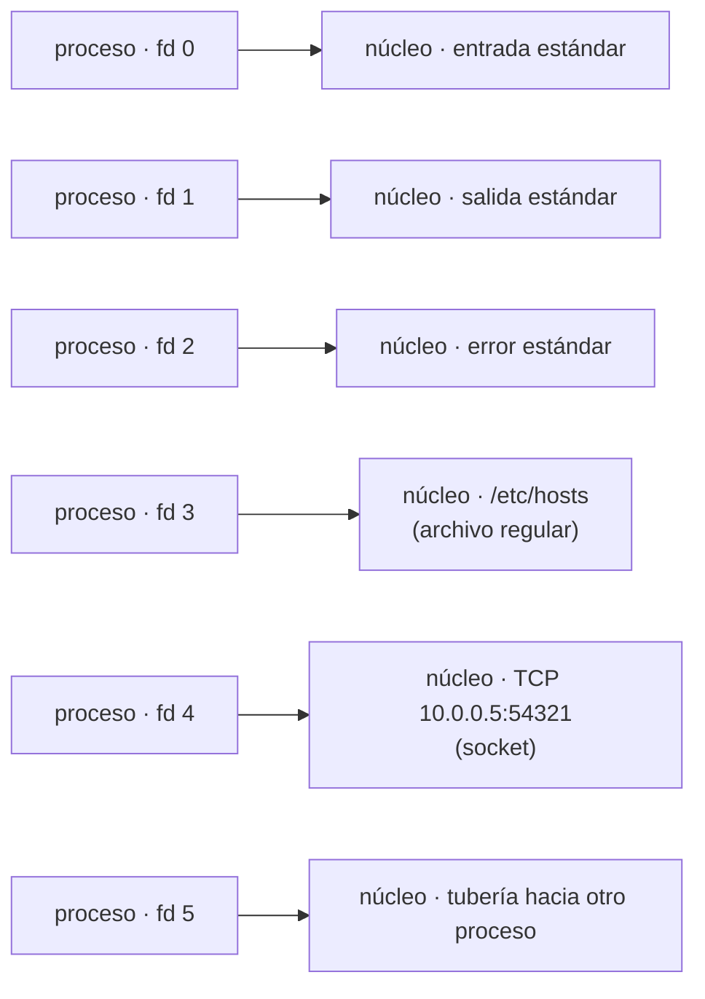

# 01 — El descriptor y el recurso

> El número entero que está detrás de todo lo que tu proceso abre: archivos, sockets, tuberías,
> terminales. Cuánto valen, cuántos hay, por qué se agotan, y quién los cierra cuando tú no lo haces
> —que en cada lenguaje es alguien distinto y en dos de ellos no es nadie—.
>
> **Asume leído:** [`06/03` — Estructuras y concurrencia](../06-numeros-tiempo-concurrencia/03-estructuras-y-concurrencia.md),
> del que hereda el vocabulario de hilos.
>
> **Vigencia:** 2026-09-18. Todas las salidas de este capítulo están **ejecutadas**.

---

## 1. 🎯 El problema

Un servicio lleva ocho meses en producción. Una tarde, sin despliegue de por medio y con la memoria
a media máquina, empieza a fallar todo a la vez: no acepta conexiones, no lee archivos, no conecta a
la base de datos. En el log, siempre el mismo error:

```text
java.net.SocketException: Too many open files
```

No hay fuga de memoria, no hay CPU al 100 %, no hay disco lleno. **Se agotó un recurso que casi nadie
mide**, y que no aparece en ningún panel: los descriptores de archivo del proceso.

Y la trampa está en el límite. En esta máquina:

```bash
ulimit -n                      # límite blando del shell
sysctl -n kern.maxfilesperproc # tope por proceso del núcleo
```

```text
ulimit -n            1048576
kern.maxfilesperproc  122880
```

Abriendo descriptores hasta agotarlos, el proceso muere aquí:

```text
RLIMIT_NOFILE  blando=1048576  duro=9223372036854775807
se agotó tras 122877 descriptores -> [Errno 24] Too many open files
```

**El límite que aplica no es el que dice `ulimit`.** Es el menor de todos los que hay en juego, y hay
al menos tres: el del shell, el del núcleo por proceso y el del contenedor. Diagnosticar esto mirando
solo uno es la razón de que el incidente dure horas.

---

## 2. 🧱 Qué es un descriptor de archivo

**Qué es.** Un **entero pequeño**, índice en una tabla que el núcleo mantiene por proceso. Cada
entrada apunta a un objeto abierto: un archivo, un socket, una tubería, un terminal, un temporizador.



**Cómo va.** Las llamadas al sistema que importan son cuatro, y son las mismas para todos los tipos:
`open` devuelve el descriptor libre más bajo, `read` y `write` lo usan, `close` lo libera. Que sean
las mismas para un archivo y para un socket es el paradigma del capítulo `02`.

- **Se reutilizan, y ese es un error clásico**: si cierras el `fd 7` y abres otra cosa, lo más
  probable es que la nueva sea también el `7`. Un puntero guardado al descriptor viejo ahora apunta a
  un recurso ajeno, y escribe en él sin error.
- **Los hereda el hijo.** Un proceso creado con `fork`/`exec` hereda los descriptores abiertos salvo
  que estén marcados con `CLOEXEC`. De ahí que un proceso hijo pueda quedarse agarrado a un puerto
  que creías cerrado.
- **En Java y en Go no ves el número**, pero está: un `FileInputStream`, un `Socket` y un `os.File`
  envuelven un descriptor. Que no se vea es lo que hace que se olvide.

**Cuánto cuesta.** El descriptor en sí es un entero: nada. Lo que cuesta es **lo que hay detrás** —
búferes del núcleo, la estructura del socket— y sobre todo que **el número total es un recurso
finito y compartido**.

**Cuándo sí** preocuparte: siempre que abras algo dentro de un bucle, en un manejador de peticiones o
en código que se ejecute por evento.

**Cuándo no:** en un `main` que abre tres archivos y termina. Ahí el proceso al morir lo libera todo.

> **Veredicto:** el descriptor es el recurso que no se mide y que se agota. Memoria y CPU tienen
> paneles en todas partes; los descriptores abiertos, casi nunca — y son la causa de una familia
> entera de incidentes que parecen otra cosa.

---

## 3. 🧱 Quién cierra si tú no cierras

**El problema.** Abres un archivo en un bucle y no lo cierras. ¿Qué pasa? La respuesta **depende del
lenguaje**, y la diferencia es de varios órdenes de magnitud. Medido, 200 aperturas sin cerrar:

```text
Python, 200 open() sin close():           descriptores extra = 1
Java,   200 open sin close (antes de GC): descriptores extra = 200
Java,   tras System.gc():                 descriptores extra = 0
```

**Qué está pasando en cada caso:**

- **Python usa conteo de referencias.** Al reasignar la variable, el objeto anterior queda sin
  referencias y se destruye **inmediatamente**, cerrando el descriptor. Por eso el contador se queda
  en uno: solo vive el último. Es determinista y por eso funciona.
- **Java se apoya en el recolector de basura.** El descriptor vive hasta que el recolector pasa y
  ejecuta el `Cleaner` asociado. Y ahí está el veneno: **el recolector se dispara por presión de
  memoria, no por presión de descriptores.** Un objeto que envuelve un descriptor ocupa unas decenas
  de bytes en el montón, así que puedes acumular cien mil descriptores con el montón medio vacío y
  sin que el recolector vea ninguna razón para actuar.
- **Go no cierra nada.** No hay finalizadores fiables: si no llamas a `Close`, el descriptor vive
  hasta que muere el proceso. Es el más explícito de los tres y también el más honesto.

> ⚠️ **La consecuencia que hay que saber decir.** El incidente de "too many open files" en Java
> aparece **con memoria libre de sobra**, porque son dos recursos independientes y solo uno tiene
> presión. Por eso el panel de memoria está verde mientras el servicio se cae, y por eso el
> diagnóstico se va por el camino equivocado.

---

## 4. 🧱 El cierre determinista en los cinco lenguajes

**Qué es.** La construcción que garantiza que el recurso se libera al salir del ámbito, **pase lo que
pase**, incluida una excepción.

```java
// Java — try-with-resources: cierra en orden inverso, incluso si el cuerpo lanza
try (var in = Files.newInputStream(p); var out = Files.newOutputStream(q)) {
    in.transferTo(out);
}
```

```python
# Python — with: el gestor de contexto llama a __exit__ siempre
with open(origen, "rb") as ent, open(destino, "wb") as sal:
    shutil.copyfileobj(ent, sal)
```

```go
// Go — defer: se ejecuta al salir de la FUNCIÓN, no del bloque
f, err := os.Open(ruta)
if err != nil { return err }
defer f.Close()
```

```javascript
// JavaScript — no hay construcción clásica: finally, o using (TC39, ya en TypeScript 5.2)
const fh = await fs.open(ruta);
try { /* … */ } finally { await fh.close(); }
```

Las trampas de cada uno, que son preguntas de entrevista:

- **Java:** solo funciona con `AutoCloseable`, y **cerrar dos veces** debe ser inofensivo — lo es en
  las clases del JDK. El error frecuente es abrir el recurso **fuera** del paréntesis y creer que se
  cierra igual.
- **Python:** `with` sobre varios recursos en una línea los cierra en orden inverso, igual que Java.
  El error frecuente es abrir dentro de una comprensión de listas, donde no hay ámbito que cierre.
- **Go:** `defer` se ejecuta al salir de **la función**, no del bloque. Un `defer f.Close()` dentro de
  un bucle **acumula** todos los cierres hasta el final de la función: es la fuga de descriptores más
  común del lenguaje, y la corrección es extraer el cuerpo del bucle a su propia función.
- **JavaScript y TypeScript:** hasta hace poco solo había `try/finally`. `using` y `await using` son
  la construcción nueva —propuesta de TC39, disponible en TypeScript desde 5.2— y requieren que el
  objeto implemente `Symbol.dispose` o `Symbol.asyncDispose`.

**Cuánto cuesta.** Nada en tiempo de ejecución: es una construcción del compilador. Lo que cuesta es
la disciplina.

**Cuándo sí.** Siempre. No hay caso donde un recurso deba quedar abierto al salir del ámbito salvo que
lo estés devolviendo, y entonces la responsabilidad de cerrarlo pasa a quien lo recibe — y eso hay
que **documentarlo en la firma**.

**Cuándo no** aplica: cuando el recurso vive tanto como el proceso —un pool de conexiones, un
servidor de escucha—. Esos se cierran en el apagado ordenado, y también hay que escribirlo.

> **Veredicto:** el cierre determinista no es una buena práctica, es la única forma de que el recurso
> se libere cuando tú decides. Delegarlo al recolector funciona en las pruebas y falla en producción,
> porque en producción hay concurrencia y el recolector no sabe nada de descriptores.

---

## 5. 🧱 Diagnosticar una fuga

**El problema.** El servicio da `Too many open files`. Tienes quince minutos.

```bash
# 1. ¿Cuántos tiene abiertos ahora y cuál es su límite real?
lsof -p <pid> | wc -l
cat /proc/<pid>/limits | grep "open files"    # en Linux; en macOS, launchctl limit maxfiles
```

- `lsof -p` lista todo lo que el proceso tiene abierto, con su tipo. Es la herramienta, y el conteo
  por sí solo ya dice si estás cerca del límite.
- El límite del **proceso** puede ser distinto del del shell donde lo lanzaste: si lo arrancó un
  gestor de servicios o un contenedor, manda el de ahí.

```bash
# 2. ¿De qué tipo son? Aquí está el diagnóstico, no en el total
lsof -p <pid> | awk '{print $5}' | sort | uniq -c | sort -rn | head
```

- Agrupar por tipo es lo que distingue los tres casos habituales: **`REG`** apunta a archivos que no
  se cierran; **`IPv4`/`IPv6`** a conexiones que no se cierran o a un pool mal configurado; y
  **`sock` en estado `CLOSE_WAIT`** a conexiones que el otro extremo cerró y tu código no.
- **`CLOSE_WAIT` acumulándose es casi siempre código tuyo**: el sistema operativo ya recibió el
  cierre del otro lado y espera que llames a `close`.

```bash
# 3. ¿Crece con el tiempo o con la carga?
while :; do echo "$(date +%T) $(lsof -p <pid> | wc -l)"; sleep 10; done
```

- Si crece **monótonamente** y no baja, es una fuga. Si sube con la carga y baja después, es
  dimensionado: el límite es demasiado bajo para la concurrencia real.
- Esa distinción decide la corrección: **una fuga se arregla en el código; un dimensionado, en la
  configuración.** Subir el límite ante una fuga solo retrasa el incidente.

> 💡 **Lo que hay que instrumentar antes del incidente.** Una métrica de descriptores abiertos, con
> alerta al 80 % del límite. En Java se obtiene del `UnixOperatingSystemMXBean`; en Linux, contando
> `/proc/self/fd`. Es de las métricas más baratas de exponer y de las que menos gente tiene.

---

## 6. ⏱️ La tabla de costes

| | Coste | Lo que la tabla no dice |
|---|---|---|
| Abrir un descriptor | una llamada al sistema, microsegundos | Lo caro es el total, no cada uno |
| Mantenerlo abierto | un entero + estructuras del núcleo | **Es un recurso finito y compartido** |
| Cerrarlo | una llamada al sistema | Olvidarlo no da error: da un incidente meses después |
| Delegar el cierre al GC (Java) | impredecible | El GC responde a memoria, no a descriptores |
| Delegarlo al conteo de referencias (Python) | inmediato | Falla con ciclos de referencias |
| No cerrarlo (Go) | permanente | Nadie lo hará por ti |

---

## ⚠️ Errores frecuentes

| Se dice | Lo preciso |
|---|---|
| "El límite es el de `ulimit -n`" | Manda el menor de shell, núcleo por proceso y contenedor |
| "El recolector cerrará los archivos" | En Java sí, cuando pase; y pasa por memoria, no por descriptores |
| "En Go el `defer` cierra al salir del bloque" | Sale al final de **la función**: en un bucle, acumula |
| "Si hay memoria libre, no hay fuga" | Son recursos independientes: se agotan descriptores con el montón vacío |
| "Subo el límite y listo" | Solo si es dimensionado. Ante una fuga, retrasa el incidente |
| "Un socket no es un descriptor" | Lo es, y por eso compite por el mismo límite que los archivos |
| "`CLOSE_WAIT` es problema de la red" | Es tu código: falta el `close` de tu lado |
| "Cerrar dos veces rompe" | En las clases del JDK es inofensivo; en un recurso propio, hay que garantizarlo |

---

## 📚 Para profundizar

- **Libro** — W. Richard Stevens y Stephen Rago, *Advanced Programming in the UNIX Environment*. El
  capítulo 3, de entrada y salida sin búfer, es la fuente de todo este capítulo.
- **Manual** — [`man 2 open`](https://man7.org/linux/man-pages/man2/open.2.html) y
  [`man 2 close`](https://man7.org/linux/man-pages/man2/close.2.html): la definición normativa, con
  la regla del descriptor libre más bajo y la advertencia sobre ignorar el error de `close`.
- **Manual** — [`man 2 getrlimit`](https://man7.org/linux/man-pages/man2/getrlimit.2.html): límites
  blandos y duros, y qué se puede subir sin privilegios.
- **Java** — [`try-with-resources`](https://docs.oracle.com/javase/tutorial/essential/exceptions/tryResourceClose.html)
  y [`UnixOperatingSystemMXBean`](https://docs.oracle.com/en/java/javase/21/docs/api/jdk.management/com/sun/management/UnixOperatingSystemMXBean.html),
  que es como se expone la métrica.
- **Go** — [Effective Go — *Defer*](https://go.dev/doc/effective_go#defer): explica el ámbito de
  función, que es justo donde está la trampa.
- **Python** — [*Context Managers*](https://docs.python.org/3/reference/datamodel.html#context-managers):
  el protocolo detrás de `with`.
- **TypeScript** — [TypeScript 5.2 — *Explicit Resource Management*](https://devblogs.microsoft.com/typescript/announcing-typescript-5-2/):
  `using`, `await using` y los símbolos de disposición.

---

## 🧠 Preguntas

Sin respuestas aquí. Todas, con enunciado literal y respuesta en tres capas, en
[`07` — Respuestas](07-respuestas.md).

1. ¿Qué es un descriptor de archivo? 🟢
2. ¿Qué tipos de recurso se representan con un descriptor? 🟢
3. ¿Qué significa el error `Too many open files`? 🟢
4. ¿Qué construcción garantiza el cierre en Java? ¿Y en Python? ¿Y en Go? 🟢
5. ¿Qué descriptores tiene todo proceso nada más arrancar? 🟢
6. ¿Qué hace `lsof -p`? 🟢
7. ¿Cierra el recolector de basura de Java los archivos que olvidaste? 🟢
8. ¿Cuánto cuesta mantener un descriptor abierto? 🟢
9. ¿Por qué `ulimit -n` puede no ser el límite que aplica? 🟡
10. ¿Por qué Python no acumula descriptores aunque no llames a `close`? 🟡
11. ¿Por qué Java sí los acumula? 🟡
12. ¿Qué hace Go si no cierras? 🟡
13. ¿Dónde está la trampa de `defer` dentro de un bucle? 🟡
14. ¿Por qué se reutilizan los números de descriptor y qué riesgo tiene? 🟡
15. ¿Qué significa que un descriptor esté en `CLOSE_WAIT`? 🟡
16. ¿Qué hereda un proceso hijo y cómo se evita? 🟡
17. ¿Cómo distingues una fuga de un problema de dimensionado? 🟠
18. ¿Por qué el incidente aparece con memoria libre de sobra? 🟠
19. ¿Por qué subir el límite no es la corrección ante una fuga? 🟠
20. Te dan quince minutos y un `pid`. Escribe los tres comandos, en orden, y qué concluyes de
    cada uno. 🟠
21. ¿Por qué un socket compite por el mismo límite que un archivo? 🟠
22. ¿Cuándo es legítimo devolver un recurso abierto desde una función? 🟠
23. ¿Qué métrica expondrías y con qué umbral de alerta? 🟠
24. Un proceso hijo mantiene un puerto ocupado después de que el padre lo cerrara. Explica y
    corrige. 🟠
25. Diseña la revisión de código que impediría esta clase de fuga en los cinco lenguajes: qué
    buscas y qué automatizas. 🔴
26. Un servicio acumula `CLOSE_WAIT` solo contra un proveedor concreto. Da tres hipótesis
    ordenadas y cómo las distingues. 🔴
27. Escribe el informe post-incidente de un `Too many open files`: causa raíz, por qué no se
    detectó antes, corrección inmediata y prevención. 🔴
28. Tu servicio abre un archivo por petición y lo cierra correctamente, y aun así se agotan los
    descriptores bajo carga. Explica cómo puede ocurrir y qué cambiarías. 🔴
29. Tu servicio corre en un contenedor con un límite de descriptores distinto al de la máquina.
    Explica cómo lo averiguas y qué manda. 🔴
30. Escribe la política de recursos de un equipo: qué se abre, quién cierra, qué se prohíbe en
    revisión y qué se mide. 🔴

---

**Siguiente:** [`02` — Todo es un archivo, y dónde se rompe](02-todo-es-un-archivo.md) ·
**Bloque:** [README](README.md)
