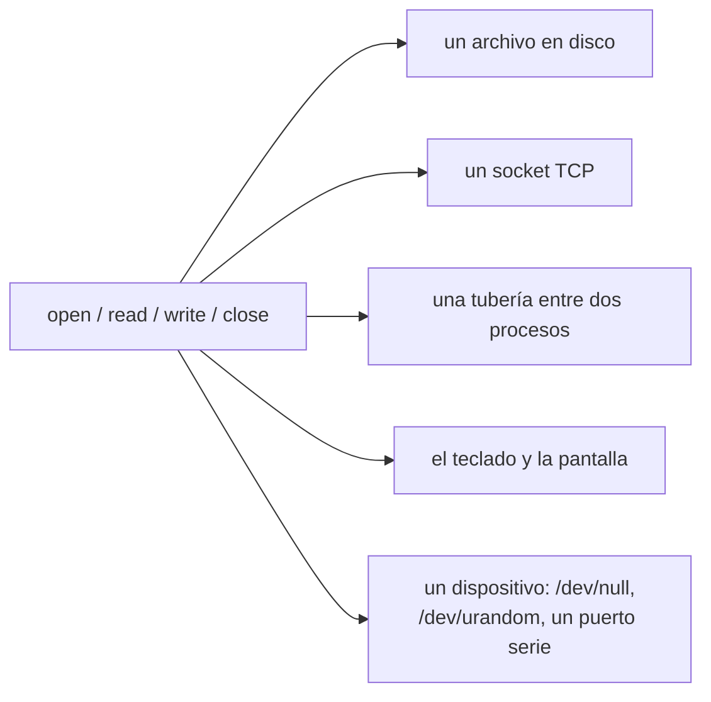

# 02 — Todo es un archivo, y dónde se rompe

> El paradigma que unifica archivos, sockets, tuberías y dispositivos bajo las mismas cuatro llamadas
> al sistema. Por qué es el mejor modelo mental que existe para pensar la entrada y la salida, y por
> qué **todo lo interesante de una entrevista ocurre exactamente en los puntos donde la abstracción
> se rompe** — uno de los cuales es un error de compilación de Java.
>
> **Asume leído:** [`01` — El descriptor y el recurso](01-el-descriptor-y-el-recurso.md).
>
> **Vigencia:** 2026-09-18. Todas las salidas de este capítulo están **ejecutadas**.

---

## 1. 🎯 El problema

La idea es de Unix y es de 1970: **un solo tipo de asa para todo**. Abres algo, te dan un descriptor,
y a partir de ahí las mismas cuatro llamadas sirven para todo:



Por eso `cat archivo | grep hola > salida.txt` funciona sin que `grep` sepa de dónde vienen los datos
ni a dónde van. Es una de las mejores ideas de la informática, y sigue siendo el modelo correcto para
razonar sobre entrada y salida.

**Y ahora la parte que importa.** Intenta poner un archivo regular en modo no bloqueante en Java:

```java
FileChannel fc = FileChannel.open(Path.of("x.txt"));
fc.configureBlocking(false);
```

```text
Sel2.java:6: error: cannot find symbol
        fc.configureBlocking(false);
          ^  symbol: method configureBlocking(boolean)
```

**No compila.** El mismo método sobre un socket funciona perfectamente:

```text
socket  -> configureBlocking(false) + register: OK
archivo -> ¿instancia de SelectableChannel? false
```

Si todo fuera un archivo, esas dos líneas serían la misma línea. No lo son, y el motivo es el
contenido de este capítulo.

---

## 2. 🧱 Qué unifica de verdad el paradigma

**Qué es.** Lo que se unifica es **la interfaz**, no el comportamiento. Las cuatro llamadas existen
para todos los tipos y su firma es idéntica; lo que hacen no lo es.

**Cómo va.** Lo que sí es común y se puede explotar:

- **La composición.** Un programa que lee de `fd 0` y escribe en `fd 1` funciona con archivos, con
  tuberías y con sockets sin cambiar una línea. Es lo que hace posibles las tuberías del shell y lo
  que convierte a cada programa pequeño en una pieza reutilizable.
- **La redirección.** `programa < entrada.txt > salida.txt` no cambia el programa: cambia a qué
  apuntan sus descriptores antes de arrancarlo.
- **La herencia.** Los descriptores cruzan `fork`/`exec`, y por eso un proceso puede preparar la
  entrada y la salida de otro sin que este se entere.

**Cuánto vale.** Muchísimo, y sobre todo como **modelo mental**: si entiendes que todo IO es leer y
escribir en un descriptor, entonces una petición HTTP, una consulta a base de datos y una lectura de
disco son el mismo problema con distintas latencias — y eso es exactamente lo que hay que ver para
razonar sobre bloqueo y concurrencia.

**Cuándo sí** usarlo como marco: siempre que pienses en rendimiento de entrada y salida, en
concurrencia o en fugas de recursos.

**Cuándo no:** cuando estés escribiendo el código concreto. Ahí las diferencias mandan, y la sección
siguiente es la lista.

> **Veredicto:** "todo es un archivo" es verdad sobre la **interfaz** y mentira sobre la
> **semántica**. Usarlo para pensar es correcto; usarlo para predecir el comportamiento es la fuente
> de la mitad de los errores de este bloque.

---

## 3. 🧱 Las cuatro roturas

**Rotura 1: un archivo regular siempre está "listo".**

`select`, `poll` y `epoll` sirven para preguntar "¿cuál de estos descriptores tiene datos?". Sobre un
archivo regular la pregunta no tiene sentido: la respuesta es **siempre sí**, porque los datos están
en el disco. Pero "listo" no significa "instantáneo": la lectura puede tardar milisegundos si hay que
ir al disco, y durante ese tiempo **el hilo está bloqueado**.

- Por eso Java no deja: `FileChannel` no extiende `SelectableChannel`, y el compilador lo impide.
- Por eso `O_NONBLOCK` sobre un archivo regular en Linux **no hace nada**: se acepta y se ignora.
- **Y por eso existe `io_uring`**, que es el mecanismo moderno de Linux para hacer entrada y salida de
  archivos realmente asíncrona. Si alguien pregunta "¿por qué hacía falta `io_uring` si ya estaba
  `epoll`?", esta es la respuesta.

**Rotura 2: `read` no significa lo mismo en cada tipo.**

| Devuelve | En un archivo regular | En un socket |
|---|---|---|
| `n > 0` | leyó `n` bytes | leyó `n` bytes, **puede ser menos de lo que pediste** |
| `0` | fin de archivo | **el otro extremo cerró** |
| `-1` con `EAGAIN` | no ocurre | no hay datos ahora mismo, vuelve luego |

- **La lectura parcial es la trampa práctica.** Un `read` de 1024 bytes sobre un socket puede devolver
  3: los datos vienen troceados por la red. Todo código que lea de un socket necesita un bucle; el
  mismo código sobre un archivo funciona a la primera y da una falsa sensación de que está bien.
- **`lseek` no existe para sockets ni tuberías.** No se puede retroceder: lo que leíste, leído está.
  De ahí que los parsers de flujo del bloque `07` no puedan dar marcha atrás.

**Rotura 3: Windows nunca siguió el modelo.**

- En Windows hay `HANDLE`, no descriptores enteros, y el modelo de entrada y salida asíncrona es
  distinto —puertos de terminación—. No es "Unix con otros nombres": es otro diseño.
- **Eso explica la forma de las bibliotecas que tienes delante.** El NIO de Java y `libuv` de Node
  existen en buena medida para tapar esa diferencia, y es la razón de que sus abstracciones tengan
  esquinas raras.

**Rotura 4: la asincronía de archivos suele ser hilos disfrazados.**

Node presume de asíncrono, y para sockets lo es de verdad. Para archivos no: usa un **pool de hilos
de tamaño fijo**. Medido, ocho tareas que pasan por ese pool:

```text
UV_THREADPOOL_SIZE=1    799 ms
UV_THREADPOOL_SIZE=2    449 ms
UV_THREADPOOL_SIZE=4    332 ms   ← el valor por defecto
UV_THREADPOOL_SIZE=8    253 ms
```

Si fuera asincronía del sistema operativo, el tamaño del pool no cambiaría nada.

- **Lo que pasa por ese pool** en Node: `fs`, `crypto`, `zlib` y `dns.lookup`. Los sockets, no.
- **La consecuencia operativa:** cuatro operaciones de archivo lentas simultáneas **bloquean también
  las de `crypto`**, porque comparten pool. Es una causa real de latencia inexplicable en servicios
  Node, y no aparece en ningún perfilador de JavaScript porque el trabajo ocurre fuera del bucle.
- Java tuvo el mismo problema: `AsynchronousFileChannel` también usa un pool por debajo en varias
  plataformas.

---

## 4. 🧱 Lo que el paradigma sí predice bien

A pesar de las roturas, hay tres cosas que el modelo acierta y que vale la pena tener presentes:

- **Todo IO compite por el mismo límite de descriptores.** Archivos y sockets salen del mismo cubo, y
  por eso un pico de conexiones puede impedirte abrir un archivo de configuración. Es el capítulo `01`.
- **Todo IO se puede envolver con la misma abstracción de flujo.** `InputStream`, `io.Reader`,
  `Readable`, objeto-archivo de Python: los cuatro lenguajes eligieron la misma forma, y por eso se
  puede escribir código que copia de cualquier origen a cualquier destino.
- **Todo IO tiene el mismo problema de búferes**, que es el capítulo `04`: cruzar la frontera entre tu
  proceso y el núcleo cuesta, y cuesta por llamada y no por byte.

> **Veredicto:** quédate con la interfaz y desconfía de la semántica. La pregunta útil ante cualquier
> operación de entrada y salida no es "¿es un archivo?", sino **"¿esta operación puede no estar lista,
> y qué hace mi hilo mientras tanto?"** — que es el capítulo `03`.

---

## 5. 🔭 Dónde aparece de verdad

En el servicio Node que va lento y cuyo perfilador no encuentra nada, porque la espera está en un
pool de hilos que el perfilador no ve; en el código que lee de un socket con un solo `read` y
funciona en local con mensajes cortos; en la pregunta de entrevista *"¿por qué no puedes hacer
`epoll` sobre un archivo?"*, que separa a quien ha leído sobre el bucle de eventos de quien lo
entiende; en la migración a Windows que descubre que media biblioteca se comporta distinto; y en
cualquier discusión sobre `io_uring`, que no se puede sostener sin saber qué problema vino a
resolver.

---

## ⚠️ Errores frecuentes

| Se dice | Lo preciso |
|---|---|
| "Todo es un archivo, así que todo se comporta igual" | Se unifica la interfaz, no la semántica |
| "Puedo hacer IO no bloqueante sobre un archivo" | En Java ni compila; en Linux, `O_NONBLOCK` se ignora |
| "`read` devuelve lo que pedí" | En un socket puede devolver menos. Siempre hay que iterar |
| "`read` devolvió 0, hubo un error" | En un socket significa que el otro extremo cerró |
| "Node es asíncrono" | Para sockets sí; para `fs`, `crypto` y `zlib` es un pool de hilos |
| "El pool de libuv es infinito" | Son cuatro hilos por defecto, y se comparten entre familias |
| "Windows es Unix con otros nombres" | Otro modelo: `HANDLE` y puertos de terminación |
| "`io_uring` es una optimización" | Es la respuesta a que `epoll` no sirva para archivos regulares |

---

## 📚 Para profundizar

- **Libro** — Stevens y Rago, *Advanced Programming in the UNIX Environment*, capítulos 3 y 14. El 14,
  de entrada y salida avanzada, es donde están `select`, `poll` y la entrada/salida no bloqueante.
- **Artículo** — Dennis Ritchie y Ken Thompson, [*The UNIX Time-Sharing System*](https://people.eecs.berkeley.edu/~brewer/cs262/unix.pdf)
  (1974): el artículo original, donde aparece la idea del asa única. Se lee en una tarde y explica el
  porqué mejor que cualquier resumen posterior.
- **Manual** — [`man 2 select`](https://man7.org/linux/man-pages/man2/select.2.html) y
  [`man 7 epoll`](https://man7.org/linux/man-pages/man7/epoll.7.html): la sección de limitaciones de
  `epoll` dice explícitamente que no sirve para archivos regulares.
- **Manual** — [`man 7 io_uring`](https://man7.org/linux/man-pages/man7/io_uring.7.html): el
  mecanismo moderno, y en su introducción está el problema que resuelve.
- **Node** — [Documentación de `libuv` — *Thread pool work scheduling*](https://docs.libuv.org/en/v1.x/threadpool.html):
  qué pasa por el pool y cómo se dimensiona.
- **Java** — [`SelectableChannel`](https://docs.oracle.com/en/java/javase/21/docs/api/java.base/java/nio/channels/SelectableChannel.html):
  mira qué clases lo extienden y, sobre todo, cuál no.

---

## 🧠 Preguntas

Sin respuestas aquí. Todas, con enunciado literal y respuesta en tres capas, en
[`07` — Respuestas](07-respuestas.md).

1. ¿Qué significa "todo es un archivo"? 🟢
2. ¿Qué cuatro llamadas al sistema comparten todos los tipos? 🟢
3. ¿Qué permite la redirección del shell y por qué funciona? 🟢
4. ¿Se puede poner un archivo regular en modo no bloqueante en Java? 🟢
5. ¿Qué es `epoll` y para qué sirve? 🟢
6. ¿Es Node asíncrono para leer archivos? 🟢
7. ¿Qué devuelve `read` cuando el otro extremo de un socket cierra? 🟢
8. ¿Sigue Windows este modelo? 🟢
9. ¿Qué se unifica realmente: la interfaz o el comportamiento? 🟡
10. ¿Por qué un archivo regular "siempre está listo" para `select`? 🟡
11. ¿Por qué eso no significa que leerlo sea instantáneo? 🟡
12. ¿Qué es una lectura parcial y dónde ocurre? 🟡
13. ¿Por qué `lseek` no funciona sobre un socket? 🟡
14. ¿Qué operaciones de Node pasan por el pool de hilos? 🟡
15. ¿Cuántos hilos tiene ese pool por defecto? 🟡
16. ¿Qué tres cosas sí predice bien el paradigma? 🟡
17. ¿Por qué existe `io_uring` si ya estaba `epoll`? 🟠
18. Un servicio Node tiene latencia alta y el perfilador no encuentra nada. Da la hipótesis y
    cómo la confirmas. 🟠
19. ¿Por qué el compilador de Java es una prueba más fuerte que una comprobación en ejecución? 🟠
20. ¿Qué código funciona con archivos y falla con sockets, y por qué solo se ve en producción? 🟠
21. ¿Qué implica para el diseño que archivos y sockets compartan el límite de descriptores? 🟠
22. ¿Por qué el NIO de Java y `libuv` tienen abstracciones con esquinas raras? 🟠
23. Te preguntan si conviene subir `UV_THREADPOOL_SIZE`. ¿Qué contestas? 🟠
24. ¿Qué preguntarías ante cualquier operación de entrada y salida para decidir su modelo? 🟠
25. Un compañero afirma que Node no tiene hilos. ¿Cómo lo corriges sin discutir? 🟠
26. Explica en dos minutos, a alguien que solo ha programado con frameworks, por qué su servicio
    se queda sin hilos. 🔴
27. Diseña una prueba que demuestre, en tu lenguaje, que la entrada y salida de archivos no es
    realmente asíncrona. 🔴
28. Tu equipo quiere migrar un servicio con mucha entrada y salida de archivos de Node a Go.
    Argumenta a favor y en contra con lo de este capítulo. 🔴
29. Escribe la explicación de `io_uring` para un comité técnico que ya conoce `epoll`: qué
    problema resuelve, qué cuesta y cuándo lo adoptarías. 🔴
30. Te dan un servicio que lee miles de archivos pequeños y va lento. Enumera las cinco causas
    posibles a la luz de este capítulo, en orden. 🔴

---

**Anterior:** [`01` — El descriptor y el recurso](01-el-descriptor-y-el-recurso.md) ·
**Siguiente:** [`03` — Bloqueante, no bloqueante y asíncrono](03-bloqueante-no-bloqueante-y-asincrono.md) ·
**Bloque:** [README](README.md)
