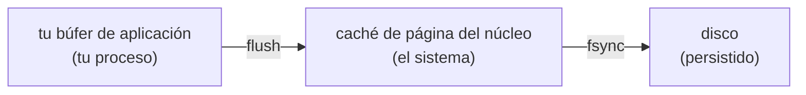

# 04 — Búferes y el coste de la frontera

> Por qué leer un archivo byte a byte tarda **dos mil veces** más que leerlo por bloques, aunque en
> los dos casos se lean los mismos bytes y el algoritmo sea `O(n)`. Dónde está la frontera que se
> cruza, cuánto cuesta cruzarla, y por qué `write` no significa que el dato esté guardado.
>
> **Asume leído:** [`01` — El descriptor y el recurso](01-el-descriptor-y-el-recurso.md).
>
> **Vigencia:** 2026-09-18. Todas las medidas de este capítulo están **ejecutadas**.

---

## 1. 🎯 El problema

Leer un archivo de 3 MB y contar sus bytes. El algoritmo es el mismo —una pasada, `O(n)`— y lo único
que cambia es cuántos bytes se piden por llamada:

```text
read(      1) ->  1878.92 ms
read(     16) ->   117.08 ms
read(    512) ->     4.12 ms
read(   4096) ->     0.59 ms
read(  65536) ->     0.17 ms
read(1048576) ->     0.21 ms
```

**De 1 879 ms a 0,17 ms: un factor de once mil.** Misma complejidad, mismo disco, mismos datos. Y la
curva tiene forma: cae en picado hasta los 4 KB, se aplana en 64 KB y **empeora ligeramente** al
llegar al mega.

Lo que la notación `O(n)` no cuenta es **qué es cada operación**. Aquí cada `read` es una llamada al
sistema: un cambio de modo del procesador, una transición de tu proceso al núcleo y vuelta. Tres
millones de esas transiciones cuestan casi dos segundos; cuarenta y seis, nada.

---

## 2. 🧱 La frontera y su peaje

**Qué es.** Entre tu proceso y el núcleo hay una frontera de protección. Una llamada al sistema la
cruza dos veces, y ese cruce tiene un coste fijo que **no depende de cuántos bytes pidas**.


**Cómo va.** De ahí sale toda la aritmética del capítulo:

```text
coste total ≈ (número de llamadas × coste por llamada) + (bytes × coste por byte)
```

- Con `read(1)`, el primer término domina por completo: tres millones de llamadas.
- Con `read(65536)`, el primer término desaparece: cuarenta y seis llamadas, y solo queda copiar
  bytes.
- **Por eso la curva se aplana.** A partir de cierto tamaño ya no quedan llamadas que ahorrar, y
  seguir subiendo solo añade memoria que copiar y páginas que tocar — de ahí el ligero repunte del
  búfer de un mega.

**Cuánto cuesta.** El punto de rodilla está entre 4 KB y 64 KB, y no es casualidad: **4 KB es el
tamaño de página** del sistema y el de bloque de la mayoría de los sistemas de archivos. Los valores
por defecto de las bibliotecas caen ahí: 8 KB en `BufferedInputStream` de Java, 8 KB en Python, 4 KB
en `bufio` de Go.

**Cuándo sí** ajustar el tamaño: cuando mueves gigas y el perfil dice que la entrada y salida domina.
Subir de 8 KB a 64 KB es la mejora barata; más allá, hay que medir.

**Cuándo no:** casi nunca. **El error que importa no es elegir 8 KB en vez de 64 KB; es no usar búfer
en absoluto**, que es lo que hace un factor de mil.

> **Veredicto:** el búfer no es una optimización, es la forma correcta de hacer entrada y salida.
> Elegir su tamaño exacto es afinado; no ponerlo es un error de dos órdenes de magnitud que ninguna
> prueba unitaria detecta, porque con archivos pequeños no se nota.

---

## 3. 🧱 Dónde está el búfer en cada lenguaje

**El problema.** Todos los lenguajes ponen búferes, y casi ninguno lo hace por defecto en la clase
más básica. Saber cuál lleva búfer y cuál no es la diferencia entre el primer renglón de la tabla y
el quinto.

```java
// Java — el clásico: FileInputStream NO tiene búfer; hay que envolverlo
try (var in = new BufferedInputStream(new FileInputStream(f), 65536)) { … }
// o, en la API moderna, ya viene envuelto:
try (var in = Files.newInputStream(p)) { … }        // con búfer interno
```

```python
# Python — con búfer POR DEFECTO; buffering=0 lo desactiva y es lo que midió 1878 ms
with open(ruta, "rb") as f: ...                # 8 KB de búfer
with open(ruta, "rb", buffering=0) as f: ...   # sin búfer: no hagas esto
```

```go
// Go — os.File NO tiene búfer; bufio lo añade
r := bufio.NewReaderSize(f, 65536)
```

```javascript
// Node — los streams llevan búfer y highWaterMark controla su tamaño
fs.createReadStream(ruta, { highWaterMark: 65536 })
```

Tres cosas que se preguntan:

- **En Java, `FileInputStream` sin envolver es el error clásico**, y es exactamente el caso de
  `read(1)`: cada `read()` de un byte es una llamada al sistema. La API moderna de `java.nio.file` ya
  devuelve flujos con búfer, que es una razón para preferirla.
- **En Python el búfer viene puesto**, así que el error hay que cometerlo a propósito con
  `buffering=0`. Es el lenguaje que mejor protege al principiante aquí.
- **`highWaterMark` en Node no es solo tamaño de búfer**: es el umbral de contrapresión. Cuando el
  búfer interno llega a ese valor, `write` devuelve `false` y hay que esperar al evento `drain`.
  Ignorarlo es cómo se acumula memoria en un servicio que copia flujos.

---

## 4. 🧱 Escribir no es guardar

**El problema.** `write` devuelve sin error. ¿Está el dato en disco? **No necesariamente.** Hay al
menos tres copias en camino:



- **`flush` vacía tu búfer hacia el núcleo.** Con eso sobrevives a que tu proceso muera, porque el
  dato ya no es tuyo.
- **`fsync` fuerza al núcleo a escribir en el dispositivo.** Con eso, y solo con eso, sobrevives a un
  corte de luz.
- Confundir los dos es la causa de la pérdida de datos que aparece "solo cuando se cae la máquina", y
  es una pregunta habitual en dominios con dinero.

**Cuánto cuesta.** Mucho, y por eso nadie lo hace por defecto. Mil escrituras de 100 bytes:

```text
1000 escrituras sin fsync :      0.6 ms
1000 escrituras con fsync :     30.8 ms      ← 50 veces más
```

- Cincuenta veces, y eso en un disco de estado sólido moderno. En un disco mecánico la diferencia es
  de tres órdenes de magnitud, porque cada `fsync` espera a una rotación física.
- **Por eso las bases de datos no hacen `fsync` por transacción**: lo agrupan. El registro de
  escritura anticipada se sincroniza una vez por lote de transacciones, y ahí está el compromiso
  entre durabilidad y rendimiento que se discute en `repaso-arquitectura-entrevistas`.

**Cuándo sí** llamar a `fsync`: cuando el dato es un compromiso con el exterior —confirmaste un pago,
aceptaste una orden— y no puedes reconstruirlo.

**Cuándo no:** archivos temporales, cachés, cualquier cosa regenerable, y logs de diagnóstico. Ahí el
coste no compra nada.

> **Veredicto:** hay tres niveles de "escrito" —mi búfer, el núcleo, el disco— y cada uno sobrevive a
> un fallo distinto: un error de la aplicación, la muerte del proceso y el corte de corriente. Saber
> a cuál de los tres necesitas llegar es una decisión de diseño, no un detalle de implementación.

---

## 5. 🧱 Contrapresión: el búfer que crece

**El problema.** Copias de un origen rápido a un destino lento — de disco a red, de una consulta a un
socket—. Si lees más rápido de lo que escribes, ¿dónde se acumula lo que sobra?

**En memoria.** Y si nadie lo detiene, hasta que el proceso muere.

- **Contrapresión** es el mecanismo por el que el destino lento le dice al origen rápido que pare. Sin
  él, el búfer intermedio crece sin límite.
- En Node es explícito: `write` devuelve `false` cuando se pasa del `highWaterMark`, y hay que esperar
  el evento `drain`. **`pipe()` y `pipeline()` lo hacen por ti**, y esa es la razón de usarlos en vez
  de copiar a mano.
- En Java con flujos clásicos el problema no aparece porque `write` es bloqueante: el propio bloqueo
  **es** la contrapresión. Aparece en cuanto pasas a reactivo, y por eso las bibliotecas reactivas
  hacen tanto ruido con el concepto.
- En Go, un canal sin búfer es contrapresión pura: el emisor se para hasta que el receptor recibe.
  Un canal con búfer de tamaño N es una tolerancia de N y nada más.

> 💡 **La conexión con el resto del corpus.** Esto es la cola acotada de
> [`06/03`](../06-numeros-tiempo-concurrencia/03-estructuras-y-concurrencia.md) vista desde la
> entrada y salida: una cola sin límite no es generosa, es una fuga de memoria con otro nombre. Que
> el productor se bloquee es la funcionalidad, no el fallo.

---

## 6. ⏱️ La tabla de costes

| Operación | Coste medido | Lo que la tabla no dice |
|---|---|---|
| `read(1)` sobre 3 MB | 1 879 ms | Tres millones de llamadas al sistema |
| `read(4096)` sobre 3 MB | 0,59 ms | La rodilla: tamaño de página |
| `read(65536)` sobre 3 MB | 0,17 ms | A partir de aquí ya no se gana |
| `read(1 MB)` sobre 3 MB | 0,21 ms | **Empeora**: más memoria que tocar |
| 1 000 escrituras sin `fsync` | 0,6 ms | El dato está en la caché del núcleo |
| 1 000 escrituras con `fsync` | 30,8 ms | 50×, y en disco mecánico mucho más |

---

## ⚠️ Errores frecuentes

| Se dice | Lo preciso |
|---|---|
| "Es `O(n)`, da igual cómo lo lea" | La constante vale un factor de once mil. `O(n)` no cuenta llamadas al sistema |
| "Un búfer más grande siempre es mejor" | La curva se aplana en 64 KB y empeora en 1 MB |
| "`FileInputStream` ya lleva búfer" | No lo lleva. Hay que envolverlo o usar `java.nio.file` |
| "`write` devolvió sin error, está guardado" | Está en la caché del núcleo. Para el disco hace falta `fsync` |
| "`flush` garantiza durabilidad" | Garantiza que sobrevive a la muerte de tu proceso, no a un corte de luz |
| "`fsync` en cada escritura es lo seguro" | Y cincuenta veces más lento. Las bases de datos lo agrupan |
| "Una cola sin límite evita perder datos" | Es una fuga de memoria: el límite **es** la contrapresión |
| "`pipe()` es azúcar sintáctico" | Implementa la contrapresión que a mano se olvida |

---

## 📚 Para profundizar

- **Libro** — Stevens y Rago, *Advanced Programming in the UNIX Environment*, capítulo 3 (sin búfer) y
  capítulo 5 (con búfer). El experimento del tamaño de búfer está ahí, hecho en los ochenta y con la
  misma forma de curva.
- **Manual** — [`man 2 fsync`](https://man7.org/linux/man-pages/man2/fsync.2.html): lo que garantiza
  y lo que no; y la nota sobre los errores, que es donde estuvo el famoso problema de pérdida
  silenciosa.
- **Java** — [`BufferedInputStream`](https://docs.oracle.com/en/java/javase/21/docs/api/java.base/java/io/BufferedInputStream.html)
  y [`Files.newInputStream`](https://docs.oracle.com/en/java/javase/21/docs/api/java.base/java/nio/file/Files.html):
  compara cuál lleva búfer y cuál no.
- **Node** — [*Stream — backpressure*](https://nodejs.org/en/learn/modules/backpressuring-in-streams):
  la guía oficial, con el ejemplo de lo que pasa al ignorar el valor de retorno de `write`.
- **Go** — [`bufio`](https://pkg.go.dev/bufio): por qué `os.File` no lleva búfer y qué tamaño usa por
  defecto.
- **Artículo** — [*Files are hard*, Dan Luu](https://danluu.com/file-consistency/): por qué escribir
  en un archivo de forma verdaderamente segura es mucho más difícil de lo que parece.

---

## 🧠 Preguntas

Sin respuestas aquí. Todas, con enunciado literal y respuesta en tres capas, en
[`07` — Respuestas](07-respuestas.md).

1. ¿Qué es un búfer de entrada y salida? 🟢
2. ¿Qué es una llamada al sistema? 🟢
3. ¿Qué hace `flush`? 🟢
4. ¿Qué hace `fsync`? 🟢
5. ¿Lleva búfer `FileInputStream` de Java? 🟢
6. ¿Lleva búfer `open()` de Python? 🟢
7. ¿Qué es la contrapresión? 🟢
8. ¿Qué tamaño de búfer usan por defecto las bibliotecas y por qué ese? 🟢
9. ¿Por qué leer byte a byte es tan lento si el algoritmo es `O(n)`? 🟡
10. ¿Por qué la curva se aplana a partir de 64 KB? 🟡
11. ¿Por qué un búfer de 1 MB puede ser peor que uno de 64 KB? 🟡
12. Diferencia los tres niveles de "escrito". 🟡
13. ¿A qué fallo sobrevive cada uno de esos tres niveles? 🟡
14. ¿Qué es `highWaterMark` en Node y qué controla además del tamaño? 🟡
15. ¿Por qué en Java con flujos clásicos no se habla de contrapresión? 🟡
16. ¿Qué relación tiene un canal de Go sin búfer con la contrapresión? 🟡
17. ¿Por qué las bases de datos no hacen `fsync` por transacción? 🟠
18. ¿Cuándo es obligatorio `fsync` y cuándo es desperdicio? 🟠
19. ¿Por qué el error de no poner búfer no lo detectan las pruebas? 🟠
20. ¿Qué tiene que ver la contrapresión con las colas acotadas del bloque `06`? 🟠
21. Un servicio que copia de disco a red consume memoria hasta morir. Diagnostica. 🟠
22. ¿Por qué `pipeline()` es mejor que encadenar `pipe()` a mano? 🟠
23. Te piden subir el búfer de 8 KB a 1 MB "para ir más rápido". ¿Qué contestas? 🟠
24. ¿Cómo comprobarías, sin perfilador, si un proceso está dominado por llamadas al sistema? 🟠
25. ¿Por qué el tamaño de página del sistema aparece en la curva del búfer? 🟠
26. ¿Qué relación hay entre el búfer y la latencia percibida en un flujo interactivo? 🟠
27. Diseña la escritura de un fichero de confirmaciones de pago que no puede perder ni un
    registro ante un corte de luz. Di el coste de tu decisión. 🔴
28. Escribe el experimento que demuestra la curva del tamaño de búfer y di qué esperas ver y por
    qué. 🔴
29. Un proceso por lotes tarda ocho horas y la CPU está al 8 %. Da tres hipótesis ordenadas y
    cómo las distingues. 🔴
30. Diseña la copia de un archivo de 100 GB entre dos discos con memoria limitada: tamaño de
    búfer, comprobación de integridad y qué haces si falla a mitad. 🔴
31. Un servicio escribe logs y bajo carga pierde líneas al reiniciarse. Diagnostica y da las
    tres correcciones con su coste. 🔴

---

**Anterior:** [`03` — Bloqueante, no bloqueante y asíncrono](03-bloqueante-no-bloqueante-y-asincrono.md) ·
**Siguiente:** [`05` — El árbol de directorios](05-el-arbol-de-directorios.md) ·
**Bloque:** [README](README.md)
