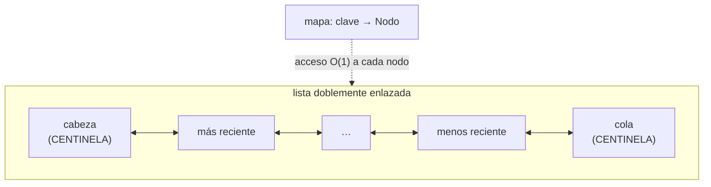

# 03 — Ejercicios comparativos

> **Documento opcional.** Está fuera del hilo principal. **Las soluciones van aquí mismo, debajo de
> cada enunciado**: este bloque se hace con el editor abierto, no de memoria, así que no alimenta
> ningún solucionario.
> Seis ejercicios: tres adaptados de
> [`repaso-arquitectura-entrevistas/01-bases/04`](../../../arquitectura/01-bases/01-bases/04-patrones-gof.md)
> y de [`preguntas-entrevista/01`](../../../../preguntas-entrevista/01-poo-solid-patrones.md), y tres
> nuevos que cruzan aquellos patrones con el temario algorítmico de este corpus.
> **Versiones ejecutadas:** Java 21.0.12 y 17.0.15 (Zulu, vía sdkman), Python 3.13, Node 24.21, Go
> 1.27 — salida idéntica en ambas versiones de Java. TypeScript comprobado con `tsc --strict`.
>
> **Vigencia:** 2026-09-18.

**Salto rápido:** [E1](#e1--el-switch-de-doce-casos) · [E2](#e2--notificaciones-multicanal) ·
[E3](#e3--el-código-que-depende-de-la-fecha) · [E4](#e4--el-comparador-que-revienta-en-producción) ·
[E5](#e5--el-top-k-de-un-flujo-en-cinco-lenguajes) · [E6](#e6--la-caché-lru-cinco-líneas-contra-cincuenta)

---

## E1 — El switch de doce casos

**De dónde viene.** Pregunta 18 de
[`04-patrones-gof`](../../../arquitectura/01-bases/01-bases/04-patrones-gof.md): *"tienes un
`switch` de 12 casos que crece cada sprint; ¿cómo lo atacas y qué pierdes?"*.

**Enunciado.** Un método calcula la comisión según el tipo de cuenta con un `switch` de doce ramas
que crece en cada release. Refactorízalo en los cinco lenguajes y **di qué pierdes**.

### Solución

El patrón es Strategy, y en los cinco se reduce a un mapa de funciones —el código completo está en
[`02` §2](02-lab-patrones-en-cinco-lenguajes.md#2--strategy)—. Lo que cambia es **quién puebla el
mapa**:

```text
Java + Spring   → Map<String, CalculoDeComision> inyectado: añadir una estrategia es añadir un bean
Java sin Spring → enum con método abstracto, si el conjunto es cerrado y conocido
Python / JS     → dict/objeto de funciones, poblado en el módulo
TypeScript      → Record<TipoCuenta, Fn>: añadir un tipo sin su estrategia NO COMPILA
Go              → map[string]CalculoDeComision, con el tipo función dando nombre al contrato
```

**Qué pierdes**, que es la mitad del ejercicio y lo que casi nadie contesta:

- **La exhaustividad.** El `switch` con `default` que lanza excepción te obliga a tratar todos los
  casos; un mapa devuelve `null` para una clave que nadie registró. Se recupera con `getOrDefault`
  y una estrategia por defecto explícita, o —en Java 21— con un `switch` sobre una jerarquía
  `sealed`, que el compilador verifica.
- **La localidad.** Doce ramas juntas se leen de un vistazo; doce clases o doce beans repartidos
  exigen una búsqueda en el IDE para saber qué existe.
- **La trazabilidad del cambio.** Con el `switch`, un `git blame` muestra la historia de las doce
  reglas en un archivo. Con estrategias, está repartida.

> **El veredicto que se dice en voz alta:** si el conjunto es **cerrado y conocido** —doce tipos de
> cuenta que no van a crecer— el `switch` sobre un `enum` o sobre una jerarquía `sealed` es mejor:
> el compilador comprueba la exhaustividad. Strategy gana cuando el conjunto **crece sin tocar el
> consumidor**, que es justo lo que dice el enunciado.

---

## E2 — Notificaciones multicanal

**De dónde viene.** Pregunta 95 de
[`01-poo-solid-patrones`](../../../../preguntas-entrevista/01-poo-solid-patrones.md): *"diseña un sistema
de notificaciones multicanal (email, SMS, push, webhook) extensible"*.

**Enunciado.** Diseña el sistema en Java y en Go. Tiene que permitir añadir un canal sin tocar el
emisor, aplicar reintentos a todos los canales sin duplicar código, y poder encolar los envíos.

### Solución

Son **tres patrones combinados**, y nombrarlos por separado es lo que puntúa:

```text
Strategy  → un canal es una implementación del contrato "enviar"
Decorator → el reintento y la traza envuelven cualquier canal, sin tocarlo
Command   → el envío se convierte en un objeto/función encolable
```

**Java:**

```java
interface Canal { void enviar(Notificacion notificacion); }          // Strategy

// Decorator: envuelve CUALQUIER canal y añade reintentos. No hereda de ninguno.
static Canal conReintentos(Canal base, int intentos) {
    return notificacion -> {
        for (int i = 1; i <= intentos; i++) {
            try { base.enviar(notificacion); return; }
            catch (EnvioFallido e) { if (i == intentos) throw e; esperar(backoff(i)); }
        }
    };
}

Map<TipoCanal, Canal> canales = Map.of(
        TipoCanal.EMAIL, conReintentos(new CanalEmail(cliente), 3),
        TipoCanal.SMS,   conReintentos(new CanalSms(pasarela), 3));
```

**Go**, con el tipo función en vez de la interfaz:

```go
type Canal func(n Notificacion) error

func conReintentos(base Canal, intentos int) Canal {
	return func(n Notificacion) error {
		var err error
		for i := 1; i <= intentos; i++ {
			if err = base(n); err == nil { return nil }
			time.Sleep(backoff(i))
		}
		return err            // el error como valor: sin excepciones que capturar
	}
}
```

**Los cuatro detalles que se preguntan después:**

1. **El reintento exige idempotencia.** Si el canal no lo es, reintentar duplica notificaciones. Es
   una decisión de arquitectura, no del patrón, y hay que decirlo.
2. **El backoff necesita jitter.** Sin aleatoriedad, todos los envíos que fallaron por la misma
   causa reintentan a la vez y repiten la avalancha.
3. **Encolar es Command.** El envío se serializa como `{canal, destinatario, plantilla, datos}` y va
   a una cola con la estructura de
   [`04-arboles-grafos/02`](../04-arboles-grafos/02-monticulos-y-colas-de-prioridad.md): una cola de
   prioridad por instante de reintento.
4. **El decorador se apila.** `conTraza(conReintentos(conCircuitBreaker(canal)))` es legible y cada
   capa es independiente. Es la diferencia práctica entre Decorator y herencia.

---

## E3 — El código que depende de la fecha

**De dónde viene.** Pregunta 96 de
[`01-poo-solid-patrones`](../../../../preguntas-entrevista/01-poo-solid-patrones.md): *"¿cómo harías
testeable un código que depende de la fecha y hora actual?"*.

**Enunciado.** Un método calcula si una póliza está vencida usando `LocalDate.now()`. El test solo
pasa ciertos días del mes. Arréglalo en los cinco lenguajes.

### Solución

**El diagnóstico:** `LocalDate.now()` es una **dependencia oculta y no determinista**. No aparece en
la firma, no se puede sustituir, y hace el test dependiente del calendario. Es el mismo problema que
`new Random()`, `UUID.randomUUID()` y el acceso directo al sistema de archivos.

**Java** — se inyecta un `Clock`, que existe en la plataforma exactamente para esto:

```java
private final Clock reloj;                                   // inyectado por constructor

boolean estaVencida(Poliza poliza) {
    return poliza.fin().isBefore(LocalDate.now(reloj));       // now(reloj), no now()
}

// En el test:
Clock reloj = Clock.fixed(Instant.parse("2026-09-17T10:00:00Z"), ZoneOffset.UTC);
// LocalDate.now(reloj) → 2026-09-17, siempre
```

**Los cinco lenguajes:**

| Lenguaje | Cómo se inyecta el tiempo | El detalle que muerde |
|---|---|---|
| **Java** | `Clock` por constructor; `Clock.fixed` en test | `Clock` está en la stdlib desde Java 8 y casi nadie lo usa |
| **Python** | Un parámetro `ahora=None` con valor por defecto, o `freezegun` en test | Parchear `datetime.now` con `mock.patch` funciona y acopla el test al módulo |
| **JavaScript** | Inyectar una función `ahora()`; `vi.useFakeTimers()` en test | `Date.now` es global y sobrescribirlo es tentador y frágil |
| **TypeScript** | Igual que JS; el tipo `() => Date` documenta la dependencia | Sin aportación en runtime |
| **Go** | Un campo `ahora func() time.Time` en el struct | Es el idioma estándar y no hay `Clock` en la stdlib |

> **El principio que hay debajo**, y que conviene enunciar: **toda fuente de no determinismo
> —reloj, aleatoriedad, red, sistema de archivos, identificadores generados— se pone detrás de una
> abstracción inyectable.** Si necesitas una biblioteca de parcheo para probar algo, el diseño te lo
> está diciendo.

---

## E4 — El comparador que revienta en producción

**Ejercicio nuevo.** Cruza los patrones con
[`03-orden-busqueda/02`](../03-orden-busqueda/02-comparadores-y-orden-total.md).

**Enunciado.** Este comparador lleva dos años en producción y ayer lanzó
`IllegalArgumentException: Comparison method violates its general contract!`. **Reprodúcelo**,
explica la causa, y corrígelo.

```java
Comparator<Double> comparador = (a, b) -> Math.abs(a - b) < 0.01 ? 0 : Double.compare(a, b);
```

### Solución

**La reproducción**, verificada: hacen falta **más de 32 elementos** y valores lo bastante juntos
como para que la tolerancia se encadene.

```java
List<Double> pesos = new ArrayList<>();
Random r = new Random(42);                       // semilla fija: reproducible
for (int i = 0; i < 100; i++) pesos.add(r.nextDouble() * 0.05);

pesos.sort(comparador);
// → IllegalArgumentException: Comparison method violates its general contract!

List<Double> pocos = new ArrayList<>(pesos.subList(0, 20));
pocos.sort(comparador);
// → ordena sin quejarse. Con 20 elementos TimSort usa insertion sort y NO VALIDA NADA.
```

**La causa.** Rompe la **transitividad**. Con 1.000, 1.005 y 1.011: el comparador dice que los dos
primeros son iguales (difieren 0.005) y que el segundo y el tercero también (0.006), pero que el
primero y el tercero **no** lo son (0.011). Si a = b y b = c, entonces a debería ser igual a c.

**Por qué tardó dos años.** Porque el error solo aparece cuando la lista pasa de 32 elementos —el
umbral por debajo del cual TimSort usa insertion sort y no comprueba nada— **y** los datos producen
una cadena de tolerancias encadenadas. Con listas pequeñas, el comparador simplemente ordenaba mal
y nadie lo notó.

**La corrección.** No es meter la tolerancia en la comparación: es **discretizar antes de
comparar**, lo que convierte la tolerancia en una clave y sí es transitiva.

```java
// Correcto: redondear a la precisión deseada y comparar los valores redondeados
Comparator<Double> corregido = Comparator.comparingLong(peso -> Math.round(peso * 100));
```

- Ahora dos pesos "parecidos" caen en la misma clave **de verdad**, y la relación es transitiva por
  construcción.
- El cambio de semántica hay que declararlo: con redondeo, 1.004 y 1.006 pueden caer en claves
  distintas aunque difieran menos de 0.01. Es el precio de tener un orden total, y es inevitable.

**Lo que este ejercicio evalúa.** Que sepas que **Java es el único de los cinco lenguajes que
avisa**: Python, JavaScript y Go ordenan mal en silencio con un comparador incoherente. Y que la
parada de emergencia —`-Djava.util.Arrays.useLegacyMergeSort=true`— **no es una corrección**: apaga
la comprobación y devuelve la lista mal ordenada, que es peor que la excepción.

---

## E5 — El top-K de un flujo, en cinco lenguajes

**Ejercicio nuevo.** Cruza
[`04-arboles-grafos/02`](../04-arboles-grafos/02-monticulos-y-colas-de-prioridad.md) con las cinco
bibliotecas estándar.

**Enunciado.** Sobre un flujo continuo de ventas, mantén los **3 productos más vendidos**. Escríbelo
en los cinco lenguajes usando lo que cada plataforma trae, y di dónde no trae nada.

### Solución

**Python** — ya está hecho, y en una línea:

```python
import heapq
heapq.nlargest(3, ventas, key=lambda v: v.total)     # top-K con heap acotado por dentro
```

**Java** — hay `PriorityQueue`, pero el heap acotado se escribe:

```java
PriorityQueue<Venta> top = new PriorityQueue<>(comparingLong(Venta::total));  // MIN-heap
for (Venta v : flujo) {
    if (top.size() < 3) top.offer(v);
    else if (v.total() > top.peek().total()) { top.poll(); top.offer(v); }
}
```

- **Min-heap para los mayores**: la cabeza es el peor de los tres que están dentro, o sea el
  candidato a expulsar. Es lo contraintuitivo del patrón.

**Go** — con `container/heap`, la estructura la aportas tú (ver
[`01` §1](01-estructuras-a-pie-vs-prehechas.md#1--el-heap-binario)). Unas 15 líneas de interfaz más
el bucle, que es idéntico al de Java.

**JavaScript y TypeScript** — **no hay heap**, así que hay dos caminos:

```javascript
// (a) escribir el heap: ~35 líneas, las de `01`
// (b) con k pequeño y fijo, un arreglo ordenado de tamaño k es perfectamente correcto:
const top = [];
for (const v of flujo) {
  if (top.length < 3 || v.total > top[top.length - 1].total) {
    top.push(v);
    top.sort((a, b) => b.total - a.total);     // k=3: ordenar 4 elementos es gratis
    top.length = Math.min(top.length, 3);
  }
}
```

- La opción (b) es O(k log k) por inserción en vez de O(log k), y con **k = 3 eso es irrelevante**.
  Elegirla a propósito y decir por qué es criterio, no pereza; con k = 1 000 sería un error.

**La comparación que cierra el ejercicio:**

| Lenguaje | Líneas | Qué aporta la plataforma |
|---|---|---|
| **Python** | **1** | `heapq.nlargest` con el heap acotado ya dentro |
| **Java** | ~6 | `PriorityQueue`; el patrón acotado lo escribes tú |
| **Go** | ~20 | Los algoritmos del heap; la estructura la aportas tú |
| **JavaScript** | ~10 (o ~45) | **Nada**. Arreglo ordenado si k es pequeño, o heap propio |
| **TypeScript** | igual que JS | Solo tipos |

---

## E6 — La caché LRU: cinco líneas contra cincuenta

**Ejercicio nuevo.** Cruza
[`01-fundamentos/02`](../01-fundamentos/02-tdas-contrato-e-implementacion.md) con la pregunta clásica
de entrevista.

**Enunciado.** Implementa una caché LRU con `get` y `put` en O(1). Primero con lo que trae la
plataforma; después a mano, porque el enunciado real siempre acaba diciendo "sin usar utilidades".

### Solución, versión corta

```java
int capacidad = 3;
Map<String, Integer> lru = new LinkedHashMap<>(capacidad, 0.75f, true) {
    @Override protected boolean removeEldestEntry(Map.Entry<String, Integer> eldest) {
        return size() > capacidad;
    }
};
```

Verificado: tras `put(a) put(b) put(c)`, un `get("a")` y un `put("d")`, las claves que quedan son
**`[c, a, d]`** — se expulsó `b`, que era la menos usada recientemente, y `a` sobrevivió porque el
`get` la refrescó.

- El tercer parámetro del constructor, `accessOrder = true`, es lo que convierte el orden de
  inserción en orden de acceso. Sin él, `get` no refresca nada.
- `removeEldestEntry` se invoca después de cada inserción y decide si expulsar. Devolver
  `size() > capacidad` es toda la política.

### Solución, versión a mano



```text
get(k):   nodo = mapa.get(k); si existe → desenlazar y poner al frente; devolver valor
put(k,v): si existe → actualizar y mover al frente
          si no     → crear nodo al frente; si size > max → borrar el anterior a la cola
```

**Los tres detalles que se preguntan:**

1. **La lista tiene que ser doblemente enlazada.** Para desenlazar un nodo en O(1) hace falta su
   anterior. Con lista simple, cada movimiento sería O(n) y la estructura pierde su razón de ser.
2. **Los centinelas de cabeza y cola eliminan todos los casos borde**: lista vacía, un solo elemento,
   borrar el primero o el último. Sin ellos, la mitad del código son comprobaciones de nulo.
3. **El nodo guarda también la clave**, no solo el valor: al expulsar por la cola hay que borrar del
   mapa, y para eso hace falta saber cuál era su clave.

**Los cinco lenguajes:**

| Lenguaje | Versión corta | El detalle |
|---|---|---|
| **Java** | `LinkedHashMap` con `accessOrder` | 5 líneas, y casi nadie la conoce |
| **Python** | **`functools.lru_cache`** para memoizar funciones; `OrderedDict.move_to_end` para una caché de datos | Dos herramientas distintas para dos casos distintos |
| **JavaScript** | `Map` conserva orden de inserción: borrar y reinsertar **es** mover al final | El truco más limpio de los cinco |
| **TypeScript** | Igual que JS, con `Map<K, V>` tipado | Sin aportación en runtime |
| **Go** | `container/list` más un `map[K]*list.Element` | Es la versión "a mano", con la lista puesta |

**La repregunta obligatoria: "¿y si tiene que ser segura entre hilos?"** `synchronizedMap` **no
basta**, porque `get` **muta** la estructura al mover el nodo al frente: dos lecturas concurrentes
corrompen la lista. Las salidas: un bloqueo único —que serializa incluso las lecturas y suele
bastar—, segmentar por hash de la clave, o usar **Caffeine**, que aproxima el LRU con un búfer de
accesos drenado por lotes y por eso no bloquea en cada lectura. Nombrar que **el `get` mutante es el
problema** es la parte que distingue la respuesta.

---

## 📚 Para profundizar

- **Libro** — Bloch, *Effective Java*, 3ª ed. (Addison-Wesley, 2018). Ítem 14 (`Comparable` y el
  contrato que rompe E4) e ítems 1–6 (las alternativas a los patrones creacionales de E1).
- **Libro** — Feathers, *Working Effectively with Legacy Code* (Prentice Hall, 2004). Los capítulos
  sobre "seams" son la teoría completa de E3: cómo introducir un punto de sustitución en código que
  no lo tenía.
- [Java 21 API — `LinkedHashMap`](https://docs.oracle.com/en/java/javase/21/docs/api/java.base/java/util/LinkedHashMap.html):
  `accessOrder` y `removeEldestEntry`, con el ejemplo de caché LRU en la propia documentación.
- [Java 21 API — `Comparator`](https://docs.oracle.com/en/java/javase/21/docs/api/java.base/java/util/Comparator.html):
  el contrato que E4 incumple, enunciado formalmente.
- [Python — `functools`](https://docs.python.org/3/library/functools.html): `lru_cache` y `cache`,
  con la diferencia entre memoizar una función y cachear datos.
- [Python — `heapq`](https://docs.python.org/3/library/heapq.html): `nlargest` y `nsmallest`, que
  son E5 resuelto.
- [Go — `container/list`](https://pkg.go.dev/container/list): la lista doblemente enlazada de la
  stdlib, que es la mitad de E6.

---

**Anterior:** [`02` — Lab de patrones en cinco lenguajes](02-lab-patrones-en-cinco-lenguajes.md) ·
**Siguiente:** [`04` — Lab: formatos en cinco lenguajes](04-lab-formatos-en-cinco-lenguajes.md) ·
**Bloque:** [README](README.md)
