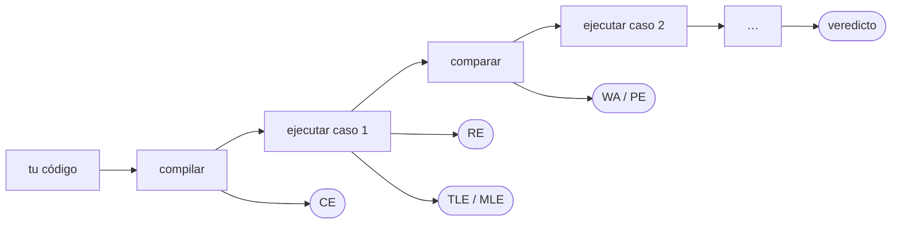
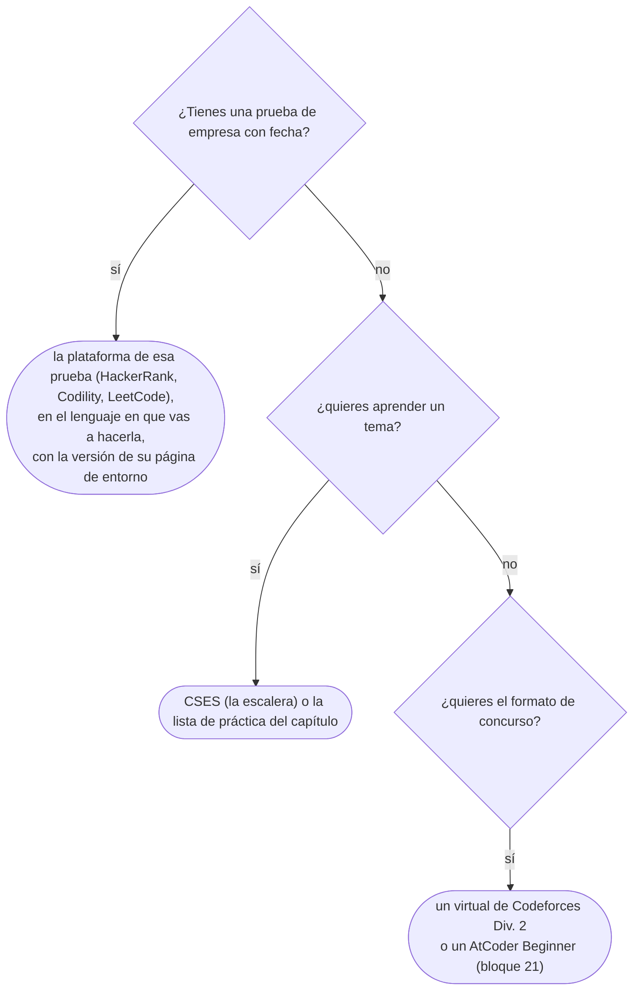

# 01 — El juez, los veredictos y las plataformas

> Qué hace un juez en línea con tu código, qué significa cada veredicto y qué no te dice, cómo se
> puntúa una prueba de empresa frente a un concurso, y cómo elegir plataforma, lenguaje y versión.
>
> **Niveles:** veredictos [A] · formato de empresa y de concurso [A] · plataformas [B].
>
> **📚 Lectura troncal:** Laaksonen, *Guide to Competitive Programming*, 3.ª ed. (Springer, 2024),
> cap. 1; Halim, Halim y Effendy, *Competitive Programming 4*, libro 1 (2020), cap. 1.
>
> **Vigencia:** 2026-10-03.

**Salto rápido:** [1](#1--el-problema) · [2](#2--el-juez-y-sus-veredictos) · [3](#3--prueba-de-empresa-y-concurso) · [4](#4--las-plataformas) · [5](#5--la-versión-importa) · [6](#6--cómo-se-elige) · [7](#7--dónde-aparece-de-verdad) · [🧠](#-preguntas) · [🧩](#-problemas-propios)

---

## 1. 🎯 El problema

Escribes una solución, la pruebas con los dos ejemplos del enunciado, los dos dan bien, la envías.
Treinta segundos después la plataforma responde:

```text
Test 1   Accepted        0.01 s
Test 2   Accepted        0.01 s
...
Test 13  Accepted        0.09 s
Test 14  Wrong Answer    0.11 s
```

No ves el caso 14. No sabes qué entrada era ni qué esperaba. Solo sabes que tu programa imprimió algo
distinto de lo que el juez tenía guardado. Y si es una prueba de empresa, puede que ni siquiera veas
el número del caso: solo un «9/15 casos superados».

Todo el corpus usa jueces como medio de práctica, así que lo primero es saber **qué hace un juez con
tu código, qué te está diciendo cada respuesta y, sobre todo, qué no te está diciendo**. Un veredicto
es una pista sobre el error, no un diagnóstico; leerlo bien ahorra la mitad de los reenvíos.

---

## 2. 🧱 El juez y sus veredictos

**Qué es.** Un juez en línea (*online judge*) es un programa que compila tu código, lo ejecuta contra
una batería de casos de prueba —casi todos ocultos— con un límite de tiempo y de memoria, y compara tu
salida con la esperada. Todo lo que te devuelve es una etiqueta por caso, el **veredicto**.

**Cómo va.** El recorrido es siempre el mismo, y cada etapa tiene su forma de fallar:



- **Compilar.** Con el compilador y la versión que eligió la plataforma, no los tuyos (§5).
- **Ejecutar.** Un proceso por caso, con la entrada en `stdin` o como argumentos de una función. El
  tiempo que se mide es casi siempre **tiempo de CPU** del proceso, y la memoria es el pico que usó.
- **Comparar.** Casi todos los jueces comparan **por *tokens***: ignoran la cantidad de espacios y los
  saltos de línea finales. Si la respuesta es un real, comparan con tolerancia (típicamente `1e-6`
  absoluta o relativa). Si hay varias respuestas válidas, un *checker* propio del problema valida la
  tuya en vez de compararla con una fija.

**Los veredictos**, con su sigla, que es como se nombran desde aquí:

| Veredicto | Sigla | Qué pasó | Qué miras primero |
|---|---|---|---|
| *Accepted* | AC | La salida coincide en todos los casos | Nada; si fue justo en el límite, la constante |
| *Wrong Answer* | WA | Terminó a tiempo e imprimió algo distinto | Desbordamiento, caso borde, idea incorrecta |
| *Time Limit Exceeded* | TLE | No terminó dentro del límite | La complejidad contra las restricciones; la E/S lenta |
| *Memory Limit Exceeded* | MLE | Pasó el pico de memoria permitido | Arreglos de tamaño máximo, recursión profunda |
| *Runtime Error* | RE | El proceso murió: excepción, *segfault*, código de salida distinto de cero | Índice fuera de rango, división por cero, pila desbordada |
| *Compilation Error* | CE | No compiló | La versión del lenguaje; el nombre de la clase en Java |
| *Presentation Error* | PE | Los *tokens* coinciden pero el formato no | Espacios, saltos de línea; casi ningún juez moderno lo da |

**Los casos ocultos y por qué los últimos son los grandes.** Los casos de un problema se escriben en
un orden: primero los ejemplos del enunciado, después casos pequeños pensados a mano (los bordes),
después aleatorios, y al final los máximos de las restricciones y los adversarios, que son los que
castigan una complejidad que no cabe o una estructura atacable. Por eso un TLE casi nunca sale en el
caso 2 y un WA por desbordamiento casi nunca sale antes de los grandes. **El número del caso que falla
es información**: si cae en los primeros, sospecha de la idea o de un borde; si cae en los últimos,
sospecha del tamaño.

> 🩺 **Diagnóstico.** El juez **para en el primer caso que falla** y solo te dice ese veredicto. Un TLE
> en el caso 20 no significa que los casos 21 a 40 den AC: significa que no se ejecutaron. Y un
> programa que daría WA en el caso 5 y TLE en el 20 te mostrará WA, que es el primero.

**Lo que el veredicto no dice.** Un RE en Java puede ser un `StackOverflowError` por recursión
profunda, no un índice malo. Un MLE en Java puede llegar disfrazado de RE (un `OutOfMemoryError` es una
excepción). Un TLE puede ser una E/S lenta con el algoritmo correcto. Y un WA puede ser un TLE
encubierto en plataformas que cortan la salida a medias. **El veredicto apunta a una etapa, no a la
causa**: la causa la encuentras tú, con los casos borde y el *stress test* del capítulo [`01/05`](05-probar-sin-ide-y-stress-test.md).

**Cuánto cuesta.** Cada envío fallido cuesta algo distinto según el formato (§3): tiempo de
penalización en un concurso, nada o casi nada en una prueba de empresa, y siempre los minutos que
tardas en entender por qué.

**Cuándo sí** se confía en el veredicto: para saber en qué etapa falló. **Cuándo no**: para saber por
qué. Si reenvías cambiando cosas al azar hasta que el veredicto cambie, el juez se convierte en tu
depurador, y es el depurador más lento y más caro que existe.

> **Veredicto:** el juez es un examinador que solo dice «mal» y el número de la pregunta. Lee el
> número: casos tempranos, la idea o un borde; casos tardíos, el tamaño o el desbordamiento.

---

## 3. 🧱 Prueba de empresa y concurso

**Qué es.** Hay dos formatos con reglas muy distintas, y la estrategia correcta en uno es un error en
el otro.

| | Prueba de empresa | Concurso |
|---|---|---|
| Problemas y tiempo | 2–3 problemas en 60–120 minutos | 5–10 problemas en 2–5 horas |
| Qué escribes | Casi siempre **una función con firma dada** | Casi siempre **el programa entero**, con su `main` |
| Puntuación | **Parcial, por casos**: 9 de 15 casos valen el 60 % | **Todo o nada** por problema |
| Penalización | Ninguna por reenviar, o muy poca | Por envío fallido: 20 minutos en ICPC, 5 en AtCoder y en LeetCode, 50 puntos en una ronda de Codeforces |
| Qué se mira además | A veces el código, el tiempo total y, en Codility, el **rendimiento** con casos grandes aparte | Solo el marcador |
| Quién te lee | A veces una persona, después | Nadie |

**Cómo va una prueba de empresa.** HackerRank y LeetCode muestran los casos de ejemplo y ocultan el
resto; la nota es la fracción de casos superados, a veces ponderada. **Codility** separa explícitamente
los casos de **corrección** (pequeños y bordes) de los de **rendimiento** (grandes), y una solución
correcta pero cuadrática suele quedarse cerca de la mitad: pasa la corrección y cae en el rendimiento.
CodeSignal, que muchas empresas usan, sigue el mismo modelo de casos ocultos con puntuación parcial.

**La consecuencia estratégica** es la más importante del capítulo:

```text
Regla de prueba de empresa:
  una fuerza bruta correcta, enviada a los 15 minutos  →  puntos seguros (los casos pequeños)
  después, si queda tiempo, la versión óptima          →  los puntos del rendimiento

Regla de concurso:
  un envío que no estás seguro de que pase              →  penalización y nada a cambio
  pruébalo antes contra tus casos y contra la cota      →  el envío fallido cuesta más que la prueba
```

En una prueba de empresa **la fuerza bruta vale puntos**; en un concurso, un envío dudoso **resta**.
El capítulo [`01/06`](06-protocolo-de-resolucion.md) convierte esto en un protocolo de tiempo.

**Cuándo sí** conviene enviar pronto: en la prueba de empresa, en cuanto tienes una versión correcta,
aunque sea lenta. **Cuándo no**: en un concurso con penalización, sin haber probado los bordes.

> **Veredicto:** en la empresa, asegura los puntos de la fuerza bruta y después optimiza; en el
> concurso, cada envío fallido es tiempo perdido, así que prueba antes de enviar.

---

## 4. 🧱 Las plataformas

**Qué es.** El corpus usa **tres plataformas base** para todo, porque son las de las pruebas de
empresa, y otras **específicas** solo donde las base no llegan.

| Plataforma | Qué enseña | Lo que hay que saber |
|---|---|---|
| **HackerRank** | El formato de prueba de empresa más extendido; problemas por temas y por lenguaje | Muchos problemas traen el `main` escrito y piden la función; los antiguos piden el programa entero |
| **LeetCode** | El formato de entrevista: una clase `Solution` con un método | **Solo los problemas gratuitos entran en el corpus** (abajo); todo o nada por problema |
| **Codility** | Las *Lessons*, cortas y graduadas, y el rendimiento puntuado aparte | Llega a lo básico: hasta DP elemental, voraces y búsqueda binaria; más allá no se fuerza |
| **CSES** | Una escalera de 300 problemas clásicos, con enunciados limpios | Programa completo; los límites son ajustados y castigan la E/S lenta |
| **Codeforces** y **AtCoder** | Concursos reales, *rating*, el problema de concurso puro | Codeforces tiene API pública; AtCoder, enunciados muy precisos |
| **Kattis** | Problemas de concursos universitarios con licencia declarada | Algunos admiten adaptarse con cita (`01/06` y la guía del corpus lo detallan) |

**LeetCode y los problemas de pago.** Una parte de LeetCode solo se ve con suscripción. El corpus
enlaza **solo los gratuitos**: cada problema se comprueba con la API de la plataforma, que devuelve un
campo `isPaidOnly`, y si vale `true` el problema no entra. Así cualquier lector puede abrir todos los
enlaces sin pagar.

**Las específicas, más adelante:** CodinGame para juegos y heurísticos, Library Checker para probar
plantillas, Project Euler para matemática, SPOJ para el nivel alto, y Acepta el reto, omegaUp y Jutge
como fuente opcional en español. Cada una aparece en el capítulo que la necesita.

**Cuánto cuesta.** Una cuenta en cada una, gratuita. Lo caro es dispersarse: hacer un problema en
cada plataforma no enseña más que hacer veinte en una.

**Cuándo sí** se sale de las tres base: cuando el tema no está en ellas (un *suffix array* no está en
Codility) o cuando quieres la escalera ordenada de CSES. **Cuándo no**: para coleccionar perfiles.

> **Veredicto:** HackerRank, LeetCode y Codility para el formato de la entrevista; CSES y Codeforces
> para la escalera y el concurso. El resto, solo cuando un capítulo lo pide.

---

## 5. 🧱 La versión importa

**Qué es.** Tu código no se compila con tu compilador, sino con el de la plataforma, **en la versión
que ella eligió**. Y las plataformas no coinciden entre sí. Esto se comprobó el 3 de octubre de 2026:

| Plataforma | C++ | Java | Python |
|---|---|---|---|
| **HackerRank** | G++ 14.2 en la opción «C++23»; **G++ 8.3 en la opción «C++20»** | OpenJDK 21.0.4 | 3.14.2 |
| **LeetCode** | Clang 19 con libstdc++ 14, C++23, `-O2` y AddressSanitizer | OpenJDK 25 | 3.14 |
| **Codility** | G++ 10.3 (C++20) o G++ 13.3 (C++23) | 21 | 3.12 |

**La trampa de HackerRank.** La opción que se llama «C++20» usa **G++ 8.3**, un compilador de 2019 que
casi no implementa C++20: ni `std::ranges`, ni `<numbers>`, ni la mayoría de lo que el estándar
añadió. Un código perfectamente válido en C++20 da CE en esa opción. **En HackerRank se elige siempre
«C++23»**, que compila C++20 sin problema porque es un G++ moderno.

**Lo que fija el corpus**, a partir de la tabla, es la **intersección**: lo que compila en las tres.

```text
C++20        lo de C++23 que G++ 13.3 no trae (std::print, por ejemplo) no se usa
Java 21      LeetCode corre Java 25, pero Codility y HackerRank corren 21
Python 3.12  Codility corre 3.12; nada de 3.13 ni 3.14 en las plantillas
```

**Los límites también cambian por lenguaje.** HackerRank publica los suyos: **2 segundos y 512 MB para
C++, 4 segundos y 2 GB para Java, 10 segundos y 512 MB para Python**. Es decir, la plataforma ya asume
que Python es varias veces más lento, y lo compensa a medias. Los concursos casi nunca compensan: el
límite es el mismo para todos, y por eso el bloque `03` dedica un capítulo a cada lenguaje.

| Lenguaje | Qué te da la plataforma | El detalle que muerde |
|---|---|---|
| **C++** | El límite más bajo, y la constante más baja | En HackerRank, la opción «C++20» es G++ 8.3; elige «C++23» |
| **Java** | Más tiempo en HackerRank, el mismo en un concurso | El arranque de la JVM y la E/S con `Scanner` comen parte del límite |
| **Python** | Hasta 5 veces más tiempo en HackerRank; casi nunca en un concurso | Un factor de 30–50 frente a C++ en bucles; la recursión tiene límite |

**Cuándo sí** importa la versión: siempre que uses algo de los últimos cinco años del lenguaje.
**Cuándo no**: con código que no sale de lo básico. Pero no sabes cuál es cuál hasta que da CE.

> **Veredicto:** antes de escribir en una plataforma nueva, mira su página de entorno. En HackerRank,
> «C++23»; en Codility, Python 3.12; y en todas, Java 21.

---

## 6. 🧭 Cómo se elige

Plataforma, lenguaje y versión, según para qué estás practicando:



Y la frase que se dice en voz alta cuando te preguntan qué lenguaje usar en una prueba:

> **Mejor:** «El que mejor domino, salvo que el límite de tiempo no compense a Python; en ese caso,
> Java o C++.»

---

## 7. 🔭 Dónde aparece de verdad

Un juez en línea es, literalmente, **un conjunto de pruebas de regresión con entradas ocultas**. La
misma disciplina aparece en tu trabajo diario con otros nombres:

- **El caso 14 es producción.** Tus pruebas unitarias son los ejemplos del enunciado: los escribiste tú
  y pasan. El tráfico real es el caso 14, con la entrada que no imaginaste.
- **TLE es el *timeout* de un servicio.** Un algoritmo cuadrático que va bien con 100 registros y se
  cae con 10⁵ es el mismo fallo que un TLE en el caso grande.
- **La versión del compilador es la imagen del contenedor.** El código que compila en tu máquina y no
  en la de integración continua es un CE con otro nombre.
- **El *checker* es una aserción por propiedad.** Cuando hay varias respuestas válidas, no se compara
  con una fija: se comprueba que la tuya cumple lo que se pide, igual que en las pruebas basadas en
  propiedades.

---

## ⚠️ Errores frecuentes

| Se dice | Lo preciso |
|---|---|
| «Si pasa los ejemplos, está bien» | Los ejemplos son los casos 1 y 2; los bordes y los máximos vienen después y están ocultos |
| «El lenguaje da igual» | El límite de tiempo puede ser el mismo para todos, y Python es 30–50 veces más lento en bucles |
| «C++20 en HackerRank es C++20» | Es G++ 8.3; para C++20 real, la opción «C++23» |
| «TLE significa que el algoritmo es lento» | O que la E/S es lenta, o que hay un bucle infinito; mira primero la complejidad contra las restricciones |
| «Si el caso 20 da TLE, los demás están bien» | El juez para en el primer fallo; los siguientes no se ejecutaron |
| «RE es un índice fuera de rango» | También una pila desbordada, una división por cero o, en Java, memoria agotada |
| «En una prueba de empresa hay que enviar solo el óptimo» | La puntuación es parcial: una fuerza bruta correcta asegura los casos pequeños |

---

## 📚 Para profundizar

- **Libro** — Laaksonen, *Guide to Competitive Programming*, 3.ª ed. (Springer, 2024), cap. 1
  («Introduction»): lenguajes, entrada y salida, y cómo trabaja un juez. *Lectura troncal.*
- **Libro** — Halim, Halim y Effendy, *Competitive Programming 4*, libro 1 (2020), cap. 1: los
  veredictos, los jueces y la estrategia de concurso.
- **Libro** — Skiena, *The Algorithm Design Manual*, 3.ª ed. (Springer, 2020), cap. 1: por qué
  probar con ejemplos no demuestra nada, con contraejemplos a heurísticas que parecen correctas.
- **Documentación de la plataforma** — HackerRank, [*Execution Environment*](https://support.hackerrank.com/articles/6693750503-execution-environment):
  versiones, límites de tiempo y de memoria por lenguaje.
- **Video** — los cursos EDU de Codeforces, por título: la introducción al formato de concurso.

---

## 🧠 Preguntas

1. ¿Qué significan AC, WA, TLE, MLE y RE, y en qué etapa del juez se produce cada uno? 🟢
2. ¿Qué compara el juez cuando compara «por *tokens*», y qué diferencias de formato ignora? 🟢
3. ¿Qué campo de la API de LeetCode decide si un problema entra en este corpus, y por qué? 🟢
4. ¿Qué diferencia hay entre la puntuación de una prueba de empresa y la de un concurso? 🟡
5. ¿En qué se distingue un caso de corrección de uno de rendimiento en Codility? 🟡
6. ¿Por qué un *checker* propio del problema no es lo mismo que comparar con una salida fija? 🟡
7. Tu envío da TLE en el caso 3 de 40. ¿Qué sospechas primero, y por qué distinto que si fuera el caso 38? 🟠
8. En una prueba de empresa de 90 minutos tienes una fuerza bruta correcta a los 20 minutos y una idea óptima sin probar. ¿Qué haces, y por qué al revés en un concurso? 🟠
9. ¿Por qué un código C++20 válido puede dar CE en HackerRank, y cómo lo evitas? 🟠
10. Compara C++, Java y Python ante el mismo problema con límite de 1 segundo en un concurso y en HackerRank: ¿qué cambia para cada lenguaje? 🟠
11. Un envío en Java da RE en el caso 25, el más grande, y el código no tiene accesos a arreglos sospechosos. Da dos causas posibles y cómo distinguirlas. 🔴
12. Diseña la regla de comparación de un juez para un problema cuya respuesta es un real: qué tolerancia, absoluta o relativa, y un ejemplo de salida que una comparación exacta rechazaría injustamente. 🔴

---

## 🧩 Problemas propios

### Suma de la jornada

**Nivel:** 🟢 · **Formato:** programa completo; sirve para probar el envío en una plataforma nueva.

Una tienda registra el importe de cada venta del día. Imprime el total de la jornada.

- **Entrada.** Una línea con `n`, el número de ventas. Una segunda línea con `n` enteros, los importes.
- **Salida.** Un entero: la suma de los importes.
- **Restricciones.** `1 ≤ n ≤ 2·10⁵`; `0 ≤ importe ≤ 10⁹`.

```text
Entrada            Salida
3                  60
10 20 30

Entrada            Salida
2                  2000000000
1000000000 1000000000
```

**Pista 1:** ¿cuánto vale la suma más grande que permiten las restricciones?

### El comparador del juez

**Nivel:** 🟡 · **Formato:** programa completo.

Escribe la etapa «comparar» de un juez. Recibes la salida esperada y la de un participante, y decides
el veredicto: `AC` si las dos tienen los mismos *tokens* en el mismo orden (un *token* es una
secuencia de caracteres sin espacios ni saltos de línea); `PE` si al quitar **todos** los espacios y
saltos de línea las dos quedan idénticas, pero los *tokens* no coinciden; `WA` en cualquier otro caso.

- **Entrada.** Una línea con dos enteros `a` y `b`. Después, `a` líneas con la salida esperada, y
  después `b` líneas con la del participante.
- **Salida.** `AC`, `PE` o `WA`.
- **Restricciones.** `1 ≤ a, b ≤ 1000`; cada línea tiene como mucho 1000 caracteres ASCII imprimibles
  o espacios.

```text
Entrada            Salida
2 1                AC
1 2
3
1  2 3

Entrada            Salida
1 1                PE
12 3
1 23

Entrada            Salida
1 1                WA
5
6
```

**Pista 1:** ¿qué tienen en común dos salidas que se escriben distinto pero se leen igual?

🔥 **Para el geek — en JavaScript:** leer líneas que pueden estar vacías o tener espacios al final
cambia la forma de partir la entrada: `split(/\s+/)` y `split('\n')` no dan lo mismo.

### Puntuación parcial

**Nivel:** 🟠 · **Formato:** programa completo.

Una prueba agrupa sus casos en **subtareas**. Cada subtarea vale unos puntos y se gana entera solo si
**todos** sus casos son AC. Dada la lista de veredictos, calcula la puntuación con dos reglas: la de
**empresa** (cada caso vale lo mismo, y la nota es `⌊100 · casos AC / total de casos⌋`) y la de **subtareas** (la suma de los puntos de las subtareas ganadas).

- **Entrada.** Una línea con `k`, el número de subtareas. Después, `k` líneas: cada una empieza con
  los puntos `p` de la subtarea y su número de casos `c`, seguidos de `c` veredictos (`AC`, `WA`,
  `TLE`, `MLE`, `RE`).
- **Salida.** Dos enteros: la nota con la regla de empresa y la nota con la de subtareas.
- **Restricciones.** `1 ≤ k ≤ 100`; `1 ≤ c ≤ 100`; la suma de los `p` es 100.

```text
Entrada                       Salida
2                             83 30
30 2 AC AC
70 4 AC AC WA AC

Entrada                       Salida
1                             0 0
100 1 TLE
```

**Pista 1:** ¿qué tienen que cumplir todos los casos de una subtarea para que cuente?

---

## 🧩 Práctica externa

> 💡 **Truco.** Si te atascas y tienes una IA a mano, **no le pidas la solución**: escribe tú la
> versión ingenua, pídele *feedback* sobre ella y, si hace falta, solo la pista siguiente. El
> lineamiento entero está en `01/06`.

Aquí los problemas son triviales a propósito: el objetivo es **enviar y leer el veredicto** en cada
plataforma, y notar la diferencia entre escribir una función y escribir el programa entero.

### Núcleo

| ✔ | Problema | Plataforma | Nivel | Patrón | Pista 1 |
|---|---|---|---|---|---|
| [ ] | [Solve Me First](https://www.hackerrank.com/challenges/solve-me-first/problem) | HackerRank | 🟢 | Formato: función | ¿Qué parte del programa ya está escrita y cuál te toca? |
| [ ] | [Simple Array Sum](https://www.hackerrank.com/challenges/simple-array-sum/problem) | HackerRank | 🟢 | Formato: función | ¿De dónde salen los datos: de `stdin` o de los parámetros? |
| [ ] | [Running Sum of 1d Array](https://leetcode.com/problems/running-sum-of-1d-array/) | LeetCode | 🟢 | Formato: clase `Solution` | ¿Qué devuelve el método, y quién lo imprime? |
| [ ] | [Fizz Buzz](https://leetcode.com/problems/fizz-buzz/) | LeetCode | 🟢 | Formato: lista de cadenas | ¿En qué orden tienes que comprobar las condiciones? |
| [ ] | [BinaryGap](https://app.codility.com/programmers/lessons/1-iterations/binary_gap/) | Codility | 🟢 | Formato: función, con bordes | ¿Cuenta un hueco de ceros que no se cierra con un 1? |
| [ ] | [CyclicRotation](https://app.codility.com/programmers/lessons/2-arrays/cyclic_rotation/) | Codility | 🟢 | Formato: función, con bordes | ¿Qué pasa si el arreglo está vacío o `K` es mayor que su tamaño? |

### Ampliación

| ✔ | Problema | Plataforma | Nivel | Patrón | Pista 1 |
|---|---|---|---|---|---|
| [ ] | [Weird Algorithm](https://cses.fi/problemset/task/1068) | CSES | 🟢 | Programa completo | ¿Qué valor máximo alcanza la secuencia antes de llegar a 1? |
| [ ] | [Watermelon](https://codeforces.com/problemset/problem/4/A) | Codeforces | 🟢 | Programa completo, borde | ¿Qué pasa con el peso más pequeño que sí es par? |
| [ ] | [A - Product](https://atcoder.jp/contests/abc086/tasks/abc086_a) | AtCoder | 🟢 | Programa completo | ¿Hace falta calcular el producto entero para saber su paridad? |

### Por curiosidad

| ✔ | Problema | Plataforma | Nivel | Patrón | Pista 1 |
|---|---|---|---|---|---|
| [ ] | [Hello World!](https://open.kattis.com/problems/hello) | Kattis | 💀 | Programa completo | ¿Coincide tu salida carácter por carácter, signos incluidos? |

---

## ✅ Criterio de dominio

- Decir, para cada veredicto, en qué etapa del juez se produce y qué miras primero.
- Explicar en dos frases por qué en una prueba de empresa se envía la fuerza bruta y en un concurso
  no se envía nada sin probar.
- Tener cuenta en HackerRank, LeetCode y Codility y haber enviado un problema del núcleo en cada una,
  en tu lenguaje y con la versión correcta.
- Saber de memoria qué opción de C++ elegir en HackerRank y qué versión de Python corre Codility.

---

**Anterior:** — · **Siguiente:** [`01/02` — Leer las restricciones](02-leer-las-restricciones.md) ·
**Relacionado:** [`01/03` — Entrada, salida y la plantilla](03-entrada-salida-y-plantilla.md); [el bloque `21` — Simulacros](../21-simulacros/README.md).
