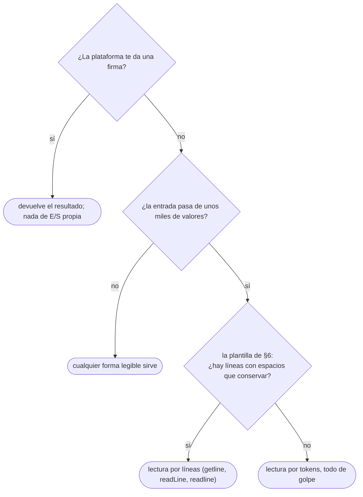

# 03 — Entrada, salida y la plantilla en C++, Java y Python

> Leer y escribir rápido en los tres lenguajes, en los dos formatos de plataforma —completar una
> firma o escribir el programa entero—, y la plantilla de programa completo del corpus, la única con
> `main`.
>
> **Niveles:** E/S rápida [A] · los dos formatos [A].
>
> **📚 Lectura troncal:** Halim, Halim y Effendy, *Competitive Programming 4*, libro 1 (2020), cap. 1;
> la documentación de `<iostream>`, `java.io` y `sys`.
>
> **Ruta corta:** sí.
>
> **Vigencia:** 2026-10-03.

**Salto rápido:** [1](#1--el-problema) · [2](#2--los-dos-formatos) · [3](#3--es-rápida-en-c) · [4](#4--es-rápida-en-java) · [5](#5--es-rápida-en-python) · [6](#6--la-plantilla) · [7](#7-️-la-tabla-de-costes) · [8](#8--cómo-se-elige) · [🧠](#-preguntas) · [🧩](#-problemas-propios)

---

## 1. 🎯 El problema

El enunciado pide sumar `n ≤ 10⁶` enteros. El algoritmo es un bucle: `O(n)`, un millón de pasos,
cabe cien veces en el segundo que da el juez. Lo escribes en Java así:

```java
// falla: TLE con n = 10⁶ en jueces con límite ajustado, aunque el algoritmo sea lineal
Scanner sc = new Scanner(System.in);
int n = sc.nextInt();
long sum = 0;
for (int i = 0; i < n; i++) sum += sc.nextInt();
System.out.println(sum);
```

Y da *Time Limit Exceeded* (TLE). El algoritmo no tiene la culpa: la tiene **leer**. Un millón de
números son unos 10 MB de texto, y `Scanner` analiza cada uno con expresiones regulares. La lectura
sola puede comerse el límite.

Lo mismo pasa en las otras direcciones: en C++ con `cin` sin desacoplar y `endl` en cada línea, en
Python con `input()` dentro de un bucle de un millón. **La entrada y la salida cuentan en el tiempo**,
y en los problemas de entrada grande deciden el veredicto. Este capítulo fija cómo se lee y se escribe
en cada lenguaje, y deja escrita la plantilla que el resto del corpus da por supuesta.

---

## 2. 🧱 Los dos formatos

**Qué es.** Las plataformas te piden una de dos cosas, y la diferencia cambia qué escribes:

| Formato | Quién lee la entrada | Qué escribes | Dónde |
|---|---|---|---|
| **Completar una firma** | La plataforma, antes de llamarte | Una función o un método que recibe los datos ya parseados y **devuelve** el resultado | LeetCode, Codility, HackerRank moderno |
| **Escribir el programa** | Tú, desde `stdin` | El `main` entero: leer, resolver, **imprimir** | HackerRank clásico, Codeforces, CSES, AtCoder, Kattis |

**Cómo va una firma.** En LeetCode, una clase con un método:

```java
class Solution {
    public int[] runningSum(int[] nums) {
        // la plataforma ya leyó nums; tú devuelves, no imprimes
        for (int i = 1; i < nums.length; i++) nums[i] += nums[i - 1];
        return nums;
    }
}
```

- **No hay `main`, ni lectura, ni impresión.** Imprimir de más no rompe nada en LeetCode, pero en
  algunos jueces la salida estándar se compara y un `println` de depuración da *Wrong Answer* (WA).
- **La E/S rápida no aplica**: la paga la plataforma. Lo que sí aplica es todo lo demás del capítulo
  `01/02`: la cota de `n`, los tipos, la memoria.

**Cómo va un programa entero.** Lees todo de la entrada estándar con el formato exacto del enunciado,
y escribes la salida con el formato exacto. Aquí sí decide la velocidad de la E/S, y aquí vive la
plantilla de §6.

**Cuándo sí** importa cada formato: en una prueba de empresa casi siempre es la firma; en un concurso
y en CSES, el programa. **Cuándo no** hay que pensarlo: nunca; lo primero que se mira de una
plataforma nueva es cuál de los dos pide.

> **Veredicto:** en el formato de firma, devuelve y no imprimas; en el de programa, la E/S es parte
> del algoritmo y se escribe con la plantilla.

---

## 3. 🧱 E/S rápida en C++

**Qué es.** `iostream` es lento por dos razones de compatibilidad que se pueden apagar.

```cpp
#include <iostream>

int main() {
    std::ios::sync_with_stdio(false);  // desacopla iostream de stdio de C
    std::cin.tie(nullptr);             // leer de cin ya no vacía cout antes
    long long x, sum = 0;
    while (std::cin >> x) sum += x;    // lee hasta el fin de la entrada
    std::cout << sum << '\n';          // '\n', no std::endl
}
```

- **`sync_with_stdio(false)`**: por defecto, `cin` y `cout` están sincronizados con `scanf` y `printf`
  para poder mezclarlos, y eso obliga a no tener búfer propio. Al apagarlo, cada flujo usa su búfer y
  va varias veces más rápido. **El precio:** a partir de ahí **no se mezclan** `cin` con `scanf` ni
  `cout` con `printf`; la salida puede salir desordenada.
- **`cin.tie(nullptr)`**: por defecto, cada lectura de `cin` vacía `cout` primero, pensado para que una
  pregunta aparezca antes de esperar la respuesta del usuario. En un juez no hay usuario. **La
  excepción** son los problemas interactivos ([`20/03`](../20-ad-hoc-constructivos-e-interactivos/03-interactivos.md)), donde sí hay que vaciar a mano.
- **`'\n'` frente a `std::endl`**: `endl` escribe el salto **y vacía el búfer**. Un millón de `endl`
  son un millón de escrituras al sistema operativo. `'\n'` solo escribe el salto.

**`<bits/stdc++.h>` y `using namespace std`.** Casi todo el código de competidores empieza con estas
dos líneas. La primera es una cabecera **interna de GCC** que incluye toda la librería estándar de
golpe: ahorra escribir los `#include`, pero alarga la compilación, no existe con la libc++ de Clang
(la de macOS) y no es C++ estándar. La segunda mete todos los nombres de `std` en el espacio global:
ahorra escribir `std::`, pero choca con tus nombres (`count`, `distance`, `next` son funciones de
`std`). **El corpus no usa ninguna de las dos en sus plantillas**: cabeceras explícitas y `std::`. Si
las usas en un concurso, sabes qué compras.

**Cuánto cuesta.** Dos líneas al principio del `main`. **Cuándo sí**: en todo programa que lea más de
unos miles de valores. **Cuándo no**: en un problema interactivo, donde el `tie` hay que pensarlo, y si
vas a usar `scanf`, que entonces se usa solo.

> **Veredicto:** las dos líneas van siempre, y `endl` no va nunca salvo que necesites vaciar.

---

## 4. 🧱 E/S rápida en Java

**Qué es.** `Scanner` y `System.out.println` son cómodos y lentos. La alternativa es leer líneas con
búfer, partirlas a mano y escribir en un búfer que se vacía una vez.

**Por qué `Scanner` es lento.** Cada `nextInt()` aplica expresiones regulares para reconocer el
*token* y su formato, con un búfer interno pequeño. Para cien números no importa; para un millón, es
la mitad del límite.

**Por qué `System.out.println` es lento en bucle.** `System.out` es un `PrintStream` sincronizado que
vacía su búfer en cada salto de línea. Un millón de `println` son un millón de escrituras.

**La alternativa:**

- **Leer**: `BufferedReader` lee bloques grandes de la entrada; `StringTokenizer` parte cada línea por
  espacios sin expresiones regulares; `Integer.parseInt` convierte. Es la pareja estándar.
- **`StreamTokenizer`** es aún más rápido, pero **lee los números como `double`**: un `long` de más de
  15–16 dígitos pierde precisión sin avisar. Sirve para enteros de 32 bits; para `long` grandes, no.
- **Escribir**: `PrintWriter` sobre un `BufferedWriter`, y **un único `flush()` al final**. Si se te
  olvida el `flush`, la salida se queda en el búfer y el juez ve una salida vacía: WA en todos los
  casos.

**La clase del programa.** El nombre de la clase pública lo fija la plataforma: HackerRank suele
usar `Solution`, otros aceptan `Main`. Mira la plantilla que te da el editor antes de cambiarlo, porque
un nombre equivocado es un *Compilation Error* (CE).

**Cuánto cuesta.** Unas veinte líneas de lector que se copian de la plantilla (§6). **Cuándo sí**: en
todo programa con entrada de más de unos miles de valores. **Cuándo no**: en el formato de firma, o
con entradas diminutas donde `Scanner` es más legible.

> **Veredicto:** `BufferedReader` con `StringTokenizer` para leer y `PrintWriter` con un `flush` al
> final para escribir. `Scanner` solo cuando la entrada es pequeña.

---

## 5. 🧱 E/S rápida en Python

**Qué es.** `input()` y `print()` hacen trabajo extra por llamada. Con muchas llamadas, ese trabajo
domina.

- **Leer línea a línea**: `sys.stdin.readline` es mucho más rápido que `input()`. Devuelve la línea
  **con su `'\n'` final**, que `int()` tolera pero una comparación de cadenas no.
- **Leer todo de golpe**: `sys.stdin.buffer.read().split()` lee la entrada entera como *bytes* y la
  parte por blancos en una sola llamada en C. Es lo más rápido cuando la entrada es una lista de
  números y no importa dónde acaba cada línea.
- **Escribir**: acumular las líneas en una lista y escribir una vez con
  `sys.stdout.write("\n".join(...))`. Un `print` por línea en un bucle de `10⁶` es lento.
- **Dentro de una función**: el código que corre dentro de `main()` usa variables locales, que Python
  resuelve más rápido que las globales. En bucles largos se nota.

**Cuánto cuesta.** Dos o tres líneas distintas a las de un script normal. **Cuándo sí**: siempre que
la entrada pase de unas decenas de miles de valores. **Cuándo no**: cuando la entrada tiene líneas con
espacios que hay que conservar; ahí se lee línea a línea.

> **Veredicto:** `sys.stdin.buffer.read().split()` para listas de números, `sys.stdin.readline` para
> líneas, y una sola escritura al final.

---

## 6. 🧱 La plantilla

**Qué es.** El programa completo mínimo que lee rápido y escribe rápido, en los tres lenguajes. Es la
**única plantilla con `main` del corpus**: las demás son funciones que se pegan dentro de esta. El
ejemplo lee `n` y `n` enteros e imprime su suma, para que se vea dónde va cada cosa.

```cpp
#include <iostream>
#include <vector>

int main() {
    std::ios::sync_with_stdio(false);
    std::cin.tie(nullptr);

    int n;
    std::cin >> n;
    std::vector<long long> a(n);
    for (auto& x : a) std::cin >> x;

    long long sum = 0;                  // aquí va la solución
    for (long long x : a) sum += x;

    std::cout << sum << '\n';
    return 0;
}
```

```java
import java.io.*;
import java.util.*;

public class Main {
    public static void main(String[] args) throws IOException {
        FastReader in = new FastReader(System.in);
        PrintWriter out = new PrintWriter(new BufferedWriter(new OutputStreamWriter(System.out)));

        int n = in.nextInt();
        long[] a = new long[n];
        for (int i = 0; i < n; i++) a[i] = in.nextLong();

        long sum = 0;                   // aquí va la solución
        for (long x : a) sum += x;

        out.println(sum);
        out.flush();                    // sin esto, la salida se queda en el búfer
    }

    static class FastReader {
        private final BufferedReader br;
        private StringTokenizer st;

        FastReader(InputStream is) {
            br = new BufferedReader(new InputStreamReader(is), 1 << 16);
        }

        String next() throws IOException {
            while (st == null || !st.hasMoreTokens()) {
                String line = br.readLine();
                if (line == null) return null;   // fin de la entrada
                st = new StringTokenizer(line);
            }
            return st.nextToken();
        }

        int nextInt() throws IOException { return Integer.parseInt(next()); }
        long nextLong() throws IOException { return Long.parseLong(next()); }
    }
}
```

```python
import sys

def main():
    data = sys.stdin.buffer.read().split()
    n = int(data[0])
    a = list(map(int, data[1:1 + n]))

    total = sum(a)                      # aquí va la solución

    sys.stdout.write(str(total) + "\n")

main()
```

- **Lo común**: leer todo, resolver, escribir una vez. La solución va en el hueco marcado; las
  plantillas de los demás capítulos son funciones que se llaman desde ahí.
- **C++**: `std::vector<long long>` porque los valores pueden pasar de `2³¹` (el capítulo `01/04` lo
  justifica); las dos líneas de §3 al principio.
- **Java**: el lector es una clase interna estática que se copia entera; `next()` devuelve `null` al
  final de la entrada, que es como se detecta el fin cuando no te dan `n`. El `flush` es la línea que
  más se olvida. La clase se llama `Main`; cámbiala si la plataforma pide otro nombre.
- **Python**: `data` es una lista de *bytes*, e `int()` los acepta directamente; `sum` está en C y no
  es un bucle de Python. Con varios casos de prueba, se lleva un índice que avanza sobre `data`.

**Varios casos de prueba.** Si la entrada empieza con `t`, el número de casos, la plantilla envuelve el
bloque de lectura y solución en un bucle de `t` vueltas, y **cada caso reinicia su estado**: un
acumulador que no se reinicia es un WA en el segundo caso que el ejemplo, con un solo caso, no
detecta.

### De la versión ingenua a la buena

**El problema.** Imprimir, una por línea, las sumas de prefijos de `n ≤ 10⁶` enteros: con
`[5, 2, 9, 1, 5, 6]`, las líneas `5`, `7`, `16`, `17`, `22`, `28`.

**La versión ingenua:**

```java
// Correcta, y lenta en E/S: Scanner al leer y println al escribir, un millón de veces cada uno.
import java.util.Scanner;

public class Main {
    public static void main(String[] args) {
        Scanner sc = new Scanner(System.in);
        int n = sc.nextInt();
        long sum = 0;
        for (int i = 0; i < n; i++) {
            sum += sc.nextInt();
            System.out.println(sum);
        }
    }
}
```

> «El algoritmo es lineal y cabe de sobra. Lo que no cabe es la E/S: `Scanner` analiza cada número
> con expresiones regulares y `System.out.println` vacía el búfer en cada línea. Con un millón de
> líneas en cada dirección, eso domina el tiempo.»

**El camino a la buena.** Leer con `BufferedReader` y `StringTokenizer`, y acumular la salida en un
`PrintWriter` que se vacía una sola vez. El algoritmo no cambia ni una línea.

**La versión buena** es la plantilla de §6 con el hueco relleno: dentro del bucle de lectura,
`sum += in.nextLong(); out.println(sum);`, y el `flush` final. Lo único que cambió son las dos
clases de E/S.

**Cuándo sí** se copia la plantilla: al empezar cualquier problema de programa completo. **Cuándo no**:
en el formato de firma, donde la E/S no es tuya.

> **Veredicto:** la plantilla se escribe de memoria en los tres lenguajes, porque es lo primero que se
> teclea en una prueba y lo último en lo que quieres pensar.

---

## 7. ⏱️ La tabla de costes

Para leer `10⁶` enteros y escribir `10⁶` líneas. Los costes son relativos dentro de cada lenguaje;
las mediciones concretas dependen de la máquina y del juez.

| Método | Coste relativo | Lo que la tabla no dice |
|---|---|---|
| C++ `cin` sin desacoplar, `endl` | Varias veces más lento | `endl` vacía en cada línea; es lo que más pesa en la salida |
| C++ `cin` desacoplado, `'\n'` | La referencia | No se mezcla con `scanf` ni `printf` |
| Java `Scanner` + `println` | El más lento de Java, con diferencia | Basta para entradas pequeñas y es lo más legible |
| Java `BufferedReader` + `PrintWriter` | Cerca de C++ | Olvidar el `flush` da salida vacía |
| Java `StreamTokenizer` | Algo más rápido aún | Lee como `double`: `long` grandes pierden precisión |
| Python `input()` + `print` | El más lento de Python | Cómodo para entradas pequeñas |
| Python `sys.stdin.buffer.read().split()` + un `write` | El más rápido de Python | Pierde la estructura de líneas |

---

## 8. 🧭 Cómo se elige



> **Mejor:** «Leo con búfer y escribo una sola vez al final; con un millón de valores, la E/S lenta da
> TLE aunque el algoritmo sea lineal.»

---

## 9. 🔭 Dónde aparece de verdad

- **Los registros de un servicio.** Escribir un *log* con vaciado en cada línea es el `endl` de
  producción: una llamada al sistema por línea. Por eso los *loggers* usan búferes y escritura
  asíncrona.
- **Parsear archivos grandes.** Cargar un CSV de millones de filas con expresiones regulares por campo
  es el `Scanner` de producción; los parsers rápidos leen bloques y parten a mano.
- **El `flush` olvidado.** Un proceso que muere sin vaciar su búfer pierde las últimas líneas de su
  salida. Es el WA por `flush` con consecuencias reales.

---

## ⚠️ Errores frecuentes

| Se dice | Lo preciso |
|---|---|
| «`Scanner` vale» | Vale para entradas pequeñas; con `10⁶` valores puede comerse el límite de tiempo |
| «`endl` es un salto de línea» | Es un salto de línea **y** un vaciado del búfer; en bucle, es una escritura por línea |
| «La entrada no cuenta en el tiempo» | Cuenta entera: el juez mide el proceso desde que arranca hasta que termina |
| «Con `sync_with_stdio(false)` puedo seguir usando `printf`» | Ya no: mezclar los dos desordena la salida |
| «`StreamTokenizer` sirve para todo» | Lee como `double`; un `long` de 18 dígitos pierde precisión |
| «Si imprimo bien, el `flush` da igual» | Sin `flush`, el `PrintWriter` puede terminar con la salida en el búfer: salida vacía |
| «`readline` devuelve la línea» | La devuelve con su `'\n'`; comparada como cadena, no coincide |

---

## 📚 Para profundizar

- **Libro** — Halim, Halim y Effendy, *Competitive Programming 4*, libro 1 (2020), cap. 1: la E/S en
  los jueces y las plantillas de cada lenguaje. *Lectura troncal.*
- **Libro** — Laaksonen, *Guide to Competitive Programming*, 3.ª ed. (Springer, 2024), cap. 1: la
  plantilla de C++ y la entrada y salida eficientes.
- **Documentación** — cppreference, [`std::ios_base::sync_with_stdio`](https://en.cppreference.com/cpp/io/ios_base/sync_with_stdio):
  qué desactiva y qué garantías pierdes.
- **Documentación** — cppreference, [`std::endl`](https://en.cppreference.com/cpp/io/manip/endl): el
  vaciado que va con el salto.
- **Documentación** — Java 21, [`BufferedReader`](https://docs.oracle.com/en/java/javase/21/docs/api/java.base/java/io/BufferedReader.html)
  y [`PrintWriter`](https://docs.oracle.com/en/java/javase/21/docs/api/java.base/java/io/PrintWriter.html).
- **Documentación** — Java 21, [`StreamTokenizer`](https://docs.oracle.com/en/java/javase/21/docs/api/java.base/java/io/StreamTokenizer.html):
  el campo `nval` es un `double`.
- **Documentación** — Python, [`sys`](https://docs.python.org/3/library/sys.html): `stdin`, `stdout` y
  sus atributos `buffer`.

---

## 🧠 Preguntas

1. ¿Qué diferencia hay entre el formato de completar una firma y el de escribir el programa entero? 🟢
2. ¿Qué hacen `std::ios::sync_with_stdio(false)` y `std::cin.tie(nullptr)`? 🟢
3. ¿Qué hace `std::endl` además de escribir un salto de línea? 🟡
4. ¿Por qué `Scanner` es lento, y qué pareja de clases lo sustituye para leer? 🟡
5. ¿Qué diferencia hay entre `sys.stdin.readline` y `sys.stdin.buffer.read().split()`, y cuándo usas cada una? 🟡
6. Compara las tres plantillas: ¿qué línea de cada lenguaje, si se olvida, convierte la plantilla en lenta o en incorrecta? 🟠
7. Después de `sync_with_stdio(false)` usas `printf` para una línea y `cout` para el resto. ¿Qué puede pasar, y por qué? 🟠
8. ¿Por qué `StreamTokenizer` es peligroso para leer valores de hasta `10¹⁸`, y qué usarías en su lugar? 🟠
9. ¿Qué cuestan `<bits/stdc++.h>` y `using namespace std`, y por qué el corpus no los usa en sus plantillas? 🟠
10. Un programa Java da WA en todos los casos, incluido el primero, y en tu máquina imprime bien. Da la causa más probable y cómo confirmarla. 🔴
11. La entrada no dice cuántos valores vienen: hay que leer hasta el final. Escribe cómo detectas el final en cada uno de los tres lenguajes con la plantilla del capítulo. 🔴
12. Un problema tiene `t ≤ 10⁴` casos y tu solución pasa el ejemplo, que tiene un solo caso, y da WA. Propón dos causas relacionadas con la plantilla y cómo las descartas. 🔴

---

## 🧩 Problemas propios

### Eco al revés

**Nivel:** 🟢 · **Formato:** programa completo.

Lee una lista de enteros y escríbela al revés, uno por línea.

- **Entrada.** Una línea con `n`. Una segunda línea con `n` enteros.
- **Salida.** Los `n` enteros en orden inverso, uno por línea.
- **Restricciones.** `1 ≤ n ≤ 10⁶`; `|a[i]| ≤ 10¹⁸`. Límite: 1 segundo.

```text
Entrada            Salida
6                  6
5 2 9 1 5 6        5
                   1
                   9
                   2
                   5

Entrada            Salida
1                  -1000000000000000000
-1000000000000000000
```

**Pista 1:** ¿cuántas líneas escribe tu programa con el `n` máximo, y cuántas veces habla con el
sistema operativo para escribirlas?

🔥 **Para el geek — en Go:** `fmt.Println` en un bucle de un millón es una escritura por línea; con
`bufio.NewWriter` y un `Flush` al final cambia el diseño de la salida, y si olvidas el `Flush` no sale
nada.

### Nombres con espacios

**Nivel:** 🟡 · **Formato:** programa completo.

Un registro de visitas tiene una línea por visitante con su nombre completo, que puede llevar varios
espacios entre palabras. Para cada línea, imprime cuántas palabras tiene el nombre.

- **Entrada.** Una línea con `n`. Después, `n` líneas, cada una con un nombre de una o más palabras
  separadas por uno o más espacios. Ninguna línea está vacía ni empieza o termina con espacios.
- **Salida.** `n` líneas, cada una con el número de palabras del nombre correspondiente.
- **Restricciones.** `1 ≤ n ≤ 10⁵`; cada línea tiene como mucho 100 caracteres.

```text
Entrada                    Salida
3                          5
Ana María de la Cruz       1
Luis                       3
Carmen   Rosa   Díaz

Entrada                    Salida
1                          1
A
```

**Pista 1:** después de leer `n` con el lector de números, ¿qué queda sin leer en la primera línea de
la entrada?

### Hasta el final

**Nivel:** 🟠 · **Formato:** programa completo.

Un sensor envía lecturas en parejas `(momento, valor)`, sin decir cuántas. Imprime el valor máximo y
el primer momento en que se alcanzó.

- **Entrada.** Parejas de enteros `momento valor`, una o varias por línea, hasta el final de la
  entrada. Los momentos son estrictamente crecientes.
- **Salida.** Dos enteros: el momento de la primera aparición del valor máximo, y ese valor.
- **Restricciones.** Entre 1 y `5·10⁵` parejas; `0 ≤ momento ≤ 10¹²`; `|valor| ≤ 10⁹`.

```text
Entrada                    Salida
1 5  2 9                   2 9
3 1  4 9

Entrada                    Salida
7 -3                       7 -3
```

**Pista 1:** si no sabes cuántas lecturas hay, ¿qué te devuelve cada lenguaje cuando ya no queda nada
que leer?

🔥 **Para el geek — en JavaScript:** en Node no hay una lectura por *tokens* que se detenga al final: se
lee la entrada entera con `fs.readFileSync(0)` y se parte, así que «hasta el final» es el largo del
arreglo resultante. Los momentos de hasta `10¹²` caben exactos en un `Number`, porque están por debajo
de `2⁵³`.

---

## 🧩 Práctica externa

Los de HackerRank son de su sección de lenguaje: el objetivo es la E/S, no el algoritmo. Los de CSES y
CodeChef castigan una lectura lenta.

### Núcleo

| ✔ | Problema | Plataforma | Nivel | Patrón | Pista 1 |
|---|---|---|---|---|---|
| [ ] | [Java Stdin and Stdout I](https://www.hackerrank.com/challenges/java-stdin-and-stdout-1/problem) | HackerRank | 🟢 | E/S en Java | ¿Qué clase usarías si la entrada tuviera un millón de números? |
| [ ] | [Java End-of-file](https://www.hackerrank.com/challenges/java-end-of-file/problem) | HackerRank | 🟢 | Leer hasta el final | ¿Cómo sabes que ya no quedan líneas? |
| [ ] | [Input and Output](https://www.hackerrank.com/challenges/cpp-input-and-output/problem) | HackerRank | 🟢 | E/S en C++ | ¿Qué dos líneas pondrías al principio si la entrada fuera enorme? |
| [ ] | [Print Function](https://www.hackerrank.com/challenges/python-print/problem) | HackerRank | 🟢 | E/S en Python | ¿Cuántas llamadas de escritura hace tu solución? |
| [ ] | [OddOccurrencesInArray](https://app.codility.com/programmers/lessons/2-arrays/odd_occurrences_in_array/) | Codility | 🟢 | Formato: firma | ¿Quién lee el arreglo, tú o la plataforma? |
| [ ] | [Concatenation of Array](https://leetcode.com/problems/concatenation-of-array/) | LeetCode | 🟢 | Formato: firma | ¿Qué devuelve el método, y de qué tamaño? |
| [ ] | [Distinct Numbers](https://cses.fi/problemset/task/1621) | CSES | 🟢 | Programa completo | ¿Cuánto texto lees con el `n` máximo? |

### Ampliación

| ✔ | Problema | Plataforma | Nivel | Patrón | Pista 1 |
|---|---|---|---|---|---|
| [ ] | [Enormous Input Test](https://www.codechef.com/problems/INTEST) | CodeChef | 🟢 | E/S rápida | Con la cota de este enunciado, ¿cuánto tarda tu forma de leer? |
| [ ] | [Repetitions](https://cses.fi/problemset/task/1069) | CSES | 🟢 | Leer una cadena larga | ¿Cómo lees una línea de un millón de caracteres sin partirla? |
| [ ] | [Way Too Long Words](https://codeforces.com/problemset/problem/71/A) | Codeforces | 🟢 | Líneas de texto | ¿Lees palabra a palabra o línea a línea, y por qué da igual aquí? |

---

## ✅ Criterio de dominio

- Escribir la plantilla de §6 de memoria, en tu lenguaje, en menos de cinco minutos, y en los otros
  dos mirando solo los nombres de las clases.
- Explicar qué hace cada una de las dos líneas de C++ y por qué `endl` no va en un bucle.
- Leer hasta el final de la entrada en los tres lenguajes.
- Resolver Enormous Input Test y Distinct Numbers con AC en tu lenguaje.

---

**Anterior:** [`01/02` — Leer las restricciones](02-leer-las-restricciones.md) ·
**Siguiente:** [`01/04` — Tipos, desbordamiento y módulo](04-tipos-desbordamiento-y-modulo.md) ·
**Relacionado:** [`03/03` — Java: las colecciones](../03-biblioteca-estandar/03-java-colecciones.md); [`03/04` — Python para competir](../03-biblioteca-estandar/04-python-para-competir.md).
