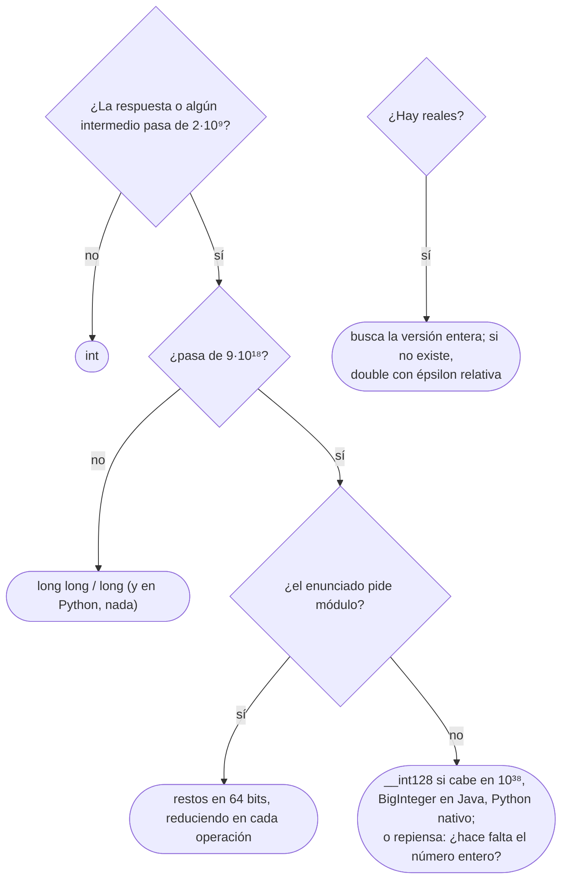

# 04 — Tipos, desbordamiento y el primer contacto con el módulo

> Cuándo un tipo entero deja de bastar y qué hace cada lenguaje cuando se pasa, por qué tantos
> enunciados piden la respuesta módulo 10⁹+7 y cómo se opera con él, y cómo se comparan reales sin
> que el redondeo te dé un WA.
>
> **Niveles:** desbordamiento [A] · aritmética modular básica [A] · `double` y épsilon [A].
>
> **📚 Lectura troncal:** Halim, Halim y Effendy, *Competitive Programming 4*, libro 1 (2020), cap. 1;
> Warren, *Hacker's Delight*, 2.ª ed. (Addison-Wesley, 2012), cap. 2.
>
> **Asume leído:** [`01/02` — Leer las restricciones](02-leer-las-restricciones.md).
>
> **Vigencia:** 2026-10-03.

**Salto rápido:** [1](#1--el-problema) · [2](#2--los-rangos) · [3](#3--desbordamiento) · [4](#4--aritmética-modular-básica) · [5](#5--double-y-épsilon) · [6](#6-️-los-tres-lenguajes-ante-el-mismo-número) · [7](#7--cómo-se-elige) · [🧠](#-preguntas) · [🧩](#-problemas-propios)

---

## 1. 🎯 El problema

Sumas `n ≤ 2·10⁵` enteros, cada uno de hasta `10⁹`. El algoritmo es trivial. Los dos ejemplos del
enunciado tienen tres números pequeños, dan bien, envías, y:

```text
Test 1   Accepted
...
Test 13  Accepted
Test 14  Wrong Answer
```

El caso 14 tiene `2·10⁵` valores cercanos a `10⁹`. La suma real es unos `2·10¹⁴`, y tu acumulador era
un `int`, que no pasa de `2 147 483 647`. Al pasarse, en Java dio la vuelta y quedó negativo; en C++
fue **comportamiento indefinido**, que en la práctica suele ser lo mismo pero no está garantizado.
Ningún lenguaje te avisó.

El desbordamiento es el WA más frecuente de la competitiva, porque **los ejemplos nunca lo muestran**:
son pequeños por diseño. Este capítulo enseña a verlo venir en las restricciones, a elegir el tipo, a
operar con el módulo que los enunciados piden cuando la respuesta es astronómica, y a no fiarse de un
`double`.

---

## 2. 🧱 Los rangos

**Qué es.** Lo que cabe en cada tipo, que se sabe de memoria en órdenes de magnitud:

| Tipo | Bits | Máximo | Orden |
|---|---|---|---|
| `int` (C++, Java) | 32 con signo | `2³¹ − 1 = 2 147 483 647` | ~`2,1·10⁹` |
| `unsigned int` (C++) | 32 sin signo | `2³² − 1 = 4 294 967 295` | ~`4,3·10⁹` |
| `long long` (C++), `long` (Java) | 64 con signo | `2⁶³ − 1 = 9 223 372 036 854 775 807` | ~`9,2·10¹⁸` |
| `__int128` (C++ con GCC o Clang) | 128 con signo | `2¹²⁷ − 1` | ~`1,7·10³⁸` |
| `int` (Python) | sin límite | lo que quepa en memoria | — |
| `double` | 64, coma flotante | ~`1,8·10³⁰⁸`, pero **enteros exactos solo hasta `2⁵³ ≈ 9·10¹⁵`** | — |

**Cómo se usa.** Con la tabla y las cotas del enunciado (`01/02`), el tipo sale de una cuenta:

```text
Regla:
suma de n valores ≤ V        → cabe si n · V ≤ ~2·10⁹ (int) o ≤ ~9·10¹⁸ (64 bits)
producto de dos valores ≤ V  → V² contra los mismos topes
n(n−1)/2 parejas             → con n ≥ 65 536 ya no cabe en int
```

**Lo que no está en la tabla.** `__int128` no es estándar: existe en GCC y en Clang, no en MSVC, y no
se puede leer ni imprimir con `cin` y `cout` directamente. Java no tiene enteros sin signo, aunque
`Integer` y `Long` traen métodos para tratarlos como tales. Y el `long` de C++ (sin el segundo `long`)
**mide 32 bits en Windows** y 64 en Linux: por eso el corpus escribe siempre `long long`.

> **Veredicto:** de memoria, `2·10⁹` para `int` y `9·10¹⁸` para 64 bits. Todo lo demás se deriva de
> esos dos números.

---

## 3. 🧱 Desbordamiento

**Qué es.** Un resultado que no cabe en el tipo donde se calcula. Lo que pasa después depende del
lenguaje:

- **C++**: el desbordamiento de un entero **con signo** es comportamiento indefinido. El compilador
  puede asumir que nunca ocurre y optimizar en consecuencia; un bucle `for (int i = 0; i >= 0; i++)`
  puede volverse infinito. En los sin signo, en cambio, el resultado está definido: da la vuelta
  módulo `2ᵏ`.
- **Java**: da la vuelta en silencio, en complemento a dos. `Integer.MAX_VALUE + 1` es
  `Integer.MIN_VALUE`. Determinista, pero igual de incorrecto.
- **Python**: no desborda. Los enteros crecen lo que haga falta, y lo que pagas es tiempo: operar con
  números de miles de dígitos no es `O(1)`.

**Dónde desborda**, los cinco sitios que se miran siempre:

| Dónde | Por qué | Arreglo |
|---|---|---|
| Un acumulador de sumas | `n · V` pasa de `2·10⁹` | El acumulador en 64 bits desde que se declara |
| El producto de dos valores | `V²` con `V ~ 10⁹` es `10¹⁸` | Convertir **antes** de multiplicar |
| Contar parejas | `n(n−1)/2` con `n = 10⁵` es `5·10⁹` | El contador en 64 bits |
| El punto medio | `(lo + hi) / 2` con los dos cerca del tope | `lo + (hi − lo) / 2` |
| Negar o tomar valor absoluto | `−(−2³¹)` no cabe en `int` | Pasar a 64 bits antes |

**La conversión va antes de operar.** El error más sutil no es olvidar el tipo grande, sino ponerlo
tarde:

```java
int a = 1_000_000_000, b = 1_000_000_000;
long bad  = a * b;            // falla: se multiplica en int, desborda, y después se convierte
long good = (long) a * b;     // a se convierte primero; la multiplicación es en long
long bit  = 1L << 40;         // con 1 << 40, Java desplaza un int y usa 40 mod 32 = 8: da 256
```

- **`a * b` en `int`**: el tipo de la expresión lo deciden los operandos, no la variable donde se
  guarda. El resultado ya llegó roto a la asignación.
- **`(long) a * b`**: el *cast* se aplica a `a`, y entonces `b` se promociona. Escribir
  `(long) (a * b)` sería convertir el resultado ya desbordado.
- **`1L << 40`**: en Java, el desplazamiento de un `int` usa solo los 5 bits bajos de la cuenta; en
  C++, desplazar un `int` 32 posiciones o más es comportamiento indefinido. En los dos, el literal
  tiene que ser de 64 bits: `1L` en Java, `1LL` en C++.

**Las herramientas de detección.** Java trae `Math.addExact` y `Math.multiplyExact`, que lanzan una
excepción en vez de dar la vuelta; GCC y Clang, `__builtin_add_overflow` y `__builtin_mul_overflow`.
Sirven para depurar y para los casos donde el desbordamiento es parte de la lógica («si pasa de
`10¹⁸`, satura»).

### Autopsia de un bug: el acumulador de 32 bits

**1. El código que escribe todo el mundo:**

```java
static int total(int[] a) {
    int sum = 0;
    for (int x : a) sum += x;
    return sum;
}
```

**2. Por qué parece correcto.** Lo es, para los ejemplos del enunciado: `[5, 2, 9, 1, 5, 6]` suma `28`.
Pasa todos los casos pequeños del juez.

**3. La entrada que lo rompe.** Tres valores de `10⁹`. La suma real es `3·10⁹`; la que devuelve es
`3 000 000 000 − 2³² = −1 294 967 296`:

```java
total(new int[] {1_000_000_000, 1_000_000_000, 1_000_000_000});
// -1294967296
```

**4. El código correcto**, con la línea que cambia:

```java
static long total(int[] a) {
    long sum = 0;              // ← antes: int sum = 0, y el tipo de retorno int
    for (int x : a) sum += x;
    return sum;
}
```

**5. La generalización.** Es un **error de tipo, no de algoritmo**: la idea es correcta y la
representación no. Aparece en cualquier acumulador, contador o producto cuyo máximo no calculaste, y
se previene con la cuenta de §2 hecha **al leer el enunciado**, no al depurar.

**Cuánto cuesta prevenirlo.** Una multiplicación mental por variable. Usar `long long` en todas partes
«por si acaso» también funciona en C++ y en Java, con dos precios: el doble de memoria en arreglos
grandes, y que en Java un `long[]` de `10⁸` ya no cabe donde un `int[]` sí.

**Cuándo sí** se usa 64 bits: en acumuladores, productos y contadores de parejas, siempre que la cuenta
pase de `2·10⁹`. **Cuándo no**: en arreglos enormes de valores que caben en 32 bits, donde la memoria
importa.

> **Veredicto:** el desbordamiento no se depura, se previene: la cuenta de máximos se hace al leer las
> restricciones, y la conversión a 64 bits va antes de operar.

---

## 4. 🧱 Aritmética modular básica

**Qué es.** Cuando la respuesta es un número astronómico —el número de caminos en una cuadrícula de
`10⁶`, el número de subconjuntos de `10⁵` elementos—, el enunciado pide **el resto de dividirla por
`10⁹ + 7`**. No se calcula el número y luego el resto: se trabaja **con restos todo el tiempo**, porque
la suma, la resta y el producto respetan el módulo.

**Por qué es correcto.** Si `a ≡ a'` y `b ≡ b'` (módulo `m`), entonces `a + b ≡ a' + b'`, `a − b ≡
a' − b'` y `a · b ≡ a' · b'`. Por eso se puede reducir cada operando antes de operar y el resultado
final es el mismo resto. **La división no está en la lista**: `(a / b) mod m` no es `(a mod m) / (b mod
m)`. Dividir exige el **inverso modular**, que existe cuando `m` es primo y `b` no es múltiplo suyo; la
teoría es de [`17/03`](../17-matematica/03-aritmetica-modular.md).

**Por qué `10⁹ + 7`.** Tres razones, y las tres se pueden comprobar:

```text
es primo                → existen los inversos, y la división se puede hacer (17/03)
10⁹ + 7 < 2³⁰           → la suma de dos restos (< 2·10⁹ + 14) cabe en un int con signo
(10⁹ + 7)² < 2⁶³        → el producto de dos restos (~10¹⁸) cabe en 64 bits con signo
```

Otro módulo frecuente es `998 244 353`, primo también, elegido porque sirve para la transformada de
Fourier sobre enteros ([`17/09`](../17-matematica/09-fft-y-ntt.md)).

**Cómo va.** Las tres operaciones, en los tres lenguajes:

```cpp
const long long MOD = 1'000'000'007;

long long addMod(long long a, long long b) { return (a + b) % MOD; }
long long subMod(long long a, long long b) { return ((a - b) % MOD + MOD) % MOD; }
long long mulMod(long long a, long long b) { return (a % MOD) * (b % MOD) % MOD; }
```

```java
static final long MOD = 1_000_000_007L;

static long addMod(long a, long b) { return (a + b) % MOD; }
static long subMod(long a, long b) { return ((a - b) % MOD + MOD) % MOD; }
static long mulMod(long a, long b) { return (a % MOD) * (b % MOD) % MOD; }
```

```python
MOD = 10**9 + 7

def add_mod(a, b): return (a + b) % MOD
def sub_mod(a, b): return (a - b) % MOD          # en Python ya es no negativo
def mul_mod(a, b): return a * b % MOD
```

- **La resta**: en C++ y en Java, `%` de un negativo da negativo (`-7 % 3` es `-1`), porque el
  resultado toma el signo del dividendo. Sumar `MOD` y volver a reducir lo deja en `[0, MOD)`. En
  Python, `%` toma el signo del divisor: `-7 % 3` es `2`, y no hace falta nada.
- **El producto**: los dos restos son menores que `MOD`, así que el producto es menor que `10¹⁸` y cabe
  en `long long`/`long`. Reducir los operandos antes protege si te pasan valores sin reducir.
- **Python**: no desborda, pero reducir en cada paso igual importa: si no reduces, los números crecen
  y cada operación se vuelve más cara.
- **Los nombres**: `MOD` es la constante del enunciado, en mayúsculas en los tres, y las funciones se
  llaman igual que en el resto del corpus.

### De la versión ingenua a la buena

**El problema.** ¿Cuántas cadenas binarias de longitud `n` hay, módulo `10⁹ + 7`? Con `n = 3`, son `8`;
con `n ≤ 10⁶`, el número exacto tiene unos 300 000 dígitos.

**La versión ingenua:**

```java
// falla: con n ≥ 63, 1L << n ya no representa 2ⁿ; el resultado es basura
static long countStrings(int n) {
    long total = 1L << n;
    return total % 1_000_000_007L;
}
```

> «Calculo `2ⁿ` y después reduzco. El problema es que `2ⁿ` deja de caber en 64 bits con `n = 63`, y
> el enunciado llega a `10⁶`. La respuesta exacta no cabe en ningún tipo; tengo que reducir mientras
> calculo, no al final.»

**El camino a la buena.** Multiplicar por 2 `n` veces, reduciendo en cada paso: el producto de un resto
por 2 siempre cabe. Es `O(n)`, que con `10⁶` sobra. (Con `n` hasta `10¹⁸` haría falta la
exponenciación rápida, `O(log n)`, que es de `17/03`.)

```java
static long countStrings(int n) {
    final long MOD = 1_000_000_007L;
    long total = 1;
    for (int i = 0; i < n; i++) total = total * 2 % MOD;   // nunca pasa de 2·MOD
    return total;
}
```

**Cuánto cuesta.** Un `%` por operación, que es de las instrucciones caras pero no cambia la
complejidad. **Cuándo sí**: siempre que el enunciado pida la respuesta módulo algo. **Cuándo no**:
cuando hay que **comparar** cantidades (¿cuál es mayor?), porque los restos no conservan el orden: si
el problema compara, el módulo no sirve y hay que pensar otra cosa.

> **Veredicto:** con módulo se suma, se resta (sumando `MOD`) y se multiplica en 64 bits, reduciendo
> en cada paso. No se divide sin inverso, y no se compara.

---

## 5. 🧱 `double` y épsilon

**Qué es.** Un `double` guarda un número real con 53 bits de mantisa: unas 15–17 cifras decimales
significativas. Casi ningún decimal se representa exacto, y por eso las comparaciones directas fallan:

```python
print(0.1 + 0.2 == 0.3)        # False
print(0.1 + 0.2)               # 0.30000000000000004
```

**Cómo se compara.** Con una tolerancia, **épsilon**, que se elige según la magnitud de los valores:

```cpp
#include <algorithm>
#include <cmath>

// a y b se consideran iguales si su diferencia es pequeña en términos absolutos o relativos
bool nearlyEqual(double a, double b, double eps = 1e-9) {
    return std::fabs(a - b) <= eps * std::max(1.0, std::max(std::fabs(a), std::fabs(b)));
}
```

```java
static boolean nearlyEqual(double a, double b, double eps) {
    return Math.abs(a - b) <= eps * Math.max(1.0, Math.max(Math.abs(a), Math.abs(b)));
}
```

```python
import math

def nearly_equal(a, b, eps=1e-9):
    return math.isclose(a, b, rel_tol=eps, abs_tol=eps)
```

- **Absoluta cerca de cero, relativa lejos**: el `max(1, |a|, |b|)` hace que la tolerancia sea `eps`
  para valores pequeños y proporcional para los grandes. Una tolerancia absoluta de `10⁻⁹` con valores
  de `10¹²` es imposible de cumplir: el `double` no tiene esa precisión ahí.
- **Python** trae `math.isclose`, que hace lo mismo con dos parámetros explícitos.
- **`a < b` también se compara con tolerancia**: «estrictamente menor» es `a < b − eps`.

**Lo mejor es no usarlo.** Muchos problemas con reales tienen una versión entera exacta, y es la que se
prefiere:

| En vez de | Usa | Por qué |
|---|---|---|
| comparar `a/b` con `c/d` | `a·d` con `c·b`, en 64 bits | Sin división, sin redondeo (cuidado con el signo de los denominadores) |
| `(long) Math.sqrt(x)` con `x ~ 10¹⁸` | la raíz y un ajuste de ±1, o `math.isqrt` en Python | El `double` no distingue `x` de `x + 1` a esa escala |
| dinero en `double` | enteros en la unidad mínima | `0.1 + 0.2` no da `0.3` |
| geometría con reales | coordenadas enteras y productos cruzados ([`18/01`](../18-geometria/01-vectores-y-orientacion.md)) | Las orientaciones salen exactas |

**La raíz entera exacta**, que aparece mucho, en C++ y en Java es la raíz del `double` corregida:

```java
// floor(sqrt(x)) exacto para 0 ≤ x ≤ 10¹⁸: la raíz del double puede fallar por uno
static long isqrt(long x) {
    long r = (long) Math.sqrt((double) x);
    while (r * r > x) r--;
    while ((r + 1) * (r + 1) <= x) r++;
    return r;
}
```

- **Los dos `while` corrigen** el error de redondeo, que como mucho es de una unidad para `x ≤ 10¹⁸`.
- **No desborda**: `r` es como mucho `10⁹ + 1`, y su cuadrado cabe en `long`.
- En C++ es la misma función con `long long` y `std::sqrt`; en Python, `math.isqrt(x)` es exacta.

**Cuánto cuesta.** Pensar la versión entera lleva un minuto; un WA por redondeo, un envío y la duda de
si la idea estaba mal. **Cuándo sí** se usa `double`: cuando el problema es de reales de verdad
(probabilidades, geometría con ángulos) y pide imprimir con tolerancia. **Cuándo no**: cuando todos
los datos son enteros y existe una formulación entera.

> **Veredicto:** un `double` nunca se compara con `==`. Y antes de compararlo con épsilon, pregúntate
> si el problema tiene una versión entera exacta, porque casi siempre la tiene.

---

## 6. ⚖️ Los tres lenguajes ante el mismo número

| Lenguaje | Al desbordar | `-7 % 3` y la división entera |
|---|---|---|
| **C++** | Con signo: comportamiento indefinido; sin signo: da la vuelta | `-1`, y `-7 / 3` es `-2` (trunca hacia cero) |
| **Java** | Da la vuelta en silencio; `Math.*Exact` lanza excepción si se pide | `-1`, y `-7 / 3` es `-2`; `Math.floorMod` y `Math.floorDiv` dan los de Python |
| **Python** | No desborda; el coste crece con el tamaño del número | `2`, y `-7 // 3` es `-3` (redondea hacia abajo) |

> 📝 **En JavaScript:** todos los números son `double`. Los enteros son exactos solo hasta
> `Number.MAX_SAFE_INTEGER = 2⁵³ − 1`, y el producto de dos restos módulo `10⁹ + 7` (~`10¹⁸`) ya no lo
> es: `a * b % MOD` da un resultado incorrecto **sin avisar**. Hay que usar `BigInt` o partir el
> producto en mitades.

---

## 7. 🧭 Cómo se elige



> **Mejor:** «La suma llega a 2·10¹⁴, así que el acumulador va en 64 bits; y como la respuesta se
> pide módulo 10⁹+7, reduzco después de cada producto.»

---

## 8. 🔭 Dónde aparece de verdad

- **El cohete Ariane 5 (1996).** Su primer vuelo terminó a los 37 segundos porque una conversión de un
  real de 64 bits a un entero con signo de 16 bits desbordó en el software de navegación, reutilizado
  del Ariane 4, donde ese valor nunca era tan grande.
- **La búsqueda binaria de Java (2006).** Durante casi una década, `Arrays.binarySearch` calculó el
  punto medio como `(low + high) / 2`, que desborda cuando la suma pasa de `2³¹ − 1`: con arreglos de
  más de unos 2³⁰ elementos. Se corrigió a `(low + high) >>> 1` después de que Joshua Bloch lo contara
  en un artículo de 2006.
- **El año 2038.** Los sistemas que guardan el tiempo como segundos desde 1970 en un entero de 32 bits
  con signo desbordan el 19 de enero de 2038.
- **El dinero.** Los sistemas contables guardan céntimos en enteros o usan tipos decimales exactos,
  nunca `double`: es la fila del dinero de §5 con consecuencias legales.

---

## ⚠️ Errores frecuentes

| Se dice | Lo preciso |
|---|---|
| «`long` basta para todo» | Basta hasta `9·10¹⁸`; el producto de dos valores de `10¹⁰` ya no cabe |
| «El `%` de un negativo es positivo» | En C++ y Java toma el signo del dividendo: `-7 % 3` es `-1` |
| «Python no desborda, así que no hay que pensar» | No desborda, pero sin reducir los números crecen y cada operación cuesta más; y el módulo hay que aplicarlo igual |
| «`long x = a * b` es una multiplicación en 64 bits» | Si `a` y `b` son `int`, se multiplica en 32 y se convierte después |
| «En C++ el desbordamiento da la vuelta como en Java» | Con signo es comportamiento indefinido: el compilador puede asumir que no ocurre |
| «`(a / b) % m` es `(a % m) / (b % m)`» | La división no respeta el módulo; hace falta el inverso modular |
| «Dos `double` iguales se comparan con `==`» | Se comparan con tolerancia, y mejor aún se evita el `double` |

---

## 📚 Para profundizar

- **Libro** — Halim, Halim y Effendy, *Competitive Programming 4*, libro 1 (2020), cap. 1: tipos,
  límites y los errores clásicos de tipo en los jueces. *Lectura troncal.*
- **Libro** — Warren, *Hacker's Delight*, 2.ª ed. (Addison-Wesley, 2012), cap. 2: la aritmética de
  complemento a dos y la detección de desbordamiento. *Lectura troncal.*
- **Libro** — Bryant y O'Hallaron, *Computer Systems: A Programmer's Perspective*, 3.ª ed. (Pearson,
  2016), cap. 2: representación de enteros y de coma flotante.
- **Artículo** — Goldberg, «What Every Computer Scientist Should Know About Floating-Point
  Arithmetic», *ACM Computing Surveys* 23(1), 1991.
- **Documentación** — cppreference, [operadores aritméticos](https://en.cppreference.com/cpp/language/operator_arithmetic):
  el desbordamiento con signo y el redondeo de `/` y `%`.
- **Documentación** — Java 21, [`Math`](https://docs.oracle.com/en/java/javase/21/docs/api/java.base/java/lang/Math.html):
  `addExact`, `multiplyExact`, `floorMod`, `floorDiv`.
- **Documentación** — Python, [*Floating-Point Arithmetic: Issues and Limitations*](https://docs.python.org/3/tutorial/floatingpoint.html).
- **Documentación** — MDN, [`BigInt`](https://developer.mozilla.org/en-US/docs/Web/JavaScript/Reference/Global_Objects/BigInt).

---

## 🧠 Preguntas

1. ¿Cuál es el máximo de un `int` de 32 bits con signo y el de un entero de 64 bits con signo, en órdenes de magnitud? 🟢
2. ¿Qué pasa en Java, en C++ y en Python cuando un entero con signo se desborda? 🟢
3. ¿Por qué tantos enunciados piden la respuesta módulo `10⁹ + 7`? Da las tres razones. 🟢
4. ¿Cuánto vale `-7 % 3` en C++, en Java y en Python, y por qué no coinciden? 🟢
5. ¿Qué diferencia hay entre `(long) a * b` y `(long) (a * b)` cuando `a` y `b` son `int`? 🟡
6. ¿Por qué la suma, la resta y el producto respetan el módulo y la división no? 🟡
7. ¿Qué diferencia hay entre una tolerancia absoluta y una relativa, y cuándo falla cada una? 🟡
8. ¿Por qué `(long) Math.sqrt(x)` puede fallar con `x` cerca de `10¹⁸`, y cómo lo corriges? 🟠
9. Un enunciado pide el número de formas módulo `10⁹ + 7`, y además cuál de dos estrategias da más formas. ¿Por qué el módulo no te sirve para lo segundo? 🟠
10. ¿Por qué en JavaScript `a * b % MOD` con `MOD = 10⁹ + 7` da resultados incorrectos, y qué alternativas hay? 🟠
11. Tu código C++ tiene un bucle `for (int i = 1; i > 0; i *= 2)` que en tu máquina termina y en el juez no. Explica cómo es posible. 🟠
12. Escribe la condición exacta para comparar dos fracciones `a/b` y `c/d` sin divisiones, con `b` y `d` posiblemente negativos, y di qué cota necesitan los valores para que no desborde en 64 bits. 🔴
13. Un envío calcula `n(n−1)/2` con `n = 10⁵` en `int` y da WA solo en los casos grandes. Haz la autopsia: el valor que debería dar, el que da en Java y la línea que cambia. 🔴
14. Demuestra que `(a · b) mod m = ((a mod m) · (b mod m)) mod m` para enteros no negativos. 🔴

---

## 🧩 Problemas propios

### Promedio hacia abajo

**Nivel:** 🟡 · **Formato:** programa completo.

Calcula `⌊S / n⌋`, donde `S` es la suma de los valores: el promedio **redondeado hacia abajo**, también
cuando es negativo.

- **Entrada.** Una línea con `n`. Una segunda línea con `n` enteros.
- **Salida.** Un entero: `⌊S / n⌋`.
- **Restricciones.** `1 ≤ n ≤ 2·10⁵`; `|a[i]| ≤ 10⁹`.

```text
Entrada            Salida
6                  4
5 2 9 1 5 6

Entrada            Salida
2                  -2
-1 -2

Entrada            Salida
3                  1000000000
1000000000 1000000000 1000000000
```

**Pista 1:** ¿cuánto da `-3 / 2` en tu lenguaje, y cuánto vale `⌊−1,5⌋`?

### Producto con signo, módulo 10⁹+7

**Nivel:** 🟡 · **Formato:** programa completo.

Calcula el producto de todos los valores, módulo `10⁹ + 7`, como un número en `[0, 10⁹ + 7)`.

- **Entrada.** Una línea con `n`. Una segunda línea con `n` enteros.
- **Salida.** Un entero en `[0, 10⁹ + 6]`.
- **Restricciones.** `1 ≤ n ≤ 2·10⁵`; `|a[i]| ≤ 10⁹`.

```text
Entrada            Salida
3                  6
1 2 3

Entrada            Salida
1                  1000000006
-1

Entrada            Salida
2                  49
1000000000 1000000000
```

**Pista 1:** ¿qué resto da tu lenguaje para un número negativo, y en qué rango tiene que quedar la
respuesta?

🔥 **Para el geek — en JavaScript:** el producto de dos restos ya pasa de `2⁵³`; tienes que decidir
entre `BigInt`, más lento, y partir cada multiplicación en dos mitades de 15 bits.

### ¿Cuadrado perfecto?

**Nivel:** 🟠 · **Formato:** programa completo.

Para cada número, di si es el cuadrado de un entero.

- **Entrada.** Una línea con `q`. Después, `q` líneas con un entero `x` cada una.
- **Salida.** Por cada `x`, `SI` o `NO`.
- **Restricciones.** `1 ≤ q ≤ 10⁵`; `0 ≤ x ≤ 10¹⁸`.

```text
Entrada                  Salida
4                        SI
0                        SI
16                       NO
17                       SI
1000000000000000000

Entrada                  Salida
1                        NO
999999999999999999
```

**Pista 1:** ¿cuántos números enteros distintos hay cerca de `10¹⁸` que tu `double` representa igual?

---

## 🧩 Práctica externa

### Núcleo

| ✔ | Problema | Plataforma | Nivel | Patrón | Pista 1 |
|---|---|---|---|---|---|
| [ ] | [A Very Big Sum](https://www.hackerrank.com/challenges/a-very-big-sum/problem) | HackerRank | 🟢 | Tipo del acumulador | ¿Cuánto vale la suma máxima con las cotas del enunciado? |
| [ ] | [Mini-Max Sum](https://www.hackerrank.com/challenges/mini-max-sum/problem) | HackerRank | 🟢 | Tipo del acumulador | ¿Caben cuatro valores de hasta `10⁹` sumados en 32 bits? |
| [ ] | [Java Datatypes](https://www.hackerrank.com/challenges/java-datatypes/problem) | HackerRank | 🟢 | Rangos de los tipos | ¿Cuáles son los extremos de cada tipo primitivo de Java? |
| [ ] | [Plus Minus](https://www.hackerrank.com/challenges/plus-minus/problem) | HackerRank | 🟢 | Reales e impresión | ¿Con cuántos decimales imprimes, y qué tolerancia usa el juez? |
| [ ] | [Reverse Integer](https://leetcode.com/problems/reverse-integer/) | LeetCode | 🟡 | Desbordamiento detectado | ¿Cómo sabes, antes de multiplicar por 10, si el resultado va a pasarse? |
| [ ] | [Sqrt(x)](https://leetcode.com/problems/sqrtx/) | LeetCode | 🟢 | Raíz entera | ¿Qué pasa con `mid * mid` cuando `mid` ronda `46 341`? |
| [ ] | [Pow(x, n)](https://leetcode.com/problems/powx-n/) | LeetCode | 🟡 | Borde del tipo | ¿Qué valor de `n` no se puede negar dentro de un `int`? |
| [ ] | [PermMissingElem](https://app.codility.com/programmers/lessons/3-time_complexity/perm_missing_elem/) | Codility | 🟢 | Tipo de la suma | ¿Cuánto vale la suma de `1` a `N + 1` con el `N` máximo? |

### Ampliación

| ✔ | Problema | Plataforma | Nivel | Patrón | Pista 1 |
|---|---|---|---|---|---|
| [ ] | [Bit Strings](https://cses.fi/problemset/task/1617) | CSES | 🟢 | Módulo | ¿Puedes calcular el número entero antes de reducir? |
| [ ] | [Increasing Array](https://cses.fi/problemset/task/1094) | CSES | 🟢 | Tipo del acumulador | ¿Cuánto pueden sumar los incrementos en el peor caso? |
| [ ] | [Theatre Square](https://codeforces.com/problemset/problem/1/A) | Codeforces | 🟢 | Producto en 64 bits | ¿Cuántas losas hacen falta con los valores máximos? |
| [ ] | [Count Good Numbers](https://leetcode.com/problems/count-good-numbers/) | LeetCode | 🟡 | Módulo con exponente grande | Con `n` hasta `10¹⁵`, ¿puedes multiplicar `n` veces? |
| [ ] | [PassingCars](https://app.codility.com/programmers/lessons/5-prefix_sums/passing_cars/) | Codility | 🟢 | Contador con tope | ¿Cuántas parejas puede haber como máximo, y qué pide el enunciado si se pasa del tope? |

---

## ✅ Criterio de dominio

- Decir de memoria los máximos de 32 y 64 bits y, ante cualquier enunciado, el tipo de cada
  acumulador antes de escribir.
- Escribir `addMod`, `subMod` y `mulMod` en tu lenguaje sin mirar, y explicar por qué la resta suma
  `MOD` en C++ y Java y no en Python.
- Hacer la autopsia de un desbordamiento: el valor correcto, el que sale en tu lenguaje y la línea que
  cambia.
- Resolver Reverse Integer y Sqrt(x) sin pista 2.

---

**Anterior:** [`01/03` — Entrada, salida y la plantilla](03-entrada-salida-y-plantilla.md) ·
**Siguiente:** [`01/05` — Probar sin IDE y *stress test*](05-probar-sin-ide-y-stress-test.md) ·
**Relacionado:** [`01/02` — Leer las restricciones](02-leer-las-restricciones.md);
[`17/03` — Aritmética modular](../17-matematica/03-aritmetica-modular.md).
