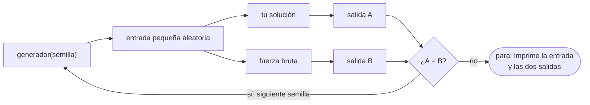
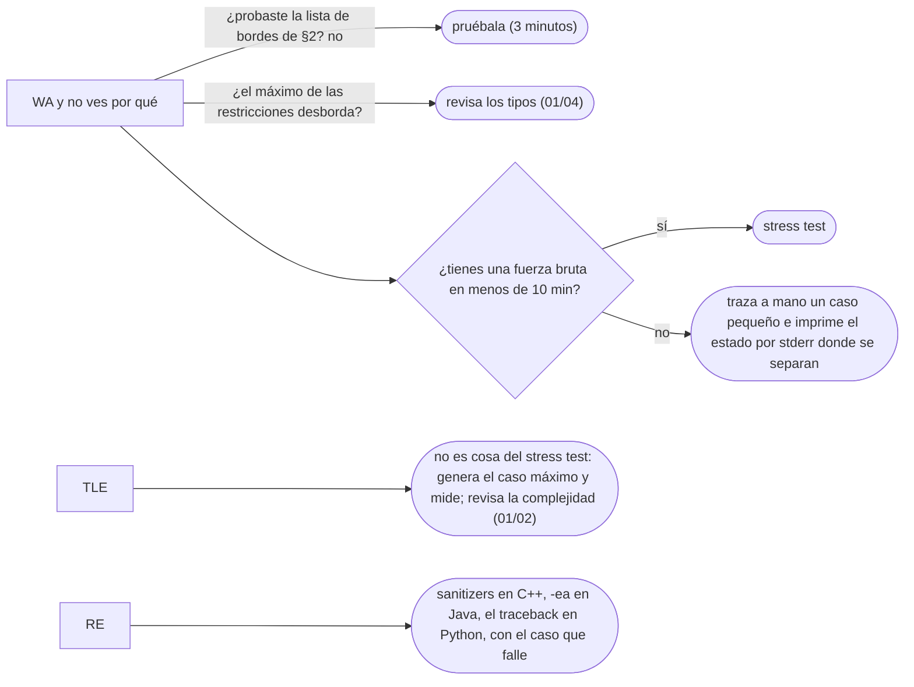

# 05 — Probar sin IDE: casos borde, depuración y *stress test*

> Encontrar el bug antes que el juez: la lista fija de casos borde, la depuración por la salida de
> error, y el *stress test* contra una fuerza bruta, que es la herramienta más rentable de la
> competitiva y el arnés con el que este corpus verifica su propio código.
>
> **Niveles:** casos borde [A] · *stress test* [A] · depuración por `stderr` [A].
>
> **📚 Lectura troncal:** Laaksonen, *Guide to Competitive Programming*, 3.ª ed. (Springer, 2024),
> cap. 1; Skiena y Revilla, *Programming Challenges* (Springer, 2003), cap. 1.
>
> **Asume leído:** [`01/03` — Entrada, salida y la plantilla](03-entrada-salida-y-plantilla.md).
>
> **Vigencia:** 2026-10-03.

**Salto rápido:** [1](#1--el-problema) · [2](#2--los-casos-borde) · [3](#3--depurar-sin-ide) · [4](#4--el-stress-test) · [5](#5--cómo-se-elige) · [6](#6--dónde-aparece-de-verdad) · [🧠](#-preguntas) · [🧩](#-problemas-propios)

---

## 1. 🎯 El problema

Tu solución da *Wrong Answer* (WA) en el caso 9. No ves el caso. Relees el código tres veces y te
parece correcto. Lo envías otra vez con un cambio que «podría ser», y da WA en el caso 9. Cambias otra
cosa: WA en el caso 6, que antes pasaba.

Ese ciclo —leer, adivinar, reenviar— es la forma más cara de depurar, porque **el juez solo dice que
falla, no dónde**, y tú tienes un sesgo: el código que escribiste te parece correcto porque lo
escribiste pensando que lo era. Lo que hace falta es **una entrada concreta en la que falle**, porque
con ella el bug se ve en dos minutos.

Hay tres formas de conseguirla, de la más barata a la más potente: **probar los casos borde** que
casi siempre rompen algo, **mirar el estado interno** imprimiendo por la salida de error, y dejar que
una máquina pruebe miles de entradas pequeñas contra una solución lenta pero obviamente correcta.
Esa última es el *stress test* (prueba de estrés), y es lo que separa a quien depura en minutos de
quien depura en horas.

---

## 2. 🧱 Los casos borde

**Qué es.** Un caso borde es una entrada en el extremo de lo que permiten las restricciones, o una
forma especial de los datos que el razonamiento general no contempla. Hay una lista que se repite en
casi todos los problemas, y se prueba **antes de enviar**, a mano.

**La lista fija:**

| Caso | Qué rompe típicamente |
|---|---|
| Vacío (`n = 0`), si está permitido | Un acceso a `a[0]`; un máximo inicializado con el primer elemento |
| Un solo elemento | Bucles que empiezan en `i = 1`; parejas que no existen |
| Todos iguales | Comparaciones estrictas frente a no estrictas; búsquedas que asumen un cambio |
| Todos negativos, o ceros | Máximos inicializados en `0`; productos que se anulan |
| El máximo de las restricciones | Desbordamiento (`01/04`), TLE, recursión profunda |
| La respuesta en la primera o la última posición | El último tramo que nunca se cierra; el *off-by-one* |
| Duplicados | Conteos que cuentan dos veces; estructuras que no admiten repetidos |
| Ya ordenado, o al revés | Pivotes malos; algoritmos que dependen del orden de la entrada |

**Cómo va.** Antes de enviar, escribes tres o cuatro de estos casos en archivos y corres tu programa
con cada uno, comparando con la respuesta que calculas a mano. No hacen falta todos: mira las
restricciones y quédate con los que el enunciado permite. Si `1 ≤ n`, el vacío no existe; si los
valores son positivos, los negativos tampoco.

**Cuánto cuesta.** Tres minutos. **Cuándo sí**: siempre, y antes del primer envío en un concurso con
penalización. **Cuándo no** bastan: cuando el bug no está en un borde sino en una combinación que no
se te ocurre; ahí entra el *stress test* (§4).

> **Veredicto:** los ejemplos del enunciado son casos del centro. Los bordes los escribes tú, y son los
> que esconden la mitad de los WA.

---

## 3. 🧱 Depurar sin IDE

**Qué es.** En una prueba de empresa o en un concurso no siempre hay un depurador paso a paso, y
aunque lo haya, es lento. Lo que siempre hay es la **salida de error** (`stderr`), que el juez **no
compara** con la esperada: puedes imprimir ahí el estado interno sin romper la respuesta.

| Lenguaje | Salida de error | Aserción |
|---|---|---|
| **C++** | `std::cerr << x << '\n';` | `assert(cond);` de `<cassert>`, que se desactiva con `-DNDEBUG` |
| **Java** | `System.err.println(x);` | `assert cond;`, **desactivada por defecto**: solo actúa con `java -ea` |
| **Python** | `print(x, file=sys.stderr)` | `assert cond`, desactivada con `python -O` |

**Cómo va.** Compilas y corres en local con la entrada en un archivo, igual que el juez:

```bash
g++ -std=c++20 -O2 -Wall -Wextra -fsanitize=address,undefined -o sol sol.cpp
./sol < caso.txt > salida.txt
diff salida.txt esperada.txt
```

- **`-std=c++20`**: el estándar del corpus, el mismo que corre el juez ([`01/01`](01-el-juez-los-veredictos-y-las-plataformas.md)).
- **`-O2`**: las optimizaciones del juez; hay bugs (el comportamiento indefinido de `01/04`) que solo
  aparecen con ellas.
- **`-Wall -Wextra`**: los avisos del compilador, que señalan variables sin inicializar, comparaciones
  entre con y sin signo y desplazamientos sospechosos. Leerlos es depurar gratis.
- **`-fsanitize=address,undefined`**: instrumenta el programa para que **se detenga con un mensaje**
  en un acceso fuera de rango o en un desbordamiento con signo, en vez de seguir con basura. Es lento,
  así que solo en local.
- **`< caso.txt > salida.txt`**: redirige la entrada y la salida a archivos; `stderr` sigue saliendo
  por la terminal.
- **`diff`**: compara las dos salidas línea a línea; sin diferencias, no imprime nada.
- En macOS, `g++` es un alias del Clang de Apple; el GCC real de Homebrew se llama con su versión
  (`g++-16`, por ejemplo). En Java es `javac Main.java` y `java -ea Main < caso.txt`; en Python,
  `python3 sol.py < caso.txt`.

> 🩺 **Diagnóstico.** Ante un WA, en este orden: ¿desborda algún tipo con el máximo de las
> restricciones? ¿Falla con `n = 1`? ¿Inicializaste el estado en cada caso de prueba? ¿El formato de
> salida es exacto? Si las cuatro dicen que no, *stress test*.

**Cuánto cuesta.** Imprimir en `stderr` es casi gratis en local, pero **en el juez también se
ejecuta**: un `cerr` dentro de un bucle de `10⁶` vueltas puede dar *Time Limit Exceeded* (TLE). Se
borra o se comenta antes de enviar.

**Cuándo sí**: para ver el estado en el paso donde la traza a mano y el programa se separan. **Cuándo
no**: para buscar a ciegas; imprimir todo sin una hipótesis llena la pantalla y no dice nada.

> **Veredicto:** depura en local con la entrada en un archivo, los avisos encendidos y los
> *sanitizers* activos, e imprime por `stderr` solo lo que confirma o refuta una hipótesis.

---

## 4. 🧱 El *stress test*

**Qué es.** Un procedimiento automático para encontrar una entrada en la que tu solución falla:



**Por qué funciona.** Se apoya en dos hechos. El primero: **la fuerza bruta es fácil de escribir
correcta**, porque no tiene ideas, solo enumera; es el **oráculo**, la solución cuya respuesta se da
por buena. El segundo: **casi todos los bugs aparecen ya en entradas pequeñas**. Si tu solución falla
con `n = 10⁵`, casi siempre falla también con alguna de `n ≤ 8` y valores entre `−5` y `5`, y entre
miles de entradas pequeñas aleatorias alguna lo encuentra. Y una entrada pequeña se lee y se traza a
mano.

**Cómo va.** Tres piezas: el generador, la fuerza bruta y el arnés que los orquesta. El generador
recibe una **semilla**, para que el caso que falla se pueda reproducir. En los tres lenguajes, el
generador para un problema de «un arreglo de enteros»:

```cpp
#include <iostream>
#include <random>
#include <string>

int main(int, char* argv[]) {
    std::mt19937 rng(std::stoul(argv[1]));            // la semilla la pasa el arnés
    auto between = [&](int lo, int hi) {
        return std::uniform_int_distribution<int>(lo, hi)(rng);
    };
    int n = between(1, 8);                             // pequeño: se lee a simple vista
    std::cout << n << '\n';
    for (int i = 0; i < n; i++) std::cout << between(-5, 5) << (i + 1 < n ? ' ' : '\n');
}
```

```java
import java.util.Random;

public class Gen {
    public static void main(String[] args) {
        Random rng = new Random(Long.parseLong(args[0]));   // la semilla la pasa el arnés
        int n = 1 + rng.nextInt(8);                          // de 1 a 8
        StringBuilder sb = new StringBuilder().append(n).append('\n');
        for (int i = 0; i < n; i++) sb.append(rng.nextInt(11) - 5).append(i + 1 < n ? ' ' : '\n');
        System.out.print(sb);
    }
}
```

```python
import random
import sys

random.seed(int(sys.argv[1]))                      # la semilla la pasa el arnés
n = random.randint(1, 8)                           # de 1 a 8, los dos incluidos
print(n)
print(*(random.randint(-5, 5) for _ in range(n)))
```

- **La semilla** entra por argumento en los tres: misma semilla, misma entrada. Sin semilla, el caso
  que falla no se puede volver a generar.
- **C++**: `std::mt19937` con `uniform_int_distribution`, que da enteros uniformes en `[lo, hi]` con
  los dos extremos; **no** `rand() % k`, que tiene sesgo y un rango pequeño en algunas plataformas.
- **Java**: `nextInt(11)` da `[0, 10]`, y restando 5 queda `[−5, 5]`; `Random` con semilla es
  determinista entre ejecuciones.
- **Python**: `randint(a, b)` **incluye `b`**, al revés que `range`; es la diferencia que más
  confunde.
- **Rangos pequeños a propósito**: valores entre `−5` y `5` hacen que salgan duplicados, ceros y
  negativos con frecuencia, que son justo los bordes de §2.

**El arnés**, en Python, que es el lenguaje más cómodo para orquestar procesos. Compara por *tokens*,
igual que el juez:

```python
#!/usr/bin/env python3
# Compara sol contra brute con entradas aleatorias hasta encontrar una diferencia.
import subprocess
import sys

def run(cmd, data):
    # check=True: si el programa termina con error (un RE), el arnés también para
    return subprocess.run(cmd, input=data, capture_output=True, text=True, check=True).stdout.split()

def main():
    gen, sol, brute = ["./gen"], ["./sol"], ["./brute"]   # en Java: ["java", "Gen"], etc.
    for seed in range(1, 10_001):
        data = subprocess.run(gen + [str(seed)], capture_output=True, text=True, check=True).stdout
        mine, oracle = run(sol, data), run(brute, data)
        if mine != oracle:
            print(f"Diferencia con la semilla {seed}:\n{data}")
            print("sol:  ", " ".join(mine))
            print("brute:", " ".join(oracle))
            sys.exit(1)
    print("10 000 casos sin diferencias")

main()
```

- **`subprocess.run(..., input=data)`** pasa la entrada por `stdin`, como el juez; **`.split()`**
  convierte la salida en *tokens*, así que los espacios y saltos de línea no cuentan.
- **`check=True`** convierte un *Runtime Error* (RE) de cualquiera de los dos programas en una
  excepción que detiene el arnés: un *stress test* también encuentra caídas.
- **Se detiene en la primera diferencia** e imprime la semilla, la entrada y las dos salidas. Lo
  siguiente es **reducir** el caso: si falla con `n = 6`, prueba a quitar elementos mientras siga
  fallando; un caso de dos o tres valores ya señala el bug.

**Cuánto cuesta.** Escribir la fuerza bruta y el generador lleva diez o quince minutos la primera vez y
cinco las siguientes, porque el generador y el arnés se reutilizan casi enteros. **Este corpus usa
exactamente este arnés** para verificar sus plantillas en la pasada final.

### De la versión ingenua a la buena

**El problema.** La suma máxima de un subarreglo **no vacío**. Con `[5, 2, 9, 1, 5, 6]` es `28`, el
arreglo entero; con `[−3]`, es `−3`.

**La versión ingenua**, que hace de oráculo:

```java
// Fuerza bruta: todas las parejas (i, j), suma incremental. O(n²), y obviamente correcta.
static long maxSubarrayBrute(int[] a) {
    long best = Long.MIN_VALUE;
    for (int i = 0; i < a.length; i++) {
        long sum = 0;
        for (int j = i; j < a.length; j++) {
            sum += a[j];
            best = Math.max(best, sum);
        }
    }
    return best;
}
```

> «Esto prueba los `n(n+1)/2` subarreglos y es cuadrático. Con `n` hasta `10⁵` no cabe, pero me sirve
> de oráculo. Lo que repito es recalcular subarreglos que comparten prefijo; si para cada posición
> guardo la mejor suma que termina ahí, lo hago en un recorrido.»

**El camino a la buena.** Un recorrido que mantiene la mejor suma de un subarreglo que **termina** en
la posición actual: es el algoritmo de Kadane, cuya teoría está en el capítulo [`04/03`](../04-secuencias/03-kadane-y-subarreglos.md). La primera
versión que sale suele ser esta:

```java
// falla: con todos los valores negativos devuelve 0, que no es la suma de ningún subarreglo no vacío
static long maxSubarray(int[] a) {
    long best = 0, cur = 0;
    for (int x : a) {
        cur = Math.max(0, cur + x);
        best = Math.max(best, cur);
    }
    return best;
}
```

Pasa el ejemplo, porque `[5, 2, 9, 1, 5, 6]` tiene la respuesta positiva. El *stress test* con el
generador de arriba, en cambio, encuentra muy pronto una entrada como esta:

```text
1
-3
sol:   0
brute: -3
```

La versión buena cambia dos líneas:

```java
static long maxSubarray(int[] a) {
    long best = a[0], cur = 0;              // ← antes: best = 0
    for (int x : a) {
        cur = Math.max(x, cur + x);         // ← antes: Math.max(0, cur + x)
        best = Math.max(best, cur);
    }
    return best;
}
```

- **`cur = max(x, cur + x)`**: el subarreglo que termina aquí o extiende el anterior o empieza en `x`,
  pero **nunca es vacío**; la versión con `0` permitía el vacío, de suma `0`.
- **`best = a[0]`**: el máximo se inicializa con un valor real del arreglo, no con un neutro inventado.

**Cuándo sí** se hace un *stress test*: cuando tienes WA y no ves el bug en cinco minutos, y antes de
enviar en un concurso cuando la solución tiene una idea no trivial. **Cuándo no**: cuando la fuerza
bruta es tan difícil de escribir como la solución, o cuando el fallo es TLE, que un *stress test* con
entradas pequeñas no reproduce.

> **Veredicto:** la fuerza bruta no se tira nunca: es el oráculo. Generador con semilla, arnés que
> compara por *tokens* y para en la primera diferencia, y el caso reducido a mano.

---

## 5. 🧭 Cómo se elige



> **Mejor:** «Antes de reenviar, genero casos pequeños y comparo contra la fuerza bruta; con el caso
> que falla delante, el bug sale en dos minutos.»

---

## 6. 🔭 Dónde aparece de verdad

El *stress test* tiene nombres serios fuera de los jueces:

- **Pruebas basadas en propiedades** (*property-based testing*): bibliotecas como QuickCheck en
  Haskell, Hypothesis en Python o jqwik en Java generan entradas aleatorias, comprueban una propiedad
  y **reducen** el caso que falla automáticamente. Es el arnés de §4 con la reducción hecha.
- **Pruebas diferenciales**: comparar dos implementaciones de lo mismo —un compilador nuevo contra el
  viejo, una base de datos contra otra— con las mismas entradas. La fuerza bruta es la implementación
  de referencia.
- **Fuzzing**: generar entradas, a menudo malformadas, hasta que el programa se cae. Es el
  `check=True` del arnés llevado al extremo, y encuentra fallos de seguridad reales.

---

## ⚠️ Errores frecuentes

| Se dice | Lo preciso |
|---|---|
| «Probé con el ejemplo» | El ejemplo es un caso del centro; los bordes y los máximos los tienes que escribir tú |
| «El juez me dirá qué falla» | Te dice que falla y en qué caso, nunca la entrada ni dónde |
| «Para depurar, imprimo en la salida» | En la salida estándar rompe la respuesta; va en `stderr`, y se quita antes de enviar |
| «El *stress test* necesita casos grandes» | Los bugs de lógica aparecen en casos pequeños, que además se leen; los grandes son para el TLE |
| «Si la fuerza bruta da distinto, la que está mal es la rápida» | Casi siempre, pero la fuerza bruta también puede tener bugs: con el caso reducido se comprueba a mano |
| «`assert` en Java comprueba» | Solo con `java -ea`; sin esa opción, las aserciones no se ejecutan |
| «Sin semilla también vale» | Sin semilla, el caso que falla no se puede reproducir |

---

## 📚 Para profundizar

- **Libro** — Laaksonen, *Guide to Competitive Programming*, 3.ª ed. (Springer, 2024), cap. 1: cómo
  probar soluciones y depurar. *Lectura troncal.*
- **Libro** — Skiena y Revilla, *Programming Challenges* (Springer, 2003), cap. 1: el juez, los
  errores clásicos y cómo encontrarlos. *Lectura troncal.*
- **Libro** — Bentley, *Programming Pearls*, 2.ª ed. (Addison-Wesley, 2000), columna 5: andamiaje de
  pruebas y aserciones para un programa pequeño.
- **Documentación** — cppreference, [`std::mersenne_twister_engine`](https://en.cppreference.com/cpp/numeric/random/mersenne_twister_engine):
  el generador de `std::mt19937`.
- **Documentación** — Java 21, [`Random`](https://docs.oracle.com/en/java/javase/21/docs/api/java.base/java/util/Random.html):
  la secuencia determinista a partir de una semilla.
- **Documentación** — Python, [`random`](https://docs.python.org/3/library/random.html) y
  [`subprocess`](https://docs.python.org/3/library/subprocess.html).
- **Documentación** — GCC, [*Program Instrumentation Options*](https://gcc.gnu.org/onlinedocs/gcc/Instrumentation-Options.html):
  `-fsanitize=address` y `-fsanitize=undefined`.
- **Tutorial aplicado** — [Hypothesis](https://hypothesis.readthedocs.io/en/latest/): pruebas basadas
  en propiedades en Python, con reducción automática del caso.

---

## 🧠 Preguntas

1. ¿Qué casos borde de la lista fija probarías siempre, y cómo decides cuáles descartar? 🟢
2. ¿Por qué la salida de error sirve para depurar en un juez sin romper la respuesta? 🟢
3. ¿Qué tres piezas tiene un *stress test*, y qué papel cumple cada una? 🟢
4. ¿Por qué el generador recibe una semilla en vez de usar una aleatoria cada vez? 🟡
5. ¿Qué diferencia hay entre `assert` en C++, en Java y en Python en cuanto a cuándo se ejecuta? 🟡
6. ¿Qué hace `-fsanitize=address,undefined` y por qué no se usa en el envío? 🟡
7. ¿Por qué un *stress test* con entradas pequeñas encuentra bugs que aparecen en el caso 14 de un juez con `n = 10⁵`? 🟠
8. Tu *stress test* corre 10 000 casos sin diferencias y el juez sigue dando WA. Da tres explicaciones posibles. 🟠
9. ¿Por qué un `cerr` olvidado puede convertir un AC en TLE, si el juez no compara la salida de error? 🟠
10. Compara `rand() % k` en C++, `random.randint(a, b)` en Python y `nextInt(k)` en Java: ¿qué rango da cada uno y qué trampa tiene? 🟠
11. El *stress test* encuentra una diferencia con `n = 7`. Describe el procedimiento para reducirla y por qué conviene hacerlo antes de mirar el código. 🔴
12. Escribe, en palabras, el generador y la fuerza bruta para un problema de «el primer índice con valor mayor o igual que `x` en un arreglo ordenado», incluyendo qué rangos usarías y por qué. 🔴

---

## 🧩 Problemas propios

Cada problema viene con la solución de alguien que **pasa los ejemplos y tiene un bug sembrado**. El
ejercicio tiene dos partes: encontrar con un *stress test* la entrada más pequeña que la rompe, y
escribir tu versión correcta.

### La racha más larga

**Nivel:** 🟢 · **Formato:** programa completo.

Dado un arreglo, imprime la longitud del tramo más largo de elementos consecutivos iguales.

- **Entrada.** Una línea con `n`. Una segunda línea con `n` enteros.
- **Salida.** Un entero.
- **Restricciones.** `1 ≤ n ≤ 2·10⁵`; `|a[i]| ≤ 10⁹`.

```text
Entrada            Salida
6                  2
5 5 2 9 9 1

Entrada            Salida
5                  3
1 2 2 2 3
```

La solución con el bug:

```java
static int longestRun(int[] a) {
    int best = 0, run = 1;
    for (int i = 1; i < a.length; i++) {
        if (a[i] == a[i - 1]) run++;
        else { best = Math.max(best, run); run = 1; }
    }
    return best;
}
```

**Pista 1:** ¿en qué momento actualiza `best` esta función, y qué tramo no llega nunca a ese momento?

### Primer índice mayor o igual

**Nivel:** 🟡 · **Formato:** programa completo.

Dado un arreglo ordenado de forma no decreciente y `q` consultas, para cada `x` imprime el primer
índice `i` (desde 0) con `a[i] ≥ x`, o `n` si no existe.

- **Entrada.** Una línea con `n` y `q`. Una línea con los `n` valores ordenados. Una línea con las `q`
  consultas.
- **Salida.** `q` enteros separados por espacios.
- **Restricciones.** `1 ≤ n, q ≤ 2·10⁵`; `|a[i]|, |x| ≤ 10⁹`.

```text
Entrada            Salida
6 3                2 0 4
1 2 5 5 6 9
5 0 6

Entrada            Salida
1 3                0 1 0
7
7 8 -1000000000
```

La solución con el bug:

```java
static int firstAtLeast(int[] a, int x) {
    int lo = 0, hi = a.length - 1;
    while (lo < hi) {
        int mid = lo + (hi - lo) / 2;
        if (a[mid] < x) lo = mid + 1;
        else hi = mid;
    }
    return lo;
}
```

**Pista 1:** ¿qué valores puede devolver esta función, y está entre ellos la respuesta `n`?

### Duración de un turno

**Nivel:** 🟠 · **Formato:** programa completo.

Un turno empieza a una hora y termina a otra, ambas en formato `HH:MM` de 24 horas. Si la hora de fin
es anterior a la de inicio, el turno cruza la medianoche. Si son iguales, el turno dura 0 minutos.
Imprime la duración de cada turno en minutos.

- **Entrada.** Una línea con `t`. Después, `t` líneas con dos horas `HH:MM HH:MM`.
- **Salida.** `t` enteros, uno por línea.
- **Restricciones.** `1 ≤ t ≤ 10⁵`; `00 ≤ HH ≤ 23`; `00 ≤ MM ≤ 59`.

```text
Entrada            Salida
2                  480
09:00 17:00        420
22:00 05:00

Entrada            Salida
2                  0
08:15 08:15        1
23:59 00:00
```

La solución con el bug:

```java
static int duration(String start, String end) {
    int s = Integer.parseInt(start.substring(0, 2)) * 60 + Integer.parseInt(start.substring(3));
    int e = Integer.parseInt(end.substring(0, 2)) * 60 + Integer.parseInt(end.substring(3));
    int d = e - s;
    if (d <= 0) d += 24 * 60;
    return d;
}
```

**Pista 1:** relee el enunciado palabra por palabra: ¿qué caso describe que la solución no respeta?

---

## 🧩 Práctica externa

Todos estos problemas tienen un borde que los ejemplos no muestran. El ejercicio es encontrarlo
**antes** de enviar: escribe la lista de bordes que aplican, pruébalos y solo entonces envía.

### Núcleo

| ✔ | Problema | Plataforma | Nivel | Patrón | Pista 1 |
|---|---|---|---|---|---|
| [ ] | [Search Insert Position](https://leetcode.com/problems/search-insert-position/) | LeetCode | 🟢 | Borde: al final | ¿Qué devuelves si el objetivo es mayor que todos? |
| [ ] | [Plus One](https://leetcode.com/problems/plus-one/) | LeetCode | 🟢 | Borde: todo nueves | ¿Qué tamaño tiene el resultado si todos los dígitos son 9? |
| [ ] | [Merge Sorted Array](https://leetcode.com/problems/merge-sorted-array/) | LeetCode | 🟢 | Borde: una lista vacía | ¿Qué pasa si `m` vale 0? |
| [ ] | [Valid Palindrome](https://leetcode.com/problems/valid-palindrome/) | LeetCode | 🟢 | Borde: nada que comparar | ¿Qué queda de la cadena si no tiene ni letras ni dígitos? |
| [ ] | [Time Conversion](https://www.hackerrank.com/challenges/time-conversion/problem) | HackerRank | 🟢 | Borde: medianoche y mediodía | ¿Cómo se escriben las 12 de la noche y las 12 del mediodía en 24 horas? |
| [ ] | [MissingInteger](https://app.codility.com/programmers/lessons/4-counting_elements/missing_integer/) | Codility | 🟢 | Borde: todos negativos | ¿Cuál es la respuesta si ningún valor es positivo? |
| [ ] | [PermCheck](https://app.codility.com/programmers/lessons/4-counting_elements/perm_check/) | Codility | 🟢 | Borde: valores fuera de rango | ¿Qué haces con un valor mayor que `N`? |

### Ampliación

| ✔ | Problema | Plataforma | Nivel | Patrón | Pista 1 |
|---|---|---|---|---|---|
| [ ] | [Permutations](https://cses.fi/problemset/task/1070) | CSES | 🟢 | Bordes pequeños | ¿Para qué valores pequeños de `n` no existe ninguna? |
| [ ] | [Two Knights](https://cses.fi/problemset/task/1072) | CSES | 🟡 | Fórmula contra fuerza bruta | ¿Puedes comprobar tu fórmula contra un conteo directo para tableros pequeños? |
| [ ] | [Candies and Two Sisters](https://codeforces.com/problemset/problem/1335/A) | Codeforces | 🟢 | Borde: muy pocos | ¿Qué pasa con 1 y con 2 caramelos? |

---

## ✅ Criterio de dominio

- Escribir de memoria el generador con semilla en tu lenguaje y el arnés en Python, y tener los dos
  guardados para reutilizarlos.
- Recitar la lista de bordes de §2 y decir, ante un enunciado, cuáles aplican.
- Encontrar con un *stress test* el bug de los tres problemas propios y reducir cada caso a dos o tres
  valores.
- Compilar con avisos y *sanitizers* en local, y explicar qué hace cada opción.

---

**Anterior:** [`01/04` — Tipos, desbordamiento y módulo](04-tipos-desbordamiento-y-modulo.md) ·
**Siguiente:** [`01/06` — El protocolo de resolución](06-protocolo-de-resolucion.md) ·
**Relacionado:** [`02/04` — Corrección: invariantes, inducción e intercambio](../02-analisis/04-correccion-invariantes-induccion-intercambio.md).
