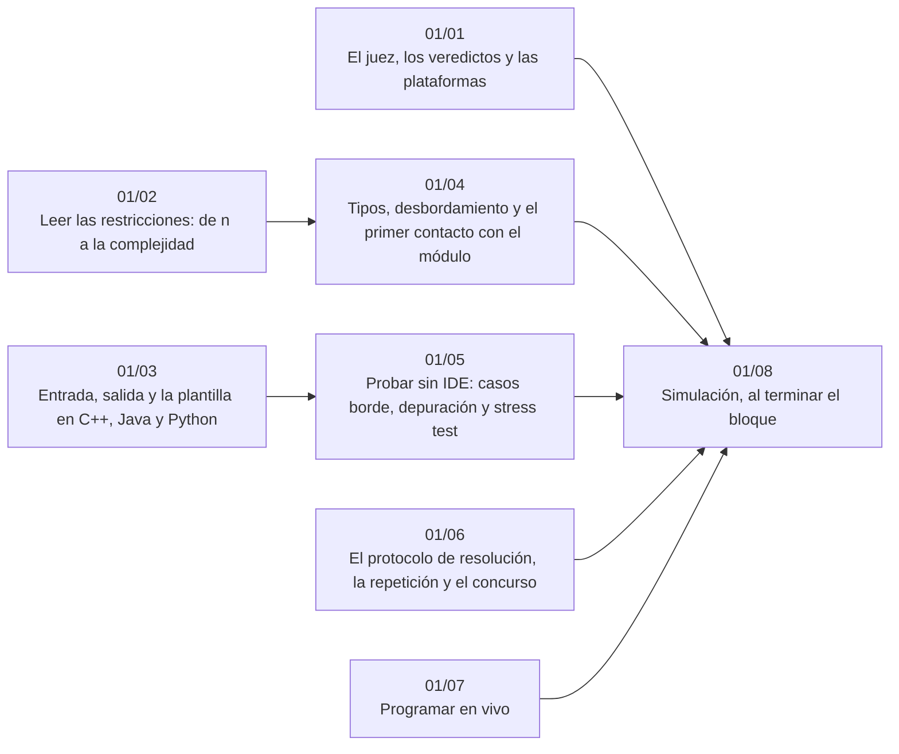

# Bloque 01 — Oficio del competidor

> El oficio antes que los algoritmos: qué hace un juez y qué significa cada veredicto, cómo se leen las
> restricciones para saber qué complejidad cabe, la plantilla de entrada y salida en los tres lenguajes, los tipos
> que desbordan, cómo se prueba sin IDE con un *stress test*, el protocolo para atacar un problema (con la IA como
> tutor) y la entrevista en vivo. Sin teoría algorítmica: es el bloque que hace que todo lo demás llegue a *Accepted*.
>
> Las respuestas de las preguntas y las pistas 2 y 3 de los problemas, en [`09` — Respuestas](09-respuestas.md).
>
> **Vigencia:** 2026-10-04.

---

## 🧭 Índice

| Capítulo | Niveles | Ruta corta |
|---|---|---|
| [`01/01` — El juez, los veredictos y las plataformas](01-el-juez-los-veredictos-y-las-plataformas.md) | veredictos [A] · formato de empresa y de concurso [A] · plataformas [B] |  |
| [`01/02` — Leer las restricciones: de `n` a la complejidad](02-leer-las-restricciones.md) | la tabla `n` → complejidad [A] · estimación de memoria [A] | sí |
| [`01/03` — Entrada, salida y la plantilla en C++, Java y Python](03-entrada-salida-y-plantilla.md) | E/S rápida [A] · los dos formatos [A] | sí |
| [`01/04` — Tipos, desbordamiento y el primer contacto con el módulo](04-tipos-desbordamiento-y-modulo.md) | desbordamiento [A] · aritmética modular básica [A] · `double` y épsilon [A] |  |
| [`01/05` — Probar sin IDE: casos borde, depuración y *stress test*](05-probar-sin-ide-y-stress-test.md) | casos borde [A] · *stress test* [A] · depuración por `stderr` [A] |  |
| [`01/06` — El protocolo de resolución, la repetición y el concurso](06-protocolo-de-resolucion.md) | el protocolo [A] · las pistas y la IA como tutor [A] · repetición y concurso [B] | sí |
| [`01/07` — Programar en vivo](07-programar-en-vivo.md) | el método en vivo [A] · la rúbrica [A] | sí |
| [`01/08` — Simulación](08-simulacion.md) | El examen del bloque: preguntas transversales y problemas cronometrados | |
| [`01/09` — Respuestas](09-respuestas.md) | Las preguntas en tres capas y las pistas 2 y 3 | |

---

## 🧭 Orden de lectura

- Para una prueba de empresa inminente, `01/02`, `01/03` y `01/06` son el mínimo; `01/07` si es en vivo.
- `01/04` y `01/05` se leen antes del primer *Wrong Answer* inexplicable, no después.

---

## 🔎 Mapa de señales del bloque

| Señal | Técnica | Capítulo |
|---|---|---|
| «`1 ≤ n ≤ 2·10⁵`», «límite de 1 segundo» | La tabla `n` → complejidad | [`01/02`](02-leer-las-restricciones.md) |
| «Lee hasta el final de la entrada», casos múltiples | La plantilla de E/S rápida | [`01/03`](03-entrada-salida-y-plantilla.md) |
| «Módulo `10⁹ + 7`», sumas que pasan de `2³¹` | Tipos de 64 bits y aritmética modular | [`01/04`](04-tipos-desbordamiento-y-modulo.md) |
| *Wrong Answer* en un caso oculto que no entiendes | *Stress test* contra fuerza bruta | [`01/05`](05-probar-sin-ide-y-stress-test.md) |
| No sabes por dónde empezar | El protocolo: ejemplos a mano, fuerza bruta, pistas | [`01/06`](06-protocolo-de-resolucion.md) |
| «Comparte tu pantalla y explícame mientras escribes» | El método en vivo y su rúbrica | [`01/07`](07-programar-en-vivo.md) |

---

## 📚 Lectura troncal del bloque

La de cada capítulo, que es también la primera entrada de su «Para profundizar»:

- **`01/01`** — Laaksonen, *Guide to Competitive Programming*, 3.ª ed. (Springer, 2024), cap. 1; Halim, Halim y Effendy, *Competitive Programming 4*, libro 1 (2020), cap. 1.
- **`01/02`** — Laaksonen, *Guide to Competitive Programming*, 3.ª ed. (Springer, 2024), cap. 3; Skiena, *The Algorithm Design Manual*, 3.ª ed. (Springer, 2020), cap. 2.
- **`01/03`** — Halim, Halim y Effendy, *Competitive Programming 4*, libro 1 (2020), cap. 1; la documentación de `<iostream>`, `java.io` y `sys`.
- **`01/04`** — Halim, Halim y Effendy, *Competitive Programming 4*, libro 1 (2020), cap. 1; Warren, *Hacker's Delight*, 2.ª ed. (Addison-Wesley, 2012), cap. 2.
- **`01/05`** — Laaksonen, *Guide to Competitive Programming*, 3.ª ed. (Springer, 2024), cap. 1; Skiena y Revilla, *Programming Challenges* (Springer, 2003), cap. 1.
- **`01/06`** — Pólya, *Cómo plantear y resolver problemas* (Trillas; traducción de *How to Solve It*); Skiena, *The Algorithm Design Manual*, 3.ª ed. (Springer, 2020), cap. 1.
- **`01/07`** — McDowell, *Cracking the Coding Interview*, 6.ª ed. (CareerCup, 2015), secciones I («The Interview Process») y VII («Technical Questions»); Aziz, Lee y Prakash, *Elements of Programming Interviews in Java* (2015), cap. 1.

---

## 🧭 Qué NO está aquí

- **La teoría de cualquier técnica**: desde el [bloque `02`](../02-analisis/README.md); este bloque solo enseña a usarlas contra un juez.
- **Las colecciones de cada lenguaje**: en el [bloque `03`](../03-biblioteca-estandar/README.md).
- **La teoría de números**, más allá del módulo básico: en [`17/03` — Aritmética modular](../17-matematica/03-aritmetica-modular.md).
- **Simulacros completos**: en el [bloque `21`](../21-simulacros/README.md); la simulación de este bloque examina solo el oficio.

---

**Siguiente:** [Bloque 02 — Análisis](../02-analisis/README.md) ·
**Inicio:** [README del corpus](../README.md)
