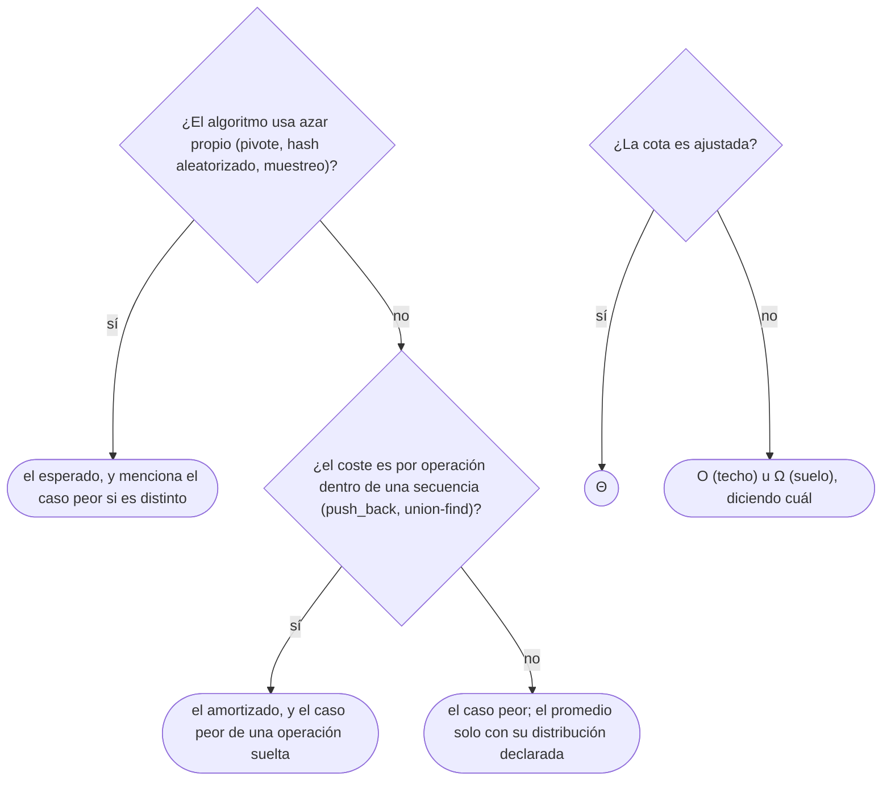

# 01 — Notación asintótica y casos

> Las definiciones de O, Ω y Θ con sus constantes, cómo se cuentan los pasos de un fragmento con
> bucles anidados y dependientes, y de qué caso se habla cuando se da un coste: peor, promedio,
> esperado o amortizado. Es el dueño de la notación en todo el corpus.
>
> **Niveles:** O, Ω, Θ [A] · peor, promedio, amortizado, esperado [A] · o y ω [C].
>
> **📚 Lectura troncal:** Brassard y Bratley, *Fundamentos de algoritmia* (Prentice Hall, 1997),
> caps. 2–3; Cormen, Leiserson, Rivest y Stein, *Introduction to Algorithms*, 3.ª ed. (MIT Press,
> 2009), cap. 3.
>
> **Ruta corta:** sí.
>
> **Vigencia:** 2026-10-03.

**Salto rápido:** [1](#1--el-problema) · [2](#2--la-teoría) · [3](#3--o-ω-y-θ) · [4](#4--los-casos) · [5](#5--o-y-ω) · [6](#6-️-la-jerarquía-con-números) · [7](#7--cómo-se-elige) · [8](#8--señales-del-enunciado) · [🧠](#-preguntas) · [🧩](#-problemas-propios)

---

## 1. 🎯 El problema

Tienes dos algoritmos para el mismo problema. Uno hace `100 · n · log₂ n` pasos; el otro, `n²`. ¿Cuál
es más rápido?

```text
n          100 · n · log₂ n        n²
10         ~3 300                   100              ← gana n²
100        ~66 000                  10 000           ← gana n²
1 000      ~1 000 000               1 000 000        ← empate
10⁵        ~1,7·10⁸                 10¹⁰             ← gana n log n, por 60 veces
10⁶        ~2·10⁹                   10¹²             ← gana n log n, por 500 veces
```

Depende de `n`. Para entradas pequeñas manda la constante; para las grandes, la forma de crecer. La
notación asintótica es la herramienta que **se queda solo con la forma de crecer** y descarta la
constante, porque cuando las restricciones dicen `n ≤ 10⁶` lo que decide si entra en el tiempo es la
forma, no el `100`.

El problema es que esa herramienta se usa mal casi siempre. Se dice «quicksort es `O(n log n)`»
cuando en el caso peor es cuadrático; se dice «el `HashMap` es `O(1)`» sin decir de qué caso; se
confunde `O` con «lo que tarda». Este capítulo da las definiciones exactas y el vocabulario de los
casos, para que cada coste del corpus se pueda leer sin ambigüedad.

---

## 2. 📐 La teoría

**Las tres cotas.** Sean `f` y `g` funciones de los naturales en los reales no negativos.

- **`f ∈ O(g)`** si existen una constante `c > 0` y un `n₀` tales que `f(n) ≤ c · g(n)` para todo
  `n ≥ n₀`. Es una **cota superior**: `f` no crece más rápido que `g`.
- **`f ∈ Ω(g)`** si existen `c > 0` y `n₀` tales que `f(n) ≥ c · g(n)` para todo `n ≥ n₀`. Es una
  **cota inferior**.
- **`f ∈ Θ(g)`** si `f ∈ O(g)` y `f ∈ Ω(g)`: existen `c₁, c₂ > 0` y `n₀` con
  `c₁ · g(n) ≤ f(n) ≤ c₂ · g(n)` para todo `n ≥ n₀`. Es el **orden exacto**.

**`O(g)` es un conjunto**, el de las funciones acotadas por un múltiplo de `g`. Escribir
`f(n) = O(g(n))` es un abuso de notación que todo el mundo usa; lo preciso es `f ∈ O(g)`, y por eso
«`n ∈ O(n²)`» es cierto aunque suene raro: `O` no dice que la cota sea ajustada.

**Teorema (regla del límite).** Si existe `L = lim f(n)/g(n)` cuando `n → ∞`, entonces:

```text
0 < L < ∞    →   f ∈ Θ(g)
L = 0        →   f ∈ O(g), y f ∉ Ω(g)
L = ∞        →   f ∈ Ω(g), y f ∉ O(g)
```

Es la forma práctica de comparar dos funciones: `lim (3n² + 10n) / n² = 3`, así que `3n² + 10n ∈ Θ(n²)`.
La prueba sale de la definición de límite: si el cociente tiende a `L`, a partir de algún `n₀` queda
entre `L/2` y `2L`, y esas son las constantes. Brassard y Bratley, cap. 3, la dan entera.

**Las reglas de cálculo**, que son las que se usan al analizar código:

- **Suma**: `O(f) + O(g) = O(max(f, g))`. Dos fases seguidas cuestan lo que la más cara. *Esbozo:* si
  `f₁ ≤ c₁ f` y `f₂ ≤ c₂ g`, entonces `f₁ + f₂ ≤ (c₁ + c₂) · max(f, g)`.
- **Producto**: `O(f) · O(g) = O(f · g)`. Un bucle de `f` vueltas con un cuerpo de coste `g` cuesta
  `f · g`, si el cuerpo cuesta lo mismo en cada vuelta.
- **Constantes y bases**: `O(c · f) = O(f)`, y `O(log_a n) = O(log_b n)`, porque
  `log_a n = log_b n / log_b a` y `1 / log_b a` es una constante. Por eso no se escribe la base.

**La jerarquía**, que se sabe de memoria, de menor a mayor crecimiento:

```text
1  ≺  log n  ≺  √n  ≺  n  ≺  n log n  ≺  n²  ≺  n³  ≺  2ⁿ  ≺  n!  ≺  nⁿ
```

Cada flecha es una `o` estricta (§5): la de la izquierda es despreciable frente a la de la derecha.
Dos hechos que la sostienen: **cualquier potencia de `log n` es `o(n^ε)` para todo `ε > 0`**, y
**cualquier polinomio es `o(cⁿ)` para todo `c > 1`**. Los dos salen de la regla del límite con
L'Hôpital.

---

## 3. 🧱 O, Ω y Θ

**Qué es.** Las tres cotas de §2, aplicadas a contar los pasos de un algoritmo en función del tamaño
de la entrada.

**Por qué es correcto** descartar la constante: porque las tres definiciones la absorben en `c`. Un
algoritmo de `100 n log n` y otro de `n log n` están en el mismo `Θ(n log n)`, y la diferencia real
entre ellos (un factor 100) no la ve la notación. Es una decisión consciente: se gana poder comparar
algoritmos sin medir, y se pierde la constante, que hay que mirar aparte ([`02/05`](05-el-coste-real.md)). El ejemplo que
fija las constantes: `3n² + 10n ∈ Θ(n²)` con `c₁ = 3`, `c₂ = 4` y `n₀ = 10`, porque para `n ≥ 10`,
`10n ≤ n²` y entonces `3n² ≤ 3n² + 10n ≤ 4n²`.

**Cómo va.** Analizar un fragmento es contar cuántas veces se ejecuta su instrucción más interna en
función de `n`, y quedarse con el término dominante. Cuatro formas de bucle cubren casi todo:

```java
// Cuatro patrones de bucle. "count++" es la operación que se cuenta.
static long countSteps(int n) {
    long count = 0;
    for (int i = 0; i < n; i++)                       // 1. independientes: n · n
        for (int j = 0; j < n; j++) count++;
    for (int i = 0; i < n; i++)                       // 2. dependiente: 0 + 1 + ... + (n−1)
        for (int j = 0; j < i; j++) count++;
    for (int i = 1; i < n; i *= 2) count++;           // 3. duplicando: ⌈log₂ n⌉ vueltas
    for (int i = 1; i <= n; i++)                      // 4. armónico: Σ ⌊n / i⌋
        for (int j = i; j <= n; j += i) count++;
    return count;
}
```

- **Bucle 1**: `n²` exactos. `Θ(n²)`.
- **Bucle 2**: `Σ_{i=0}^{n−1} i = n(n−1)/2`. Sigue siendo `Θ(n²)`: el `1/2` es una constante. Que el
  bucle interno sea «más corto» no cambia el orden.
- **Bucle 3**: `i` toma los valores `1, 2, 4, …` hasta pasar de `n`: son `⌈log₂ n⌉` vueltas. `Θ(log n)`.
- **Bucle 4**: el interno da `⌊n/i⌋` vueltas, y `Σ_{i=1}^{n} n/i = n · H(n) ≈ n ln n`, donde `H(n)` es
  el número armónico. `Θ(n log n)`, aunque haya dos bucles.

La traza a mano con `n = 6`, para ver los números:

```text
bucle 1:  6 · 6                          = 36
bucle 2:  0 + 1 + 2 + 3 + 4 + 5          = 15     (= 6 · 5 / 2)
bucle 3:  i = 1, 2, 4                    =  3     (= ⌈log₂ 6⌉)
bucle 4:  6 + 3 + 2 + 1 + 1 + 1          = 14     (⌊6/1⌋ + ⌊6/2⌋ + ... + ⌊6/6⌋)
```

**Cuánto.** Analizar cuesta poco y no corre nada: es contar. Lo que la notación **no da** es la
constante, ni el comportamiento con `n` pequeño, ni el efecto de la memoria (`02/05`).

**La plantilla.** No hay: la notación no se programa, se aplica. El código del capítulo son bucles
para contar, en Java, como fija la ficha del capítulo.

### De la versión ingenua a la buena

**El problema.** La suma de las sumas de todos los subarreglos contiguos. Con `[5, 2, 9, 1, 5, 6]` hay
21 subarreglos, y la suma de sus sumas es `256`.

**La versión ingenua:**

```java
// Para cada subarreglo [i, j], sumarlo desde cero. Tres bucles: O(n³).
static long sumOfAllSubarrays(int[] a) {
    long total = 0;
    for (int i = 0; i < a.length; i++)
        for (int j = i; j < a.length; j++)
            for (int k = i; k <= j; k++)
                total += a[k];
    return total;
}
```

> «Esto es cúbico: hay `n(n+1)/2` subarreglos y cada uno se suma en `O(n)`. Pero los subarreglos que
> empiezan en `i` se van alargando de uno en uno, así que puedo sumar incrementalmente y bajar a
> `O(n²)`. Y si cuento cuántas veces aparece cada `a[k]` en total, ni siquiera necesito enumerar los
> subarreglos.»

**El camino a la buena.** El elemento `a[k]` aparece en todos los subarreglos `[i, j]` con `i ≤ k ≤ j`:
hay `k + 1` elecciones de `i` y `n − k` de `j`. Su contribución total es `a[k] · (k + 1) · (n − k)`,
y la suma es un solo recorrido: `Θ(n)`.

```java
// Contribución de cada elemento: aparece en (k + 1)·(n − k) subarreglos. O(n).
static long sumOfAllSubarrays(int[] a) {
    int n = a.length;
    long total = 0;
    for (int k = 0; k < n; k++)
        total += (long) a[k] * (k + 1) * (n - k);
    return total;
}
```

- **De `Θ(n³)` a `Θ(n)`** sin cambiar de técnica, solo contando mejor: el análisis también es una
  herramienta de diseño.
- **`(long) a[k]`** antes de multiplicar: `(k + 1)(n − k)` llega a `n²/4`, y con valores de `10⁹` el
  producto pasa de 32 bits.

**Cuándo sí** se usa `Θ`: cuando la cota es ajustada, que es casi siempre lo que se quiere decir.
**Cuándo sí** `O` a secas: cuando solo se garantiza un techo («la búsqueda termina en `O(log n)`»).
**Cuándo no** basta ninguna: con `n` pequeño o cerca del límite de tiempo, donde decide la constante.

> **Veredicto:** `O` es un techo, `Ω` un suelo y `Θ` las dos cosas. Cuando digas «es `O(n log n)`»
> queriendo decir «es exactamente del orden de `n log n`», lo preciso es `Θ`.

---

## 4. 🧱 Los casos

**Qué es.** Un algoritmo no tiene «un» coste: para cada `n` hay muchas entradas, y cada una cuesta
distinto. Hay que decir **sobre qué** se mide:

| Caso | Sobre qué | Ejemplo |
|---|---|---|
| **Peor** | La entrada más cara de tamaño `n` | Búsqueda lineal: `n` comparaciones, si el elemento no está |
| **Promedio** | Una **distribución declarada** de las entradas | Búsqueda lineal, elemento presente en posición uniforme: `(n + 1)/2` |
| **Esperado** | El **azar del propio algoritmo**, para cada entrada fija | *Quicksort* con pivote aleatorio: `Θ(n log n)` esperado para **toda** entrada |
| **Amortizado** | Una **secuencia** de operaciones, en el caso peor | `push_back` de un arreglo dinámico: `O(1)` amortizado ([`02/03`](03-analisis-amortizado.md)) |

**Por qué es correcto** el promedio de la búsqueda lineal: si el elemento está en cada una de las `n`
posiciones con probabilidad `1/n`, encontrarlo en la posición `i` (contando desde 1) cuesta `i`
comparaciones, y el promedio es `Σ i / n = (n + 1) / 2`. El cálculo **depende de la distribución**: si
el elemento casi siempre está al final, el promedio se acerca a `n`. Un caso promedio sin distribución
declarada no significa nada.

**Cómo va**, con el ejemplo que más se confunde, *quicksort*:

```text
pivote fijo (el primero), caso peor       entrada ya ordenada → particiones de 0 y n−1 → Θ(n²)
pivote fijo, caso promedio                sobre permutaciones uniformes → ~1,39 · n log₂ n → Θ(n log n)
pivote aleatorio, caso esperado           para CUALQUIER entrada, sobre el azar del pivote → Θ(n log n)
pivote aleatorio, caso peor               existe (mala suerte en cada pivote), con probabilidad ínfima → Θ(n²)
```

La diferencia entre promedio y esperado es la que importa en un juez: el promedio supone que **la
entrada** es aleatoria, y un caso de prueba adversario no lo es; el esperado supone que **tus
decisiones** son aleatorias, y ningún caso de prueba las controla.

**Cuánto.** Cada caso se deriva distinto: el peor, buscando la entrada más cara; el promedio, con una
suma ponderada por la distribución; el esperado, con la esperanza sobre el azar del algoritmo; el
amortizado, con los métodos de `02/03`.

> ⏱️ **Coste.** Este capítulo es el primero que da costes esperados y amortizados distintos del caso
> peor: el `HashMap` es `O(1)` **esperado** por operación con un buen *hash* y `O(n)` en el caso peor
> de una cubeta (en Java, desde la versión 8, una cubeta muy llena se convierte en árbol y el caso peor
> por operación baja a `O(log n)` con claves comparables); el `push_back` es `O(1)` **amortizado** y
> `O(n)` en el caso peor de una operación suelta.

**La plantilla.** No hay; los casos se aplican a las plantillas de los demás capítulos.

### De la versión ingenua a la buena

**El problema.** ¿Tiene el arreglo algún valor repetido? Con `[5, 2, 9, 1, 5, 6]`, sí: el 5.

**La versión ingenua:**

```java
// Todas las parejas: Θ(n²) en el caso peor (cuando no hay repetidos y se recorre todo).
static boolean hasDuplicate(int[] a) {
    for (int i = 0; i < a.length; i++)
        for (int j = i + 1; j < a.length; j++)
            if (a[i] == a[j]) return true;
    return false;
}
```

> «En el caso peor, sin repetidos, compara todas las parejas: `n(n−1)/2`. Hay dos mejoras con
> garantías distintas: un conjunto *hash*, `O(n)` **esperado**, o ordenar y mirar vecinos, `O(n log n)`
> en el **caso peor**.»

**El camino a la buena.** Con un `HashSet`, cada inserción y consulta es `O(1)` esperada, y el total
`O(n)` esperado. Si la entrada puede ser adversaria —un caso diseñado para que todas las claves caigan
en la misma cubeta—, ordenar da una garantía de caso peor que el *hash* no da.

```java
// Ordenar una copia y comparar vecinos: Θ(n log n) en el caso peor, sin depender de un hash.
static boolean hasDuplicate(int[] a) {
    int[] sorted = a.clone();
    java.util.Arrays.sort(sorted);
    for (int i = 1; i < sorted.length; i++)
        if (sorted[i] == sorted[i - 1]) return true;
    return false;
}
```

- **Las dos son correctas**; lo que cambia es **qué caso garantizan**. La de `HashSet` es más rápida
  en el caso típico; la de ordenar no tiene caso malo.
- **`Arrays.sort` sobre `int[]`** es un *quicksort* de doble pivote; desde Java 14 cambia a *heapsort*
  si la recursión se hace demasiado profunda, y por eso garantiza `n log n` en el caso peor. En Java 8
  y 11 no lo garantizaba. [`03/03`](../03-biblioteca-estandar/03-java-colecciones.md) lo detalla.

**Cuándo sí** se cita el caso peor: cuando la entrada la puede elegir un adversario, que en un juez es
siempre. **Cuándo sí** el esperado: cuando el azar es del algoritmo y no de la entrada. **Cuándo no**
el promedio: sin una distribución declarada.

> **Veredicto:** un coste sin su caso es media respuesta. «`O(1)`» no dice nada; «`O(1)` esperado, `O(n)`
> en el caso peor» lo dice todo.

---

## 5. 🧱 o y ω

### o pequeña y ω pequeña

- **Qué resuelve.** Expresan que una función es **estrictamente** más pequeña (o más grande) que otra
  en orden: no solo acotada, sino despreciable.
- **Qué garantiza.** `f ∈ o(g)` si para **toda** `c > 0` existe `n₀` con `f(n) < c · g(n)` para
  `n ≥ n₀`; equivale a `lim f/g = 0`. `ω` es lo simétrico: `lim f/g = ∞`.
- **Cuánto.** Nada: es vocabulario. `n ∈ o(n log n)`, `n² ∈ ω(n log n)`, pero `n ∉ o(n)`.
- **Cómo reconocerlo.** En los enunciados de teoremas («si `f ∈ o(n^{log_b a})`…», en el teorema
  maestro de [`02/02`](02-recurrencias-y-teorema-maestro.md)) y en la jerarquía de §2.
- **Si no te la sabes.** Usa `O` sin `Θ`, diciendo «y no es `Θ`»; es lo mismo, más largo.
- **Dónde está entera.** CLRS, 3.ª ed., §3.1; Brassard y Bratley, cap. 3.

---

## 6. ⏱️ La jerarquía con números

Lo que vale cada función para tamaños típicos, y lo que significa en la regla de `10⁸` pasos por
segundo:

| `f(n)` | `n = 10` | `n = 10³` | `n = 10⁶` | Lo que la tabla no dice |
|---|---|---|---|---|
| `log₂ n` | ~3 | ~10 | ~20 | Con `n = 10¹⁸` son 60: el logaritmo es casi una constante |
| `n` | 10 | 10³ | 10⁶ | Un recorrido; lo que cuesta de verdad es la memoria que toca |
| `n log₂ n` | ~33 | ~10⁴ | ~2·10⁷ | Ordenar; con objetos en Java o en Python, multiplica la constante |
| `n²` | 100 | 10⁶ | 10¹² | Con `n = 10⁶` no cabe; con `5 000`, sí |
| `2ⁿ` | ~10³ | ~10³⁰¹ | — | Solo con `n ≤ 20` o poco más |
| `n!` | ~3,6·10⁶ | — | — | Solo con `n ≤ 11` |

---

## 7. 🧭 Cómo se elige

Qué cota y qué caso dar cuando te preguntan «¿cuánto cuesta?»:



> **Mejor:** «Es `Θ(n log n)` en el caso peor por la ordenación; el recorrido posterior es lineal y no
> cambia el orden.»

---

## 8. 🔎 Señales del enunciado

| Señal | Técnica | Por qué |
|---|---|---|
| La solución obvia tiene dos bucles anidados y `n ≤ 10⁵` | Contar pasos y descartar `Θ(n²)` | `10¹⁰` pasos no caben |
| Hay casos de prueba diseñados para romper (*hacks*, «adversario», casos *anti-hash*) | Garantía de caso peor: ordenar, árboles balanceados, *hash* aleatorizado | El promedio y el esperado con *hash* fijo no se sostienen |
| «`q` operaciones» sobre una estructura que a veces hace mucho trabajo | Coste amortizado (`02/03`) | Lo que importa es el total de la secuencia |
| Un bucle que duplica o divide su índice | `Θ(log n)` vueltas | El índice llega al tope en `log₂ n` pasos |
| Un doble bucle cuyo interno avanza de `i` en `i` | `Θ(n log n)` por la serie armónica | `Σ n/i ≈ n ln n` |

---

## 9. 🔭 Dónde aparece de verdad

- **Los percentiles de latencia.** Un servicio se mide por su p99, no por su media: es el caso peor
  práctico. Un algoritmo con buen promedio y caso peor cuadrático se ve en el p99 aunque la media esté
  bien.
- **El ataque a las tablas *hash* (2011).** Se mostró que en muchos lenguajes y servidores web se podían
  enviar formularios con claves elegidas para colisionar todas en la misma cubeta, convirtiendo cada
  petición en un trabajo cuadrático. La respuesta fue aleatorizar la función *hash*: pasar de un caso
  promedio a uno esperado, que el atacante no controla.
- **Las expresiones regulares con retroceso.** Un patrón inocente puede tener un caso peor exponencial
  frente a una entrada concreta, y ha tumbado servicios en producción. Su caso típico es lineal.

---

## ⚠️ Errores frecuentes

| Se dice | Lo preciso |
|---|---|
| «O grande es el tiempo que tarda» | Es una cota de cómo crece el número de pasos, sin constante; el tiempo depende además de la constante y de la máquina |
| «*Quicksort* es `O(n log n)`» | Con pivote fijo es `Θ(n²)` en el caso peor; `Θ(n log n)` en promedio, o esperado con pivote aleatorio |
| «`O(2n)` es peor que `O(n)`» | Son el mismo conjunto: la constante se absorbe |
| «El `HashMap` es `O(1)`» | `O(1)` esperado con buen *hash*; el caso peor de una operación es `O(n)`, u `O(log n)` en Java desde la 8 con claves comparables |
| «Dos bucles anidados son `n²`» | Depende de los rangos: el armónico es `n log n` y el que duplica es `n log n` o menos |
| «El caso promedio es el típico» | Es un promedio sobre una distribución declarada; sin ella no significa nada |
| «`O(log n)` en base 2 es distinto que en base 10» | Difieren en una constante; la base no se escribe |

---

## 📚 Para profundizar

- **Libro** — Brassard y Bratley, *Fundamentos de algoritmia* (Prentice Hall, 1997), caps. 2–3: la
  algoritmia elemental y la notación asintótica, con la regla del límite y sus pruebas. *Lectura
  troncal.*
- **Libro** — Cormen, Leiserson, Rivest y Stein, *Introduction to Algorithms*, 3.ª ed. (MIT Press,
  2009), cap. 3: las cinco notaciones y sus propiedades. *Lectura troncal.*
- **Libro** — Skiena, *The Algorithm Design Manual*, 3.ª ed. (Springer, 2020), cap. 2: el análisis con
  la mirada práctica y la jerarquía de funciones dominantes.
- **Libro** — Sedgewick y Flajolet, *An Introduction to the Analysis of Algorithms*, 2.ª ed.
  (Addison-Wesley, 2013), cap. 1: el caso promedio hecho con rigor (electivo).
- **Referencia** — Sedgewick y Wayne, [*Analysis of Algorithms*](https://algs4.cs.princeton.edu/14analysis/):
  el modelo de coste y la notación tilde, con experimentos en Java.
- **Video** — MIT OpenCourseWare, *6.006 Introduction to Algorithms*: las primeras clases, sobre
  modelos de cómputo y notación asintótica.

---

## 🧠 Preguntas

1. Escribe la definición de `f ∈ O(g)` con sus constantes. 🟢
2. ¿Por qué `n ∈ O(n²)` es cierto, y por qué casi nunca se dice así? 🟢
3. ¿Cuántas veces se ejecuta el cuerpo de `for (i = 1; i < n; i *= 2)`, y en qué `Θ` queda? 🟢
4. ¿Qué diferencia hay entre caso promedio y caso esperado? 🟡
5. ¿Qué diferencia hay entre `O`, `Ω` y `Θ`, y cuál se quiere decir casi siempre que se dice «es `O(…)`»? 🟡
6. ¿Por qué la base del logaritmo no se escribe dentro de una `O`? 🟡
7. ¿Qué diferencia hay entre el coste amortizado de una operación y su caso peor? 🟡
8. ¿Por qué el doble bucle `for (i = 1..n) for (j = i; j ≤ n; j += i)` es `Θ(n log n)` y no `Θ(n²)`? 🟠
9. Un juez tiene casos diseñados por un adversario. ¿Qué garantía prefieres, la del *hash* o la de ordenar, y por qué? 🟠
10. «*Quicksort* es `O(n log n)`»: corrige la frase con los tres casos que corresponden. 🟠
11. Compara cómo cambia el tiempo real de un mismo `Θ(n log n)` entre C++, Java con `List<Integer>` y Python. ¿Qué parte de la diferencia ve la notación? 🟠
12. Demuestra con la definición, dando `c` y `n₀`, que `5n² + 3n log₂ n ∈ Θ(n²)`. 🔴
13. Usa la regla del límite para ordenar `n^{0,001}`, `(log n)¹⁰⁰⁰` y `√n`, y explica por qué el resultado contradice la intuición con `n` pequeño. 🔴

---

## 🧩 Problemas propios

### Cuántas veces se ejecuta

**Nivel:** 🟢 · **Formato:** programa completo.

Para cada `n`, imprime cuántas veces se ejecuta `count++` en este fragmento:

```text
for i in 0..n−1
  for j in i+1..n−1
    for k in j+1..n−1
      count++
```

- **Entrada.** Una línea con `q`. Después, `q` líneas con un entero `n`.
- **Salida.** `q` enteros, uno por línea.
- **Restricciones.** `1 ≤ q ≤ 10⁵`; `1 ≤ n ≤ 10⁶`.

```text
Entrada            Salida
3                  0
2                  1
3                  20
6

Entrada            Salida
2                  0
1                  166666166667000000
1000000
```

**Pista 1:** ¿qué tienen en común las ternas `(i, j, k)` que cuenta el fragmento?

### El doble bucle armónico

**Nivel:** 🟡 · **Formato:** programa completo.

Imprime cuántas veces se ejecuta `count++` en el bucle 4 de §3:
`for (i = 1..n) for (j = i; j ≤ n; j += i) count++`.

- **Entrada.** Un entero `n`.
- **Salida.** Un entero.
- **Restricciones.** `1 ≤ n ≤ 10⁶`. Límite: 1 segundo.

```text
Entrada            Salida
6                  14

Entrada            Salida
1                  1
```

**Pista 1:** ¿cuántas vueltas da el bucle interno para un `i` fijo?

### ¿Cuál crece más?

**Nivel:** 🟠 · **Formato:** programa completo.

Cada función tiene la forma `f(n) = cⁿ · nᵃ · (log n)ᵇ`, con `a`, `b` y `c` enteros. Para cada par de
funciones, decide si la primera es `o` de la segunda (`<`), la segunda es `o` de la primera (`>`) o
son del mismo orden `Θ` (`=`).

- **Entrada.** Una línea con `q`. Después, `q` líneas con seis enteros `a₁ b₁ c₁ a₂ b₂ c₂`.
- **Salida.** `q` líneas con `<`, `>` o `=`.
- **Restricciones.** `1 ≤ q ≤ 10⁵`; `0 ≤ a, b ≤ 10⁹`; `1 ≤ c ≤ 10⁹`.

```text
Entrada                        Salida
4                              >
2 0 1 1 1 1                    <
0 5 1 1 0 1                    >
0 0 2 10 0 1                   =
1 0 1 1 0 1

Entrada                        Salida
2                              =
1000000000 0 1 1000000000 0 1  <
0 1000000000 1 1 0 1
```

**Pista 1:** si una de las dos tiene una base exponencial mayor, ¿importa lo que valgan los demás
exponentes?

---

## 🧩 Práctica externa

> 💡 **Truco.** Antes de abrir el enunciado completo, lee solo las restricciones y escribe la
> complejidad que cabe. Y si te atascas con una IA a mano, enséñale tu análisis de la fuerza bruta y
> pídele que lo revise, no que resuelva ([`01/06`](../01-oficio-del-competidor/06-protocolo-de-resolucion.md)).

En todos, el ejercicio es **analizar antes de escribir**: el coste de la fuerza bruta, por qué no cabe,
y el de tu solución, con su caso.

### Núcleo

| ✔ | Problema | Plataforma | Nivel | Patrón | Pista 1 |
|---|---|---|---|---|---|
| [ ] | [FrogJmp](https://app.codility.com/programmers/lessons/3-time_complexity/frog_jmp/) | Codility | 🟢 | Bucle frente a fórmula | Con distancias de hasta `10⁹`, ¿cuántas vueltas daría un bucle que salta de uno en uno? |
| [ ] | [Find Pivot Index](https://leetcode.com/problems/find-pivot-index/) | LeetCode | 🟢 | `n²` frente a `n` | ¿Hace falta volver a sumar la izquierda en cada posición? |
| [ ] | [Squares of a Sorted Array](https://leetcode.com/problems/squares-of-a-sorted-array/) | LeetCode | 🟢 | `n log n` frente a `n` | ¿Dónde están los cuadrados más grandes en un arreglo ordenado con negativos? |
| [ ] | [Maximum Average Subarray I](https://leetcode.com/problems/maximum-average-subarray-i/) | LeetCode | 🟢 | `n·k` frente a `n` | Al mover la ventana una posición, ¿cuántos elementos cambian? |
| [ ] | [Find All Numbers Disappeared in an Array](https://leetcode.com/problems/find-all-numbers-disappeared-in-an-array/) | LeetCode | 🟢 | Espacio extra | ¿Puedes marcar que viste un valor usando el propio arreglo? |
| [ ] | [Ice Cream Parlor](https://www.hackerrank.com/challenges/icecream-parlor/problem) | HackerRank | 🟢 | Leer la cota | Con las cotas del enunciado, ¿cabe probar todas las parejas? |
| [ ] | [Pairs](https://www.hackerrank.com/challenges/pairs/problem) | HackerRank | 🟡 | `n²` frente a `n log n` | Para cada valor, ¿qué otro valor concreto necesitas encontrar? |

### Ampliación

| ✔ | Problema | Plataforma | Nivel | Patrón | Pista 1 |
|---|---|---|---|---|---|
| [ ] | [Subarray Sums I](https://cses.fi/problemset/task/1660) | CSES | 🟡 | `n²` frente a `n` | Con valores positivos, ¿qué le pasa a la suma al mover cada extremo? |
| [ ] | [Subarray Sums II](https://cses.fi/problemset/task/1661) | CSES | 🟡 | Esperado frente a caso peor | Si hubiera negativos, ¿qué información sobre los prefijos anteriores necesitarías? |
| [ ] | [Sum of Two Values](https://cses.fi/problemset/task/1640) | CSES | 🟡 | Esperado frente a caso peor | ¿Qué garantía da una tabla *hash* si los casos están pensados para atacarla? |

---

## ✅ Criterio de dominio

- Escribir las definiciones de `O`, `Ω` y `Θ` con sus constantes y demostrar un `Θ` concreto dando `c`
  y `n₀`.
- Analizar los cuatro patrones de bucle de §3 sin mirar, incluido el armónico.
- Decir el coste de cualquier plantilla del corpus con su caso: peor, esperado o amortizado.
- Resolver dos problemas del núcleo escribiendo antes el análisis de la fuerza bruta y de la solución.

---

**Anterior:** — · **Siguiente:** [`02/02` — Recurrencias y teorema maestro](02-recurrencias-y-teorema-maestro.md) ·
**Relacionado:** [`01/02` — Leer las restricciones](../01-oficio-del-competidor/02-leer-las-restricciones.md); [`02/03` — Análisis amortizado](03-analisis-amortizado.md).
