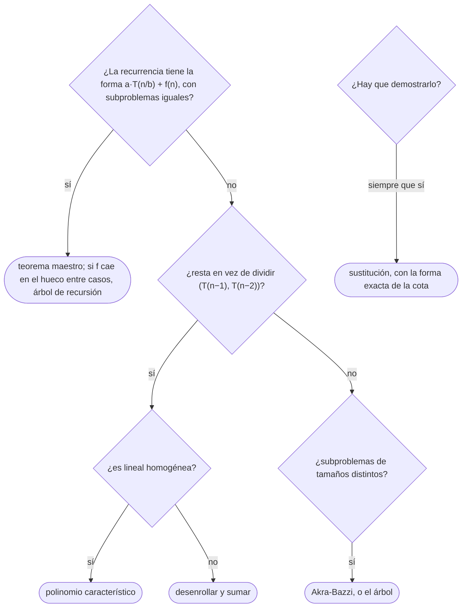

# 02 — Recurrencias y teorema maestro

> Escribir la recurrencia de un algoritmo recursivo y resolverla: por el árbol de recursión, por
> sustitución y por el teorema maestro, con sus tres casos y la condición de regularidad. Y qué hacer
> cuando el teorema no se aplica.
>
> **Niveles:** sustitución y árbol de recursión [A] · teorema maestro [A] · Akra-Bazzi [C] ·
> funciones generadoras [C, electivo].
>
> **📚 Lectura troncal:** Cormen, Leiserson, Rivest y Stein, *Introduction to Algorithms*, 3.ª ed.
> (MIT Press, 2009), cap. 4; Brassard y Bratley, *Fundamentos de algoritmia* (Prentice Hall, 1997),
> cap. 4. Electivo: Sedgewick y Flajolet, *An Introduction to the Analysis of Algorithms*, 2.ª ed.
> (Addison-Wesley, 2013), caps. 2–3.
>
> **Asume leído:** [`02/01` — Notación asintótica y casos](01-notacion-asintotica.md).
>
> **Vigencia:** 2026-10-03.

**Salto rápido:** [1](#1--el-problema) · [2](#2--la-teoría) · [3](#3--árbol-de-recursión-y-sustitución) · [4](#4--el-teorema-maestro) · [5](#5--fuera-del-teorema-maestro) · [6](#6-️-la-tabla-de-costes) · [7](#7--cómo-se-elige) · [8](#8--señales-del-enunciado) · [🧠](#-preguntas) · [🧩](#-problemas-propios)

---

## 1. 🎯 El problema

Con bucles, el coste se cuenta (`02/01`). Con recursión, no hay bucle que contar: la función se llama
a sí misma, y lo que cuesta depende de cuántas veces se llama, con qué tamaño y cuánto trabajo hace
cada llamada fuera de las recursivas.

```java
// ¿Cuánto cuesta esto? No hay un bucle que lo diga.
static long fib(int n) {
    if (n < 2) return n;
    return fib(n - 1) + fib(n - 2);
}
```

Con `n = 40` hace unos `3,3·10⁸` llamadas; con `n = 50`, unas `4·10¹⁰`. Y la ordenación por mezcla,
que también se llama dos veces a sí misma, ordena `10⁶` elementos en unos `2·10⁷` pasos. Las dos
tienen la misma forma —dos llamadas recursivas—, y una es exponencial y la otra casi lineal. La
diferencia está en **el tamaño de los subproblemas**: `n − 1` y `n − 2` frente a `n/2` y `n/2`.

Para ver eso hace falta escribir **la recurrencia** del algoritmo y resolverla. Este capítulo da tres
formas de hacerlo y el teorema que resuelve en una línea la familia más frecuente.

---

## 2. 📐 La teoría

**Una recurrencia** expresa el coste de un tamaño en función del coste de tamaños menores. Para un
algoritmo de divide y vencerás que parte el problema en `a` subproblemas de tamaño `n/b` y gasta
`f(n)` en partir y combinar:

```text
T(n) = a · T(n/b) + f(n)        con T(n) = Θ(1) para n pequeño
```

Los suelos y techos (`T(⌊n/2⌋)` frente a `T(n/2)`) no cambian el orden en los casos que salen en la
práctica, y se omiten. El caso base tampoco, siempre que sea constante.

**El árbol de recursión** es la herramienta que lo explica todo. Cada nodo es una llamada, con su
coste propio; el nivel `j` tiene `aʲ` nodos de tamaño `n/bʲ`; el árbol tiene `log_b n` niveles, y
sus hojas son `a^{log_b n} = n^{log_b a}`:

```text
nivel 0          f(n)                                    1 nodo
nivel 1          f(n/b)   ...  a veces                   a nodos         → a · f(n/b)
nivel 2          f(n/b²)  ...  a² veces                  a² nodos        → a² · f(n/b²)
  ...
hojas            Θ(1)     ...  n^{log_b a} veces                         → Θ(n^{log_b a})

T(n) = Σ_{j=0}^{log_b n − 1} aʲ · f(n/bʲ)  +  Θ(n^{log_b a})
```

El total es la suma por niveles, y **solo hay tres cosas que pueden pasar**: que el coste por nivel
crezca hacia las hojas (y entonces mandan las hojas), que sea igual en todos los niveles (y entonces
es el coste de un nivel por el número de niveles), o que decrezca desde la raíz (y entonces manda la
raíz). Eso es el teorema maestro.

**Teorema (maestro).** Sea `T(n) = a·T(n/b) + f(n)` con `a ≥ 1` y `b > 1`, y sea `p = log_b a`.

```text
Caso 1   f(n) ∈ O(n^{p−ε}) para algún ε > 0                    →  T(n) ∈ Θ(n^p)
Caso 2   f(n) ∈ Θ(n^p)                                          →  T(n) ∈ Θ(n^p · log n)
Caso 3   f(n) ∈ Ω(n^{p+ε}) para algún ε > 0, y además
         a · f(n/b) ≤ c · f(n) para alguna c < 1 y n grande     →  T(n) ∈ Θ(f(n))
```

**Esbozo de la prueba**, por el árbol. En el caso 1, `f` es polinómicamente menor que el número de
hojas, y el coste por nivel `aʲ f(n/bʲ)` crece geométricamente hacia abajo: la suma es dominada por
su último término, las hojas, `Θ(n^p)`. En el caso 2, cada nivel cuesta `Θ(n^p)` y hay `log_b n`
niveles. En el caso 3, la **condición de regularidad** `a f(n/b) ≤ c f(n)` dice exactamente que el
coste por nivel decrece geométricamente con razón `c`, y la suma queda dominada por la raíz:
`f(n) · 1/(1 − c)`. La prueba completa, con los suelos y techos, está en CLRS, 3.ª ed., §4.6.

**Lo que el teorema no cubre**, y hay que saberlo: el hueco entre los casos. Con
`T(n) = 2T(n/2) + n / log n`, `p = 1` y `f(n) = n / log n` es menor que `n¹` pero **no
polinómicamente** menor —no existe `ε` con `n/log n ∈ O(n^{1−ε})`—, así que no es caso 1, ni caso 2. La
solución, por el árbol, es `Θ(n log log n)`. Tampoco cubre recurrencias como `T(n) = T(n − 1) + n`,
que no dividen el tamaño (§5).

---

## 3. 🧱 Árbol de recursión y sustitución

**Qué es.** Dos técnicas generales: **el árbol** para **adivinar** la solución sumando por niveles, y
**la sustitución** para **demostrarla** por inducción.

**Por qué es correcto.** El árbol es una contabilidad exacta del trabajo: cada llamada aparece una vez
con su coste propio, así que la suma de todos los nodos es `T(n)`. La sustitución es inducción fuerte
([`02/04`](04-correccion-invariantes-induccion-intercambio.md)): se supone la cota para todos los tamaños menores y se demuestra para `n`.

**Cómo va**, con la ordenación por mezcla, `T(n) = 2T(n/2) + n`:

```text
nivel 0:   n                                   = n
nivel 1:   n/2 + n/2                           = n
nivel 2:   n/4 + n/4 + n/4 + n/4               = n
  ...      (log₂ n niveles, cada uno suma n)
total:     n · log₂ n                          → Θ(n log n)
```

Y la prueba por sustitución de que `T(n) ≤ c · n log₂ n` para `n ≥ 2`, con `T(n) = 2T(⌊n/2⌋) + n`:

```text
T(n) ≤ 2 · c · ⌊n/2⌋ · log₂ ⌊n/2⌋ + n        (hipótesis inductiva)
     ≤ c · n · log₂ (n/2) + n
     = c · n · log₂ n − c · n + n
     ≤ c · n · log₂ n                         si c ≥ 1
```

El paso clave es que `log₂(n/2) = log₂ n − 1`, y ese `−c·n` paga el `+n` de la combinación. Los casos
base (`n = 2, 3`) fijan una `c` suficientemente grande.

> ⚠️ **Advertencia.** El error clásico de la sustitución es «demostrar» `T(n) = 2T(n/2) + n ∈ O(n)`
> así: `T(n) ≤ 2c(n/2) + n = cn + n = O(n)`. Es falso: hay que demostrar **la misma forma exacta**,
> `T(n) ≤ cn`, y `cn + n` no es `≤ cn` para ninguna `c`. La constante no puede crecer en cada paso de la
> inducción.

**Cuánto.** El árbol cuesta un dibujo y una suma; la sustitución, una inducción de tres líneas.

**La plantilla.** No hay código: la ficha del capítulo fija árboles de recursión en `text`.

### De la versión ingenua a la buena

**El problema.** El `n`-ésimo número de Fibonacci, con `F(0) = 0` y `F(1) = 1`. Con `n = 40` es
`102 334 155`.

**La versión ingenua** es la de §1. Su recurrencia, contando llamadas, es
`C(n) = C(n−1) + C(n−2) + 1`, y su árbol no se parte por la mitad: baja de uno en uno por la izquierda
y de dos en dos por la derecha.

> «Esto es exponencial porque recalcula los mismos subproblemas: `fib(n−2)` se calcula dos veces,
> `fib(n−3)` tres, `fib(n−4)` cinco… El número de llamadas crece como los propios números de
> Fibonacci, unas `1,618ⁿ`. Con memoización cada subproblema se calcula una vez y baja a `O(n)`.»

**El camino a la buena.** Guardar cada `fib(k)` la primera vez que se calcula. El árbol se convierte
en una cadena: cada valor se calcula una vez y las demás llamadas devuelven el guardado.

```java
// Con memoización: cada fib(k) se calcula una vez. Θ(n) tiempo y Θ(n) memoria.
static long fib(int n, long[] memo) {
    if (n < 2) return n;
    if (memo[n] != 0) return memo[n];            // ya calculado (fib(k) > 0 para k ≥ 1)
    return memo[n] = fib(n - 1, memo) + fib(n - 2, memo);
}
```

- **La recurrencia nueva** es `T(n) = T(n−1) + O(1)`: la llamada a `fib(n−2)` encuentra el valor
  guardado, porque `fib(n−1)` ya lo calculó. Resuelta, `Θ(n)`.
- **`memo[n] != 0`** sirve de marca porque `fib(k) > 0` para `k ≥ 1`; en otro problema, donde `0` sea
  un valor válido, la marca tiene que ser otra. Es el paso de la recursión a la tabla de [`12/01`](../12-dp-clasica/01-de-la-recursion-a-la-tabla.md).

**Cuándo sí** se dibuja el árbol: con cualquier recurrencia nueva, para ver qué domina. **Cuándo sí** la
sustitución: cuando hay que demostrar la cota, no solo creerla. **Cuándo no** hacen falta: cuando la
recurrencia es de la forma del teorema maestro y cae claramente en un caso.

> **Veredicto:** el árbol adivina y la sustitución demuestra. Y antes de resolver nada, mira el tamaño
> de los subproblemas: dividir por dos da logaritmos, restar uno da sumas o exponenciales.

---

## 4. 🧱 El teorema maestro

**Qué es.** El teorema de §2, aplicado como receta: identificar `a`, `b` y `f(n)`, calcular
`p = log_b a`, comparar `f(n)` con `n^p` y leer el caso.

**Por qué es correcto.** Por el esbozo del árbol de §2: los tres casos son las tres formas posibles de
la serie del coste por nivel —creciente, constante o decreciente—.

**Cómo va**, con los ejemplos que hay que saber:

| Algoritmo | Recurrencia | `p = log_b a` | Comparación | Caso | Solución |
|---|---|---|---|---|---|
| Búsqueda binaria | `T(n/2) + 1` | 0 | `1 = n⁰` | 2 | `Θ(log n)` |
| Ordenación por mezcla | `2T(n/2) + n` | 1 | `n = n¹` | 2 | `Θ(n log n)` |
| Karatsuba | `3T(n/2) + n` | `log₂ 3 ≈ 1,585` | `n ≺ n^{1,585}` | 1 | `Θ(n^{1,585})` |
| Strassen | `7T(n/2) + n²` | `log₂ 7 ≈ 2,807` | `n² ≺ n^{2,807}` | 1 | `Θ(n^{2,807})` |
| Recorrido de un árbol binario completo | `2T(n/2) + 1` | 1 | `1 ≺ n` | 1 | `Θ(n)` |
| Selección con mediana de medianas, simplificada | `T(n/2) + n` | 0 | `n ≻ n⁰` | 3 | `Θ(n)` |

- **Karatsuba** multiplica dos números de `n` cifras con **tres** multiplicaciones de la mitad en vez
  de cuatro: el `a` baja de 4 a 3, y con él el exponente, de 2 a 1,585. Toda la ganancia está en `a`.
- **Strassen** hace lo mismo con matrices: 7 productos de bloques en vez de 8.
- **El caso 3 necesita la regularidad**, que con `f(n) = nᵈ` polinómico se cumple siempre que el caso
  aplique: `a · (n/b)ᵈ = (a/bᵈ) nᵈ`, y `a/bᵈ < 1` exactamente cuando `d > p`.

**La regla corta** para `f(n) = Θ(nᵈ)`, que cubre casi todo:

```text
Regla:
a < bᵈ   →  Θ(nᵈ)            (manda la raíz: el trabajo de combinar)
a = bᵈ   →  Θ(nᵈ log n)      (todos los niveles pesan igual)
a > bᵈ   →  Θ(n^{log_b a})   (mandan las hojas: el número de subproblemas)
```

**Cuánto.** Una comparación de exponentes. **La plantilla:** no hay código.

### De la versión ingenua a la buena

**El problema.** Calcular `xⁿ` para un entero `n ≥ 0`. Con `x = 2` y `n = 10`, `1024`.

**La versión ingenua:**

```java
// n multiplicaciones: T(n) = T(n−1) + 1, Θ(n).
static long power(long x, int n) {
    if (n == 0) return 1;
    return x * power(x, n - 1);
}
```

> «La recurrencia es `T(n) = T(n−1) + 1`, que se desenrolla en `n` pasos: `Θ(n)`. Pero `xⁿ` es
> `(x^{n/2})²`, así que si parto el exponente por la mitad, la recurrencia pasa a `T(n/2) + 1`, que por
> el teorema maestro es caso 2 con `p = 0`: `Θ(log n)`.»

**El camino a la buena.** Calcular `x^{⌊n/2⌋}` **una sola vez** y elevarlo al cuadrado; si `n` es
impar, multiplicar una vez más por `x`.

```java
// Exponenciación rápida: T(n) = T(n/2) + O(1), Θ(log n) multiplicaciones.
static long power(long x, int n) {
    if (n == 0) return 1;
    long half = power(x, n / 2);                 // una sola llamada recursiva
    return (n % 2 == 0) ? half * half : half * half * x;
}
```

- **Una llamada, no dos**: `power(x, n/2) * power(x, n/2)` sería `T(n) = 2T(n/2) + 1`, que por el caso 1
  es `Θ(n)` y no gana nada. El `a` de la recurrencia es lo que decide.
- **El desbordamiento** es el de [`01/04`](../01-oficio-del-competidor/04-tipos-desbordamiento-y-modulo.md): para valores grandes se trabaja módulo `m` ([`17/03`](../17-matematica/03-aritmetica-modular.md)).

**Cuándo sí** se aplica el teorema: con recurrencias `a·T(n/b) + f(n)` de subproblemas iguales.
**Cuándo no**: con subproblemas de tamaños distintos, con `T(n − 1)`, o en el hueco entre casos (§5).

> **Veredicto:** el teorema maestro resuelve en una línea casi todas las recurrencias de divide y
> vencerás. Lo que no resuelve, lo resuelve el árbol.

---

## 5. 🧱 Fuera del teorema maestro

### Recurrencias que restan

No dividen el tamaño, así que el teorema no aplica. Se **desenrollan**:

```text
T(n) = T(n−1) + 1      → 1 + 1 + ... + 1                 = Θ(n)
T(n) = T(n−1) + n      → n + (n−1) + ... + 1 = n(n+1)/2   = Θ(n²)      (no n log n)
T(n) = 2T(n−1) + 1     → 2ⁿ − 1                            = Θ(2ⁿ)      (torres de Hanoi)
T(n) = T(n−1) + T(n−2) → crece como φⁿ, φ ≈ 1,618         = Θ(φⁿ)      (Fibonacci)
```

**Las recurrencias lineales homogéneas**, como la última, se resuelven con el **polinomio
característico**: de `T(n) = T(n−1) + T(n−2)` sale `x² = x + 1`, cuyas raíces son `φ = (1 + √5)/2` y
`ψ = (1 − √5)/2`, y la solución es `A·φⁿ + B·ψⁿ`. Como `|ψ| < 1`, domina `φⁿ`. Calcular estos valores
para `n` enorme con exponenciación de matrices es tema de [`13/06`](../13-dp-avanzada/06-recurrencias-lineales-y-matrices.md).

### Akra-Bazzi

- **Qué resuelve.** Recurrencias con subproblemas de **tamaños distintos**, como
  `T(n) = T(n/3) + T(2n/3) + n`, que el teorema maestro no cubre.
- **Qué garantiza.** Para `T(n) = Σ aᵢ T(bᵢ n) + g(n)`, se busca el `p` con `Σ aᵢ bᵢᵖ = 1`, y entonces
  `T(n) ∈ Θ(nᵖ (1 + ∫₁ⁿ g(u) / u^{p+1} du))`.
- **Cuánto.** Una ecuación y una integral. En el ejemplo, `(1/3)ᵖ + (2/3)ᵖ = 1` da `p = 1`, y la
  integral de `u / u²` es `ln n`: `Θ(n log n)`.
- **Cómo reconocerlo.** Divide y vencerás con partes desiguales: el *quicksort* con un pivote que
  siempre deja un tercio, la selección con mediana de medianas.
- **Si no te la sabes.** El árbol de recursión da la misma respuesta: cada nivel completo suma `n` y la
  rama más larga tiene `log_{3/2} n` niveles.
- **Dónde está entera.** CLRS, 3.ª ed., notas del cap. 4; el artículo original de Akra y Bazzi (1998).

### Funciones generadoras (electivo)

- **Qué resuelve.** Recurrencias cualesquiera, incluidas las no homogéneas y las del caso promedio, de
  forma exacta y no solo asintótica.
- **Qué garantiza.** Convierte la recurrencia en una ecuación algebraica sobre la serie
  `G(z) = Σ T(n) zⁿ`; los coeficientes de la solución son los valores de `T(n)`.
- **Cuánto.** Álgebra de series; es la herramienta del análisis de caso promedio de *quicksort*.
- **Cómo reconocerlo.** Cuando hace falta la constante exacta, no solo el orden.
- **Si no te la sabes.** Para el orden, el árbol o el polinomio característico bastan.
- **Dónde está entera.** Sedgewick y Flajolet, caps. 2–3; Graham, Knuth y Patashnik, *Concrete
  Mathematics*, cap. 7. Se retoma en [`17/11`](../17-matematica/11-funciones-generadoras.md).

---

## 6. ⏱️ La tabla de costes

| Recurrencia | Solución | Ejemplo | Lo que la tabla no dice |
|---|---|---|---|
| `T(n/2) + 1` | `Θ(log n)` | Búsqueda binaria | Con `n = 10¹⁸` son 60 pasos |
| `T(n/2) + n` | `Θ(n)` | Selección (versión simplificada) | La constante de la selección determinista es alta ([`05/03`](../05-orden-y-busqueda/03-inversiones-y-seleccion.md)) |
| `2T(n/2) + 1` | `Θ(n)` | Recorrer un árbol completo | Cada llamada cuesta pila |
| `2T(n/2) + n` | `Θ(n log n)` | Ordenación por mezcla | Necesita memoria auxiliar `Θ(n)` |
| `2T(n/2) + n log n` | `Θ(n log² n)` | Divide y vencerás que ordena al combinar | Fuera de los tres casos básicos; lo da el árbol |
| `3T(n/2) + n` | `Θ(n^{1,585})` | Karatsuba | Solo compensa con números de cientos de cifras |
| `T(n−1) + n` | `Θ(n²)` | Ordenación por selección | Parece «divide», pero solo resta |
| `2T(n−1) + 1` | `Θ(2ⁿ)` | Hanoi | Exponencial aunque cada paso sea `O(1)` |
| `T(n−1) + T(n−2)` | `Θ(φⁿ)` | Fibonacci ingenuo | Con memoización, `Θ(n)` |

---

## 7. 🧭 Cómo se elige



> **Mejor:** «Son dos llamadas sobre la mitad y un trabajo lineal para combinar: `2T(n/2) + n`, caso 2
> del teorema maestro, `Θ(n log n)`.»

---

## 8. 🔎 Señales del enunciado

| Señal | Técnica | Por qué |
|---|---|---|
| Una función recursiva que se llama dos veces con `n − 1` y `n − 2` | Árbol de recursión → exponencial; memoización | Los subproblemas se solapan y se recalculan |
| «Parte en mitades, resuelve cada una y combina en lineal» | Teorema maestro, caso 2 | `2T(n/2) + n` |
| Reduce el tamaño a la mitad con trabajo constante | Teorema maestro, caso 2 con `p = 0` | `T(n/2) + 1 = Θ(log n)` |
| La recursión baja de uno en uno con un bucle lineal dentro | Desenrollar: `Θ(n²)` | `T(n−1) + n` no es `n log n` |
| Subproblemas de tamaños `n/3` y `2n/3` | Akra-Bazzi o árbol | El teorema maestro pide partes iguales |

---

## 9. 🔭 Dónde aparece de verdad

- **La aritmética de números grandes.** Las bibliotecas de enteros de precisión arbitraria cambian de
  algoritmo de multiplicación según el tamaño: el escolar para números pequeños, Karatsuba y sus
  generalizaciones para medianos, y la transformada de Fourier ([`17/09`](../17-matematica/09-fft-y-ntt.md)) para enormes. Los umbrales
  salen de comparar recurrencias con sus constantes.
- **La multiplicación de matrices.** Strassen es asintóticamente mejor, pero su constante y su peor
  estabilidad numérica hacen que las bibliotecas numéricas casi siempre usen el algoritmo cúbico
  optimizado para la caché.
- **La ordenación externa.** Ordenar datos que no caben en memoria es una ordenación por mezcla por
  bloques: la recurrencia decide cuántas pasadas sobre el disco hacen falta.

---

## ⚠️ Errores frecuentes

| Se dice | Lo preciso |
|---|---|
| «El teorema maestro resuelve cualquier recurrencia» | Solo `a·T(n/b) + f(n)` con partes iguales, y deja huecos entre sus casos |
| «`T(n) = T(n−1) + n` es `O(n log n)`» | Es `Θ(n²)`: restar uno no divide el tamaño |
| «Dos llamadas recursivas siempre son exponenciales» | Depende del tamaño: con `n/2` cada una y combinación lineal, `Θ(n log n)` |
| «`2T(n/2) + n ≤ cn + n`, luego es `O(n)`» | La sustitución exige la misma forma exacta: `cn + n` no es `≤ cn` |
| «La condición de regularidad es un tecnicismo» | Es lo que garantiza que el coste por nivel decrezca; con `f` polinómica se cumple sola |
| «Karatsuba es más rápido» | Asintóticamente sí; para números pequeños, la multiplicación escolar gana por la constante |

---

## 📚 Para profundizar

- **Libro** — Cormen, Leiserson, Rivest y Stein, *Introduction to Algorithms*, 3.ª ed. (MIT Press,
  2009), cap. 4: sustitución, árbol de recursión y el teorema maestro con su prueba. En la 4.ª ed.
  (2022) el capítulo conserva el número y reorganiza las secciones. *Lectura troncal.*
- **Libro** — Brassard y Bratley, *Fundamentos de algoritmia* (Prentice Hall, 1997), cap. 4: el análisis
  de algoritmos y la resolución de recurrencias, incluido el polinomio característico. *Lectura
  troncal.*
- **Libro** — Kleinberg y Tardos, *Algorithm Design* (Addison-Wesley, 2005), cap. 5: recurrencias de
  divide y vencerás contadas desde el diseño.
- **Libro** — Erickson, *Algorithms* (2019), cap. 1: recursión, la ordenación por mezcla y el árbol de
  recursión, con mucho rigor.
- **Libro** — Sedgewick y Flajolet, *An Introduction to the Analysis of Algorithms*, 2.ª ed.
  (Addison-Wesley, 2013), caps. 2–3: recurrencias y funciones generadoras (electivo).
- **Referencia** — Sedgewick y Flajolet, [*Recurrence Relations*](https://aofa.cs.princeton.edu/20recurrence/):
  la página del capítulo 2 con sus ejercicios.
- **Video** — Sedgewick en Coursera, *Analysis of Algorithms*: las clases de recurrencias.

---

## 🧠 Preguntas

1. Enuncia el teorema maestro con sus tres casos y la condición de regularidad. 🟢
2. Resuelve `T(n) = 2T(n/2) + n` y `T(n) = T(n/2) + 1`. 🟢
3. ¿Qué diferencia hay entre el árbol de recursión y el método de sustitución, en para qué sirve cada uno? 🟡
4. ¿Por qué `T(n) = T(n−1) + n` no es `Θ(n log n)`? 🟡
5. ¿Qué diferencia hay entre una recurrencia que divide el tamaño y una que lo resta, en cuanto al orden que suele dar? 🟡
6. ¿Por qué `power(x, n/2) * power(x, n/2)` no mejora a la versión ingenua, y la versión con una sola llamada sí? 🟠
7. ¿Por qué el teorema maestro no se aplica a `T(n) = 2T(n/2) + n / log n`, y cuánto vale? 🟠
8. Karatsuba pasa de cuatro multiplicaciones a tres. ¿Qué parte de la recurrencia cambia y cuánto baja el exponente? 🟠
9. Un código Java recursivo con recurrencia `T(n) = T(n−1) + O(1)` y `n = 10⁶` da RE, y el mismo en C++ no. ¿Qué tiene que ver la recurrencia con eso, y qué cambia entre lenguajes? 🟠
10. Esboza la prueba del caso 2 del teorema maestro con el árbol de recursión. 🔴
11. Encuentra el error de esta prueba: «`T(n) = 2T(n/2) + n ≤ 2c(n/2) + n = cn + n = O(n)`». 🔴
12. Resuelve `T(n) = T(n/3) + T(2n/3) + n` con el árbol de recursión y comprueba el resultado con Akra-Bazzi. 🔴

---

## 🧩 Problemas propios

### Clasificar por el teorema maestro

**Nivel:** 🟢 · **Formato:** programa completo.

Para cada recurrencia `T(n) = a·T(n/b) + Θ(nᵈ)`, imprime el caso del teorema maestro que se aplica
(`1`, `2` o `3`).

- **Entrada.** Una línea con `q`. Después, `q` líneas con tres enteros `a b d`.
- **Salida.** `q` líneas con `1`, `2` o `3`.
- **Restricciones.** `1 ≤ q ≤ 10⁵`; `1 ≤ a ≤ 10⁹`; `2 ≤ b ≤ 10⁹`; `0 ≤ d ≤ 60`.

```text
Entrada                  Salida
5                        2
2 2 1                    2
1 2 0                    1
3 2 1                    1
7 2 2                    3
1 2 1

Entrada                  Salida
2                        2
1000000000 1000000000 1  3
1000000000 2 60
```

**Pista 1:** ¿qué número tienes que comparar con `a` para saber qué domina, y cabe en tu tipo?

🔥 **Para el geek — en JavaScript:** `bᵈ` con `b = 10⁹` y `d = 60` es astronómico; con `Number` se
vuelve `Infinity` o pierde precisión mucho antes, así que la comparación tiene que hacerse sin
calcular la potencia entera.

### Evaluar la recurrencia

**Nivel:** 🟡 · **Formato:** programa completo.

Sea `T(1) = 1` y `T(n) = 2·T(⌊n/2⌋) + n` para `n ≥ 2`. Para cada consulta, imprime `T(n)` exacto.

- **Entrada.** Una línea con `q`. Después, `q` líneas con un entero `n`.
- **Salida.** `q` enteros, uno por línea.
- **Restricciones.** `1 ≤ q ≤ 10⁵`; `1 ≤ n ≤ 10¹⁵`.

```text
Entrada            Salida
4                  1
1                  4
2                  13
5                  16
6

Entrada            Salida
1                  49337097826861056
1000000000000000
```

**Pista 1:** al calcular `T(n)` con la recursión, ¿cuántos valores distintos de `n` llegas a visitar?

### Llamadas de Fibonacci

**Nivel:** 🟠 · **Formato:** programa completo.

Cuenta cuántas veces se llama a la función `fib` (contando la primera) al evaluar `fib(n)` con la
versión ingenua de §1.

- **Entrada.** Un entero `n`.
- **Salida.** Un entero: el número de llamadas.
- **Restricciones.** `0 ≤ n ≤ 85`.

```text
Entrada            Salida
0                  1

Entrada            Salida
2                  3

Entrada            Salida
5                  15
```

**Pista 1:** si `C(n)` es el número de llamadas para `n`, ¿cómo se escribe `C(n)` en función de
`C(n−1)` y `C(n−2)`?

---

## 🧩 Práctica externa

En cada uno, **escribe la recurrencia** de tu solución y resuélvela antes de enviar. Codility no tiene
lecciones de recursión, y no se fuerza.

### Núcleo

| ✔ | Problema | Plataforma | Nivel | Patrón | Pista 1 |
|---|---|---|---|---|---|
| [ ] | [Fibonacci Number](https://leetcode.com/problems/fibonacci-number/) | LeetCode | 🟢 | Exponencial frente a lineal | ¿Cuántas veces calcula tu solución el mismo valor? |
| [ ] | [Sort an Array](https://leetcode.com/problems/sort-an-array/) | LeetCode | 🟡 | Divide y vencerás | ¿Qué trabajo hace tu solución al combinar dos mitades ordenadas? |
| [ ] | [Different Ways to Add Parentheses](https://leetcode.com/problems/different-ways-to-add-parentheses/) | LeetCode | 🟡 | Recursión por el último operador | Si eliges qué operador se evalúa al final, ¿qué dos subproblemas quedan? |
| [ ] | [Search a 2D Matrix II](https://leetcode.com/problems/search-a-2d-matrix-ii/) | LeetCode | 🟡 | Recurrencia frente a recorrido | ¿Desde qué esquina cada comparación descarta una fila o una columna entera? |
| [ ] | [Recursive Digit Sum](https://www.hackerrank.com/challenges/recursive-digit-sum/problem) | HackerRank | 🟡 | Profundidad de la recursión | ¿Cuántos dígitos tiene el número después del primer paso? |
| [ ] | [The Power Sum](https://www.hackerrank.com/challenges/the-power-sum/problem) | HackerRank | 🟡 | Recursión con poda | ¿Qué base es la mayor que puede entrar en la suma? |

### Ampliación

| ✔ | Problema | Plataforma | Nivel | Patrón | Pista 1 |
|---|---|---|---|---|---|
| [ ] | [Merge Sort: Counting Inversions](https://www.hackerrank.com/challenges/ctci-merge-sort/problem) | HackerRank | 🟠 | Divide y vencerás con conteo | Al mezclar dos mitades ordenadas, ¿qué sabes cuando tomas un elemento de la derecha? |
| [ ] | [Tower of Hanoi](https://cses.fi/problemset/task/2165) | CSES | 🟢 | `2T(n−1) + 1` | Para mover el disco más grande, ¿dónde tienen que estar todos los demás? |
| [ ] | [Gray Code](https://cses.fi/problemset/task/2205) | CSES | 🟡 | Construcción recursiva | Si tienes el código de `n − 1` bits, ¿cómo obtienes el de `n` reflejándolo? |
| [ ] | [Exponentiation](https://cses.fi/problemset/task/1095) | CSES | 🟢 | `T(n/2) + 1` | ¿Cómo se relaciona `aᵇ` con `a^{b/2}`? |

---

## ✅ Criterio de dominio

- Enunciar el teorema maestro con la regularidad y esbozar su prueba con el árbol de recursión.
- Resolver de memoria las recurrencias de la tabla de §6.
- Demostrar por sustitución que `2T(n/2) + n` es `O(n log n)`, y señalar el error de la «prueba» de que
  es `O(n)`.
- Escribir la recurrencia de tu solución en dos problemas del núcleo antes de enviarlos.

---

**Anterior:** [`02/01` — Notación asintótica y casos](01-notacion-asintotica.md) ·
**Siguiente:** [`02/03` — Análisis amortizado](03-analisis-amortizado.md) ·
**Relacionado:** [`10/05` — Divide y vencerás](../10-busqueda-completa-y-divide-y-venceras/05-divide-y-venceras.md); [`13/06` — Recurrencias lineales y matrices](../13-dp-avanzada/06-recurrencias-lineales-y-matrices.md).
