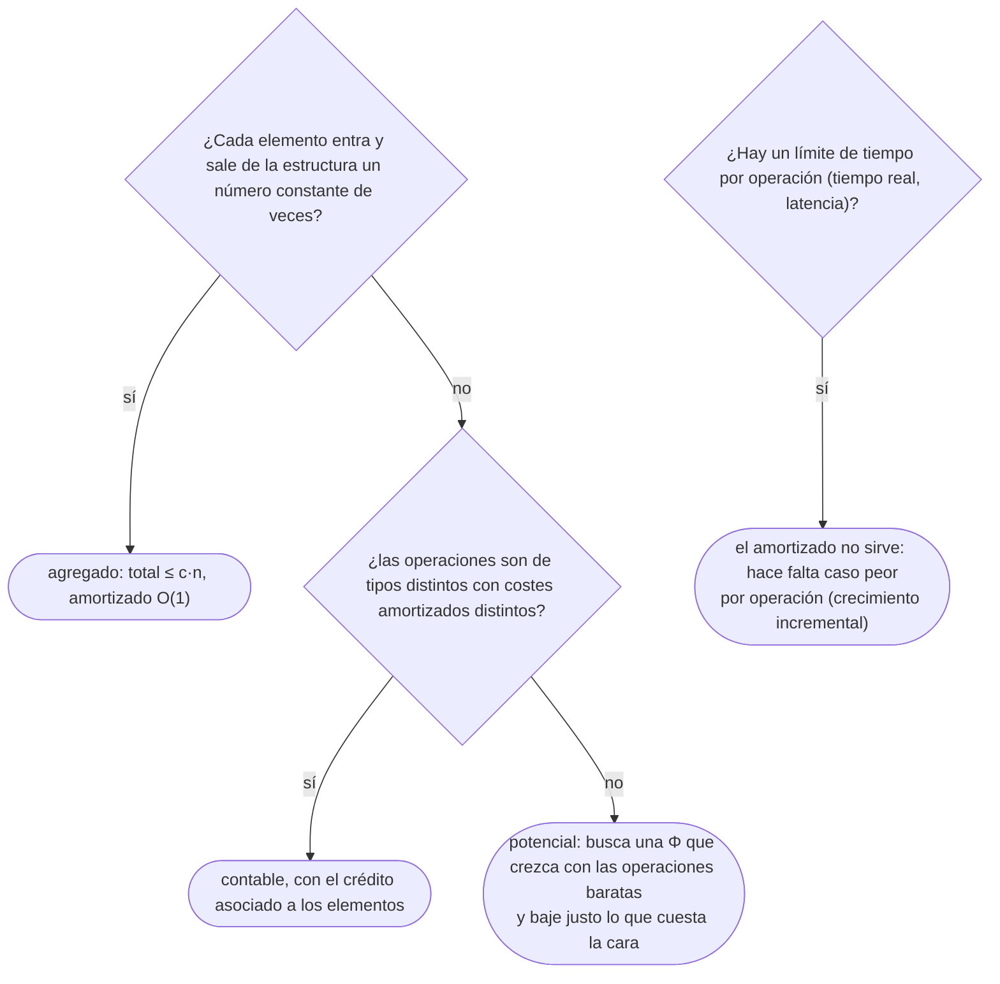

# 03 — Análisis amortizado

> Demostrar que una operación cara de vez en cuando cuesta poco en promedio sobre toda la secuencia:
> los métodos agregado, contable y del potencial, aplicados a los mismos tres ejemplos —el arreglo
> dinámico, la pila con vaciado múltiple y el contador binario—, y lo que hacen por dentro
> `std::vector`, `ArrayList` y `list`.
>
> **Niveles:** agregado [A] · contable [B] · potencial [B].
>
> **📚 Lectura troncal:** Cormen, Leiserson, Rivest y Stein, *Introduction to Algorithms*, 3.ª ed.
> (MIT Press, 2009), cap. 17; Brassard y Bratley, *Fundamentos de algoritmia* (Prentice Hall, 1997),
> cap. 4.
>
> **Asume leído:** [`02/01` — Notación asintótica y casos](01-notacion-asintotica.md).
>
> **Vigencia:** 2026-10-03.

**Salto rápido:** [1](#1--el-problema) · [2](#2--la-teoría) · [3](#3--el-método-agregado) · [4](#4--el-método-contable) · [5](#5--el-método-del-potencial) · [6](#6-️-la-tabla-de-costes) · [7](#7--cómo-se-elige) · [8](#8--señales-del-enunciado) · [🧠](#-preguntas) · [🧩](#-problemas-propios)

---

## 1. 🎯 El problema

`ArrayList.add` guarda el elemento en un arreglo interno. Cuando el arreglo está lleno, reserva uno
más grande y **copia todos los elementos**. Con un millón de elementos dentro, ese `add` concreto
copia un millón de cosas. Entonces, ¿`add` es `O(n)`?

Si lo fuera, un bucle que añade `n` elementos costaría `O(n²)`, y con `n = 10⁶` serían `10¹²` pasos.
Pero ese bucle tarda milisegundos. Lo que pasa es que la copia grande ocurre **muy pocas veces**: tras
copiar un millón, el siguiente medio millón de `add` no copian nada. El coste caro existe, pero se
**reparte** entre todas las operaciones baratas que lo hicieron posible.

El análisis amortizado es la herramienta que hace precisa esa intuición. No es un promedio sobre
entradas aleatorias ni una esperanza sobre el azar: es una **garantía de caso peor sobre toda una
secuencia** de operaciones. Y explica por qué la documentación de Java dice que `add` corre en
«tiempo constante amortizado», y no simplemente «constante».

---

## 2. 📐 La teoría

**El coste amortizado.** Sea una secuencia de `n` operaciones con costes reales `c₁, …, cₙ`. Unos
costes `ĉ₁, …, ĉₙ` son **amortizados** si para **toda** secuencia, y para todo prefijo de ella:

```text
Σ_{i=1}^{k} cᵢ  ≤  Σ_{i=1}^{k} ĉᵢ        para todo k
```

Es decir, la suma de los amortizados es una cota superior de la suma real. Si cada `ĉᵢ` es `O(1)`,
cualquier secuencia de `n` operaciones cuesta `O(n)` en total, aunque alguna operación suelta cueste
`O(n)`.

**No es un promedio.** No hay probabilidad en ningún sitio: la garantía vale para la peor secuencia
posible. «`O(1)` amortizado» es más fuerte que «`O(1)` en promedio»: el promedio puede fallar con una
entrada mala; el amortizado, no.

**Los tres métodos** demuestran lo mismo con contabilidades distintas:

- **Agregado.** Se acota el coste total `T(n)` de cualquier secuencia de `n` operaciones, y el
  amortizado es `T(n)/n`. Da el mismo coste a todas las operaciones.
- **Contable.** Se cobra a cada operación una tarifa fija; lo que sobra se guarda como **crédito** en
  partes de la estructura, y las operaciones caras lo gastan. Es correcto si **el crédito nunca es
  negativo**.
- **Del potencial.** Se define una función `Φ` del estado de la estructura, y el amortizado es
  `ĉᵢ = cᵢ + Φ(Dᵢ) − Φ(Dᵢ₋₁)`.

**Teorema (método del potencial).** Si `Φ(Dₖ) ≥ Φ(D₀)` para todo `k`, los `ĉᵢ` definidos así son costes
amortizados.

*Prueba.* Al sumar, la diferencia de potenciales es telescópica:

```text
Σ ĉᵢ = Σ (cᵢ + Φ(Dᵢ) − Φ(Dᵢ₋₁)) = Σ cᵢ + Φ(Dₖ) − Φ(D₀)  ≥  Σ cᵢ
```

porque `Φ(Dₖ) − Φ(D₀) ≥ 0`. Casi siempre se elige `Φ(D₀) = 0` y `Φ ≥ 0`. La prueba entera, con los
tres ejemplos, está en CLRS, 3.ª ed., cap. 17.

**Los tres ejemplos** que se usan con los tres métodos:

```text
Arreglo dinámico    push: si está lleno, duplica la capacidad copiando todo; luego escribe
Pila con multipop   push(x): apila · multipop(k): saca min(k, tamaño) elementos
Contador binario    increment: suma 1 a un número de k bits, cambiando los bits que haga falta
```

---

## 3. 🧱 El método agregado

**Qué es.** Acotar el coste total de **cualquier** secuencia de `n` operaciones y dividir por `n`.

**Por qué es correcto.** Por la definición: si toda secuencia de `n` operaciones cuesta como mucho
`T(n)`, asignar `T(n)/n` a cada una cumple la desigualdad para la secuencia completa. (Para los
prefijos, basta con que la cota valga para todo `n`, que es como se demuestra.)

**Cómo va**, con los tres ejemplos:

**El arreglo dinámico.** Con capacidad inicial 1 y duplicando, los `push` que copian son los que
llegan con el arreglo lleno, de capacidad `1, 2, 4, …`. Para `n` operaciones:

```text
coste total = n escrituras + (1 + 2 + 4 + ... + 2ᵏ) copias,   con 2ᵏ < n
            < n + 2n = 3n                                      → O(1) amortizado por push
```

La traza con nueve `push` sobre el arreglo de juguete extendido:

```text
push   tamaño antes   capacidad antes   copias   capacidad después
1      0              1                 0        1
2      1              1                 1        2
3      2              2                 2        4
4      3              4                 0        4
5      4              4                 4        8
6–8    5–7            8                 0        8
9      8              8                 8        16
total de copias: 1 + 2 + 4 + 8 = 15 < 2 · 9
```

**La pila con multipop.** Un `multipop(k)` puede costar `n`, así que acotar cada operación por su caso
peor da `O(n²)`. Pero **cada elemento se apila una vez y se desapila como mucho una vez**: en toda la
secuencia hay como mucho tantos desapilados como apilados, es decir, como mucho `n`. Total `≤ 2n`:
`O(1)` amortizado por operación.

**El contador binario.** Un `increment` puede cambiar `k` bits (de `0111…1` a `1000…0`). Pero el bit
`i` cambia una de cada `2ⁱ` veces: el bit 0 siempre, el 1 cada dos, el 2 cada cuatro. En `n`
incrementos desde cero, los cambios son `Σ ⌊n / 2ⁱ⌋ < 2n`: `O(1)` amortizado.

> ⏱️ **Coste.** Los tres tienen la misma forma: una operación **`O(1)` amortizada** que en el caso peor,
> suelta, cuesta `O(n)` (el arreglo y la pila) o `O(k)` (el contador). La cota amortizada no promete
> nada de una operación aislada, y si tienes un límite de tiempo por operación, manda el caso peor.

**Cuánto.** El arreglo dinámico gasta `Θ(n)` de memoria, con hasta el doble de la necesaria tras
crecer.

**La plantilla.** Un arreglo dinámico mínimo en Java, que es lo que fija la ficha del capítulo; en C++
y en Python es `std::vector` y `list`, que vienen hechos:

```java
// Arreglo dinámico de int: push O(1) amortizado, get O(1) en el caso peor.
final class IntArrayList {
    private int[] data = new int[1];
    private int size = 0;

    void push(int x) {
        if (size == data.length)
            data = java.util.Arrays.copyOf(data, 2 * data.length);   // duplica: copia size elementos
        data[size++] = x;
    }

    int get(int i) {
        if (i < 0 || i >= size) throw new IndexOutOfBoundsException(i);
        return data[i];
    }

    int size() { return size; }
}
```

- **`2 * data.length`**: el factor multiplicativo es lo que hace la serie de copias geométrica.
- **`int[]` y no `Integer[]`**: es el arreglo dinámico sin *boxing*, que `ArrayList<Integer>` no puede
  ser; [`02/05`](05-el-coste-real.md) explica por qué importa.
- **`get` comprueba el rango contra `size`, no contra `data.length`**: las posiciones entre `size` y la
  capacidad existen en memoria pero no son elementos.

### De la versión ingenua a la buena

**El problema.** Un arreglo que crece con `push`. Con los seis valores `[5, 2, 9, 1, 5, 6]`, la versión
ingenua copia `1 + 2 + 3 + 4 + 5 = 15` elementos; la que duplica, `1 + 2 + 4 = 7`.

**La versión ingenua:**

```java
// Crece de uno en uno: cada push con el arreglo lleno copia todo. Θ(n²) en total.
void push(int x) {
    if (size == data.length)
        data = java.util.Arrays.copyOf(data, data.length + 1);
    data[size++] = x;
}
```

> «Cada `push` copia todo lo que hay: `1 + 2 + … + (n−1)`, que es `Θ(n²)` en total. Si en vez de sumar
> uno multiplico la capacidad por dos, las copias forman una serie geométrica que suma menos de `2n`,
> y el `push` queda en `O(1)` amortizado.»

**El camino a la buena.** Es la plantilla de arriba: `2 * data.length` en vez de `data.length + 1`.

**Por qué multiplicar y no sumar una constante.** Si la capacidad crece de `c` en `c`, se copia cada
`c` operaciones, pero cada copia es del tamaño actual: `c + 2c + 3c + … ≈ n²/(2c)`. Sigue siendo
`Θ(n²)`, solo que dividido por `c`. Con un factor `r > 1` cualquiera, las copias suman unas
`n/r + n/r² + … = n/(r − 1)`: lineal en `n`, con una constante que crece cuando `r` se acerca a 1.

**Lo que hacen las librerías**, comprobado en su código fuente el 2026-10-03:

| Librería | Cómo crece | Factor |
|---|---|---|
| **C++** `std::vector` (libstdc++, de GCC) | `size + max(size, n)`: al menos el doble | 2 |
| **Java** `ArrayList` (OpenJDK 21) | `oldCapacity + (oldCapacity >> 1)`; capacidad 10 al primer `add` | 1,5 |
| **Python** `list` (CPython 3.12) | `newsize + (newsize >> 3) + 6`, redondeado a múltiplo de 4 | ~1,125 |

El estándar de C++ no fija el factor: solo exige que `push_back` sea `O(1)` amortizado. Otras
implementaciones usan 1,5. Python sobreasigna poco, a cambio de copiar más a menudo; su `append` sigue
siendo `O(1)` amortizado porque el factor es mayor que 1.

**Cuándo sí** se usa el agregado: cuando la cuenta total sale directa, como «cada elemento entra y
sale una vez». **Cuándo no** basta: cuando las operaciones tienen costes amortizados distintos entre
sí, o cuando la cuenta total no se ve sin una función que la guíe.

> **Veredicto:** el agregado es el primer método que se intenta, y el que se dice en una entrevista:
> «cada elemento se copia un número constante de veces en total, así que `push` es `O(1)`
> amortizado».

---

## 4. 🧱 El método contable

**Qué es.** Cobrar a cada operación una tarifa fija `ĉ`, mayor que su coste real cuando es barata, y
guardar la diferencia como crédito asociado a partes concretas de la estructura. Las operaciones caras
se pagan con ese crédito.

**Por qué es correcto** (el enunciado y una frase): si el crédito total nunca es negativo, lo cobrado
cubre siempre lo gastado, y la suma de tarifas es una cota de la suma real.

**Cómo va**, con el arreglo dinámico. Se cobran **3** por `push`:

```text
1 paga la escritura del propio elemento
1 se guarda en el elemento, para pagar su copia en la próxima duplicación
1 se guarda para pagar la copia de un elemento de la mitad vieja, que ya gastó su crédito
```

Justo después de duplicar a capacidad `2m`, hay `m` elementos sin crédito. Hasta la siguiente
duplicación entran `m` elementos nuevos, que aportan `2m` créditos: exactamente lo que cuesta copiar
los `2m` elementos. El crédito no baja de cero.

Con la pila: `push` cobra 2 (1 por apilar, 1 que queda en el elemento para pagar su salida); `pop` y
`multipop` cobran 0 y gastan el crédito de los elementos que sacan. Con el contador: poner un bit a 1
cobra 2 (1 por ponerlo, 1 que queda en el bit para cuando vuelva a 0).

**Cuánto.** Igual que el agregado; da tarifas distintas a operaciones distintas, que es su ventaja.

**La plantilla.** No hay: es un método de demostración.

**Cuándo sí**: cuando las operaciones son de tipos distintos y quieres un amortizado por tipo.
**Cuándo no**: cuando no es fácil decir dónde «vive» el crédito; ahí, el potencial.

> **Veredicto:** el contable es el agregado con el crédito a la vista. Su única regla es que el crédito
> nunca sea negativo.

---

## 5. 🧱 El método del potencial

**Qué es.** Definir `Φ`, una función del estado de la estructura que mide «el trabajo acumulado que
alguien tendrá que pagar», y tomar `ĉᵢ = cᵢ + ΔΦ`.

**Por qué es correcto** (el enunciado y una frase): es el teorema de §2; la suma de las diferencias de
potencial es telescópica y no negativa si `Φ` nunca baja de su valor inicial.

**Cómo va**, con los tres ejemplos:

| Estructura | Potencial `Φ` | Operación barata | Operación cara |
|---|---|---|---|
| Arreglo dinámico | `2 · tamaño − capacidad` (tras el primer crecimiento) | `push` sin copia: `1 + 2 = 3` | `push` con copia de `m`: `(m + 1) + (2 − m) = 3` |
| Pila con multipop | número de elementos | `push`: `1 + 1 = 2` | `multipop(k)` con `k'` sacados: `k' − k' = 0` |
| Contador binario | número de bits a 1 | — | `increment` que pone `t` bits a 0 y uno a 1: `(t + 1) + (1 − t) = 2` |

En el arreglo: la copia de `m` elementos cuesta `m + 1` reales, pero el potencial baja de `2m − m = m`
a `2(m + 1) − 2m = 2`, un cambio de `2 − m`, y el amortizado queda en 3. **El potencial alto antes de
la copia es lo que la paga.**

**Cuánto.** Igual que los otros dos. Es el más general: sirve para estructuras donde los otros dos se
complican, como el árbol *splay* ([`07/03`](../07-arboles/03-arboles-aleatorizados.md)) y Union-Find con compresión de caminos ([`08/04`](../08-heaps-y-union-find/04-union-find.md)), cuyo
amortizado de `O(α(n))` por operación se demuestra con un potencial.

**La plantilla.** No hay: es un método de demostración.

**Cuándo sí**: cuando la estructura tiene un estado que se «desordena» con las operaciones baratas y
se «ordena» con las caras. **Cuándo no**: cuando el agregado ya sale en una línea.

> **Veredicto:** el potencial es el método de las pruebas difíciles. Para el arreglo, la pila y el
> contador, el agregado basta; para *splay* y Union-Find, hace falta el potencial.

---

## 6. ⏱️ La tabla de costes

| Operación | Caso peor de una | Amortizado | Lo que la tabla no dice |
|---|---|---|---|
| `std::vector::push_back` | `O(n)` | `O(1)` | Tras crecer, invalida punteros e iteradores ([`03/01`](../03-biblioteca-estandar/01-cpp-contenedores.md)) |
| `ArrayList.add` | `O(n)` | `O(1)` | Con `Integer`, cada elemento es un objeto aparte |
| `list.append` de Python | `O(n)` | `O(1)` | Su sobreasignación es pequeña y copia más a menudo |
| `list.pop(0)` de Python | `O(n)` | `O(n)` | No es amortizable: mueve todo cada vez ([`03/04`](../03-biblioteca-estandar/04-python-para-competir.md)) |
| `multipop(k)` | `O(n)` | `O(1)` | Solo si cada elemento entra una vez |
| Incremento del contador | `O(k)` | `O(1)` | Si también se puede decrementar, el amortizado se rompe |
| Unión y búsqueda en Union-Find | `O(log n)` con unión por rango | `O(α(n))` | Con compresión de caminos; `α` es menor que 5 en la práctica |
| Operación en un árbol *splay* | `O(n)` | `O(log n)` | Sin garantía por operación; mala para tiempo real |

---

## 7. 🧭 Cómo se elige



> **Mejor:** «El `add` de `ArrayList` es `O(1)` amortizado, no `O(1)`: de vez en cuando copia todo, pero
> como la capacidad crece por un factor, cada elemento se copia un número constante de veces en
> total.»

---

## 8. 🔎 Señales del enunciado

| Señal | Técnica | Por qué |
|---|---|---|
| «`q` operaciones», algunas aparentemente caras («elimina todos los…») | Análisis amortizado agregado | Lo que importa es el total de la secuencia |
| Un bucle `while` dentro de un `for` que saca elementos de una pila o mueve un puntero | Cada elemento entra y sale una vez: `O(n)` total | Es el patrón de la pila monótona ([`06/01`](../06-lineales-y-hashing/01-pilas-colas-y-monotonas.md)) y de los dos punteros ([`04/02`](../04-secuencias/02-dos-punteros-y-ventana.md)) |
| Dos pilas que simulan una cola | Agregado: cada elemento pasa una vez de una pila a la otra | La transferencia cara se paga una vez por elemento |
| «Igualar todos los contadores al máximo» con muchas operaciones | Actualización perezosa con amortizado | Rehacer todo cada vez es `O(n)` por operación |

---

## 9. 🔭 Dónde aparece de verdad

- **El redimensionado incremental de las tablas *hash*.** Una tabla que duplica su tamaño copia todo de
  golpe, y esa copia es una pausa visible en un servidor con millones de claves. Redis, por ejemplo,
  redimensiona sus diccionarios **por pasos**, moviendo unas pocas cubetas en cada operación: convierte
  el amortizado en caso peor acotado por operación.
- **Los recolectores de basura.** Un recolector que se detiene a limpiar todo tiene un coste amortizado
  bajo y pausas largas; los recolectores incrementales y concurrentes reparten el trabajo para acotar
  la pausa, que es lo que pide una aplicación interactiva.
- **Los *buffers* de red y de archivos.** Crecen por factores y se reutilizan: es el arreglo dinámico de
  §3 en cada pila de red.

---

## ⚠️ Errores frecuentes

| Se dice | Lo preciso |
|---|---|
| «Amortizado es lo mismo que promedio» | El amortizado es una garantía de caso peor sobre la secuencia; el promedio depende de una distribución |
| «El `add` de `ArrayList` es `O(1)` siempre» | Es `O(1)` amortizado; un `add` suelto puede copiar todo, `O(n)` |
| «Para crecer basta con sumar un bloque grande» | Sumar una constante deja `Θ(n²)` total; hace falta multiplicar |
| «Si el amortizado es `O(1)`, ninguna operación tarda» | Una operación suelta puede tardar `O(n)`; en tiempo real eso importa |
| «Todas las colecciones dinámicas son amortizadas `O(1)`» | `list.pop(0)` de Python es `O(n)` en cada llamada; no hay nada que amortizar |
| «El método contable puede dejar crédito negativo un momento» | Nunca: la prueba depende de que no baje de cero en ningún prefijo |

---

## 📚 Para profundizar

- **Libro** — Cormen, Leiserson, Rivest y Stein, *Introduction to Algorithms*, 3.ª ed. (MIT Press,
  2009), cap. 17: los tres métodos sobre los mismos ejemplos, y las tablas dinámicas que crecen y
  encogen. En la 4.ª ed. (2022) es el cap. 16. *Lectura troncal.*
- **Libro** — Brassard y Bratley, *Fundamentos de algoritmia* (Prentice Hall, 1997), cap. 4: el análisis
  amortizado dentro del análisis de algoritmos. *Lectura troncal.*
- **Artículo** — Tarjan, «Amortized Computational Complexity», *SIAM Journal on Algebraic and Discrete
  Methods* 6(2), 1985: el artículo que formalizó el método del potencial.
- **Documentación** — Java 21, [`ArrayList`](https://docs.oracle.com/en/java/javase/21/docs/api/java.base/java/util/ArrayList.html):
  «*The add operation runs in amortized constant time*».
- **Documentación** — cppreference, [`std::vector::push_back`](https://en.cppreference.com/cpp/container/vector/push_back):
  complejidad constante amortizada e invalidación de iteradores.
- **Referencia** — Sedgewick y Wayne, [*Bags, Queues, and Stacks*](https://algs4.cs.princeton.edu/13stacks/):
  la pila sobre arreglo redimensionable, con el análisis.
- **Referencia** — el código fuente de CPython 3.12, [`listobject.c`](https://github.com/python/cpython/blob/3.12/Objects/listobject.c):
  la función `list_resize` y su patrón de crecimiento.

---

## 🧠 Preguntas

1. ¿Qué es un coste amortizado, y qué desigualdad tienen que cumplir los costes amortizados? 🟢
2. ¿Cuántas copias hace en total un arreglo dinámico que duplica, con `n` `push` desde capacidad 1? 🟢
3. ¿Qué factor de crecimiento usan `std::vector` en libstdc++, `ArrayList` y `list` de CPython? 🟢
4. ¿Qué diferencia hay entre coste amortizado y coste promedio? 🟡
5. ¿Qué diferencia hay entre los métodos agregado, contable y del potencial, en qué contabilizan? 🟡
6. ¿Qué diferencia hay entre el caso peor de un `push` y su coste amortizado, y cuándo importa el primero? 🟡
7. ¿Por qué crecer sumando una constante deja el total en `Θ(n²)`, aunque la constante sea un millón? 🟠
8. Compara `ArrayList<Integer>.add` en Java, `push_back` en C++ y `append` en Python: ¿son los tres `O(1)` amortizados, y qué los distingue? 🟠
9. Si el arreglo dinámico además encoge a la mitad cuando queda medio vacío, ¿qué secuencia rompe el amortizado, y cómo se arregla? 🟠
10. Demuestra con el método del potencial que el `increment` del contador binario es `O(1)` amortizado. 🔴
11. Demuestra con el método agregado que una cola hecha con dos pilas tiene `O(1)` amortizado por operación. 🔴
12. Un servicio con un `HashMap` enorme tiene picos de latencia cada cierto tiempo, aunque la media sea buena. Explica la causa con el vocabulario del capítulo y propón un diseño que acote el caso peor. 🔴

---

## 🧩 Problemas propios

### Copias del arreglo dinámico

**Nivel:** 🟢 · **Formato:** programa completo.

Un arreglo dinámico empieza con capacidad 1 y, cuando un `push` lo encuentra lleno, duplica su
capacidad copiando todos sus elementos. Para cada `n`, imprime el número total de copias de elementos
tras `n` operaciones `push` (la escritura del elemento nuevo no cuenta como copia).

- **Entrada.** Una línea con `q`. Después, `q` líneas con un entero `n`.
- **Salida.** `q` enteros.
- **Restricciones.** `1 ≤ q ≤ 10⁵`; `1 ≤ n ≤ 10¹⁸`.

```text
Entrada            Salida
4                  0
1                  1
2                  3
4                  15
9

Entrada            Salida
2                  3
3                  1152921504606846975
1000000000000000000
```

**Pista 1:** ¿en qué `push` concretos se copia, y cuántos elementos se copian en cada uno?

### El contador binario

**Nivel:** 🟡 · **Formato:** programa completo.

Un contador empieza en 0 y se incrementa `n` veces. Imprime el número total de bits que cambian a lo
largo de los `n` incrementos.

- **Entrada.** Un entero `n`.
- **Salida.** Un entero.
- **Restricciones.** `1 ≤ n ≤ 10¹⁸`.

```text
Entrada            Salida
1                  1

Entrada            Salida
4                  7
```

**Pista 1:** ¿cada cuántos incrementos cambia el bit `i`?

🔥 **Para el geek — en JavaScript:** `n` hasta `10¹⁸` no cabe exacto en un `Number`, y los
operadores de bits de JavaScript trabajan con 32 bits: el conteo de bits a 1 hay que hacerlo con
`BigInt` y sus propios desplazamientos.

### Pila con vaciado

**Nivel:** 🟠 · **Formato:** programa completo.

Una pila recibe `q` operaciones: `P x` apila `x`; `M k` saca los `k` elementos de arriba (o todos, si
hay menos) e imprime su suma (0 si la pila estaba vacía).

- **Entrada.** Una línea con `q`. Después, `q` líneas con una operación.
- **Salida.** Una línea por cada operación `M`, con la suma.
- **Restricciones.** `1 ≤ q ≤ 2·10⁵`; `1 ≤ k ≤ 2·10⁵`; `0 ≤ x ≤ 10⁹`. Límite: 1 segundo.

```text
Entrada            Salida
6                  11
P 5                5
P 2                0
P 9
M 2
M 5
M 1

Entrada            Salida
3                  0
M 1                1000000000
P 1000000000
M 200000
```

**Pista 1:** ¿cuántas veces, como mucho, puede salir de la pila un mismo elemento a lo largo de todas
las operaciones?

---

## 🧩 Práctica externa

En cada uno, **justifica el coste total** de tu solución con uno de los tres métodos: casi todos tienen
un bucle interno que parece cuadrático y no lo es.

### Núcleo

| ✔ | Problema | Plataforma | Nivel | Patrón | Pista 1 |
|---|---|---|---|---|---|
| [ ] | [Implement Queue using Stacks](https://leetcode.com/problems/implement-queue-using-stacks/) | LeetCode | 🟢 | Dos pilas | ¿Cuántas veces, en total, pasa un elemento de una pila a la otra? |
| [ ] | [Maximum Element](https://www.hackerrank.com/challenges/maximum-element/problem) | HackerRank | 🟢 | Pila con máximo | ¿Qué necesitas guardar junto a cada elemento para saber el máximo al desapilarlo? |
| [ ] | [Fish](https://app.codility.com/programmers/lessons/7-stacks_and_queues/fish/) | Codility | 🟢 | Cada elemento sale una vez | ¿Cuántas veces puede ser comido un mismo pez? |
| [ ] | [Min Stack](https://leetcode.com/problems/min-stack/) | LeetCode | 🟡 | Pila con mínimo | ¿Qué cambia en el mínimo cuando sacas el elemento de arriba? |
| [ ] | [Queue using Two Stacks](https://www.hackerrank.com/challenges/queue-using-two-stacks/problem) | HackerRank | 🟡 | Dos pilas | ¿Cuándo hace falta mover elementos de una pila a la otra, y cuándo no? |
| [ ] | [Online Stock Span](https://leetcode.com/problems/online-stock-span/) | LeetCode | 🟡 | Pila monótona | Si un precio ya quedó tapado por uno mayor, ¿volverá a importar? |
| [ ] | [Daily Temperatures](https://leetcode.com/problems/daily-temperatures/) | LeetCode | 🟡 | Pila monótona | ¿Qué días siguen esperando un día más cálido? |
| [ ] | [StoneWall](https://app.codility.com/programmers/lessons/7-stacks_and_queues/stone_wall/) | Codility | 🟡 | Pila monótona | ¿Qué bloques siguen «abiertos» cuando la altura baja? |

### Ampliación

| ✔ | Problema | Plataforma | Nivel | Patrón | Pista 1 |
|---|---|---|---|---|---|
| [ ] | [Nearest Smaller Values](https://cses.fi/problemset/task/1645) | CSES | 🟡 | Pila monótona | Si un valor tiene a su derecha uno menor, ¿puede ser la respuesta de alguien más a la derecha? |
| [ ] | [Sum of Subarray Minimums](https://leetcode.com/problems/sum-of-subarray-minimums/) | LeetCode | 🟡 | Contribución con pila | ¿En cuántos subarreglos es cada elemento el mínimo? |
| [ ] | [Largest Rectangle in Histogram](https://leetcode.com/problems/largest-rectangle-in-histogram/) | LeetCode | 🟠 | Pila monótona | Para cada barra, ¿hasta dónde puede extenderse un rectángulo de su altura? |

---

## ✅ Criterio de dominio

- Demostrar con el método agregado que el `push` del arreglo dinámico, el `multipop` y el `increment`
  son `O(1)` amortizados.
- Escribir el potencial de cada uno de los tres ejemplos y calcular el amortizado de la operación cara.
- Escribir el arreglo dinámico de §3 sin mirar y explicar por qué multiplica y no suma.
- Resolver dos problemas del núcleo y justificar su coste total con el agregado.

---

**Anterior:** [`02/02` — Recurrencias y teorema maestro](02-recurrencias-y-teorema-maestro.md) ·
**Siguiente:** [`02/04` — Corrección: invariantes, inducción e intercambio](04-correccion-invariantes-induccion-intercambio.md) ·
**Relacionado:** [`08/04` — Union-Find](../08-heaps-y-union-find/04-union-find.md); [`07/03` — Árboles aleatorizados y autoajustables](../07-arboles/03-arboles-aleatorizados.md).
