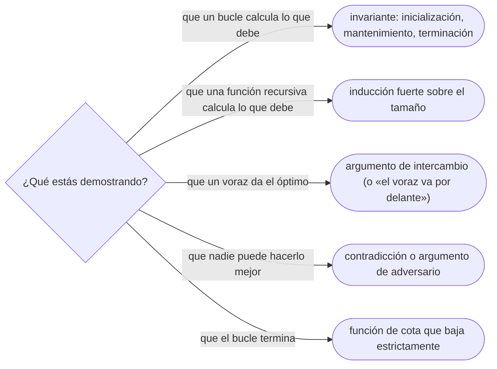

# 04 — Corrección: invariante de bucle, inducción y argumento de intercambio

> Argumentar por qué un algoritmo es correcto con la herramienta que le toca: el invariante de bucle
> para lo iterativo, la inducción para lo recursivo, el argumento de intercambio para los voraces y la
> contradicción para las cotas. Es el dueño de esas tres herramientas en todo el corpus.
>
> **Niveles:** invariante de bucle [A] · inducción [A] · argumento de intercambio [A] · contradicción
> [B].
>
> **📚 Lectura troncal:** Cormen, Leiserson, Rivest y Stein, *Introduction to Algorithms*, 3.ª ed.
> (MIT Press, 2009), cap. 2 (invariantes); Kleinberg y Tardos, *Algorithm Design* (Addison-Wesley,
> 2005), cap. 4 (intercambio).
>
> **Ruta corta:** sí.
>
> **Vigencia:** 2026-10-03.

**Salto rápido:** [1](#1--el-problema) · [2](#2--la-teoría) · [3](#3--invariante-de-bucle) · [4](#4--inducción) · [5](#5--argumento-de-intercambio) · [6](#6--contradicción) · [7](#7--cómo-se-elige) · [8](#8--señales-del-enunciado) · [🧠](#-preguntas) · [🧩](#-problemas-propios)

---

## 1. 🎯 El problema

Tres programas que pasan los ejemplos y están mal:

```text
1. Una búsqueda binaria con hi = n − 1 que nunca devuelve n cuando el valor es mayor que todos.
2. Un voraz que elige siempre la reunión más corta, y con [0,5) [4,6) [5,10) se queda con una
   cuando cabían dos.
3. Una partición en el sitio que intercambia un elemento de más y pierde un valor.
```

Los tres tienen algo en común: **su autor estaba seguro de que eran correctos**, porque «se ve que
funciona». Y en los tres el error habría aparecido al intentar escribir **por qué** funcionan. La
búsqueda binaria no tiene un invariante que incluya el `n`; el voraz no tiene un argumento de
intercambio que lo sostenga; la partición rompe su invariante en un paso.

Probar con ejemplos encuentra errores; **argumentar la corrección los previene**, y además es lo que
se pide en una entrevista cuando preguntan «¿por qué funciona?». Este capítulo da las cuatro
herramientas que se usan en todo el corpus, cada una con su forma fija, para que esa pregunta tenga
una respuesta de tres frases y no un «porque sí».

> 🧠 **Modelo mental.** Recordatorio, si llegas directo aquí: un algoritmo es **correcto** si para
> toda entrada válida termina y devuelve lo que pide su especificación. «Funciona con los ejemplos» es
> una prueba sobre unas pocas entradas; la corrección habla de todas.

---

## 2. 📐 La teoría

**La especificación.** Antes de demostrar nada hay que decir qué se demuestra: la **precondición**
(qué cumple la entrada) y la **postcondición** (qué cumple la salida). Para la búsqueda del primer
índice con `a[i] ≥ x`: *pre:* `a` está ordenado de forma no decreciente; *post:* se devuelve el menor
`i` en `[0, n]` tal que todo índice `< i` tiene valor `< x` y todo índice `≥ i` tiene valor `≥ x`.

**Las cuatro herramientas**, y qué demuestra cada una:

| Herramienta | Para qué | Su forma fija |
|---|---|---|
| **Invariante de bucle** | Algoritmos iterativos | Inicialización, mantenimiento, terminación |
| **Inducción** | Algoritmos recursivos y definiciones recursivas | Caso base y paso inductivo (fuerte, sobre el tamaño) |
| **Argumento de intercambio** | Algoritmos voraces | Una solución óptima que difiere de la voraz se transforma, sin empeorar, en una que se parece más |
| **Contradicción** | Cotas inferiores y unicidad | Suponer lo contrario y llegar a un absurdo |

**La terminación** es aparte de la corrección parcial: un bucle que mantiene su invariante y nunca
termina no devuelve nada. Se demuestra con una **función de cota**: una cantidad entera, no negativa,
que **disminuye estrictamente** en cada vuelta. En la búsqueda binaria es `hi − lo`.

**Teorema (invariante de bucle).** Sea `I` una propiedad tal que (1) es cierta antes de la primera
vuelta, (2) si es cierta antes de una vuelta y la condición del bucle se cumple, sigue siendo cierta
después de ella, y (3) el bucle termina. Entonces `I` es cierta al salir, junto con la negación de la
condición del bucle.

La prueba es una inducción sobre el número de vueltas: el punto (1) es el caso base y el (2) el paso.
Por eso el invariante es «la inducción de los bucles», y la forma de las tres partes viene de ahí. La
exposición completa está en CLRS, 3.ª ed., §2.1.

---

## 3. 🧱 Invariante de bucle

**Qué es.** Una propiedad sobre las variables del bucle que se cumple al principio de cada vuelta, y
que al salir del bucle, junto con la condición de salida, implica la postcondición.

**Por qué es correcto.** Por el teorema de §2: las tres partes son una inducción sobre las vueltas.

**Cómo va**, con la búsqueda del primer índice con valor `≥ x`:

```text
Invariante:  todo índice < lo tiene valor < x,   y   todo índice ≥ hi tiene valor ≥ x.

Inicialización   lo = 0, hi = n: no hay índices < 0 ni ≥ n; el invariante es cierto por vacío.
Mantenimiento    si a[mid] < x, todo índice ≤ mid tiene valor < x (por el orden): lo = mid + 1 lo mantiene.
                 si a[mid] ≥ x, todo índice ≥ mid tiene valor ≥ x: hi = mid lo mantiene.
Terminación      la función de cota hi − lo baja en cada vuelta (mid está en [lo, hi)).
                 Al salir, lo = hi, y el invariante dice que lo es la respuesta.
```

La traza con `[1, 2, 5, 5, 6, 9]` y `x = 5`:

```text
lo  hi  mid  a[mid]  decisión
0   6   3    5       a[3] ≥ 5  → hi = 3
0   3   1    2       a[1] < 5  → lo = 2
2   3   2    5       a[2] ≥ 5  → hi = 2
2   2   —    —       sale: respuesta 2 (el primer 5)
```

**Cuánto.** No cuesta nada en tiempo de ejecución: es un argumento. Comprobarlo con aserciones mientras
se depura cuesta lo que la comprobación, y se quita al enviar.

**La plantilla.** La búsqueda binaria anotada con su invariante, en Java como fija la ficha del
capítulo. La plantilla en los tres lenguajes, con sus variantes, es la de [`05/04`](../05-orden-y-busqueda/04-busqueda-binaria.md).

```java
// Primer índice i en [0, n] con a[i] >= x (lower bound). Pre: a ordenado de forma no decreciente.
static int lowerBound(int[] a, int x) {
    int lo = 0, hi = a.length;
    // Invariante: a[0..lo) < x  y  a[hi..n) >= x.  Cota: hi - lo, que baja en cada vuelta.
    while (lo < hi) {
        int mid = lo + (hi - lo) / 2;     // lo <= mid < hi
        if (a[mid] < x) lo = mid + 1;     // a[0..mid] < x: el invariante se mantiene
        else hi = mid;                    // a[mid..n) >= x: el invariante se mantiene
    }
    return lo;                            // lo == hi: la frontera exacta
}
```

- **`hi = a.length`, exclusivo**: es lo que permite devolver `n` cuando todos son menores. Con
  `hi = n − 1` el invariante no puede expresar «ningún índice cumple», que es el error del ejemplo 1
  de §1.
- **`mid` en `[lo, hi)`**: garantiza que las dos ramas reducen `hi − lo`, que es la terminación.
- **El comentario del invariante es parte de la plantilla**: escribirlo antes del bucle es lo que hace
  que el bucle salga bien a la primera.

### De la versión ingenua a la buena

**El problema.** Reordenar el arreglo para que todos los valores menores que `p` queden antes que los
demás, en cualquier orden dentro de cada grupo. Con `[5, 2, 9, 1, 5, 6]` y `p = 5`, una salida válida
es `[2, 1, 5, 9, 5, 6]`.

**La versión ingenua:**

```java
// Dos pasadas a un arreglo auxiliar: correcta, O(n) tiempo y O(n) memoria extra.
static void partitionBelow(int[] a, int p) {
    int[] out = new int[a.length];
    int k = 0;
    for (int x : a) if (x < p) out[k++] = x;
    for (int x : a) if (x >= p) out[k++] = x;
    System.arraycopy(out, 0, a, 0, a.length);
}
```

> «Es lineal pero usa un arreglo entero de más. Puedo hacerlo en el sitio con un índice que marque
> dónde termina la zona de menores, si mantengo un invariante: lo que está antes de ese índice es
> menor que `p`, y lo que está entre ese índice y el recorrido, mayor o igual.»

**El camino a la buena.** Un índice `i` para la frontera y otro `j` que recorre; cuando `a[j] < p`, se
intercambia con `a[i]` y la frontera avanza.

```java
// Partición en el sitio. O(n) tiempo, O(1) memoria extra.
static void partitionBelow(int[] a, int p) {
    int i = 0;
    // Invariante: a[0..i) < p  y  a[i..j) >= p.
    for (int j = 0; j < a.length; j++) {
        if (a[j] < p) {
            int t = a[i]; a[i] = a[j]; a[j] = t;     // a[j] entra en la zona de menores
            i++;
        }
    }
}
```

- **El invariante se mantiene** en las dos ramas: si `a[j] ≥ p`, la zona `[i, j+1)` sigue siendo de
  mayores o iguales; si `a[j] < p`, el intercambio lleva un menor a la posición `i` y un mayor o igual
  a la `j`, y las dos zonas crecen en uno.
- **Al terminar**, `j = n` y el invariante dice que `a[0..i)` son los menores y `a[i..n)` el resto: la
  postcondición. Es la partición de Lomuto que usa *quicksort* ([`05/01`](../05-orden-y-busqueda/01-ordenacion-por-comparacion.md)).

**Cuándo sí**: en todo bucle con estado no trivial, y siempre en una búsqueda binaria. **Cuándo no**
hace falta escribirlo: en un recorrido que solo acumula una suma, donde el invariante es obvio.

> **Veredicto:** escribe el invariante **antes** del bucle. Si no sabes escribirlo, no sabes todavía
> qué hace el bucle, y el *off-by-one* está esperando.

---

## 4. 🧱 Inducción

**Qué es.** Demostrar una propiedad `P(n)` para todo `n` probando un caso base y que `P` para los
tamaños menores implica `P(n)`. La **inducción fuerte** —suponer `P(k)` para **todos** los `k < n`, no
solo para `n − 1`— es la que corresponde a los algoritmos recursivos, que se llaman con tamaños
arbitrarios más pequeños.

**Por qué es correcto.** Es el principio de inducción de los naturales: si fallara para algún `n`,
habría un `n` mínimo donde falla, y el paso inductivo aplicado a ese `n` daría una contradicción.

**Cómo va.** Para un algoritmo recursivo, la prueba tiene siempre la misma forma:

```text
Caso base      el algoritmo devuelve lo correcto para los tamaños donde no se llama a sí mismo.
Paso           suponiendo que las llamadas recursivas (de tamaño menor) devuelven lo correcto,
               la combinación que hace el algoritmo devuelve lo correcto para n.
Terminación    cada llamada recursiva tiene tamaño estrictamente menor, y el tamaño no baja de cero.
```

Con la exponenciación rápida de [`02/02`](02-recurrencias-y-teorema-maestro.md), `power(x, n)`: el caso base `n = 0` devuelve `1 = x⁰`. Paso:
si `power(x, ⌊n/2⌋)` devuelve `x^{⌊n/2⌋}`, entonces para `n` par devuelve `(x^{n/2})² = xⁿ`, y para `n`
impar `(x^{(n−1)/2})² · x = xⁿ`. Terminación: `⌊n/2⌋ < n` para `n ≥ 1`.

**Cuánto.** Es un argumento, como el invariante. **La plantilla:** no hay código propio; la inducción
se aplica sobre la plantilla de cada capítulo recursivo ([`10/01`](../10-busqueda-completa-y-divide-y-venceras/01-recursion.md), [`10/05`](../10-busqueda-completa-y-divide-y-venceras/05-divide-y-venceras.md)).

### De la versión ingenua a la buena

**El problema.** ¿Es una cadena un palíndromo? `"abracadabra"` no lo es; `"abba"`, sí.

**La versión ingenua**, recursiva y correcta:

```java
// Correcta por inducción sobre la longitud, pero cada substring copia: O(n²) tiempo y memoria.
static boolean isPalindrome(String s) {
    if (s.length() <= 1) return true;
    return s.charAt(0) == s.charAt(s.length() - 1)
        && isPalindrome(s.substring(1, s.length() - 1));
}
```

> «Es correcta: la cadena vacía o de una letra es palíndromo, y una más larga lo es si sus extremos
> coinciden y el centro lo es, que es la hipótesis inductiva. Pero `substring` copia el centro en cada
> llamada, y las copias suman `n + (n−2) + …`, cuadrático. Si paso índices en vez de cadenas, la misma
> prueba vale y el coste baja a `O(n)`.»

**El camino a la buena.** Los mismos casos y la misma combinación, sobre un intervalo `[lo, hi]` de la
cadena original:

```java
// La misma inducción, sobre la longitud hi − lo + 1. O(n) tiempo, O(n) de pila.
static boolean isPalindrome(String s, int lo, int hi) {
    if (lo >= hi) return true;                      // caso base: longitud 0 o 1
    return s.charAt(lo) == s.charAt(hi) && isPalindrome(s, lo + 1, hi - 1);
}
```

- **La prueba no cambió**: caso base para longitud `≤ 1`, paso «extremos iguales y centro palíndromo»,
  y la longitud baja en dos en cada llamada. Cambiar la representación no obliga a rehacer la
  corrección si la estructura recursiva es la misma.
- **La pila**: son `n/2` llamadas; con `n = 10⁶` revienta en Java y en Python. La versión iterativa con
  dos índices tiene el invariante «`s[0..lo)` es el reverso de `s(hi..n−1]`» y no usa pila.

**Cuándo sí**: en todo algoritmo recursivo, y en las DP, donde la corrección de la recurrencia es una
inducción ([`12/01`](../12-dp-clasica/01-de-la-recursion-a-la-tabla.md)). **Cuándo no** basta la inducción débil: cuando la recursión salta a tamaños
arbitrarios, como `n/2`; ahí hace falta la fuerte.

> **Veredicto:** la prueba de un algoritmo recursivo es su propio código leído en voz alta: caso base,
> «si las llamadas aciertan, la combinación acierta», y el tamaño que baja.

---

## 5. 🧱 Argumento de intercambio

**Qué es.** La forma estándar de demostrar que un algoritmo voraz es óptimo. Se toma una solución
óptima cualquiera y se muestra que se puede transformar, paso a paso y **sin empeorarla**, en la que
construye el voraz.

**Por qué es correcto.** El esquema, en palabras:

```text
1. Sea O una solución óptima, y G la del voraz. Si O = G, terminado.
2. Si no, mira la primera decisión en que O y G difieren.
3. Cambia en O esa decisión por la del voraz (el intercambio), y demuestra que
   el resultado O' sigue siendo válido y no es peor que O.
4. O' coincide con G en una decisión más. Repitiendo, O se convierte en G sin empeorar:
   G es tan buena como una óptima, luego es óptima.
```

**Teorema (selección de actividades).** Dado un conjunto de intervalos semiabiertos `[s, f)`, elegir
repetidamente el intervalo **que termina antes** entre los compatibles con los ya elegidos produce un
conjunto de intervalos disjuntos de tamaño máximo.

*Esbozo.* Sea `g₁` el que termina antes de todos, y `O` una solución óptima cuyo primer intervalo
(por final) es `o₁`. Como `g₁` termina antes o a la vez que `o₁`, cambiar `o₁` por `g₁` en `O` no crea
solapamientos con los demás intervalos de `O`, que empiezan después de que `o₁` termina. El resultado
es válido y tiene el mismo tamaño. Repitiendo sobre los intervalos que empiezan después de `g₁`, se
llega a la solución voraz. La prueba entera, y la variante «el voraz va por delante», están en
Kleinberg y Tardos, §4.1.

**Cómo va**, con los datos de este bloque, once reuniones `[s, f)` ordenadas por final:

```text
[1,4) [3,5) [0,6) [5,7) [3,9) [5,9) [6,10) [8,11) [8,12) [2,14) [12,16)

elige [1,4)           termina en 4
descarta [3,5) [0,6)  empiezan antes de 4
elige [5,7)           termina en 7
descarta [3,9) [5,9) [6,10)
elige [8,11)          termina en 11
descarta [8,12) [2,14)
elige [12,16)
resultado: 4 reuniones
```

**Cuánto.** Ordenar por final, `Θ(n log n)`, y un recorrido lineal.

**La plantilla.** La selección de actividades, en Java:

```java
// Máximo número de intervalos [s, f) disjuntos. Θ(n log n) por la ordenación.
static int maxDisjoint(int[][] intervals) {
    int[][] byEnd = intervals.clone();
    java.util.Arrays.sort(byEnd, (p, q) -> Integer.compare(p[1], q[1]));
    int count = 0;
    long lastEnd = Long.MIN_VALUE;                 // final del último elegido
    for (int[] iv : byEnd) {
        if (iv[0] >= lastEnd) {                    // semiabierto: empezar justo al terminar vale
            count++;
            lastEnd = iv[1];
        }
    }
    return count;
}
```

- **`Integer.compare`** y no `p[1] - q[1]`: la resta desborda con valores grandes y de signo opuesto,
  y un comparador que desborda no es un orden.
- **`iv[0] >= lastEnd`**: con intervalos cerrados `[s, f]` sería `>`; la frontera la decide el
  enunciado.

### De la versión ingenua a la buena

**El problema.** El máximo número de reuniones disjuntas de las once de arriba: 4.

**La versión ingenua**: probar todos los subconjuntos, comprobar cuáles son disjuntos y quedarse con el
mayor. Con `n ≤ 20` es `2ⁿ · n`, unos `2·10⁷`.

> «Probar los `2ⁿ` subconjuntos es correcto pero exponencial. Hay una elección voraz que se puede
> demostrar: quedarse siempre con la reunión que termina antes, porque deja la mayor cantidad de tiempo
> libre para las siguientes; por intercambio, cualquier óptima se puede convertir en esa sin perder
> ninguna reunión. Ordenando por final, `O(n log n)`.»

**El camino a la buena** es la plantilla de arriba. Y la parte que más se pregunta en una entrevista es
**por qué no las otras elecciones voraces**:

| Voraz | Contraejemplo mínimo | Elige | Óptimo |
|---|---|---|---|
| El que **empieza** antes | `[0,10) [1,2) [3,4)` | `[0,10)`: 1 | `[1,2) [3,4)`: 2 |
| El más **corto** | `[0,5) [4,6) [5,10)` | `[4,6)`: 1 | `[0,5) [5,10)`: 2 |
| El que **termina** antes | — | Óptimo, por el argumento de intercambio | — |

**Cuándo sí**: en todo voraz, antes de escribirlo; si el intercambio no sale, probablemente el voraz es
incorrecto. **Cuándo no**: cuando el problema no tiene la estructura de «elección local que se puede
cambiar sin empeorar»; ahí la herramienta es la programación dinámica (bloque `12`).

> **Veredicto:** un voraz es correcto porque tiene un argumento de intercambio, no porque parezca
> obvio. Busca primero el contraejemplo pequeño; si no aparece, escribe el intercambio.

---

## 6. 🧱 Contradicción

**Qué es.** Suponer que la afirmación es falsa y deducir algo imposible. Es la herramienta de las
**cotas inferiores**: demostrar que ningún algoritmo puede hacerlo mejor.

**Por qué es correcto** (el enunciado y una frase): si de la negación de `P` se deduce una
contradicción, `P` es cierta.

**Cómo va**, con la cota más simple: **encontrar el mínimo de `n` elementos por comparaciones exige
`n − 1` comparaciones en el caso peor**. Supón que un algoritmo lo hace con menos. Cada comparación
declara «perdedor» como mucho a un elemento (el mayor de los dos). Con menos de `n − 1` comparaciones,
al menos dos elementos nunca perdieron. El algoritmo devuelve uno de ellos como mínimo; pero el otro
podría ser menor sin cambiar ningún resultado de las comparaciones hechas, y la respuesta sería
incorrecta. Contradicción.

**Cuánto.** No es un algoritmo, es un límite para todos; no hay plantilla.

**Cuándo sí**: para cotas inferiores (la de `Ω(n log n)` para ordenar por comparación, en `05/01`) y
para probar que algo es único. **Cuándo no**: cuando una prueba directa es igual de corta; la
contradicción tiende a esconder el porqué.

> **Veredicto:** la contradicción demuestra que algo no se puede mejorar. Es la respuesta a «¿se puede
> hacer en menos?»: no, y aquí está por qué.

---

## 7. 🧭 Cómo se elige



> **Mejor:** «Funciona porque mantiene este invariante: todo lo que está antes de `lo` es menor que `x`
> y todo lo que está desde `hi` es mayor o igual. Al salir, `lo` y `hi` coinciden en la frontera.»

---

## 8. 🔎 Señales del enunciado

| Señal | Técnica | Por qué |
|---|---|---|
| «Elige siempre el…», «en cada paso, el mejor» | Argumento de intercambio, o contraejemplo | Un voraz sin prueba es una apuesta |
| Un bucle con dos índices que se mueven («la frontera», «la zona de…») | Invariante sobre las zonas | Es lo que fija qué se intercambia y cuándo avanza cada índice |
| Búsqueda binaria con «el primero que…», «el último que…» | Invariante con intervalo semiabierto | Decide la condición, los extremos y el valor devuelto |
| Una función recursiva sobre «el resto» o «la mitad» | Inducción fuerte | El tamaño baja y la combinación se demuestra con la hipótesis |
| «¿Se puede hacer con menos comparaciones?» | Contradicción, adversario | Es una cota inferior |

---

## 9. 🔭 Dónde aparece de verdad

- **El fallo de TimSort (2015).** Al intentar verificar formalmente la ordenación de Java, unos
  investigadores vieron que TimSort no mantenía el invariante de su diseño sobre las longitudes de los
  tramos: una entrada construida a propósito la hacía fallar. Lo encontró el invariante, no las pruebas.
- **Las aserciones en producción.** Comprobar invariantes internos («el saldo nunca es negativo»)
  detecta la corrupción donde ocurre, y no cientos de operaciones después.
- **La verificación formal.** Lenguajes como Dafny exigen invariantes y pre y postcondiciones, y un
  demostrador las comprueba: es este capítulo con un juez que revisa las pruebas.

---

## ⚠️ Errores frecuentes

| Se dice | Lo preciso |
|---|---|
| «Si funciona en los ejemplos, es correcto» | Es correcto en esos ejemplos; la corrección es una afirmación sobre todas las entradas |
| «El voraz es obvio» | Es correcto si tiene argumento de intercambio; «el más corto primero» parece obvio y falla con tres intervalos |
| «El invariante es lo que hace el bucle» | Es lo que **no cambia** entre vueltas y, al salir, implica el resultado |
| «Con el invariante ya está demostrado» | Falta la terminación: una función de cota que baje en cada vuelta |
| «Inducción sobre `n − 1` vale para cualquier recursión» | Si la recursión salta a `n/2`, hace falta inducción fuerte |
| «Una prueba por contradicción vale siempre más» | Vale lo mismo; si hay una directa igual de corta, se entiende mejor |
| «El comparador `a - b` es un atajo inocente» | Desborda con valores grandes y deja de ser un orden: la ordenación puede fallar |

---

## 📚 Para profundizar

- **Libro** — Cormen, Leiserson, Rivest y Stein, *Introduction to Algorithms*, 3.ª ed. (MIT Press,
  2009), cap. 2: el invariante de bucle con la ordenación por inserción y la mezcla. *Lectura troncal.*
- **Libro** — Kleinberg y Tardos, *Algorithm Design* (Addison-Wesley, 2005), cap. 4: el argumento de
  intercambio y «el voraz va por delante», con la selección de intervalos. *Lectura troncal.*
- **Libro** — Bentley, *Programming Pearls*, 2.ª ed. (Addison-Wesley, 2000), columna 4: escribir la
  búsqueda binaria correcta razonando sobre su invariante.
- **Libro** — Erickson, *Algorithms* (2019), cap. 1: pensar la recursión como una inducción, confiando
  en las llamadas sin seguirlas.
- **Documentación** — cppreference, [`std::lower_bound`](https://en.cppreference.com/cpp/algorithm/lower_bound),
  Java 21, [`Arrays.binarySearch`](https://docs.oracle.com/en/java/javase/21/docs/api/java.base/java/util/Arrays.html),
  y Python, [`bisect`](https://docs.python.org/3/library/bisect.html): las tres búsquedas binarias de
  la librería, con contratos distintos.
- **Artículo** — Bloch, [«Extra, Extra — Read All About It: Nearly All Binary Searches and Mergesorts
  are Broken»](https://research.google/blog/extra-extra-read-all-about-it-nearly-all-binary-searches-and-mergesorts-are-broken/)
  (2006): el desbordamiento del punto medio que sobrevivió años a las pruebas.

---

## 🧠 Preguntas

1. ¿Cuáles son las tres partes de un invariante de bucle? 🟢
2. ¿Qué es una función de cota y para qué sirve? 🟢
3. Enuncia el esquema del argumento de intercambio en cuatro pasos. 🟢
4. ¿Qué diferencia hay entre corrección parcial y corrección total? 🟡
5. ¿Qué diferencia hay entre inducción débil y fuerte, y cuál pide un algoritmo que se llama con `n/2`? 🟡
6. Compara lo que devuelven `std::lower_bound`, `Arrays.binarySearch` y `bisect_left` cuando el valor no está. ¿Qué contrato cumple cada una? 🟡
7. ¿Por qué el voraz «la reunión más corta primero» no es correcto? Da el contraejemplo mínimo. 🟠
8. En la partición de §3, ¿por qué el invariante sigue siendo cierto cuando `i = j` y se intercambia un elemento consigo mismo? 🟠
9. ¿Por qué `hi = n − 1` con condición `lo < hi` no puede devolver `n`, y qué parte del invariante falla? 🟠
10. ¿Por qué un comparador escrito como `(p, q) -> p[1] - q[1]` puede romper una ordenación, y qué propiedad de un orden viola? 🟠
11. Escribe el invariante de la ordenación por inserción y demuestra que se mantiene en cada vuelta del bucle exterior. 🔴
12. Demuestra por inducción que la exponenciación rápida devuelve `xⁿ` y que termina. 🔴
13. Demuestra por contradicción que encontrar el mínimo de `n` elementos por comparaciones exige `n − 1` comparaciones en el caso peor. 🔴

---

## 🧩 Problemas propios

### Último índice no mayor

**Nivel:** 🟢 · **Formato:** programa completo.

Dado un arreglo ordenado de forma no decreciente, para cada consulta `x` imprime el **último** índice
`i` (desde 0) con `a[i] ≤ x`, o `−1` si no existe. Escribe primero el invariante.

- **Entrada.** Una línea con `n` y `q`. Una línea con los `n` valores. Una línea con las `q` consultas.
- **Salida.** `q` enteros separados por espacios.
- **Restricciones.** `1 ≤ n, q ≤ 2·10⁵`; `|a[i]|, |x| ≤ 10⁹`.

```text
Entrada            Salida
6 4                3 -1 5 1
1 2 5 5 6 9
5 0 9 3

Entrada            Salida
1 2                -1 0
5
4 5
```

**Pista 1:** ¿qué relación hay entre «el último `≤ x`» y «el primero `> x`»?

### Pinchar todas las reuniones

**Nivel:** 🟡 · **Formato:** programa completo.

Cada reunión es un intervalo cerrado `[s, f]` de minutos. Un *aviso* lanzado en el minuto `t` llega a
todas las reuniones con `s ≤ t ≤ f`. Imprime el menor número de avisos que llegan a todas las
reuniones.

- **Entrada.** Una línea con `n`. Después, `n` líneas con `s f`.
- **Salida.** Un entero.
- **Restricciones.** `1 ≤ n ≤ 2·10⁵`; `0 ≤ s ≤ f ≤ 10⁹`.

```text
Entrada            Salida
4                  2
1 4
3 5
6 9
8 10

Entrada            Salida
3                  1
1 5
2 5
5 7
```

**Pista 1:** la reunión que termina antes necesita un aviso en algún momento de su intervalo: ¿cuál de
esos momentos es el más útil para las demás?

### Contraejemplo de monedas

**Nivel:** 🟠 · **Formato:** programa completo.

Un sistema de monedas incluye la de valor 1. El voraz paga una cantidad usando siempre la moneda más
grande que no se pasa. Imprime la **menor** cantidad para la que el voraz usa más monedas que el
mínimo posible, o `0` si no existe ninguna.

- **Entrada.** Una línea con `k`. Una línea con los `k` valores, distintos y crecientes, el primero 1.
- **Salida.** Un entero.
- **Restricciones.** `1 ≤ k ≤ 100`; los valores no pasan de 1000. Se sabe que, si existe un
  contraejemplo, el menor es menor que la suma de las dos monedas más grandes.

```text
Entrada            Salida
3                  6
1 3 4

Entrada            Salida
4                  0
1 5 10 25
```

**Pista 1:** ¿hasta qué cantidad tienes que comprobar, y cómo sabrías el mínimo de monedas para cada
cantidad pequeña?

---

## 🧩 Práctica externa

En cada uno, **escribe la prueba** antes de enviar: el invariante del bucle, la inducción de la
recursión o el intercambio del voraz.

### Núcleo

| ✔ | Problema | Plataforma | Nivel | Patrón | Pista 1 |
|---|---|---|---|---|---|
| [ ] | [Binary Search](https://leetcode.com/problems/binary-search/) | LeetCode | 🟢 | Invariante | ¿Qué sabes de los índices a la izquierda de `lo` en cada vuelta? |
| [ ] | [First Bad Version](https://leetcode.com/problems/first-bad-version/) | LeetCode | 🟢 | Invariante de frontera | ¿Qué es cierto de todas las versiones antes de `lo` y desde `hi`? |
| [ ] | [Remove Element](https://leetcode.com/problems/remove-element/) | LeetCode | 🟢 | Invariante de zonas | ¿Qué zona del arreglo ya está terminada en cada momento? |
| [ ] | [Assign Cookies](https://leetcode.com/problems/assign-cookies/) | LeetCode | 🟢 | Intercambio | ¿A qué niño conviene darle la galleta más pequeña que le sirve? |
| [ ] | [Sort Colors](https://leetcode.com/problems/sort-colors/) | LeetCode | 🟡 | Invariante de tres zonas | ¿Cuántas fronteras necesitas para tres valores? |
| [ ] | [Correctness and the Loop Invariant](https://www.hackerrank.com/challenges/correctness-invariant/problem) | HackerRank | 🟢 | Invariante | ¿Qué parte del arreglo está ordenada al empezar cada vuelta? |
| [ ] | [Insertion Sort - Part 2](https://www.hackerrank.com/challenges/insertionsort2/problem) | HackerRank | 🟢 | Invariante | ¿Qué cumple el prefijo después de insertar cada elemento? |
| [ ] | [Dominator](https://app.codility.com/programmers/lessons/8-leader/dominator/) | Codility | 🟢 | Invariante de votación | ¿Qué pasa con el valor dominante si descartas dos elementos distintos? |

### Ampliación

| ✔ | Problema | Plataforma | Nivel | Patrón | Pista 1 |
|---|---|---|---|---|---|
| [ ] | [TieRopes](https://app.codility.com/programmers/lessons/16-greedy_algorithms/tie_ropes/) | Codility | 🟢 | Voraz con intercambio | ¿Cuándo conviene cerrar el grupo actual? |
| [ ] | [EquiLeader](https://app.codility.com/programmers/lessons/8-leader/equi_leader/) | Codility | 🟡 | Invariante y prefijos | ¿Puede el líder de una parte ser distinto del líder del total? |
| [ ] | [Lemonade Change](https://leetcode.com/problems/lemonade-change/) | LeetCode | 🟢 | Voraz con argumento | Para dar 15 de cambio, ¿qué combinación de billetes te conviene gastar? |
| [ ] | [Tasks and Deadlines](https://cses.fi/problemset/task/1630) | CSES | 🟡 | Intercambio | Si dos tareas consecutivas están en el orden «malo», ¿qué pasa al cambiarlas? |

---

## ✅ Criterio de dominio

- Escribir la búsqueda binaria de §3 con su invariante sin mirar, y defender cada línea con él.
- Dar el esquema del argumento de intercambio y aplicarlo a la selección de actividades.
- Dar en menos de un minuto el contraejemplo de los voraces «empieza antes» y «más corto».
- Demostrar por inducción la corrección de una función recursiva del corpus, con su terminación.

---

**Anterior:** [`02/03` — Análisis amortizado](03-analisis-amortizado.md) ·
**Siguiente:** [`02/05` — El coste real](05-el-coste-real.md) ·
**Relacionado:** [`05/04` — Búsqueda binaria](../05-orden-y-busqueda/04-busqueda-binaria.md); [`11/01` — Cuándo funciona un voraz](../11-voraces/01-cuando-funciona-un-voraz.md);
[`12/01` — De la recursión a la tabla](../12-dp-clasica/01-de-la-recursion-a-la-tabla.md).
