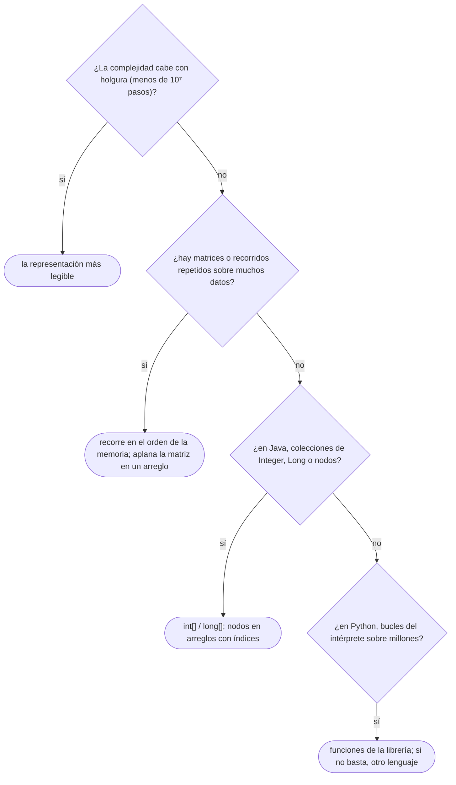

# 05 — El coste real

> Por qué dos algoritmos con la misma cota tardan distinto: la jerarquía de memoria y la localidad,
> las constantes y el *boxing*, y qué hay debajo de una asignación de memoria, con el *buddy system*
> como ficha. Es lo que la notación asintótica descarta a propósito.
>
> **Niveles:** caché y localidad [B] · constantes y *boxing* [B] · el asignador y el *buddy system*
> [C].
>
> **📚 Lectura troncal:** Bryant y O'Hallaron, *Computer Systems: A Programmer's Perspective*, 3.ª ed.
> (Pearson, 2016), cap. 6; Knuth, *The Art of Computer Programming*, Vol. 1 (Addison-Wesley), §2.5.
>
> **Asume leído:** [`02/01` — Notación asintótica y casos](01-notacion-asintotica.md).
>
> **Vigencia:** 2026-10-03.

**Salto rápido:** [1](#1--el-problema) · [2](#2--la-teoría) · [3](#3--caché-y-localidad) · [4](#4--constantes-y-boxing) · [5](#5--el-asignador-y-el-buddy-system) · [6](#6-️-la-tabla-de-costes) · [7](#7--cómo-se-elige) · [8](#8--señales-del-enunciado) · [🧠](#-preguntas) · [🧩](#-problemas-propios)

---

## 1. 🎯 El problema

Dos funciones suman una matriz de `5000 × 5000` enteros. Las dos tienen dos bucles anidados, las dos
hacen `2,5·10⁷` sumas, las dos son `Θ(n²)`. Una recorre por filas y la otra por columnas. En la mayoría
de las máquinas, **la segunda es varias veces más lenta**.

Otra: dos programas Java ordenan `10⁶` enteros. Uno usa `int[]` y `Arrays.sort`; el otro,
`ArrayList<Integer>` y `Collections.sort`. Los dos son `Θ(n log n)`. El segundo tarda bastante más y
usa varias veces más memoria.

La notación asintótica (`02/01`) descarta la constante **a propósito**: es lo que le permite comparar
algoritmos sin máquina. Pero el juez corre en una máquina, y cuando la complejidad cabe justo, **la
constante decide el veredicto**. Este capítulo explica de dónde sale esa constante: de cómo se mueven
los datos entre la memoria y el procesador, de cuántos objetos crea tu lenguaje para representar un
número, y de qué cuesta pedir memoria.

---

## 2. 📐 La teoría

**La jerarquía de memoria.** El procesador no lee la RAM directamente en cada acceso: hay varios
niveles de caché entre los dos, cada uno más pequeño y más rápido que el siguiente. Los números son
**órdenes de magnitud orientativos**, que cambian con cada procesador:

```text
nivel          tamaño típico           latencia orientativa
registros      decenas de valores      < 1 ns
caché L1       ~32–64 KB por núcleo    ~1 ns
caché L2       ~1 MB por núcleo        ~4 ns
caché L3       decenas de MB           ~10–40 ns
RAM            gigabytes               ~100 ns
SSD            terabytes               ~100 µs
```

**La línea de caché.** La memoria se mueve en bloques de tamaño fijo, las **líneas**: 64 bytes en la
mayoría de los procesadores x86 y 128 en los Apple M. Leer un `int` trae a la caché los 15 vecinos que
comparten su línea. Si los siguientes accesos son a esos vecinos, son casi gratis.

**La localidad** es la propiedad que la caché aprovecha:

- **Espacial**: si accedes a una dirección, pronto accederás a las cercanas. Recorrer un arreglo de
  izquierda a derecha la tiene; saltar por punteros, no.
- **Temporal**: si accedes a un dato, pronto volverás a él. Un bucle interno pequeño la tiene.

Además, el procesador **precarga** líneas cuando detecta un patrón de acceso regular: un recorrido
secuencial casi nunca espera a la RAM.

**El modelo de memoria externa.** La forma teórica de contar esto: la memoria rápida tiene tamaño `M`,
se transfiere en bloques de `B` elementos, y el coste es **el número de transferencias**, no el de
operaciones.

**Teorema (recorrido en el modelo de memoria externa).** Recorrer `N` elementos contiguos cuesta
`Θ(N/B)` transferencias; recorrerlos con un salto de `B` o más elementos entre accesos consecutivos
cuesta `Θ(N)`.

*Esbozo.* En el recorrido contiguo, cada bloque transferido sirve a `B` accesos seguidos. Con un salto
de `B` o más, cada acceso cae en un bloque distinto del anterior y, si `N` es mucho mayor que `M`, el
bloque ya fue desalojado cuando se vuelve a él. La diferencia entre las dos es un factor `B`, que con
líneas de 64 bytes y `int` de 4 bytes es 16. El modelo es de Aggarwal y Vitter (1988).

---

## 3. 🧱 Caché y localidad

**Qué es.** Elegir el orden de recorrido y la representación de los datos para que los accesos
consecutivos caigan en la misma línea de caché.

**Por qué es correcto** (el enunciado y una frase): por el teorema de §2, el recorrido contiguo hace
`B` veces menos transferencias que el recorrido con saltos grandes, y la transferencia es lo caro.

**Cómo va.** Una matriz guardada **por filas**, como un arreglo contiguo de C++ con índice `i·n + j`,
tiene contiguos los elementos de una misma fila. Recorrerla por filas
lee cada línea una vez; por columnas, salta `n` elementos en cada acceso:

```text
memoria (n = 4):   [a00 a01 a02 a03 | a10 a11 a12 a13 | a20 a21 a22 a23 | a30 a31 a32 a33]

por filas:         a00 → a01 → a02 → a03 → a10 → ...      cada línea se usa entera
por columnas:      a00 → a10 → a20 → a30 → a01 → ...      cada acceso, una línea distinta
```

**Cuánto.** Con `n` grande, la matriz no cabe en la caché y el recorrido por columnas paga una línea
por acceso: varias veces más lento que por filas, con la misma complejidad. En la pasada de verificación
del corpus, con la plantilla de abajo y `n = 4096` en un Mac con Apple Silicon, la mediana de cinco
corridas fue de 6,4 ms frente a 16,7 ms (unas 2,6 veces); la proporción cambia con la máquina.

**La plantilla.** El mismo cálculo en los dos órdenes, en C++, sobre una matriz guardada por filas en
un `std::vector` contiguo:

```cpp
#include <cstddef>
#include <vector>

// Suma por filas: accesos contiguos, cada línea de caché se aprovecha entera.
long long sumByRows(const std::vector<int>& m, int n) {
    long long s = 0;
    for (int i = 0; i < n; i++)
        for (int j = 0; j < n; j++) s += m[static_cast<std::size_t>(i) * n + j];
    return s;
}

// Suma por columnas: cada acceso salta n enteros; con n grande, una línea por acceso.
long long sumByColumns(const std::vector<int>& m, int n) {
    long long s = 0;
    for (int j = 0; j < n; j++)
        for (int i = 0; i < n; i++) s += m[static_cast<std::size_t>(i) * n + j];
    return s;
}
```

```java
// En Java, int[][] es un arreglo de filas: cada fila es contigua, las filas no lo son entre sí.
static long sumByRows(int[][] m) {
    long s = 0;
    for (int[] row : m)
        for (int x : row) s += x;          // contiguo dentro de cada fila
    return s;
}
```

- **C++**: un solo `std::vector` de `n²` elementos con índice `i * n + j` es la representación más
  amigable con la caché; `static_cast<std::size_t>` evita que `i * n` desborde `int` con `n` grande.
- **Java**: `int[][]` son `n` arreglos independientes; recorrer por columnas salta además de fila en
  fila por punteros, y es aún peor que en C++. Recorrer por filas con `for (int[] row : m)` es lo
  natural.
- **Lo que no cambia**: los dos órdenes hacen exactamente las mismas sumas; solo cambia cuántas líneas
  se traen de memoria.

**El arreglo frente a la lista enlazada.** Una lista enlazada guarda cada nodo donde el asignador lo
puso, así que recorrerla es seguir punteros a direcciones dispersas: un posible fallo de caché por
nodo, sin precarga. Por eso **insertar en mitad de un arreglo** —que desplaza memoria contigua con
una copia rápida— suele ganar a **buscar la posición en una lista enlazada y enlazar ahí**, aunque la
lista «inserte en `O(1)`». Ese `O(1)` supone que ya tienes el nodo; encontrarlo es `O(n)` de accesos
dispersos. Stroustrup lo mostró con `std::vector` y `std::list` en una charla de 2012.

**Cuándo sí** se piensa en la localidad: con matrices grandes, con recorridos repetidos y cuando la
complejidad cabe justo. **Cuándo no**: con datos que caben en L1 o L2, donde todo es rápido.

> **Veredicto:** recorre la memoria en el orden en que está guardada. A igual complejidad, el
> recorrido contiguo es el rápido, y la lista enlazada casi nunca lo es.

---

## 4. 🧱 Constantes y *boxing*

**Qué es.** El *boxing* (empaquetado) es representar un valor primitivo como un objeto en el *heap*:
en Java, un `int` dentro de una colección es un `Integer`; en Python, **todo** entero es un objeto. El
coste no cambia la complejidad, pero multiplica la constante en tiempo y en memoria.

**Por qué es correcto** (el enunciado y una frase): un arreglo de objetos es un arreglo de punteros,
y cada acceso a un valor es un acceso más a una dirección que puede no estar en caché.

**Cómo va**, con la misma suma en las dos representaciones de Java:

```java
// int[]: los valores contiguos en memoria. 4 bytes por elemento.
static long sumPrimitive(int[] a) {
    long s = 0;
    for (int x : a) s += x;
    return s;
}

// List<Integer>: un arreglo de referencias a objetos Integer dispersos. Cada x se desempaqueta.
static long sumBoxed(java.util.List<Integer> a) {
    long s = 0;
    for (int x : a) s += x;
    return s;
}
```

- **Memoria**: un `Integer` ocupa unos 16 bytes (cabecera más valor) y la lista guarda además una
  referencia de 4 u 8 bytes. Son unos 20 bytes por elemento frente a 4: cinco veces más, y cinco veces
  menos elementos por línea de caché.
- **La caché de `Integer`**: `Integer.valueOf` reutiliza los objetos de −128 a 127; fuera de ese rango
  cada valor empaquetado puede ser un objeto nuevo. Por eso `==` entre dos `Integer` funciona con
  valores pequeños y falla con grandes ([`03/03`](../03-biblioteca-estandar/03-java-colecciones.md)).
- **Ordenar**: `Arrays.sort(int[])` es un *quicksort* de doble pivote sobre primitivos (con respaldo de
  *heapsort* desde Java 14); sobre objetos,
  `Collections.sort` es TimSort, que compara llamando a `compareTo`. Los dos son `n log n`, con
  constantes muy distintas.

**En C++ no hay *boxing***: `std::vector<int>` guarda los valores directamente, y las plantillas generan
código específico para cada tipo. **En Python**, cada entero es un objeto de unos 28 bytes y una lista
es un arreglo de punteros a ellos; de ahí, junto con el intérprete, sale el factor de 30–50 frente a C++
en bucles ([`01/02`](../01-oficio-del-competidor/02-leer-las-restricciones.md)). Las funciones de la librería escritas en C (`sum`, `sorted`) evitan parte del
coste porque no ejecutan un bucle del intérprete.

**Cuánto.** En Java, una colección de objetos puede usar cinco veces la memoria y tardar varias veces
más que el arreglo primitivo equivalente. **Cuándo sí** se evita el *boxing*: con más de `10⁵`–`10⁶`
elementos y la complejidad justa. **Cuándo no** importa: con colecciones pequeñas o cuando la
legibilidad gana (un `Map<String, List<Integer>>` de pocos elementos).

> **Veredicto:** en Java, `int[]` para los datos grandes y colecciones de objetos para lo que no cabe
> en un arreglo. En Python, empuja el trabajo a la librería.

---

## 5. 🧱 El asignador y el *buddy system*

### El asignador de memoria

- **Qué resuelve.** Pedir y devolver bloques de memoria de tamaños variables (`new`, `malloc`) sobre
  un espacio que se fragmenta con el uso.
- **Qué garantiza.** Ninguna complejidad fija: depende del asignador. Los de propósito general
  mantienen listas de bloques libres por tamaño y suelen responder en tiempo casi constante, con picos
  cuando piden memoria al sistema operativo.
- **Cuánto.** Una asignación pequeña cuesta del orden de decenas de nanosegundos, mucho más que una
  suma; en Java, el *heap* con recolector hace la asignación casi gratis y paga después en la
  recolección.
- **Cómo reconocerlo.** Un programa que crea millones de objetos pequeños (nodos, `Integer`, cadenas)
  pasa buena parte de su tiempo en el asignador.
- **Si no te la sabes.** Reserva de golpe: un arreglo de nodos con índices en vez de punteros
  ([`06/02`](../06-lineales-y-hashing/02-listas-enlazadas.md)), o reutiliza los objetos.
- **Dónde está entera.** Bryant y O'Hallaron, 3.ª ed., §9.9; Knuth, Vol. 1, §2.5.

### El *buddy system*

- **Qué resuelve.** Asignar bloques cuyo tamaño es una **potencia de dos** dentro de una región de
  `2ᴷ` unidades, con fusión rápida de bloques libres.
- **Qué garantiza.** Cada petición se redondea a la potencia de dos siguiente; un bloque de tamaño `2ᵏ`
  en la dirección `a` tiene como **compañero** (*buddy*) el de dirección `a XOR 2ᵏ`, y al liberar se
  fusiona con él si está libre, recursivamente. Asignar y liberar cuestan `O(K)` partir o fusionar.
- **Cuánto.** `O(log` del tamaño de la región`)` por operación; desperdicia hasta casi la mitad de un
  bloque por el redondeo (fragmentación interna).
- **Cómo reconocerlo.** Asignadores de páginas de un sistema operativo, de memoria de dispositivos, y
  enunciados que hablan de «partir en mitades» y «fusionar con el vecino».
- **Si no te la sabes.** Una lista de bloques libres con primer ajuste resuelve una versión sin las
  garantías de fusión.
- **Dónde está entera.** Knuth, Vol. 1, §2.5, que lo presenta con su análisis. Es el problema propio
  «Asignador por compañeros» de este capítulo.

---

## 6. ⏱️ La tabla de costes

| Operación | Coste orientativo | Lo que la tabla no dice |
|---|---|---|
| Suma de dos enteros en registros | < 1 ns | Es la «operación simple» de la regla de `10⁸` por segundo |
| Acceso a memoria que está en L1 | ~1 ns | Un recorrido secuencial casi siempre está aquí, por la precarga |
| Acceso a memoria que falla hasta la RAM | ~100 ns | Lo que cuesta cada nodo de una lista enlazada grande |
| Desempaquetar un `Integer` de una colección | un acceso extra a otra dirección | Lo que separa `List<Integer>` de `int[]` |
| Una asignación pequeña (`new`, `malloc`) | decenas de ns | En Java, barata al asignar y cara al recolectar |
| Una iteración de un bucle en Python | decenas de ns | El factor 30–50 frente a C++ |

Todas las cifras son órdenes de magnitud: dependen del procesador, del compilador y de la versión del
lenguaje, y lo que se lleva a una entrevista es el orden, no el número.

---

## 7. 🧭 Cómo se elige



> **Mejor:** «Las dos son `O(n²)`, pero esta recorre la matriz por filas, que es como está en memoria;
> la otra salta una fila en cada acceso y desperdicia cada línea de caché.»

---

## 8. 🔎 Señales del enunciado

| Señal | Técnica | Por qué |
|---|---|---|
| Matrices de `n, m` hasta `5000` con varios recorridos | Recorrido por filas, matriz aplanada | `2,5·10⁷` accesos: la localidad decide |
| Solución `n log n` correcta en Java que da TLE con colecciones | `int[]`, `long[]` y ordenar primitivos | El *boxing* multiplica la constante |
| «Lista enlazada» en el enunciado, con muchas búsquedas | Arreglo, o nodos en un arreglo con índices | La lista paga un fallo de caché por nodo |
| Millones de objetos pequeños creados y descartados | Reservar de golpe y reutilizar | El asignador y el recolector dominan |
| «Bloques de tamaño potencia de dos», «partir en mitades y fusionar» | *Buddy system* | Es su forma exacta |

---

## 9. 🔭 Dónde aparece de verdad

- **Las bases de datos columnares.** Una consulta analítica que suma una columna de mil millones de
  filas va mucho más rápido si la columna está contigua en disco y en memoria: es el recorrido por
  columnas de §3, pero guardando los datos por columnas para que sea contiguo.
- **Los árboles B.** Un índice de base de datos no es un árbol binario: cada nodo ocupa una página de
  disco y tiene cientos de hijos, para que cada transferencia de bloque descarte la mayor parte del
  árbol. Es el modelo de memoria externa aplicado ([`07/02`](../07-arboles/02-bst-y-balanceados.md)).
- **Los motores de videojuegos.** Guardan las propiedades de miles de entidades en arreglos separados
  por campo (*structure of arrays*) en vez de en objetos, para que el bucle que mueve todas las
  posiciones recorra memoria contigua.

---

## ⚠️ Errores frecuentes

| Se dice | Lo preciso |
|---|---|
| «La lista enlazada es más rápida para insertar» | Inserta en `O(1)` si ya tienes el nodo; encontrarlo es `O(n)` de accesos dispersos, y un arreglo suele ganar |
| «`O(1)` es `O(1)`» | Un acceso en L1 y uno que falla hasta la RAM son los dos `O(1)`, con un factor 100 entre ellos |
| «Recorrer una matriz por filas o por columnas da igual» | Misma complejidad; la constante cambia varias veces por la caché |
| «`ArrayList<Integer>` y `int[]` son lo mismo con otra sintaxis» | Uno guarda referencias a objetos dispersos y otro los valores contiguos: memoria y tiempo muy distintos |
| «Python es lento por ser interpretado, y ya» | También porque cada entero es un objeto; la librería en C evita parte del coste |
| «Pedir memoria es gratis» | Una asignación cuesta decenas de nanosegundos, y millones de ellas se notan |

---

## 📚 Para profundizar

- **Libro** — Bryant y O'Hallaron, *Computer Systems: A Programmer's Perspective*, 3.ª ed. (Pearson,
  2016), cap. 6: la jerarquía de memoria, la localidad y cómo escribir código amigable con la caché.
  *Lectura troncal.*
- **Libro** — Knuth, *The Art of Computer Programming*, Vol. 1 (Addison-Wesley), §2.5: la asignación
  dinámica de memoria y el *buddy system*. *Lectura troncal.*
- **Artículo** — Drepper, «What Every Programmer Should Know About Memory» (2007): la jerarquía de
  memoria contada para programadores, con mediciones.
- **Artículo** — Aggarwal y Vitter, «The Input/Output Complexity of Sorting and Related Problems»,
  *Communications of the ACM* 31(9), 1988: el modelo de memoria externa.
- **Documentación** — Java 21, [`Integer`](https://docs.oracle.com/en/java/javase/21/docs/api/java.base/java/lang/Integer.html):
  `valueOf` y la caché de valores pequeños.
- **Documentación** — Python, [`array`](https://docs.python.org/3/library/array.html): arreglos
  compactos de valores numéricos.

---

## 🧠 Preguntas

1. ¿Qué es una línea de caché y cuánto mide en la mayoría de los procesadores x86? 🟢
2. ¿Qué diferencia hay entre localidad espacial y temporal? 🟢
3. ¿Cuántos bytes ocupa aproximadamente un `int` en un `int[]` y en una `ArrayList<Integer>` de Java? 🟢
4. ¿Qué diferencia hay entre el modelo de la regla de `10⁸` operaciones y el modelo de memoria externa, en qué cuentan? 🟡
5. ¿Por qué `int[][]` en Java recorrido por columnas es aún peor que una matriz contigua de C++ recorrida por columnas? 🟡
6. ¿Por qué `==` entre dos `Integer` funciona con 100 y falla con 1000? 🟡
7. Compara cómo representan una lista de un millón de enteros C++, Java y Python, y qué cuesta recorrerla en cada uno. 🟡
8. «La lista enlazada inserta en `O(1)`». ¿Cuándo es cierto, y por qué en la práctica un arreglo suele ganar al insertar en el medio? 🟠
9. Tu solución Java `Θ(n log n)` con `n = 10⁶` da TLE usando `ArrayList<Integer>` y `Collections.sort`. ¿Qué cambias primero, y por qué no la complejidad? 🟠
10. ¿Por qué el recorrido contiguo de `N` elementos cuesta `Θ(N/B)` transferencias en el modelo de memoria externa y el recorrido con salto grande cuesta `Θ(N)`? 🟠
11. En el *buddy system*, ¿por qué el compañero de un bloque de tamaño `2ᵏ` en la dirección `a` está en `a XOR 2ᵏ`? 🔴
12. Tienes que calcular el máximo de cada columna de una matriz enorme que se genera fila a fila. Diseña el recorrido para que sea amigable con la caché y di cuánta memoria usa. 🔴

---

## 🧩 Problemas propios

### Líneas de caché tocadas

**Nivel:** 🟢 · **Formato:** programa completo.

Un arreglo de `n` elementos de `e` bytes empieza en la dirección 0. Se accede a los índices
`0, k, 2k, …` menores que `n`. Con líneas de `L` bytes, imprime cuántas líneas distintas se tocan.

- **Entrada.** Una línea con `q`. Después, `q` líneas con `n e k L`.
- **Salida.** `q` enteros.
- **Restricciones.** `1 ≤ q ≤ 10⁵`; `1 ≤ n, k ≤ 10¹²`; `e ∈ {1, 2, 4, 8}`; `L ∈ {32, 64, 128}`.

```text
Entrada                            Salida
3                                  1
16 4 1 64                          4
64 4 1 64                          4
64 4 16 64

Entrada                            Salida
2                                  1
1000000000000 8 1000000000000 128  1
1 1 1 32
```

**Pista 1:** si el salto en bytes entre dos accesos es menor que una línea, ¿puede quedar alguna línea
sin tocar entre el primer acceso y el último?

### Máximos por columna

**Nivel:** 🟡 · **Formato:** programa completo.

Una matriz de `n` filas y `m` columnas tiene `a[i][j] = (i·A + j·B + C) mod P`, con filas y columnas
numeradas desde 0. Imprime la suma de los máximos de cada columna.

- **Entrada.** Una línea con `n m A B C P`.
- **Salida.** Un entero.
- **Restricciones.** `1 ≤ n, m ≤ 5000`; `0 ≤ A, B, C < P ≤ 10⁹`. Límite: 1 segundo, 64 MB.

```text
Entrada            Salida
2 3 1 2 0 5        8

Entrada            Salida
1 1 0 0 0 1        0
```

**Pista 1:** ¿cabe la matriz entera en 64 MB, y en qué orden te conviene generar los valores?

🔥 **Para el geek — en JavaScript:** `i·A` llega a `5·10¹²`, que todavía es exacto en un `Number`, pero
la suma de los máximos con `m` grande sí conviene vigilarla; y una matriz de `Array` de `Array` no es
contigua como un `Int32Array` aplanado, que cambia el coste del recorrido.

### Asignador por compañeros

**Nivel:** 🟠 · **Formato:** programa completo.

Una memoria tiene `2ᴷ` unidades, al principio un solo bloque libre. Las operaciones son:

- `A s`: pide un bloque de tamaño `t`, la menor potencia de dos `≥ s`. Entre los bloques libres de
  menor tamaño `≥ t`, se toma el de menor dirección; si es mayor que `t`, se parte en dos mitades y se
  sigue con la de menor dirección, hasta tener tamaño `t`. Imprime la dirección del bloque, o `-1` si no
  hay ninguno libre suficiente (y la operación no asigna nada).
- `F id`: libera el bloque asignado por la `id`-ésima operación `A` (contando desde 1 todas las `A`,
  también las fallidas), que se garantiza que tuvo éxito y no se liberó antes. Al liberar, si su
  compañero del mismo tamaño está libre y entero, se fusionan, y se repite con el bloque resultante.

- **Entrada.** Una línea con `K` y `q`. Después, `q` líneas con una operación.
- **Salida.** Una línea por cada `A`.
- **Restricciones.** `1 ≤ K ≤ 30`; `1 ≤ q ≤ 2·10⁵`; `1 ≤ s ≤ 2ᴷ`.

```text
Entrada            Salida
3 5                0
A 3                4
A 1                -1
A 4                0
F 1
A 4

Entrada            Salida
1 3                0
A 2                -1
A 1
F 1
```

**Pista 1:** si conoces la dirección y el tamaño de un bloque, ¿cómo calculas, sin buscar, la dirección
de su compañero?

---

## 🧩 Práctica externa

Codility no tiene lecciones de este tema. En los de matrices, **el ejercicio es el orden de
recorrido**; en los de CSES, que en Java llegan justos, **la representación**.

### Núcleo

| ✔ | Problema | Plataforma | Nivel | Patrón | Pista 1 |
|---|---|---|---|---|---|
| [ ] | [2D Array - DS](https://www.hackerrank.com/challenges/2d-array/problem) | HackerRank | 🟢 | Recorrido de matriz | ¿Cuántos «relojes de arena» caben en una matriz de 6×6? |
| [ ] | [Transpose Matrix](https://leetcode.com/problems/transpose-matrix/) | LeetCode | 🟢 | Orden de recorrido | ¿Qué recorres por filas: la de origen o la de destino? |
| [ ] | [Rotate Image](https://leetcode.com/problems/rotate-image/) | LeetCode | 🟡 | Recorrido en el sitio | ¿Qué dos operaciones sencillas sobre la matriz equivalen a girarla? |
| [ ] | [Spiral Matrix](https://leetcode.com/problems/spiral-matrix/) | LeetCode | 🟡 | Recorrido con fronteras | ¿Qué cuatro límites cambian al terminar cada lado de la espiral? |
| [ ] | [Set Matrix Zeroes](https://leetcode.com/problems/set-matrix-zeroes/) | LeetCode | 🟡 | Memoria extra | ¿Dónde puedes apuntar qué filas y columnas hay que anular sin memoria extra? |
| [ ] | [Range Sum Query 2D - Immutable](https://leetcode.com/problems/range-sum-query-2d-immutable/) | LeetCode | 🟡 | Preproceso por filas | ¿Qué rectángulos anclados en la esquina te permiten responder cualquier otro? |

### Ampliación

| ✔ | Problema | Plataforma | Nivel | Patrón | Pista 1 |
|---|---|---|---|---|---|
| [ ] | [Concert Tickets](https://cses.fi/problemset/task/1091) | CSES | 🟡 | Representación en Java | Si usas un mapa ordenado de conteos, ¿cuántos objetos creas con el `n` máximo? |
| [ ] | [Traffic Lights](https://cses.fi/problemset/task/1163) | CSES | 🟡 | Representación en Java | ¿Puedes responder procesando los semáforos al revés, quitando en vez de poner? |
| [ ] | [Room Allocation](https://cses.fi/problemset/task/1164) | CSES | 🟡 | Representación en Java | ¿Necesitas objetos en el montículo, o te basta con codificar dos números en un `long`? |

---

## ✅ Criterio de dominio

- Explicar con la línea de caché por qué el recorrido por columnas es más lento, sin cambiar la
  complejidad.
- Dar los bytes por elemento de `int[]`, `ArrayList<Integer>` y una lista de Python, y la consecuencia
  en tiempo.
- Desmontar «la lista enlazada inserta en `O(1)`» en dos frases.
- Explicar el *buddy system* con el cálculo del compañero por `XOR`.

---

**Anterior:** [`02/04` — Corrección](04-correccion-invariantes-induccion-intercambio.md) ·
**Siguiente:** [`02/06` — Tipos abstractos de datos](06-tipos-abstractos-de-datos.md) ·
**Relacionado:** [`03/03` — Java: las colecciones](../03-biblioteca-estandar/03-java-colecciones.md); [`06/02` — Listas enlazadas](../06-lineales-y-hashing/02-listas-enlazadas.md).
