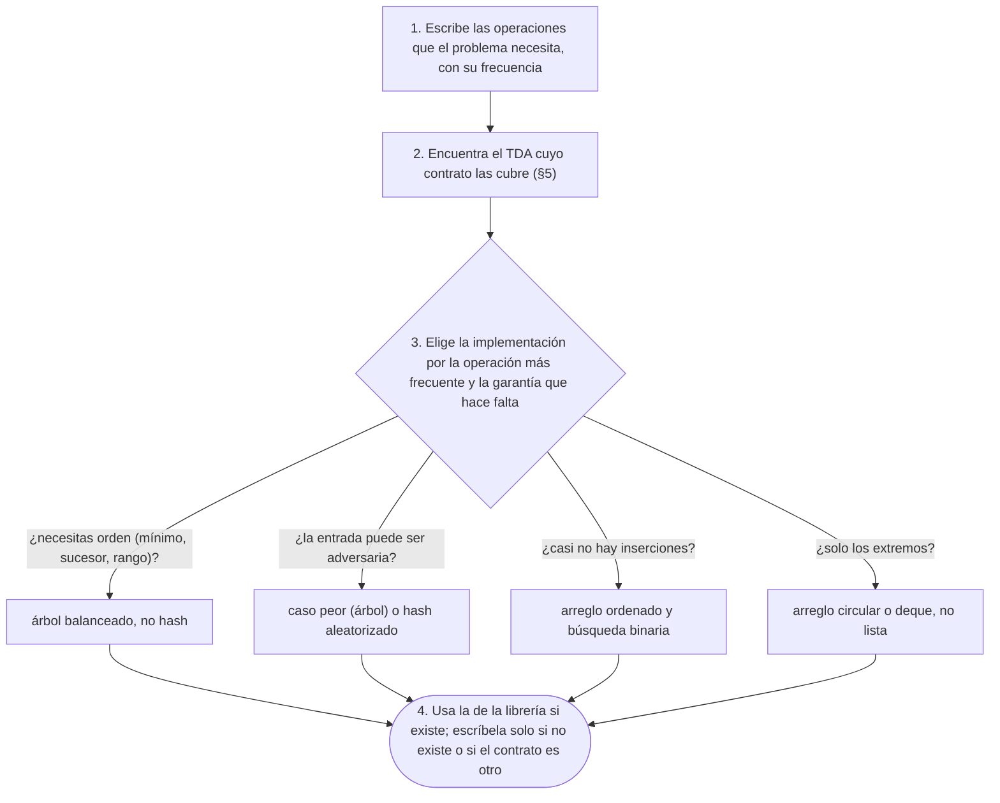

# 06 — Tipos abstractos de datos

> Separar el contrato de una estructura —qué operaciones tiene y qué promete cada una— de su
> implementación y de su coste. El mismo TDA con implementaciones de coste distinto, el invariante de
> representación que las mantiene correctas, y el mapa de qué estructura del corpus implementa cada
> TDA.
>
> **Niveles:** TDA, contrato e invariante de representación [A] · TDA en orientación a objetos [B].
>
> **📚 Lectura troncal:** Brassard y Bratley, *Fundamentos de algoritmia* (Prentice Hall, 1997),
> cap. 5; Goodrich, Tamassia y Goldwasser, *Data Structures and Algorithms in Java*, 6.ª ed. (Wiley,
> 2014), caps. 2 y 6–7.
>
> **Asume leído:** [`02/01` — Notación asintótica y casos](01-notacion-asintotica.md).
>
> **Vigencia:** 2026-10-03.

**Salto rápido:** [1](#1--el-problema) · [2](#2--la-teoría) · [3](#3--tda-contrato-e-invariante-de-representación) · [4](#4--tda-en-orientación-a-objetos) · [5](#5--el-mapa-de-tda-del-corpus) · [6](#6-️-la-tabla-de-costes) · [7](#7--cómo-se-elige) · [8](#8--señales-del-enunciado) · [🧠](#-preguntas) · [🧩](#-problemas-propios)

---

## 1. 🎯 El problema

Un programa necesita una cola: los turnos entran por un lado y se atienden por el otro. Se escribe con
lo que hay a mano:

```java
// falla: TLE con 2·10⁵ turnos. remove(0) desplaza todos los elementos restantes.
List<Integer> turnos = new ArrayList<>();
turnos.add(turno);              // encolar: O(1) amortizado
int siguiente = turnos.remove(0);   // desencolar: O(n), mueve todo el arreglo una posición
```

Funciona. Con pocos turnos, nadie lo nota. Con `2·10⁵`, cada `remove(0)` mueve el arreglo entero y el
total es `Θ(n²)`: TLE. Y lo que había que cambiar no era el algoritmo, sino **la implementación de la
cola**, sin tocar una sola línea del código que la usa.

Esa separación es la idea de este capítulo. «Cola» es un **contrato**: encolar, desencolar el más
antiguo, mirar el frente. Cómo se cumple ese contrato —un arreglo circular, una lista enlazada, un
arreglo con `remove(0)`— es otra decisión, y cada una tiene su coste. Un **tipo abstracto de datos**
(TDA) es el contrato; una estructura de datos es una forma de cumplirlo. Casi todo el corpus son
implementaciones de una docena de TDA, y elegir bien empieza por saber cuál es el contrato.

---

## 2. 📐 La teoría

**Un TDA** se define por sus **operaciones** y por lo que **promete** cada una, sin decir nada de la
representación:

- **La signatura**: nombre, argumentos y resultado de cada operación.
- **La precondición**: lo que tiene que ser cierto al llamarla (`dequeue` exige que la cola no esté
  vacía).
- **La postcondición**: lo que es cierto después (tras `enqueue(x)`, `x` es el último de la secuencia
  y el resto no cambió).

Para especificar sin hablar de la representación, se describe el **valor abstracto**: una cola es una
**secuencia** de elementos; `enqueue(x)` la convierte en la misma secuencia con `x` al final;
`dequeue()` quita y devuelve el primero.

**La implementación** elige una **representación** concreta (un arreglo y dos índices, una lista
enlazada) y dos cosas la conectan con el TDA:

- **El invariante de representación**: la condición que la representación cumple siempre entre
  operaciones (`0 ≤ size ≤ capacidad`, la cabeza dentro del arreglo).
- **La función de abstracción**: cómo se lee el valor abstracto a partir de la representación (los
  `size` elementos desde la cabeza, dando la vuelta al final del arreglo).

**Teorema (corrección de una implementación).** Si cada operación, partiendo de una representación que
cumple el invariante y su precondición, **conserva el invariante** y deja una representación cuya
abstracción cumple la **postcondición**, entonces la implementación es correcta para cualquier
secuencia de operaciones.

La prueba es una inducción sobre la secuencia de operaciones, con la misma forma que el invariante de
bucle ([`02/04`](04-correccion-invariantes-induccion-intercambio.md)): el constructor establece el invariante, y cada operación lo mantiene. La exposición
en clave de algoritmia está en Brassard y Bratley, cap. 5.

**El mismo TDA, costes distintos.** El contrato no fija el coste; cada implementación pone el suyo. Por
eso un mismo programa puede ser `Θ(n²)` o `Θ(n)` según la implementación que le pases, como en §1.

---

## 3. 🧱 TDA, contrato e invariante de representación

**Qué es.** Escribir primero la interfaz (el contrato) y después una o varias implementaciones que la
cumplan, cada una con su invariante de representación.

**Por qué es correcto.** Por el teorema de §2: si cada operación conserva el invariante y cumple su
postcondición sobre el valor abstracto, cualquier secuencia de operaciones se comporta como la cola
abstracta, que es lo que el código cliente supone.

**Cómo va.** El arreglo circular para una cola: un arreglo `data`, el índice `head` del primero y el
número `size` de elementos. Los elementos son `data[head]`, `data[(head + 1) mod cap]`, …, hasta `size`
de ellos. La traza con `enqueue` de `5, 2, 9, 1` y dos `dequeue`, con capacidad 4:

```text
operación      data           head  size   valor abstracto
inicio         [_ _ _ _]      0     0      ⟨⟩
enqueue 5      [5 _ _ _]      0     1      ⟨5⟩
enqueue 2      [5 2 _ _]      0     2      ⟨5, 2⟩
enqueue 9      [5 2 9 _]      0     3      ⟨5, 2, 9⟩
dequeue → 5    [_ 2 9 _]      1     2      ⟨2, 9⟩
enqueue 1      [_ 2 9 1]      1     3      ⟨2, 9, 1⟩
enqueue 5      [5 2 9 1]      1     4      ⟨2, 9, 1, 5⟩      el 5 entra en data[(1+3) mod 4] = data[0]
dequeue → 2    [5 _ 9 1]      2     3      ⟨9, 1, 5⟩
```

**Cuánto.** Con el arreglo circular, `enqueue` es `O(1)` amortizado (crece duplicando, como en
[`02/03`](03-analisis-amortizado.md)) y `dequeue`, `O(1)` en el caso peor; con la lista enlazada, ambas son `O(1)` en el caso peor,
con una asignación por elemento y peor localidad (`02/05`).

**La plantilla.** Una interfaz y dos implementaciones en Java, como fija la ficha del capítulo:

```java
// El contrato: una cola de enteros. Pre de dequeue y peek: !isEmpty().
interface IntQueue {
    void enqueue(int x);
    int dequeue();
    int peek();
    boolean isEmpty();
    int size();
}

// Arreglo circular. Invariante: 0 <= size <= data.length, 0 <= head < data.length;
// los elementos son data[(head + i) % data.length] para i en [0, size).
final class RingBufferQueue implements IntQueue {
    private int[] data = new int[4];
    private int head = 0, size = 0;

    public void enqueue(int x) {
        if (size == data.length) grow();
        data[(head + size) % data.length] = x;
        size++;
    }

    public int dequeue() {
        int x = peek();
        head = (head + 1) % data.length;
        size--;
        return x;
    }

    public int peek() {
        if (size == 0) throw new java.util.NoSuchElementException();
        return data[head];
    }

    public boolean isEmpty() { return size == 0; }
    public int size() { return size; }

    private void grow() {                       // copia en orden lógico: la cabeza vuelve a 0
        int[] bigger = new int[2 * data.length];
        for (int i = 0; i < size; i++) bigger[i] = data[(head + i) % data.length];
        data = bigger;
        head = 0;
    }
}

// Lista enlazada simple. Invariante: size nodos desde head; tail es el último (o null si size == 0).
final class LinkedQueue implements IntQueue {
    private static final class Node { int value; Node next; Node(int v) { value = v; } }
    private Node head, tail;
    private int size = 0;

    public void enqueue(int x) {
        Node node = new Node(x);
        if (tail == null) head = node; else tail.next = node;
        tail = node;
        size++;
    }

    public int dequeue() {
        int x = peek();
        head = head.next;
        if (head == null) tail = null;          // la cola quedó vacía: tail también
        size--;
        return x;
    }

    public int peek() {
        if (size == 0) throw new java.util.NoSuchElementException();
        return head.value;
    }

    public boolean isEmpty() { return size == 0; }
    public int size() { return size; }
}
```

- **El invariante va escrito** encima de cada clase: es lo que cada método tiene que dejar cierto, y lo
  primero que se lee al depurar.
- **`grow()` copia en orden lógico** y deja `head = 0`: copiar `data` tal cual rompería la función de
  abstracción, porque los índices módulo cambian con la capacidad.
- **`if (head == null) tail = null`** en `LinkedQueue`: sin esa línea, tras vaciar la cola `tail` apunta
  a un nodo que ya no está, y el siguiente `enqueue` lo enlaza a la nada. Es el invariante «`tail` es el
  último» roto en el borde.
- **En C++ y en Python** no hace falta escribirlas: `std::queue` (sobre `std::deque`) y
  `collections.deque` cumplen el contrato con coste `O(1)`.

### De la versión ingenua a la buena

**El problema.** Atender `2·10⁵` turnos en orden de llegada, intercalando llegadas y atenciones. Con
los turnos `5, 2, 9, 1, 5, 6` encolados y atendidos uno a uno, el orden de atención es el mismo.

**La versión ingenua** es la de §1: una `ArrayList` con `remove(0)`.

> «Uso una lista como cola, pero `remove(0)` desplaza todos los elementos: es `O(n)` por operación y
> `Θ(n²)` en total. El contrato que necesito es el de una cola, y hay implementaciones con las dos
> operaciones en `O(1)`: un arreglo circular o, en la librería, `ArrayDeque`.»

**El camino a la buena.** Programar contra la interfaz y cambiar solo la implementación:

```java
// El código cliente usa el contrato; la implementación se elige en una línea.
IntQueue turnos = new RingBufferQueue();        // o new LinkedQueue(); o ArrayDeque en la librería
for (int t : new int[] {5, 2, 9, 1, 5, 6}) turnos.enqueue(t);
while (!turnos.isEmpty()) atender(turnos.dequeue());
```

- **El cliente no cambió**: la mejora fue de `Θ(n²)` a `Θ(n)` cambiando el `new`. Es la ventaja
  práctica de separar contrato e implementación.
- **`atender`** es lo que el problema haga con cada turno; no forma parte de la cola.

**Cuándo sí** se piensa en TDA: al diseñar cualquier estructura, y al elegir una de la librería («¿qué
contrato necesito?» antes de «¿qué clase uso?»). **Cuándo no** hace falta escribir la interfaz: en un
problema de juez con una sola implementación, donde basta con usar la de la librería.

> **Veredicto:** primero el contrato, después la implementación, y el invariante de representación
> escrito encima de la clase. La implementación se cambia en una línea; el contrato, nunca sin avisar.

---

## 4. 🧱 TDA en orientación a objetos

**Qué es.** La forma en que los lenguajes con clases expresan los TDA: el contrato es una **interfaz**
(o una clase abstracta) y cada implementación es una clase que la cumple. El código cliente declara
variables del tipo de la interfaz.

**Por qué es correcto** (el enunciado y una frase): por el **principio de sustitución de Liskov**, una
implementación que cumple el contrato —acepta al menos las precondiciones y garantiza al menos las
postcondiciones— puede sustituir a otra sin que el cliente lo note.

**Cómo va.** En Java, la librería de colecciones está organizada exactamente así:

| Interfaz (el TDA) | Implementaciones | Lo que cambia entre ellas |
|---|---|---|
| `Deque` (pila, cola, doble cola) | `ArrayDeque`, `LinkedList` | Arreglo circular frente a lista doble; `ArrayDeque` es más rápida y no admite `null` |
| `Map` (diccionario) | `HashMap`, `TreeMap`, `LinkedHashMap` | `O(1)` esperado sin orden; `O(log n)` con orden; orden de inserción |
| `List` (secuencia indexada) | `ArrayList`, `LinkedList` | `get(i)` en `O(1)` frente a `O(n)` |
| `Queue` con prioridad | `PriorityQueue` | Montículo binario ([`08/01`](../08-heaps-y-union-find/01-monticulo-binario.md)) |

```java
// Programar contra la interfaz: el resto del código no sabe qué implementación hay detrás.
Deque<Integer> stack = new ArrayDeque<>();   // pila: push, pop, peek
Map<String, Integer> counts = new HashMap<>();   // si luego hace falta orden, TreeMap
```

```cpp
#include <deque>
#include <queue>
#include <stack>

// En C++, std::stack y std::queue son adaptadores: un contrato sobre un contenedor elegido.
std::stack<int> stack;                        // por defecto, sobre std::deque<int>
std::queue<int, std::deque<int>> queue;       // el segundo parámetro elige la implementación
```

- **Java** usa interfaces y polimorfismo en tiempo de ejecución; **C++** usa plantillas, y el
  «contrato» de `std::queue` lo cumple cualquier contenedor con `push_back`, `pop_front`, `front` y
  `back`, resuelto en compilación, sin coste de llamada virtual.
- **Python** tiene clases base abstractas en `collections.abc` (`Sequence`, `Mapping`,
  `MutableSet`) y, sobre todo, *duck typing*: el contrato es «tener los métodos», sin declararlo.
- **`Stack` de Java** es una clase antigua que hereda de `Vector` (sincronizada y con acceso por
  índice, que rompe el contrato de pila). La pila de Java es `Deque` con `ArrayDeque`.

**Cuánto.** Una llamada a través de una interfaz en Java puede costar una indirección, que el
compilador JIT suele eliminar cuando solo ve una implementación. En C++, nada. **Cuándo sí**: siempre
que una estructura pueda cambiar de implementación. **Cuándo no**: en una plantilla de concurso
cerrada, donde la interfaz solo añade líneas.

> **Veredicto:** declara el tipo de la interfaz (`Deque`, `Map`) y elige la clase en el `new`. Y en
> Java, la pila es `ArrayDeque`, no `Stack`.

---

## 5. 🧱 El mapa de TDA del corpus

**Qué es.** La tabla que dice qué estructura del corpus implementa cada TDA, para leer cada capítulo
del bloque `06` en adelante como «una implementación más de un contrato conocido».

| TDA | Operaciones del contrato | Implementaciones en el corpus |
|---|---|---|
| Pila | `push`, `pop`, `peek` | Arreglo dinámico (`02/03`); pila monótona ([`06/01`](../06-lineales-y-hashing/01-pilas-colas-y-monotonas.md)) |
| Cola y doble cola | `enqueue`, `dequeue`, por los dos extremos | Arreglo circular (§3); deque y cola monótona (`06/01`) |
| Secuencia | acceso por posición, insertar, borrar | Arreglo dinámico; lista enlazada ([`06/02`](../06-lineales-y-hashing/02-listas-enlazadas.md)); *treap* implícito ([`07/03`](../07-arboles/03-arboles-aleatorizados.md)) |
| Diccionario y conjunto | `put`, `get`, `remove`, pertenencia | Tabla *hash* ([`06/03`](../06-lineales-y-hashing/03-tablas-hash.md)); árbol balanceado ([`07/02`](../07-arboles/02-bst-y-balanceados.md)) |
| Diccionario ordenado | además, mínimo, sucesor, rango | Árbol balanceado (`07/02`); *skip list* (`07/03`) |
| Cola de prioridad | `insert`, `extractMin`, `decreaseKey` | Montículo binario (`08/01`); montículos fusionables ([`08/03`](../08-heaps-y-union-find/03-monticulos-fusionables.md)) |
| Conjuntos disjuntos | `find`, `union` | Union-Find ([`08/04`](../08-heaps-y-union-find/04-union-find.md)) |
| Secuencia con consultas de rango | suma o mínimo de un rango, actualizar | Prefijos ([`04/01`](../04-secuencias/01-prefijos-y-diferencias.md)); Fenwick y árbol de segmentos (bloque `09`) |
| Grafo | vecinos, existe la arista | Lista de adyacencia, matriz ([`14/01`](../14-grafos-recorridos/01-representaciones.md)) |

**Cuánto.** Cada fila tiene su tabla de costes en el capítulo de su implementación. **Cuándo sí** se
usa: al leer un enunciado, para traducir «necesito el siguiente mayor y poder borrar» en «diccionario
ordenado». **Cuándo no**: no es una lista exhaustiva; algunas estructuras (el *trie*, el *suffix
array*) son implementaciones especializadas de un diccionario sobre cadenas.

> **Veredicto:** casi todo el corpus son implementaciones de nueve contratos. Saber el contrato que pide
> el problema es la mitad de elegir la estructura.

---

## 6. ⏱️ La tabla de costes

La misma cola y el mismo diccionario, con implementaciones distintas:

| TDA e implementación | Operación principal | Coste | Lo que la tabla no dice |
|---|---|---|---|
| Cola con `ArrayList` y `remove(0)` | desencolar | `O(n)` | Funciona con pocos elementos y explota con muchos |
| Cola con arreglo circular | encolar / desencolar | `O(1)` amortizado / `O(1)` | Contigua, amigable con la caché |
| Cola con lista enlazada | encolar / desencolar | `O(1)` / `O(1)` | Una asignación por elemento y peor localidad |
| Diccionario con tabla *hash* | `get` / `put` | `O(1)` esperado | Atacable sin aleatorizar (`06/03`); sin orden |
| Diccionario con árbol balanceado | `get` / `put` / sucesor | `O(log n)` caso peor | Mantiene el orden; constante mayor |
| Diccionario con arreglo ordenado | `get` / `put` | `O(log n)` / `O(n)` | Imbatible si casi no hay inserciones |

---

## 7. 🧭 Cómo se elige



> **Mejor:** «Lo que necesito es una cola: encolar y atender el más antiguo. `ArrayDeque` lo da en
> `O(1)` por operación; una `ArrayList` con `remove(0)` sería `O(n)` por atención.»

---

## 8. 🔎 Señales del enunciado

| Señal | Técnica | Por qué |
|---|---|---|
| «En orden de llegada», «el más antiguo» | Cola | Es el contrato FIFO |
| «Deshacer», «el último», «anidado» | Pila | Es el contrato LIFO |
| «El siguiente mayor», «el más cercano por debajo», «los que están en el rango» | Diccionario ordenado | Necesita sucesor y rango, que un *hash* no da |
| «¿Ya apareció?», «cuántas veces aparece» | Conjunto o diccionario *hash* | Solo pertenencia y conteo, sin orden |
| «El más urgente», «el menor de los que hay» con inserciones | Cola de prioridad | El mínimo con inserciones y extracciones |
| «Diseña una clase con estas operaciones en `O(1)`» | Componer TDA: mapa más lista, arreglo más mapa | Cada operación la cubre una pieza |

---

## 9. 🔭 Dónde aparece de verdad

- **Las interfaces de un servicio.** Un repositorio declarado como interfaz y con una implementación en
  memoria para las pruebas y otra sobre la base de datos para producción es exactamente §3: el mismo
  contrato con implementaciones de coste y garantías distintos.
- **Los índices de una base de datos.** Una tabla admite índices *hash* (igualdad en `O(1)` esperado)
  o de árbol B (igualdad, rangos y orden en `O(log n)`): elegir el índice es elegir la implementación
  del diccionario por las consultas que se van a hacer.
- **Las API públicas.** Cambiar la implementación de una clase pública sin cambiar su contrato es
  seguro; cambiar el contrato (una postcondición más débil, una excepción nueva) rompe a los clientes
  aunque compile.

---

## ⚠️ Errores frecuentes

| Se dice | Lo preciso |
|---|---|
| «El TDA es la clase» | El TDA es el contrato; la clase es una de sus implementaciones |
| «`List` y `ArrayList` son lo mismo» | `List` es la interfaz; `ArrayList` y `LinkedList` la implementan con costes distintos para `get(i)` |
| «`Stack` es la pila de Java» | Es una clase heredada de `Vector`; la pila es `Deque` con `ArrayDeque` |
| «`LinkedList` es la mejor cola en Java» | `ArrayDeque` cumple el mismo contrato, más rápido y con menos memoria |
| «Un diccionario es una tabla *hash*» | Es un contrato; la tabla *hash* es una implementación sin orden, y el árbol otra con orden |
| «El invariante de representación es documentación» | Es lo que cada operación tiene que conservar; sin él no se puede demostrar la corrección |

---

## 📚 Para profundizar

- **Libro** — Brassard y Bratley, *Fundamentos de algoritmia* (Prentice Hall, 1997), cap. 5: las
  estructuras de datos como implementaciones de tipos con operaciones. *Lectura troncal.*
- **Libro** — Goodrich, Tamassia y Goldwasser, *Data Structures and Algorithms in Java*, 6.ª ed.
  (Wiley, 2014), caps. 2 y 6–7: el diseño orientado a objetos, y los TDA de pila, cola, deque, lista e
  iterador con sus implementaciones. *Lectura troncal.*
- **Artículo** — Liskov y Wing, «A Behavioral Notion of Subtyping», *ACM Transactions on Programming
  Languages and Systems* 16(6), 1994: el principio de sustitución.
- **Documentación** — Java 21, [`Deque`](https://docs.oracle.com/en/java/javase/21/docs/api/java.base/java/util/Deque.html),
  [`ArrayDeque`](https://docs.oracle.com/en/java/javase/21/docs/api/java.base/java/util/ArrayDeque.html)
  y [`Map`](https://docs.oracle.com/en/java/javase/21/docs/api/java.base/java/util/Map.html).
- **Documentación** — cppreference, [`std::queue`](https://en.cppreference.com/cpp/container/queue):
  el adaptador y su contenedor subyacente.
- **Documentación** — Python, [`collections.abc`](https://docs.python.org/3/library/collections.abc.html)
  y [`collections`](https://docs.python.org/3/library/collections.html).

---

## 🧠 Preguntas

1. ¿Qué es un tipo abstracto de datos y qué lo distingue de una estructura de datos? 🟢
2. ¿Qué es el invariante de representación de una implementación? 🟢
3. ¿Qué diferencia hay entre una precondición y una postcondición, con un ejemplo de la cola? 🟡
4. ¿Qué diferencia hay entre el invariante de representación y la función de abstracción? 🟡
5. ¿Qué diferencia hay entre `List` y `ArrayList` en Java, y por qué se declara la variable con la primera? 🟡
6. Compara cómo expresan el contrato de una cola Java, C++ y Python: interfaz, adaptador y *duck typing*. 🟡
7. ¿Por qué `grow()` en el arreglo circular copia en orden lógico y no el arreglo tal cual? 🟠
8. ¿Por qué `Stack` no es una buena pila en Java, y qué contrato rompe? 🟠
9. Un problema necesita insertar, borrar y «el menor elemento mayor o igual que `x`». ¿Qué TDA es, y por qué una tabla *hash* no sirve? 🟠
10. En `LinkedQueue`, ¿qué invariante se rompe si se omite `if (head == null) tail = null`, y con qué secuencia de operaciones falla? 🟠
11. Demuestra, con el teorema de §2, que `RingBufferQueue` es una implementación correcta de la cola: escribe el invariante y comprueba que `enqueue` y `dequeue` lo conservan. 🔴
12. Diseña un TDA con `insert(x)`, `remove(x)` y `getRandom()` en `O(1)` esperado: elige la representación, escribe su invariante y explica `remove`. 🔴
13. Diseña una caché que guarde como mucho `k` pares clave-valor y, al llenarse, expulse el usado hace más tiempo, con `get` y `put` en `O(1)`. Di qué dos TDA compones y el invariante que los une. 🔴

---

## 🧩 Problemas propios

### Cola de turnos

**Nivel:** 🟢 · **Formato:** programa completo.

Procesa operaciones sobre una cola de turnos: `E x` encola el turno `x`; `D` atiende el primero e
imprime su número, o `VACIA` si no hay; `F` imprime el primero sin atenderlo, o `VACIA`.

- **Entrada.** Una línea con `q`. Después, `q` líneas con una operación.
- **Salida.** Una línea por cada `D` y cada `F`.
- **Restricciones.** `1 ≤ q ≤ 2·10⁵`; `1 ≤ x ≤ 10⁹`. Límite: 1 segundo.

```text
Entrada            Salida
6                  5
E 5                5
E 2                2
F                  VACIA
D
D
D

Entrada            Salida
3                  VACIA
D                  VACIA
F
E 1000000000
```

**Pista 1:** con el `q` máximo, ¿cuántos elementos mueve tu implementación en cada atención?

🔥 **Para el geek — en JavaScript:** `Array.prototype.shift()` es `O(n)` en el caso general, igual que
`remove(0)`; la cola tiene que ser un arreglo con índice de cabeza o un buffer circular escrito a mano.

### Agenda con siguiente

**Nivel:** 🟡 · **Formato:** programa completo.

Una agenda guarda horas (enteros). Operaciones: `A x` añade la hora `x` si no está; `B x` la borra si
está; `S x` imprime la menor hora guardada `≥ x`, o `-1`.

- **Entrada.** Una línea con `q`. Después, `q` líneas con una operación.
- **Salida.** Una línea por cada `S`.
- **Restricciones.** `1 ≤ q ≤ 2·10⁵`; `0 ≤ x ≤ 10⁹`.

```text
Entrada            Salida
6                  9
A 5                5
A 9                -1
S 6
S 5
B 9
S 6

Entrada            Salida
4                  -1
B 3                1000000000
S 0
A 1000000000
S 0
```

**Pista 1:** ¿qué operación del contrato necesitas que un conjunto *hash* no tiene?

🔥 **Para el geek — en Go:** no hay mapa ordenado en la librería estándar; necesitas un sustituto
(un *treap*, o un arreglo ordenado si casi no hay inserciones) y eso cambia el diseño.

### El más frecuente

**Nivel:** 🟠 · **Formato:** programa completo.

Una bolsa de valores con repetidos. Operaciones: `I x` mete una copia de `x`; `R x` saca una copia de
`x` (se garantiza que hay); `M` imprime el valor con más copias (el menor, si empatan), o `-1` si la
bolsa está vacía.

- **Entrada.** Una línea con `q`. Después, `q` líneas con una operación.
- **Salida.** Una línea por cada `M`.
- **Restricciones.** `1 ≤ q ≤ 2·10⁵`; `|x| ≤ 10⁹`.

```text
Entrada            Salida
9                  5
I 5                2
I 2                -1
I 5
M
R 5
R 5
M
R 2
M

Entrada            Salida
4                  -1
M                  -1000000000
I -1000000000
I 1000000000
M
```

**Pista 1:** si solo tuvieras conteos por valor, ¿cuánto te costaría responder `M`?

---

## 🧩 Práctica externa

> 💡 **Truco.** En los problemas de «diseña una clase», escribe primero el contrato: cada operación con
> su coste pedido. Si una IA te ayuda, pídele que revise tu invariante de representación, no que
> escriba la clase.

### Núcleo

| ✔ | Problema | Plataforma | Nivel | Patrón | Pista 1 |
|---|---|---|---|---|---|
| [ ] | [Design HashSet](https://leetcode.com/problems/design-hashset/) | LeetCode | 🟢 | Implementar un contrato | Con claves hasta `10⁶`, ¿qué representación es la más simple que cumple las tres operaciones? |
| [ ] | [Design HashMap](https://leetcode.com/problems/design-hashmap/) | LeetCode | 🟢 | Implementar un contrato | ¿Qué haces cuando dos claves caen en la misma cubeta? |
| [ ] | [Implement Stack using Queues](https://leetcode.com/problems/implement-stack-using-queues/) | LeetCode | 🟢 | Un TDA sobre otro | ¿Qué operación de la pila conviene que sea la cara? |
| [ ] | [Jesse and Cookies](https://www.hackerrank.com/challenges/jesse-and-cookies/problem) | HackerRank | 🟢 | Elegir el TDA | ¿Qué dos galletas necesitas en cada paso, y qué estructura te las da rápido? |
| [ ] | [Design Circular Queue](https://leetcode.com/problems/design-circular-queue/) | LeetCode | 🟡 | Invariante de representación | ¿Cómo distingues la cola llena de la vacía si la cabeza y la cola coinciden? |
| [ ] | [Design Browser History](https://leetcode.com/problems/design-browser-history/) | LeetCode | 🟡 | Elegir la representación | ¿Qué pasa con las páginas «hacia delante» cuando visitas una nueva? |
| [ ] | [Time Based Key-Value Store](https://leetcode.com/problems/time-based-key-value-store/) | LeetCode | 🟡 | Diccionario ordenado | Para una clave, ¿qué necesitas encontrar entre sus marcas de tiempo? |
| [ ] | [Simple Text Editor](https://www.hackerrank.com/challenges/simple-text-editor/problem) | HackerRank | 🟡 | Pila de estados | ¿Qué necesitas recordar de cada operación para poder deshacerla? |

### Ampliación

| ✔ | Problema | Plataforma | Nivel | Patrón | Pista 1 |
|---|---|---|---|---|---|
| [ ] | [Kth Largest Element in a Stream](https://leetcode.com/problems/kth-largest-element-in-a-stream/) | LeetCode | 🟢 | Cola de prioridad acotada | ¿Cuántos elementos necesitas guardar en realidad? |
| [ ] | [Design Linked List](https://leetcode.com/problems/design-linked-list/) | LeetCode | 🟡 | Invariante de una lista | ¿Qué nodo ficticio simplifica las inserciones al principio? |
| [ ] | [Snapshot Array](https://leetcode.com/problems/snapshot-array/) | LeetCode | 🟡 | Componer TDA | ¿Hace falta copiar el arreglo entero en cada instantánea? |
| [ ] | [Find Median from Data Stream](https://leetcode.com/problems/find-median-from-data-stream/) | LeetCode | 🟠 | Dos colas de prioridad | Si partes los números en dos mitades, ¿qué necesitas saber de cada una? |

---

## ✅ Criterio de dominio

- Escribir una interfaz de cola y la implementación con arreglo circular, con su invariante de
  representación, sin mirar.
- Explicar con un ejemplo la diferencia entre el contrato, el invariante de representación y la
  función de abstracción.
- Traducir cinco señales de enunciado a su TDA con la tabla de §5 y elegir la implementación.
- Resolver Design Browser History diciendo antes qué contrato necesitas y qué implementación eliges.

---

**Anterior:** [`02/05` — El coste real](05-el-coste-real.md) ·
**Siguiente:** [`02/07` — Simulación](07-simulacion.md) ·
**Relacionado:** [`06/01` — Pila, cola, deque y sus versiones monótonas](../06-lineales-y-hashing/01-pilas-colas-y-monotonas.md); [`08/01` — Montículo binario](../08-heaps-y-union-find/01-monticulo-binario.md);
[`03/05` — La tabla de equivalencias](../03-biblioteca-estandar/05-equivalencias-entre-lenguajes.md).
