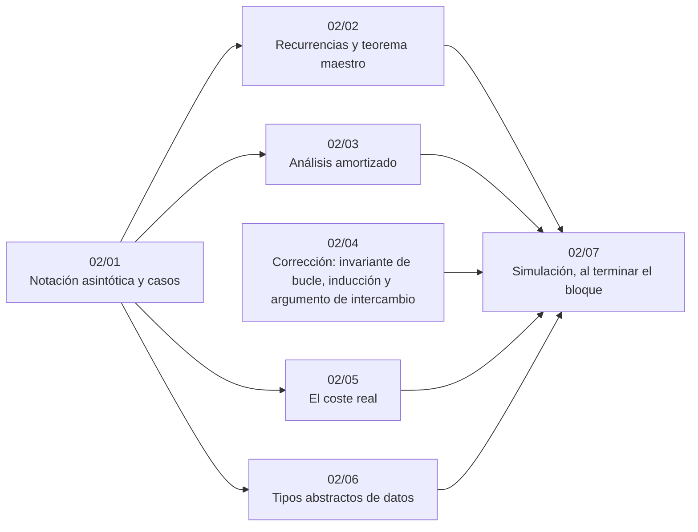

# Bloque 02 — Análisis

> Las herramientas para hablar con precisión de un algoritmo: notación asintótica y sus casos, recurrencias
> y el teorema maestro, análisis amortizado, las tres formas de demostrar que algo es correcto (invariante,
> inducción, intercambio), por qué la O grande no cuenta la caché ni el *boxing*, y los tipos abstractos de datos
> como contrato. Es el vocabulario que usan todos los bloques siguientes.
>
> Las respuestas de las preguntas y las pistas 2 y 3 de los problemas, en [`08` — Respuestas](08-respuestas.md).
>
> **Vigencia:** 2026-10-04.

---

## 🧭 Índice

| Capítulo | Niveles | Ruta corta |
|---|---|---|
| [`02/01` — Notación asintótica y casos](01-notacion-asintotica.md) | O, Ω, Θ [A] · peor, promedio, amortizado, esperado [A] · o y ω [C] | sí |
| [`02/02` — Recurrencias y teorema maestro](02-recurrencias-y-teorema-maestro.md) | sustitución y árbol de recursión [A] · teorema maestro [A] · Akra-Bazzi [C] · funciones generadoras [C, electivo] |  |
| [`02/03` — Análisis amortizado](03-analisis-amortizado.md) | agregado [A] · contable [B] · potencial [B] |  |
| [`02/04` — Corrección: invariante de bucle, inducción y argumento de intercambio](04-correccion-invariantes-induccion-intercambio.md) | invariante de bucle [A] · inducción [A] · argumento de intercambio [A] · contradicción [B] | sí |
| [`02/05` — El coste real](05-el-coste-real.md) | caché y localidad [B] · constantes y *boxing* [B] · el asignador y el *buddy system* [C] |  |
| [`02/06` — Tipos abstractos de datos](06-tipos-abstractos-de-datos.md) | TDA, contrato e invariante de representación [A] · TDA en orientación a objetos [B] |  |
| [`02/07` — Simulación](07-simulacion.md) | El examen del bloque: preguntas transversales y problemas cronometrados | |
| [`02/08` — Respuestas](08-respuestas.md) | Las preguntas en tres capas y las pistas 2 y 3 | |

---

## 🧭 Orden de lectura

- `02/01` es el único prerrequisito de casi todo el corpus; `02/04` es el que más se cita desde los voraces y la DP.
- `02/05` y `02/06` pueden esperar hasta que una solución correcta sea lenta o hasta diseñar una estructura.

---

## 🔎 Mapa de señales del bloque

| Señal | Técnica | Capítulo |
|---|---|---|
| La solución obvia tiene dos bucles anidados y `n ≤ 10⁵` | Contar pasos y descartar `Θ(n²)` | [`02/01`](01-notacion-asintotica.md) |
| Hay casos de prueba diseñados para romper (*hacks*, «adversario», casos *anti-hash*) | Garantía de caso peor: ordenar, árboles balanceados, *hash* aleatorizado | [`02/01`](01-notacion-asintotica.md) |
| Una función recursiva que se llama dos veces con `n − 1` y `n − 2` | Árbol de recursión → exponencial; memoización | [`02/02`](02-recurrencias-y-teorema-maestro.md) |
| «Parte en mitades, resuelve cada una y combina en lineal» | Teorema maestro, caso 2 | [`02/02`](02-recurrencias-y-teorema-maestro.md) |
| «`q` operaciones», algunas aparentemente caras («elimina todos los…») | Análisis amortizado agregado | [`02/03`](03-analisis-amortizado.md) |
| Un bucle `while` dentro de un `for` que saca elementos de una pila o mueve un puntero | Cada elemento entra y sale una vez: `O(n)` total | [`02/03`](03-analisis-amortizado.md) |
| «Elige siempre el…», «en cada paso, el mejor» | Argumento de intercambio, o contraejemplo | [`02/04`](04-correccion-invariantes-induccion-intercambio.md) |
| Un bucle con dos índices que se mueven («la frontera», «la zona de…») | Invariante sobre las zonas | [`02/04`](04-correccion-invariantes-induccion-intercambio.md) |
| Matrices de `n, m` hasta `5000` con varios recorridos | Recorrido por filas, matriz aplanada | [`02/05`](05-el-coste-real.md) |
| Solución `n log n` correcta en Java que da TLE con colecciones | `int[]`, `long[]` y ordenar primitivos | [`02/05`](05-el-coste-real.md) |
| «En orden de llegada», «el más antiguo» | Cola | [`02/06`](06-tipos-abstractos-de-datos.md) |
| «Deshacer», «el último», «anidado» | Pila | [`02/06`](06-tipos-abstractos-de-datos.md) |

---

## 📚 Lectura troncal del bloque

La de cada capítulo, que es también la primera entrada de su «Para profundizar»:

- **`02/01`** — Brassard y Bratley, *Fundamentos de algoritmia* (Prentice Hall, 1997), caps. 2–3; Cormen, Leiserson, Rivest y Stein, *Introduction to Algorithms*, 3.ª ed. (MIT Press, 2009), cap. 3.
- **`02/02`** — Cormen, Leiserson, Rivest y Stein, *Introduction to Algorithms*, 3.ª ed. (MIT Press, 2009), cap. 4; Brassard y Bratley, *Fundamentos de algoritmia* (Prentice Hall, 1997), cap. 4. Electivo: Sedgewick y Flajolet, *An Introduction to the Analysis of Algorithms*, 2.ª ed. (Addison-Wesley, 2013), caps. 2–3.
- **`02/03`** — Cormen, Leiserson, Rivest y Stein, *Introduction to Algorithms*, 3.ª ed. (MIT Press, 2009), cap. 17; Brassard y Bratley, *Fundamentos de algoritmia* (Prentice Hall, 1997), cap. 4.
- **`02/04`** — Cormen, Leiserson, Rivest y Stein, *Introduction to Algorithms*, 3.ª ed. (MIT Press, 2009), cap. 2 (invariantes); Kleinberg y Tardos, *Algorithm Design* (Addison-Wesley, 2005), cap. 4 (intercambio).
- **`02/05`** — Bryant y O'Hallaron, *Computer Systems: A Programmer's Perspective*, 3.ª ed. (Pearson, 2016), cap. 6; Knuth, *The Art of Computer Programming*, Vol. 1 (Addison-Wesley), §2.5.
- **`02/06`** — Brassard y Bratley, *Fundamentos de algoritmia* (Prentice Hall, 1997), cap. 5; Goodrich, Tamassia y Goldwasser, *Data Structures and Algorithms in Java*, 6.ª ed. (Wiley, 2014), caps. 2 y 6–7.

---

## 🧭 Qué NO está aquí

- **Las técnicas que se analizan**: desde el [bloque `04`](../04-secuencias/README.md); aquí se analizan con ejemplos pequeños.
- **Funciones generadoras a fondo**: en [`17/11` — Funciones generadoras y Berlekamp-Massey](../17-matematica/11-funciones-generadoras.md).
- **Lo que la teoría de la computación dice de lo que no se puede calcular**: en el bloque opcional [`22`](../22-teoria-de-la-computacion/README.md).

---

**Anterior:** [Bloque 01 — Oficio del competidor](../01-oficio-del-competidor/README.md) ·
**Siguiente:** [Bloque 03 — Biblioteca estándar](../03-biblioteca-estandar/README.md) ·
**Inicio:** [README del corpus](../README.md)
