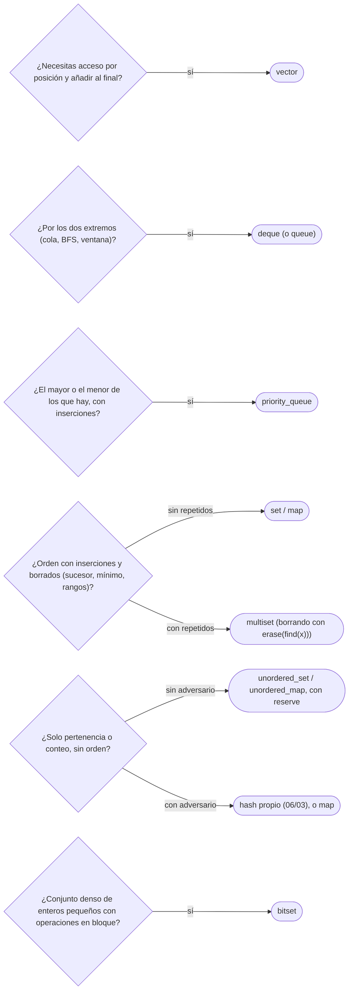

# 01 — C++: contenedores de la STL y su coste

> Elegir el contenedor de la STL por sus operaciones y su coste: `vector`, `deque`, `set` y `multiset`,
> `map`, `unordered_map` y `priority_queue`, con `bitset` y `list` como herramientas de segunda línea.
> Qué invalida cada operación, y las trampas que dan WA sin avisar.
>
> **Niveles:** `vector`, `deque`, `set`/`multiset`, `map`, `unordered_map`, `priority_queue` [A] ·
> `bitset`, `list` [B].
>
> **📚 Lectura troncal:** Farrier, *Data Structures and Algorithms with the C++ STL* (Packt, 2024),
> caps. 1–9; cppreference, [*Containers library*](https://en.cppreference.com/cpp/container).
>
> **Ruta corta:** sí (si tu lenguaje es C++).
>
> **Vigencia:** 2026-10-03.

**Salto rápido:** [1](#1--el-problema) · [2](#2--vector) · [3](#3--deque) · [4](#4--set-y-multiset) · [5](#5--map) · [6](#6--unordered_map) · [7](#7--priority_queue) · [8](#8--bitset-y-list) · [9](#9-️-la-tabla-de-costes) · [10](#10--cómo-se-elige) · [🧠](#-preguntas) · [🧩](#-problemas-propios)

---

## 1. 🎯 El problema

Una taquilla tiene billetes con precio, algunos repetidos, y cada cliente compra el más caro que no
pasa de su presupuesto. Se modela con un `std::multiset<int>` de precios: `upper_bound`, retroceder
uno, y borrar el vendido.

```cpp
// falla: con dos billetes de precio 5, vender uno borra los dos
std::multiset<int> prices = {5, 2, 9, 1, 5, 6};
auto it = prices.upper_bound(5);   // primer precio > 5
--it;                              // el mayor precio <= 5: un 5
prices.erase(*it);                 // ¡erase(valor) borra TODOS los 5!
```

Pasa el ejemplo del enunciado si no tiene precios repetidos. Con repetidos, vende un billete y hace
desaparecer otro, y el caso 9 da *Wrong Answer* (WA). No hay error de compilación, ni aviso, ni
excepción: `erase` con un valor está documentado así.

La STL es el arsenal más completo de la competitiva, y por eso C++ sigue siendo su lenguaje: casi
todas las estructuras del corpus tienen ahí una versión probada. Pero cada contenedor tiene **un coste
por operación**, **unas reglas sobre qué iteradores invalida** y **una o dos trampas** que hay que
saber de memoria. Este capítulo las reúne, contenedor por contenedor.

> 🧠 **Modelo mental.** Recordatorio, si llegas directo aquí: `O(log n)` en un contenedor ordenado
> significa unas 17 comparaciones con `n = 10⁵`; `O(1)` *esperado* en uno con *hash* significa
> constante en la práctica, pero con un caso peor lineal que un adversario puede provocar.

---

## 2. 🧱 `vector`

**Qué es.** Un arreglo dinámico contiguo: el contenedor por defecto de C++ y el que se usa salvo que
haya una razón para otro.

**Cómo va.**

```cpp
#include <vector>

std::vector<int> a = {5, 2, 9, 1, 5, 6};
a.push_back(7);                 // al final: O(1) amortizado
a.pop_back();                   // quita el último: O(1)
int x = a[2];                   // acceso por índice: O(1), sin comprobar el rango
a.insert(a.begin() + 1, 4);     // en medio: O(n), desplaza todo lo que va detrás
a.reserve(1'000'000);           // reserva capacidad de golpe: ningún push_back copiará hasta ahí
std::vector<std::vector<int>> grid(3, std::vector<int>(4, 0));   // 3 × 4 a cero
```

- **`operator[]` no comprueba el rango**; `at(i)` sí, y lanza `std::out_of_range`. Con
  `-fsanitize=address` ([`01/05`](../01-oficio-del-competidor/05-probar-sin-ide-y-stress-test.md)) el acceso fuera de rango se detecta en local.
- **`reserve`** evita las copias del crecimiento cuando se conoce el tamaño final; **no** cambia
  `size()`. `resize` sí.
- **El crecimiento** es por duplicación en libstdc++: `push_back` es `O(1)` amortizado ([`02/03`](../02-analisis/03-analisis-amortizado.md)).

> ⚠️ **Advertencia.** `std::vector<bool>` no es un vector de `bool`: está especializado para guardar
> un bit por elemento, sus elementos no son `bool&` y `&v[0]` no compila. Para un vector de banderas
> rápido y sin sorpresas, `std::vector<char>` o `std::bitset` (§8).

**Cuánto cuesta.** Acceso `O(1)`; `push_back` `O(1)` amortizado; insertar o borrar en medio `O(n)`.
**Invalidación**: cualquier operación que haga crecer la capacidad invalida **todos** los iteradores,
punteros y referencias; insertar o borrar invalida los de esa posición en adelante.

**Cuándo sí**: casi siempre. **Cuándo no**: cuando hay que insertar o borrar por delante a menudo
(`deque`), o necesitas orden con inserciones (`set`).

> **Veredicto:** `vector` por defecto. Con `reserve` si conoces el tamaño, y sin guardar iteradores a
> través de un `push_back`.

---

## 3. 🧱 `deque`

**Qué es.** Una cola doble: inserción y borrado en `O(1)` por los dos extremos, y acceso por índice en
`O(1)`. No es contigua: son bloques de tamaño fijo con un índice de bloques.

**Cómo va.**

```cpp
#include <deque>

std::deque<int> d = {2, 9};
d.push_front(5);                // {5, 2, 9}
d.push_back(1);                 // {5, 2, 9, 1}
d.pop_front();                  // {2, 9, 1}
int x = d[1];                   // 9: acceso por índice en O(1)
```

- **Es la base de `std::queue` y `std::stack`** por defecto: los adaptadores solo exponen las
  operaciones de su contrato ([`02/06`](../02-analisis/06-tipos-abstractos-de-datos.md)).
- **Las ventanas deslizantes con máximo** (la cola monótona de [`06/01`](../06-lineales-y-hashing/01-pilas-colas-y-monotonas.md)) se escriben sobre un `deque`.

**Cuánto cuesta.** `push_front`, `push_back`, `pop_front`, `pop_back` en `O(1)`; índice `O(1)` con una
indirección más que `vector`. **Invalidación**: insertar en un extremo invalida los iteradores pero
**no** las referencias a elementos; insertar en medio invalida todo.

**Cuándo sí**: colas, BFS ([`14/02`](../14-grafos-recorridos/02-bfs.md)), ventanas deslizantes. **Cuándo no**: como sustituto general de
`vector`, porque no es contiguo y recorrerlo es algo más lento.

> **Veredicto:** `deque` cuando hay que trabajar por los dos extremos. Para todo lo demás, `vector`.

---

## 4. 🧱 `set` y `multiset`

**Qué es.** Conjuntos ordenados implementados con un árbol rojo-negro ([`07/02`](../07-arboles/02-bst-y-balanceados.md)): `set` sin repetidos,
`multiset` con repetidos. Los elementos se recorren siempre en orden.

**Cómo va.**

```cpp
#include <set>

std::multiset<int> ms = {5, 2, 9, 1, 5, 6};   // guardado como 1 2 5 5 6 9
auto lo = ms.lower_bound(5);   // primer elemento >= 5: el primer 5
auto hi = ms.upper_bound(5);   // primer elemento > 5: el 6
int fives = ms.count(5);       // 2, en O(log n + cuántos hay)
ms.erase(ms.find(5));          // borra UNA copia: la que apunta el iterador
int smallest = *ms.begin();    // el mínimo: O(1)
int largest = *ms.rbegin();    // el máximo: O(1)
```

- **`erase(valor)` borra todas las copias** de ese valor y devuelve cuántas borró; **`erase(iterador)`
  borra solo esa**. En un `multiset`, casi siempre se quiere la segunda, con `find`.
- **`lower_bound` y `upper_bound` de miembro** son `O(log n)`. El `std::lower_bound` libre sobre un
  `set` es `O(n)`, porque sus iteradores no son de acceso aleatorio: es un error de rendimiento
  frecuente.
- **`count` en un `multiset`** cuesta además lineal en el número de copias; para saber si existe,
  `find(x) != end()` o, desde C++20, `contains(x)`.

**Cuánto cuesta.** Insertar, borrar y buscar en `O(log n)`, caso peor. Mínimo y máximo en `O(1)`.
**Invalidación**: insertar no invalida nada; borrar invalida solo los iteradores al elemento borrado.

### Autopsia de un bug: el `erase` del `multiset`

**1. El código que escribe todo el mundo** es el de §1: `prices.erase(*it)`.

**2. Por qué parece correcto.** Con precios distintos, `erase(*it)` y `erase(it)` hacen lo mismo. Los
ejemplos del enunciado suelen tener precios distintos.

**3. La entrada que lo rompe.** Dos billetes de 5 y un cliente con presupuesto 5. Después de su compra
debería quedar un billete de 5; con `erase(*it)` no queda ninguno, y el siguiente cliente con
presupuesto 5 compra uno más barato o se queda sin billete.

**4. El código correcto**, con la línea que cambia:

```cpp
auto it = prices.upper_bound(budget);
if (it == prices.begin()) {
    // no hay ningún billete <= budget
} else {
    --it;
    int sold = *it;
    prices.erase(it);          // ← antes: prices.erase(*it), que borra todas las copias
}
```

**5. La generalización.** Es un error de **contrato de la operación**: dos sobrecargas con el mismo
nombre y semánticas distintas. Aparece igual en `std::multimap::erase(clave)` y, en otra forma, en
`std::remove`, que no borra nada sino que mueve ([`03/02`](02-cpp-algoritmos-ranges-y-pbds.md)).

**Cuándo sí**: cuando necesitas orden con inserciones y borrados: el mínimo, el máximo, el sucesor, el
predecesor. **Cuándo no**: si solo necesitas pertenencia, `unordered_set` es más rápido; si los datos no
cambian, un `vector` ordenado con búsqueda binaria es más rápido y compacto.

> **Veredicto:** `set` y `multiset` son el diccionario ordenado de C++. En `multiset`, se borra con
> `erase(find(x))`, nunca con `erase(x)`.

---

## 5. 🧱 `map`

**Qué es.** Un diccionario ordenado por clave, también sobre un árbol rojo-negro. `multimap` admite
claves repetidas.

**Cómo va.**

```cpp
#include <map>
#include <string>

std::map<std::string, int> stock;
stock["pan"] += 3;                       // si "pan" no existe, se crea con 0 y después se suma
if (stock.count("leche")) { /* ... */ }  // consulta sin crear la clave
auto it = stock.find("pan");             // iterador, o end() si no está
auto next = stock.lower_bound("p");      // primera clave >= "p"
for (const auto& [name, qty] : stock) {  // recorrido en orden de clave (C++17)
    // ...
}
```

- **`operator[]` inserta**: `stock[k]` crea la clave con el valor por defecto si no existe. Usarlo
  para **consultar** llena el mapa de claves vacías y cambia su tamaño. Para consultar, `find`,
  `count` o `contains` (C++20).
- **El recorrido es en orden de clave**, que es lo que lo distingue de `unordered_map`.

**Cuánto cuesta.** `O(log n)` por operación, caso peor, con una constante mayor que la del *hash*
(cada nivel es un acceso por puntero). **Invalidación**: como `set`.

**Cuándo sí**: cuando necesitas las claves en orden, el sucesor de una clave o rangos de claves.
**Cuándo no**: como diccionario sin orden, donde `unordered_map` suele ser más rápido.

> **Veredicto:** `map` cuando el orden importa. Y `operator[]` solo para escribir, nunca para
> preguntar si una clave existe.

---

## 6. 🧱 `unordered_map`

**Qué es.** Un diccionario con tabla *hash* por encadenamiento: sin orden, con operaciones en `O(1)`
esperado. `unordered_set` es lo mismo sin valores.

**Cómo va.**

```cpp
#include <unordered_map>

std::unordered_map<long long, int> freq;
freq.reserve(1 << 18);              // reserva cubetas: evita rehacer la tabla mientras crece
for (long long x : {5LL, 2LL, 9LL, 1LL, 5LL, 6LL}) freq[x]++;
int fives = freq[5];                // 2
```

- **`reserve`** fija el número de cubetas para que la tabla no se rehaga varias veces al crecer; cada
  rehacer recorre todo y es `O(n)`.
- **El orden de recorrido no está especificado** y cambia entre ejecuciones y compiladores: si la
  salida depende de él, la respuesta es frágil.

**Cuánto cuesta.** `O(1)` esperado por operación; `O(n)` en el caso peor, cuando muchas claves caen en
la misma cubeta. **Invalidación**: un rehacer invalida todos los iteradores (no las referencias a
elementos).

> 🩺 **Diagnóstico.** Un `unordered_map` que da TLE en los últimos casos de un concurso con *hacks*
> casi siempre es un **caso anti-*hash***: el *hash* por defecto de los enteros en libstdc++ es la
> identidad, y la cubeta es el valor módulo un primo de una lista conocida. Basta con elegir claves que
> sean múltiplos de ese primo para que todas colisionen. La defensa —un *hash* propio con una semilla
> aleatoria— es de [`06/03`](../06-lineales-y-hashing/03-tablas-hash.md).

**Cuándo sí**: diccionarios y conjuntos sin orden, conteo de frecuencias, memoización con claves
dispersas. **Cuándo no**: si necesitas orden o garantía de caso peor frente a entradas adversarias.

> **Veredicto:** el diccionario más rápido de la STL en el caso típico, y el más fácil de atacar.
> `reserve` siempre, y un *hash* propio cuando hay adversario.

---

## 7. 🧱 `priority_queue`

**Qué es.** Un montículo binario ([`08/01`](../08-heaps-y-union-find/01-monticulo-binario.md)) sobre un `vector`: da el **máximo** en `O(1)` y lo saca en
`O(log n)`. Es un adaptador: solo expone `push`, `top`, `pop`, `size` y `empty`.

**Cómo va.**

```cpp
#include <functional>
#include <queue>
#include <utility>
#include <vector>

std::priority_queue<int> maxHeap;                                    // el mayor arriba
std::priority_queue<int, std::vector<int>, std::greater<>> minHeap;  // el menor arriba
minHeap.push(5); minHeap.push(2); minHeap.push(9);
int smallest = minHeap.top();     // 2
minHeap.pop();                    // pop no devuelve nada: se lee con top antes

// Pares (distancia, nodo): se ordenan por el primero y desempatan por el segundo
std::priority_queue<std::pair<long long, int>,
                    std::vector<std::pair<long long, int>>, std::greater<>> pq;
```

- **Es un *max-heap* por defecto**, al revés que el `PriorityQueue` de Java y el `heapq` de Python.
  Para un mínimo, `std::greater<>` en el tercer parámetro.
- **`pop()` no devuelve el elemento**: se lee con `top()` y se saca con `pop()`.
- **No hay `decrease-key`**, ni se puede recorrer, ni borrar un elemento concreto. El patrón para
  actualizar prioridades es **reinsertar** con la nueva y descartar al sacar las entradas viejas (la
  «eliminación perezosa» de Dijkstra, [`15/01`](../15-grafos-pesos-y-flujos/01-dijkstra.md)).

**Cuánto cuesta.** `push` y `pop` en `O(log n)`; `top` en `O(1)`; construir desde un rango, `O(n)`.

**Cuándo sí**: «el mayor o el menor de los que hay», con inserciones. **Cuándo no**: cuando necesitas
borrar elementos arbitrarios o el siguiente de un valor dado; ahí `multiset`.

> **Veredicto:** `priority_queue` para el extremo con inserciones; `std::greater<>` para el mínimo, y
> eliminación perezosa en vez de `decrease-key`.

---

## 8. 🧱 `bitset` y `list`

**Qué es.** Dos contenedores de nivel B: útiles en su nicho y fuera de él casi nunca.

**`std::bitset<N>`** guarda `N` bits —`N` fijo en compilación— y opera con ellos de 64 en 64:

```cpp
#include <bitset>

std::bitset<100001> reachable;     // tamaño fijo en compilación
reachable[0] = 1;
for (int w : {5, 2, 9}) reachable |= reachable << w;   // sumas alcanzables: cada desplazamiento es O(N/64)
bool canMake11 = reachable[11];    // 2 + 9
int howMany = reachable.count();   // número de bits a 1
```

- **El tamaño es una constante de compilación**: no se puede dimensionar con la `n` de la entrada; se
  usa la cota máxima del enunciado.
- **Las operaciones de bits** (`<<`, `|`, `&`) recorren `N/64` palabras: la mochila de existencia de
  arriba cuesta `O(n · N / 64)`, 64 veces menos que la versión con `bool`.

**`std::list`** es una lista doblemente enlazada: insertar y borrar en `O(1)` **con un iterador**, y
`splice` mueve tramos entre listas en `O(1)`. Pero no tiene acceso por índice, y recorrerla es seguir
punteros dispersos ([`02/05`](../02-analisis/05-el-coste-real.md)). Fuera de los casos que necesitan iteradores estables y `splice`, un
`vector` gana.

**Cuánto cuesta.** `bitset`: `O(N/64)` por operación de conjunto. `list`: `O(1)` por inserción con
iterador, `O(n)` para llegar a una posición.

**Cuándo sí**: `bitset` para conjuntos densos de enteros pequeños y DP de existencia; `list` para un
editor con cursor o una caché LRU ([`06/02`](../06-lineales-y-hashing/02-listas-enlazadas.md)). **Cuándo no**: `bitset` con tamaños que dependen de la
entrada; `list` como secuencia general.

> **Veredicto:** `bitset` es la optimización por 64 más barata de la STL. `list` casi nunca es la
> respuesta.

---

## 9. ⏱️ La tabla de costes

| Contenedor | Operación principal | Coste | Lo que la tabla no dice |
|---|---|---|---|
| `vector` | `push_back` / `[i]` / insertar en medio | `O(1)` amort. / `O(1)` / `O(n)` | Crecer invalida todos los iteradores; contiguo y el más rápido de recorrer |
| `deque` | `push`/`pop` en los dos extremos | `O(1)` | No es contiguo; insertar en un extremo conserva las referencias |
| `set` / `multiset` | insertar, borrar, `lower_bound` | `O(log n)` | `erase(valor)` borra todas las copias; el `std::lower_bound` libre es `O(n)` aquí |
| `map` | `[clave]`, `find`, `lower_bound` | `O(log n)` | `operator[]` inserta la clave si no existe |
| `unordered_map` | `[clave]`, `find` | `O(1)` esperado, `O(n)` peor | Atacable con el *hash* por defecto; orden de recorrido no especificado |
| `priority_queue` | `push`, `pop` / `top` | `O(log n)` / `O(1)` | *Max-heap* por defecto; sin `decrease-key` ni borrado arbitrario |
| `bitset<N>` | `\|`, `&`, `<<` | `O(N/64)` | `N` fijo en compilación |
| `list` | insertar con iterador | `O(1)` | Llegar a la posición es `O(n)` y con mala localidad |

---

## 10. 🧭 Cómo se elige



> **Mejor:** «Necesito el mayor precio que no pase del presupuesto, con borrados y repetidos: un
> `multiset` con `upper_bound`, y borro con el iterador, no con el valor.»

---

## 11. 🔭 Dónde aparece de verdad

- **Las tablas de símbolos de un compilador** son diccionarios *hash* (`unordered_map`) cuando solo se
  busca por nombre, y ordenados cuando hay que listar en orden.
- **Los temporizadores de un sistema** (los *timeouts* de las conexiones de un servidor) son colas de
  prioridad por instante de vencimiento, o conjuntos ordenados cuando hay que cancelar uno concreto,
  que un montículo no permite.
- **Los libros de órdenes de un mercado** guardan las órdenes por precio en estructuras ordenadas con
  repetidos: la mejor oferta es el mínimo y la mejor demanda el máximo, como el `multiset` de §1.

---

## ⚠️ Errores frecuentes

| Se dice | Lo preciso |
|---|---|
| «`map` es una tabla *hash*» | Es un árbol rojo-negro ordenado, `O(log n)`; la tabla *hash* es `unordered_map` |
| «`erase(x)` en un `multiset` borra uno» | Borra todas las copias de `x`; para una, `erase(find(x))` |
| «`m[k]` solo consulta» | Inserta `k` con el valor por defecto si no existía |
| «`priority_queue` da el mínimo» | Da el máximo por defecto; para el mínimo, `std::greater<>` |
| «`std::lower_bound(s.begin(), s.end(), x)` sobre un `set` es `O(log n)`» | Es `O(n)`: hay que usar el miembro `s.lower_bound(x)` |
| «`unordered_map` es `O(1)`» | Esperado; con claves elegidas por un adversario, `O(n)` por operación |
| «`vector<bool>` es un vector de `bool`» | Es una especialización de bits con referencias especiales; `vector<char>` si quieres un vector normal |

---

## 📚 Para profundizar

- **Libro** — Farrier, *Data Structures and Algorithms with the C++ STL* (Packt, 2024), caps. 1–9: los
  contenedores de la STL con su coste y su uso moderno. *Lectura troncal.*
- **Documentación** — cppreference, [*Containers library*](https://en.cppreference.com/cpp/container):
  la tabla de complejidades y de invalidación de iteradores de todos los contenedores. *Lectura
  troncal.*
- **Documentación** — cppreference, [`std::multiset::erase`](https://en.cppreference.com/cpp/container/multiset/erase):
  las sobrecargas por iterador y por clave.
- **Documentación** — cppreference, [`std::map::operator[]`](https://en.cppreference.com/cpp/container/map/operator_at):
  la inserción implícita.
- **Documentación** — cppreference, [`std::priority_queue`](https://en.cppreference.com/cpp/container/priority_queue)
  y [`std::bitset`](https://en.cppreference.com/cpp/utility/bitset).
- **Libro** — Halim, Halim y Effendy, *Competitive Programming 4*, libro 1 (2020), cap. 2: las
  estructuras de datos de la librería estándar usadas para competir.

---

## 🧠 Preguntas

1. ¿Qué estructura de datos hay debajo de `std::map` y debajo de `std::unordered_map`, y qué coste tiene cada una? 🟢
2. ¿Qué diferencia hay entre `ms.erase(5)` y `ms.erase(ms.find(5))` en un `multiset`? 🟢
3. ¿Cómo se declara un montículo de mínimos con `std::priority_queue`? 🟢
4. ¿Qué diferencia hay entre `reserve` y `resize` en un `vector`? 🟡
5. ¿Qué diferencia hay entre el `lower_bound` miembro de un `set` y `std::lower_bound` aplicado a ese `set`? 🟡
6. ¿Qué operaciones de `vector` invalidan los iteradores, y por qué guardar un iterador antes de un `push_back` es peligroso? 🟡
7. ¿Por qué consultar un `map` con `operator[]` puede cambiar el resultado de un programa? 🟠
8. Compara el montículo de C++, Java y Python: ¿cuál da el máximo por defecto y cuál el mínimo, y cómo se consigue el otro en cada uno? 🟠
9. Tu `unordered_map` da TLE solo en los últimos casos de un concurso con *hacks*. ¿Qué sospechas y por qué? 🟠
10. ¿Cuándo un `vector` ordenado con búsqueda binaria es mejor que un `set`? 🟠
11. Escribe el fragmento que, dado un `multiset` de precios y un presupuesto, vende el billete más caro que no lo supera, incluido el caso en que no hay ninguno. 🔴
12. Diseña con contenedores de la STL una estructura que mantenga los números que se insertan y responda en `O(log n)` «el menor número mayor o igual que `x`» y «cuántas veces aparece `x`». Di el contenedor y el coste de cada operación. 🔴

---

## 🧩 Problemas propios

### Taquilla

**Nivel:** 🟢 · **Formato:** programa completo.

Hay `n` billetes con su precio y `m` clientes que llegan en orden, cada uno con su presupuesto. Cada
cliente compra el billete más caro que no supere su presupuesto, y ese billete deja de estar
disponible. Imprime, para cada cliente, el precio que paga, o `-1` si no puede comprar ninguno.

- **Entrada.** Una línea con `n` y `m`. Una línea con los `n` precios. Una línea con los `m`
  presupuestos.
- **Salida.** `m` líneas.
- **Restricciones.** `1 ≤ n, m ≤ 2·10⁵`; `1 ≤ precio, presupuesto ≤ 10⁹`.

```text
Entrada                          Salida
6 4                              5
5 2 9 1 5 6                      5
5 5 5 1                          2
                                 1

Entrada                          Salida
1 3                              -1
1000000000                       1000000000
999999999 1000000000 1000000000  -1
```

**Pista 1:** ¿qué pasa con los demás billetes de 5 cuando se vende uno?

### El menor de los últimos k

**Nivel:** 🟡 · **Formato:** programa completo.

Llegan lecturas de un sensor una a una. Después de cada lectura, imprime el mínimo de las últimas `k`
(o de todas, si aún hay menos de `k`).

- **Entrada.** Una línea con `n` y `k`. Una línea con las `n` lecturas.
- **Salida.** `n` enteros separados por espacios.
- **Restricciones.** `1 ≤ k ≤ n ≤ 2·10⁵`; `|lectura| ≤ 10⁹`.

```text
Entrada                   Salida
6 3                       5 2 2 1 1 1
5 2 9 1 5 6

Entrada                   Salida
3 1                       -1000000000 1000000000 0
-1000000000 1000000000 0
```

**Pista 1:** cuando la lectura más vieja sale de la ventana, ¿cómo la quitas si hay otras iguales?

🔥 **Para el geek — en Go:** no hay `multiset` ni montículo con borrado; la versión en Go obliga a
pensar la cola monótona de `06/01` o a escribir un montículo con eliminación perezosa.

### Clasificación en vivo

**Nivel:** 🟠 · **Formato:** programa completo.

Una competencia tiene jugadores con puntos. Operaciones: `S nombre p` suma `p` puntos a `nombre`
(que empieza en 0 si es nuevo); `T` imprime el nombre del líder (más puntos; si empatan, el menor
alfabéticamente).

- **Entrada.** Una línea con `q`. Después, `q` líneas con una operación.
- **Salida.** Una línea por cada `T`.
- **Restricciones.** `1 ≤ q ≤ 2·10⁵`; nombres de 1 a 10 letras minúsculas; `1 ≤ p ≤ 10⁹`. Hay al menos
  un `S` antes del primer `T`.

```text
Entrada            Salida
5                  ana
S ana 5            luis
S luis 3
T
S luis 4
T

Entrada            Salida
4                  a
S b 1000000000     b
S a 1000000000
T
S b 1
T
```

**Pista 1:** cuando cambian los puntos de un jugador, ¿qué entrada vieja tienes que quitar de la
estructura que ordena a los jugadores?

---

## 🧩 Práctica externa

> 💡 **Truco.** Los de HackerRank son de su sección de STL: el objetivo es la operación exacta, no el
> algoritmo. Si usas una IA, pídele que revise qué invalida tu código, no que lo escriba ([`01/06`](../01-oficio-del-competidor/06-protocolo-de-resolucion.md)).

### Núcleo

| ✔ | Problema | Plataforma | Nivel | Patrón | Pista 1 |
|---|---|---|---|---|---|
| [ ] | [Vector-Erase](https://www.hackerrank.com/challenges/vector-erase/problem) | HackerRank | 🟢 | `vector::erase` | Después del primer `erase`, ¿siguen valiendo las posiciones que te dieron? |
| [ ] | [Sets-STL](https://www.hackerrank.com/challenges/cpp-sets/problem) | HackerRank | 🟢 | `set` | ¿Qué devuelve `find` cuando el elemento no está? |
| [ ] | [Maps-STL](https://www.hackerrank.com/challenges/cpp-maps/problem) | HackerRank | 🟢 | `map` | ¿Qué pasa si consultas con `[]` un nombre que no existe? |
| [ ] | [Lower Bound-STL](https://www.hackerrank.com/challenges/cpp-lower-bound/problem) | HackerRank | 🟢 | `lower_bound` | ¿Cómo sabes, con el iterador que devuelve, si el valor estaba? |
| [ ] | [Last Stone Weight](https://leetcode.com/problems/last-stone-weight/) | LeetCode | 🟢 | `priority_queue` | ¿Qué dos piedras necesitas en cada paso, y qué estructura te las da? |
| [ ] | [Contains Duplicate II](https://leetcode.com/problems/contains-duplicate-ii/) | LeetCode | 🟢 | `unordered_map` | ¿Qué te basta con recordar de cada valor visto? |
| [ ] | [Distinct](https://app.codility.com/programmers/lessons/6-sorting/distinct/) | Codility | 🟢 | `set` o `sort` | ¿Necesitas guardar algo más que si un valor ya apareció? |
| [ ] | [Seat Reservation Manager](https://leetcode.com/problems/seat-reservation-manager/) | LeetCode | 🟡 | `priority_queue` de mínimos | ¿Qué asiento libre se da siempre, y qué estructura lo tiene arriba? |

### Ampliación

| ✔ | Problema | Plataforma | Nivel | Patrón | Pista 1 |
|---|---|---|---|---|---|
| [ ] | [Deque-STL](https://www.hackerrank.com/challenges/deque-stl/problem) | HackerRank | 🟡 | `deque` | Si un elemento tiene a su derecha uno mayor dentro de la ventana, ¿volverá a ser el máximo? |
| [ ] | [Towers](https://cses.fi/problemset/task/1073) | CSES | 🟡 | `multiset` | Para cada cubo, ¿sobre qué torre conviene ponerlo? |
| [ ] | [Playlist](https://cses.fi/problemset/task/1141) | CSES | 🟡 | `map` de últimas posiciones | Cuando una canción se repite, ¿hasta dónde tiene que avanzar el inicio? |
| [ ] | [Sliding Window Median](https://cses.fi/problemset/task/1076) | CSES | 🟠 | Dos `multiset` | Si partes la ventana en dos mitades, ¿qué tienes que mantener al mover la ventana? |

---

## ✅ Criterio de dominio

- Decir de memoria el coste de las operaciones principales de los seis contenedores A y qué invalida
  cada una.
- Escribir sin dudar un montículo de mínimos de pares con `std::greater<>`.
- Explicar las dos trampas de esta tabla: `multiset::erase(valor)` y `map::operator[]`.
- Resolver Taquilla y Towers eligiendo el contenedor antes de escribir.

---

**Anterior:** — · **Siguiente:** [`03/02` — C++: algoritmos, *ranges* y `ordered_set`](02-cpp-algoritmos-ranges-y-pbds.md) ·
**Relacionado:** [`03/05` — La tabla de equivalencias](05-equivalencias-entre-lenguajes.md); [`06/03` — Tablas *hash* por dentro](../06-lineales-y-hashing/03-tablas-hash.md).
