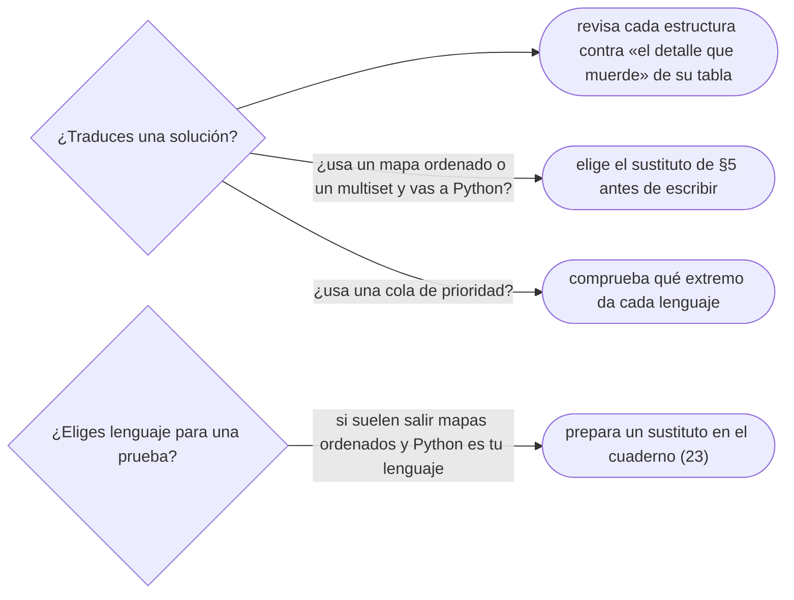

# 05 — La tabla de equivalencias

> Traducir una estructura de un lenguaje a otro y saber qué falta en cada uno: para cada tipo abstracto
> del corpus —pila, cola, deque, diccionario, diccionario ordenado, conjunto, *multiset*, cola de
> prioridad, *bitset*—, qué da C++, qué da Java, qué da Python, el detalle que muerde y el sustituto de
> lo que no existe.
>
> **Niveles:** la tabla [A].
>
> **📚 Lectura troncal:** cppreference, la API de Java 21 y la documentación de Python.
>
> **Asume leído:** [`03/01` — C++: contenedores](01-cpp-contenedores.md),
> [`03/03` — Java: las colecciones](03-java-colecciones.md) y
> [`03/04` — Python para competir](04-python-para-competir.md).
>
> **Vigencia:** 2026-10-04.

**Salto rápido:** [1](#1--el-problema) · [2](#2--cómo-se-lee-la-tabla) · [3](#3--pila-cola-y-deque) · [4](#4--diccionarios-y-conjuntos) · [5](#5--el-multiset) · [6](#6--la-cola-de-prioridad) · [7](#7--bits-ordenar-y-buscar) · [8](#8--lo-que-falta-en-cada-uno) · [🧠](#-preguntas) · [🧩](#-problemas-propios)

---

## 1. 🎯 El problema

Una solución en Java usa un `TreeMap<Integer, Integer>` como *multiset*: `floorKey` para el mayor
valor que no pasa de `x`, y decrementar el conteo al usarlo. Hay que pasarla a Python para una prueba
que solo admite Python. Y en Python **no hay** nada equivalente en la librería estándar.

O al revés: una solución en C++ con `priority_queue<int>` se traduce a Java con `PriorityQueue<Integer>`
sin tocar nada más, y Dijkstra empieza a sacar el nodo **más lejano**, porque uno es un montículo de
máximos y el otro de mínimos.

Las tres librerías estándar resuelven los mismos tipos abstractos de datos (`02/06`), pero con nombres
distintos, **comportamientos por defecto opuestos** y **huecos distintos**. Este capítulo es la tabla
que se consulta al cambiar de lenguaje —en una entrevista que pide otro, al leer una solución ajena, al
pasar del cuaderno de C++ al de Java— y la lista de lo que falta en cada uno con su sustituto.

---

## 2. 🧱 Cómo se lee la tabla

**Qué es.** Para cada tipo abstracto, una tabla con **una fila por lenguaje**, en el orden del corpus
(C++ · Java · Python), con lo que da la librería y el detalle que más errores produce al traducir.
Cuando Go o JavaScript cambian la respuesta, una nota al final de la sección, y el capítulo [`03/06`](06-sin-arsenal-go-y-javascript.md) los
trata a fondo.

**Cómo va.** La pregunta que guía la lectura no es «¿cómo se llama esto en el otro lenguaje?», sino
**«¿qué se comporta distinto?»**: el extremo que da el montículo, qué devuelve una consulta que no
encuentra nada, si una operación borra uno o todos, qué cuesta de verdad una operación con el mismo
nombre.

**Cuánto cuesta.** Consultarla, nada. **No consultarla** al traducir es la fuente de errores más
silenciosa: el código compila y da otra respuesta.

**Cuándo sí**: al traducir, al leer código de otro lenguaje y al preparar el cuaderno de un lenguaje
nuevo (`23`). **Cuándo no**: para aprender cada librería, que es de `03/01`–`03/04`.

> **Veredicto:** al traducir, cada línea que toca una estructura se revisa contra la columna «el
> detalle que muerde». Las traducciones literales fallan en silencio.

---

## 3. 🧱 Pila, cola y deque

### Pila

| Lenguaje | Qué te da | El detalle que muerde |
|---|---|---|
| **C++** | `std::stack<T>` (sobre `deque`), o un `vector` con `push_back`/`pop_back` | `pop()` no devuelve el elemento: `top()` y después `pop()` |
| **Java** | `ArrayDeque<T>` con `push`/`pop`/`peek` | `Stack` existe y no se usa; `pop` vacía lanza excepción |
| **Python** | `list` con `append`/`pop` | `pop()` sin argumento es el último, `O(1)` |

### Cola

| Lenguaje | Qué te da | El detalle que muerde |
|---|---|---|
| **C++** | `std::queue<T>` con `push`/`front`/`pop` | `pop()` no devuelve; `front()` sobre una cola vacía es comportamiento indefinido |
| **Java** | `ArrayDeque<T>` con `offer`/`poll` | `poll` vacía devuelve `null`; desempaquetarlo lanza excepción |
| **Python** | `collections.deque` con `append`/`popleft` | `list.pop(0)` es `O(n)` |

### Deque

| Lenguaje | Qué te da | El detalle que muerde |
|---|---|---|
| **C++** | `std::deque<T>`, también con índice `O(1)` | No es contigua; insertar en un extremo conserva las referencias pero invalida los iteradores |
| **Java** | `ArrayDeque<T>` con `offerFirst`/`offerLast`/`pollFirst`/`pollLast` | Sin acceso por índice; sin `null` |
| **Python** | `collections.deque` | Índice en el medio `O(n)` |

> 📝 **En JavaScript:** no hay cola ni deque; `Array.prototype.shift()` es `O(n)`. La cola se escribe
> con un arreglo y un índice de cabeza (`03/06`).

---

## 4. 🧱 Diccionarios y conjuntos

### Diccionario sin orden

| Lenguaje | Qué te da | El detalle que muerde |
|---|---|---|
| **C++** | `std::unordered_map<K, V>` | `m[k]` crea la clave; el *hash* de enteros es la identidad y se ataca |
| **Java** | `HashMap<K, V>` con `merge`/`getOrDefault` | `get` de una clave ausente devuelve `null`; los valores `Integer` se comparan con `equals` |
| **Python** | `dict`, `Counter`, `defaultdict` | Las claves tienen que ser *hashables* (tupla sí, lista no); `defaultdict` crea al consultar |

### Diccionario ordenado

| Lenguaje | Qué te da | El detalle que muerde |
|---|---|---|
| **C++** | `std::map<K, V>`, con `lower_bound`/`upper_bound` | El predecesor es `prev(upper_bound(x))`, comprobando antes `begin()` |
| **Java** | `TreeMap<K, V>`, con `floorKey`/`ceilingKey`/`lowerKey`/`higherKey` | Las cuatro devuelven `null` si no hay ninguna |
| **Python** | **No hay** en la librería estándar | `dict` conserva el orden de **inserción**, no el de las claves |

### Conjunto

| Lenguaje | Qué te da | El detalle que muerde |
|---|---|---|
| **C++** | `std::set` (ordenado) y `std::unordered_set` | El `std::lower_bound` libre sobre un `set` es `O(n)`: se usa el miembro |
| **Java** | `TreeSet` (ordenado) y `HashSet` | `TreeSet.floor` y compañía devuelven `null` |
| **Python** | `set` (sin orden) | No hay conjunto ordenado; `min(s)` es `O(n)` |

---

## 5. 🧱 El *multiset*

**Qué es.** El conjunto con repeticiones y orden: el TDA que más cambia de un lenguaje a otro.

| Lenguaje | Qué te da | El detalle que muerde |
|---|---|---|
| **C++** | `std::multiset<T>` | `erase(x)` borra todas las copias; una, con `erase(find(x))` |
| **Java** | No existe: `TreeMap<T, Integer>` de conteos | Al llegar a 0, hay que borrar la clave o `floorKey` la seguirá devolviendo |
| **Python** | No existe: `Counter` si no hace falta orden | Con orden, no hay estructura en la librería |

**Los sustitutos en Python**, de más simple a más general:

```text
n pequeño (≤ ~10⁵) y pocas operaciones  → lista ordenada con bisect.insort y del lista[i]
todas las operaciones conocidas de antes  → comprimir valores + árbol de Fenwick con conteos (09/02)
operaciones online y n grande            → un treap o una skip list escritos a mano (07/03)
solo el mínimo o el máximo, con borrados → heapq con borrado perezoso (08/02)
```

> **Veredicto:** el *multiset* es nativo solo en C++. En Java son conteos en un `TreeMap`; en Python hay
> que elegir el sustituto según `n` antes de empezar.

---

## 6. 🧱 La cola de prioridad

| Lenguaje | Qué te da | El detalle que muerde |
|---|---|---|
| **C++** | `std::priority_queue<T>`: **máximo** arriba | Para el mínimo, `std::greater<>` en el tercer parámetro |
| **Java** | `PriorityQueue<T>`: **mínimo** arriba | Para el máximo, `Collections.reverseOrder()`; el comparador, con `compare`, nunca con una resta |
| **Python** | `heapq` sobre una `list`: **mínimo** | Para el máximo, negar; con tuplas, un contador de desempate si los datos no se comparan |

**Lo que comparten los tres**: ninguno tiene `decrease-key` ni borrado arbitrario eficiente, y en los
tres el patrón es el mismo: **reinsertar con la prioridad nueva y descartar al sacar las entradas
viejas** ([`15/01`](../15-grafos-pesos-y-flujos/01-dijkstra.md)).

> 📝 **En Go y en JavaScript:** Go tiene `container/heap`, que exige implementar una interfaz de cinco
> métodos; JavaScript no tiene montículo y hay que escribirlo (`03/06`).

---

## 7. 🧱 Bits, ordenar y buscar

### Conjunto de bits

| Lenguaje | Qué te da | El detalle que muerde |
|---|---|---|
| **C++** | `std::bitset<N>` | `N` constante de compilación |
| **Java** | `BitSet` | Crece solo; `nextSetBit` para recorrer los unos |
| **Python** | Un `int` como máscara (`x \| (1 << i)`, `bin(x).count("1")`) | Sin límite de bits, pero cada operación sobre un entero enorme es `O(bits)` |

### Ordenar

| Lenguaje | Qué te da | El detalle que muerde |
|---|---|---|
| **C++** | `std::sort` (no estable), `std::stable_sort` | El comparador tiene que ser un orden estricto débil ([`03/02`](02-cpp-algoritmos-ranges-y-pbds.md)) |
| **Java** | `Arrays.sort` sobre primitivos (no estable) y sobre objetos (estable) | Comparadores con `Integer.compare`; en primitivos, respaldo de *heapsort* desde Java 14 |
| **Python** | `sorted` y `list.sort`, estables | Se ordena por clave con `key=`; el comparador de dos argumentos necesita `cmp_to_key` |

### Buscar en ordenado

| Lenguaje | Qué te da | El detalle que muerde |
|---|---|---|
| **C++** | `std::lower_bound`, `std::upper_bound` | Devuelven iteradores; restar `begin()` para el índice |
| **Java** | `Arrays.binarySearch`, `Collections.binarySearch` | Devuelven **algún** índice si hay repetidos, y `−(inserción) − 1` si no está |
| **Python** | `bisect.bisect_left`, `bisect.bisect_right` | Son el `lower_bound` y el `upper_bound` exactos |

> 📝 **En JavaScript:** `[10, 9, 1].sort()` ordena como **texto** y da `[1, 10, 9]`: con números, siempre
> `sort((a, b) => a - b)`.

---

## 8. 🧱 Lo que falta en cada uno

**Qué es.** El resumen de los huecos, que es lo que decide si una solución se traduce línea a línea o
hay que rediseñarla.

| Lenguaje | Lo que falta | El sustituto |
|---|---|---|
| **C++** | Enteros de precisión arbitraria; un mapa *hash* resistente a ataques por defecto | `__int128` hasta `10³⁸`; un *hash* propio con semilla aleatoria ([`06/03`](../06-lineales-y-hashing/03-tablas-hash.md)) |
| **Java** | *Multiset*; tipos sin *boxing* en las colecciones; un `ordered_set` con estadísticos de orden | `TreeMap` de conteos; arreglos primitivos; árbol de Fenwick con compresión |
| **Python** | Mapa, conjunto y *multiset* ordenados; montículo de máximos hasta 3.13; velocidad en bucles | Ver §5; negar prioridades; empujar el trabajo a la librería (`03/04`) |

**Cuánto cuesta.** Un hueco del lenguaje elegido puede añadir media hora a un problema de veinte
minutos. **Cuándo sí** se mira esta tabla: antes de elegir el lenguaje para una prueba, sabiendo qué
temas suelen salir. **Cuándo no**: a mitad de un problema; para entonces el lenguaje ya está elegido.

> **Veredicto:** C++ no tiene huecos para competir; Java tiene el del *multiset*, que se tapa en una
> línea; Python tiene el del mapa ordenado, que a veces obliga a otro diseño. Se sabe antes de empezar.

---

## 9. 🧭 Cómo se elige



> **Mejor:** «En Python no hay `TreeMap`; como las consultas se conocen de antemano, comprimo los valores
> y uso un Fenwick de conteos, que me da el mayor presente que no pasa de `x` en `O(log n)`.»

---

## ⚠️ Errores frecuentes

| Se dice | Lo preciso |
|---|---|
| «Todos los lenguajes tienen lo mismo» | Mismo TDA, nombres distintos, comportamientos por defecto opuestos y huecos distintos |
| «`priority_queue` y `PriorityQueue` son lo mismo» | Uno da el máximo y el otro el mínimo |
| «El `dict` de Python está ordenado» | Conserva el orden de inserción, no el de las claves |
| «`Arrays.binarySearch` es el `lower_bound` de Java» | Devuelve algún índice entre los iguales, no el primero |
| «Traducir `erase(x)` de un `multiset` es quitar una copia» | En C++ borra todas; la traducción fiel depende de qué quería el autor |
| «`sort()` ordena números en JavaScript» | Sin comparador, ordena como texto |

---

## 📚 Para profundizar

- **Documentación** — cppreference, [*Containers library*](https://en.cppreference.com/cpp/container):
  la tabla de todos los contenedores de C++. *Lectura troncal.*
- **Documentación** — Java 21, [`NavigableMap`](https://docs.oracle.com/en/java/javase/21/docs/api/java.base/java/util/NavigableMap.html)
  y [`Deque`](https://docs.oracle.com/en/java/javase/21/docs/api/java.base/java/util/Deque.html).
  *Lectura troncal.*
- **Documentación** — Python, [`collections`](https://docs.python.org/3/library/collections.html),
  [`heapq`](https://docs.python.org/3/library/heapq.html) y
  [`bisect`](https://docs.python.org/3/library/bisect.html). *Lectura troncal.*
- **Referencia** — la wiki de Python, [*TimeComplexity*](https://wiki.python.org/moin/TimeComplexity).
- **Libro** — Goodrich, Tamassia y Goldwasser, *Data Structures and Algorithms in Java*, 6.ª ed.
  (Wiley, 2014), caps. 6–7: los TDA de la tabla, implementados.

---

## 🧠 Preguntas

1. ¿Qué extremo da por defecto la cola de prioridad de C++, la de Java y la de Python? 🟢
2. ¿Qué estructura usas como *multiset* en Java? 🟢
3. ¿Qué devuelve `TreeMap.floorKey` si no hay ninguna clave que sirva, y qué hace el equivalente de C++? 🟡
4. ¿Qué diferencia hay entre el orden del `dict` de Python y el de un `std::map`? 🟡
5. ¿Qué diferencia hay entre `Arrays.binarySearch` y `bisect_left` cuando hay valores repetidos? 🟡
6. ¿Por qué la pila de C++ no devuelve el elemento en `pop()`, y cómo se traduce `x = stack.pop()` de Java? 🟡
7. Traduces a Java una solución C++ que usa `ms.erase(ms.find(x))` sobre un `multiset`. ¿Qué escribes y qué línea no puedes olvidar? 🟠
8. ¿Qué sustituto del mapa ordenado eliges en Python si todas las operaciones se conocen de antemano, y por qué ese? 🟠
9. Compara cómo se recorren los bits a 1 de un conjunto en C++, Java y Python, y el coste de cada forma. 🟠
10. Una solución de Dijkstra pasa de C++ a Java y da distancias incorrectas sin errores de compilación. ¿Qué miras primero? 🟠
11. Te piden resolver en Python un problema de «para cada consulta online, el menor valor guardado mayor o igual que `x`, con inserciones y borrados, `n = 2·10⁵`». Diseña la solución y justifica por qué no basta `insort`. 🔴
12. Escribe la tabla de huecos de §8 de memoria y, para cada hueco, el sustituto con su coste. 🔴

---

## 🧩 Problemas propios

Resuélvelos **en los tres lenguajes**: el ejercicio es la traducción, y cada lenguaje tiene una trampa
distinta.

### El menor que alcanza

**Nivel:** 🟡 · **Formato:** programa completo, en C++, Java y Python.

Hay un almacén de piezas con sus tamaños, con repetidos. Para cada pedido de tamaño `x`, se entrega la
**menor pieza de tamaño `≥ x`** y deja de estar disponible. Imprime el tamaño entregado, o `-1`.

- **Entrada.** Una línea con `n` y `m`. Una línea con los `n` tamaños. Una línea con los `m` pedidos.
- **Salida.** `m` líneas.
- **Restricciones.** `1 ≤ n, m ≤ 2·10⁵`; `1 ≤ tamaño, x ≤ 10⁹`. Límite: 2 segundos.

```text
Entrada            Salida
6 4                5
5 2 9 1 5 6        5
4 4 7 10           9
                   -1

Entrada            Salida
2 3                4
4 4                4
4 4 4              -1
```

**Pista 1:** al entregar una pieza de 5 cuando hay otra de 5, ¿qué hace la operación de borrado de tu
lenguaje con la otra?

🔥 **Para el geek — en Go:** sin estructura ordenada en la librería, la traducción a Go obliga a elegir
entre escribir un árbol o resolverlo *offline*.

### Los dos extremos de la urgencia

**Nivel:** 🟠 · **Formato:** programa completo, en C++, Java y Python.

Llegan tareas con su urgencia. Operaciones: `T u` añade una tarea de urgencia `u`; `M` atiende e imprime
la **más urgente** (mayor `u`); `m` atiende e imprime la **menos urgente** (menor `u`). Si no hay tareas,
imprime `-1`. Las tres operaciones se mezclan en cualquier orden.

- **Entrada.** Una línea con `q`. Después, `q` líneas con una operación.
- **Salida.** Una línea por cada `M` o `m`.
- **Restricciones.** `1 ≤ q ≤ 2·10⁵`; `1 ≤ u ≤ 10⁹`.

```text
Entrada            Salida
6                  9
T 5                2
T 9                5
T 2
M
m
m

Entrada            Salida
4                  -1
M                  7
T 7                -1
m
M
```

**Pista 1:** si hay que atender por los dos extremos, ¿te basta una sola cola de prioridad, y qué estructura de tu lenguaje da los dos?

---

## 🧩 Práctica externa

En todos, **resuélvelo en tu lenguaje y tradúcelo a otro de los tres**, revisando cada estructura contra
su tabla.

### Núcleo

| ✔ | Problema | Plataforma | Nivel | Patrón | Pista 1 |
|---|---|---|---|---|---|
| [ ] | [Valid Anagram](https://leetcode.com/problems/valid-anagram/) | LeetCode | 🟢 | Diccionario o arreglo de 26 | ¿Qué estructura de cada lenguaje cuenta caracteres con menos código? |
| [ ] | [Find the Difference](https://leetcode.com/problems/find-the-difference/) | LeetCode | 🟢 | Conteo o XOR | ¿Qué se cancela si combinas todos los caracteres de las dos cadenas? |
| [ ] | [Minimum Absolute Difference](https://leetcode.com/problems/minimum-absolute-difference/) | LeetCode | 🟢 | Ordenar con la librería | Tras ordenar, ¿entre qué pares puede estar la menor diferencia? |
| [ ] | [Mark and Toys](https://www.hackerrank.com/challenges/mark-and-toys/problem) | HackerRank | 🟢 | Ordenar y acumular | ¿Qué juguetes conviene comprar primero para comprar más? |
| [ ] | [K Closest Points to Origin](https://leetcode.com/problems/k-closest-points-to-origin/) | LeetCode | 🟡 | Cola de prioridad en cada lenguaje | ¿Qué extremo del montículo tienes que poder sacar para quedarte con los `k` más cercanos? |
| [ ] | [Longest Consecutive Sequence](https://leetcode.com/problems/longest-consecutive-sequence/) | LeetCode | 🟡 | Conjunto *hash* | ¿Desde qué números tiene sentido empezar a contar una secuencia? |

### Ampliación

| ✔ | Problema | Plataforma | Nivel | Patrón | Pista 1 |
|---|---|---|---|---|---|
| [ ] | [Design Front Middle Back Queue](https://leetcode.com/problems/design-front-middle-back-queue/) | LeetCode | 🟡 | Dos deques | ¿Cómo partes la cola en dos mitades para que el medio esté siempre en un extremo? |
| [ ] | [Merge k Sorted Lists](https://leetcode.com/problems/merge-k-sorted-lists/) | LeetCode | 🟠 | Cola de prioridad con desempate | Con objetos nodo que no se comparan, ¿qué metes en el montículo en Python? |
| [ ] | [Apartments](https://cses.fi/problemset/task/1084) | CSES | 🟡 | Ordenar y dos punteros | ¿Hace falta alguna estructura más que dos listas ordenadas? |

---

## ✅ Criterio de dominio

- Decir, para cada TDA de la tabla, el nombre en los tres lenguajes y el detalle que muerde.
- Traducir de memoria un `multiset` de C++ a Java y explicar qué haces en Python.
- Resolver «El menor que alcanza» en tu lenguaje y traducirlo a los otros dos.
- Recitar los huecos de §8 con su sustituto.

---

**Anterior:** [`03/04` — Python para competir](04-python-para-competir.md) ·
**Siguiente:** [`03/06` — Competir sin arsenal: Go y JavaScript](06-sin-arsenal-go-y-javascript.md) ·
**Relacionado:** [`02/06` — Tipos abstractos de datos](../02-analisis/06-tipos-abstractos-de-datos.md).
