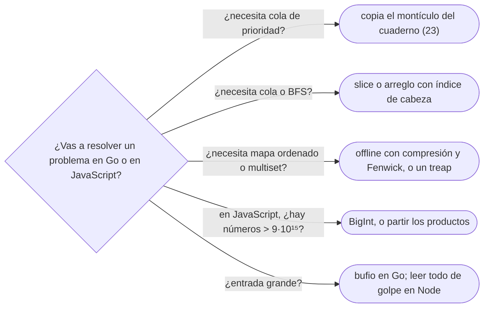

# 06 — Competir sin arsenal: Go y JavaScript

> Qué pasa cuando el lenguaje no trae la estructura o trae una trampa: el montículo con
> `container/heap`, la cola sobre un *slice* y la E/S con `bufio` en Go; el número que es un `double`,
> `BigInt`, el `sort` que ordena como texto, el `shift()` lineal y el montículo y la cola a mano en
> JavaScript. Todo el capítulo es «para el geek».
>
> **Niveles:** Go [B] · JavaScript [B].
>
> **📚 Lectura troncal:** Bodner, *Learning Go*, 2.ª ed. (O'Reilly, 2024); MDN, la referencia de
> JavaScript.
>
> **Asume leído:** [`03/05` — La tabla de equivalencias](05-equivalencias-entre-lenguajes.md).
>
> **Vigencia:** 2026-10-04.

**Salto rápido:** [1](#1--el-problema) · [2](#2--go-lo-que-trae-y-lo-que-no) · [3](#3--go-el-montículo-con-containerheap) · [4](#4--go-la-cola-y-la-es) · [5](#5--javascript-el-número-y-bigint) · [6](#6--javascript-sort-shift-y-las-estructuras-a-mano) · [7](#7--javascript-leer-la-entrada-en-node) · [8](#8-️-la-tabla-de-costes) · [🧠](#-preguntas) · [🧩](#-problemas-propios)

---

## 1. 🎯 El problema

En JavaScript, ordenar las puntuaciones `[10, 9, 1]`:

```js
// falla: sin comparador, sort convierte a texto y ordena como cadenas
[10, 9, 1].sort();            // [1, 10, 9]
```

Y en Go, un Dijkstra que en C++ son tres líneas de `priority_queue` necesita definir un tipo, cinco
métodos y conversiones desde `any`, porque Go no tiene montículo listo para usar: tiene una interfaz
que hay que implementar.

C++, Java y Python traen casi todo lo que un problema necesita (`03/05`). Go y JavaScript no: cada uno
deja fuera estructuras enteras y cambia reglas que en los otros se dan por supuestas, como que un
número entero sea exacto o que ordenar números los ordene como números. **Por eso el corpus los usa
como casos de estudio**: escribir un problema en Go o en JavaScript obliga a entender lo que los otros
lenguajes hacen por ti. Las versiones de referencia son las de HackerRank, la más baja de las bases que
los ofrece: **Go 1.26 y Node 20** ([`01/01`](../01-oficio-del-competidor/01-el-juez-los-veredictos-y-las-plataformas.md)). Las plantillas completas en los dos lenguajes se generan en
el cuaderno del bloque `23`.

---

## 2. 🧱 Go: lo que trae y lo que no

**Qué es.** Go es un lenguaje compilado con recolector de basura, con *slices* que crecen solos y mapas
nativos, y una librería estándar pequeña. **No es «C sin el más más»**: su modelo es de valores sin
*boxing*, sin herencia y sin estructuras ordenadas.

**Por qué es correcto** (el enunciado y una frase): lo que define el coste en Go es su **semántica de
valor**: un *slice* es una vista (puntero, longitud, capacidad) sobre un arreglo compartido, y un tipo
se copia entero al asignarlo salvo que sea un *slice*, un mapa, un canal o un puntero.

**Cómo va**, lo que hay y lo que no:

| Necesidad | En Go | El detalle que muerde |
|---|---|---|
| Arreglo dinámico | `[]int` con `append` | Dos *slices* pueden compartir el arreglo: un `append` puede pisar al otro |
| Diccionario | `map[K]V` | El orden de recorrido es aleatorio a propósito |
| Ordenar | `slices.Sort(a)`, `sort.Slice(a, less)` | `sort.Slice` no es estable; `sort.SliceStable` sí |
| Montículo | `container/heap` con una interfaz | Hay que escribir el tipo y cinco métodos (§3) |
| Cola, deque | No hay | Un *slice* con índice de cabeza, o un búfer circular (§4) |
| Mapa ordenado, *multiset* | No hay | Escribir un *treap* o resolver *offline* |
| Enteros | `int` de 64 bits en plataformas de 64 bits | El desbordamiento da la vuelta en silencio, como en Java |
| Grandes | `math/big` | Cada operación reserva memoria; lento en bucles |

- **`min` y `max` son funciones del lenguaje desde Go 1.21**, junto con los paquetes `slices` y `cmp`.
- **La división entera trunca hacia cero** y `%` toma el signo del dividendo, como en C++ y Java
  (`01/04`).
- **La lección de estilo** que hereda el corpus de Bodner: no escribir Java con sintaxis de Go. Nada de
  jerarquías de tipos; funciones y estructuras pequeñas.

**Cuánto cuesta.** Go compila a código nativo y su constante está entre la de C++ y la de Java. Lo caro
es el tiempo de escribir lo que falta.

**Cuándo sí** se compite en Go: con problemas que caben en *slices*, mapas y ordenar. **Cuándo no**:
con mapas ordenados o montículos en el centro del problema, salvo que lleves la estructura escrita.

> **Veredicto:** Go da arreglos, mapas y ordenación, y nada más. Todo lo ordenado o con prioridad lo
> escribes tú, y esa es la lección.

---

## 3. 🧱 Go: el montículo con `container/heap`

**Qué es.** `container/heap` no es un montículo: son las funciones que mantienen el invariante de
montículo ([`08/01`](../08-heaps-y-union-find/01-monticulo-binario.md)) sobre **cualquier tipo que implemente su interfaz**: `Len`, `Less`, `Swap`, `Push` y
`Pop`.

**Por qué es correcto** (el enunciado y una frase): `heap.Push` y `heap.Pop` llaman a tus `Push` y `Pop`
para cambiar el tamaño y a `Less` y `Swap` para subir y bajar elementos; si `Less` es un orden estricto,
el invariante se mantiene.

**Cómo va.**

```go
package main

import (
	"container/heap"
	"fmt"
)

// IntHeap es un montículo de mínimos de int; container/heap exige estos cinco métodos.
type IntHeap []int

func (h IntHeap) Len() int           { return len(h) }
func (h IntHeap) Less(i, j int) bool { return h[i] < h[j] } // con > sería de máximos
func (h IntHeap) Swap(i, j int)      { h[i], h[j] = h[j], h[i] }
func (h *IntHeap) Push(x any)        { *h = append(*h, x.(int)) }
func (h *IntHeap) Pop() any {
	old := *h
	n := len(old)
	x := old[n-1]
	*h = old[:n-1]
	return x
}

func main() {
	h := &IntHeap{5, 2, 9, 1, 5, 6}
	heap.Init(h)              // O(n)
	heap.Push(h, 0)           // O(log n)
	fmt.Println(heap.Pop(h))  // 0
}
```

- **Tus `Push` y `Pop` solo añaden y quitan del final**; `heap.Push` y `heap.Pop` (las del paquete)
  hacen el trabajo de reordenar. Llamar a `h.Pop()` directamente rompe el montículo.
- **`any` y la aserción `x.(int)`**: la interfaz trabaja con `any`, y cada `Push` y `Pop` convierte.
  Para pares `(distancia, nodo)`, el tipo es un *slice* de estructuras y `Less` compara el campo.
- **Para el máximo**, `Less` con `>`; no hay que negar como en Python.

**Cuánto cuesta.** `heap.Push` y `heap.Pop` en `O(log n)`, con llamadas a través de la interfaz y
conversiones de `any`, más lentas que el `priority_queue` de C++. **Cuándo sí**: siempre que Go necesite
una cola de prioridad. **Cuándo no**: si el problema solo necesita el mínimo de una vez; ahí, ordenar.

> **Veredicto:** en Go, el montículo es un tipo tuyo con cinco métodos y las funciones del paquete.
> Después de escribirlo una vez, se copia del cuaderno.

---

## 4. 🧱 Go: la cola y la E/S

**Qué es.** Go no tiene cola: se escribe sobre un *slice*. Y su E/S por defecto (`fmt.Scan`, `fmt.Println`)
es lenta para entradas grandes: se usa `bufio`.

**Cómo va.** La cola con índice de cabeza, que nunca mueve elementos:

```go
// Cola sobre un slice con índice de cabeza: Pop en O(1) sin desplazar nada.
type Queue struct {
	items []int
	head  int
}

func (q *Queue) Push(x int) { q.items = append(q.items, x) }
func (q *Queue) Pop() int   { x := q.items[q.head]; q.head++; return x }
func (q *Queue) Len() int   { return len(q.items) - q.head }
```

Y la plantilla de E/S rápida:

```go
package main

import (
	"bufio"
	"os"
	"strconv"
)

func main() {
	in := bufio.NewScanner(os.Stdin)
	in.Buffer(make([]byte, 1<<20), 1<<20) // admite líneas de hasta 1 MB
	in.Split(bufio.ScanWords)             // lee token a token
	next := func() int {
		in.Scan()
		x, _ := strconv.Atoi(in.Text())
		return x
	}
	out := bufio.NewWriter(os.Stdout)
	defer out.Flush() // sin esto, la salida se queda en el búfer

	n := next()
	var sum int64
	for i := 0; i < n; i++ {
		sum += int64(next())
	}
	out.WriteString(strconv.FormatInt(sum, 10) + "\n")
}
```

- **La cola desperdicia memoria**: los elementos sacados siguen en el *slice*. Con muchas operaciones,
  se compacta cuando `head` pasa de la mitad (`items = items[head:]`, `head = 0`). Para una deque con
  los dos extremos, un búfer circular como el de [`02/06`](../02-analisis/06-tipos-abstractos-de-datos.md).
- **`bufio.Scanner` con `ScanWords`** parte por blancos sin expresiones regulares; `Buffer` amplía el
  tamaño máximo de un *token*, que por defecto es 64 KB.
- **`defer out.Flush()`** es el `flush` de Java ([`01/03`](../01-oficio-del-competidor/03-entrada-salida-y-plantilla.md)): olvidarlo da una salida vacía.

**Cuánto cuesta.** Cola `O(1)` por operación; E/S con `bufio`, comparable a la de C++ con `sync_with_stdio`.
**Cuándo sí**: siempre que la entrada pase de unos miles de valores. **Cuándo no**: nunca sobra.

> **Veredicto:** en Go, la cola es un *slice* con un índice, y la E/S, `bufio` con `Flush` diferido.

---

## 5. 🧱 JavaScript: el número y `BigInt`

**Qué es.** En JavaScript, `Number` es un `double` de 64 bits: **los enteros son exactos solo hasta
`Number.MAX_SAFE_INTEGER = 2⁵³ − 1`**, unos `9·10¹⁵`. Para enteros mayores está `BigInt`, exacto y
arbitrariamente grande, con su propia aritmética.

**Por qué es correcto** (el enunciado y una frase): un `double` tiene 53 bits de mantisa; por encima de
`2⁵³` hay enteros consecutivos que se representan con el mismo valor, y las operaciones redondean sin
avisar.

**Cómo va.**

```js
const MOD = 1_000_000_007;
const a = 999_999_999, b = 999_999_999;
const wrong = (a * b) % MOD;                                   // a·b ≈ 10¹⁸ > 2⁵³: ya redondeado
const right = Number((BigInt(a) * BigInt(b)) % BigInt(MOD));   // exacto
const big = 2n ** 64n;                                          // literales BigInt con n
// 1n + 1  lanza TypeError: no se mezclan BigInt y Number
```

- **`a * b % MOD` con restos de `10⁹`** da un resultado incorrecto sin error: el producto pasa de `2⁵³`
  antes de reducir (`01/04`).
- **`BigInt` no se mezcla con `Number`**: hay que convertir los dos operandos, y volver con `Number()`
  si el resultado cabe.
- **Los operadores de bits** (`&`, `|`, `<<`, `>>`) convierten a **enteros de 32 bits con signo**: `1 << 31`
  es negativo y `x >> 1` sobre `3·10⁹` da basura. Para 64 bits, `BigInt` o aritmética.

**Cuánto cuesta.** `BigInt` es varias veces más lento que `Number`. La alternativa sin `BigInt` para el
producto modular es partir un factor en dos mitades de 15 o 16 bits, de forma que cada producto parcial
quede por debajo de `2⁵³`.

**Cuándo sí**: `BigInt` para productos modulares y números que pasan de `2⁵³`. **Cuándo no**: en bucles
calientes con números que caben; ahí, `Number`.

> **Veredicto:** en JavaScript, todo entero mayor que `9·10¹⁵` miente. Producto modular, con `BigInt` o
> partido; operadores de bits, solo con 32 bits.

---

## 6. 🧱 JavaScript: `sort`, `shift` y las estructuras a mano

**Qué es.** Tres trampas de la librería y dos estructuras que no existen.

**Las trampas:**

- **`sort()` sin comparador ordena como texto**: `[10, 9, 1].sort()` da `[1, 10, 9]`. Con números,
  `sort((x, y) => x - y)`; con números que pueden pasar de `2⁵³`, un comparador sin resta.
- **`shift()` es `O(n)`**: quita el primero y reindexa el arreglo. Un BFS con `shift()` es cuadrático,
  como el `pop(0)` de Python.
- **No hay montículo ni deque**: se escriben.

**Cómo va.** El montículo y la cola, mínimos:

```js
// Montículo binario de mínimos sobre un arreglo, con comparador.
class MinHeap {
  constructor(less = (x, y) => x < y) { this.a = []; this.less = less; }
  size() { return this.a.length; }
  peek() { return this.a[0]; }
  push(x) {
    const a = this.a;
    a.push(x);
    let i = a.length - 1;
    while (i > 0) {
      const p = (i - 1) >> 1;
      if (!this.less(a[i], a[p])) break;
      [a[i], a[p]] = [a[p], a[i]];
      i = p;
    }
  }
  pop() {
    const a = this.a, top = a[0], last = a.pop();
    if (a.length > 0) {
      a[0] = last;
      let i = 0;
      for (;;) {
        const l = 2 * i + 1, r = l + 1;
        let m = i;
        if (l < a.length && this.less(a[l], a[m])) m = l;
        if (r < a.length && this.less(a[r], a[m])) m = r;
        if (m === i) break;
        [a[i], a[m]] = [a[m], a[i]];
        i = m;
      }
    }
    return top;
  }
}

// Cola con índice de cabeza: dequeue en O(1) sin shift().
class Queue {
  constructor() { this.items = []; this.head = 0; }
  push(x) { this.items.push(x); }
  pop() { return this.items[this.head++]; }
  size() { return this.items.length - this.head; }
}
```

- **`push` sube y `pop` baja**, el `siftUp` y `siftDown` de `08/01`; el comparador permite pares
  `[distancia, nodo]` con `(x, y) => x[0] < y[0]`.
- **`(i - 1) >> 1`** es la división entera por dos; vale porque los índices caben en 32 bits.
- **La cola** desperdicia memoria como la de Go; se compacta igual cuando `head` pasa de la mitad.

**Cuánto cuesta.** Montículo `O(log n)`, cola `O(1)`. **Cuándo sí**: cualquier Dijkstra o BFS en
JavaScript. **Cuándo no**: con un solo uso del mínimo; ahí, ordenar.

> **Veredicto:** en JavaScript, el comparador numérico siempre, `shift()` nunca en un bucle, y el
> montículo y la cola, del cuaderno.

---

## 7. 🧱 JavaScript: leer la entrada en Node

**Qué es.** Node no tiene una lectura de *tokens* desde la entrada estándar como `cin`. La forma
rápida y simple es **leer toda la entrada de golpe**, partirla y recorrer el arreglo con un índice.

**Cómo va.**

```js
const data = require("fs").readFileSync(0, "utf8").split(/\s+/).filter(Boolean);
let pos = 0;
const next = () => data[pos++];

const n = Number(next());
let sum = 0;
for (let i = 0; i < n; i++) sum += Number(next());
const out = [];
out.push(String(sum));
process.stdout.write(out.join("\n") + "\n");
```

- **`readFileSync(0)`** lee el descriptor 0, la entrada estándar, entera.
- **`split(/\s+/)` y `filter(Boolean)`** parten por cualquier blanco y quitan la cadena vacía del
  principio o del final.
- **Una sola escritura al final**: `console.log` en un bucle de `10⁶` es lento.
- **«Hasta el final de la entrada»** es `pos < data.length`.

**Cuánto cuesta.** Una lectura y un `split` sobre toda la entrada; con decenas de MB, memoria
proporcional. **Cuándo sí**: siempre en problemas de programa completo. **Cuándo no**: en problemas
interactivos ([`20/03`](../20-ad-hoc-constructivos-e-interactivos/03-interactivos.md)), donde hay que leer línea a línea con `readline`.

> **Veredicto:** en Node, se lee todo de golpe y se escribe una vez. Lo demás es la plantilla de
> `01/03` con otra sintaxis.

---

## 8. ⏱️ La tabla de costes

| Lenguaje | Qué hay que escribir a mano | El detalle que muerde |
|---|---|---|
| **Go** | Montículo (sobre `container/heap`), cola, deque, mapa ordenado | `append` sobre *slices* compartidos; mapas con orden aleatorio |
| **JavaScript** | Montículo, cola, deque, mapa ordenado | `Number` exacto solo hasta `2⁵³`; `sort` como texto; `shift` `O(n)`; bits de 32 |

---

## 9. 🧭 Cómo se elige



> **Mejor:** «En JavaScript el producto de dos restos ya pasa de `2⁵³`, así que lo hago con `BigInt`; y
> la cola del BFS, con un índice de cabeza, porque `shift()` es lineal.»

---

## ⚠️ Errores frecuentes

| Se dice | Lo preciso |
|---|---|
| «Go es C sin el más más» | Tiene recolector, *slices* que crecen y mapas nativos; lo que no tiene son estructuras ordenadas y montículos listos |
| «`[10, 9, 1].sort()` ordena números» | Ordena como texto: `[1, 10, 9]` |
| «En JavaScript los enteros son exactos» | Solo hasta `2⁵³ − 1`; después redondean en silencio |
| «`shift()` es la forma de sacar de una cola» | Es `O(n)`: reindexa todo el arreglo |
| «`container/heap` es un montículo» | Es un conjunto de funciones sobre tu tipo, que implementa cinco métodos |
| «`x >> 1` divide por dos en JavaScript» | Convierte a 32 bits: con valores grandes da basura |

---

## 📚 Para profundizar

- **Libro** — Bodner, *Learning Go*, 2.ª ed. (O'Reilly, 2024): los modismos de Go, los *slices* y los
  mapas por dentro. *Lectura troncal.*
- **Documentación** — Go, [`container/heap`](https://pkg.go.dev/container/heap),
  [`slices`](https://pkg.go.dev/slices) y [`bufio`](https://pkg.go.dev/bufio).
- **Documentación** — Go, [*Go Slices: usage and internals*](https://go.dev/blog/slices-intro): por qué
  dos *slices* pueden compartir el arreglo.
- **Documentación** — MDN, [`Array.prototype.sort`](https://developer.mozilla.org/en-US/docs/Web/JavaScript/Reference/Global_Objects/Array/sort)
  y [`Array.prototype.shift`](https://developer.mozilla.org/en-US/docs/Web/JavaScript/Reference/Global_Objects/Array/shift).
  *Lectura troncal.*
- **Documentación** — MDN, [`BigInt`](https://developer.mozilla.org/en-US/docs/Web/JavaScript/Reference/Global_Objects/BigInt)
  y [`Number.MAX_SAFE_INTEGER`](https://developer.mozilla.org/en-US/docs/Web/JavaScript/Reference/Global_Objects/Number/MAX_SAFE_INTEGER).
- **Documentación** — Node, [`fs`](https://nodejs.org/api/fs.html): `readFileSync` sobre el
  descriptor 0.

---

## 🧠 Preguntas

1. ¿Qué cinco métodos exige `container/heap` en Go? 🟢
2. ¿Hasta qué entero es exacto un `Number` de JavaScript? 🟢
3. ¿Qué da `[10, 9, 1].sort()` y por qué? 🟢
4. ¿Qué diferencia hay entre llamar a `heap.Pop(h)` y a `h.Pop()` en Go? 🟡
5. ¿Por qué `shift()` hace cuadrático un BFS en JavaScript, y qué se usa en su lugar? 🟡
6. ¿Qué diferencia hay entre `sort.Slice` y `sort.SliceStable` en Go? 🟡
7. Compara cómo se obtiene un montículo de máximos en C++, Java, Python, Go y JavaScript. 🟠
8. ¿Por qué `(a * b) % MOD` da un resultado incorrecto en JavaScript con `a` y `b` cerca de `10⁹`, y qué dos alternativas hay? 🟠
9. ¿Qué puede pasar en Go si dos variables comparten un *slice* y una de ellas hace `append`? 🟠
10. ¿Por qué `1 << 31` es negativo en JavaScript, y qué consecuencia tiene para un problema de máscaras de 40 bits? 🟠
11. Diseña en Go la estructura para un Dijkstra: el tipo del montículo, qué guarda cada elemento y cómo se descartan las entradas viejas. 🔴
12. Escribe cómo calcularías `a · b mod m` en JavaScript sin `BigInt`, con `a, b < m ≤ 10⁹ + 7`, y por qué ningún producto parcial pasa de `2⁵³`. 🔴

---

## 🧩 Problemas propios

Resuélvelos **en Go y en JavaScript**: en los dos cambia el razonamiento, no solo la sintaxis.

### Suma sin redondeo

**Nivel:** 🟢 · **Formato:** programa completo.

Imprime la suma exacta de `n` enteros.

- **Entrada.** Una línea con `n`. Una línea con los `n` enteros.
- **Salida.** Un entero.
- **Restricciones.** `1 ≤ n ≤ 2·10⁵`; `0 ≤ a[i] ≤ 10¹³`.

```text
Entrada            Salida
3                  60
10 20 30

Entrada            Salida
2                  20000000000000
10000000000000 10000000000000
```

**Pista 1:** ¿cuánto puede valer la suma, y es exacta en el tipo numérico de tu lenguaje?

### Turnos por urgencia

**Nivel:** 🟡 · **Formato:** programa completo.

Operaciones: `T u` añade una tarea de urgencia `u`; `A` atiende e imprime la de **menor** `u` (la más
inmediata), o `-1`.

- **Entrada.** Una línea con `q`. Después, `q` líneas con una operación.
- **Salida.** Una línea por cada `A`.
- **Restricciones.** `1 ≤ q ≤ 2·10⁵`; `1 ≤ u ≤ 10⁹`.

```text
Entrada            Salida
7                  2
T 5                5
T 2                9
A                  -1
A
T 9
A
A

Entrada            Salida
4                  -1
A                  3
T 3
T 3
A
```

**Pista 1:** ¿qué estructura te da el menor en cada momento, y está en la librería de tu lenguaje?

### Producto modular

**Nivel:** 🟠 · **Formato:** programa completo.

Imprime el producto de los `n` valores módulo `10⁹ + 7`.

- **Entrada.** Una línea con `n`. Una línea con los `n` valores.
- **Salida.** Un entero en `[0, 10⁹ + 6]`.
- **Restricciones.** `1 ≤ n ≤ 2·10⁵`; `1 ≤ a[i] ≤ 10⁹`. Límite: 1 segundo.

```text
Entrada            Salida
3                  6
1 2 3

Entrada            Salida
2                  49
1000000000 1000000000
```

**Pista 1:** el producto de dos restos ronda `10¹⁸`: ¿es exacto en el tipo con que lo calculas?

---

## 🧩 Práctica externa

Las tres bases admiten Go y JavaScript. **Resuélvelos en Go o en JavaScript**: con C++, Java o Python
serían triviales.

### Núcleo

| ✔ | Problema | Plataforma | Nivel | Patrón | Pista 1 |
|---|---|---|---|---|---|
| [ ] | [Big Sorting](https://www.hackerrank.com/challenges/big-sorting/problem) | HackerRank | 🟢 | Comparador propio | Los números tienen hasta `10⁶` cifras: ¿los conviertes, o comparas las cadenas? |
| [ ] | [Last Stone Weight](https://leetcode.com/problems/last-stone-weight/) | LeetCode | 🟢 | Montículo escrito a mano | ¿Qué dos piedras necesitas cada vez, y de dónde las sacas sin ordenar todo? |
| [ ] | [Time Needed to Buy Tickets](https://leetcode.com/problems/time-needed-to-buy-tickets/) | LeetCode | 🟢 | Cola o fórmula | ¿Hace falta simular la cola, o cada persona aporta una cantidad que se calcula? |
| [ ] | [Relative Ranks](https://leetcode.com/problems/relative-ranks/) | LeetCode | 🟢 | Ordenar números de verdad | ¿Qué hace `sort()` sin comparador con estas puntuaciones? |
| [ ] | [Nesting](https://app.codility.com/programmers/lessons/7-stacks_and_queues/nesting/) | Codility | 🟢 | Contador o pila | ¿Necesitas guardar los paréntesis, o basta un número? |
| [ ] | [Extra Long Factorials](https://www.hackerrank.com/challenges/extra-long-factorials/problem) | HackerRank | 🟡 | Enteros grandes | ¿Cuántas cifras tiene `100!`, y qué tipo las representa? |
| [ ] | [Reveal Cards In Increasing Order](https://leetcode.com/problems/reveal-cards-in-increasing-order/) | LeetCode | 🟡 | Simular con una cola | Si simulas el proceso con posiciones en vez de cartas, ¿qué posición recibe cada carta? |

### Ampliación

| ✔ | Problema | Plataforma | Nivel | Patrón | Pista 1 |
|---|---|---|---|---|---|
| [ ] | [Dota2 Senate](https://leetcode.com/problems/dota2-senate/) | LeetCode | 🟡 | Dos colas | Si cada senador vuelve al final de la cola tras actuar, ¿qué posición tiene? |
| [ ] | [Exponentiation II](https://cses.fi/problemset/task/1712) | CSES | 🟡 | Producto modular | ¿A qué módulo se reduce el exponente, y por qué ese? |
| [ ] | [Concert Tickets](https://cses.fi/problemset/task/1091) | CSES | 🟠 | Mapa ordenado que no existe | Sin un `multiset`, ¿puedes resolverlo con los precios ordenados y una forma de saltar los vendidos? |

---

## ✅ Criterio de dominio

- Escribir de memoria el montículo de `container/heap` en Go y el `MinHeap` en JavaScript.
- Explicar las cuatro trampas numéricas y de librería de JavaScript: `2⁵³`, `sort`, `shift` y bits de
  32.
- Resolver los tres problemas propios en Go y en JavaScript.
- Resolver Concert Tickets en Go o en JavaScript sin estructura ordenada de librería.

---

**Anterior:** [`03/05` — La tabla de equivalencias](05-equivalencias-entre-lenguajes.md) ·
**Siguiente:** [`03/07` — Simulación](07-simulacion.md) ·
**Relacionado:** [`01/04` — Tipos, desbordamiento y módulo](../01-oficio-del-competidor/04-tipos-desbordamiento-y-modulo.md); [`08/01` — Montículo binario](../08-heaps-y-union-find/01-monticulo-binario.md).
