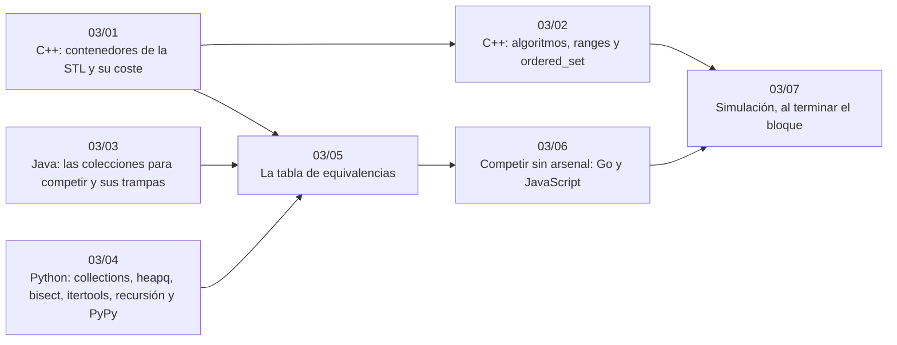

# Bloque 03 — Biblioteca estándar

> Lo que ya viene escrito en cada lenguaje y lo que cuesta: los contenedores y algoritmos de la STL (con
> `ordered_set` de PBDS), las colecciones de Java y sus trampas, lo que Python tiene para competir y su límite de
> recursión, la tabla de equivalencias entre los tres, y qué hacer en Go y JavaScript, donde falta medio arsenal.
> Sin teoría algorítmica: es el bloque de «no lo implemento, uso esto».
>
> Las respuestas de las preguntas y las pistas 2 y 3 de los problemas, en [`08` — Respuestas](08-respuestas.md).
>
> **Vigencia:** 2026-10-04.

---

## 🧭 Índice

| Capítulo | Niveles | Ruta corta |
|---|---|---|
| [`03/01` — C++: contenedores de la STL y su coste](01-cpp-contenedores.md) | `vector`, `deque`, `set`/`multiset`, `map`, `unordered_map`, `priority_queue` [A] · `bitset`, `list` [B] | sí |
| [`03/02` — C++: algoritmos, *ranges* y `ordered_set`](02-cpp-algoritmos-ranges-y-pbds.md) | `sort`, `lower_bound`, `next_permutation`, `nth_element`, `accumulate`, `partial_sum` [A] · `std::ranges` [B] · `ordered_set` de PBDS [B] |  |
| [`03/03` — Java: las colecciones para competir y sus trampas](03-java-colecciones.md) | `ArrayList`, `ArrayDeque`, `HashMap`, `TreeMap`, `PriorityQueue` [A] · `BitSet`, `Arrays`, `Collections` [B] | sí |
| [`03/04` — Python: `collections`, `heapq`, `bisect`, `itertools`, recursión y PyPy](04-python-para-competir.md) | `list`, `dict`, `set`, `deque`, `Counter`, `defaultdict`, `heapq`, `bisect` [A] · `itertools`, `functools.cache`, `sys.setrecursionlimit` [A] · PyPy [B] | sí |
| [`03/05` — La tabla de equivalencias](05-equivalencias-entre-lenguajes.md) | la tabla [A] |  |
| [`03/06` — Competir sin arsenal: Go y JavaScript](06-sin-arsenal-go-y-javascript.md) | Go [B] · JavaScript [B] |  |
| [`03/07` — Simulación](07-simulacion.md) | El examen del bloque: preguntas transversales y problemas cronometrados | |
| [`03/08` — Respuestas](08-respuestas.md) | Las preguntas en tres capas y las pistas 2 y 3 | |

---

## 🧭 Orden de lectura

- Se lee el capítulo del lenguaje propio (`03/01`, `03/03` o `03/04`) y después `03/05`; el resto, al cambiar de lenguaje.
- `03/06` es para quien compite o entrevista en Go o JavaScript.

---

## 🔎 Mapa de señales del bloque

| Señal | Técnica | Capítulo |
|---|---|---|
| Necesitas un conjunto ordenado con «el siguiente mayor» | `std::set` y `TreeSet`; en Python no hay: `bisect` sobre una lista ordenada o una estructura propia | [`03/05`](05-equivalencias-entre-lenguajes.md) |
| «El `k`-ésimo menor» dinámico en C++ | `ordered_set` de PBDS | [`03/02`](02-cpp-algoritmos-ranges-y-pbds.md) |
| Java da TLE con la lógica correcta | *Boxing*, `Scanner` o `HashMap` atacado | [`03/03`](03-java-colecciones.md) |
| Python da `RecursionError` o TLE | `sys.setrecursionlimit`, iterativo, PyPy | [`03/04`](04-python-para-competir.md) |
| Compites en Go o JavaScript y te falta un *heap* o un mapa ordenado | Escribirlo a mano | [`03/06`](06-sin-arsenal-go-y-javascript.md) |

---

## 📚 Lectura troncal del bloque

La de cada capítulo, que es también la primera entrada de su «Para profundizar»:

- **`03/01`** — Farrier, *Data Structures and Algorithms with the C++ STL* (Packt, 2024), caps. 1–9; cppreference, [*Containers library*](https://en.cppreference.com/cpp/container).
- **`03/02`** — Farrier, *Data Structures and Algorithms with the C++ STL* (Packt, 2024), caps. 11–15; cppreference; la documentación de GCC sobre las estructuras basadas en políticas.
- **`03/03`** — la documentación de la API de Java 21, paquete `java.util`; Sedgewick y Wayne, *Algorithms*, 4.ª ed. (Addison-Wesley, 2011), cap. 1.
- **`03/04`** — Miller y Ranum, *Problem Solving with Algorithms and Data Structures using Python*, cap. 2; Ramalho, *Fluent Python*, 2.ª ed. (O'Reilly, 2022), caps. 2–3; la documentación de Python.
- **`03/05`** — cppreference, la API de Java 21 y la documentación de Python.
- **`03/06`** — Bodner, *Learning Go*, 2.ª ed. (O'Reilly, 2024); MDN, la referencia de JavaScript.

---

## 🧭 Qué NO está aquí

- **Por qué funciona cada estructura**: el montículo en [`08/01` — Montículo binario](../08-heaps-y-union-find/01-monticulo-binario.md), el árbol rojo-negro en [`07/02` — BST y árboles balanceados](../07-arboles/02-bst-y-balanceados.md), la tabla *hash* en [`06/03` — Tablas *hash* por dentro y los *anti-hash tests*](../06-lineales-y-hashing/03-tablas-hash.md).
- **Entrada y salida rápidas**: en [`01/03` — Entrada, salida y la plantilla en C++, Java y Python](../01-oficio-del-competidor/03-entrada-salida-y-plantilla.md).
- **Las plantillas completas de Go y JavaScript**: en el cuaderno opcional [`23`](../23-cuaderno-de-competencia/README.md).

---

**Anterior:** [Bloque 02 — Análisis](../02-analisis/README.md) ·
**Siguiente:** [Bloque 04 — Secuencias](../04-secuencias/README.md) ·
**Inicio:** [README del corpus](../README.md)
