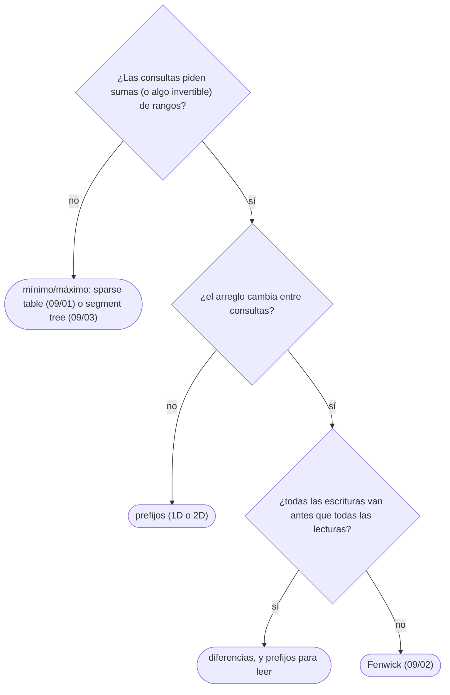

# 01 — Sumas de prefijos y arreglos de diferencias

> Responder la suma de cualquier rango en `O(1)` tras un preproceso lineal, y aplicar sumas a rangos
> enteros en `O(1)` cada una; en una y en dos dimensiones. Las dos técnicas son inversas una de la otra,
> y juntas son la base de medio bloque.
>
> **Niveles:** prefijos 1D [A] · diferencias 1D [A] · prefijos y diferencias 2D [A].
>
> **📚 Lectura troncal:** Laaksonen, *Guide to Competitive Programming*, 3.ª ed. (Springer, 2024),
> cap. 9; Halim, Halim y Effendy, *Competitive Programming 4*, libro 1 (2020), cap. 3.
>
> **Ruta corta:** sí.
>
> **Vigencia:** 2026-10-04.

**Salto rápido:** [1](#1--el-problema) · [2](#2--la-teoría) · [3](#3--prefijos-1d) · [4](#4--diferencias-1d) · [5](#5--prefijos-y-diferencias-2d) · [6](#6-️-la-tabla-de-costes) · [7](#7--cómo-se-elige) · [8](#8--señales-del-enunciado) · [🧠](#-preguntas) · [🧩](#-problemas-propios)

---

## 1. 🎯 El problema

Un arreglo de `n = 2·10⁵` ventas diarias y `q = 2·10⁵` preguntas: «¿cuánto se vendió entre el día `l` y
el día `r`?». Sumar el rango en cada pregunta son, en el caso peor, `n · q = 4·10¹⁰` sumas: unas 400
veces lo que cabe en un segundo. Pero la suma de los días 3 a 9 y la de los días 3 a 10 comparten casi
todo: si se guarda **la suma acumulada hasta cada día** —los prefijos—, cualquier rango es **una resta
de dos prefijos**, `O(1)` por pregunta tras un recorrido.

El problema simétrico, «suma `v` a todos los días de `l` a `r`» `q` veces y dar el arreglo al final,
vuelve a ser `n · q` si se aplica día a día. La técnica inversa, el **arreglo de diferencias**, registra
cada operación en dos posiciones y reconstruye el resultado con un solo recorrido.

> 🧠 **Modelo mental.** Recordatorio, si llegas directo aquí: con `n` y `q` hasta `2·10⁵`, un algoritmo
> `O(n · q)` son `4·10¹⁰` pasos y no cabe en un segundo ([`01/02`](../01-oficio-del-competidor/02-leer-las-restricciones.md)); `O(n + q)` son `4·10⁵` y sobra.

---

## 2. 📐 La teoría

**Definiciones.** Para un arreglo `a[0..n−1]`, el **arreglo de prefijos** tiene `n + 1` posiciones:

```text
P[0] = 0          P[i + 1] = P[i] + a[i]          es decir, P[k] = a[0] + a[1] + ... + a[k−1]
```

El desplazamiento de índice —`P` tiene una posición más que `a`, y `P[0] = 0`— es lo que evita casos
especiales: el prefijo vacío existe y vale 0.

**Teorema (suma telescópica).** Para todo `0 ≤ l ≤ r < n`, la suma de `a[l..r]` es `P[r + 1] − P[l]`.

*Prueba.* `P[r + 1] − P[l] = (a[0] + … + a[r]) − (a[0] + … + a[l−1]) = a[l] + … + a[r]`: los términos de
`0` a `l − 1` aparecen en los dos y se cancelan. Por eso se llama telescópica: el resto «se pliega».

**Las diferencias, como inversa.** El arreglo de diferencias de `b` es `D[0] = b[0]` y `D[i] = b[i] −
b[i−1]`; sus prefijos devuelven `b`, como integrar deshace derivar.

**Teorema (actualización de rango).** Sumar `v` a `b[l..r]` equivale a hacer `D[l] += v` y
`D[r + 1] −= v`, sin tocar nada más.

*Prueba.* Al reconstruir con prefijos, el `+v` en `l` se arrastra a todas las posiciones desde `l` y el
`−v` en `r + 1` lo cancela desde ahí: solo `l..r` acumulan el `+v`.

**En dos dimensiones**, la misma idea con **inclusión-exclusión**. `S[i][j]` es la suma del rectángulo de
filas `0..i−1` y columnas `0..j−1`, y:

```text
S[i+1][j+1] = M[i][j] + S[i][j+1] + S[i+1][j] − S[i][j]           (construir)
suma de filas r1..r2 y columnas c1..c2 =
      S[r2+1][c2+1] − S[r1][c2+1] − S[r2+1][c1] + S[r1][c1]        (consultar)
```

En los dos casos, el rectángulo de la esquina se descuenta dos veces y se devuelve una. Laaksonen,
cap. 9, lo trata entero.

---

## 3. 🧱 Prefijos 1D

**Qué es.** Un arreglo `P` de `n + 1` posiciones con las sumas acumuladas, que responde la suma de
cualquier rango con una resta.

**Por qué es correcto.** Por el teorema de la suma telescópica de §2.

**Cómo va**, sobre el arreglo de juguete:

```text
i       0   1   2   3   4   5   6
a[i]    5   2   9   1   5   6
P[i]    0   5   7  16  17  22  28

suma de a[1..3] = 2 + 9 + 1 = P[4] − P[1] = 17 − 5 = 12
```

**Cuánto.** Preproceso `Θ(n)` en tiempo y `Θ(n)` en memoria; cada consulta `Θ(1)`. Los prefijos llegan
a `n · max|a|`: con `2·10⁵` valores de `10⁹`, `2·10¹⁴`, así que van en 64 bits ([`01/04`](../01-oficio-del-competidor/04-tipos-desbordamiento-y-modulo.md)).

**La plantilla**, en los tres lenguajes:

```cpp
#include <vector>

// P[k] = a[0] + ... + a[k-1]; suma de a[l..r] = P[r+1] - P[l].
std::vector<long long> buildPrefix(const std::vector<int>& a) {
    std::vector<long long> p(a.size() + 1, 0);
    for (std::size_t i = 0; i < a.size(); i++) p[i + 1] = p[i] + a[i];
    return p;
}

long long rangeSum(const std::vector<long long>& p, int l, int r) {   // l, r incluidos
    return p[r + 1] - p[l];
}
```

```java
// P[k] = a[0] + ... + a[k-1]; suma de a[l..r] = P[r+1] - P[l].
static long[] buildPrefix(int[] a) {
    long[] p = new long[a.length + 1];
    for (int i = 0; i < a.length; i++) p[i + 1] = p[i] + a[i];
    return p;
}

static long rangeSum(long[] p, int l, int r) {   // l, r incluidos
    return p[r + 1] - p[l];
}
```

```python
from itertools import accumulate

def build_prefix(a):
    """P[k] = a[0] + ... + a[k-1]; suma de a[l..r] = P[r+1] - P[l]."""
    return [0] + list(accumulate(a))

def range_sum(p, l, r):   # l, r incluidos
    return p[r + 1] - p[l]
```

- **El tamaño `n + 1` y `P[0] = 0`** en los tres: con eso, el rango que empieza en 0 no es un caso
  especial.
- **C++ y Java**: `long long` y `long` para los prefijos, aunque los datos sean `int`; en C++,
  `std::partial_sum` hace lo mismo en una línea, con el cuidado del tipo de [`03/02`](../03-biblioteca-estandar/02-cpp-algoritmos-ranges-y-pbds.md).
- **Python**: `accumulate` corre en C y no desborda; el `[0] +` delante añade el prefijo vacío.

### De la versión ingenua a la buena

**El problema.** `q` consultas de suma de rango sobre `n` ventas, con `n, q ≤ 2·10⁵`. Con
`[5, 2, 9, 1, 5, 6]` y la consulta `(1, 3)`, la respuesta es 12.

**La versión ingenua:**

```java
// Cada consulta suma su rango desde cero: O(n) por consulta, O(n·q) en total.
static long[] answerQueries(int[] a, int[][] queries) {
    long[] ans = new long[queries.length];
    for (int k = 0; k < queries.length; k++) {
        long sum = 0;
        for (int i = queries[k][0]; i <= queries[k][1]; i++) sum += a[i];
        ans[k] = sum;
    }
    return ans;
}
```

> «Esto es `O(n·q)`: con `2·10⁵` y `2·10⁵` son `4·10¹⁰`. Lo que repito es sumar tramos que se solapan
> entre consultas. Si precalculo las sumas acumuladas, cada rango es una resta de dos prefijos: `O(n)` de
> preproceso y `O(1)` por consulta.»

**El camino a la buena.** `buildPrefix` una vez y `rangeSum` en cada consulta. El bucle interno
desaparece.

**Cuándo sí**: muchas consultas de suma sobre un arreglo **que no cambia**. **Cuándo no**: si hay
actualizaciones entre las consultas; rehacer los prefijos cuesta `O(n)` por cambio, y ahí entra el
árbol de Fenwick ([`09/02`](../09-consultas-sobre-rangos/02-fenwick.md)). Tampoco sirve para mínimos o máximos de rango: el mínimo no tiene «resta»
([`09/01`](../09-consultas-sobre-rangos/01-sparse-table.md)).

> **Veredicto:** prefijos siempre que haya sumas de rangos sobre datos fijos. Un árbol de segmentos para
> esto es ceremonia: los prefijos lo resuelven en tres líneas.

---

## 4. 🧱 Diferencias 1D

**Qué es.** Un arreglo `D` donde cada operación «suma `v` a `[l, r]`» se registra en dos posiciones; el
resultado final se reconstruye con los prefijos de `D`.

**Por qué es correcto.** Por el teorema de la actualización de rango de §2: cada operación solo cambia
las diferencias de sus dos bordes.

**Cómo va**, con `n = 6` y tres operaciones: `+2` en `[1, 3]`, `+1` en `[2, 5]`, `+4` en `[0, 0]`:

```text
operación          D[0] D[1] D[2] D[3] D[4] D[5] D[6]
+2 en [1,3]          0    2    0    0   −2    0    0
+1 en [2,5]          0    2    1    0   −2    0   −1
+4 en [0,0]          4   −2    1    0   −2    0   −1

prefijos de D:       4    2    3    3    1    1          ← el arreglo final
```

**Cuánto.** Cada operación `Θ(1)`; la reconstrucción, `Θ(n)`. Total `Θ(n + q)`, memoria `Θ(n)`.

**La plantilla:**

```cpp
#include <vector>

// Suma v a [l, r] en O(1); al final, finish() reconstruye el arreglo con prefijos.
struct RangeAdd {
    std::vector<long long> d;
    explicit RangeAdd(int n) : d(n + 1, 0) {}
    void add(int l, int r, long long v) { d[l] += v; d[r + 1] -= v; }
    std::vector<long long> finish() const {
        std::vector<long long> b(d.size() - 1);
        long long run = 0;
        for (std::size_t i = 0; i + 1 < d.size(); i++) b[i] = (run += d[i]);
        return b;
    }
};
```

```java
// Suma v a [l, r] en O(1); al final, finish() reconstruye el arreglo con prefijos.
final class RangeAdd {
    private final long[] d;
    RangeAdd(int n) { d = new long[n + 1]; }
    void add(int l, int r, long v) { d[l] += v; d[r + 1] -= v; }
    long[] finish() {
        long[] b = new long[d.length - 1];
        long run = 0;
        for (int i = 0; i < b.length; i++) b[i] = (run += d[i]);
        return b;
    }
}
```

```python
from itertools import accumulate

class RangeAdd:
    """Suma v a [l, r] en O(1); al final, finish() reconstruye el arreglo con prefijos."""

    def __init__(self, n):
        self.d = [0] * (n + 1)

    def add(self, l, r, v):
        self.d[l] += v
        self.d[r + 1] -= v

    def finish(self):
        return list(accumulate(self.d[:-1]))   # prefijos de las diferencias
```

- **El tamaño `n + 1`**: la posición `r + 1` existe aunque `r = n − 1`, y así no hay que comprobar el
  borde.
- **Los tres** separan registrar (`add`) de reconstruir (`finish`): entre medias, el arreglo real no
  existe.
- **El tipo**: con `q` sumas de hasta `10⁹`, los valores llegan a `2·10¹⁴`; `long long` y `long`.

### De la versión ingenua a la buena

**El problema.** Un calendario de `n` días y `q` turnos, cada uno del día `l` al día `r` con `v`
trabajadores. ¿Cuántos trabajadores hay cada día? Con los tres turnos de la traza, `[4, 2, 3, 3, 1, 1]`.

**La versión ingenua:**

```java
// Cada turno suma día a día: O(longitud) por turno, O(n·q) en el caso peor.
static long[] staffPerDay(int n, int[][] shifts) {
    long[] staff = new long[n];
    for (int[] s : shifts)
        for (int day = s[0]; day <= s[1]; day++) staff[day] += s[2];
    return staff;
}
```

> «Cada turno recorre su rango, y un rango puede ser todo el calendario: `O(n·q)`. Pero el número de
> trabajadores solo **cambia** en los días en que un turno empieza o termina. Si apunto esos cambios y
> acumulo al final, cada turno cuesta `O(1)` y el total `O(n + q)`.»

**El camino a la buena.** Un `RangeAdd` de `n` días, un `add(l, r, v)` por turno y un `finish()`.

**Cuándo sí**: muchas sumas de rango y una sola lectura al final. **Cuándo no**: si hay que leer valores
**entre** actualizaciones; entonces cada lectura obligaría a reconstruir, y la estructura es un Fenwick
de diferencias (`09/02`).

> **Veredicto:** diferencias cuando se escribe mucho por rangos y se lee una vez al final. Si se lee
> entre escrituras, Fenwick.

---

## 5. 🧱 Prefijos y diferencias 2D

**Qué es.** Las mismas dos técnicas sobre una matriz: sumas de submatrices en `O(1)` y sumas a
submatrices en `O(1)` cada una.

**Por qué es correcto.** Por la inclusión-exclusión de §2: cada rectángulo anclado en la esquina se
obtiene de tres ya calculados, y cada submatriz, de cuatro rectángulos anclados.

**Cómo va.** Los datos del bloque para dos dimensiones, una matriz de 3 × 4:

```text
M:                    S (una fila y una columna más, con ceros):
3 1 4 1               0  0  0  0  0
5 9 2 6               0  3  4  8  9
5 3 5 8               0  8 18 24 31
                      0 13 26 37 52

suma de filas 1..2, columnas 1..2 = 9 + 2 + 3 + 5 = 19
  = S[3][3] − S[1][3] − S[3][1] + S[1][1] = 37 − 8 − 13 + 3 = 19
```

Las **diferencias 2D** suman `v` a la submatriz `(r1, c1)–(r2, c2)` con cuatro anotaciones —`+v` en
`(r1, c1)`, `−v` en `(r1, c2+1)` y en `(r2+1, c1)`, `+v` en `(r2+1, c2+1)`— y se reconstruyen con prefijos
2D.

**Cuánto.** Construir `Θ(R·C)`; cada consulta o actualización `Θ(1)`; memoria `Θ(R·C)`.

**La plantilla**, prefijos 2D:

```cpp
#include <vector>

// S[i][j] = suma de M[0..i-1][0..j-1]; consulta inclusiva de (r1,c1) a (r2,c2).
struct Prefix2D {
    std::vector<std::vector<long long>> s;
    explicit Prefix2D(const std::vector<std::vector<int>>& m)
        : s(m.size() + 1, std::vector<long long>(m.empty() ? 1 : m[0].size() + 1, 0)) {
        for (std::size_t i = 0; i < m.size(); i++)
            for (std::size_t j = 0; j < m[0].size(); j++)
                s[i + 1][j + 1] = m[i][j] + s[i][j + 1] + s[i + 1][j] - s[i][j];
    }
    long long query(int r1, int c1, int r2, int c2) const {
        return s[r2 + 1][c2 + 1] - s[r1][c2 + 1] - s[r2 + 1][c1] + s[r1][c1];
    }
};
```

```java
// S[i][j] = suma de M[0..i-1][0..j-1]; consulta inclusiva de (r1,c1) a (r2,c2).
final class Prefix2D {
    private final long[][] s;
    Prefix2D(int[][] m) {
        int rows = m.length, cols = rows == 0 ? 0 : m[0].length;
        s = new long[rows + 1][cols + 1];
        for (int i = 0; i < rows; i++)
            for (int j = 0; j < cols; j++)
                s[i + 1][j + 1] = m[i][j] + s[i][j + 1] + s[i + 1][j] - s[i][j];
    }
    long query(int r1, int c1, int r2, int c2) {
        return s[r2 + 1][c2 + 1] - s[r1][c2 + 1] - s[r2 + 1][c1] + s[r1][c1];
    }
}
```

```python
class Prefix2D:
    """S[i][j] = suma de M[0..i-1][0..j-1]; consulta inclusiva de (r1,c1) a (r2,c2)."""

    def __init__(self, m):
        rows, cols = len(m), len(m[0]) if m else 0
        s = [[0] * (cols + 1) for _ in range(rows + 1)]
        for i in range(rows):
            row, prev, cur = m[i], s[i], s[i + 1]
            for j in range(cols):
                cur[j + 1] = row[j] + prev[j + 1] + cur[j] - prev[j]
        self.s = s

    def query(self, r1, c1, r2, c2):
        s = self.s
        return s[r2 + 1][c2 + 1] - s[r1][c2 + 1] - s[r2 + 1][c1] + s[r1][c1]
```

- **Una fila y una columna de ceros** delante, igual que el `P[0] = 0` de 1D; el recorrido, por filas
  ([`02/05`](../02-analisis/05-el-coste-real.md)); en Python, las filas en variables locales para no indexar dos veces.
- **Las cuatro esquinas de la consulta**, siempre en el mismo orden: ahí nacen los errores de signo.

### De la versión ingenua a la buena

**El problema.** `q` consultas de suma de submatriz sobre una cuadrícula de `R × C` hasta `1000 × 1000`.
Con la matriz del bloque y la consulta de filas `1..2` y columnas `1..2`, 19.

**La versión ingenua:**

```java
// Cada consulta suma su submatriz: O(R·C) por consulta.
static long rectSum(int[][] m, int r1, int c1, int r2, int c2) {
    long sum = 0;
    for (int i = r1; i <= r2; i++)
        for (int j = c1; j <= c2; j++) sum += m[i][j];
    return sum;
}
```

> «Una consulta puede cubrir la matriz entera, `10⁶` celdas; con `10⁵` consultas, `10¹¹`. Si precalculo
> la suma de cada rectángulo anclado en la esquina, cualquier submatriz son cuatro valores combinados por
> inclusión-exclusión: `O(R·C)` de preproceso y `O(1)` por consulta.»

**El camino a la buena.** `Prefix2D` una vez y `query` por consulta.

**Cuándo sí**: sumas de submatrices sobre una cuadrícula fija. **Cuándo no**: con actualizaciones
intercaladas (Fenwick 2D, `09/02`) o con `R·C` en 64 bits que no cabe (`5000²` son 200 MB).

> **Veredicto:** en 2D, la misma resta con cuatro esquinas. El error típico es de signo o de índice, y
> se previene escribiendo siempre la consulta en el mismo orden.

---

## 6. ⏱️ La tabla de costes

| Técnica | Preproceso | Consulta | Actualización | Lo que la tabla no dice |
|---|---|---|---|---|
| Prefijos 1D | `O(n)` | `O(1)` | `O(n)` (rehacer) | Solo sumas y operaciones invertibles; datos fijos |
| Diferencias 1D | — | `O(n)` al final | `O(1)` por rango | Una sola lectura al final |
| Prefijos 2D | `O(R·C)` | `O(1)` | `O(R·C)` | La memoria en 64 bits manda con matrices grandes |
| Fenwick (`09/02`) | `O(n)` | `O(log n)` | `O(log n)` | Cuando consultas y actualizaciones se mezclan |

---

## 7. 🧭 Cómo se elige



> **Mejor:** «Como el arreglo no cambia, precalculo los prefijos en `O(n)` y cada suma de rango es una
> resta: `O(1)` por consulta.»

---

## 8. 🔎 Señales del enunciado

| Señal | Técnica | Por qué |
|---|---|---|
| «Suma (o conteo) entre `l` y `r`», muchas consultas, sin cambios | Prefijos | Cada consulta es una resta |
| «Suma `v` a todos los elementos entre `l` y `r`», muchas veces, y el resultado al final | Diferencias | Cada operación cambia solo dos posiciones |
| «Cuántos intervalos cubren cada punto» | Diferencias con `v = 1` | Es una suma de rangos de unos |
| «Subarreglo con suma `k`», «suma divisible por `k`» | Prefijos más un mapa ([`04/03`](03-kadane-y-subarreglos.md)) | La suma de un subarreglo es una diferencia de prefijos |

---

## ⚠️ Errores frecuentes

| Se dice | Lo preciso |
|---|---|
| «Para cada consulta, sumo el rango» | Con muchas consultas es `O(n·q)`; con prefijos, `O(n + q)` |
| «Los prefijos sirven con actualizaciones» | Cada cambio obliga a rehacer `O(n)` prefijos; con actualizaciones, Fenwick |
| «Los prefijos sirven para el mínimo de un rango» | El mínimo no tiene inversa; no hay «resta» de mínimos |
| «La diferencia en `r + 1` puede salirse del arreglo» | Por eso `D` tiene `n + 1` posiciones |
| «Con `int` basta para los prefijos» | Llegan a `n · max\|a\|`: con `2·10⁵` valores de `10⁹`, `2·10¹⁴` |

---

## 📚 Para profundizar

- **Libro** — Laaksonen, *Guide to Competitive Programming*, 3.ª ed. (Springer, 2024), cap. 9:
  consultas sobre rangos, desde los prefijos. *Lectura troncal.*
- **Libro** — Halim, Halim y Effendy, *Competitive Programming 4*, libro 1 (2020), cap. 3: los prefijos
  y las diferencias entre las técnicas básicas. *Lectura troncal.*
- **Documentación** — [`std::partial_sum`](https://en.cppreference.com/cpp/algorithm/partial_sum) e [`itertools.accumulate`](https://docs.python.org/3/library/itertools.html).
- **Referencia** — USACO Guide, [*Prefix Sums*](https://usaco.guide/silver/prefix-sums) y
  [*More on Prefix Sums*](https://usaco.guide/silver/more-prefix-sums): 2D y diferencias.

---

## 🧠 Preguntas

1. ¿Cómo se calcula la suma de `a[l..r]` con el arreglo de prefijos, y por qué `P` tiene `n + 1` posiciones? 🟢
2. ¿Qué dos posiciones cambia «suma `v` a `[l, r]`» en un arreglo de diferencias? 🟢
3. Escribe la fórmula de construcción de los prefijos 2D. 🟢
4. ¿Por qué hacer prefijos y hacer diferencias son operaciones inversas? 🟡
5. ¿Qué diferencia hay entre usar diferencias y usar un Fenwick para sumas de rango? 🟡
6. ¿Por qué los prefijos no sirven para el mínimo de un rango, y para el XOR sí? 🟡
7. Demuestra el teorema de la suma telescópica. 🟠
8. Compara cómo construyes los prefijos en C++, Java y Python, y qué detalle de tipos o de rendimiento tiene cada uno. 🟠
9. Tienes `10⁵` operaciones de suma por rango mezcladas con `10⁵` consultas de un valor puntual. ¿Por qué no basta con diferencias, y qué usas? 🟠
10. En la consulta 2D, ¿por qué la esquina `S[r1][c1]` se suma y no se resta? 🟠
11. Diseña cómo contar, para cada punto de `0` a `10⁶`, cuántos de `n` intervalos lo cubren, con su coste. 🔴
12. Una solución con prefijos da WA solo en los casos grandes. Da dos causas posibles y cómo descartarlas. 🔴
13. Escribe las cuatro anotaciones de una diferencia 2D y demuestra que, tras los prefijos 2D, solo la submatriz recibe `v`. 🔴

---

## 🧩 Problemas propios

### Ventas por periodo

**Nivel:** 🟢 · **Formato:** programa completo.

Dadas las ventas de `n` días, responde `q` consultas: la suma de las ventas entre el día `l` y el día
`r`, numerados desde 1 e incluidos.

- **Entrada.** Una línea con `n` y `q`. Una línea con las `n` ventas. Después, `q` líneas con `l r`.
- **Salida.** `q` enteros, uno por línea.
- **Restricciones.** `1 ≤ n, q ≤ 2·10⁵`; `0 ≤ venta ≤ 10⁹`; `1 ≤ l ≤ r ≤ n`.

```text
Entrada            Salida
6 3                12
5 2 9 1 5 6        28
2 4                6
1 6
6 6

Entrada            Salida
1 1                1000000000
1000000000
1 1
```

**Pista 1:** si supieras cuánto se vendió desde el día 1 hasta cada día, ¿cuánto se vendió entre `l` y
`r`?

### Ocupación del hotel

**Nivel:** 🟡 · **Formato:** programa completo.

Un hotel recibe `q` reservas; la reserva `i` ocupa `k` habitaciones desde la noche `l` hasta la noche
`r`, incluidas. Imprime la noche de mayor ocupación (la primera, si hay empate) y su ocupación.

- **Entrada.** Una línea con `n` (noches, numeradas de 1 a `n`) y `q`. Después, `q` líneas con `l r k`.
- **Salida.** Dos enteros: la noche y la ocupación.
- **Restricciones.** `1 ≤ n ≤ 10⁶`; `1 ≤ q ≤ 2·10⁵`; `1 ≤ l ≤ r ≤ n`; `1 ≤ k ≤ 10⁹`.

```text
Entrada                     Salida
6 3                         1 4
2 4 2
3 6 1
1 1 4

Entrada                     Salida
1000000 2                   1000000 2000000000
1 1000000 1000000000
1000000 1000000 1000000000
```

**Pista 1:** ¿en qué noches cambia la ocupación, comparada con la noche anterior?

### Parcelas del vivero

**Nivel:** 🟠 · **Formato:** programa completo.

Un vivero es una cuadrícula de `R × C` parcelas con un número de plantas en cada una. Responde `q`
consultas: el total de plantas en el rectángulo de filas `r1..r2` y columnas `c1..c2`, numeradas desde
1 e incluidas.

- **Entrada.** Una línea con `R`, `C` y `q`. Después, `R` líneas con `C` enteros. Después, `q` líneas con
  `r1 c1 r2 c2`.
- **Salida.** `q` enteros, uno por línea.
- **Restricciones.** `1 ≤ R, C ≤ 1000`; `0 ≤ plantas ≤ 10⁹`; `1 ≤ q ≤ 2·10⁵`.

```text
Entrada            Salida
3 4 2              19
3 1 4 1            52
5 9 2 6
5 3 5 8
2 2 3 3
1 1 3 4

Entrada            Salida
1 1 1              1000000000
1000000000
1 1 1 1
```

**Pista 1:** ¿qué rectángulos anclados en la esquina superior izquierda combinarías para obtener uno
cualquiera?

---

## 🧩 Práctica externa

> 💡 **Truco.** Antes de escribir, identifica si hay escrituras, lecturas o las dos, y en qué orden: eso
> decide entre prefijos, diferencias y Fenwick. Con una IA, pide que revise esa decisión, no el código
> ([`01/06`](../01-oficio-del-competidor/06-protocolo-de-resolucion.md)).

### Núcleo

| ✔ | Problema | Plataforma | Nivel | Patrón | Pista 1 |
|---|---|---|---|---|---|
| [ ] | [Range Sum Query - Immutable](https://leetcode.com/problems/range-sum-query-immutable/) | LeetCode | 🟢 | Prefijos | ¿Qué precalculas en el constructor para que cada consulta sea inmediata? |
| [ ] | [Static Range Sum Queries](https://cses.fi/problemset/task/1646) | CSES | 🟢 | Prefijos | ¿Cuánto vale la suma más grande posible, y en qué tipo cabe? |
| [ ] | [GenomicRangeQuery](https://app.codility.com/programmers/lessons/5-prefix_sums/genomic_range_query/) | Codility | 🟡 | Prefijos por categoría | Si solo hay cuatro letras, ¿qué contarías por separado para cada una? |
| [ ] | [MinAvgTwoSlice](https://app.codility.com/programmers/lessons/5-prefix_sums/min_avg_two_slice/) | Codility | 🟡 | Prefijos y una observación | ¿Puede un tramo de cinco tener media menor que todos sus subtramos de dos o tres? |
| [ ] | [Corporate Flight Bookings](https://leetcode.com/problems/corporate-flight-bookings/) | LeetCode | 🟡 | Diferencias | ¿En qué vuelos cambia el número de asientos respecto del anterior? |
| [ ] | [Forest Queries](https://cses.fi/problemset/task/1652) | CSES | 🟡 | Prefijos 2D | ¿Qué cuatro rectángulos combinas para cada consulta? |
| [ ] | [Matrix Block Sum](https://leetcode.com/problems/matrix-block-sum/) | LeetCode | 🟡 | Prefijos 2D con bordes | ¿Qué haces cuando el bloque se sale de la matriz? |

### Ampliación

| ✔ | Problema | Plataforma | Nivel | Patrón | Pista 1 |
|---|---|---|---|---|---|
| [ ] | [Increment Submatrices by One](https://leetcode.com/problems/increment-submatrices-by-one/) | LeetCode | 🟡 | Diferencias 2D | ¿Cuántas celdas anotas por cada submatriz? |
| [ ] | [Range Update Queries](https://cses.fi/problemset/task/1651) | CSES | 🟡 | Diferencias con lecturas intercaladas | Si tienes que leer un valor entre actualizaciones, ¿qué estructura mantiene los prefijos de las diferencias? |
| [ ] | [Array Manipulation](https://www.hackerrank.com/challenges/crush/problem) | HackerRank | 🟠 | Diferencias | ¿Necesitas el arreglo final entero, o solo su máximo durante la reconstrucción? |

---

## ✅ Criterio de dominio

- Escribir de memoria `buildPrefix`, `RangeAdd` y `Prefix2D` en tu lenguaje, con los tamaños `n + 1`.
- Demostrar la suma telescópica y la actualización de rango con diferencias.
- Decidir entre prefijos, diferencias y Fenwick con la pregunta «¿escrituras y lecturas se mezclan?».
- Resolver dos problemas del núcleo sin pista 2, uno de ellos en 2D.

---

**Anterior:** — · **Siguiente:** [`04/02` — Dos punteros y ventana deslizante](02-dos-punteros-y-ventana.md) ·
**Relacionado:** [`04/03` — Kadane y subarreglos](03-kadane-y-subarreglos.md); [`09/02` — Fenwick](../09-consultas-sobre-rangos/02-fenwick.md).
