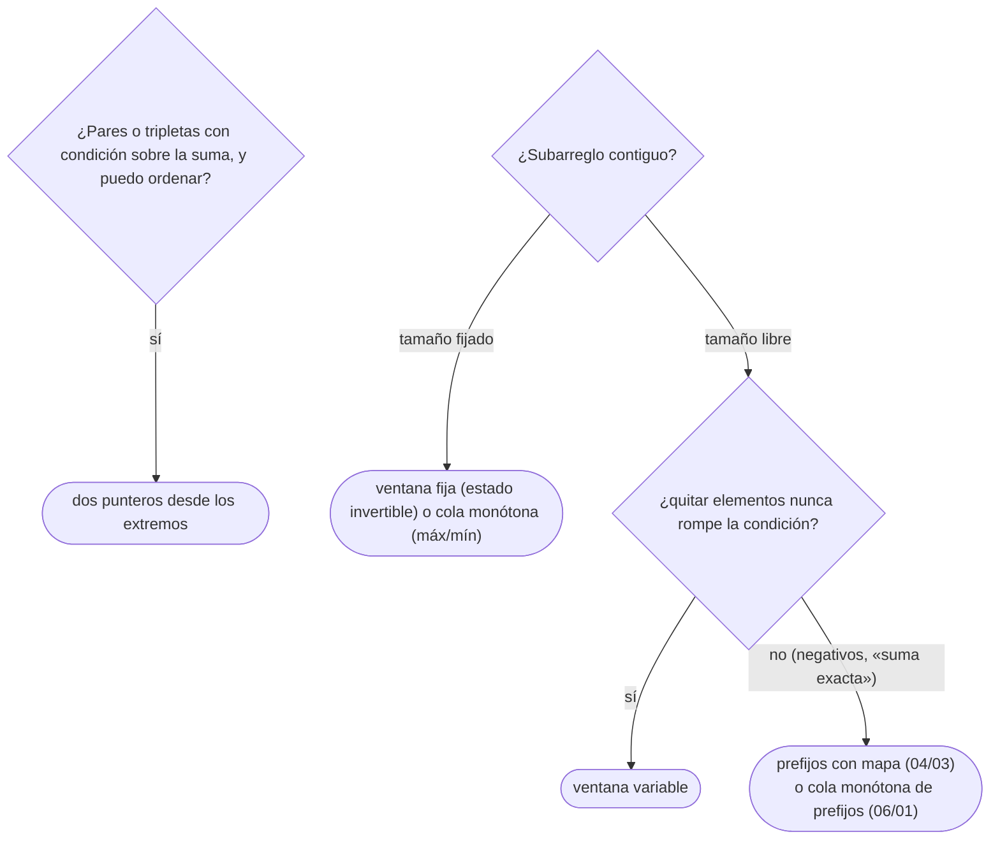

# 02 — Dos punteros y ventana deslizante

> Resolver en `O(n)` los problemas de pares sobre arreglos ordenados y de subarreglos contiguos con una
> condición monótona: dos índices que solo avanzan, por qué no hace falta retroceder, y por qué la
> técnica deja de funcionar en cuanto aparecen negativos.
>
> **Niveles:** dos punteros [A] · ventana variable [A] · ventana fija [A].
>
> **📚 Lectura troncal:** Laaksonen, *Guide to Competitive Programming*, 3.ª ed. (Springer, 2024),
> cap. 8; Halim, Halim y Effendy, *Competitive Programming 4*, libro 1 (2020), cap. 3.
>
> **Ruta corta:** sí.
>
> **Vigencia:** 2026-10-04.

**Salto rápido:** [1](#1--el-problema) · [2](#2--la-teoría) · [3](#3--dos-punteros) · [4](#4--ventana-variable) · [5](#5--ventana-fija) · [6](#6-️-la-tabla-de-costes) · [7](#7--cómo-se-elige) · [8](#8--señales-del-enunciado) · [🧠](#-preguntas) · [🧩](#-problemas-propios)

---

## 1. 🎯 El problema

«El tramo más largo de días consecutivos cuyas ventas suman como mucho `S`», con `n = 2·10⁵`. La
fuerza bruta prueba cada inicio y cada final: `n²/2 = 2·10¹⁰` tramos. No cabe.

Pero hay estructura. Si un tramo `[l, r]` ya se pasa de `S`, alargarlo por la derecha no lo arregla, y
acortarlo por la izquierda solo puede ayudar, **porque las ventas no son negativas**. Así que basta con
dos índices que **solo avanzan**: el derecho entra elementos y el izquierdo los saca cuando la suma se
pasa. Cada índice recorre el arreglo una vez: `O(n)`.

Es la técnica de **dos punteros** (*two pointers*) y, sobre subarreglos, la **ventana deslizante**
(*sliding window*). Las dos se apoyan en una **monotonía**: hay que saber reconocerla, y reconocer
cuándo falta, porque entonces la técnica da respuestas incorrectas sin avisar.

> 🧠 **Modelo mental.** Recordatorio, si llegas directo aquí: «dos bucles anidados» no significa
> `O(n²)` si el índice interno nunca retrocede; contando cuántas veces se mueve cada índice en total
> (análisis agregado, `02/03`), son `2n` pasos.

---

## 2. 📐 La teoría

**El coste, por análisis agregado.** En todas las variantes, cada índice empieza en un extremo y solo
se mueve en un sentido, hasta el otro extremo. El índice izquierdo se mueve como mucho `n` veces en
total y el derecho también, sin importar cómo se repartan los movimientos entre las vueltas del bucle
exterior. Total: `O(n)`, aunque el código tenga un `while` dentro de un `for`.

**La monotonía que justifica no retroceder.** La ventana variable resuelve «el mejor subarreglo que
cumple una condición `C`» cuando `C` es **monótona respecto de la inclusión**:

```text
si [l, r] cumple C, entonces todo subtramo [l', r'] ⊆ [l, r] también cumple C
```

«Suma `≤ S` con valores no negativos» lo es: quitar elementos no aumenta la suma. «Como mucho `k`
valores distintos» también. «Suma exactamente `S`» con negativos no lo es.

**Teorema (corrección de la ventana).** Si `C` es monótona respecto de la inclusión, el algoritmo que
avanza `r` de uno en uno y, para cada `r`, avanza `l` hasta que `[l, r]` cumple `C`, examina para cada
`r` el tramo válido **más largo** que termina en `r`.

*Esbozo.* Invariante: al terminar la vuelta de `r`, `l` es el menor índice con `[l, r]` válido. Al pasar
a `r + 1`, ningún `l' < l` puede servir, porque `[l', r]` ya era inválido y `[l', r + 1]` lo contiene:
por la monotonía, también es inválido. Así que `l` nunca tiene que retroceder. Laaksonen, cap. 8,
desarrolla la técnica.

**Los dos punteros sobre un arreglo ordenado** se justifican igual: en la búsqueda de pares, si
`a[l] + a[r]` es demasiado grande, **ningún** par con ese `r` y un `l'` mayor sirve, así que `r` se
descarta para siempre.

---

## 3. 🧱 Dos punteros

**Qué es.** Dos índices que empiezan en los extremos de un arreglo **ordenado** y se acercan, descartando
en cada paso un elemento que ya no puede formar parte de la respuesta.

**Por qué es correcto.** Para contar los pares `l < r` con `a[l] + a[r] ≤ K`: si `a[l] + a[r] ≤ K`,
entonces `a[l]` con **todos** los índices entre `l + 1` y `r` también cumple, porque son menores o
iguales que `a[r]`: se cuentan `r − l` pares y `l` ya no aporta más. Si se pasa, `a[r]` no cumple con
ningún `l' ≥ l`: se descarta `r`. Cada paso descarta un índice sin perder pares.

**Cómo va**, sobre `[1, 2, 5, 5, 6, 9]` con `K = 7`:

```text
l  r  a[l]+a[r]   decisión
0  5  1+9 = 10    > 7  → r = 4
0  4  1+6 = 7     ≤ 7  → cuenta r−l = 4 (con 2, 5, 5, 6) → l = 1
1  4  2+6 = 8     > 7  → r = 3
1  3  2+5 = 7     ≤ 7  → cuenta 2 (con 5, 5) → l = 2
2  3  5+5 = 10    > 7  → r = 2
fin: l = r · total 6 parejas
```

**Cuánto.** `O(n)` tras ordenar, `O(n log n)` en total si hay que ordenar; memoria `O(1)` extra.

**La plantilla:**

```cpp
#include <vector>

// Número de pares i < j con a[i] + a[j] <= k. Pre: a ordenado. O(n).
long long countPairsAtMost(const std::vector<int>& a, long long k) {
    long long count = 0;
    int l = 0, r = static_cast<int>(a.size()) - 1;
    while (l < r) {
        if (static_cast<long long>(a[l]) + a[r] <= k) { count += r - l; l++; }
        else r--;
    }
    return count;
}
```

```java
// Número de pares i < j con a[i] + a[j] <= k. Pre: a ordenado. O(n).
static long countPairsAtMost(int[] a, long k) {
    long count = 0;
    int l = 0, r = a.length - 1;
    while (l < r) {
        if ((long) a[l] + a[r] <= k) { count += r - l; l++; }
        else r--;
    }
    return count;
}
```

```python
def count_pairs_at_most(a, k):
    """Número de pares i < j con a[i] + a[j] <= k. Pre: a ordenado. O(n)."""
    count, l, r = 0, 0, len(a) - 1
    while l < r:
        if a[l] + a[r] <= k:
            count += r - l
            l += 1
        else:
            r -= 1
    return count
```

- **La suma en 64 bits** en C++ y Java: dos valores de `10⁹` desbordan `int`; el contador también,
  porque llega a `n²/2`.
- **La variante «¿existe un par con suma exactamente `K`?»** cambia el cuerpo: si la suma es menor,
  `l++`; si es mayor, `r--`; si es igual, se encontró.

### De la versión ingenua a la buena

**El problema.** Contar las parejas de precios que caben en un presupuesto `K`. Con
`[5, 2, 9, 1, 5, 6]` y `K = 7`, son 6.

**La versión ingenua:**

```java
// Todas las parejas: O(n²).
static long countPairsAtMost(int[] a, long k) {
    long count = 0;
    for (int i = 0; i < a.length; i++)
        for (int j = i + 1; j < a.length; j++)
            if ((long) a[i] + a[j] <= k) count++;
    return count;
}
```

> «Es cuadrático. Si ordeno, para el menor precio el compañero válido más caro me dice de golpe cuántas
> parejas forma: todas las de en medio también caben. Con un índice en cada extremo, cada paso descarta
> uno de los dos, y tras ordenar el recorrido es lineal.»

**El camino a la buena.** Ordenar y aplicar la plantilla. Ordenar no cambia el número de parejas,
porque contar pares no depende del orden de los índices originales.

**Cuándo sí**: pares o tripletas con una condición sobre la suma en datos que se pueden ordenar.
**Cuándo no**: si la respuesta necesita los índices originales (se ordenan pares valor-índice), o si
la condición no es monótona en la suma.

> **Veredicto:** ordenar y dos punteros desde los extremos convierte un problema de pares cuadrático en
> uno lineal. Pregunta primero si puedes ordenar.

---

## 4. 🧱 Ventana variable

**Qué es.** Un subarreglo `[l, r]` que crece por la derecha y se encoge por la izquierda para mantener
una condición, con los dos extremos avanzando siempre.

**Por qué es correcto.** Por el teorema de §2: con una condición monótona respecto de la inclusión,
para cada `r` el `l` correcto nunca está a la izquierda del anterior.

**Cómo va**, el tramo más largo con suma `≤ 12` en `[5, 2, 9, 1, 5, 6]`:

```text
r  entra  suma tras entrar  ajuste de l                 ventana     largo
0  5      5                 —                           [5]         1
1  2      7                 —                           [5,2]       2
2  9      16                > 12: sale 5 → 11            [2,9]       2
3  1      12                —                           [2,9,1]     3
4  5      17                sale 2 → 15, sale 9 → 6      [1,5]       2
5  6      12                —                           [1,5,6]     3
mejor: 3
```

**Cuánto.** `O(n)` por el análisis agregado; memoria `O(1)` para sumas, o lo que cueste mantener el
estado de la ventana (un mapa de conteos para «`k` distintos»).

**La plantilla**, el tramo más largo con suma `≤ S` y valores no negativos:

```cpp
#include <algorithm>
#include <vector>

// Longitud del subarreglo más largo con suma <= s. Pre: a[i] >= 0. O(n).
int longestAtMost(const std::vector<int>& a, long long s) {
    long long sum = 0;
    int best = 0;
    for (int l = 0, r = 0; r < static_cast<int>(a.size()); r++) {
        sum += a[r];                          // entra a[r]
        while (sum > s) sum -= a[l++];        // sale por la izquierda hasta volver a cumplir
        best = std::max(best, r - l + 1);     // [l, r] es el más largo que termina en r
    }
    return best;
}
```

```java
// Longitud del subarreglo más largo con suma <= s. Pre: a[i] >= 0. O(n).
static int longestAtMost(int[] a, long s) {
    long sum = 0;
    int best = 0;
    for (int l = 0, r = 0; r < a.length; r++) {
        sum += a[r];
        while (sum > s) sum -= a[l++];
        best = Math.max(best, r - l + 1);
    }
    return best;
}
```

```python
def longest_at_most(a, s):
    """Longitud del subarreglo más largo con suma <= s. Pre: a[i] >= 0. O(n)."""
    total = best = l = 0
    for r, x in enumerate(a):
        total += x
        while total > s:
            total -= a[l]
            l += 1
        best = max(best, r - l + 1)
    return best
```

- **El `while` interno** es el que asusta y el que no cuesta: `l` avanza como mucho `n` veces en todo el
  programa.
- **Si un solo elemento pasa de `S`**, el `while` vacía la ventana (`l = r + 1`) y el largo es 0; el
  código lo tolera sin caso especial.
- **Para «el más corto con suma `≥ S`»** el esquema se invierte: mientras la ventana cumple, se anota y
  se encoge.

### De la versión ingenua a la buena

**El problema.** El tramo más largo de días con ventas que suman como mucho `S = 12`. Con el arreglo de
juguete, 3.

**La versión ingenua:**

```java
// Todos los inicios, y para cada uno, alargar hasta pasarse: O(n²) en el caso peor.
static int longestAtMost(int[] a, long s) {
    int best = 0;
    for (int i = 0; i < a.length; i++) {
        long sum = 0;
        for (int j = i; j < a.length && sum + a[j] <= s; j++) {
            sum += a[j];
            best = Math.max(best, j - i + 1);
        }
    }
    return best;
}
```

> «Para cada inicio vuelvo a sumar desde cero: si todos los valores son pequeños, es cuadrático. Pero con
> valores no negativos, cuando muevo el inicio una posición, el final válido no puede retroceder: el
> tramo `[i+1, j]` cumple si `[i, j]` cumplía. Con una ventana que solo avanza, `O(n)`.»

**El camino a la buena.** La plantilla: el final avanza siempre y el inicio solo cuando hace falta.

**Cuándo sí**: subarreglos contiguos con una condición monótona respecto de la inclusión. **Cuándo
no**: con **valores negativos** y condiciones sobre la suma, donde la monotonía se rompe; ahí se usan
prefijos con un mapa ([`04/03`](03-kadane-y-subarreglos.md)) o una cola monótona sobre los prefijos ([`06/01`](../06-lineales-y-hashing/01-pilas-colas-y-monotonas.md)).

> **Veredicto:** la ventana variable es correcta si y solo si quitar elementos no puede romper la
> condición. Compruébalo antes de escribirla.

---

## 5. 🧱 Ventana fija

**Qué es.** Un subarreglo de tamaño exacto `k` que se desliza de uno en uno: entra un elemento por la
derecha y sale otro por la izquierda.

**Por qué es correcto.** Cada ventana `[i, i + k − 1]` es la anterior sin `a[i − 1]` y con
`a[i + k − 1]`: si el estado se actualiza con esas dos operaciones, es el de la ventana actual.

**Cómo va**, el máximo de días con ventas `≥ 5` en una ventana de 3 días; los días que cumplen son
`[1, 0, 1, 0, 1, 1]`:

```text
ventana   días        cuenta   operación
[0,2]     1 0 1       2        construir
[1,3]     0 1 0       1        sale 1, entra 0
[2,4]     1 0 1       2        sale 0, entra 1
[3,5]     0 1 1       2        sale 1, entra 1
máximo: 2
```

**Cuánto.** `O(n)`; el estado de una ventana se actualiza en `O(1)` si la operación es invertible
(sumas, conteos). Para el máximo de cada ventana, que no es invertible, hace falta la cola monótona
(`06/01`).

**La plantilla**, el máximo de la suma de `k` consecutivos:

```cpp
#include <algorithm>
#include <vector>

// Máxima suma de k elementos consecutivos. Pre: 1 <= k <= n. O(n).
long long maxWindowSum(const std::vector<int>& a, int k) {
    long long sum = 0;
    for (int i = 0; i < k; i++) sum += a[i];
    long long best = sum;
    for (int i = k; i < static_cast<int>(a.size()); i++) {
        sum += a[i] - a[i - k];               // entra a[i], sale a[i - k]
        best = std::max(best, sum);
    }
    return best;
}
```

```java
// Máxima suma de k elementos consecutivos. Pre: 1 <= k <= n. O(n).
static long maxWindowSum(int[] a, int k) {
    long sum = 0;
    for (int i = 0; i < k; i++) sum += a[i];
    long best = sum;
    for (int i = k; i < a.length; i++) {
        sum += a[i] - a[i - k];
        best = Math.max(best, sum);
    }
    return best;
}
```

```python
def max_window_sum(a, k):
    """Máxima suma de k elementos consecutivos. Pre: 1 <= k <= n. O(n)."""
    total = sum(a[:k])
    best = total
    for i in range(k, len(a)):
        total += a[i] - a[i - k]
        best = max(best, total)
    return best
```

- **La primera ventana se construye entera** y las siguientes se actualizan; `best` empieza en la
  primera, no en 0, por si todo es negativo.
- **`a[i] − a[i − k]`** se calcula en `int` en C++ y Java: con valores de `10⁹` y signos opuestos, la
  diferencia llega a `2·10⁹` y desborda. Con datos así, se convierte antes: `sum += a[i]; sum -= a[i-k];`.

### De la versión ingenua a la buena

**El problema.** El mayor número de días «buenos» (ventas `≥ 5`) en cualquier periodo de 3 días
seguidos. Con el arreglo de juguete, 2.

**La versión ingenua:**

```java
// Recontar cada ventana: O(n·k).
static int bestWindow(int[] good, int k) {
    int best = 0;
    for (int i = 0; i + k <= good.length; i++) {
        int c = 0;
        for (int j = i; j < i + k; j++) c += good[j];
        best = Math.max(best, c);
    }
    return best;
}
```

> «Recuento `k` días por ventana: `O(n·k)`, que con `k = n/2` es cuadrático. Dos ventanas consecutivas
> comparten `k − 1` días: basta con sumar el que entra y restar el que sale.»

**El camino a la buena.** La plantilla de ventana fija sobre el arreglo de unos y ceros.

**Cuándo sí**: el tamaño de la ventana está fijado por el enunciado y el estado es invertible. **Cuándo
no**: si el estado no se puede «restar» (máximo, mínimo): cola monótona.

> **Veredicto:** ventana fija = construir una vez y actualizar con lo que entra y lo que sale. El error
> típico es el desbordamiento de esa resta.

---

## 6. ⏱️ La tabla de costes

| Técnica | Tiempo | Requisito | Lo que la tabla no dice |
|---|---|---|---|
| Dos punteros desde los extremos | `O(n)` tras ordenar | Datos ordenables | Si hacen falta los índices originales, se ordenan pares |
| Ventana variable | `O(n)` | Condición monótona respecto de la inclusión | Con negativos y sumas, da respuestas incorrectas |
| Ventana fija | `O(n)` | Estado invertible | Para máximos o mínimos, cola monótona |
| Prefijos con mapa (`04/03`) | `O(n)` esperado | — | La alternativa cuando hay negativos |

---

## 7. 🧭 Cómo se elige



> **Mejor:** «Como los valores no son negativos, si una ventana se pasa, alargarla no la arregla; así que
> el inicio solo avanza, y cada índice se mueve `n` veces: `O(n)`.»

---

## 8. 🔎 Señales del enunciado

| Señal | Técnica | Por qué |
|---|---|---|
| «Par (o terna) con suma objetivo», datos ordenados u ordenables | Dos punteros | Cada comparación descarta un extremo |
| «Subarreglo más largo / más corto con suma `≤` / `≥ S`», valores `≥ 0` | Ventana variable | La condición es monótona |
| «Como mucho `k` distintos», «sin repetidos» | Ventana variable con mapa de conteos | Quitar elementos no los aumenta |
| «En cada bloque de `k` consecutivos» | Ventana fija | Entra uno, sale uno |
| La misma frase **con valores negativos** | **No** es ventana: prefijos con mapa | La monotonía se rompe |

---

## ⚠️ Errores frecuentes

| Se dice | Lo preciso |
|---|---|
| «La ventana deslizante sirve para cualquier subarreglo» | Solo con una condición monótona respecto de la inclusión; con negativos y sumas, falla |
| «Dos bucles anidados son siempre `O(n²)`» | Si el índice interno nunca retrocede, el total es `O(n)` por análisis agregado |
| «Para pares en un arreglo, dos punteros siempre» | Necesitan el arreglo ordenado; si no se puede ordenar, una tabla *hash* |
| «En la ventana fija, `best` empieza en 0» | Empieza en la primera ventana; con valores negativos, 0 sería incorrecto |
| «La resta de la ventana fija no desborda» | `a[i] − a[i−k]` con signos opuestos llega a `2·10⁹` |

---

## 📚 Para profundizar

- **Libro** — Laaksonen, *Guide to Competitive Programming*, 3.ª ed. (Springer, 2024), cap. 8: el método
  de los dos punteros y sus aplicaciones. *Lectura troncal.*
- **Libro** — Halim, Halim y Effendy, *Competitive Programming 4*, libro 1 (2020), cap. 3: las técnicas
  de dos punteros y ventana entre los paradigmas básicos. *Lectura troncal.*
- **Referencia** — USACO Guide, [*Two Pointers*](https://usaco.guide/silver/two-pointers).
- **Referencia** — Codility, [lección 15, *Caterpillar method*](https://app.codility.com/programmers/lessons/15-caterpillar_method/):
  este capítulo con otro nombre, y su material de lectura.

---

## 🧠 Preguntas

1. ¿Por qué un bucle `while` dentro de un `for` puede ser `O(n)` en total? 🟢
2. ¿Qué condición tiene que cumplir el arreglo para usar dos punteros desde los extremos? 🟢
3. ¿Qué diferencia hay entre ventana fija y ventana variable? 🟢
4. ¿Qué significa que una condición sea monótona respecto de la inclusión? Da un ejemplo que lo sea y otro que no. 🟡
5. ¿Qué diferencia hay entre buscar «el tramo más largo con suma `≤ S`» y «el más corto con suma `≥ S`» en la forma de mover los punteros? 🟡
6. ¿Por qué en la ventana fija `best` empieza en la suma de la primera ventana y no en 0? 🟡
7. Escribe el invariante de la ventana variable y demuestra que `l` nunca tiene que retroceder. 🟠
8. Compara la plantilla de dos punteros en C++, Java y Python: ¿qué tipos tienen que ser de 64 bits en cada uno y por qué? 🟠
9. Con `[5, −10, 4, 6]` y «el subarreglo más corto con suma `≥ 10`», ¿qué da la ventana variable y qué da la respuesta correcta? 🟠
10. ¿Por qué ordenar no cambia el número de pares con suma `≤ K`, y cuándo ordenar sí te hace perder información? 🟠
11. Diseña con una ventana el «subarreglo más largo con como mucho `k` valores distintos»: el estado, la entrada, la salida y el coste. 🔴
12. Da un caso de prueba que rompa una ventana variable aplicada a «subarreglos con suma exactamente `S`» cuando hay ceros, y explica qué parte del razonamiento falla. 🔴

---

## 🧩 Problemas propios

### Combinar dos listas de precios

**Nivel:** 🟢 · **Formato:** programa completo.

Una tienda tiene una lista ordenada de entrantes y otra de platos principales. Cuenta los menús (un
entrante y un principal) cuyo precio total no pasa de `K`.

- **Entrada.** Una línea con `n`, `m` y `K`. Una línea con los `n` entrantes, ordenados. Una línea con
  los `m` principales, ordenados.
- **Salida.** Un entero.
- **Restricciones.** `1 ≤ n, m ≤ 2·10⁵`; `1 ≤ precio ≤ 10⁹`; `1 ≤ K ≤ 2·10⁹`.

```text
Entrada            Salida
3 3 7              6
1 3 5
2 4 6

Entrada            Salida
2 1 2              2
1 1
1
```

**Pista 1:** si el entrante más barato no cabe con el principal más caro, ¿puede ese principal formar
algún menú?

### Tramos dentro del presupuesto

**Nivel:** 🟡 · **Formato:** programa completo.

Cuenta los subarreglos contiguos cuya suma no pasa de `S`. Los valores no son negativos.

- **Entrada.** Una línea con `n` y `S`. Una línea con los `n` valores.
- **Salida.** Un entero.
- **Restricciones.** `1 ≤ n ≤ 2·10⁵`; `0 ≤ a[i] ≤ 10⁹`; `0 ≤ S ≤ 10¹⁴`.

```text
Entrada            Salida
6 12               13
5 2 9 1 5 6

Entrada            Salida
2 0                3
0 0
```

**Pista 1:** para un final `r` fijo, si conoces el menor inicio válido, ¿cuántos tramos válidos
terminan en `r`?

### El más corto, con pérdidas

**Nivel:** 🟠 · **Formato:** programa completo.

Un registro de beneficios diarios puede tener días con pérdidas (valores negativos). Imprime la
longitud del tramo contiguo más corto cuya suma es al menos `S`, o `-1` si no existe.

- **Entrada.** Una línea con `n` y `S`. Una línea con los `n` valores.
- **Salida.** Un entero.
- **Restricciones.** `1 ≤ n ≤ 2·10⁵`; `|a[i]| ≤ 10⁹`; `1 ≤ S ≤ 10¹⁴`.

```text
Entrada            Salida
3 3                3
2 -1 2

Entrada            Salida
4 10               2
5 -10 4 6

Entrada            Salida
2 4                -1
1 2
```

**Pista 1:** ¿qué hace una ventana que encoge en cuanto la suma llega a `S` con el segundo ejemplo?

🔥 **Para el geek — en JavaScript:** la solución correcta necesita una cola doble sobre los prefijos, que
JavaScript no trae, y `shift()` la haría cuadrática.

---

## 🧩 Práctica externa

### Núcleo

| ✔ | Problema | Plataforma | Nivel | Patrón | Pista 1 |
|---|---|---|---|---|---|
| [ ] | [AbsDistinct](https://app.codility.com/programmers/lessons/15-caterpillar_method/abs_distinct/) | Codility | 🟢 | Dos punteros desde los extremos | En un arreglo ordenado, ¿dónde están los valores absolutos más grandes? |
| [ ] | [CountDistinctSlices](https://app.codility.com/programmers/lessons/15-caterpillar_method/count_distinct_slices/) | Codility | 🟡 | Ventana sin repetidos | Si el tramo que termina en `r` empieza en `l`, ¿cuántos tramos válidos terminan en `r`? |
| [ ] | [CountTriangles](https://app.codility.com/programmers/lessons/15-caterpillar_method/count_triangles/) | Codility | 🟡 | Dos punteros dentro de un bucle | Con el lado mayor fijo, ¿cómo se mueve el límite de los otros dos? |
| [ ] | [3Sum](https://leetcode.com/problems/3sum/) | LeetCode | 🟡 | Fijar uno y dos punteros | Fijado el primero, ¿qué problema de pares queda, y cómo evitas repetir ternas? |
| [ ] | [Container With Most Water](https://leetcode.com/problems/container-with-most-water/) | LeetCode | 🟡 | Dos punteros con descarte | ¿Qué pared conviene mover, la más alta o la más baja, y por qué la otra no puede mejorar? |
| [ ] | [Minimum Size Subarray Sum](https://leetcode.com/problems/minimum-size-subarray-sum/) | LeetCode | 🟡 | Ventana variable | Mientras la ventana cumple, ¿qué haces antes de encogerla? |
| [ ] | [Max Consecutive Ones III](https://leetcode.com/problems/max-consecutive-ones-iii/) | LeetCode | 🟡 | Ventana con un contador | ¿Qué cuentas dentro de la ventana para saber si todavía vale? |
| [ ] | [Permutation in String](https://leetcode.com/problems/permutation-in-string/) | LeetCode | 🟡 | Ventana fija con conteos | ¿De qué tamaño es la ventana y qué comparas en cada posición? |

### Ampliación

| ✔ | Problema | Plataforma | Nivel | Patrón | Pista 1 |
|---|---|---|---|---|---|
| [ ] | [Fruit Into Baskets](https://leetcode.com/problems/fruit-into-baskets/) | LeetCode | 🟡 | Ventana con «como mucho dos tipos» | ¿Qué estado de la ventana te dice cuántos tipos distintos hay? |
| [ ] | [Longest Repeating Character Replacement](https://leetcode.com/problems/longest-repeating-character-replacement/) | LeetCode | 🟡 | Ventana con el más frecuente | ¿Cuántos cambios necesita una ventana, en función de su letra más frecuente? |
| [ ] | [Sum of Three Values](https://cses.fi/problemset/task/1641) | CSES | 🟡 | Fijar uno y dos punteros | ¿Cómo conservas las posiciones originales después de ordenar? |
| [ ] | [MinAbsSumOfTwo](https://app.codility.com/programmers/lessons/15-caterpillar_method/min_abs_sum_of_two/) | Codility | 🟠 | Dos punteros con signo | Tras ordenar, ¿qué puntero mueves para acercar la suma a cero? |

---

## ✅ Criterio de dominio

- Escribir las tres plantillas sin mirar y justificar el `O(n)` con el análisis agregado.
- Decir, ante un enunciado de subarreglos, si la condición es monótona, y si no lo es, qué se usa.
- Dar el contraejemplo `[5, −10, 4, 6]` y explicar por qué la ventana falla con negativos.
- Resolver CountDistinctSlices y 3Sum sin pista 2.

---

**Anterior:** [`04/01` — Sumas de prefijos y arreglos de diferencias](01-prefijos-y-diferencias.md) ·
**Siguiente:** [`04/03` — Kadane y subarreglos](03-kadane-y-subarreglos.md) ·
**Relacionado:** [`06/01` — Pila, cola, deque y monótonas](../06-lineales-y-hashing/01-pilas-colas-y-monotonas.md); [`02/03` — Análisis amortizado](../02-analisis/03-analisis-amortizado.md).
