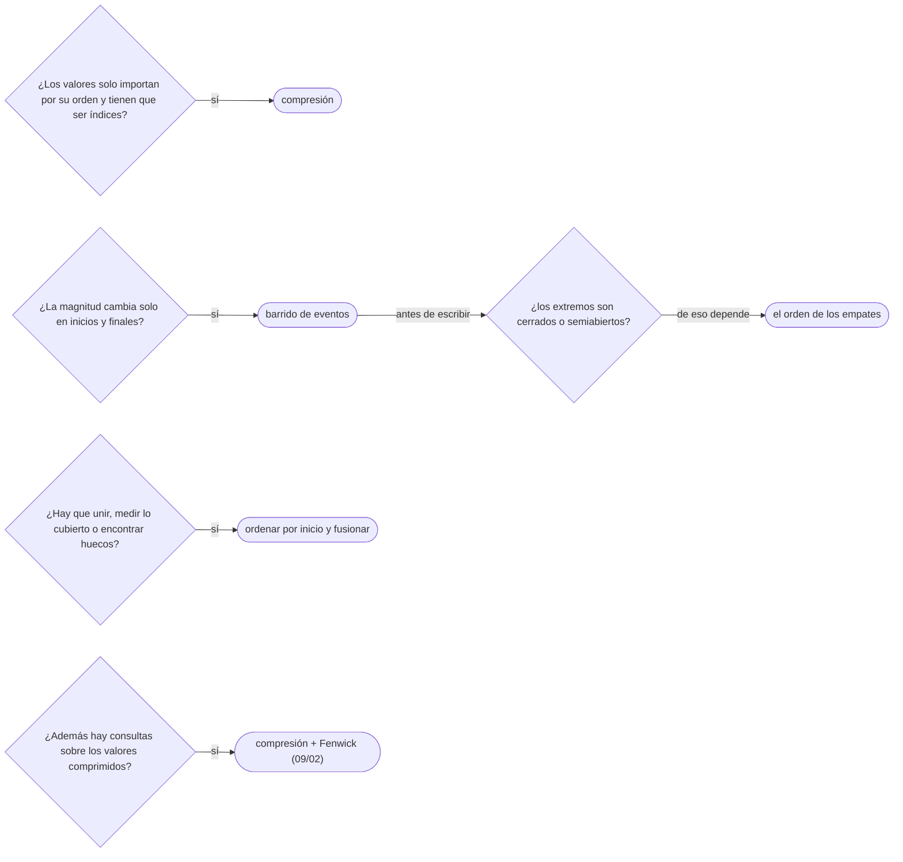

# 04 — Compresión de coordenadas y barrido de eventos

> Reducir valores enormes a índices pequeños sin perder su orden, y procesar intervalos como una lista
> ordenada de eventos de apertura y cierre. Con el detalle que más WA produce: el orden de los empates,
> que es parte de la corrección y no un detalle de implementación.
>
> **Niveles:** compresión de coordenadas [A] · barrido de eventos [A] · unión de intervalos [A].
>
> **📚 Lectura troncal:** Laaksonen, *Guide to Competitive Programming*, 3.ª ed. (Springer, 2024),
> cap. 13; de Berg y otros, *Computational Geometry: Algorithms and Applications*, 3.ª ed. (Springer,
> 2008), cap. 2 (el barrido como paradigma).
>
> **Asume leído:** [`04/01` — Sumas de prefijos y arreglos de diferencias](01-prefijos-y-diferencias.md).
>
> **Vigencia:** 2026-10-04.

**Salto rápido:** [1](#1--el-problema) · [2](#2--la-teoría) · [3](#3--compresión-de-coordenadas) · [4](#4--barrido-de-eventos) · [5](#5--unión-de-intervalos) · [6](#6-️-la-tabla-de-costes) · [7](#7--cómo-se-elige) · [8](#8--señales-del-enunciado) · [🧠](#-preguntas) · [🧩](#-problemas-propios)

---

## 1. 🎯 El problema

Reuniones con horas de inicio y fin entre 0 y `10⁹`, y la pregunta «¿cuántas reuniones hay a la vez como
máximo?». La técnica de `04/01` —un arreglo de diferencias indexado por la hora— necesitaría `10⁹`
posiciones: 4 GB. Y sin embargo, con `n = 2·10⁵` reuniones, el número de reuniones en curso **solo
cambia en `2n` instantes**: los inicios y los finales. Lo que pasa entre dos de esos instantes es
constante.

Dos ideas lo resuelven. La **compresión de coordenadas** sustituye cada valor por su posición en la lista
ordenada de valores distintos: `10⁹` horas posibles se convierten en a lo sumo `2n` índices, y el arreglo
de diferencias vuelve a caber. El **barrido** (*sweep*) hace lo mismo sin arreglo: ordena los `2n`
eventos por instante y los procesa en orden, llevando el contador.

Y aparece una pregunta que parece de detalle y es de corrección: si una reunión termina a las 3 y otra
empieza a las 3, **¿se solapan?** La respuesta la da el enunciado, y el orden de los eventos empatados
tiene que respetarla. Con `[1,3) [3,5) [2,4)`, procesar el cierre antes de la apertura da 2 reuniones a
la vez; al revés, 3.

---

## 2. 📐 La teoría

**La compresión conserva el orden.** Sea `V` la lista ordenada de los valores distintos y `rank(x)` la
posición de `x` en `V`. Entonces `x < y` si y solo si `rank(x) < rank(y)`, y `x = y` si y solo si
`rank(x) = rank(y)`. Todo algoritmo que solo **compara** valores da el mismo resultado sobre los
rangos. Lo que se pierde son las **distancias**: `rank` no sabe que entre 5 y `10⁹` hay mucho espacio, y
si el problema mide longitudes, hay que guardarlas aparte.

**El principio del barrido.** Si una magnitud solo cambia en un conjunto finito de **eventos**, basta con
recorrer los eventos en orden y actualizar el estado en cada uno; entre dos eventos consecutivos, el
estado es constante. De Berg y otros, cap. 2, lo presentan como paradigma general de la geometría
computacional.

**Teorema (orden de los empates).** Con intervalos **semiabiertos** `[s, e)`, dos intervalos con
`e₁ = s₂` no se solapan, y el barrido es correcto si en cada instante procesa **los cierres antes que las
aperturas**. Con intervalos **cerrados** `[s, e]`, sí se solapan, y el barrido tiene que procesar **las
aperturas antes que los cierres**.

*Esbozo.* El contador tras procesar todos los eventos de un instante `t` es el número de intervalos que
contienen a `t + ε`. El máximo se mide **entre** eventos de un mismo instante, y ahí el orden decide si
en algún momento se cuentan a la vez un intervalo que termina en `t` y otro que empieza en `t`. La regla
de cada caso hace que ese momento exista solo cuando el enunciado dice que se solapan.

**La unión de intervalos**, ordenados por inicio, se obtiene fusionando cada uno con el último fusionado
si se solapan. Es correcta porque, ordenados por inicio, un intervalo solo puede solaparse con el bloque
fusionado inmediatamente anterior: todos los demás terminaron antes.

---

## 3. 🧱 Compresión de coordenadas

**Qué es.** Sustituir cada valor por su posición en la lista ordenada de valores distintos, para poder
usarlo como índice de un arreglo.

**Por qué es correcto.** Porque `rank` es una biyección que conserva el orden (§2): comparar rangos es
comparar valores.

**Cómo va**, con valores de hasta `10⁹`:

```text
valores:            1000000000   5   999999999   5   −7
distintos, en orden: −7, 5, 999999999, 1000000000
rangos:              3            1   2           1   0
```

**Cuánto.** Ordenar y quitar repetidos, `Θ(n log n)`; cada consulta de rango, una búsqueda binaria
`Θ(log n)`, o `Θ(1)` si se precalcula para todos los valores de la entrada. Memoria `Θ(n)`.

**La plantilla:**

```cpp
#include <algorithm>
#include <vector>

// Devuelve los rangos de a en [0, k), con k el número de valores distintos. O(n log n).
std::vector<int> compress(const std::vector<long long>& a, std::vector<long long>& sortedDistinct) {
    sortedDistinct = a;
    std::sort(sortedDistinct.begin(), sortedDistinct.end());
    sortedDistinct.erase(std::unique(sortedDistinct.begin(), sortedDistinct.end()),
                         sortedDistinct.end());
    std::vector<int> rank(a.size());
    for (std::size_t i = 0; i < a.size(); i++)
        rank[i] = static_cast<int>(std::lower_bound(sortedDistinct.begin(), sortedDistinct.end(), a[i])
                                   - sortedDistinct.begin());
    return rank;
}
```

```java
// Devuelve los rangos de a en [0, k), con k el número de valores distintos. O(n log n).
static int[] compress(long[] a) {
    long[] sorted = a.clone();
    java.util.Arrays.sort(sorted);
    int k = 0;
    for (int i = 0; i < sorted.length; i++)
        if (i == 0 || sorted[i] != sorted[i - 1]) sorted[k++] = sorted[i];   // quitar repetidos
    int[] rank = new int[a.length];
    for (int i = 0; i < a.length; i++)
        rank[i] = java.util.Arrays.binarySearch(sorted, 0, k, a[i]);         // valores distintos: índice único
    return rank;
}
```

```python
def compress(a):
    """Devuelve (rangos de a en [0, k), lista ordenada de distintos). O(n log n)."""
    distinct = sorted(set(a))
    pos = {v: i for i, v in enumerate(distinct)}
    return [pos[x] for x in a], distinct
```

- **`std::unique` + `erase`** quita los repetidos contiguos tras ordenar: `unique` no borra, mueve, y
  devuelve dónde empieza la basura.
- **Java**: `Arrays.binarySearch` devuelve **algún** índice si hay repetidos ([`03/03`](../03-biblioteca-estandar/03-java-colecciones.md)); aquí sirve porque
  la búsqueda es sobre los **distintos**, donde cada valor está una sola vez.
- **Python**: un diccionario de valor a rango hace cada consulta `O(1)` esperado; `bisect_left` sobre
  `distinct` es la alternativa sin *hash*.

### De la versión ingenua a la buena

**El problema.** Valores de hasta `10⁹`; hay que decir cuántas veces aparece el más repetido, usando un
arreglo de conteos. Con `[10⁹, 5, 999999999, 5, −7]`, 2.

**La versión ingenua:**

```java
// falla: un arreglo de conteos indexado por valor necesitaría 10⁹ posiciones y no admite negativos
static int maxFrequency(int[] a) {
    int[] count = new int[1_000_000_001];
    int best = 0;
    for (int x : a) best = Math.max(best, ++count[x]);
    return best;
}
```

> «Indexar por valor no cabe en memoria con valores de `10⁹`, y además hay negativos. Pero solo hay `n`
> valores distintos: si los comprimo a `[0, k)`, el arreglo de conteos tiene `k ≤ n` posiciones.»

**El camino a la buena.** Comprimir y contar sobre los rangos: `count[rank[i]]++`. (Para este problema
concreto, un mapa *hash* también sirve; la compresión gana cuando el índice alimenta otra estructura,
como un Fenwick, [`09/02`](../09-consultas-sobre-rangos/02-fenwick.md).)

**Cuándo sí**: valores grandes o negativos que tienen que servir de índice, con un número de valores
distintos manejable. **Cuándo no**: si el algoritmo necesita las distancias entre valores, que la
compresión pierde; o si los valores llegan *online* y no se conocen todos antes.

> **Veredicto:** comprime cuando el valor solo importa por su orden. Si importan las distancias, guárdalas
> en la lista de distintos y úsalas al barrer.

---

## 4. 🧱 Barrido de eventos

**Qué es.** Convertir cada intervalo en dos eventos —apertura y cierre—, ordenarlos por instante con una
regla de desempate, y recorrerlos llevando un contador.

**Por qué es correcto.** Por el principio del barrido y el teorema del orden de los empates (§2).

**Cómo va**, con `[1,3) [3,5) [2,4)` semiabiertos:

```text
eventos ordenados (cierre antes que apertura en empate):
t=1 abre → 1 · t=2 abre → 2 · t=3 cierra → 1 · t=3 abre → 2 · t=4 cierra → 1 · t=5 cierra → 0
máximo: 2      (con la apertura antes del cierre en t=3, el contador pasaría por 3: incorrecto aquí)
```

**Cuánto.** Ordenar los `2n` eventos, `Θ(n log n)`, y un recorrido lineal. Memoria `Θ(n)`.

**La plantilla**, el máximo de intervalos semiabiertos solapados:

```cpp
#include <algorithm>
#include <utility>
#include <vector>

// Máximo de intervalos [s, e) que se solapan en algún instante. O(n log n).
int maxOverlap(const std::vector<std::pair<long long, long long>>& intervals) {
    std::vector<std::pair<long long, int>> events;     // (instante, +1 abre / −1 cierra)
    for (auto [s, e] : intervals) { events.push_back({s, +1}); events.push_back({e, -1}); }
    std::sort(events.begin(), events.end());           // en empate, −1 antes que +1: cierra primero
    int open = 0, best = 0;
    for (auto [t, d] : events) { open += d; best = std::max(best, open); }
    return best;
}
```

```java
// Máximo de intervalos [s, e) que se solapan en algún instante. O(n log n).
static int maxOverlap(long[][] intervals) {
    long[][] events = new long[2 * intervals.length][];
    int k = 0;
    for (long[] iv : intervals) { events[k++] = new long[] {iv[0], +1}; events[k++] = new long[] {iv[1], -1}; }
    java.util.Arrays.sort(events, (p, q) -> p[0] != q[0] ? Long.compare(p[0], q[0])
                                                        : Long.compare(p[1], q[1]));   // cierre primero
    int open = 0, best = 0;
    for (long[] ev : events) { open += (int) ev[1]; best = Math.max(best, open); }
    return best;
}
```

```python
def max_overlap(intervals):
    """Máximo de intervalos [s, e) que se solapan en algún instante. O(n log n)."""
    events = []
    for s, e in intervals:
        events.append((s, 1))
        events.append((e, -1))
    events.sort()                      # en empate, -1 antes que 1: cierra primero
    open_ = best = 0
    for _, d in events:
        open_ += d
        best = max(best, open_)
    return best
```

- **El desempate sale del orden natural de los pares**: `(t, −1) < (t, +1)`, así que los cierres van
  primero. **Con intervalos cerrados** se invierte: o se codifica la apertura como −1, o se ordena por
  `(t, −d)`.
- **Java**: el comparador compara los dos campos con `Long.compare`, nunca con una resta ([`02/04`](../02-analisis/04-correccion-invariantes-induccion-intercambio.md)).
- **Python**: `open_` con guion bajo porque `open` es una función de la librería.

### De la versión ingenua a la buena

**El problema.** ¿Durante cuánto tiempo hay al menos dos reuniones a la vez? Con `[1,4) [3,5) [0,6) [5,7)`
semiabiertas, 5 horas: de 1 a 6.

**La versión ingenua:**

```java
// Recorre cada unidad de tiempo y cuenta las reuniones que la contienen: O(T · n).
static long timeAtLeastTwo(long[][] meetings, long maxTime) {
    long total = 0;
    for (long t = 0; t < maxTime; t++) {
        int c = 0;
        for (long[] m : meetings) if (m[0] <= t && t < m[1]) c++;
        if (c >= 2) total++;
    }
    return total;
}
```

> «Recorrer cada instante es `O(T · n)`, y con horas hasta `10⁹` no termina. Pero el número de reuniones
> en curso solo cambia en los inicios y los finales: entre dos eventos consecutivos es constante. Si
> barro los eventos en orden, sumo la duración de cada tramo en que el contador es al menos 2.»

**El camino a la buena.** El barrido de la plantilla, sumando `t − tAnterior` antes de procesar cada
evento si el contador previo era `≥ 2`. Los empates no cambian la duración, porque el tramo entre dos
eventos del mismo instante mide 0.

**Cuándo sí**: intervalos, rectángulos o puntos cuyo efecto empieza y termina en instantes concretos.
**Cuándo no**: si cada evento necesita consultar una estructura compleja (el barrido sigue, pero con un
árbol de segmentos o un conjunto ordenado como estado, [`09/03`](../09-consultas-sobre-rangos/03-segment-tree.md)).

> **Veredicto:** barrer es ordenar eventos y llevar un contador. La mitad del trabajo es decidir el orden
> de los empates según lo que diga el enunciado de los extremos.

---

## 5. 🧱 Unión de intervalos

**Qué es.** Fusionar los intervalos que se solapan en bloques disjuntos, ordenándolos por inicio.

**Por qué es correcto.** Por el argumento de §2: ordenados por inicio, el siguiente intervalo solo puede
solaparse con el último bloque fusionado.

**Cómo va**, con `[1,3) [2,5) [7,9)`:

```text
ordenados: [1,3) [2,5) [7,9)
[1,3)          → bloque [1,3)
[2,5): 2 < 3   → se solapa: bloque [1,5)
[7,9): 7 ≥ 5   → no se solapa: cierra [1,5) (largo 4), abre [7,9)
fin            → cierra [7,9) (largo 2) · longitud de la unión: 6
```

**Cuánto.** `Θ(n log n)` por la ordenación y un recorrido lineal.

**La plantilla**, los bloques fusionados de intervalos semiabiertos:

```cpp
#include <algorithm>
#include <utility>
#include <vector>

// Une intervalos [s, e) que se solapan. Devuelve los bloques disjuntos ordenados. O(n log n).
std::vector<std::pair<long long, long long>> mergeIntervals(std::vector<std::pair<long long, long long>> v) {
    std::sort(v.begin(), v.end());
    std::vector<std::pair<long long, long long>> out;
    for (auto [s, e] : v) {
        if (!out.empty() && s < out.back().second) out.back().second = std::max(out.back().second, e);
        else out.push_back({s, e});
    }
    return out;
}
```

```java
// Une intervalos [s, e) que se solapan. Devuelve los bloques disjuntos ordenados. O(n log n).
static java.util.List<long[]> mergeIntervals(long[][] v) {
    long[][] sorted = v.clone();
    java.util.Arrays.sort(sorted, (p, q) -> Long.compare(p[0], q[0]));
    java.util.List<long[]> out = new java.util.ArrayList<>();
    for (long[] iv : sorted) {
        long[] last = out.isEmpty() ? null : out.get(out.size() - 1);
        if (last != null && iv[0] < last[1]) last[1] = Math.max(last[1], iv[1]);
        else out.add(new long[] {iv[0], iv[1]});
    }
    return out;
}
```

```python
def merge_intervals(v):
    """Une intervalos [s, e) que se solapan. Devuelve los bloques disjuntos ordenados. O(n log n)."""
    out = []
    for s, e in sorted(v):
        if out and s < out[-1][1]:
            out[-1][1] = max(out[-1][1], e)
        else:
            out.append([s, e])
    return out
```

- **`s < out.back().second`** con semiabiertos: `[1,3)` y `[3,5)` **no** se fusionan. Con cerrados, o si
  el enunciado quiere unir los que se tocan, `≤`.
- **El final del bloque es el máximo**, no el del último intervalo: `[1,10)` seguido de `[2,3)` deja el
  bloque en `[1,10)`.
- **La longitud de la unión** es la suma de `e − s` de los bloques.

### De la versión ingenua a la buena

**El problema.** La longitud total cubierta por al menos un intervalo. Con `[1,3) [2,5) [7,9)`, 6.

**La versión ingenua:** marcar cada unidad cubierta en un arreglo y contar, `O(Σ longitudes)`; con
coordenadas hasta `10⁹`, imposible.

> «Marcar unidades depende del tamaño de las coordenadas, no del número de intervalos. Si ordeno por
> inicio, cada intervalo o alarga el bloque actual o empieza uno nuevo; la unión es la suma de los
> bloques, en `O(n log n)`.»

**El camino a la buena.** `mergeIntervals` y sumar las longitudes de los bloques.

**Cuándo sí**: unión, huecos libres, intervalos que se tocan. **Cuándo no**: si hace falta saber cuántos
se solapan en cada punto (barrido), o elegir el máximo de disjuntos (voraz, [`11/02`](../11-voraces/02-intervalos.md)).

> **Veredicto:** ordenar por inicio y fusionar con el último bloque. La comparación `<` o `≤` es la
> decisión del enunciado sobre los extremos.

---

## 6. ⏱️ La tabla de costes

| Técnica | Tiempo | Memoria | Lo que la tabla no dice |
|---|---|---|---|
| Arreglo indexado por valor | `O(n + V)` | `O(V)` | Con `V ~ 10⁹`, no cabe |
| Compresión + arreglo | `O(n log n)` | `O(n)` | Pierde las distancias |
| Barrido de eventos | `O(n log n)` | `O(n)` | El orden de los empates es parte de la corrección |
| Unión de intervalos | `O(n log n)` | `O(n)` | `<` o `≤` según los extremos |
| Barrido con estructura (`09/03`) | `O(n log n)` | `O(n)` | Cuando el estado no es un contador |

---

## 7. 🧭 Cómo se elige



> **Mejor:** «Con horas hasta `10⁹` no indexo por hora: los `2n` eventos de inicio y fin, ordenados con
> el cierre antes de la apertura porque los intervalos son semiabiertos, y un contador.»

---

## 8. 🔎 Señales del enunciado

| Señal | Técnica | Por qué |
|---|---|---|
| Coordenadas hasta `10⁹` y una estructura indexada | Compresión | Solo hay `n` valores distintos |
| «Máximo de intervalos a la vez», «hora punta» | Barrido de eventos | El contador cambia solo en los extremos |
| «Termina a la misma hora que empieza otra» | Decidir el orden de los empates | Cerrado o semiabierto cambia la respuesta |
| «Fusiona», «longitud cubierta», «huecos libres» | Ordenar por inicio y fusionar | Solo el último bloque puede solaparse |
| «Cuántos menores que cada uno» con valores grandes | Compresión + Fenwick | Contar por rango necesita índices pequeños |

---

## ⚠️ Errores frecuentes

| Se dice | Lo preciso |
|---|---|
| «Los empates no importan» | Deciden si dos intervalos que se tocan se solapan; con `[1,3) [3,5) [2,4)` cambian 2 por 3 |
| «Con valores hasta `10⁹` necesito un arreglo de `10⁹`» | Basta uno del número de valores distintos, tras comprimir |
| «La compresión conserva todo» | Conserva el orden y pierde las distancias |
| «El final del bloque fusionado es el del último intervalo» | Es el máximo de los finales |
| «`Arrays.binarySearch` da el primer índice» | Da alguno; sirve en la compresión solo porque se busca entre distintos |
| «El barrido es para geometría» | Es para cualquier magnitud que cambia en eventos discretos |

---

## 📚 Para profundizar

- **Libro** — Laaksonen, *Guide to Competitive Programming*, 3.ª ed. (Springer, 2024), cap. 13: los
  algoritmos de barrido. *Lectura troncal.*
- **Libro** — de Berg y otros, *Computational Geometry: Algorithms and Applications*, 3.ª ed. (Springer,
  2008), cap. 2: el barrido como paradigma, con el cruce de segmentos. *Lectura troncal.*
- **Referencia** — USACO Guide, [*Custom Comparators and Coordinate Compression*](https://usaco.guide/silver/sorting-custom).
- **Referencia** — cp-algorithms, [*Search for a pair of intersecting segments*](https://cp-algorithms.com/geometry/intersecting_segments.html):
  el barrido con un conjunto ordenado como estado.

---

## 🧠 Preguntas

1. ¿Qué conserva y qué pierde la compresión de coordenadas? 🟢
2. ¿Qué dos eventos genera cada intervalo en un barrido? 🟢
3. ¿Qué orden de empates usas con intervalos semiabiertos, y cuál con cerrados? 🟢
4. ¿Qué diferencia hay entre barrer eventos y usar un arreglo de diferencias indexado por instante? 🟡
5. ¿Qué diferencia hay entre fusionar con `<` y con `≤` en la unión de intervalos? 🟡
6. ¿Por qué ordenar por inicio garantiza que un intervalo solo puede solaparse con el último bloque fusionado? 🟡
7. Compara cómo quitas repetidos tras ordenar en C++, Java y Python, y la trampa de cada forma. 🟡
8. Demuestra que la compresión no cambia el resultado de un algoritmo que solo compara valores. 🟠
9. Un barrido da 3 reuniones a la vez y la respuesta esperada es 2. ¿Qué miras primero? 🟠
10. ¿Por qué el final del bloque fusionado es el máximo de los finales y no el del último intervalo? Da un ejemplo. 🟠
11. Diseña cómo contar, para cada elemento de un arreglo con valores hasta `10⁹`, cuántos elementos a su derecha son menores, con su coste. 🔴
12. Demuestra el teorema del orden de los empates para intervalos semiabiertos. 🔴

---

## 🧩 Problemas propios

### Puntos cubiertos

**Nivel:** 🟡 · **Formato:** programa completo.

Cada intervalo `[s, e]` es **cerrado** y cubre los enteros de `s` a `e`. Imprime cuántos enteros están
cubiertos por al menos un intervalo.

- **Entrada.** Una línea con `n`. Después, `n` líneas con `s e`.
- **Salida.** Un entero.
- **Restricciones.** `1 ≤ n ≤ 2·10⁵`; `0 ≤ s ≤ e ≤ 10⁹`.

```text
Entrada            Salida
3                  8
1 3
2 5
7 9

Entrada            Salida
2                  1
5 5
5 5
```

**Pista 1:** ¿cuántos enteros cubre `[s, e]`, y cuándo dos intervalos cerrados forman un solo bloque?

### Hora punta con empates

**Nivel:** 🟡 · **Formato:** programa completo.

Las reuniones son intervalos **cerrados** `[s, e]`: una que termina a las 3 y otra que empieza a las 3
coinciden a las 3. Imprime el máximo de reuniones simultáneas y el primer instante en que se alcanza.

- **Entrada.** Una línea con `n`. Después, `n` líneas con `s e`.
- **Salida.** Dos enteros.
- **Restricciones.** `1 ≤ n ≤ 2·10⁵`; `0 ≤ s ≤ e ≤ 10⁹`.

```text
Entrada            Salida
3                  3 3
1 3
3 5
2 4

Entrada            Salida
2                  1 1
1 2
3 4
```

**Pista 1:** en el instante 3 del primer ejemplo, ¿qué tiene que procesar antes tu barrido, la reunión
que empieza o la que termina?

### Pintar la valla

**Nivel:** 🟠 · **Formato:** programa completo.

Una valla se pinta con `q` operaciones en orden; la operación `i` pinta el tramo `[l, r)` del color `c`,
tapando lo anterior. Imprime, para cada color de 1 a `C`, la longitud visible al final.

- **Entrada.** Una línea con `q` y `C`. Después, `q` líneas con `l r c`.
- **Salida.** `C` enteros separados por espacios.
- **Restricciones.** `1 ≤ q ≤ 2000`; `1 ≤ C ≤ 2000`; `0 ≤ l < r ≤ 10⁹`; `1 ≤ c ≤ C`.

```text
Entrada            Salida
3 3                4 2 4
0 10 1
2 5 2
4 8 3

Entrada            Salida
2 2                0 1000000000
0 1000000000 1
0 1000000000 2
```

**Pista 1:** si cortas la valla por todos los extremos que aparecen, ¿cuántos tramos elementales hay, y
de qué color queda cada uno?

---

## 🧩 Práctica externa

### Núcleo

| ✔ | Problema | Plataforma | Nivel | Patrón | Pista 1 |
|---|---|---|---|---|---|
| [ ] | [Rank Transform of an Array](https://leetcode.com/problems/rank-transform-of-an-array/) | LeetCode | 🟢 | Compresión | ¿Qué lista ordenada te da el rango de cada valor? |
| [ ] | [Merge Intervals](https://leetcode.com/problems/merge-intervals/) | LeetCode | 🟡 | Unión de intervalos | Ordenados por inicio, ¿con qué intervalo puede solaparse el siguiente? |
| [ ] | [Insert Interval](https://leetcode.com/problems/insert-interval/) | LeetCode | 🟡 | Unión con la lista ya ordenada | ¿Qué intervalos quedan antes, cuáles se fusionan y cuáles quedan después? |
| [ ] | [Interval List Intersections](https://leetcode.com/problems/interval-list-intersections/) | LeetCode | 🟡 | Dos punteros sobre intervalos | De los dos intervalos actuales, ¿cuál puedes descartar después de intersecarlos? |
| [ ] | [Car Pooling](https://leetcode.com/problems/car-pooling/) | LeetCode | 🟡 | Barrido de subidas y bajadas | En un mismo kilómetro, ¿bajan antes o después de que suban otros? |
| [ ] | [NumberOfDiscIntersections](https://app.codility.com/programmers/lessons/6-sorting/number_of_disc_intersections/) | Codility | 🟡 | Barrido de intervalos | Si recorres los extremos en orden, ¿con cuántos discos abiertos se cruza cada uno que se abre? |

### Ampliación

| ✔ | Problema | Plataforma | Nivel | Patrón | Pista 1 |
|---|---|---|---|---|---|
| [ ] | [Salary Queries](https://cses.fi/problemset/task/1144) | CSES | 🟠 | Compresión + Fenwick | Los salarios llegan a `10⁹`: ¿qué valores pueden aparecer en total, contando las actualizaciones? |
| [ ] | [Count of Smaller Numbers After Self](https://leetcode.com/problems/count-of-smaller-numbers-after-self/) | LeetCode | 🟠 | Compresión + conteo de derecha a izquierda | Si recorres de derecha a izquierda, ¿qué estructura te dice cuántos menores viste? |
| [ ] | [Number of Flowers in Full Bloom](https://leetcode.com/problems/number-of-flowers-in-full-bloom/) | LeetCode | 🟠 | Barrido con consultas | Para un instante, ¿cuántas flores empezaron antes y cuántas terminaron antes? |

---

## ✅ Criterio de dominio

- Escribir la compresión y el barrido de memoria en tu lenguaje.
- Decir, para cada tipo de extremo, el orden de los empates, y demostrarlo con `[1,3) [3,5) [2,4)`.
- Unir intervalos con la comparación correcta y medir la unión.
- Resolver Car Pooling y Salary Queries sin pista 2.

---

**Anterior:** [`04/03` — Kadane y subarreglos](03-kadane-y-subarreglos.md) ·
**Siguiente:** [`04/05` — Matrices](05-matrices.md) ·
**Relacionado:** [`11/02` — Intervalos](../11-voraces/02-intervalos.md); [`09/02` — Fenwick](../09-consultas-sobre-rangos/02-fenwick.md); [`18/05` — Barrido geométrico](../18-geometria/05-barrido-geometrico.md).
