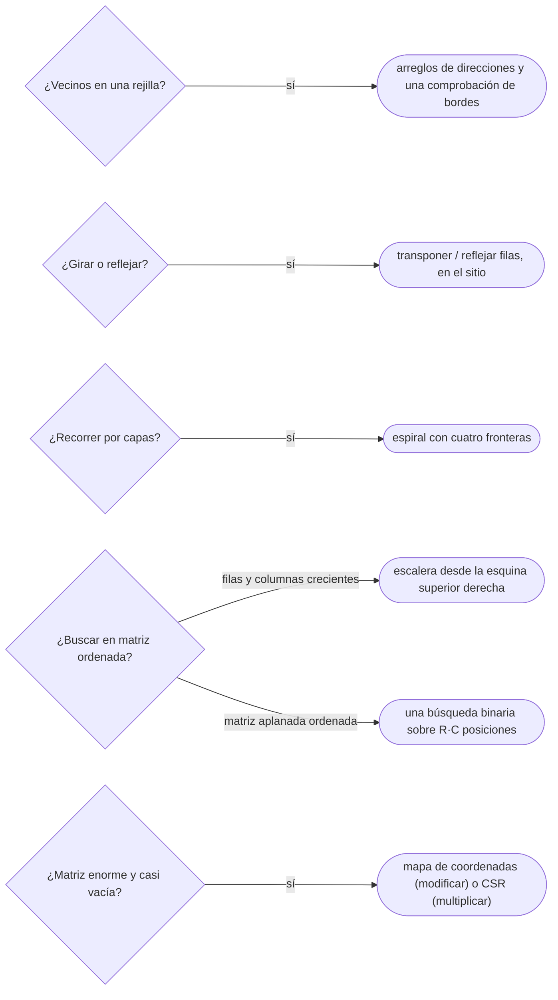

# 05 — Matrices

> Recorrer, rotar y buscar en matrices sin errores de índice: los arreglos de direcciones para los
> vecinos, la rotación en el sitio, la espiral con cuatro fronteras, la búsqueda en escalera sobre una
> matriz ordenada, y cómo se representa una matriz que es casi toda ceros.
>
> **Niveles:** recorridos, rotación y espiral [A] · búsqueda en matriz ordenada [A] · representación
> dispersa [B].
>
> **📚 Lectura troncal:** Brassard y Bratley, *Fundamentos de algoritmia* (Prentice Hall, 1997), cap. 5
> (matrices dispersas); Sedgewick y Wayne, *Algorithms*, 4.ª ed. (Addison-Wesley, 2011), cap. 1.
>
> **Vigencia:** 2026-10-04.

**Salto rápido:** [1](#1--el-problema) · [2](#2--la-teoría) · [3](#3--recorridos-rotación-y-espiral) · [4](#4--búsqueda-en-matriz-ordenada) · [5](#5--representación-dispersa) · [6](#6-️-la-tabla-de-costes) · [7](#7--cómo-se-elige) · [8](#8--señales-del-enunciado) · [🧠](#-preguntas) · [🧩](#-problemas-propios)

---

## 1. 🎯 El problema

Una matriz no es más difícil que un arreglo, pero tiene el doble de índices y cuatro bordes, y ahí viven
los errores. Escribir los cuatro vecinos de una celda con cuatro `if` distintos, cada uno con su propia
comprobación de bordes, es la receta del *off-by-one*. Rotar una imagen copiando a otra matriz funciona
y gasta el doble de memoria. Buscar un valor en una matriz con filas y columnas ordenadas recorriéndola
entera ignora justo la estructura que el enunciado regala.

Y en el otro extremo, una matriz de `10⁶ × 10⁶` con `2·10⁵` valores distintos de cero ni siquiera cabe:
son `10¹²` celdas. Representarla como «una lista de las celdas que no son cero» es la única forma de
trabajar con ella.

Este capítulo fija las formas correctas de esas operaciones —con plantillas que se copian sin pensar en
los bordes—, el argumento que deja la búsqueda en `O(n + m)`, y las representaciones dispersas.

---

## 2. 📐 La teoría

**Las coordenadas.** Una matriz `R × C` guardada por filas pone la celda `(i, j)` en la posición
`i · C + j` de un arreglo plano. Los recorridos que siguen esa disposición son los rápidos ([`02/05`](../02-analisis/05-el-coste-real.md)).

**La rotación como composición.** Girar 90° en sentido horario lleva la celda `(i, j)` a `(j, n−1−i)` en
una matriz `n × n`. Esa aplicación es la composición de dos más simples: **transponer**
(`(i, j) → (j, i)`) y **reflejar cada fila** (`(i, j) → (i, n−1−j)`). Las dos se hacen en el sitio
intercambiando pares, sin matriz auxiliar.

**Teorema (búsqueda en escalera).** En una matriz `R × C` con filas crecientes de izquierda a derecha y
columnas crecientes de arriba abajo, empezar en la esquina superior derecha y, en cada paso, ir a la
izquierda si el valor es mayor que el buscado y abajo si es menor, encuentra el valor o demuestra que no
está en como mucho `R + C − 1` pasos.

*Prueba.* Invariante: si `x` está en la matriz, está en la submatriz de filas `≥ i` y columnas `≤ j`.
Si `M[i][j] > x`, toda la columna `j` desde la fila `i` hacia abajo es aún mayor (columnas crecientes):
`x` no está en ella, y `j` baja. Si `M[i][j] < x`, toda la fila `i` hasta la columna `j` es menor (filas
crecientes): `x` no está en ella, e `i` sube. Cada paso descarta una fila o una columna, y hay `R + C`
como mucho. Es la misma forma de argumento que el invariante de la búsqueda binaria ([`02/04`](../02-analisis/04-correccion-invariantes-induccion-intercambio.md)).

**La matriz dispersa.** Si una matriz tiene `nnz` valores distintos de cero, una representación que
guarde solo esos `nnz` ocupa `O(nnz)` en vez de `O(R · C)`. El coste de cada operación depende de la
representación: acceso aleatorio, recorrido por filas o modificación. Brassard y Bratley, cap. 5,
presentan las listas múltiples; CSR (*compressed sparse row*) es la forma estándar de las bibliotecas
numéricas.

---

## 3. 🧱 Recorridos, rotación y espiral

**Qué es.** Tres formas de recorrer una matriz que salen constantemente: los vecinos de una celda, la
rotación en el sitio y el recorrido en espiral.

**Por qué es correcto.** Los vecinos, porque los arreglos de direcciones enumeran exactamente los
desplazamientos válidos y una sola comprobación de bordes filtra los que se salen. La rotación, por la
composición de §2. La espiral, porque cada lado recorrido estrecha una frontera y ninguna celda queda
dentro de dos fronteras a la vez.

**Cómo va**, con los datos del bloque:

```text
M (3 × 4):        espiral: 3 1 4 1 → 6 8 → 5 3 5 → 5 → 9 2
3 1 4 1
5 9 2 6           rotación de A (3 × 3):
5 3 5 8           1 2 3      7 4 1
                  4 5 6  →   8 5 2
                  7 8 9      9 6 3
```

**Cuánto.** Los tres son `Θ(R · C)` en tiempo; la rotación y la espiral, `Θ(1)` de memoria extra.

**La plantilla**: vecinos con arreglos de direcciones, rotación en el sitio y espiral.

```cpp
#include <algorithm>
#include <vector>

const int DR[4] = {-1, 1, 0, 0}, DC[4] = {0, 0, -1, 1};   // arriba, abajo, izquierda, derecha

// Recorre los vecinos de (r, c) dentro de una matriz rows × cols.
template <class F> void forNeighbors(int r, int c, int rows, int cols, F visit) {
    for (int d = 0; d < 4; d++) {
        int nr = r + DR[d], nc = c + DC[d];
        if (0 <= nr && nr < rows && 0 <= nc && nc < cols) visit(nr, nc);   // una sola comprobación
    }
}

// Gira una matriz n × n 90° en sentido horario, en el sitio: transponer y reflejar cada fila.
void rotateClockwise(std::vector<std::vector<int>>& m) {
    int n = static_cast<int>(m.size());
    for (int i = 0; i < n; i++)
        for (int j = i + 1; j < n; j++) std::swap(m[i][j], m[j][i]);
    for (auto& row : m) std::reverse(row.begin(), row.end());
}

// Recorrido en espiral en sentido horario desde la esquina superior izquierda.
std::vector<int> spiral(const std::vector<std::vector<int>>& m) {
    std::vector<int> out;
    int top = 0, bottom = static_cast<int>(m.size()) - 1, left = 0, right = static_cast<int>(m[0].size()) - 1;
    while (top <= bottom && left <= right) {
        for (int j = left; j <= right; j++) out.push_back(m[top][j]);
        top++;
        for (int i = top; i <= bottom; i++) out.push_back(m[i][right]);
        right--;
        if (top <= bottom) { for (int j = right; j >= left; j--) out.push_back(m[bottom][j]); bottom--; }
        if (left <= right) { for (int i = bottom; i >= top; i--) out.push_back(m[i][left]); left++; }
    }
    return out;
}
```

```java
static final int[] DR = {-1, 1, 0, 0}, DC = {0, 0, -1, 1};   // arriba, abajo, izquierda, derecha

// Gira una matriz n × n 90° en sentido horario, en el sitio: transponer y reflejar cada fila.
static void rotateClockwise(int[][] m) {
    int n = m.length;
    for (int i = 0; i < n; i++)
        for (int j = i + 1; j < n; j++) { int t = m[i][j]; m[i][j] = m[j][i]; m[j][i] = t; }
    for (int[] row : m)
        for (int l = 0, r = n - 1; l < r; l++, r--) { int t = row[l]; row[l] = row[r]; row[r] = t; }
}

// Recorrido en espiral en sentido horario desde la esquina superior izquierda.
static java.util.List<Integer> spiral(int[][] m) {
    java.util.List<Integer> out = new java.util.ArrayList<>();
    int top = 0, bottom = m.length - 1, left = 0, right = m[0].length - 1;
    while (top <= bottom && left <= right) {
        for (int j = left; j <= right; j++) out.add(m[top][j]);
        top++;
        for (int i = top; i <= bottom; i++) out.add(m[i][right]);
        right--;
        if (top <= bottom) { for (int j = right; j >= left; j--) out.add(m[bottom][j]); bottom--; }
        if (left <= right) { for (int i = bottom; i >= top; i--) out.add(m[i][left]); left++; }
    }
    return out;
}
```

```python
DIRS = ((-1, 0), (1, 0), (0, -1), (0, 1))   # arriba, abajo, izquierda, derecha

def neighbors(r, c, rows, cols):
    for dr, dc in DIRS:
        nr, nc = r + dr, c + dc
        if 0 <= nr < rows and 0 <= nc < cols:
            yield nr, nc

def rotate_clockwise(m):
    """Gira una matriz n × n 90° en sentido horario, en el sitio."""
    n = len(m)
    for i in range(n):
        for j in range(i + 1, n):
            m[i][j], m[j][i] = m[j][i], m[i][j]
    for row in m:
        row.reverse()

def spiral(m):
    out = []
    top, bottom, left, right = 0, len(m) - 1, 0, len(m[0]) - 1
    while top <= bottom and left <= right:
        out.extend(m[top][left:right + 1]); top += 1
        out.extend(m[i][right] for i in range(top, bottom + 1)); right -= 1
        if top <= bottom:
            out.extend(m[bottom][j] for j in range(right, left - 1, -1)); bottom -= 1
        if left <= right:
            out.extend(m[i][left] for i in range(bottom, top - 1, -1)); left += 1
    return out
```

- **Los arreglos de direcciones** convierten cuatro casos en un bucle; para 8 vecinos (incluidas las
  diagonales), dos arreglos de ocho. En C++ la función recibe una lambda; en Java se escribe el bucle en
  línea con `DR` y `DC`; en Python, un generador.
- **La rotación transpone solo el triángulo superior** (`j > i`): transponer la matriz entera intercambia
  cada par dos veces y la deja como estaba.
- **La espiral comprueba `top <= bottom` y `left <= right`** antes del tercer y el cuarto lado: con una
  sola fila o una sola columna restante, sin esa comprobación se recorre dos veces.
- **En Python**, `zip(*m[::-1])` gira en una línea, pero crea una matriz nueva de tuplas.

### De la versión ingenua a la buena

**El problema.** Girar una imagen `n × n` 90° en sentido horario. Con `A`, el resultado de la traza.

**La versión ingenua:**

```java
// Copia a una matriz nueva con la fórmula de la rotación: O(n²) tiempo y O(n²) memoria extra.
static int[][] rotateCopy(int[][] m) {
    int n = m.length;
    int[][] out = new int[n][n];
    for (int i = 0; i < n; i++)
        for (int j = 0; j < n; j++) out[j][n - 1 - i] = m[i][j];
    return out;
}
```

> «Es correcta y lineal en el número de celdas, pero duplica la memoria. Girar 90° es transponer y
> reflejar cada fila, y las dos cosas se hacen intercambiando pares en el sitio: misma complejidad, sin
> matriz auxiliar.»

**El camino a la buena.** `rotateClockwise`: transponer el triángulo superior y reflejar las filas. Para
el sentido antihorario, reflejar primero y transponer después.

**Cuándo sí**: cualquier problema de rejilla con vecinos, rotaciones o recorridos por capas. **Cuándo
no**: si el problema es un grafo con aristas arbitrarias; la rejilla es un caso particular ([`14/02`](../14-grafos-recorridos/02-bfs.md)).

> **Veredicto:** vecinos con arreglos de direcciones y una sola comprobación de bordes; rotación por
> transponer y reflejar; espiral con cuatro fronteras y las dos comprobaciones de en medio.

---

## 4. 🧱 Búsqueda en matriz ordenada

**Qué es.** Buscar un valor en una matriz con filas y columnas crecientes empezando en la esquina superior
derecha y descartando una fila o una columna en cada paso.

**Por qué es correcto.** Por el teorema de la escalera de §2 y su invariante.

**Cómo va**, con la matriz de ejemplo de este capítulo, filas y columnas crecientes:

```text
S:                 buscar 5:  (0,3)=11 > 5 → izquierda · (0,2)=7 > 5 → izquierda
 1  4  7 11                   (0,1)=4 < 5 → abajo · (1,1)=5: encontrado
 2  5  8 12        buscar 15: (0,3)=11 < 15 → abajo · (1,3)=12 < 15 → abajo
 3  6  9 16                   (2,3)=16 > 15 → izquierda · (2,2)=9 < 15 → abajo
10 13 14 17                   (3,2)=14 < 15 → abajo · se sale: no está
```

**Cuánto.** `O(R + C)` en el caso peor, `O(1)` memoria.

**La plantilla:**

```cpp
#include <utility>
#include <vector>

// Busca x en una matriz con filas y columnas crecientes. Devuelve {fila, columna} o {-1, -1}. O(R + C).
std::pair<int, int> staircaseSearch(const std::vector<std::vector<int>>& m, int x) {
    int i = 0, j = static_cast<int>(m[0].size()) - 1;
    while (i < static_cast<int>(m.size()) && j >= 0) {
        if (m[i][j] == x) return {i, j};
        if (m[i][j] > x) j--;          // toda la columna j desde la fila i es > x
        else i++;                      // toda la fila i hasta la columna j es < x
    }
    return {-1, -1};
}
```

```java
// Busca x en una matriz con filas y columnas crecientes. Devuelve {fila, columna} o {-1, -1}. O(R + C).
static int[] staircaseSearch(int[][] m, int x) {
    int i = 0, j = m[0].length - 1;
    while (i < m.length && j >= 0) {
        if (m[i][j] == x) return new int[] {i, j};
        if (m[i][j] > x) j--;
        else i++;
    }
    return new int[] {-1, -1};
}
```

```python
def staircase_search(m, x):
    """Busca x en una matriz con filas y columnas crecientes. Devuelve (fila, columna) o None. O(R + C)."""
    i, j = 0, len(m[0]) - 1
    while i < len(m) and j >= 0:
        if m[i][j] == x:
            return i, j
        if m[i][j] > x:
            j -= 1
        else:
            i += 1
    return None
```

- **La esquina de partida** es la superior derecha (o la inferior izquierda): en ella un valor es el
  mayor de su fila y el menor de su columna, y por eso cada comparación descarta algo. Desde la superior
  izquierda, las dos direcciones crecen y no se descarta nada.
- **Si además cada fila empieza después de que termine la anterior** (la matriz aplanada está
  ordenada), una sola búsqueda binaria sobre `R · C` posiciones es `O(log(R·C))`, mejor.

### De la versión ingenua a la buena

**El problema.** ¿Está el valor `x` en la matriz `S`? Con 5, sí; con 15, no.

**La versión ingenua:** recorrer todas las celdas, `O(R · C)`; o una búsqueda binaria por fila,
`O(R log C)`.

```java
// Una búsqueda binaria por fila: O(R log C). Usa que las filas están ordenadas, no las columnas.
static boolean containsByRows(int[][] m, int x) {
    for (int[] row : m)
        if (java.util.Arrays.binarySearch(row, x) >= 0) return true;
    return false;
}
```

> «Aprovecho que las filas están ordenadas, pero no que las columnas también lo están. Desde la esquina
> superior derecha, cada comparación descarta una fila entera o una columna entera: `O(R + C)`.»

**El camino a la buena.** `staircaseSearch`. Con `R = C = 1000`, de unas `10⁴` comparaciones a `2000`.

**Cuándo sí**: matrices con filas **y** columnas ordenadas. **Cuándo no**: si solo las filas lo están
(búsqueda binaria por fila), o si la matriz aplanada está ordenada (una binaria global).

> **Veredicto:** buscar en matriz ordenada no es binaria por filas: es una escalera desde la esquina en
> la que cada comparación descarta una línea.

---

## 5. 🧱 Representación dispersa

**Qué es.** Guardar solo las celdas distintas de cero de una matriz. Tres formas:

| Representación | Qué guarda | Bueno para |
|---|---|---|
| Mapa de coordenadas | `(fila, columna) → valor` en un mapa | Acceso aleatorio y modificación |
| Lista de tripletas (COO) | `(fila, columna, valor)` en un arreglo | Construir; convertir a otra forma |
| CSR | Valores y columnas ordenados por fila, y dónde empieza cada fila | Recorrer por filas; multiplicar por un vector |
| Listas múltiples | Cada celda enlazada con la siguiente de su fila y de su columna | Recorrer por filas y por columnas (Brassard y Bratley) |

**Por qué es correcto** (el enunciado y una frase): toda celda ausente vale cero, así que cualquier
operación lineal (suma, producto por un vector) solo necesita las presentes.

**Cómo va.** CSR guarda tres arreglos: `values` y `cols`, de tamaño `nnz`, ordenados por fila; y
`rowStart`, de tamaño `R + 1`, donde los valores de la fila `i` ocupan `[rowStart[i], rowStart[i+1])`.
El producto `y = A · x` recorre cada fila una vez: `O(R + nnz)`.

**Cuánto.** Memoria `O(nnz)` (más `O(R)` en CSR); la multiplicación por un vector, `O(R + nnz)`.

**La plantilla**, en C++ como fija la ficha del capítulo: el producto de una matriz CSR por un vector.

```cpp
#include <vector>

// Matriz dispersa en formato CSR: la fila i ocupa [rowStart[i], rowStart[i+1]) de values y cols.
struct CsrMatrix {
    std::vector<int> rowStart, cols;
    std::vector<long long> values;

    std::vector<long long> multiply(const std::vector<long long>& x) const {   // y = A · x
        int rows = static_cast<int>(rowStart.size()) - 1;
        std::vector<long long> y(rows, 0);
        for (int i = 0; i < rows; i++)
            for (int k = rowStart[i]; k < rowStart[i + 1]; k++) y[i] += values[k] * x[cols[k]];
        return y;
    }
};
```

- **`rowStart` tiene `R + 1` posiciones**: es un arreglo de prefijos ([`04/01`](01-prefijos-y-diferencias.md)) de cuántas celdas hay en
  cada fila.
- **Con `R` enorme** (filas hasta `10⁹`), ni siquiera `rowStart` cabe: se comprimen las filas que tienen
  algún valor (`04/04`) o se usa un mapa de fila a lista de `(columna, valor)`.
- **En Java** es la misma estructura con tres arreglos; un `HashMap<Long, Long>` con la clave
  `fila · C + columna` sirve para el mapa de coordenadas.

**Cuándo sí**: matrices de adyacencia de grafos grandes, sistemas de ecuaciones dispersos, matrices de
transición. **Cuándo no**: si la densidad pasa de un 10–20 %, la matriz densa es más compacta y rápida.

> **Veredicto:** dispersa no es «una matriz con ceros»: es una representación que no guarda los ceros.
> Mapa para modificar, CSR para multiplicar.

---

## 6. ⏱️ La tabla de costes

| Operación | Tiempo | Memoria extra | Lo que la tabla no dice |
|---|---|---|---|
| Vecinos de una celda | `O(1)` | — | Una sola comprobación de bordes con arreglos de direcciones |
| Rotación copiando | `O(n²)` | `O(n²)` | Correcta y simple; duplica memoria |
| Rotación en el sitio | `O(n²)` | `O(1)` | Transponer solo el triángulo superior |
| Espiral | `O(R·C)` | `O(1)` | Las comprobaciones del tercer y cuarto lado |
| Búsqueda en escalera | `O(R + C)` | `O(1)` | Necesita filas **y** columnas ordenadas |
| Producto CSR por vector | `O(R + nnz)` | `O(nnz + R)` | Con filas hasta `10⁹`, comprimir filas |

---

## 7. 🧭 Cómo se elige



> **Mejor:** «Desde la esquina superior derecha, si el valor es mayor, toda esa columna hacia abajo
> también lo es y la descarto; si es menor, descarto la fila: como mucho `R + C` pasos.»

---

## 8. 🔎 Señales del enunciado

| Señal | Técnica | Por qué |
|---|---|---|
| «Celdas adyacentes», «arriba, abajo, izquierda, derecha» | Arreglos de direcciones | Un bucle en vez de cuatro casos |
| «Gira la imagen en el sitio», «sin memoria extra» | Transponer y reflejar | La rotación es la composición de dos intercambios |
| «Recorre en espiral», «por capas» | Cuatro fronteras | Cada lado estrecha una |
| «Filas y columnas ordenadas», «busca un valor» | Escalera | Cada comparación descarta una línea |
| Dimensiones de `10⁶` o más con pocos valores no nulos | Representación dispersa | La densa no cabe |

---

## ⚠️ Errores frecuentes

| Se dice | Lo preciso |
|---|---|
| «Buscar en matriz ordenada es binaria por filas» | Eso es `O(R log C)`; la escalera es `O(R + C)` |
| «La matriz dispersa es una matriz con ceros» | Es una representación que no guarda los ceros |
| «Transponer es intercambiar `m[i][j]` y `m[j][i]` para todo `i, j`» | Así cada par se intercambia dos veces y no cambia nada; solo el triángulo superior |
| «La espiral no necesita casos especiales» | Con una fila o una columna restante, sin las comprobaciones se recorre dos veces |
| «Los cuatro vecinos se escriben con cuatro `if`» | Con arreglos de direcciones, un bucle y una sola comprobación |
| «`[[0] * m] * n` crea una matriz en Python» | Crea `n` referencias a la misma fila ([`03/04`](../03-biblioteca-estandar/04-python-para-competir.md)) |

---

## 📚 Para profundizar

- **Libro** — Brassard y Bratley, *Fundamentos de algoritmia* (Prentice Hall, 1997), cap. 5: las
  estructuras de datos, con las matrices dispersas y las listas múltiples. *Lectura troncal.*
- **Libro** — Sedgewick y Wayne, *Algorithms*, 4.ª ed. (Addison-Wesley, 2011), cap. 1: arreglos
  bidimensionales y su uso en Java. *Lectura troncal.*
- **Libro** — Bentley, *Programming Pearls*, 2.ª ed. (Addison-Wesley, 2000), columna 2: la rotación de
  un vector con tres inversiones, la misma idea que la rotación de la matriz.
- **Referencia** — Codility, [lección 2, *Arrays*](https://app.codility.com/programmers/lessons/2-arrays/cyclic_rotation/):
  la rotación cíclica, en una dimensión.

---

## 🧠 Preguntas

1. ¿Qué dos operaciones componen una rotación de 90° en sentido horario? 🟢
2. ¿Desde qué esquina empieza la búsqueda en escalera, y por qué esa? 🟢
3. ¿Qué guardan los tres arreglos del formato CSR? 🟢
4. ¿Qué diferencia hay entre una matriz con filas y columnas ordenadas y una cuya versión aplanada está ordenada, en cómo se busca? 🟡
5. ¿Por qué la transposición en el sitio recorre solo el triángulo superior? 🟡
6. ¿Qué diferencia hay entre un mapa de coordenadas y CSR, y para qué operación es mejor cada uno? 🟡
7. Compara cómo escribes los cuatro vecinos de una celda en C++, Java y Python con arreglos de direcciones. 🟡
8. ¿Por qué buscar desde la esquina superior izquierda no permite descartar nada? 🟡
9. Demuestra que la búsqueda en escalera hace como mucho `R + C − 1` comparaciones y que no se salta el valor. 🟠
10. ¿Por qué la espiral necesita comprobar `top <= bottom` antes del tercer lado? Da una matriz que falla sin la comprobación. 🟠
11. Diseña cómo multiplicar dos matrices dispersas de `10⁶ × 10⁶` con `2·10⁵` valores cada una, y su coste en función de las celdas no nulas. 🔴
12. Escribe en palabras cómo girar una matriz rectangular `R × C` (no cuadrada), y por qué no se puede en el sitio con el mismo truco. 🔴

---

## 🧩 Problemas propios

### Picos de la rejilla

**Nivel:** 🟢 · **Formato:** programa completo.

Una celda es un *pico* si su valor es estrictamente mayor que el de todos sus vecinos de arriba, abajo,
izquierda y derecha que existan. Cuenta los picos.

- **Entrada.** Una línea con `R` y `C`. Después, `R` líneas con `C` enteros.
- **Salida.** Un entero.
- **Restricciones.** `1 ≤ R, C ≤ 1000`; `0 ≤ valor ≤ 10⁹`.

```text
Entrada            Salida
3 4                3
3 1 4 1
5 9 2 6
5 3 5 8

Entrada            Salida
2 2                0
1 1
1 1
```

**Pista 1:** ¿cómo recorres los cuatro vecinos de una celda sin escribir un caso para cada borde?

### Girar k veces

**Nivel:** 🟡 · **Formato:** programa completo.

Gira una matriz `n × n` 90° en sentido horario `k` veces e imprímela.

- **Entrada.** Una línea con `n` y `k`. Después, `n` líneas con `n` enteros.
- **Salida.** La matriz girada, `n` líneas.
- **Restricciones.** `1 ≤ n ≤ 1000`; `0 ≤ k ≤ 10¹⁸`.

```text
Entrada            Salida
2 1                3 1
1 2                4 2
3 4

Entrada            Salida
2 5                3 1
1 2                4 2
3 4
```

**Pista 1:** ¿qué pasa con la matriz después de cuatro giros?

### Dispersa por un vector

**Nivel:** 🟠 · **Formato:** programa completo.

Una matriz de `R` filas y `C` columnas se da como `k` tripletas `(fila, columna, valor)` con las celdas
no nulas (desde 0). Calcula `y = A · x` e imprime las filas con `y` distinto de cero, en orden, cada una
con su valor.

- **Entrada.** Una línea con `R`, `C` y `k`. Después, `k` líneas con `fila columna valor`. Después, una
  línea con los `C` valores de `x`.
- **Salida.** Una línea por fila con `y ≠ 0`: la fila y su valor.
- **Restricciones.** `1 ≤ R ≤ 10⁹`; `1 ≤ C ≤ 2·10⁵`; `1 ≤ k ≤ 2·10⁵`; `|valor|, |x[j]| ≤ 10⁴`; no se
  repite ninguna celda.

```text
Entrada            Salida
1000000000 4 4     0 8
0 1 2              5 4
0 3 1              999999999 9
5 0 4
999999999 2 3
1 2 3 4

Entrada            Salida
3 2 3              2 5
0 0 2
0 1 -2
2 0 5
1 1
```

**Pista 1:** con `R` hasta `10⁹`, ¿puedes reservar un `y` con una posición por fila?

---

## 🧩 Práctica externa

### Núcleo

| ✔ | Problema | Plataforma | Nivel | Patrón | Pista 1 |
|---|---|---|---|---|---|
| [ ] | [Diagonal Difference](https://www.hackerrank.com/challenges/diagonal-difference/problem) | HackerRank | 🟢 | Índices de las diagonales | ¿Qué relación cumplen `i` y `j` en cada diagonal? |
| [ ] | [Toeplitz Matrix](https://leetcode.com/problems/toeplitz-matrix/) | LeetCode | 🟢 | Comparar con un vecino | ¿Con qué celda tiene que coincidir cada una? |
| [ ] | [Reshape the Matrix](https://leetcode.com/problems/reshape-the-matrix/) | LeetCode | 🟢 | Índice plano | Si numeras las celdas por filas, ¿dónde va la celda `k` en la matriz nueva? |
| [ ] | [Flood Fill](https://leetcode.com/problems/flood-fill/) | LeetCode | 🟢 | Vecinos con direcciones | ¿Qué pasa si el color nuevo es igual al viejo? |
| [ ] | [CyclicRotation](https://app.codility.com/programmers/lessons/2-arrays/cyclic_rotation/) | Codility | 🟢 | Rotación con módulo | ¿A qué posición va el elemento `i` tras `K` rotaciones? |
| [ ] | [Search a 2D Matrix](https://leetcode.com/problems/search-a-2d-matrix/) | LeetCode | 🟡 | Matriz aplanada ordenada | Si cada fila empieza después de la anterior, ¿qué ves al ponerlas en fila? |
| [ ] | [Spiral Matrix II](https://leetcode.com/problems/spiral-matrix-ii/) | LeetCode | 🟡 | Espiral con fronteras | ¿Qué cuatro límites cambian al terminar cada lado? |
| [ ] | [Diagonal Traverse](https://leetcode.com/problems/diagonal-traverse/) | LeetCode | 🟡 | Recorrido por `i + j` | ¿Qué tienen en común las celdas de una misma diagonal ascendente? |

### Ampliación

| ✔ | Problema | Plataforma | Nivel | Patrón | Pista 1 |
|---|---|---|---|---|---|
| [ ] | [Game of Life](https://leetcode.com/problems/game-of-life/) | LeetCode | 🟡 | Vecinos en el sitio | ¿Cómo guardas el estado viejo y el nuevo en la misma celda? |
| [ ] | [Kth Smallest Element in a Sorted Matrix](https://leetcode.com/problems/kth-smallest-element-in-a-sorted-matrix/) | LeetCode | 🟡 | Escalera para contar | Para un valor `v`, ¿cuántas celdas son `≤ v`, y cuánto cuesta contarlo? |
| [ ] | [Counting Rooms](https://cses.fi/problemset/task/1192) | CSES | 🟡 | Vecinos y recorrido | Cuando encuentras una celda libre sin visitar, ¿qué haces con todas las conectadas a ella? |
| [ ] | [Matrix Layer Rotation](https://www.hackerrank.com/challenges/matrix-rotation-algo/problem) | HackerRank | 🟠 | Capas como anillos | Si sacas cada capa como una lista, ¿qué es una rotación de la capa? |

---

## ✅ Criterio de dominio

- Escribir de memoria los arreglos de direcciones, la rotación en el sitio y la espiral.
- Demostrar la búsqueda en escalera con su invariante.
- Explicar CSR con sus tres arreglos y multiplicar por un vector.
- Resolver Spiral Matrix II y Kth Smallest Element in a Sorted Matrix sin pista 2.

---

**Anterior:** [`04/04` — Compresión de coordenadas y barrido de eventos](04-compresion-y-barrido.md) ·
**Siguiente:** [`04/06` — Simulación](06-simulacion.md) ·
**Relacionado:** [`14/02` — BFS](../14-grafos-recorridos/02-bfs.md); [`17/07` — Matrices y Gauss](../17-matematica/07-matrices-y-gauss.md).
