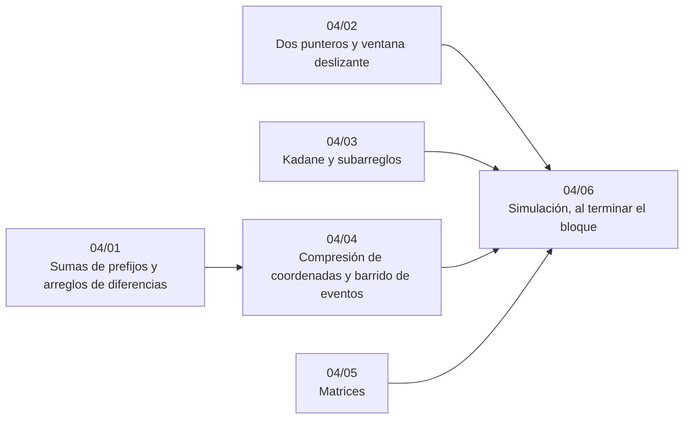

# Bloque 04 — Secuencias

> Las técnicas lineales sobre arreglos que más salen en una prueba de empresa: prefijos y diferencias, dos
> punteros y ventana deslizante, Kadane y el conteo de subarreglos con *hash*, la compresión de coordenadas con el
> barrido de eventos, y las matrices (recorridos, rotación, búsqueda en una matriz ordenada, representación
> dispersa). Casi todo baja un `O(n²)` ingenuo a `O(n)` o `O(n log n)`.
>
> Las respuestas de las preguntas y las pistas 2 y 3 de los problemas, en [`07` — Respuestas](07-respuestas.md).
>
> **Vigencia:** 2026-10-04.

---

## 🧭 Índice

| Capítulo | Niveles | Ruta corta |
|---|---|---|
| [`04/01` — Sumas de prefijos y arreglos de diferencias](01-prefijos-y-diferencias.md) | prefijos 1D [A] · diferencias 1D [A] · prefijos y diferencias 2D [A] | sí |
| [`04/02` — Dos punteros y ventana deslizante](02-dos-punteros-y-ventana.md) | dos punteros [A] · ventana variable [A] · ventana fija [A] | sí |
| [`04/03` — Kadane y subarreglos](03-kadane-y-subarreglos.md) | Kadane [A] · variante circular [A] · conteo con prefijos y *hash* [A] · voto de mayoría de Boyer-Moore [B] | sí |
| [`04/04` — Compresión de coordenadas y barrido de eventos](04-compresion-y-barrido.md) | compresión de coordenadas [A] · barrido de eventos [A] · unión de intervalos [A] |  |
| [`04/05` — Matrices](05-matrices.md) | recorridos, rotación y espiral [A] · búsqueda en matriz ordenada [A] · representación dispersa [B] |  |
| [`04/06` — Simulación](06-simulacion.md) | El examen del bloque: preguntas transversales y problemas cronometrados | |
| [`04/07` — Respuestas](07-respuestas.md) | Las preguntas en tres capas y las pistas 2 y 3 | |

---

## 🧭 Orden de lectura

- Los cinco son independientes salvo `04/04`, que usa los prefijos de `04/01`; el orden del bloque va de lo más frecuente a lo menos.

---

## 🔎 Mapa de señales del bloque

| Señal | Técnica | Capítulo |
|---|---|---|
| «Suma (o conteo) entre `l` y `r`», muchas consultas, sin cambios | Prefijos | [`04/01`](01-prefijos-y-diferencias.md) |
| «Suma `v` a todos los elementos entre `l` y `r`», muchas veces, y el resultado al final | Diferencias | [`04/01`](01-prefijos-y-diferencias.md) |
| «Par (o terna) con suma objetivo», datos ordenados u ordenables | Dos punteros | [`04/02`](02-dos-punteros-y-ventana.md) |
| «Subarreglo más largo / más corto con suma `≤` / `≥ S`», valores `≥ 0` | Ventana variable | [`04/02`](02-dos-punteros-y-ventana.md) |
| «Subarreglo contiguo de suma máxima», con negativos | Kadane | [`04/03`](03-kadane-y-subarreglos.md) |
| «Arreglo circular», «puede dar la vuelta» | Kadane circular | [`04/03`](03-kadane-y-subarreglos.md) |
| Coordenadas hasta `10⁹` y una estructura indexada | Compresión | [`04/04`](04-compresion-y-barrido.md) |
| «Máximo de intervalos a la vez», «hora punta» | Barrido de eventos | [`04/04`](04-compresion-y-barrido.md) |
| «Celdas adyacentes», «arriba, abajo, izquierda, derecha» | Arreglos de direcciones | [`04/05`](05-matrices.md) |
| «Gira la imagen en el sitio», «sin memoria extra» | Transponer y reflejar | [`04/05`](05-matrices.md) |

---

## 📚 Lectura troncal del bloque

La de cada capítulo, que es también la primera entrada de su «Para profundizar»:

- **`04/01`** — Laaksonen, *Guide to Competitive Programming*, 3.ª ed. (Springer, 2024), cap. 9; Halim, Halim y Effendy, *Competitive Programming 4*, libro 1 (2020), cap. 3.
- **`04/02`** — Laaksonen, *Guide to Competitive Programming*, 3.ª ed. (Springer, 2024), cap. 8; Halim, Halim y Effendy, *Competitive Programming 4*, libro 1 (2020), cap. 3.
- **`04/03`** — Bentley, *Programming Pearls*, 2.ª ed. (Addison-Wesley, 2000), columna 8; Cormen, Leiserson, Rivest y Stein, *Introduction to Algorithms*, 3.ª ed. (MIT Press, 2009), cap. 4 (el subarreglo máximo por divide y vencerás).
- **`04/04`** — Laaksonen, *Guide to Competitive Programming*, 3.ª ed. (Springer, 2024), cap. 13; de Berg y otros, *Computational Geometry: Algorithms and Applications*, 3.ª ed. (Springer, 2008), cap. 2 (el barrido como paradigma).
- **`04/05`** — Brassard y Bratley, *Fundamentos de algoritmia* (Prentice Hall, 1997), cap. 5 (matrices dispersas); Sedgewick y Wayne, *Algorithms*, 4.ª ed. (Addison-Wesley, 2011), cap. 1.

---

## 🧭 Qué NO está aquí

- **Ordenar y la búsqueda binaria**, que muchas de estas técnicas usan: en el [bloque `05`](../05-orden-y-busqueda/README.md).
- **Consultas sobre tramos con actualizaciones**: en el [bloque `09`](../09-consultas-sobre-rangos/README.md).
- **La pila y la cola monótonas**: en [`06/01` — Pila, cola, deque y sus versiones monótonas](../06-lineales-y-hashing/01-pilas-colas-y-monotonas.md).
- **Matrices como álgebra** (exponenciación, Gauss): en [`17/07` — Matrices y eliminación de Gauss](../17-matematica/07-matrices-y-gauss.md).

---

**Anterior:** [Bloque 03 — Biblioteca estándar](../03-biblioteca-estandar/README.md) ·
**Siguiente:** [Bloque 05 — Orden y búsqueda](../05-orden-y-busqueda/README.md) ·
**Inicio:** [README del corpus](../README.md)
