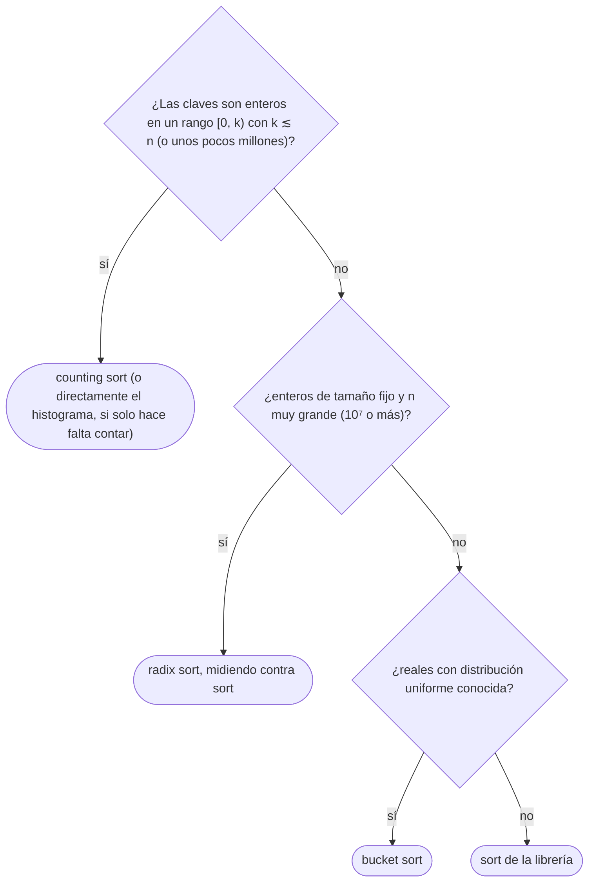

# 02 — Ordenación lineal

> Ordenar en `O(n + k)` cuando las claves son enteros acotados: el *counting sort*, el *radix sort*
> que se apoya en su estabilidad, y el *bucket sort* para datos uniformes. Por qué no contradicen la
> cota `Ω(n log n)` y cuándo no compensan.
>
> **Niveles:** *counting sort* [B] · *radix sort* [B] · *bucket sort* [C].
>
> **📚 Lectura troncal:** Cormen, Leiserson, Rivest y Stein, *Introduction to Algorithms*, 3.ª ed.
> (MIT Press, 2009), cap. 8.
>
> **Asume leído:** [`05/01` — Ordenación por comparación](01-ordenacion-por-comparacion.md).
>
> **Vigencia:** 2026-10-04.

**Salto rápido:** [1](#1--el-problema) · [2](#2--la-teoría) · [3](#3--counting-sort) · [4](#4--radix-sort) · [5](#5--bucket-sort) · [6](#6-️-la-tabla-de-costes) · [7](#7--cómo-se-elige) · [8](#8--señales-del-enunciado) · [🧠](#-preguntas) · [🧩](#-problemas-propios)

---

## 1. 🎯 El problema

Un censo trae `10⁷` edades, todas entre 0 y 130. Ordenarlas con `sort` cuesta unas `10⁷ · 23`
comparaciones. Pero solo hay 131 valores posibles: basta con **contar** cuántas veces aparece cada uno
y escribirlos en orden, en dos pasadas lineales.

`05/01` demostró que ninguna ordenación por comparación baja de `n log n`. Este capítulo baja, y no
hay contradicción: estos algoritmos **no comparan** pares, sino que usan el valor de la clave como
**índice** de un arreglo. Esa es su fuerza y su límite: solo sirven cuando las claves son enteros (o se
reducen a enteros) en un rango que cabe en memoria.

---

## 2. 📐 La teoría

**Fuera del modelo de comparación.** El árbol de decisión de `05/01` supone que la única operación
sobre los datos es `a[i] < a[j]`, con dos salidas. Leer `cuenta[a[i]]` es una operación con `k`
salidas posibles: con ella, un solo paso distingue entre `k` casos y el argumento de `log₂ n!` ya no
aplica.

**El coste depende de `k`.** Con `n` claves en `[0, k)`:

```text
counting sort   Θ(n + k) tiempo, Θ(n + k) memoria
radix sort      d pasadas de counting en base b: Θ(d · (n + b))
bucket sort     Θ(n) esperado si las claves son uniformes; Θ(n²) en el peor caso
```

Si `k` es comparable a `n`, *counting* es lineal. Si `k = n²` o `k = 10⁹`, el arreglo de cuentas cuesta
más que ordenar.

**La estabilidad como condición.** El *radix* LSD ordena por el dígito menos significativo, después
por el siguiente, y así hasta el más significativo. Funciona **solo si cada pasada es estable**.

**Teorema (corrección del *radix* LSD).** Tras la pasada `t`, el arreglo está ordenado por los `t`
dígitos menos significativos.

*Prueba*, por inducción sobre `t`. Con `t = 1`, es una ordenación por el último dígito. Supuesto para
`t − 1`, considera dos claves tras la pasada `t`: si su dígito `t` difiere, la pasada `t` las deja en
orden por ese dígito, que es el más significativo de los `t`; si es igual, la pasada, **por ser
estable**, conserva su orden anterior, que por hipótesis es el de sus `t − 1` dígitos bajos. CLRS, 3.ª
ed., lema 8.3.

---

## 3. 🧱 *Counting sort*

**Qué es.** Contar cuántas veces aparece cada valor en `[0, k)`, calcular con prefijos (`04/01`)
dónde empieza cada valor en la salida, y colocar cada elemento en su sitio.

**Por qué es correcto** (el enunciado y una frase): el prefijo `inicio[v]` es el número de elementos
menores que `v`, que es exactamente la primera posición de `v` en la salida ordenada.

**Cómo va**, sobre el arreglo de juguete con `k = 10`:

```text
a       = [5, 2, 9, 1, 5, 6]
cuenta  = [0, 1, 1, 0, 0, 2, 1, 0, 0, 1]     índices 0..9
inicio  = [0, 0, 1, 2, 2, 2, 4, 5, 5, 5]     prefijo exclusivo de cuenta
coloca, recorriendo a de izquierda a derecha:
5 → pos 2   2 → pos 1   9 → pos 5   1 → pos 0   5 → pos 3   6 → pos 4
salida  = [1, 2, 5, 5, 6, 9]                el primer 5 queda antes que el segundo: estable
```

**Cuánto.** `Θ(n + k)` en tiempo y memoria: una pasada para contar, una de `k` para los prefijos, una
para colocar.

**La plantilla:**

```cpp
#include <vector>

// Counting sort estable de valores en [0, k). Θ(n + k) tiempo y memoria.
std::vector<int> countingSort(const std::vector<int>& a, int k) {
    std::vector<int> start(k + 1, 0);
    for (int x : a) start[x + 1]++;                       // cuenta desplazada una posición
    for (int v = 0; v < k; v++) start[v + 1] += start[v]; // start[v] = cuántos son menores que v
    std::vector<int> out(a.size());
    for (int x : a) out[start[x]++] = x;                  // izquierda a derecha: estable
    return out;
}
```

```java
// Counting sort estable de valores en [0, k). Θ(n + k) tiempo y memoria.
static int[] countingSort(int[] a, int k) {
    int[] start = new int[k + 1];
    for (int x : a) start[x + 1]++;
    for (int v = 0; v < k; v++) start[v + 1] += start[v];
    int[] out = new int[a.length];
    for (int x : a) out[start[x]++] = x;
    return out;
}
```

- **`start[x + 1]++`**: contar desplazado da directamente el prefijo **exclusivo** tras la suma, sin
  una resta. Es el mismo truco de `n + 1` posiciones de `04/01`.
- **Estable** porque se recorre la entrada de izquierda a derecha y cada valor avanza su propio
  puntero. CLRS recorre de derecha a izquierda con el prefijo inclusivo; las dos son estables.
- **Con registros**, se cuenta por la clave y se copia el registro entero: así lo usa el *radix*.
- **Valores negativos**: se desplaza por el mínimo, `x − min`, y `k = max − min + 1`.

**Cuándo sí**: claves enteras con `k = O(n)`; histogramas; como pasada del *radix*. **Cuándo no**: `k`
mucho mayor que `n` (memoria y tiempo de `k`), o claves que no son enteros.

> **Veredicto:** el *counting sort* convierte el valor en una dirección. Es lineal mientras el rango de
> valores sea del orden del número de elementos, y estable si se coloca en orden.

---

## 4. 🧱 *Radix sort*

**Qué es.** Ordenar por dígitos en base `b`, del menos significativo al más significativo (LSD), con un
*counting sort* estable por pasada.

**Por qué es correcto**: el teorema de §2; la estabilidad de cada pasada es imprescindible.

**Cómo va**, con `[35, 12, 93, 11, 52, 16]` en base 10:

```text
entrada            [35, 12, 93, 11, 52, 16]
por unidades       [11, 12, 52, 93, 35, 16]      12 antes que 52: venían en ese orden
por decenas        [11, 12, 16, 35, 52, 93]      11, 12 y 16 comparten decena: conservan su orden
```

**Cuánto.** `d` pasadas de `Θ(n + b)`: `Θ(d · (n + b))`. Para enteros de `w` bits partidos en dígitos de
`r` bits, `d = ⌈w/r⌉` y `b = 2ʳ`; con `r ≈ log₂ n`, el total es `Θ(w · n / log n)`. Con enteros de 32 bits
y `n = 10⁶`, cuatro pasadas de un byte (`r = 8`, `b = 256`). CLRS, 3.ª ed., lema 8.4.

**La plantilla**, en base 256 para enteros no negativos de 32 bits:

```cpp
#include <vector>

// Radix sort LSD de enteros no negativos, base 256: cuatro pasadas de counting. Θ(4 · (n + 256)).
void radixSort(std::vector<unsigned>& a) {
    std::vector<unsigned> buf(a.size());
    for (int shift = 0; shift < 32; shift += 8) {
        unsigned start[257] = {0};
        for (unsigned x : a) start[((x >> shift) & 255) + 1]++;
        for (int v = 0; v < 256; v++) start[v + 1] += start[v];
        for (unsigned x : a) buf[start[(x >> shift) & 255]++] = x;
        a.swap(buf);                     // cuatro intercambios: el resultado acaba en a
    }
}
```

```java
// Radix sort LSD de enteros no negativos, base 256: cuatro pasadas de counting. Θ(4 · (n + 256)).
static void radixSort(int[] a) {
    int[] buf = new int[a.length];
    for (int shift = 0; shift < 32; shift += 8) {
        int[] start = new int[257];
        for (int x : a) start[((x >>> shift) & 255) + 1]++;
        for (int v = 0; v < 256; v++) start[v + 1] += start[v];
        for (int x : a) buf[start[(x >>> shift) & 255]++] = x;
        System.arraycopy(buf, 0, a, 0, a.length);
    }
}
```

- **`(x >> shift) & 255`** extrae el byte número `shift / 8`: es el «dígito» en base 256.
- **Solo no negativos.** Con negativos, el bit de signo los deja **al final**, porque el byte alto de un
  negativo es mayor que el de cualquier positivo. Se arregla invirtiendo el bit de signo antes y
  después (`x ^ Integer.MIN_VALUE`). En Java, `>>>` y `>>` dan el mismo byte tras `& 255`.
- **C++ intercambia** los dos búferes en lugar de copiar; con un número par de pasadas, el resultado
  acaba en `a`.

### Desmontando «el *radix* es siempre más rápido»

*Radix* es `Θ(n)` con `d` fijo, y *quicksort* es `Θ(n log n)`; pero con `n = 10⁶`, `log₂ n ≈ 20`, y cada
pasada de *radix* recorre los datos dos veces con escrituras dispersas en 256 destinos, que es justo lo
que peor lleva la caché ([`02/05`](../02-analisis/05-el-coste-real.md)). Cuatro pasadas son ocho recorridos con búfer auxiliar. En la
práctica, la ordenación de librería gana con frecuencia para tamaños moderados, y *radix* gana con
`n` muy grande y claves cortas. Y con claves de longitud variable (cadenas) o con un comparador, *radix*
no aplica sin trabajo extra.

**Cuándo sí**: muchos enteros de tamaño fijo; claves compuestas que se ordenan campo a campo (fechas,
tuplas). **Cuándo no**: `n` pequeño o moderado, claves largas, o cuando basta con la librería.

> **Veredicto:** *radix* es *counting* aplicado dígito a dígito, y solo funciona porque cada pasada es
> estable. Lineal en teoría; en la práctica compite con la librería, no la aplasta.

---

## 5. 🧱 *Bucket sort*

- **Qué resuelve.** Ordenar `n` reales distribuidos de forma (aproximadamente) uniforme en `[0, 1)`.
- **Qué garantiza.** `Θ(n)` **esperado** si la entrada es uniforme: reparte en `n` cubetas por
  `⌊n · x⌋`, ordena cada cubeta con inserción y concatena. Cada cubeta tiene en promedio un elemento.
- **Cuánto.** `Θ(n²)` en el peor caso, si todo cae en una cubeta; `Θ(n)` de memoria.
- **Cómo reconocerlo.** «Valores reales uniformes» o una cota sobre la distribución; y la idea de
  cubetas aparece también en problemas de enteros donde importa en qué tramo cae cada valor.
- **Si no te la sabes.** `sort` en `n log n`.
- **Dónde está entera.** CLRS, 3.ª ed., §8.4, con el análisis del caso esperado.

---

## 6. ⏱️ La tabla de costes

| Algoritmo | Tiempo | Memoria | Estable | Lo que la tabla no dice |
|---|---|---|---|---|
| *Counting* | `Θ(n + k)` | `Θ(n + k)` | Sí | Con `k = 10⁹`, el arreglo de cuentas no cabe |
| *Radix* LSD | `Θ(d · (n + b))` | `Θ(n + b)` | Sí | La constante y la caché: no siempre gana a `sort` |
| *Bucket* | `Θ(n)` esperado | `Θ(n)` | Sí, con inserción | Solo con distribución conocida |
| `sort` de librería | `Θ(n log n)` | según el lenguaje (`05/01`) | Según el lenguaje | Funciona con cualquier comparador |

---

## 7. 🧭 Cómo se elige



En entrevista, casi siempre la respuesta es la primera rama o la última: «como los valores están entre
0 y 100, cuento» o «ordeno con la librería».

---

## 8. 🔎 Señales del enunciado

| Señal | Técnica | Por qué |
|---|---|---|
| «Valores entre 0 y 100», «letras minúsculas», «edades» | *Counting* o histograma | El rango es pequeño y conocido |
| «En tiempo lineal» con enteros | *Counting* o *radix* | Fuera del modelo de comparación |
| «Ordena por día, después por mes, después por año» | *Radix* por campos, con pasadas estables | Es exactamente LSD |
| «Hueco máximo entre consecutivos en `O(n)`» | Cubetas y palomar | La respuesta cruza cubetas |
| `k` hasta `10⁹` y `n` hasta `10⁵` | Ni *counting* ni *radix*: compresión ([`04/04`](../04-secuencias/04-compresion-y-barrido.md)) o `sort` | El rango no cabe |

---

## ⚠️ Errores frecuentes

| Se dice | Lo preciso |
|---|---|
| «El *radix* es siempre más rápido» | Es lineal con `d` fijo, pero su constante y su acceso a memoria hacen que `sort` gane muchas veces |
| «El *counting* es `O(n)`» | Es `O(n + k)`; con `k ≫ n` el término `k` domina |
| «Estas ordenaciones contradicen la cota `n log n`» | La cota es para ordenaciones por comparación; estas indexan por la clave |
| «El *radix* funciona con cualquier ordenación por pasada» | Solo con pasadas estables; con una no estable, cada pasada destruye la anterior |
| «Con negativos no se puede» | Se desplaza por el mínimo, o en *radix* se invierte el bit de signo |
| «El *bucket sort* es lineal» | Lo es en esperanza y con distribución uniforme; con todo en una cubeta es cuadrático |

---

## 📚 Para profundizar

- **Libro** — Cormen, Leiserson, Rivest y Stein, *Introduction to Algorithms*, 3.ª ed. (MIT Press, 2009),
  cap. 8: la cota inferior y las tres ordenaciones lineales con su análisis. *Lectura troncal.*
- **Libro** — Sedgewick y Wayne, *Algorithms*, 4.ª ed. (Addison-Wesley, 2011), §5.1: *radix* LSD y MSD
  sobre cadenas.
- **Referencia** — Sedgewick y Wayne, [*String Sorts*](https://algs4.cs.princeton.edu/51radix/): el
  código de LSD y MSD en Java.
- **Visualización interactiva** — VisuAlgo, [*Sorting*](https://visualgo.net/en/sorting), con *counting*
  y *radix* paso a paso.

---

## 🧠 Preguntas

1. ¿Cuánto cuesta el *counting sort*, y de qué depende? 🟢
2. ¿Por qué el *counting sort* no contradice la cota `Ω(n log n)`? 🟢
3. ¿Qué hace el arreglo de prefijos en el *counting sort*? 🟢
4. ¿Por qué el *radix* LSD necesita que cada pasada sea estable? Da un ejemplo de dos números en que una pasada no estable rompe el resultado. 🟡
5. Con `n = 10⁵` claves en `[0, 10⁹]`, ¿usarías *counting sort*? ¿Qué harías? 🟡
6. ¿Cómo adaptas el *counting sort* a valores negativos? 🟡
7. ¿Cuántas pasadas hace un *radix* en base 256 sobre enteros de 64 bits, y cuánta memoria auxiliar? 🟡
8. Demuestra por inducción que el *radix* LSD con pasadas estables ordena. 🟠
9. ¿Por qué el *bucket sort* es lineal en esperanza con datos uniformes, y qué pasa si no lo son? 🟠
10. Compara qué ofrecen C++, Java y Python para una ordenación lineal de enteros, y qué escribirías tú en cada uno. 🟠
11. ¿Por qué un *radix* puede ser más lento que `std::sort` para `n = 10⁶`, aunque sea lineal? 🔴
12. Ordena `n` enteros en `[0, n³)` en `Θ(n)`, y di por qué ni el *counting* directo ni `sort` lo consiguen. 🔴

---

## 🧩 Problemas propios

### Edades del censo

**Nivel:** 🟢 · **Formato:** programa completo.

Imprime las edades ordenadas de menor a mayor.

- **Entrada.** Una línea con `n`. Una línea con las `n` edades.
- **Salida.** Las `n` edades ordenadas, separadas por espacios.
- **Restricciones.** `1 ≤ n ≤ 10⁷`; `0 ≤ edad ≤ 130`.

```text
Entrada            Salida
6                  0 2 2 30 30 101
30 2 30 101 0 2

Entrada            Salida
5                  0 0 0 130 130
0 130 0 130 0
```

**Pista 1:** ¿cuántos valores distintos puede haber, y qué necesitas saber de cada uno?

### Radix a mano

**Nivel:** 🟡 · **Formato:** programa completo.

Ejecuta el *radix* LSD en base 10 con pasadas estables e imprime el arreglo tras cada pasada.

- **Entrada.** Una línea con `n` y `d`. Una línea con `n` enteros de como mucho `d` dígitos.
- **Salida.** `d` líneas: el arreglo tras la pasada por las unidades, por las decenas, etc.
- **Restricciones.** `1 ≤ n ≤ 10⁵`; `1 ≤ d ≤ 9`; `0 ≤ a[i] < 10ᵈ`.

```text
Entrada            Salida
6 2                11 12 52 93 35 16
35 12 93 11 52 16  11 12 16 35 52 93

Entrada            Salida
3 2                30 21 7
7 30 21            7 21 30
```

**Pista 1:** en la primera pasada del primer ejemplo, ¿por qué 12 va antes que 52?

### Fechas en formato local

**Nivel:** 🟡 · **Formato:** programa completo.

Ordena cronológicamente fechas escritas como `DD/MM/AAAA`. A igual fecha, conserva el orden de entrada.

- **Entrada.** Una línea con `n`. Después, `n` líneas con una fecha cada una.
- **Salida.** Las fechas ordenadas, una por línea, en el mismo formato.
- **Restricciones.** `1 ≤ n ≤ 10⁶`; años entre 1900 y 2100; fechas válidas.

```text
Entrada            Salida
4                  15/03/2023
15/03/2024         02/11/2023
02/11/2023         01/01/2024
15/03/2023         15/03/2024
01/01/2024

Entrada            Salida
3                  31/12/1900
02/01/2024         02/01/2024
01/02/2024         01/02/2024
31/12/1900
```

**Pista 1:** ¿qué sale si ordenas las cadenas tal cual, y en qué orden de campos hay que mirar?

---

## 🧩 Práctica externa

> 💡 **Truco.** Cuando un enunciado da un rango pequeño de valores, el contador por valor suele bastar
> sin ordenar nada. Si una IA te propone `sort` para un problema así, pregúntale por qué no un histograma
> ([`01/06`](../01-oficio-del-competidor/06-protocolo-de-resolucion.md)).

### Núcleo

| ✔ | Problema | Plataforma | Nivel | Patrón | Pista 1 |
|---|---|---|---|---|---|
| [ ] | [Counting Sort 1](https://www.hackerrank.com/challenges/countingsort1/problem) | HackerRank | 🟢 | Histograma | ¿Qué índice del arreglo de cuentas suma cada valor? |
| [ ] | [Counting Sort 2](https://www.hackerrank.com/challenges/countingsort2/problem) | HackerRank | 🟢 | *Counting sort* | Con las cuentas, ¿cómo escribes la salida ordenada? |
| [ ] | [Height Checker](https://leetcode.com/problems/height-checker/) | LeetCode | 🟢 | *Counting sort* | Con alturas hasta 100, ¿necesitas ordenar por comparación? |
| [ ] | [Relative Sort Array](https://leetcode.com/problems/relative-sort-array/) | LeetCode | 🟢 | Conteo por valor | ¿Qué te dice el conteo de cada valor de `arr2`? |
| [ ] | [The Full Counting Sort](https://www.hackerrank.com/challenges/countingsort4/problem) | HackerRank | 🟡 | *Counting sort* estable con registros | ¿Cómo conservas el orden de las cadenas con la misma clave? |
| [ ] | [Sort Colors](https://leetcode.com/problems/sort-colors/) | LeetCode | 🟡 | Conteo o partición de tres vías | Con tres valores, ¿cuántas pasadas necesitas? |
| [ ] | [H-Index](https://leetcode.com/problems/h-index/) | LeetCode | 🟡 | Cubetas acotadas | ¿Qué pasa con las citas mayores que `n`? |

### Ampliación

| ✔ | Problema | Plataforma | Nivel | Patrón | Pista 1 |
|---|---|---|---|---|---|
| [ ] | [Sort Array by Increasing Frequency](https://leetcode.com/problems/sort-array-by-increasing-frequency/) | LeetCode | 🟢 | Conteo y clave compuesta | ¿Qué clave asignas a cada valor, y cómo desempatas? |
| [ ] | [Sort Characters By Frequency](https://leetcode.com/problems/sort-characters-by-frequency/) | LeetCode | 🟡 | Cubetas por frecuencia | ¿Cuál es la mayor frecuencia posible, y qué arreglo indexas con ella? |
| [ ] | [Maximum Gap](https://leetcode.com/problems/maximum-gap/) | LeetCode | 🟠 | Cubetas y palomar | Con `n` valores entre mínimo y máximo, ¿qué hueco mínimo garantiza el palomar? |

### Por curiosidad

| ✔ | Problema | Plataforma | Nivel | Patrón | Pista 1 |
|---|---|---|---|---|---|
| [ ] | 💀 [Contains Duplicate III](https://leetcode.com/problems/contains-duplicate-iii/) | LeetCode | 🔴 | Cubetas de ancho fijo en ventana | Si dos valores distan como mucho `t`, ¿en qué cubetas pueden caer? |

---

## ✅ Criterio de dominio

- Escribir el *counting sort* estable y el *radix* en base 256 sin mirar.
- Demostrar la corrección del *radix* LSD y decir dónde se usa la estabilidad.
- Decir, dado un rango y un `n`, si conviene *counting*, *radix* o la librería.
- Resolver The Full Counting Sort y H-Index sin pista 2.

---

**Anterior:** [`05/01` — Ordenación por comparación](01-ordenacion-por-comparacion.md) ·
**Siguiente:** [`05/03` — Inversiones, selección y mediana](03-inversiones-y-seleccion.md) ·
**Relacionado:** [`04/01` — Prefijos y diferencias](../04-secuencias/01-prefijos-y-diferencias.md).
