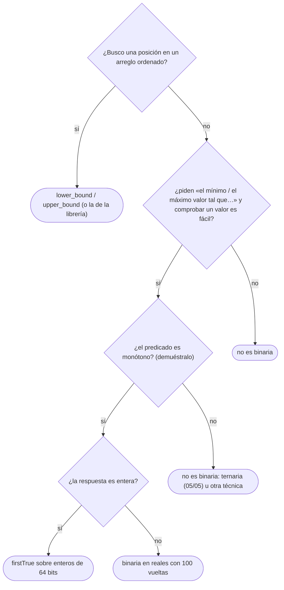

# 04 — Búsqueda binaria

> La búsqueda binaria escrita sin *off-by-one*: sobre índices con `lower` y `upper bound`, sobre la
> respuesta con un predicado monótono, y sobre los reales con un número fijo de iteraciones. Las tres
> plantillas en los tres lenguajes, y lo que ofrece cada biblioteca.
>
> **Niveles:** binaria y *lower/upper bound* [A] · **binaria sobre la respuesta** [A] · en reales [A].
>
> **📚 Lectura troncal:** Knuth, *The Art of Computer Programming*, Vol. 3 (Addison-Wesley), §6.2.1;
> Bentley, *Programming Pearls*, 2.ª ed. (Addison-Wesley, 1999), columna 4; Cormen, Leiserson, Rivest y
> Stein, *Introduction to Algorithms*, 3.ª ed. (MIT Press, 2009), cap. 2 (ejercicios).
>
> **Asume leído:** [`02/01` — Notación asintótica y casos](../02-analisis/01-notacion-asintotica.md).
>
> **Ruta corta:** sí.
>
> **Vigencia:** 2026-10-04.

**Salto rápido:** [1](#1--el-problema) · [2](#2--la-teoría) · [3](#3--lower-y-upper-bound) · [4](#4--binaria-sobre-la-respuesta) · [5](#5--binaria-en-reales) · [6](#6-️-la-tabla-de-costes) · [7](#7--cómo-se-elige) · [8](#8--señales-del-enunciado) · [🧠](#-preguntas) · [🧩](#-problemas-propios)

---

## 1. 🎯 El problema

La búsqueda binaria es la técnica más fácil de explicar y la más difícil de escribir bien. Bentley
cuenta en *Programming Pearls* que, de los programadores profesionales a los que pidió escribirla,
alrededor del 90 % entregó código con errores; y el `Arrays.binarySearch` de la JDK llevó durante años un
desbordamiento en el cálculo del punto medio, hasta que Joshua Bloch lo publicó en 2006.

Los errores son siempre los mismos: el bucle que no termina, el índice que se sale, la respuesta que
queda desplazada en uno. Este capítulo los elimina con **una sola idea**: la binaria busca la
**frontera** de un predicado monótono `P` —falso, falso, …, verdadero, verdadero— y mantiene un
invariante sobre un intervalo semiabierto. Con esa idea, las tres variantes son la misma:

- **Sobre índices**: `P(i) = a[i] ≥ x` da el *lower bound*; `P(i) = a[i] > x`, el *upper bound*.
- **Sobre la respuesta**: `P(v) = «con el valor v se puede»`, sin ningún arreglo.
- **En reales**: el mismo predicado sobre un intervalo continuo, con un número fijo de vueltas.

---

## 2. 📐 La teoría

**El predicado monótono.** Sea `P` un predicado sobre los enteros de `[lo, hi)` tal que, si `P(v)` es
cierto, también lo es `P(v + 1)`. Entonces existe una frontera `f` en `[lo, hi]`: `P` es falso en
`[lo, f)` y cierto en `[f, hi)`. La búsqueda binaria encuentra `f` con `⌈log₂(hi − lo + 1)⌉`
evaluaciones de `P`.

**El invariante**, el mismo de `02/04` con el predicado en lugar del arreglo:

```text
P es falso en [lo₀, lo)    y    P es cierto en [hi, hi₀)
```

Al principio, `lo = lo₀` y `hi = hi₀` y los dos tramos están vacíos. En cada vuelta, `mid` está en
`[lo, hi)`: si `P(mid)` es falso, todo `[lo₀, mid]` es falso por la monotonía y `lo = mid + 1` mantiene
el invariante; si es cierto, `hi = mid` lo mantiene. La función de cota `hi − lo` baja estrictamente.
Al salir, `lo = hi` es la frontera. La prueba completa, con las tres partes, está en `02/04`.

**Por qué semiabierto.** Con `[lo, hi)`, el intervalo vacío es `lo = hi`, el tamaño es `hi − lo`, y la
respuesta «ninguno cumple» es `hi₀` sin caso especial. Es la misma convención de [`04/01`](../04-secuencias/01-prefijos-y-diferencias.md) y de los
iteradores de C++.

**El punto medio.** `(lo + hi) / 2` desborda cuando `lo + hi` pasa de `2³¹ − 1`, aunque `lo` y `hi`
quepan: con `lo = hi = 1,5·10⁹` el resultado es negativo. `lo + (hi − lo) / 2` no desborda si
`lo ≤ hi`. En Java, `(lo + hi) >>> 1` también funciona con índices no negativos. Python no tiene el
problema.

**En reales.** El intervalo `[lo, hi]` se reduce a la mitad en cada vuelta; tras `k` vueltas mide
`(hi₀ − lo₀) / 2ᵏ`. Con 100 vueltas, cualquier intervalo de partida razonable baja de la precisión de un
`double`. La condición `hi − lo > ε` **no** sirve como parada general: cuando los valores son grandes,
la distancia entre dos `double` consecutivos supera `ε` y el bucle no termina (§5).

---

## 3. 🧱 *Lower* y *upper bound*

**Qué es.** Sobre un arreglo ordenado, el *lower bound* de `x` es el primer índice con `a[i] ≥ x`, y el
*upper bound*, el primero con `a[i] > x`. Los dos están en `[0, n]`; `n` significa «ninguno».

**Por qué es correcto.** Por el invariante de §2, con `P(i) = a[i] ≥ x` o `P(i) = a[i] > x`, que son
monótonos porque el arreglo está ordenado.

**Cómo va**, *upper bound* de 5 en `[1, 2, 5, 5, 6, 9]` (el *lower bound* está trazado en `02/04`):

```text
lo  hi  mid  a[mid]  P = a[mid] > 5
0   6   3    5       falso  → lo = 4
4   6   5    9       cierto → hi = 5
4   5   4    6       cierto → hi = 4
4   4   sale: 4      (el primero mayor que 5 es el 6, en la posición 4)
```

El número de cincos es `upperBound − lowerBound = 4 − 2 = 2`.

**Cuánto.** `Θ(log n)` comparaciones; `Θ(1)` de memoria.

**La plantilla**, las dos con un mismo esqueleto:

```cpp
#include <vector>

// Primer índice en [0, n] con a[i] >= x. Pre: a ordenado. Θ(log n).
int lowerBound(const std::vector<int>& a, int x) {
    int lo = 0, hi = (int)a.size();
    while (lo < hi) {
        int mid = lo + (hi - lo) / 2;
        if (a[mid] < x) lo = mid + 1; else hi = mid;
    }
    return lo;
}

// Primer índice en [0, n] con a[i] > x. Solo cambia la comparación.
int upperBound(const std::vector<int>& a, int x) {
    int lo = 0, hi = (int)a.size();
    while (lo < hi) {
        int mid = lo + (hi - lo) / 2;
        if (a[mid] <= x) lo = mid + 1; else hi = mid;
    }
    return lo;
}
```

```java
// Primer índice en [0, n] con a[i] >= x. Pre: a ordenado. Θ(log n).
static int lowerBound(int[] a, int x) {
    int lo = 0, hi = a.length;
    while (lo < hi) {
        int mid = (lo + hi) >>> 1;
        if (a[mid] < x) lo = mid + 1; else hi = mid;
    }
    return lo;
}

// Primer índice en [0, n] con a[i] > x. Solo cambia la comparación.
static int upperBound(int[] a, int x) {
    int lo = 0, hi = a.length;
    while (lo < hi) {
        int mid = (lo + hi) >>> 1;
        if (a[mid] <= x) lo = mid + 1; else hi = mid;
    }
    return lo;
}
```

```python
from bisect import bisect_left, bisect_right

def lower_bound(a, x):
    """Primer índice en [0, n] con a[i] >= x. Equivale a bisect_left(a, x)."""
    lo, hi = 0, len(a)
    while lo < hi:
        mid = (lo + hi) // 2
        if a[mid] < x:
            lo = mid + 1
        else:
            hi = mid
    return lo

# upper bound: bisect_right(a, x)
```

- **`lo = mid + 1` y `hi = mid`**, nunca `hi = mid − 1`: con el intervalo semiabierto, `hi` es «el
  primero que ya se sabe cierto».
- **`while (lo < hi)`**, no `<=`: con `lo = hi` el intervalo está vacío.
- **`(lo + hi) >>> 1`** en Java es el punto medio sin desbordamiento para índices no negativos; en C++,
  `lo + (hi − lo) / 2`.
- **El último `≤ x`** es `upperBound − 1`, y el último `< x`, `lowerBound − 1`; los dos pueden ser `−1`.

**En la biblioteca.**

| Lenguaje | *Lower bound* | *Upper bound* | Nota |
|---|---|---|---|
| C++ | `std::lower_bound` | `std::upper_bound` | `std::equal_range` da los dos; `std::partition_point` acepta un predicado |
| Java | — | — | `Arrays.binarySearch` devuelve **algún** índice con el valor, o `−(inserción) − 1`; `TreeMap.ceilingKey`/`higherKey` sobre un mapa |
| Python | `bisect_left` | `bisect_right` | Con `key=` desde Python 3.10 |

### De la versión ingenua a la buena

**El problema.** Un registro guarda `n = 10⁶` marcas de tiempo ordenadas; llegan `q = 10⁵` consultas
«¿cuántas marcas hay en `[L, R]`?».

**La versión ingenua:**

```java
// O(q · n): recorre el registro entero en cada consulta.
static int countInRange(long[] times, long l, long r) {
    int count = 0;
    for (long t : times) if (l <= t && t <= r) count++;
    return count;
}
```

> «El registro está ordenado: las marcas de `[L, R]` forman un tramo contiguo. Su principio es el
> *lower bound* de `L` y su final, el *upper bound* de `R`; la cuenta es la resta, en `log n`.»

**El camino a la buena.** `upperBound(times, r) − lowerBound(times, l)`, con las plantillas sobre
`long[]`. De `10¹¹` operaciones a `10⁵ · 2 · 20`.

**Cuándo sí**: arreglos ordenados que no cambian. **Cuándo no**: si hay inserciones intercaladas con
las consultas, un mapa ordenado ([`03/03`](../03-biblioteca-estandar/03-java-colecciones.md)) o un Fenwick ([`09/02`](../09-consultas-sobre-rangos/02-fenwick.md)).

> **Veredicto:** *lower* y *upper bound* son la misma plantilla con `<` o `<=`. Con el intervalo
> semiabierto, «ninguno» es `n` y no hay casos especiales.

---

## 4. 🧱 Binaria sobre la respuesta

**Qué es.** Cuando el enunciado pide «el mínimo `v` tal que se puede» (o «el máximo»), y comprobar si
un `v` concreto funciona es fácil, se hace binaria **sobre los valores de `v`**, sin arreglo. Es la
forma de la binaria que más aparece en problemas.

**Por qué es correcto.** Por §2, siempre que el predicado sea **monótono**: si se puede con `v`, se puede
con cualquier valor mayor (para «el mínimo»). Demostrar la monotonía es la mitad del problema; si falla,
la binaria devuelve basura sin avisar.

**Cómo va.** Hay cables de longitudes `[5, 2, 9, 1, 5, 6]` y se quieren `k = 5` trozos de la misma
longitud entera, la mayor posible. Con longitud `ℓ`, salen `Σ ⌊cᵢ / ℓ⌋` trozos, que **decrece** con
`ℓ`. El predicado «con `ℓ` salen **menos** de 5» es falso…cierto; la respuesta es su frontera menos uno:

```text
ℓ        1   2   3   4   5   6   7   8   9
trozos   28  12  7   5   4   2   1   1   1
P        F   F   F   F   C   C   C   C   C

lo  hi  mid  trozos  P
1   10  5    4       C → hi = 5
1   5   3    7       F → lo = 4
4   5   4    5       F → lo = 5
5   5   sale: frontera 5, respuesta ℓ = 4
```

**Cuánto.** `O(log(rango) · coste del predicado)`. Con un rango de `10¹⁸` son unas 60 evaluaciones.

**La plantilla**, la frontera de un predicado monótono sobre enteros de 64 bits:

```cpp
#include <functional>

// Primer v en [lo, hi) con P(v) cierto, o hi si no hay. Pre: P monótono (falso…cierto).
long long firstTrue(long long lo, long long hi, const std::function<bool(long long)>& P) {
    while (lo < hi) {
        long long mid = lo + (hi - lo) / 2;
        if (P(mid)) hi = mid; else lo = mid + 1;
    }
    return lo;
}

// Uso con los cables: la mayor longitud con al menos k trozos.
// long long f = firstTrue(1, maxLen + 1, [&](long long len) { return pieces(len) < k; });
// long long answer = f - 1;   // 0 si ni con longitud 1 salen k trozos
```

```java
import java.util.function.LongPredicate;

// Primer v en [lo, hi) con P(v) cierto, o hi si no hay. Pre: P monótono (falso…cierto).
static long firstTrue(long lo, long hi, LongPredicate p) {
    while (lo < hi) {
        long mid = lo + (hi - lo) / 2;
        if (p.test(mid)) hi = mid; else lo = mid + 1;
    }
    return lo;
}
```

```python
def first_true(lo, hi, p):
    """Primer v en [lo, hi) con p(v) cierto, o hi si no hay. Pre: p monótono (falso…cierto)."""
    while lo < hi:
        mid = (lo + hi) // 2
        if p(mid):
            hi = mid
        else:
            lo = mid + 1
    return lo
```

- **Para «el mínimo `v` que funciona»**, `P(v) = funciona(v)` y la respuesta es `firstTrue`.
- **Para «el máximo `v` que funciona»**, `P(v) = no funciona(v)` y la respuesta es `firstTrue − 1`.
- **El rango** tiene que contener la respuesta: `hi` es el primer valor que seguro cumple, o uno más
  allá del máximo posible. Un `hi` demasiado pequeño devuelve `hi` sin avisar.
- **El predicado** suele sumar o multiplicar: cuidado con desbordar dentro de él ([`01/04`](../01-oficio-del-competidor/04-tipos-desbordamiento-y-modulo.md)); con
  `mid` hasta `10¹⁸`, un `mid · n` desborda 64 bits.
- **En C++**, `std::function` cuesta una llamada indirecta; en un bucle de 60 vueltas no importa.

### De la versión ingenua a la buena

**El problema** es el de los cables, con `n = 10⁵` cables de hasta `10⁹`.

**La versión ingenua:**

```java
// O(max · n): prueba todas las longitudes desde la mayor. Con max = 10⁹, 10¹⁴ operaciones.
static long longestPiece(long[] cables, long k) {
    long max = java.util.Arrays.stream(cables).max().getAsLong();
    for (long len = max; len >= 1; len--) {
        long pieces = 0;
        for (long c : cables) pieces += c / len;
        if (pieces >= k) return len;
    }
    return 0;
}
```

> «Si con una longitud salen `k` trozos, con una menor salen al menos los mismos: el predicado es
> monótono. No hace falta probarlas todas: binaria sobre la longitud, con `log₂ 10⁹ ≈ 30`
> comprobaciones de `O(n)`.»

**El camino a la buena.** `firstTrue(1, max + 1, len -> pieces(len) < k) − 1`, como en la plantilla.

**Cuándo sí**: «mínimo máximo», «máximo mínimo», «la menor capacidad», «el menor tiempo», siempre que
comprobar un valor sea más fácil que encontrarlo. **Cuándo no**: si el predicado no es monótono; ahí
la ternaria ([`05/05`](05-ternaria-y-exponencial.md)) o un recorrido.

> **Veredicto:** la binaria sobre la respuesta convierte «encuentra el óptimo» en «comprueba un
> candidato», a cambio de un factor `log`. Todo depende de demostrar la monotonía.

---

## 5. 🧱 Binaria en reales

**Qué es.** La misma frontera sobre un intervalo de reales, cuando la respuesta es un número con
decimales: una raíz, un tiempo, una distancia.

**Por qué es correcto.** Cada vuelta conserva el invariante «`P` falso en `lo` y cierto en `hi`» y divide
el intervalo a la mitad; tras `k` vueltas, la frontera está a menos de `(hi₀ − lo₀) / 2ᵏ`.

**Cómo va**, `√2` como frontera de `P(m) = m² ≥ 2` en `[0, 2]`:

```text
vuelta  lo      hi     mid     mid²
0       0       2      1       1        falso  → lo = 1
1       1       2      1,5     2,25     cierto → hi = 1,5
2       1       1,5    1,25    1,5625   falso  → lo = 1,25
3       1,25    1,5    1,375   1,8906   falso  → lo = 1,375
…       tras 100 vueltas, lo y hi son dos double consecutivos: hi = 1,4142135623730951
```

**Cuánto.** `O(k · coste de P)` con `k` fijo, normalmente entre 60 y 100.

**La plantilla:**

```cpp
#include <functional>

// Frontera de P (falso…cierto) en [lo, hi], con 100 vueltas fijas.
double boundaryReal(double lo, double hi, const std::function<bool(double)>& P) {
    for (int it = 0; it < 100; it++) {
        double mid = lo + (hi - lo) / 2;
        if (P(mid)) hi = mid; else lo = mid;
    }
    return hi;
}
```

```java
import java.util.function.DoublePredicate;

// Frontera de P (falso…cierto) en [lo, hi], con 100 vueltas fijas.
static double boundaryReal(double lo, double hi, DoublePredicate p) {
    for (int it = 0; it < 100; it++) {
        double mid = lo + (hi - lo) / 2;
        if (p.test(mid)) hi = mid; else lo = mid;
    }
    return hi;
}
```

```python
def boundary_real(lo, hi, p):
    """Frontera de p (falso…cierto) en [lo, hi], con 100 vueltas fijas."""
    for _ in range(100):
        mid = lo + (hi - lo) / 2
        if p(mid):
            hi = mid
        else:
            lo = mid
    return hi
```

- **`lo = mid` y `hi = mid`**, sin `± 1`: en reales no hay «siguiente».
- **100 vueltas**: reducen el intervalo en un factor `2¹⁰⁰ ≈ 10³⁰`, más que suficiente para cualquier
  `double`. Si el predicado es caro, se calcula cuántas hacen falta: `log₂((hi₀ − lo₀) / ε)`.
- **La salida** se imprime con los decimales que pida el enunciado ([`03/01`](../03-biblioteca-estandar/01-cpp-contenedores.md)).

### De la versión ingenua a la buena

**El problema.** Encontrar con precisión `10⁻⁶` la frontera de un predicado sobre `[0, 2·10¹⁵]`.

**La versión ingenua:**

```java
// falla: no termina. Cerca de 10¹⁵, dos double consecutivos distan 0,125 > 1e-9.
static double boundaryEps(double lo, double hi, DoublePredicate p) {
    while (hi - lo > 1e-9) {
        double mid = (lo + hi) / 2;
        if (p.test(mid)) hi = mid; else lo = mid;
    }
    return hi;
}
```

> «Un `double` tiene unos 16 dígitos significativos: cerca de `10¹⁵` no puede representar diferencias
> de `10⁻⁹`. Cuando `lo` y `hi` son dos `double` consecutivos, `mid` redondea a uno de ellos y el
> intervalo deja de encoger. Con un número fijo de vueltas, el bucle termina siempre.»

**El camino a la buena.** La plantilla con 100 vueltas fijas.

**Cuándo sí**: respuestas reales con un predicado monótono. **Cuándo no**: si la respuesta es entera,
la binaria entera es exacta; y si la función tiene un extremo en lugar de una frontera, ternaria
(`05/05`).

> **Veredicto:** en reales, se para por número de vueltas, no por `ε`: la precisión relativa del
> `double` hace que un `ε` absoluto pueda no alcanzarse nunca.

---

## 6. ⏱️ La tabla de costes

| Variante | Coste | Lo que la tabla no dice |
|---|---|---|
| *Lower/upper bound* | `Θ(log n)` | Requiere arreglo ordenado y sin cambios |
| Sobre la respuesta | `O(log(rango) · coste(P))` | Si `P` no es monótono, devuelve basura |
| En reales | `O(k · coste(P))`, `k ≈ 100` | Se para por vueltas, no por `ε` |
| `std::lower_bound` en `std::set` | `Θ(n)` | Usa iteradores bidireccionales; el bueno es `set::lower_bound`, `Θ(log n)` |

---

## 7. 🧭 Cómo se elige



---

## 8. 🔎 Señales del enunciado

| Señal | Técnica | Por qué |
|---|---|---|
| «Arreglo ordenado», «primera posición», «cuántos en `[L, R]`» | *Lower/upper bound* | Es la frontera de una comparación |
| «Minimiza el máximo», «maximiza el mínimo» | Binaria sobre la respuesta | Fijado el valor, comprobarlo es voraz |
| «El menor tiempo / la menor capacidad / la menor velocidad tal que…» | Binaria sobre la respuesta | El predicado crece con el valor |
| Respuesta real «con error absoluto o relativo `10⁻⁶`» | Binaria en reales | Frontera continua |
| Restricciones de hasta `10¹⁸` en la respuesta y `n ≤ 10⁵` | Binaria sobre la respuesta | `60 · n` cabe; recorrer el rango, no |

---

## ⚠️ Errores frecuentes

| Se dice | Lo preciso |
|---|---|
| «La binaria solo sirve en arreglos ordenados» | Sirve sobre cualquier predicado monótono, también sin arreglo |
| «`(lo + hi) / 2` está bien» | Desborda con `lo + hi > 2³¹ − 1`; `lo + (hi − lo) / 2` no |
| «`Arrays.binarySearch` da la primera aparición» | Da **alguna**; para la primera, *lower bound* propio |
| «En reales, `while (hi − lo > 1e-9)`» | Con valores grandes no termina; número fijo de vueltas |
| «Si la binaria pasa los ejemplos, el predicado es monótono» | La monotonía se demuestra; los ejemplos no la prueban |
| «`std::lower_bound(s.begin(), s.end(), x)` sobre un `set` es `log n`» | Es lineal: hay que usar `s.lower_bound(x)` |

---

## 📚 Para profundizar

- **Libro** — Knuth, *The Art of Computer Programming*, Vol. 3 (Addison-Wesley), §6.2.1: la búsqueda
  binaria y sus variantes, con el análisis exacto. *Lectura troncal.*
- **Libro** — Bentley, *Programming Pearls*, 2.ª ed. (Addison-Wesley, 1999), columna 4: escribir la
  binaria con su invariante. *Lectura troncal.*
- **Libro** — Cormen, Leiserson, Rivest y Stein, *Introduction to Algorithms*, 3.ª ed. (MIT Press, 2009),
  cap. 2, ejercicio 2.3-5. *Lectura troncal.*
- **Artículo** — Bloch, [«Extra, Extra — Read All About It: Nearly All Binary Searches and Mergesorts
  are Broken»](https://research.google/blog/extra-extra-read-all-about-it-nearly-all-binary-searches-and-mergesorts-are-broken/)
  (Google Research, 2006): el desbordamiento del punto medio en la JDK.
- **Referencia** — cp-algorithms, [*Binary search*](https://cp-algorithms.com/num_methods/binary_search.html).
- **Referencia** — USACO Guide, [*Binary Search*](https://usaco.guide/silver/binary-search): binaria
  sobre la respuesta con problemas graduados.
- **Documentación** — Python, [`bisect`](https://docs.python.org/3/library/bisect.html); cppreference,
  [`std::lower_bound`](https://en.cppreference.com/cpp/algorithm/lower_bound).

---

## 🧠 Preguntas

1. ¿Qué devuelven *lower bound* y *upper bound*, y qué significa que devuelvan `n`? 🟢
2. ¿Por qué el bucle es `while (lo < hi)` y la actualización `hi = mid`, y no `hi = mid − 1`? 🟢
3. ¿Qué devuelve `Arrays.binarySearch` si el valor está repetido, y si no está? 🟢
4. ¿Cómo cuentas cuántas veces aparece `x` en un arreglo ordenado en `O(log n)`? 🟢
5. ¿Qué es un predicado monótono, y por qué la binaria sobre la respuesta lo necesita? 🟡
6. ¿Cuándo desborda `(lo + hi) / 2`, y qué tres formas tienes de evitarlo? 🟡
7. ¿Por qué en reales se para por número de vueltas y no por `hi − lo > ε`? 🟡
8. Para «el máximo valor que funciona», ¿qué predicado usas con `firstTrue` y qué devuelves? 🟡
9. Demuestra con el invariante que la plantilla de `firstTrue` devuelve la frontera y termina. 🟠
10. Compara lo que ofrecen C++, Java y Python para el *lower bound* sobre un arreglo y sobre un conjunto ordenado. 🟠
11. ¿Por qué `std::lower_bound` sobre un `std::set` es lineal, y qué usas en su lugar? 🟠
12. ¿Cuántas evaluaciones del predicado hace la binaria sobre `[1, 10¹⁸]`, y qué riesgo de desbordamiento hay dentro del predicado? 🟠
13. Da un problema en el que el predicado parece monótono y no lo es, y explica qué devuelve la binaria. 🔴
14. ¿Cómo haces una binaria sobre la respuesta cuando la respuesta es una fracción `p/q` exacta y no un real aproximado? 🔴

---

## 🧩 Problemas propios

### Primera lectura tardía

**Nivel:** 🟢 · **Formato:** programa completo.

Un sensor guarda `n` marcas de tiempo en orden creciente. Para cada consulta `t`, imprime la posición
(0-indexada) de la primera marca `≥ t`, o `-1` si no hay.

- **Entrada.** Una línea con `n` y `q`. Una línea con las `n` marcas. Después, `q` líneas con `t`.
- **Salida.** `q` líneas.
- **Restricciones.** `1 ≤ n, q ≤ 2·10⁵`; `0 ≤ marca, t ≤ 10¹⁸`.

```text
Entrada              Salida
6 3                  2
1 2 5 5 6 9          5
3                    -1
7
10

Entrada              Salida
1 2                  0
1000000000000000000  0
0
1000000000000000000
```

**Pista 1:** ¿qué devuelve la búsqueda cuando todas las marcas son menores que `t`?

### Altura de corte

**Nivel:** 🟡 · **Formato:** programa completo.

Hay `n` árboles de alturas `hᵢ`. Una sierra a altura `H` corta todo lo que sobresale: cada árbol más alto
que `H` da `hᵢ − H` metros de madera. Imprime la mayor `H` entera que da al menos `M` metros.

- **Entrada.** Una línea con `n` y `M`. Una línea con las `n` alturas.
- **Salida.** Un entero.
- **Restricciones.** `1 ≤ n ≤ 10⁶`; `1 ≤ M ≤ 2·10⁹`; `1 ≤ hᵢ ≤ 10⁹`; la suma de alturas es al menos `M`.

```text
Entrada            Salida
4 7                15
20 15 10 17

Entrada            Salida
6 10               3
5 2 9 1 5 6
```

**Pista 1:** si a la altura `H` sale suficiente madera, ¿qué pasa a la altura `H − 1`?

### Raíz cúbica

**Nivel:** 🟠 · **Formato:** programa completo.

Imprime `⌊∛x⌋` exacto y `∛x` con seis decimales.

- **Entrada.** Una línea con `x`.
- **Salida.** Una línea con los dos valores separados por un espacio.
- **Restricciones.** `1 ≤ x ≤ 10¹⁸`, entero.

```text
Entrada                  Salida
27                       3 3.000000

Entrada                  Salida
10                       2 2.154435

Entrada                  Salida
1000000000000000000      1000000 1000000.000000
```

**Pista 1:** con `hi = x`, ¿cuánto vale `mid³` en la primera vuelta?

---

## 🧩 Práctica externa

> 💡 **Truco.** Ante un WA en una binaria sobre la respuesta, pide a una IA un contraejemplo a la
> monotonía de tu predicado, no que corrija el código: casi siempre el fallo está ahí o en el rango
> inicial ([`01/06`](../01-oficio-del-competidor/06-protocolo-de-resolucion.md)).

### Núcleo

| ✔ | Problema | Plataforma | Nivel | Patrón | Pista 1 |
|---|---|---|---|---|---|
| [ ] | [Find Smallest Letter Greater Than Target](https://leetcode.com/problems/find-smallest-letter-greater-than-target/) | LeetCode | 🟢 | *Upper bound* | Si ninguna es mayor, ¿qué pide el enunciado? |
| [ ] | [Find First and Last Position of Element in Sorted Array](https://leetcode.com/problems/find-first-and-last-position-of-element-in-sorted-array/) | LeetCode | 🟡 | *Lower* y *upper bound* | ¿Qué relación hay entre la última posición y el *upper bound*? |
| [ ] | [Koko Eating Bananas](https://leetcode.com/problems/koko-eating-bananas/) | LeetCode | 🟡 | Binaria sobre la respuesta | Si a velocidad `v` le da tiempo, ¿a velocidad `v + 1`? |
| [ ] | [Capacity To Ship Packages Within D Days](https://leetcode.com/problems/capacity-to-ship-packages-within-d-days/) | LeetCode | 🟡 | Binaria sobre la capacidad | Fijada la capacidad, ¿cómo cuentas los días? |
| [ ] | [Search in Rotated Sorted Array](https://leetcode.com/problems/search-in-rotated-sorted-array/) | LeetCode | 🟡 | Binaria con dos tramos | Al partir por la mitad, ¿qué mitad está seguro ordenada? |
| [ ] | [Find Minimum in Rotated Sorted Array](https://leetcode.com/problems/find-minimum-in-rotated-sorted-array/) | LeetCode | 🟡 | Frontera sobre índices | ¿Con qué elemento comparas `nums[mid]` para saber de qué lado está el mínimo? |

### Ampliación

| ✔ | Problema | Plataforma | Nivel | Patrón | Pista 1 |
|---|---|---|---|---|---|
| [ ] | [Magnetic Force Between Two Balls](https://leetcode.com/problems/magnetic-force-between-two-balls/) | LeetCode | 🟡 | Maximizar el mínimo | Fijada la distancia mínima, ¿cómo colocas las bolas? |
| [ ] | [MinMaxDivision](https://app.codility.com/programmers/lessons/14-binary_search_algorithm/min_max_division/) | Codility | 🟡 | Minimizar el máximo | Fijada la suma máxima de un bloque, ¿cuántos bloques necesitas? |
| [ ] | [Factory Machines](https://cses.fi/problemset/task/1620) | CSES | 🟡 | Binaria sobre el tiempo | En un tiempo `T`, ¿cuántos productos hace cada máquina? |
| [ ] | [NailingPlanks](https://app.codility.com/programmers/lessons/14-binary_search_algorithm/nailing_planks/) | Codility | 🟠 | Binaria sobre el número de clavos | Con los `k` primeros clavos, ¿cómo compruebas que todas las tablas tienen uno? |
| [ ] | [The Meeting Place Cannot Be Changed](https://codeforces.com/problemset/problem/780/B) | Codeforces | 🟠 | Binaria en reales | Fijado un tiempo `T`, ¿qué intervalo alcanza cada amigo? |
| [ ] | [Kth Smallest Number in Multiplication Table](https://leetcode.com/problems/kth-smallest-number-in-multiplication-table/) | LeetCode | 🔴 | Binaria sobre el valor con conteo | ¿Cuántos números `≤ v` hay en la fila `i`? |

### Por curiosidad

| ✔ | Problema | Plataforma | Nivel | Patrón | Pista 1 |
|---|---|---|---|---|---|
| [ ] | 💀 [Median of Two Sorted Arrays](https://leetcode.com/problems/median-of-two-sorted-arrays/) | LeetCode | 🔴 | Binaria sobre un corte | ¿Qué condición cumplen los dos cortes que dejan la mitad de los elementos a la izquierda? |

---

## ✅ Criterio de dominio

- Escribir *lower bound*, `firstTrue` y la binaria en reales sin mirar, con su invariante.
- Demostrar la monotonía del predicado antes de escribir la binaria sobre la respuesta.
- Decir qué ofrece cada biblioteca y por qué `Arrays.binarySearch` no basta para «el primero».
- Resolver Koko Eating Bananas y The Meeting Place Cannot Be Changed sin pista 2.

---

**Anterior:** [`05/03` — Inversiones, selección y mediana](03-inversiones-y-seleccion.md) · **Siguiente:**
[`05/05` — Búsqueda ternaria, unimodales y exponencial](05-ternaria-y-exponencial.md) · **Relacionado:** [`02/04` — Corrección: invariantes, inducción e intercambio](../02-analisis/04-correccion-invariantes-induccion-intercambio.md);
[`11/01` — Cuándo funciona un voraz](../11-voraces/01-cuando-funciona-un-voraz.md).
