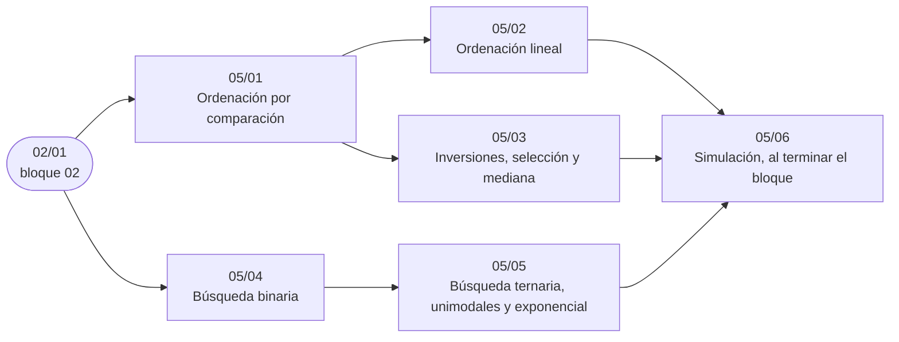

# Bloque 05 — Orden y búsqueda

> Ordenar y buscar, con sus pruebas: la cota `Ω(n log n)` de las comparaciones y los algoritmos que la
> alcanzan, las ordenaciones lineales que la esquivan, las inversiones y la selección en tiempo lineal, la búsqueda
> binaria (también sobre la respuesta y en reales) y la ternaria y exponencial. La búsqueda binaria sobre la
> respuesta es, de todo el bloque, lo que más se usa sin que el enunciado lo diga.
>
> Las respuestas de las preguntas y las pistas 2 y 3 de los problemas, en [`07` — Respuestas](07-respuestas.md).
>
> **Vigencia:** 2026-10-04.

---

## 🧭 Índice

| Capítulo | Niveles | Ruta corta |
|---|---|---|
| [`05/01` — Ordenación por comparación](01-ordenacion-por-comparacion.md) | ordenación por mezcla [A] · *quicksort* [A] · inserción [A] · estabilidad [A] · *heapsort* [B] · TimSort e *introsort* [C] |  |
| [`05/02` — Ordenación lineal](02-ordenacion-lineal.md) | *counting sort* [B] · *radix sort* [B] · *bucket sort* [C] |  |
| [`05/03` — Inversiones, selección y mediana](03-inversiones-y-seleccion.md) | inversiones con la mezcla [A] · *quickselect* [A] · mediana de medianas [C] |  |
| [`05/04` — Búsqueda binaria](04-busqueda-binaria.md) | binaria y *lower/upper bound* [A] · **binaria sobre la respuesta** [A] · en reales [A] | sí |
| [`05/05` — Búsqueda ternaria, unimodales y exponencial](05-ternaria-y-exponencial.md) | ternaria [B] · exponencial [B] |  |
| [`05/06` — Simulación](06-simulacion.md) | El examen del bloque: preguntas transversales y problemas cronometrados | |
| [`05/07` — Respuestas](07-respuestas.md) | Las preguntas en tres capas y las pistas 2 y 3 | |

---

## 🧭 Orden de lectura

- `05/04` está en todas las rutas cortas y se puede leer sin los anteriores; `05/02` y `05/03` dependen de `05/01`.

---

## 🔎 Mapa de señales del bloque

| Señal | Técnica | Capítulo |
|---|---|---|
| «Ordena por A y, a igualdad, conserva el orden de entrada» | Ordenación estable | [`05/01`](01-ordenacion-por-comparacion.md) |
| «Ordena una lista enlazada» | Mezcla | [`05/01`](01-ordenacion-por-comparacion.md) |
| «Valores entre 0 y 100», «letras minúsculas», «edades» | *Counting* o histograma | [`05/02`](02-ordenacion-lineal.md) |
| «En tiempo lineal» con enteros | *Counting* o *radix* | [`05/02`](02-ordenacion-lineal.md) |
| «Mínimo de intercambios **adyacentes**» | Inversiones | [`05/03`](03-inversiones-y-seleccion.md) |
| «Pares `i < j` con `a[i] > a[j]`» o una variante con una condición sobre los valores | Mezcla con conteo | [`05/03`](03-inversiones-y-seleccion.md) |
| «Arreglo ordenado», «primera posición», «cuántos en `[L, R]`» | *Lower/upper bound* | [`05/04`](04-busqueda-binaria.md) |
| «Minimiza el máximo», «maximiza el mínimo» | Binaria sobre la respuesta | [`05/04`](04-busqueda-binaria.md) |
| «Minimiza `f(x)`» con `f` que baja y luego sube | Ternaria, o binaria sobre la diferencia | [`05/05`](05-ternaria-y-exponencial.md) |
| Coste que es suma de funciones convexas de `x` | Ternaria sobre `x` | [`05/05`](05-ternaria-y-exponencial.md) |

---

## 📚 Lectura troncal del bloque

La de cada capítulo, que es también la primera entrada de su «Para profundizar»:

- **`05/01`** — Cormen, Leiserson, Rivest y Stein, *Introduction to Algorithms*, 3.ª ed. (MIT Press, 2009), caps. 2 y 6–8; Brassard y Bratley, *Fundamentos de algoritmia* (Prentice Hall, 1997), caps. 7 y 12 (cota inferior); Sedgewick y Wayne, *Algorithms*, 4.ª ed. (Addison-Wesley, 2011), cap. 2.
- **`05/02`** — Cormen, Leiserson, Rivest y Stein, *Introduction to Algorithms*, 3.ª ed. (MIT Press, 2009), cap. 8.
- **`05/03`** — Cormen, Leiserson, Rivest y Stein, *Introduction to Algorithms*, 3.ª ed. (MIT Press, 2009), cap. 9; Brassard y Bratley, *Fundamentos de algoritmia* (Prentice Hall, 1997), cap. 7; Kleinberg y Tardos, *Algorithm Design* (Pearson, 2005), cap. 5 (inversiones).
- **`05/04`** — Knuth, *The Art of Computer Programming*, Vol. 3 (Addison-Wesley), §6.2.1; Bentley, *Programming Pearls*, 2.ª ed. (Addison-Wesley, 1999), columna 4; Cormen, Leiserson, Rivest y Stein, *Introduction to Algorithms*, 3.ª ed. (MIT Press, 2009), cap. 2 (ejercicios).
- **`05/05`** — cp-algorithms, [*Ternary Search*](https://cp-algorithms.com/num_methods/ternary_search.html); Skiena, *The Algorithm Design Manual*, 3.ª ed. (Springer, 2020), cap. 5.

---

## 🧭 Qué NO está aquí

- **Las estructuras que mantienen el orden dinámicamente**: los árboles de [`07/02` — BST y árboles balanceados](../07-arboles/02-bst-y-balanceados.md) y el montículo de [`08/01` — Montículo binario](../08-heaps-y-union-find/01-monticulo-binario.md).
- **La mediana en flujo**: en [`08/02` — Patrones con *heap*](../08-heaps-y-union-find/02-patrones-con-heap.md).
- **Dividir y vencer en general**: en [`10/05` — Divide y vencerás](../10-busqueda-completa-y-divide-y-venceras/05-divide-y-venceras.md).

---

**Anterior:** [Bloque 04 — Secuencias](../04-secuencias/README.md) ·
**Siguiente:** [Bloque 06 — Lineales y hashing](../06-lineales-y-hashing/README.md) ·
**Inicio:** [README del corpus](../README.md)
