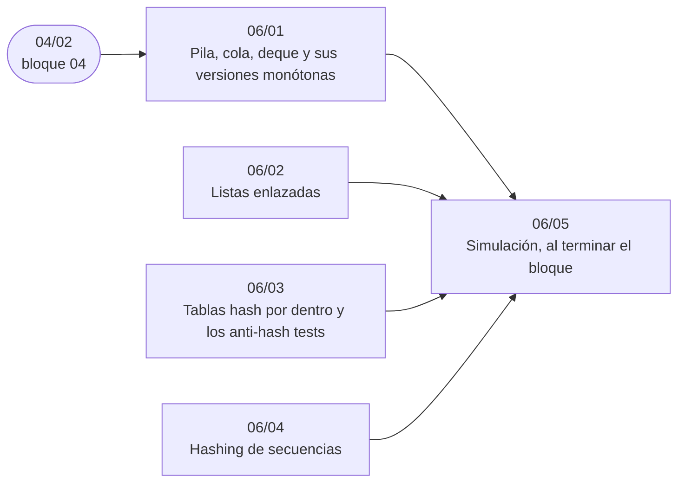

# Bloque 06 — Lineales y hashing

> Las estructuras lineales y el *hashing*: pilas, colas y sus versiones monótonas, listas enlazadas (Floyd,
> LRU), tablas *hash* por dentro con sus *anti-hash tests*, y el *hashing* de secuencias que compara subcadenas en
> `O(1)`. Es el bloque del «`HashMap` es O(1)… esperado».
>
> Las respuestas de las preguntas y las pistas 2 y 3 de los problemas, en [`06` — Respuestas](06-respuestas.md).
>
> **Vigencia:** 2026-10-04.

---

## 🧭 Índice

| Capítulo | Niveles | Ruta corta |
|---|---|---|
| [`06/01` — Pila, cola, deque y sus versiones monótonas](01-pilas-colas-y-monotonas.md) | pila, cola, deque [A] · pila monótona [A] · cola monótona [A] | sí |
| [`06/02` — Listas enlazadas](02-listas-enlazadas.md) | inversión, mezcla y punteros lento y rápido (Floyd) [A] · LRU con lista y *hash* [A] · listas múltiples [C] | sí |
| [`06/03` — Tablas *hash* por dentro y los *anti-hash tests*](03-tablas-hash.md) | encadenamiento y direccionamiento abierto [A] · factor de carga y *rehash* [A] · *anti-hash tests* y *hash* propio [B] | sí |
| [`06/04` — *Hashing* de secuencias](04-hashing-de-secuencias.md) | *hash* polinomial [B] · doble módulo [B] · Zobrist y *hash* de multiconjuntos [B] |  |
| [`06/05` — Simulación](05-simulacion.md) | El examen del bloque: preguntas transversales y problemas cronometrados | |
| [`06/06` — Respuestas](06-respuestas.md) | Las preguntas en tres capas y las pistas 2 y 3 | |

---

## 🧭 Orden de lectura

- `06/01`, `06/02` y `06/03` son independientes y de entrevista; `06/04` prepara las cadenas del bloque `16`.

---

## 🔎 Mapa de señales del bloque

| Señal | Técnica | Capítulo |
|---|---|---|
| Paréntesis, etiquetas, «deshacer», anidamiento | Pila | [`06/01`](01-pilas-colas-y-monotonas.md) |
| «El siguiente mayor», «el anterior menor», «cuántos días hasta» | Pila monótona | [`06/01`](01-pilas-colas-y-monotonas.md) |
| «Devuelve la cabeza nueva», borrados en la cabeza | Nodo centinela | [`06/02`](02-listas-enlazadas.md) |
| «Mitad de la lista», «palíndromo», «reordenar» | Lento y rápido; invertir la segunda mitad | [`06/02`](02-listas-enlazadas.md) |
| «Cuántas veces aparece», «el primero que se repite», «¿existe?» | Tabla *hash* | [`06/03`](03-tablas-hash.md) |
| Claves hasta `10⁹` o cadenas, sin necesidad de orden | Tabla *hash* | [`06/03`](03-tablas-hash.md) |
| «¿Son iguales `s[l₁..r₁]` y `s[l₂..r₂]`?», muchas consultas | *Hash* polinomial con prefijos | [`06/04`](04-hashing-de-secuencias.md) |
| «Subcadenas distintas de longitud `k`», «la repetida más larga» | *Hash* en un conjunto, con módulo grande | [`06/04`](04-hashing-de-secuencias.md) |

---

## 📚 Lectura troncal del bloque

La de cada capítulo, que es también la primera entrada de su «Para profundizar»:

- **`06/01`** — Brassard y Bratley, *Fundamentos de algoritmia* (Prentice Hall, 1997), cap. 5; Sedgewick y Wayne, *Algorithms*, 4.ª ed. (Addison-Wesley, 2011), §1.3; Goodrich, Tamassia y Goldwasser, *Data Structures and Algorithms in Java*, 6.ª ed. (Wiley, 2014), cap. 6.
- **`06/02`** — Goodrich, Tamassia y Goldwasser, *Data Structures and Algorithms in Java*, 6.ª ed. (Wiley, 2014), cap. 3; Brassard y Bratley, *Fundamentos de algoritmia* (Prentice Hall, 1997), cap. 5.
- **`06/03`** — Cormen, Leiserson, Rivest y Stein, *Introduction to Algorithms*, 3.ª ed. (MIT Press, 2009), cap. 11; Sedgewick y Wayne, *Algorithms*, 4.ª ed. (Addison-Wesley, 2011), §3.4.
- **`06/04`** — Cormen, Leiserson, Rivest y Stein, *Introduction to Algorithms*, 3.ª ed. (MIT Press, 2009), cap. 32 (Rabin-Karp); cp-algorithms, [*String Hashing*](https://cp-algorithms.com/string/string-hashing.html).

---

## 🧭 Qué NO está aquí

- **Las colecciones de la librería** que implementan estas estructuras: en el [bloque `03`](../03-biblioteca-estandar/README.md).
- **El *hashing* de cadenas aplicado** (subcadenas, palíndromos): en [`16/04` — *Hashing* de cadenas aplicado](../16-cadenas/04-hashing-de-cadenas.md).
- **El *hashing* universal y su análisis**: en [`19/02` — *Hashing* universal y análisis esperado](../19-aleatorizados-y-probabilisticos/02-hashing-universal-y-analisis-esperado.md).

---

**Anterior:** [Bloque 05 — Orden y búsqueda](../05-orden-y-busqueda/README.md) ·
**Siguiente:** [Bloque 07 — Árboles](../07-arboles/README.md) ·
**Inicio:** [README del corpus](../README.md)
