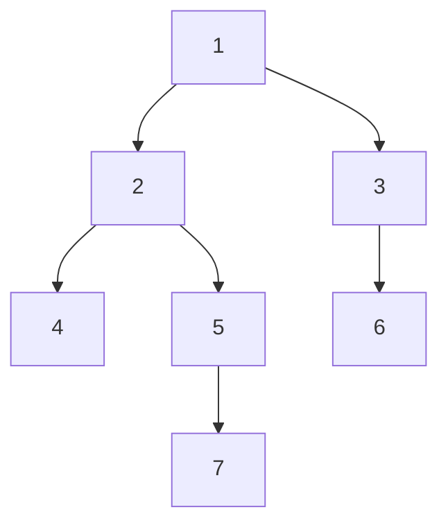

# 01 — Árboles: representación y recorridos

> Cómo se guarda un árbol según de dónde venga —nodos con punteros, arreglo de padres, lista de
> adyacencia—, sus cuatro recorridos en versión recursiva e iterativa, el diámetro con dos recorridos y
> su prueba, y los tiempos de entrada y salida que convierten un subárbol en un tramo de arreglo.
>
> **Niveles:** representación [A] · preorden, inorden, postorden, por niveles [A] · diámetro [A] ·
> recorrido de Euler [B].
>
> **📚 Lectura troncal:** Goodrich, Tamassia y Goldwasser, *Data Structures and Algorithms in Java*, 6.ª
> ed. (Wiley, 2014), cap. 8; Brassard y Bratley, *Fundamentos de algoritmia* (Prentice Hall, 1997),
> cap. 5.
>
> **Ruta corta:** sí.
>
> **Vigencia:** 2026-10-04.

**Salto rápido:** [1](#1--el-problema) · [2](#2--la-teoría) · [3](#3--representación) · [4](#4--los-cuatro-recorridos) · [5](#5--diámetro) · [6](#6--recorrido-de-euler-y-tiempos) · [7](#7-️-la-tabla-de-costes) · [8](#8--señales-del-enunciado) · [🧠](#-preguntas) · [🧩](#-problemas-propios)

---

## 1. 🎯 El problema

Un árbol aparece de tres formas en un enunciado: como objetos `TreeNode` con hijos izquierdo y derecho
(LeetCode y las entrevistas), como un arreglo «el padre del nodo `i` es `p[i]`» (organigramas, sistemas
de archivos), o como `n − 1` aristas sin orientar (Codeforces, CSES). Cada forma pide una representación
distinta, y la mayoría de los fallos vienen de no hacer la conversión antes de empezar.

Después hay que recorrerlo. Los recorridos recursivos son de tres líneas, pero con un árbol degenerado
de `10⁶` nodos la recursión tiene `10⁶` niveles y desborda la pila: hay que saber escribirlos
iterativos. Y hay preguntas sobre el árbol entero —la altura, el **diámetro**— que parecen pedir un
recorrido desde cada nodo (`n²`) y se resuelven con dos.

Este capítulo trabaja con el árbol de juguete **T** de la guía, enraizado en 1:



```text
aristas: 1-2 · 1-3 · 2-4 · 2-5 · 3-6 · 5-7
```

---

## 2. 📐 La teoría

**Árbol.** Un grafo conexo y sin ciclos. Equivalencias útiles (para un grafo de `n` vértices):

```text
conexo y sin ciclos  ⇔  conexo con n − 1 aristas  ⇔  sin ciclos con n − 1 aristas
                     ⇔  entre cada par de vértices hay exactamente un camino
```

El **camino único** es lo que hace a los árboles fáciles: la distancia entre dos nodos es la longitud
de ese camino, y no hace falta Dijkstra.

**Enraizar.** Elegir una raíz orienta todas las aristas: cada nodo salvo la raíz tiene un padre, y su
**profundidad** es la distancia a la raíz. La **altura** del árbol es la mayor profundidad.

**El diámetro** es la mayor distancia entre dos nodos. En T, es 5: `7-5-2-1-3-6`.

**Teorema (el extremo más lejano).** Sea `s` un nodo cualquiera y `u` el nodo más lejano de `s`.
Entonces `u` es extremo de algún diámetro.

*Prueba.* Sea `a–b` un diámetro, de longitud `D`. Dos casos.

- *El camino `s–u` toca el camino `a–b`.* Sea `x` el primer vértice de `s–u` que está en `a–b`. Como
  `s–x` no toca `a–b` antes de `x`, `d(s, a) = d(s, x) + d(x, a)` y lo mismo con `b`; como `u` es el más
  lejano, `d(x, u) ≥ d(x, a)` y `d(x, u) ≥ d(x, b)`. El camino de `x` a `u` sale de `a–b` por un vértice
  `z` hacia uno de los dos lados, digamos hacia `a`. Entonces `d(b, u) = d(b, x) + d(x, u) ≥
  d(b, x) + d(x, a) = D`: el camino `b–u` es un diámetro.
- *El camino `s–u` no toca `a–b`.* Sea `x` el vértice de `a–b` más cercano a `s`, y `w` el último vértice
  común de los caminos `s–u` y `s–x` (`w ≠ x`, porque `s–u` no toca `a–b`). Como `u` es el más lejano,
  `d(w, u) ≥ d(w, x) + d(x, b)`, y el camino `a–x–w–u` mide `d(a, x) + d(x, w) + d(w, u) ≥ D + 2·d(x, w)
  > D`. Contradicción con que `D` sea el diámetro.

Por tanto, dos recorridos bastan: desde cualquier nodo, el más lejano `u`; desde `u`, el más lejano `v`;
`d(u, v)` es el diámetro. Con pesos no negativos, la misma prueba vale.

**Los recorridos.** Para un nodo con hijos, el **preorden** visita el nodo antes que sus subárboles, el
**postorden** después, y el **inorden** (solo en árboles binarios) entre el izquierdo y el derecho. El
recorrido **por niveles** es un BFS desde la raíz ([`14/02`](../14-grafos-recorridos/02-bfs.md)).

---

## 3. 🧱 Representación

**Qué es.** Las tres formas de guardar un árbol y cuándo usar cada una.

| Forma | Cómo se guarda | Bueno para | Malo para |
|---|---|---|---|
| Nodos con punteros | `TreeNode` con `left`, `right` | Árboles binarios de entrevista; BST | Árboles con `10⁶` nodos (memoria, caché) |
| Arreglo de padres | `parent[v]` | Subir hacia la raíz; Union-Find | Bajar a los hijos |
| Lista de adyacencia | `adj[v]` con los vecinos | Árboles generales; recorridos | — (es la forma por defecto) |

**Cómo va**, T como lista de adyacencia desde sus aristas, y como arreglo de padres al enraizar en 1:

```text
adj[1] = [2, 3]   adj[2] = [1, 4, 5]   adj[3] = [1, 6]
adj[4] = [2]      adj[5] = [2, 7]      adj[6] = [3]      adj[7] = [5]
parent = [—, 0, 1, 1, 2, 2, 3, 5]     (índices 1..7; la raíz tiene padre 0)
```

**Cuánto.** `Θ(n)` de memoria las tres; construir la lista de adyacencia desde las aristas, `Θ(n)`.

**La plantilla**, de aristas a lista de adyacencia:

```cpp
#include <vector>

// Árbol de n nodos (1..n) a partir de sus n − 1 aristas no dirigidas.
std::vector<std::vector<int>> buildTree(int n, const std::vector<std::pair<int, int>>& edges) {
    std::vector<std::vector<int>> adj(n + 1);
    for (auto [u, v] : edges) { adj[u].push_back(v); adj[v].push_back(u); }
    return adj;
}
```

```java
// Árbol de n nodos (1..n) a partir de sus n − 1 aristas no dirigidas.
static java.util.List<Integer>[] buildTree(int n, int[][] edges) {
    @SuppressWarnings("unchecked")
    java.util.List<Integer>[] adj = new java.util.List[n + 1];
    for (int i = 0; i <= n; i++) adj[i] = new java.util.ArrayList<>();
    for (int[] e : edges) { adj[e[0]].add(e[1]); adj[e[1]].add(e[0]); }
    return adj;
}
```

```python
def build_tree(n, edges):
    """Árbol de n nodos (1..n) a partir de sus n − 1 aristas no dirigidas."""
    adj = [[] for _ in range(n + 1)]
    for u, v in edges:
        adj[u].append(v)
        adj[v].append(u)
    return adj
```

- **Las aristas van en los dos sentidos**: al recorrer, se evita volver al padre pasándolo como
  argumento o con un arreglo `parent`.
- **Java**: con `n = 2·10⁵`, una lista de `Integer` por nodo crea muchos objetos; en competición se usa la
  representación con arreglos `head[]`, `next[]`, `to[]` (la estrella hacia delante, [`14/01`](../14-grafos-recorridos/01-representaciones.md)).
- **Desde un arreglo de padres**, la lista de hijos sale en una pasada: `children[parent[v]].add(v)`.

### De la versión ingenua a la buena

**El problema.** Un organigrama da `parent[v]` para cada empleado; hay que listar los subordinados
directos de cada uno. Con `n = 2·10⁵`.

**La versión ingenua:**

```java
// O(n²): para cada empleado, recorre todos buscando a quién tiene como jefe.
static java.util.List<Integer> directReports(int[] parent, int boss) {
    java.util.List<Integer> out = new java.util.ArrayList<>();
    for (int v = 1; v < parent.length; v++) if (parent[v] == boss) out.add(v);
    return out;
}
```

> «El arreglo de padres sabe subir, no bajar. Si invierto la relación una sola vez —cada `v` se apunta
> en la lista de su padre—, cada consulta de hijos es directa. Una pasada de `n`.»

**El camino a la buena.** Construir `children` en una pasada y consultarlo.

**Cuándo sí**: la lista de adyacencia, siempre que haya que recorrer. **Cuándo no**: si solo se sube
(ancestros, Union-Find), el arreglo de padres basta.

> **Veredicto:** convierte el árbol a lista de adyacencia antes de empezar. El arreglo de padres sirve
> para subir; para bajar hay que invertirlo.

---

## 4. 🧱 Los cuatro recorridos

**Qué es.** Preorden, inorden, postorden (en profundidad) y por niveles (en anchura), en versión
recursiva para árboles binarios y en versión iterativa con pila para árboles grandes.

**Por qué es correcto.** Cada recorrido en profundidad visita cada nodo exactamente una vez porque
cada nodo se alcanza desde su padre y por un único camino; la pila explícita reproduce la pila de
llamadas. El por niveles es un BFS: visita en orden de profundidad.

**Cómo va**, en T (para el inorden, tomando 4 y 7 como hijos izquierdos y 5 y 6 como derechos):

```text
preorden     1 2 4 5 7 3 6
inorden      4 2 7 5 1 3 6
postorden    4 7 5 2 6 3 1
por niveles  1 | 2 3 | 4 5 6 | 7
```

**Cuánto.** `Θ(n)` cada uno. Memoria: `O(h)` los recursivos y los iterativos con pila (`h` la altura,
hasta `n` en un árbol degenerado); `O(ancho máximo)` el por niveles.

**La plantilla**, recursivos sobre nodos binarios e iterativo sobre lista de adyacencia:

```cpp
#include <vector>

struct TreeNode { int val; TreeNode *left = nullptr, *right = nullptr; };

void inorder(TreeNode* t, std::vector<int>& out) {             // pre y post: mover la línea del push
    if (!t) return;
    inorder(t->left, out); out.push_back(t->val); inorder(t->right, out);
}

// Preorden iterativo desde root sobre lista de adyacencia; parent y depth de cada nodo. O(n).
std::vector<int> preorder(const std::vector<std::vector<int>>& adj, int root,
                          std::vector<int>& parent, std::vector<int>& depth) {
    std::vector<int> order, st = {root};
    parent.assign(adj.size(), 0); depth.assign(adj.size(), 0);
    parent[root] = -1;
    while (!st.empty()) {
        int v = st.back(); st.pop_back();
        order.push_back(v);
        for (int w : adj[v]) if (w != parent[v]) {
            parent[w] = v; depth[w] = depth[v] + 1; st.push_back(w);
        }
    }
    return order;
}
```

```java
static final class TreeNode { int val; TreeNode left, right; }

static void inorder(TreeNode t, java.util.List<Integer> out) {
    if (t == null) return;
    inorder(t.left, out); out.add(t.val); inorder(t.right, out);
}

// Preorden iterativo desde root sobre lista de adyacencia; parent y depth de cada nodo. O(n).
static int[] preorder(java.util.List<Integer>[] adj, int root, int[] parent, int[] depth) {
    int n = adj.length;
    int[] order = new int[n - 1], st = new int[n];
    int top = 0, k = 0;
    st[top++] = root; parent[root] = -1;
    while (top > 0) {
        int v = st[--top];
        order[k++] = v;
        for (int w : adj[v]) if (w != parent[v]) {
            parent[w] = v; depth[w] = depth[v] + 1; st[top++] = w;
        }
    }
    return order;
}
```

```python
def inorder(t, out):
    if t:
        inorder(t.left, out); out.append(t.val); inorder(t.right, out)

def preorder(adj, root):
    """Preorden iterativo; devuelve (orden, parent, depth). O(n)."""
    n = len(adj)
    parent, depth, order, st = [0] * n, [0] * n, [], [root]
    parent[root] = -1
    while st:
        v = st.pop()
        order.append(v)
        for w in adj[v]:
            if w != parent[v]:
                parent[w], depth[w] = v, depth[v] + 1
                st.append(w)
    return order, parent, depth
```

- **El orden de los hijos** en el iterativo sale invertido (la pila saca el último apilado): para el
  mismo orden que el recursivo, se apilan al revés. Para casi todo (padres, profundidades, sumas de
  subárbol) el orden entre hermanos no importa.
- **El postorden** sale gratis del preorden: recorrer `order` **al revés** procesa cada nodo después de
  todos sus descendientes. Así se calculan tamaños de subárbol sin recursión:
  `for v in reversed(order): size[parent[v]] += size[v]`.
- **El por niveles** es la misma plantilla con una cola en lugar de la pila ([`06/01`](../06-lineales-y-hashing/01-pilas-colas-y-monotonas.md)).
- **Python**: la recursión por defecto se corta a 1000 niveles; el iterativo no tiene límite.

### De la versión ingenua a la buena

**El problema.** Calcular el tamaño de cada subárbol de un árbol de `n = 10⁶` nodos que puede ser una
cadena.

**La versión ingenua:**

```java
// falla: StackOverflowError con una cadena de 10⁶ nodos; la recursión tiene profundidad n.
static int size(java.util.List<Integer>[] adj, int v, int p, int[] sz) {
    sz[v] = 1;
    for (int w : adj[v]) if (w != p) sz[v] += size(adj, w, v, sz);
    return sz[v];
}
```

> «La recursión es correcta, pero su profundidad es la altura del árbol, y en una cadena son `10⁶` marcos
> de pila. Con un preorden iterativo tengo el orden y los padres; recorriéndolo al revés, cada nodo
> aparece después de sus hijos y puedo sumar su tamaño al del padre.»

**El camino a la buena.** `preorder` iterativo y después `for v in reversed(order): if parent[v] > 0:
sz[parent[v]] += sz[v]`, con `sz` inicializado a 1.

**Cuándo sí**: árboles de jueces con `n ≥ 10⁵`, sobre todo en Java y Python. **Cuándo no**: árboles de
entrevista pequeños o balanceados, donde la recursión es más clara.

> **Veredicto:** los recorridos recursivos son para leer; los iterativos, para enviar. El preorden
> iterativo, recorrido al revés, es el postorden.

---

## 5. 🧱 Diámetro

**Qué es.** La mayor distancia entre dos nodos, calculada con dos recorridos: desde cualquier nodo, el
más lejano `u`; desde `u`, el más lejano `v`.

**Por qué es correcto.** Por el teorema de §2: `u` es extremo de un diámetro, y el más lejano de un
extremo es el otro extremo.

**Cómo va**, en T:

```text
BFS desde 1:  distancias 1:0 · 2:1 · 3:1 · 4:2 · 5:2 · 6:2 · 7:3       → el más lejano, u = 7
BFS desde 7:  distancias 7:0 · 5:1 · 2:2 · 4:3 · 1:3 · 3:4 · 6:5       → el más lejano, v = 6
diámetro = d(7, 6) = 5, camino 7-5-2-1-3-6
```

**Cuánto.** `Θ(n)`: dos recorridos.

**La plantilla:**

```cpp
#include <queue>
#include <utility>
#include <vector>

// (nodo más lejano de s, distancia). BFS sobre árbol sin pesos. O(n).
std::pair<int, int> farthest(const std::vector<std::vector<int>>& adj, int s) {
    std::vector<int> dist(adj.size(), -1);
    std::queue<int> q; q.push(s); dist[s] = 0;
    int best = s;
    while (!q.empty()) {
        int v = q.front(); q.pop();
        if (dist[v] > dist[best]) best = v;
        for (int w : adj[v]) if (dist[w] < 0) { dist[w] = dist[v] + 1; q.push(w); }
    }
    return {best, dist[best]};
}

int diameter(const std::vector<std::vector<int>>& adj) {
    return farthest(adj, farthest(adj, 1).first).second;
}
```

```java
// {nodo más lejano de s, distancia}. BFS sobre árbol sin pesos. O(n).
static int[] farthest(java.util.List<Integer>[] adj, int s) {
    int[] dist = new int[adj.length], q = new int[adj.length];
    java.util.Arrays.fill(dist, -1);
    int head = 0, tail = 0, best = s;
    q[tail++] = s; dist[s] = 0;
    while (head < tail) {
        int v = q[head++];
        if (dist[v] > dist[best]) best = v;
        for (int w : adj[v]) if (dist[w] < 0) { dist[w] = dist[v] + 1; q[tail++] = w; }
    }
    return new int[]{best, dist[best]};
}

static int diameter(java.util.List<Integer>[] adj) {
    return farthest(adj, farthest(adj, 1)[0])[1];
}
```

```python
from collections import deque

def farthest(adj, s):
    """(nodo más lejano de s, distancia). BFS sobre árbol sin pesos. O(n)."""
    dist = [-1] * len(adj)
    dist[s] = 0
    q, best = deque([s]), s
    while q:
        v = q.popleft()
        if dist[v] > dist[best]:
            best = v
        for w in adj[v]:
            if dist[w] < 0:
                dist[w] = dist[v] + 1
                q.append(w)
    return best, dist[best]

def diameter(adj):
    return farthest(adj, farthest(adj, 1)[0])[1]
```

- **Con pesos no negativos**, el mismo método con un recorrido que acumule pesos (DFS iterativo o BFS
  sobre árbol, que no necesita Dijkstra porque el camino es único).
- **Con pesos negativos**, el teorema falla: hace falta la DP del capítulo [`07/06`](06-tecnicas-sobre-arboles.md) (para cada nodo, las
  dos ramas más largas hacia abajo).
- **El camino del diámetro** se recupera guardando el padre en el segundo BFS.

### De la versión ingenua a la buena

**El problema.** Una red de `n = 2·10⁵` routers sin ciclos; el retardo máximo entre dos routers es el
número de saltos del camino más largo.

**La versión ingenua:**

```java
// O(n²): un BFS desde cada router. 4·10¹⁰ operaciones.
static int maxDelay(java.util.List<Integer>[] adj) {
    int best = 0;
    for (int s = 1; s < adj.length; s++) best = Math.max(best, farthest(adj, s)[1]);
    return best;
}
```

> «No necesito un recorrido por cada extremo posible: el router más lejano de cualquiera ya es un
> extremo del camino más largo. Desde él, un segundo recorrido da el otro extremo.»

**El camino a la buena.** `diameter(adj)`: dos BFS.

**Cuándo sí**: diámetro, centro del árbol (el punto medio del diámetro), excentricidades (cada nodo
tiene su más lejano en uno de los dos extremos). **Cuándo no**: con pesos negativos, o si el grafo tiene
ciclos (ahí es un problema difícil).

> **Veredicto:** el diámetro de un árbol son dos recorridos: el más lejano de cualquiera, y el más lejano
> de ese. No pasa necesariamente por la raíz.

---

## 6. 🧱 Recorrido de Euler y tiempos

**Qué es.** Numerar los nodos en preorden: `tin[v]` es la posición de `v`, y `tout[v]` la del último
nodo de su subárbol. El subárbol de `v` ocupa exactamente el tramo `[tin[v], tout[v]]`.

**Por qué es correcto** (el enunciado y una frase): el preorden visita un nodo y, a continuación, todo su
subárbol antes de pasar a un hermano, así que los descendientes de `v` son un tramo contiguo que empieza
en `v`.

**Cómo va**, en T con los hijos en orden creciente:

```text
nodo   1  2  4  5  7  3  6
tin    0  1  2  3  4  5  6
tout   6  4  2  4  4  6  6
subárbol de 2 = posiciones [1, 4] = {2, 4, 5, 7}
u es ancestro de v  ⇔  tin[u] ≤ tin[v] ≤ tout[u]
```

**Cuánto.** `Θ(n)` el recorrido; `O(1)` la consulta de ancestro.

**La plantilla**, con el tamaño del subárbol: `tout[v] = tin[v] + size[v] − 1`.

```cpp
#include <vector>

// Con order de preorden y size de subárbol (§4): tin y tout en O(n).
void eulerTimes(const std::vector<int>& order, const std::vector<int>& size,
                std::vector<int>& tin, std::vector<int>& tout) {
    for (int i = 0; i < (int)order.size(); i++) tin[order[i]] = i;
    for (int v : order) tout[v] = tin[v] + size[v] - 1;
}
```

```java
// Con order de preorden y size de subárbol (§4): tin y tout en O(n).
static void eulerTimes(int[] order, int[] size, int[] tin, int[] tout) {
    for (int i = 0; i < order.length; i++) tin[order[i]] = i;
    for (int v : order) tout[v] = tin[v] + size[v] - 1;
}
```

**Cuándo sí**: consultas de ancestro en `O(1)`; sumas o actualizaciones sobre subárboles convertidas en
operaciones sobre un tramo con Fenwick o segment tree ([`09/02`](../09-consultas-sobre-rangos/02-fenwick.md), [`09/03`](../09-consultas-sobre-rangos/03-segment-tree.md)); el LCA por RMQ ([`07/05`](05-lca.md)).
**Cuándo no**: consultas sobre caminos (no son tramos contiguos); ahí, LCA o HLD (`07/06`).

> **Veredicto:** los tiempos de entrada y salida convierten «el subárbol de `v`» en «el tramo `[tin, tout]`»,
> y con eso todas las técnicas de secuencias valen para árboles.

---

## 7. ⏱️ La tabla de costes

| Operación | Coste | Memoria | Lo que la tabla no dice |
|---|---|---|---|
| Construir la lista de adyacencia | `Θ(n)` | `Θ(n)` | En Java, mejor con arreglos que con listas de `Integer` |
| Recorrido en profundidad o por niveles | `Θ(n)` | `O(h)` o `O(ancho)` | Recursivo: riesgo de desbordar la pila con `h ≈ n` |
| Tamaños de subárbol | `Θ(n)` | `Θ(n)` | Preorden iterativo recorrido al revés |
| Diámetro | `Θ(n)` | `Θ(n)` | Solo con pesos no negativos |
| ¿`u` es ancestro de `v`? | `O(1)` tras `Θ(n)` | `Θ(n)` | Con `tin` y `tout` |

---

## 8. 🔎 Señales del enunciado

| Señal | Técnica | Por qué |
|---|---|---|
| «`n` nodos y `n − 1` aristas», «conexo» | Es un árbol: camino único | No hace falta Dijkstra ni detectar ciclos |
| «El padre de `i` es `p[i]`» | Arreglo de padres; invertir para bajar | Subir es directo, bajar no |
| «La mayor distancia», «el camino más largo» | Diámetro con dos recorridos | El más lejano de cualquiera es extremo |
| «Suma / cuenta en el subárbol de `v`» con cambios | Tiempos de Euler + Fenwick | El subárbol es un tramo |
| Árbol con `n ≥ 10⁵` en Java o Python | Recorrido iterativo | La recursión desborda |

---

## ⚠️ Errores frecuentes

| Se dice | Lo preciso |
|---|---|
| «Un árbol es un grafo cualquiera» | Tiene `n − 1` aristas y camino único: las distancias salen con un recorrido, sin Dijkstra |
| «El diámetro pasa por la raíz» | Depende de la raíz elegida: con T enraizado en 4, el diámetro `7-5-2-1-3-6` no pasa por 4 |
| «La recursión es la forma natural, y basta» | Con una cadena de `10⁶` nodos desborda; en Java y Python hay que ir iterativo |
| «El inorden existe en cualquier árbol» | Solo en binarios: necesita distinguir izquierdo y derecho |
| «Para el diámetro hay que probar todas las raíces» | Dos recorridos bastan (con pesos no negativos) |
| «El postorden iterativo necesita dos pilas» | Basta el preorden al revés para todo lo que se acumula de hijos a padres |

---

## 📚 Para profundizar

- **Libro** — Goodrich, Tamassia y Goldwasser, *Data Structures and Algorithms in Java*, 6.ª ed. (Wiley,
  2014), cap. 8: árboles generales y binarios, recorridos y el recorrido de Euler. *Lectura troncal.*
- **Libro** — Brassard y Bratley, *Fundamentos de algoritmia* (Prentice Hall, 1997), cap. 5: árboles y su
  representación. *Lectura troncal.*
- **Referencia** — USACO Guide, [*Introduction to Tree Algorithms*](https://usaco.guide/silver/intro-tree).
- **Visualización interactiva** — VisuAlgo, [*Graph Traversal*](https://visualgo.net/en/dfsbfs).

---

## 🧠 Preguntas

1. Da tres definiciones equivalentes de árbol con `n` vértices. 🟢
2. ¿Qué diferencia hay entre profundidad de un nodo y altura del árbol? 🟢
3. Escribe el preorden, el postorden y el recorrido por niveles de T. 🟢
4. ¿Por qué en un árbol las distancias desde un nodo salen con un BFS (o un DFS) y no hace falta Dijkstra, aunque haya pesos? 🟡
5. ¿Cómo obtienes el postorden a partir de un preorden iterativo? 🟡
6. ¿Por qué el recorrido recursivo puede fallar en Java y en Python con `n = 10⁶`, y qué haces? 🟡
7. ¿Qué tramo ocupa el subárbol de `v` con los tiempos de entrada y salida, y por qué es contiguo? 🟡
8. Demuestra que el nodo más lejano de cualquier nodo es extremo de un diámetro. 🟠
9. Da un árbol con pesos negativos en el que los dos recorridos no dan el diámetro. 🟠
10. Compara cómo representarías un árbol de `2·10⁵` nodos en C++, Java y Python para un juez, y por qué. 🟠
11. ¿Por qué el preorden y el postorden juntos no siempre determinan un árbol binario? Da dos árboles distintos con los mismos dos recorridos. 🟠
12. ¿Cómo encuentras el centro del árbol (el nodo que minimiza la mayor distancia) a partir del diámetro? Demuestra que es correcto. 🔴
13. ¿Cómo calculas el diámetro en `O(n)` cuando hay pesos negativos, y por qué ahí falla el método de los dos recorridos? 🔴

---

## 🧩 Problemas propios

### Jefes y equipos

**Nivel:** 🟢 · **Formato:** programa completo.

Una empresa tiene `n` empleados; el empleado 1 es el director y el resto da el número de su jefe directo.
Imprime, para cada empleado, el tamaño de su equipo: él mismo más todos los que dependen de él directa o
indirectamente.

- **Entrada.** Una línea con `n`. Una línea con `n − 1` números: los jefes de los empleados `2..n`.
- **Salida.** `n` enteros separados por espacios.
- **Restricciones.** `1 ≤ n ≤ 2·10⁵`; el jefe de `i` es menor que `i`.

```text
Entrada            Salida
7                  7 4 2 1 2 1 1
1 1 2 2 3 5

Entrada            Salida
4                  4 3 2 1
1 2 3
```

**Pista 1:** si el jefe de `i` siempre es menor que `i`, ¿en qué orden puedes acumular los tamaños sin
recursión?

### El cable más largo

**Nivel:** 🟡 · **Formato:** programa completo.

Una red de `n` nodos sin ciclos tiene cables con longitud. Imprime la mayor distancia entre dos nodos.

- **Entrada.** Una línea con `n`. Después, `n − 1` líneas con `u v w`.
- **Salida.** Un entero.
- **Restricciones.** `2 ≤ n ≤ 2·10⁵`; `1 ≤ w ≤ 10⁹`.

```text
Entrada            Salida
7                  9
1 2 1
1 3 2
2 4 5
2 5 1
3 6 1
5 7 1

Entrada            Salida
2                  1000000000
1 2 1000000000
```

**Pista 1:** con pesos positivos, ¿sigue valiendo que el más lejano de cualquier nodo es extremo del
camino más largo?

### ¿Es ancestro?

**Nivel:** 🟡 · **Formato:** programa completo.

Dado un árbol enraizado en 1 y `q` consultas `u v`, imprime `SI` si `u` es ancestro de `v` (un nodo es
ancestro de sí mismo) y `NO` si no.

- **Entrada.** Una línea con `n` y `q`. Después, `n − 1` líneas con aristas. Después, `q` líneas con
  `u v`.
- **Salida.** `q` líneas.
- **Restricciones.** `1 ≤ n, q ≤ 2·10⁵`.

```text
Entrada            Salida
7 4                SI
1 2                SI
1 3                NO
2 4                SI
2 5
3 6
5 7
2 7
1 6
3 7
5 5

Entrada            Salida
1 1                SI
1 1
```

**Pista 1:** con un número para cuando entras en cada nodo y otro para cuando sales, ¿cómo se ve que `v`
está dentro del subárbol de `u`?

---

## 🧩 Práctica externa

> 💡 **Truco.** En LeetCode los árboles llegan como `TreeNode`; en CSES y Codeforces, como aristas. Antes
> de pedir ayuda a una IA, escribe tú la conversión a lista de adyacencia y pregunta solo por el
> recorrido ([`01/06`](../01-oficio-del-competidor/06-protocolo-de-resolucion.md)).

### Núcleo

| ✔ | Problema | Plataforma | Nivel | Patrón | Pista 1 |
|---|---|---|---|---|---|
| [ ] | [Maximum Depth of Binary Tree](https://leetcode.com/problems/maximum-depth-of-binary-tree/) | LeetCode | 🟢 | Postorden | ¿Qué relación hay entre la altura de un nodo y la de sus hijos? |
| [ ] | [Minimum Depth of Binary Tree](https://leetcode.com/problems/minimum-depth-of-binary-tree/) | LeetCode | 🟢 | Por niveles | ¿Por qué un BFS puede parar antes que un DFS? |
| [ ] | [Symmetric Tree](https://leetcode.com/problems/symmetric-tree/) | LeetCode | 🟢 | Dos recorridos en espejo | ¿Qué par de subárboles tienes que comparar en cada paso? |
| [ ] | [Binary Tree Level Order Traversal](https://leetcode.com/problems/binary-tree-level-order-traversal/) | LeetCode | 🟡 | Por niveles | ¿Cómo sabes dónde termina un nivel en la cola? |
| [ ] | [Binary Tree Right Side View](https://leetcode.com/problems/binary-tree-right-side-view/) | LeetCode | 🟡 | Por niveles | ¿Qué nodo de cada nivel se ve desde la derecha? |
| [ ] | [Construct Binary Tree from Preorder and Inorder Traversal](https://leetcode.com/problems/construct-binary-tree-from-preorder-and-inorder-traversal/) | LeetCode | 🟡 | Reconstrucción | ¿Qué te dice el primer elemento del preorden sobre el inorden? |

### Ampliación

| ✔ | Problema | Plataforma | Nivel | Patrón | Pista 1 |
|---|---|---|---|---|---|
| [ ] | [Binary Tree Zigzag Level Order Traversal](https://leetcode.com/problems/binary-tree-zigzag-level-order-traversal/) | LeetCode | 🟡 | Por niveles alternando | ¿Cambias el recorrido o solo cómo guardas cada nivel? |
| [ ] | [All Nodes Distance K in Binary Tree](https://leetcode.com/problems/all-nodes-distance-k-in-binary-tree/) | LeetCode | 🟡 | Árbol como grafo | ¿Qué te falta en un `TreeNode` para moverte hacia arriba? |
| [ ] | [Subordinates](https://cses.fi/problemset/task/1674) | CSES | 🟡 | Tamaños de subárbol | Con `2·10⁵` empleados en cadena, ¿recursión o iterativo? |
| [ ] | [Tree Distances I](https://cses.fi/problemset/task/1132) | CSES | 🟠 | Extremos del diámetro | Para cada nodo, ¿dónde está su nodo más lejano? |
| [ ] | [Serialize and Deserialize Binary Tree](https://leetcode.com/problems/serialize-and-deserialize-binary-tree/) | LeetCode | 🔴 | Preorden con marcas de nulo | ¿Basta un solo recorrido si escribes también los hijos vacíos? |

---

## ✅ Criterio de dominio

- Convertir aristas o padres a lista de adyacencia y recorrer iterativamente sin mirar.
- Escribir los cuatro recorridos y obtener el postorden del preorden al revés.
- Demostrar el teorema del extremo más lejano y calcular el diámetro con dos BFS.
- Resolver Subordinates y Tree Distances I sin pista 2.

---

**Anterior:** — · **Siguiente:** [`07/02` — BST y árboles balanceados](02-bst-y-balanceados.md) · **Relacionado:** [`07/05` — LCA](05-lca.md);
[`07/06` — Técnicas sobre árboles](06-tecnicas-sobre-arboles.md); [`14/03` — DFS](../14-grafos-recorridos/03-dfs.md).
