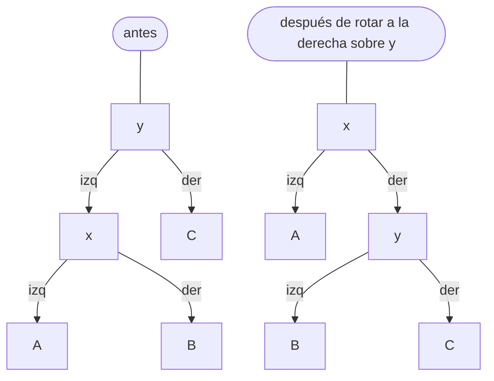
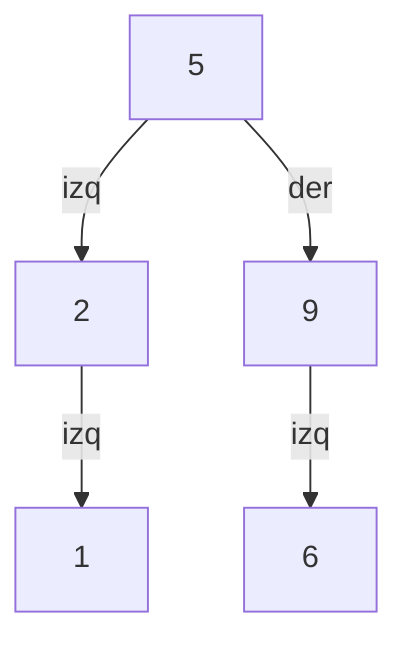
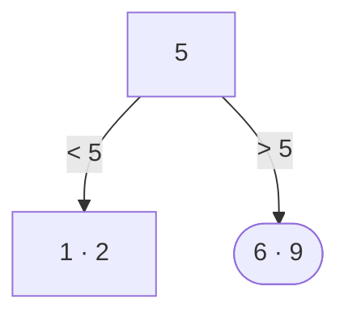

# 02 — BST y árboles balanceados

> El árbol binario de búsqueda y por qué solo es `O(log n)` si se mantiene balanceado: AVL por las
> alturas, rojo-negro por los colores y su equivalencia con los árboles (2,4), y el árbol B, que no es
> binario y es la estructura de los índices de las bases de datos.
>
> **Niveles:** BST [A] · AVL [B] · rojo-negro [B] · (2,4) [C] · árbol B [B].
>
> **📚 Lectura troncal:** Goodrich, Tamassia y Goldwasser, *Data Structures and Algorithms in Java*, 6.ª
> ed. (Wiley, 2014), caps. 11 y 15; Cormen, Leiserson, Rivest y Stein, *Introduction to Algorithms*, 3.ª
> ed. (MIT Press, 2009), caps. 12, 13 y 18.
>
> **Vigencia:** 2026-10-04.

**Salto rápido:** [1](#1--el-problema) · [2](#2--la-teoría) · [3](#3--el-árbol-binario-de-búsqueda) · [4](#4--avl) · [5](#5--rojo-negro) · [6](#6--árboles-24) · [7](#7--árbol-b) · [8](#8-️-la-tabla-de-costes) · [9](#9--señales-del-enunciado) · [🧠](#-preguntas) · [🧩](#-problemas-propios)

---

## 1. 🎯 El problema

Un mapa ordenado responde «¿está la clave?», «¿cuál es la menor mayor que `x`?» y «dame las claves entre
`a` y `b` en orden», con inserciones y borrados intercalados. Un arreglo ordenado responde las consultas
en `O(log n)` pero inserta en `O(n)`; una tabla *hash* inserta en `O(1)` pero no tiene orden.

El **árbol binario de búsqueda** hace todo en `O(h)`, con `h` la altura. El problema es que `h` depende
del orden de inserción: con las claves ya ordenadas, el árbol es una cadena y `h = n`. «Un BST es
`O(log n)`» es falso; lo es un BST **balanceado**, que se reorganiza con **rotaciones** para que la altura
se quede en `O(log n)` pase lo que pase.

Este capítulo explica las dos formas clásicas de garantizarlo (AVL y rojo-negro), la que usan
`std::map` y `TreeMap`, y por qué las bases de datos usan otra cosa: el árbol B, que minimiza los accesos
a disco.

---

## 2. 📐 La teoría

**La propiedad de BST.** Para todo nodo `v`, las claves de su subárbol izquierdo son menores que la de
`v`, y las del derecho, mayores. Consecuencia: el **inorden** visita las claves en orden creciente
(`07/01`).

**El coste.** Buscar, insertar, borrar, el sucesor y el predecesor bajan por un solo camino: `O(h)`.
Con claves insertadas al azar, la altura esperada es `O(log n)`; con un adversario o con datos
ordenados, `h = n − 1`.

**Rotaciones.** Una rotación cambia la forma local del árbol sin romper la propiedad de BST. La rotación
a la derecha sobre `y` (con hijo izquierdo `x`) sube `x` y baja `y`:



```text
orden en los dos: A < x < B < y < C
```

**Teorema (altura del AVL).** Un AVL (en todo nodo, las alturas de los dos subárboles difieren como
mucho en 1) con `n` nodos tiene altura `h < 1,45 · log₂(n + 2)`.

*Prueba.* Sea `N(h)` el mínimo de nodos de un AVL de altura `h`. El más pequeño tiene un subárbol de altura
`h − 1` y el otro de altura `h − 2`: `N(h) = 1 + N(h − 1) + N(h − 2)`, con `N(0) = 1` y `N(1) = 2`. Por
inducción, `N(h) = F(h + 3) − 1` (con `F` de Fibonacci, `F(1) = F(2) = 1`), y `F(k) ≥ φ^{k−2}` con
`φ ≈ 1,618`. Así, `n ≥ φ^{h+1} − 1` y `h ≤ log_φ(n + 1) − 1 < 1,45 · log₂(n + 2)`.

**Teorema (altura del rojo-negro).** Un árbol rojo-negro con `n` nodos internos tiene altura
`h ≤ 2 · log₂(n + 1)`.

*Prueba.* Las reglas: la raíz es negra, un nodo rojo no tiene hijos rojos, y todo camino de un nodo a sus
hojas nulas tiene el mismo número de nodos negros (la **altura negra**, `bh`). Por inducción, un subárbol
de altura negra `bh` tiene al menos `2^{bh} − 1` nodos internos. Como no hay dos rojos seguidos, al menos
la mitad de los nodos de cualquier camino son negros: `bh ≥ h/2`. Entonces `n ≥ 2^{h/2} − 1`. CLRS, 3.ª
ed., lema 13.1.

**Teorema (altura del árbol B).** Un árbol B de grado mínimo `t ≥ 2` (cada nodo salvo la raíz tiene entre
`t − 1` y `2t − 1` claves) con `n` claves tiene altura `h ≤ log_t((n + 1)/2)`. CLRS, 3.ª ed., teorema 18.1.

---

## 3. 🧱 El árbol binario de búsqueda

**Qué es.** Un árbol binario con la propiedad de BST, con búsqueda, inserción, borrado y consultas de
orden bajando desde la raíz.

**Por qué es correcto.** En cada nodo, la propiedad de BST dice en qué subárbol puede estar la clave
buscada; el otro se descarta entero, igual que en la búsqueda binaria ([`05/04`](../05-orden-y-busqueda/04-busqueda-binaria.md)).

**Cómo va**, insertando `5, 2, 9, 1, 5, 6` (el segundo 5 ya está y se ignora):



```text
inorden: 1 2 5 6 9
con las mismas claves ya ordenadas (1, 2, 5, 6, 9): una cadena hacia la derecha, altura 4
```

**Borrar** un nodo con dos hijos: se sustituye su clave por la de su **sucesor** (el mínimo del subárbol
derecho) y se borra el sucesor, que tiene como mucho un hijo.

**Cuánto.** `O(h)` por operación; `h` entre `⌊log₂ n⌋` y `n − 1`.

**La plantilla**, insertar, buscar y el menor `≥ x`:

```cpp
struct Node { int key; Node *left = nullptr, *right = nullptr; explicit Node(int k) : key(k) {} };

Node* insert(Node* t, int key) {                       // sin repetidos
    if (!t) return new Node(key);
    if (key < t->key) t->left = insert(t->left, key);
    else if (key > t->key) t->right = insert(t->right, key);
    return t;
}

bool contains(Node* t, int key) {
    while (t && t->key != key) t = key < t->key ? t->left : t->right;
    return t != nullptr;
}

// Menor clave >= x (ceiling), o nullptr. O(h).
Node* ceiling(Node* t, int x) {
    Node* best = nullptr;
    while (t) {
        if (t->key >= x) { best = t; t = t->left; }   // candidata; puede haber una menor a la izquierda
        else t = t->right;
    }
    return best;
}
```

```java
static final class Node { int key; Node left, right; Node(int k) { key = k; } }

static Node insert(Node t, int key) {
    if (t == null) return new Node(key);
    if (key < t.key) t.left = insert(t.left, key);
    else if (key > t.key) t.right = insert(t.right, key);
    return t;
}

static boolean contains(Node t, int key) {
    while (t != null && t.key != key) t = key < t.key ? t.left : t.right;
    return t != null;
}

static Node ceiling(Node t, int x) {
    Node best = null;
    while (t != null) {
        if (t.key >= x) { best = t; t = t.left; } else t = t.right;
    }
    return best;
}
```

```python
class Node:
    __slots__ = ("key", "left", "right")
    def __init__(self, key):
        self.key, self.left, self.right = key, None, None

def insert(t, key):
    if t is None:
        return Node(key)
    if key < t.key:
        t.left = insert(t.left, key)
    elif key > t.key:
        t.right = insert(t.right, key)
    return t

def ceiling(t, x):
    """Menor clave >= x, o None. O(h)."""
    best = None
    while t:
        if t.key >= x:
            best, t = t, t.left
        else:
            t = t.right
    return best
```

- **La inserción recursiva** tiene profundidad `h`: con un BST degenerado de `10⁵` nodos, desborda. En la
  práctica se usa un árbol balanceado de biblioteca.
- **`ceiling`** es la misma idea que el *lower bound* (`05/04`): guarda la mejor candidata y sigue
  buscando una menor.
- **En la biblioteca**: C++ `std::set`/`std::map` (`lower_bound`, `upper_bound`); Java `TreeSet`/`TreeMap`
  (`ceiling`, `floor`, `higher`, `lower`, `subMap`). Python no tiene mapa ordenado en la biblioteca
  estándar ([`03/04`](../03-biblioteca-estandar/04-python-para-competir.md)).

### De la versión ingenua a la buena

**El problema.** Comprobar si un árbol binario es un BST válido. En `5(2(1, 6), 9)` —el 6 es hijo derecho
del 2—, cada nodo es mayor que su hijo izquierdo y menor que su derecho, pero el 6 está en el subárbol
izquierdo del 5 y es mayor que 5: **no** es un BST.

**La versión ingenua:**

```java
// falla: WA. Solo compara cada nodo con sus hijos; el 6 bajo el 2 pasa la comprobación.
static boolean isBstNaive(Node t) {
    if (t == null) return true;
    if (t.left != null && t.left.key >= t.key) return false;
    if (t.right != null && t.right.key <= t.key) return false;
    return isBstNaive(t.left) && isBstNaive(t.right);
}
```

> «La propiedad de BST no es local: cada clave del subárbol izquierdo tiene que ser menor que **todos**
> sus ancestros por los que se bajó a la izquierda. Si paso hacia abajo el intervalo `(lo, hi)` permitido,
> cada nodo se comprueba contra él en `O(1)`.»

**El camino a la buena.** `isBst(t, lo, hi)`: falso si `t.key` no está en `(lo, hi)`; recursión con
`(lo, t.key)` a la izquierda y `(t.key, hi)` a la derecha; empezar con `(−∞, +∞)` usando `long` o
nulos para no chocar con `Integer.MIN_VALUE`. Alternativa: el inorden tiene que ser estrictamente
creciente.

**Cuándo sí**: el BST a mano, para entender y en entrevistas. **Cuándo no**: en producción y en concurso,
el árbol balanceado de la biblioteca.

> **Veredicto:** un BST es `O(h)`, no `O(log n)`. Sin balanceo, unas claves ordenadas lo convierten en
> una lista.

---

## 4. 🧱 AVL

**Qué es.** Un BST que guarda en cada nodo su altura y, tras cada inserción o borrado, rota para que en
todo nodo las alturas de los subárboles difieran como mucho en 1.

**Por qué es correcto** (el enunciado y una frase): por el teorema de §2, la altura queda por debajo de
`1,45 log₂(n + 2)`; las rotaciones conservan el orden y restauran el equilibrio en los cuatro casos
(izquierda-izquierda, izquierda-derecha y sus simétricos).

**Cómo va**, insertando `1, 2, 5, 6, 9` (ya ordenados) en un AVL:

```text
1                      1
1, 2                   1(·, 2)
1, 2, 5                1 desequilibrado (derecha-derecha) → rota a la izquierda: 2(1, 5)
… 6                    2(1, 5(·, 6))
… 9                    5 desequilibrado (derecha-derecha) → rota a la izquierda: 2(1, 6(5, 9))
altura 2, frente a 4 del BST sin balancear
```

**Cuánto.** `O(log n)` por operación; como mucho dos rotaciones por inserción.

**La plantilla**, la inserción con las rotaciones:

```cpp
#include <algorithm>

struct Avl { int key, h = 0; Avl *l = nullptr, *r = nullptr; explicit Avl(int k) : key(k) {} };

int height(Avl* t) { return t ? t->h : -1; }
void update(Avl* t) { t->h = 1 + std::max(height(t->l), height(t->r)); }

Avl* rotateRight(Avl* y) { Avl* x = y->l; y->l = x->r; x->r = y; update(y); update(x); return x; }
Avl* rotateLeft(Avl* x)  { Avl* y = x->r; x->r = y->l; y->l = x; update(x); update(y); return y; }

Avl* insert(Avl* t, int key) {
    if (!t) return new Avl(key);
    if (key < t->key) t->l = insert(t->l, key);
    else if (key > t->key) t->r = insert(t->r, key);
    else return t;
    update(t);
    int balance = height(t->l) - height(t->r);
    if (balance > 1) {                                  // pesa la izquierda
        if (key > t->l->key) t->l = rotateLeft(t->l);   // caso izquierda-derecha
        return rotateRight(t);
    }
    if (balance < -1) {                                 // pesa la derecha
        if (key < t->r->key) t->r = rotateRight(t->r);  // caso derecha-izquierda
        return rotateLeft(t);
    }
    return t;
}
```

```java
static final class Avl { int key, h; Avl l, r; Avl(int k) { key = k; } }

static int height(Avl t) { return t == null ? -1 : t.h; }
static void update(Avl t) { t.h = 1 + Math.max(height(t.l), height(t.r)); }

static Avl rotateRight(Avl y) { Avl x = y.l; y.l = x.r; x.r = y; update(y); update(x); return x; }
static Avl rotateLeft(Avl x)  { Avl y = x.r; x.r = y.l; y.l = x; update(x); update(y); return y; }

static Avl insert(Avl t, int key) {
    if (t == null) return new Avl(key);
    if (key < t.key) t.l = insert(t.l, key);
    else if (key > t.key) t.r = insert(t.r, key);
    else return t;
    update(t);
    int balance = height(t.l) - height(t.r);
    if (balance > 1) {
        if (key > t.l.key) t.l = rotateLeft(t.l);
        return rotateRight(t);
    }
    if (balance < -1) {
        if (key < t.r.key) t.r = rotateRight(t.r);
        return rotateLeft(t);
    }
    return t;
}
```

- **`update` del hijo antes que el del padre** dentro de cada rotación: la altura del nuevo padre
  depende de la del que bajó.
- **El caso doble** (izquierda-derecha) se reduce al simple con una rotación previa sobre el hijo.
- **El borrado** sigue el mismo esquema, pero puede necesitar rotaciones en todo el camino hasta la raíz.

**Cuándo sí**: muchas búsquedas y pocas modificaciones (es más estricto que el rojo-negro y sale más
bajo). **Cuándo no**: con muchas modificaciones, el rojo-negro rota menos.

> **Veredicto:** el AVL guarda alturas y rota en cuanto la diferencia llega a 2. Es el más balanceado de
> los clásicos: altura de hasta `1,45 log₂ n`.

---

## 5. 🧱 Rojo-negro

**Qué es.** Un BST con un bit de color por nodo y tres reglas (raíz negra, ningún rojo con hijo rojo,
misma altura negra en todos los caminos). Las inserciones y borrados recolorean y rotan para mantenerlas.

**Por qué es correcto** (el enunciado y una frase): por el teorema de §2, la altura es como mucho
`2 log₂(n + 1)`; las reparaciones de la inserción y el borrado hacen `O(1)` rotaciones y `O(log n)`
recoloreados.

**Cómo va.** Un nodo nuevo entra **rojo** (no cambia ninguna altura negra). Si su padre es rojo, se viola
la segunda regla: si el tío también es rojo, se recolorea (padre y tío negros, abuelo rojo) y el problema
sube dos niveles; si el tío es negro, una o dos rotaciones lo resuelven definitivamente.

**Cuánto.** `O(log n)` por operación; como mucho 2 rotaciones por inserción y 3 por borrado.

**La plantilla.** Las rotaciones son las mismas del AVL (sin alturas); la lógica de casos de la
inserción y, sobre todo, del borrado es larga y no se escribe en concurso ni suele pedirse entera en
entrevista. Lo que sí se usa:

| Lenguaje | Mapa ordenado | Implementación |
|---|---|---|
| C++ | `std::map`, `std::set`, `std::multiset` | Rojo-negro (libstdc++, libc++) |
| Java | `TreeMap`, `TreeSet` | Rojo-negro (documentado en la API) |
| Python | — | No hay en la biblioteca estándar (`03/04`) |

> 📝 **En Go y JavaScript:** ninguno de los dos tiene mapa ordenado en la biblioteca estándar; hay que
> escribir uno (un *treap*, [`07/03`](03-arboles-aleatorizados.md), es lo más corto) o sustituirlo por un arreglo ordenado si las
> inserciones son pocas ([`03/06`](../03-biblioteca-estandar/06-sin-arsenal-go-y-javascript.md)).

**Cuándo sí**: siempre, a través de la biblioteca. **Cuándo no**: si no se necesita orden, una tabla
*hash* ([`06/03`](../06-lineales-y-hashing/03-tablas-hash.md)) es más rápida.

> **Veredicto:** el rojo-negro es menos estricto que el AVL y rota menos al modificar. Es el que hay
> debajo de `std::map` y `TreeMap`.

---

## 6. 🧱 Árboles (2,4)

- **Qué resuelve.** Un árbol de búsqueda **perfectamente balanceado**: todas las hojas a la misma
  profundidad, con nodos de 1, 2 o 3 claves (2, 3 o 4 hijos).
- **Qué garantiza.** Altura `Θ(log n)`; insertar parte nodos llenos (*split*) hacia arriba; borrar fusiona
  o presta claves.
- **Cuánto.** `O(log n)` por operación.
- **Cómo reconocerlo.** Es la forma de **entender** el rojo-negro: cada nodo negro con sus hijos rojos es
  un nodo (2,4). Un negro sin hijos rojos es un 2-nodo; con uno, un 3-nodo; con dos, un 4-nodo. Las
  rotaciones y recoloreos del rojo-negro son los *splits* y fusiones del (2,4).
- **Si no te la sabes.** Basta saber que el rojo-negro existe y qué garantiza.
- **Dónde está entera.** Goodrich, Tamassia y Goldwasser, cap. 11; Sedgewick y Wayne, §3.3 (con la
  variante *left-leaning*).

---

## 7. 🧱 Árbol B

**Qué es.** Un árbol de búsqueda **no binario** en el que cada nodo guarda entre `t − 1` y `2t − 1`
claves ordenadas y tiene un hijo más que claves. Se diseña para que un nodo ocupe una página de disco.

**Por qué es correcto** (el enunciado y una frase): por el teorema de §2, la altura es `O(log_t n)`; con
`t` en los cientos, un árbol de mil millones de claves tiene 3 o 4 niveles, y cada nivel cuesta **un**
acceso a disco.

**Cómo va**, la búsqueda de 6 en un árbol B de grado mínimo `t = 2` (un árbol 2-3-4):



```text
buscar 6: en la raíz, 6 > 5 → hijo derecho; en [6 9], encontrado. Dos nodos leídos.
```

**Cuánto.** `O(log_t n)` accesos a disco; dentro de cada nodo, una búsqueda binaria entre sus claves:
`O(log t · log_t n) = O(log n)` comparaciones.

**La plantilla**, la búsqueda:

```cpp
#include <algorithm>
#include <vector>

struct BNode { std::vector<int> keys; std::vector<BNode*> kids; bool leaf = true; };

// ¿Está key en el árbol B? Una lectura de nodo por nivel.
bool bSearch(const BNode* t, int key) {
    while (t) {
        auto it = std::lower_bound(t->keys.begin(), t->keys.end(), key);
        if (it != t->keys.end() && *it == key) return true;
        if (t->leaf) return false;
        t = t->kids[it - t->keys.begin()];            // el hijo entre la clave anterior y *it
    }
    return false;
}
```

```java
static final class BNode { int[] keys; int n; BNode[] kids; boolean leaf = true; }

static boolean bSearch(BNode t, int key) {
    while (t != null) {
        int i = java.util.Arrays.binarySearch(t.keys, 0, t.n, key);
        if (i >= 0) return true;
        if (t.leaf) return false;
        t = t.kids[-i - 1];                            // punto de inserción = índice del hijo
    }
    return false;
}
```

- **Las bases de datos usan árboles B+**: las claves con datos solo en las hojas, y las hojas enlazadas
  entre sí para recorrer rangos en orden.
- **La inserción** divide en dos un nodo lleno y sube la clave mediana al padre; el árbol crece por la raíz,
  por eso todas las hojas están siempre a la misma profundidad.

**Cuándo sí**: datos en disco o en memoria donde la unidad de acceso es un bloque grande; también en
memoria, por localidad de caché ([`02/05`](../02-analisis/05-el-coste-real.md)). **Cuándo no**: árboles pequeños en memoria, donde un
rojo-negro es más simple.

> **Veredicto:** el árbol B no es binario: es ancho a propósito, para que cada acceso a disco descarte
> casi todo el árbol. Es la estructura de los índices de las bases de datos.

---

## 8. ⏱️ La tabla de costes

| Estructura | Altura | Buscar / insertar / borrar | Lo que la tabla no dice |
|---|---|---|---|
| BST sin balancear | `O(log n)` esperado al azar, `n − 1` peor | `O(h)` | Con datos ordenados, una lista |
| AVL | `< 1,45 log₂ n` | `O(log n)` | Más bajo, más rotaciones al borrar |
| Rojo-negro | `≤ 2 log₂ n` | `O(log n)` | `std::map`, `TreeMap` |
| Árbol B (grado `t`) | `≤ log_t n` | `O(log_t n)` accesos a disco | Ancho: pocos niveles |

---

## 9. 🔎 Señales del enunciado

| Señal | Técnica | Por qué |
|---|---|---|
| «El menor mayor que `x`», «el anterior», con inserciones | Mapa ordenado de biblioteca | `ceiling`, `lower_bound` en `O(log n)` |
| «Valida que es un BST» | Intervalo permitido hacia abajo, o inorden creciente | La propiedad no es local |
| «El `k`-ésimo menor del BST» | Inorden, o tamaños de subárbol | El inorden está ordenado |
| «Índice de base de datos», «páginas», «disco» | Árbol B / B+ | Minimiza accesos |
| Go o JavaScript con mapa ordenado | *Treap* propio o arreglo ordenado | No hay en la biblioteca |

---

## ⚠️ Errores frecuentes

| Se dice | Lo preciso |
|---|---|
| «Un BST es `O(log n)`» | Es `O(h)`; con claves ordenadas, `h = n − 1`. Solo los balanceados garantizan `O(log n)` |
| «El árbol B es un árbol binario» | Cada nodo tiene entre `t` y `2t` hijos; es ancho para minimizar accesos a disco |
| «Basta comparar cada nodo con sus hijos para validar un BST» | La restricción viene de todos los ancestros: hay que pasar el intervalo |
| «`TreeMap` es un AVL» | Es un rojo-negro, como `std::map` |
| «El rojo-negro es peor porque es más alto que el AVL» | Rota menos al modificar; para muchas escrituras suele ser mejor |
| «Python tiene `TreeMap`» | No en la biblioteca estándar |

---

## 📚 Para profundizar

- **Libro** — Goodrich, Tamassia y Goldwasser, *Data Structures and Algorithms in Java*, 6.ª ed. (Wiley,
  2014), cap. 11 (BST, AVL, (2,4), rojo-negro) y cap. 15 (árboles B). *Lectura troncal.*
- **Libro** — Cormen, Leiserson, Rivest y Stein, *Introduction to Algorithms*, 3.ª ed. (MIT Press, 2009),
  caps. 12 (BST), 13 (rojo-negro) y 18 (árbol B). *Lectura troncal.*
- **Libro** — Sedgewick y Wayne, *Algorithms*, 4.ª ed. (Addison-Wesley, 2011), §3.3: el rojo-negro
  *left-leaning*, con un código mucho más corto, en [*Balanced Search Trees*](https://algs4.cs.princeton.edu/33balanced/).
- **Visualización interactiva** — VisuAlgo, [*Binary Search Tree / AVL Tree*](https://visualgo.net/en/bst).
- **Documentación** — Java, [`TreeMap`](https://docs.oracle.com/en/java/javase/21/docs/api/java.base/java/util/TreeMap.html).

---

## 🧠 Preguntas

1. ¿Qué es la propiedad de BST, y qué recorrido da las claves en orden? 🟢
2. ¿Qué estructura hay debajo de `std::map` y de `TreeMap`? 🟢
3. ¿Qué hace una rotación, y por qué no rompe la propiedad de BST? 🟢
4. ¿Cuánto cuesta buscar en un BST sin balancear en el peor caso, y con qué entrada se alcanza? 🟡
5. ¿Cómo se borra un nodo con dos hijos en un BST? 🟡
6. ¿Por qué validar un BST comparando cada nodo con sus hijos es incorrecto? Da un contraejemplo. 🟡
7. ¿Cuántas rotaciones hace como mucho una inserción en un AVL, y en qué casos hacen falta dos? 🟠
8. Demuestra que la altura de un AVL es `O(log n)` con la recurrencia de Fibonacci. 🟠
9. Demuestra que la altura de un rojo-negro es como mucho `2 log₂(n + 1)`. 🟠
10. Explica la correspondencia entre un rojo-negro y un árbol (2,4). 🟠
11. Compara qué ofrecen C++, Java y Python para un mapa ordenado, y qué haces en Python si lo necesitas. 🟠
12. ¿Por qué los índices de las bases de datos son árboles B+ y no rojo-negros? Calcula la altura para `10⁹` claves con `t = 500`. 🔴
13. ¿Qué tienes que guardar en cada nodo de un árbol balanceado para responder «el `k`-ésimo menor» y «cuántas claves menores que `x`» en `O(log n)`, y cómo lo mantienes en las rotaciones? 🔴

---

## 🧩 Problemas propios

### Butacas libres

**Nivel:** 🟡 · **Formato:** programa completo.

Un teatro tiene butacas numeradas de 1 a `n`, todas libres. Llegan `q` peticiones `x`: se asigna la butaca
libre de menor número que sea `≥ x`; se imprime su número, o `-1` si no hay, y queda ocupada.

- **Entrada.** Una línea con `n` y `q`. Una línea con las `q` peticiones.
- **Salida.** `q` enteros separados por espacios.
- **Restricciones.** `1 ≤ n, q ≤ 2·10⁵`; `1 ≤ x ≤ n`.

```text
Entrada            Salida
5 6                3 4 1 5 2 -1
3 3 1 4 1 5

Entrada            Salida
1 2                1 -1
1 1
```

**Pista 1:** ¿qué operación de un conjunto ordenado da «la menor `≥ x`»?

### ¿Es un BST?

**Nivel:** 🟡 · **Formato:** programa completo.

Un árbol binario de `n` nodos viene dado por la clave y los índices de los hijos de cada nodo (`0` si no
hay). La raíz es el nodo 1. Imprime `SI` si es un BST con claves distintas y `NO` si no.

- **Entrada.** Una línea con `n`. Después, `n` líneas con `clave izquierdo derecho`.
- **Salida.** `SI` o `NO`.
- **Restricciones.** `1 ≤ n ≤ 2·10⁵`; `|clave| ≤ 2³¹ − 1`; el árbol puede ser una cadena.

```text
Entrada            Salida
5                  NO
5 2 3
2 4 5
9 0 0
1 0 0
6 0 0

Entrada            Salida
3                  SI
5 2 3
2 0 0
9 0 0
```

**Pista 1:** con claves que llegan a `±(2³¹ − 1)`, ¿con qué valores inicializas el intervalo permitido?

---

## 🧩 Práctica externa

> 💡 **Truco.** En entrevista, si el problema necesita un mapa ordenado, di primero «uso `TreeMap`» y
> después ofrece explicar cómo se balancea. Si una IA te escribe un AVL entero para un problema que se
> resuelve con `TreeMap`, pregúntale por qué ([`01/06`](../01-oficio-del-competidor/06-protocolo-de-resolucion.md)).

### Núcleo

| ✔ | Problema | Plataforma | Nivel | Patrón | Pista 1 |
|---|---|---|---|---|---|
| [ ] | [Search in a Binary Search Tree](https://leetcode.com/problems/search-in-a-binary-search-tree/) | LeetCode | 🟢 | Búsqueda en BST | ¿Hacia qué hijo bajas, y por qué no hace falta mirar el otro? |
| [ ] | [Convert Sorted Array to Binary Search Tree](https://leetcode.com/problems/convert-sorted-array-to-binary-search-tree/) | LeetCode | 🟢 | Construcción balanceada | ¿Qué elemento pones en la raíz para que quede balanceado? |
| [ ] | [Two Sum IV - Input is a BST](https://leetcode.com/problems/two-sum-iv-input-is-a-bst/) | LeetCode | 🟢 | Inorden y dos punteros | ¿Qué te da el inorden de un BST? |
| [ ] | [Insert into a Binary Search Tree](https://leetcode.com/problems/insert-into-a-binary-search-tree/) | LeetCode | 🟡 | Inserción en BST | ¿Dónde acaba siempre la clave nueva? |
| [ ] | [Delete Node in a BST](https://leetcode.com/problems/delete-node-in-a-bst/) | LeetCode | 🟡 | Borrado con sucesor | Con dos hijos, ¿qué clave puede ocupar su lugar sin romper el orden? |
| [ ] | [Kth Smallest Element in a BST](https://leetcode.com/problems/kth-smallest-element-in-a-bst/) | LeetCode | 🟡 | Inorden | ¿En qué posición del inorden está el `k`-ésimo? |
| [ ] | [Binary Search Tree Iterator](https://leetcode.com/problems/binary-search-tree-iterator/) | LeetCode | 🟡 | Inorden iterativo perezoso | ¿Qué nodos tiene que guardar la pila entre dos llamadas? |

### Ampliación

| ✔ | Problema | Plataforma | Nivel | Patrón | Pista 1 |
|---|---|---|---|---|---|
| [ ] | [Balance a Binary Search Tree](https://leetcode.com/problems/balance-a-binary-search-tree/) | LeetCode | 🟡 | Inorden y reconstrucción | ¿Cómo se relaciona con construir un BST desde un arreglo ordenado? |
| [ ] | [Recover Binary Search Tree](https://leetcode.com/problems/recover-binary-search-tree/) | LeetCode | 🟠 | Inorden con dos anomalías | En el inorden, ¿cómo se ven dos claves intercambiadas? |
| [ ] | [Self Balancing Tree](https://www.hackerrank.com/challenges/self-balancing-tree/problem) | HackerRank | 🟠 | Inserción AVL | ¿Qué cuatro casos de desequilibrio hay tras insertar? |

---

## ✅ Criterio de dominio

- Escribir el BST con inserción, búsqueda y `ceiling`, y validar un BST con el intervalo, sin mirar.
- Escribir las rotaciones y la inserción AVL, y demostrar su altura.
- Explicar la correspondencia rojo-negro ↔ (2,4) y por qué las bases de datos usan árboles B+.
- Resolver Delete Node in a BST y Recover Binary Search Tree sin pista 2.

---

**Anterior:** [`07/01` — Árboles: representación y recorridos](01-arboles-y-recorridos.md) ·
**Siguiente:** [`07/03` — Árboles aleatorizados y autoajustables](03-arboles-aleatorizados.md) · **Relacionado:**
[`03/05` — La tabla de equivalencias](../03-biblioteca-estandar/05-equivalencias-entre-lenguajes.md);
[`02/06` — Tipos abstractos de datos](../02-analisis/06-tipos-abstractos-de-datos.md).
