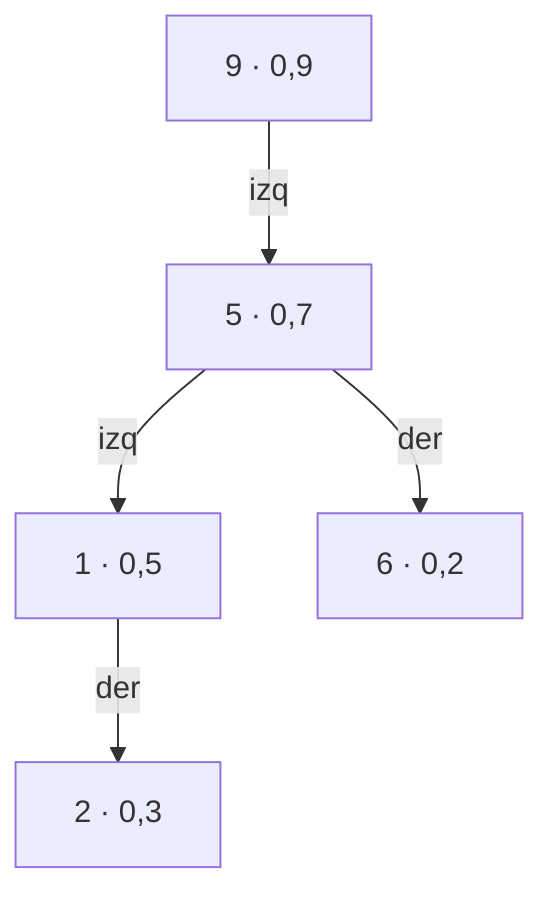

# 03 — Árboles aleatorizados y autoajustables

> Tres estructuras que logran `O(log n)` sin las reglas de balanceo del AVL o del rojo-negro: el *treap*,
> que balancea con prioridades aleatorias y se maneja con dos operaciones (`split` y `merge`); su versión
> implícita, que convierte un arreglo en un árbol donde insertar, cortar e invertir tramos cuesta
> `O(log n)`; la *skip list*, y el árbol *splay*, que se reorganiza con cada acceso.
>
> **Niveles:** *treap* [B] · *treap* implícito [B] · *skip list* [B] · *splay* [C].
>
> **📚 Lectura troncal:** Goodrich, Tamassia y Goldwasser, *Data Structures and Algorithms in Java*, 6.ª
> ed. (Wiley, 2014), cap. 11 (*splay*) y cap. 10 (*skip list*); Kubica, *Data Structures the Fun Way*
> (No Starch Press, 2022), cap. 14.
>
> **Vigencia:** 2026-10-04.

**Salto rápido:** [1](#1--el-problema) · [2](#2--la-teoría) · [3](#3--treap) · [4](#4--treap-implícito) · [5](#5--skip-list) · [6](#6--splay) · [7](#7-️-la-tabla-de-costes) · [8](#8--señales-del-enunciado) · [🧠](#-preguntas) · [🧩](#-problemas-propios)

---

## 1. 🎯 El problema

Hay dos situaciones en las que el mapa ordenado de la biblioteca (`07/02`) no basta:

- **No existe.** Go, JavaScript y Python no tienen mapa ordenado en su biblioteca estándar. Escribir un
  rojo-negro con borrado son cientos de líneas y una tarde de depuración.
- **Hace falta otra cosa.** Un arreglo donde se inserta en medio, se cortan tramos y se pegan en otro
  sitio, o se invierte un tramo: un arreglo lo hace en `O(n)` por operación, y con `n = q = 2·10⁵` son
  `4·10¹⁰`. Ninguna biblioteca trae esa estructura.

El **treap** resuelve las dos con unas 40 líneas: un BST que se mantiene balanceado **en esperanza**
gracias a prioridades aleatorias, y que se maneja con dos operaciones, `split` y `merge`. Su versión
**implícita**, que indexa por posición en lugar de por clave, es la estructura de «arreglo con cortes».

«Aleatorizado» no significa «poco fiable»: la probabilidad de que la altura pase de unas pocas veces
`log n` es despreciable, y no depende de la entrada, sino de las monedas del programa.

---

## 2. 📐 La teoría

**El *treap*.** Cada nodo tiene una **clave** y una **prioridad** aleatoria. El árbol es un BST por las
claves y un montículo por las prioridades (cada nodo tiene mayor prioridad que sus hijos). Para claves y
prioridades distintas, **ese árbol es único**: la raíz es la de mayor prioridad, y los subárboles se
construyen igual con las claves menores y las mayores.

**La equivalencia.** El *treap* es exactamente el BST que se obtendría insertando las claves en orden de
prioridad decreciente. Como las prioridades son aleatorias, es un **BST aleatorio**, sea cual sea el
orden real de las operaciones.

**Teorema (profundidad esperada).** En un *treap* de `n` claves, la profundidad esperada de cualquier
nodo es como mucho `2 ln n + O(1) ≈ 1,39 log₂ n`.

*Prueba.* Sean las claves ordenadas `x₁ < … < xₙ`. El nodo `xᵢ` es ancestro de `xⱼ` si y solo si `xᵢ`
tiene la mayor prioridad entre `xᵢ, …, xⱼ` (los `|i − j| + 1` del tramo entre ellos): si otro de ese tramo
tuviera más prioridad, sería un ancestro común que los separa. Con prioridades aleatorias, esa
probabilidad es `1/(|i − j| + 1)`. La profundidad de `xⱼ` es el número de ancestros: su esperanza es
`Σ_{i≠j} 1/(|i − j| + 1) < 2 · H_n ≈ 2 ln n`. Es el mismo argumento de *quicksort* ([`05/01`](../05-orden-y-busqueda/01-ordenacion-por-comparacion.md)).

**`split` y `merge`.** Todas las operaciones se escriben con dos:

```text
split(t, k)   parte t en (L, R): L con las claves < k, R con las ≥ k. Baja por un camino: O(profundidad).
merge(L, R)   une dos treaps con todas las claves de L menores que las de R. Por prioridad: O(profundidad).
insertar k    (L, R) = split(t, k);  t = merge(merge(L, nodo(k)), R)
borrar k      (L, R) = split(t, k);  (M, R) = split(R, k + 1);  t = merge(L, R)    (M es el nodo k)
```

**El *treap* implícito.** Si no se guarda la clave y se usa como «clave» la **posición** del nodo en el
inorden (el tamaño del subárbol izquierdo, más lo que se dejó atrás al bajar), el *treap* representa una
secuencia. `split(t, k)` parte en los `k` primeros y el resto. Con una marca perezosa de «invertido»
en cada nodo, invertir un tramo es partir, marcar la raíz del tramo y volver a unir.

**La *skip list*.** Una lista ordenada con varios niveles: cada elemento aparece en el nivel 0, y sube al
nivel siguiente con probabilidad `1/2`. La búsqueda empieza arriba, avanza mientras el siguiente sea
menor, y baja. Altura esperada `log₂ n`; coste esperado de búsqueda `O(log n)`.

---

## 3. 🧱 *Treap*

**Qué es.** Un BST con prioridades aleatorias que forman un montículo, manejado con `split` y `merge`.

**Por qué es correcto** (el enunciado y una frase): `split` y `merge` conservan a la vez el orden de las
claves y el orden de montículo de las prioridades, así que el árbol resultante es el *treap* único de
sus claves, con profundidad esperada `O(log n)` por el teorema de §2.

**Cómo va**, las claves `5, 2, 9, 1, 6` con prioridades `0,7 · 0,3 · 0,9 · 0,5 · 0,2`:



```text
mayor prioridad: 9 (0,9) → raíz; a su izquierda, las menores {5, 2, 1, 6}
entre ellas, 5 (0,7)      → raíz izquierda; a su izquierda {2, 1}, a su derecha {6}
entre {2, 1}, 1 (0,5)     → y 2 cuelga a su derecha
```

**Cuánto.** `O(log n)` esperado por operación; `Θ(n)` de memoria.

**La plantilla**, con nodos en arreglos y tamaño de subárbol (para el `k`-ésimo y para la versión
implícita de §4):

```cpp
#include <chrono>
#include <random>
#include <utility>
#include <vector>

// Treap con split/merge sobre arreglos. Nodo 0 = vacío. O(log n) esperado por operación.
struct Treap {
    std::vector<int> key, pri, lc, rc, sz;
    std::mt19937 rng{(unsigned)std::chrono::steady_clock::now().time_since_epoch().count()};
    int root = 0;
    Treap() { key = pri = lc = rc = sz = {0}; }
    int node(int k) {
        key.push_back(k); pri.push_back((int)rng()); lc.push_back(0); rc.push_back(0); sz.push_back(1);
        return (int)key.size() - 1;
    }
    void pull(int t) { sz[t] = 1 + sz[lc[t]] + sz[rc[t]]; }
    // Parte t en (claves < k, claves >= k).
    std::pair<int, int> split(int t, int k) {
        if (!t) return {0, 0};
        if (key[t] < k) { auto [a, b] = split(rc[t], k); rc[t] = a; pull(t); return {t, b}; }
        auto [a, b] = split(lc[t], k); lc[t] = b; pull(t); return {a, t};
    }
    int merge(int a, int b) {                       // todas las claves de a < las de b
        if (!a || !b) return a ? a : b;
        if (pri[a] > pri[b]) { rc[a] = merge(rc[a], b); pull(a); return a; }
        lc[b] = merge(a, lc[b]); pull(b); return b;
    }
    void insert(int k) { auto [a, b] = split(root, k); root = merge(merge(a, node(k)), b); }
    void erase(int k) {                             // borra todas las apariciones de k
        auto [a, b] = split(root, k); auto [m, c] = split(b, k + 1); root = merge(a, c);
    }
    int countLess(int k) { auto [a, b] = split(root, k); int r = sz[a]; root = merge(a, b); return r; }
};
```

```java
// Treap con split/merge sobre arreglos. Nodo 0 = vacío. O(log n) esperado por operación.
static final class Treap {
    final int[] key, pri, lc, rc, sz;
    int cnt = 0, root = 0;
    final java.util.SplittableRandom rng = new java.util.SplittableRandom();
    Treap(int cap) { key = new int[cap + 1]; pri = new int[cap + 1]; lc = new int[cap + 1];
                     rc = new int[cap + 1]; sz = new int[cap + 1]; }
    int node(int k) { cnt++; key[cnt] = k; pri[cnt] = rng.nextInt(); sz[cnt] = 1; return cnt; }
    void pull(int t) { sz[t] = 1 + sz[lc[t]] + sz[rc[t]]; }
    int sa, sb;                                     // resultado de split
    void split(int t, int k) {                      // (claves < k) en sa, (claves >= k) en sb
        if (t == 0) { sa = sb = 0; return; }
        if (key[t] < k) { split(rc[t], k); rc[t] = sa; pull(t); sa = t; }
        else { split(lc[t], k); lc[t] = sb; pull(t); sb = t; }
    }
    int merge(int a, int b) {
        if (a == 0 || b == 0) return a + b;
        if (pri[a] > pri[b]) { rc[a] = merge(rc[a], b); pull(a); return a; }
        lc[b] = merge(a, lc[b]); pull(b); return b;
    }
    void insert(int k) { split(root, k); int a = sa, b = sb; root = merge(merge(a, node(k)), b); }
    void erase(int k) { split(root, k); int a = sa; split(sb, k + 1); root = merge(a, sb); }
    int countLess(int k) { split(root, k); int r = sz[sa]; root = merge(sa, sb); return r; }
}
```

- **El nodo 0 es el vacío**, con tamaño 0: así `sz[lc[t]]` funciona sin comprobar nulos.
- **`split` devuelve un par**; en Java, sin tuplas baratas, se deja en dos campos (`sa`, `sb`) y se copian
  antes de la siguiente llamada.
- **La recursión** tiene la profundidad del árbol, `O(log n)` esperado: no hay riesgo de desbordar.
- **El `k`-ésimo**: bajar por los tamaños como en el árbol de estadísticos de orden (`07/02`).

**Cuándo sí**: mapa ordenado donde no hay biblioteca; contar menores que `x` con inserciones; como base
del *treap* implícito. **Cuándo no**: en C++ y Java, si `std::set` o `TreeSet` bastan.

> **Veredicto:** el *treap* es un BST balanceado en 40 líneas: prioridades aleatorias, `split` y
> `merge`. Su altura no depende de la entrada.

---

## 4. 🧱 *Treap* implícito

**Qué es.** Un *treap* sin clave, ordenado por posición: representa una secuencia en la que insertar,
borrar, cortar, pegar e invertir tramos cuesta `O(log n)`.

**Por qué es correcto** (el enunciado y una frase): la posición de un nodo es el tamaño de lo que queda a
su izquierda en el inorden, que `split` por tamaño calcula al bajar; la marca perezosa de inversión se
aplica (intercambiando hijos) antes de bajar por un nodo, así que nunca se lee un subárbol con una
inversión pendiente.

**Cómo va**, invertir las posiciones `[1, 4]` de `[5, 2, 9, 1, 5, 6]`:

```text
split por tamaño 1:    [5]  |  [2, 9, 1, 5, 6]
split por tamaño 4:    [5]  |  [2, 9, 1, 5]  |  [6]
marca «invertir» en la raíz del tramo del medio: se lee como [5, 1, 9, 2]
merge de los tres:     [5, 5, 1, 9, 2, 6]
```

**Cuánto.** `O(log n)` esperado por operación.

**La plantilla**, lo que cambia respecto de §3 (en C++; en Java es la misma traducción):

```cpp
// Sobre el Treap de §3, sin usar key: rev[t] marca una inversión pendiente del subárbol.
std::vector<char> rev;                                      // mismo tamaño que key: rev.push_back(0) en node()

void push(Treap& T, int t) {                                // aplica la marca antes de bajar
    if (t && rev[t]) {
        std::swap(T.lc[t], T.rc[t]);
        rev[T.lc[t]] ^= 1; rev[T.rc[t]] ^= 1; rev[t] = 0;
    }
}

// Parte t en (los k primeros, el resto).
std::pair<int, int> splitBySize(Treap& T, int t, int k) {
    if (!t) return {0, 0};
    push(T, t);
    if (T.sz[T.lc[t]] < k) {
        auto [a, b] = splitBySize(T, T.rc[t], k - T.sz[T.lc[t]] - 1);
        T.rc[t] = a; T.pull(t); return {t, b};
    }
    auto [a, b] = splitBySize(T, T.lc[t], k);
    T.lc[t] = b; T.pull(t); return {a, t};
}

int mergeI(Treap& T, int a, int b) {                       // el merge de §3, con push antes de bajar
    if (!a || !b) return a ? a : b;
    push(T, a); push(T, b);
    if (T.pri[a] > T.pri[b]) { T.rc[a] = mergeI(T, T.rc[a], b); T.pull(a); return a; }
    T.lc[b] = mergeI(T, a, T.lc[b]); T.pull(b); return b;
}

void reverseRange(Treap& T, int l, int r) {                 // posiciones [l, r], 0-indexadas
    auto [a, bc] = splitBySize(T, T.root, l);
    auto [b, c] = splitBySize(T, bc, r - l + 1);
    rev[b] ^= 1;
    T.root = mergeI(T, mergeI(T, a, b), c);
}
```

- **`push` antes de bajar** en `split` **y** en `merge`: si `merge` baja por un nodo con la marca
  pendiente, mezcla los hijos equivocados. Por eso `mergeI` es el `merge` de §3 con los dos `push`.
- **`rev[0]`** se modifica al marcar hijos vacíos; no importa, porque el nodo 0 nunca se lee.
- **Las sumas de un tramo** u otras agregaciones se guardan en cada nodo y se recalculan en `pull`, como el
  tamaño.

**Cuándo sí**: secuencias con inserciones y borrados por posición, cortar y pegar tramos, invertir
tramos; editores de texto. **Cuándo no**: si las posiciones no cambian, un segment tree ([`09/03`](../09-consultas-sobre-rangos/03-segment-tree.md)) es más
simple y más rápido.

> **Veredicto:** el *treap* implícito es un arreglo en el que insertar, cortar, pegar e invertir cuestan
> `O(log n)`. No lo trae ninguna biblioteca y cabe en una página.

---

## 5. 🧱 *Skip list*

**Qué es.** Una lista enlazada ordenada con niveles de atajos: cada elemento está en el nivel 0 y,
con probabilidad `1/2`, también en el siguiente, y así sucesivamente.

**Por qué es correcto** (el enunciado y una frase): cada nivel es una sublista ordenada de la de abajo, así
que la búsqueda que avanza en un nivel mientras el siguiente sea menor y después baja nunca se salta la
posición buscada; y con niveles aleatorios, la altura esperada es `log₂ n` y el número esperado de pasos
por nivel es constante.

**Cómo va**, buscar 6 en `1, 2, 5, 6, 9` con niveles sorteados:

```text
nivel 2:  −∞ ─────────────── 5 ─────────── +∞
nivel 1:  −∞ ──── 2 ──────── 5 ─────── 9 ─ +∞
nivel 0:  −∞ ─ 1 ─ 2 ─ 5 ─ 6 ─ 9 ─ +∞
nivel 2: −∞ → 5 (5 < 6); siguiente +∞, baja
nivel 1: en 5; siguiente 9 > 6, baja
nivel 0: en 5; siguiente 6: encontrado
```

**Cuánto.** `O(log n)` esperado por operación; `O(n)` esperado de memoria (cada elemento ocupa 2 nodos en
promedio).

**La plantilla**, la búsqueda (la inserción sortea el nivel y engancha el nodo en cada nivel usando los
predecesores que dejó la búsqueda):

```java
static final class SkipNode { int key; SkipNode[] next; SkipNode(int k, int lvl) { key = k; next = new SkipNode[lvl]; } }

// head tiene MAX niveles y clave −∞. ¿Está key? O(log n) esperado.
static boolean contains(SkipNode head, int levels, int key) {
    SkipNode x = head;
    for (int lv = levels - 1; lv >= 0; lv--)
        while (x.next[lv] != null && x.next[lv].key < key) x = x.next[lv];
    x = x.next[0];
    return x != null && x.key == key;
}
```

```cpp
#include <vector>

struct SkipNode { int key; std::vector<SkipNode*> next; };

// head tiene levels niveles y clave −∞. ¿Está key? O(log n) esperado.
bool contains(SkipNode* head, int levels, int key) {
    SkipNode* x = head;
    for (int lv = levels - 1; lv >= 0; lv--)
        while (x->next[lv] && x->next[lv]->key < key) x = x->next[lv];
    x = x->next[0];
    return x && x->key == key;
}
```

**Cuándo sí**: mapas ordenados concurrentes (añadir un nodo solo toca punteros locales); la
`ConcurrentSkipListMap` de Java y los conjuntos ordenados de Redis son *skip lists*. **Cuándo no**: en
concurso, donde el *treap* es más corto y tiene mejor localidad.

> **Veredicto:** la *skip list* es una lista ordenada con atajos aleatorios: `O(log n)` esperado y
> fácil de hacer concurrente. Por eso está en las bibliotecas de concurrencia.

---

## 6. 🧱 *Splay*

- **Qué resuelve.** Un BST sin información de balanceo que, tras cada acceso, **sube el nodo accedido a la
  raíz** con rotaciones por pares (*zig-zig*, *zig-zag*).
- **Qué garantiza.** `O(log n)` **amortizado** por operación (lema de acceso de Sleator y Tarjan, con el
  potencial `Σ log₂ tamaño(subárbol)`); una operación individual puede costar `O(n)`. Además, los
  elementos accedidos con frecuencia quedan cerca de la raíz.
- **Cuánto.** Sin memoria extra por nodo.
- **Cómo reconocerlo.** Cachés con localidad temporal; es la base del *link-cut tree* ([`07/07`](07-arboles-dinamicos.md)).
- **Si no te la sabes.** Un *treap* da `O(log n)` esperado con menos código.
- **Dónde está entera.** Goodrich, Tamassia y Goldwasser, cap. 11; Sleator y Tarjan, «Self-Adjusting
  Binary Search Trees», *Journal of the ACM* 32(3), 1985.

---

## 7. ⏱️ La tabla de costes

| Estructura | Coste por operación | Garantía | Lo que la tabla no dice |
|---|---|---|---|
| *Treap* | `O(log n)` | Esperado, sobre las prioridades | `split` y `merge` lo hacen todo |
| *Treap* implícito | `O(log n)` | Esperado | La marca perezosa, en `split` y en `merge` |
| *Skip list* | `O(log n)` | Esperado | Fácil de hacer concurrente |
| *Splay* | `O(log n)` | Amortizado; una operación puede ser `O(n)` | Los frecuentes quedan arriba |
| Rojo-negro (`07/02`) | `O(log n)` | Peor caso | Largo de escribir |

---

## 8. 🔎 Señales del enunciado

| Señal | Técnica | Por qué |
|---|---|---|
| Mapa ordenado en Go, JavaScript o Python | *Treap* | Corto y sin casos |
| «Inserta en la posición `p`», «corta el tramo y pégalo al final» | *Treap* implícito | Cortes por tamaño |
| «Invierte el tramo `[l, r]`» muchas veces | *Treap* implícito con marca perezosa | `O(log n)` por inversión |
| «Mapa ordenado con muchos hilos» | *Skip list* | Inserciones locales |
| Accesos muy repetidos a pocas claves | *Splay* | Las sube a la raíz |

---

## ⚠️ Errores frecuentes

| Se dice | Lo preciso |
|---|---|
| «Aleatorizado es poco fiable» | La probabilidad de que la altura pase de `c log n` cae como una potencia de `n`; y no depende de la entrada |
| «El *treap* es un montículo» | Es BST por claves **y** montículo por prioridades a la vez |
| «Con una semilla fija da igual» | En concursos con *hacks*, una semilla fija permite preparar la entrada |
| «El *splay* es `O(log n)` por operación» | Amortizado; una operación concreta puede costar `O(n)` |
| «En el *treap* implícito basta aplicar la marca en `split`» | También en `merge`, o se mezclan hijos con una inversión pendiente |

---

## 📚 Para profundizar

- **Libro** — Goodrich, Tamassia y Goldwasser, *Data Structures and Algorithms in Java*, 6.ª ed. (Wiley,
  2014), cap. 10 (*skip list*) y cap. 11 (*splay*). *Lectura troncal.*
- **Libro** — Kubica, *Data Structures the Fun Way* (No Starch Press, 2022), cap. 14. *Lectura troncal.*
- **Referencia** — cp-algorithms, [*Treap*](https://cp-algorithms.com/data_structures/treap.html): `split`,
  `merge` y el *treap* implícito con la marca de inversión.
- **Artículo** — Seidel y Aragon, «Randomized Search Trees», *Algorithmica* 16, 1996: el análisis del
  *treap*.
- **Artículo** — Pugh, «Skip Lists: A Probabilistic Alternative to Balanced Trees», *Communications of the
  ACM* 33(6), 1990.

---

## 🧠 Preguntas

1. ¿Qué dos propiedades cumple a la vez un *treap*? 🟢
2. ¿Qué hacen `split` y `merge`, y qué condición necesita `merge`? 🟢
3. ¿Por qué la *skip list* sube cada elemento con probabilidad `1/2`? 🟢
4. ¿Por qué el *treap* de un conjunto de claves y prioridades es único? 🟡
5. Escribe la inserción y el borrado de un *treap* con `split` y `merge`. 🟡
6. ¿Qué es la «clave implícita» del *treap* implícito y cómo la calcula `split` al bajar? 🟡
7. Demuestra que la profundidad esperada de un nodo en un *treap* es `O(log n)`. 🟠
8. ¿Por qué la marca de inversión tiene que aplicarse antes de bajar, tanto en `split` como en `merge`? 🟠
9. Compara qué harías en C++, Java y Python si necesitas «el número de claves menores que `x`» con inserciones. 🟠
10. ¿Qué diferencia hay entre el `O(log n)` esperado del *treap*, el amortizado del *splay* y el de peor caso del rojo-negro? 🟠
11. ¿Por qué Java tiene `ConcurrentSkipListMap` y no un `ConcurrentTreeMap`? 🔴
12. En un *treap* implícito con inversiones, ¿qué cambia en `pull` y en `push` si cada nodo guarda el mínimo de su subárbol? ¿Y si guarda el *hash* polinomial de la secuencia ([`06/04`](../06-lineales-y-hashing/04-hashing-de-secuencias.md))? 🔴
13. Acota la probabilidad de que la altura de una *skip list* de `n` elementos pase de `3 log₂ n`. 🔴

---

## 🧩 Problemas propios

### Fila del comedor

**Nivel:** 🟡 · **Formato:** programa completo.

En una fila de comedor, inicialmente vacía, llegan `q` órdenes: `+ x p` mete a la persona `x` en la
posición `p` (0-indexada; los de detrás se desplazan); `? p` imprime quién está en la posición `p`.

- **Entrada.** Una línea con `q`. Después, `q` órdenes.
- **Salida.** Una línea por cada `?`.
- **Restricciones.** `1 ≤ q ≤ 2·10⁵`; las posiciones son válidas.

```text
Entrada            Salida
6                  7
+ 5 0              5
+ 7 0              3
+ 3 2
? 0
? 1
? 2

Entrada            Salida
4                  2
+ 1 0              1
+ 2 1
? 1
? 0
```

**Pista 1:** con un arreglo, ¿cuánto cuesta insertar en la posición 0 `2·10⁵` veces?

### Ventana de inversiones

**Nivel:** 🟠 · **Formato:** programa completo.

Hay un arreglo y `q` órdenes `l r`: invertir el tramo `[l, r]` (0-indexado, inclusivo). Imprime el
arreglo final.

- **Entrada.** Una línea con `n` y `q`. Una línea con los `n` valores. Después, `q` líneas con `l r`.
- **Salida.** El arreglo final.
- **Restricciones.** `1 ≤ n, q ≤ 2·10⁵`.

```text
Entrada            Salida
6 2                5 6 2 9 1 5
5 2 9 1 5 6
1 4
1 5

Entrada            Salida
3 2                3 2 1
1 2 3
1 1
0 2
```

**Pista 1:** ¿qué tres trozos hay que separar para invertir el del medio sin tocar los otros?

---

## 🧩 Práctica externa

> 💡 **Truco.** Si un *treap* implícito da WA, sospecha primero de la marca perezosa: pide a una IA un
> caso pequeño que invierta dos tramos solapados y compáralo a mano, no que reescriba tu código ([`01/06`](../01-oficio-del-competidor/06-protocolo-de-resolucion.md)).

### Núcleo

| ✔ | Problema | Plataforma | Nivel | Patrón | Pista 1 |
|---|---|---|---|---|---|
| [ ] | [Yet Another Array Queries Problem](https://codeforces.com/problemset/problem/863/D) | Codeforces | 🟡 | Rotaciones e inversiones de tramos | ¿Hace falta simular todo, o basta seguir hacia atrás las pocas posiciones consultadas? |
| [ ] | [Cut and Paste](https://cses.fi/problemset/task/2072) | CSES | 🟠 | *Treap* implícito | ¿En cuántos trozos partes la cadena para mover uno al final? |
| [ ] | [Substring Reversals](https://cses.fi/problemset/task/2073) | CSES | 🟠 | *Treap* implícito con inversión | ¿Qué marca guardas para no invertir el tramo nodo a nodo? |
| [ ] | [Array and simple queries](https://www.hackerrank.com/challenges/array-and-simple-queries/problem) | HackerRank | 🟠 | *Treap* implícito | Mover un tramo al principio, ¿cuántos `split` y `merge` son? |
| [ ] | [Design Skiplist](https://leetcode.com/problems/design-skiplist/) | LeetCode | 🔴 | *Skip list* | ¿Qué nodos de cada nivel tienes que recordar para enganchar uno nuevo? |

### Ampliación

| ✔ | Problema | Plataforma | Nivel | Patrón | Pista 1 |
|---|---|---|---|---|---|
| [ ] | [Multiset](https://codeforces.com/problemset/problem/1354/D) | Codeforces | 🟠 | Estadístico de orden con poca memoria | Con 28 MB, ¿cabe un *treap* de `10⁶` nodos, o mejor un Fenwick sobre valores? |
| [ ] | [Letters Removing](https://codeforces.com/problemset/problem/899/F) | Codeforces | 🔴 | Posiciones que cambian al borrar | ¿Cómo traduces la posición actual a la original? |
| [ ] | [Reversals and Sums](https://cses.fi/problemset/task/2074) | CSES | 🔴 | *Treap* implícito con suma | ¿Qué agregado guardas en cada nodo y cómo lo afecta la inversión? |

---

## ✅ Criterio de dominio

- Escribir el *treap* con `split`, `merge`, inserción y borrado sin mirar.
- Escribir el *treap* implícito con la marca de inversión, aplicándola en `split` y en `merge`.
- Demostrar la profundidad esperada `O(log n)` con el argumento de los ancestros.
- Resolver Substring Reversals sin pista 2.

---

**Anterior:** [`07/02` — BST y árboles balanceados](02-bst-y-balanceados.md) · **Siguiente:** [`07/04` — Tries](04-tries.md) ·
**Relacionado:** [`19/02` — *Hashing* universal y análisis esperado](../19-aleatorizados-y-probabilisticos/02-hashing-universal-y-analisis-esperado.md); [`07/07` — Árboles dinámicos](07-arboles-dinamicos.md).
