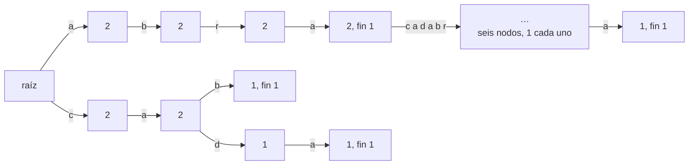

# 04 — *Tries*

> El árbol de prefijos: cada camino desde la raíz deletrea un prefijo, y todas las palabras que lo
> comparten pasan por el mismo nodo. Para palabras, responde «¿cuántas empiezan por…?» en el tiempo de
> leer el prefijo; con bits, da el XOR máximo de un número con un conjunto en `O(bits)` con un voraz
> desde el bit más alto.
>
> **Niveles:** *trie* de palabras [A] · *trie* binario [A] · *trie* comprimido [C].
>
> **📚 Lectura troncal:** Sedgewick y Wayne, *Algorithms*, 4.ª ed. (Addison-Wesley, 2011), §5.2.
>
> **Ruta corta:** sí.
>
> **Vigencia:** 2026-10-04.

**Salto rápido:** [1](#1--el-problema) · [2](#2--la-teoría) · [3](#3--trie-de-palabras) · [4](#4--trie-binario) · [5](#5--trie-comprimido) · [6](#6-️-la-tabla-de-costes) · [7](#7--señales-del-enunciado) · [🧠](#-preguntas) · [🧩](#-problemas-propios)

---

## 1. 🎯 El problema

Un buscador tiene `N = 10⁵` palabras y recibe `Q = 10⁵` consultas «¿cuántas palabras empiezan por este
prefijo?». Comparar el prefijo con cada palabra cuesta `O(N · L)` por consulta: `10¹⁰` comparaciones en
total. Una tabla *hash* de palabras no ayuda: responde «¿está esta palabra?», no «¿cuántas empiezan
así?».

El *trie* organiza las palabras por sus prefijos: un árbol en el que cada arista lleva un carácter, y el
camino desde la raíz hasta un nodo deletrea un prefijo. Todas las palabras que empiezan por `"ab"` pasan
por el mismo nodo, que puede guardar cuántas son. La consulta es bajar `L` aristas.

La misma idea, con bits en lugar de letras, resuelve un problema que parece no tener nada que ver: dado un
conjunto de números, ¿cuál da el mayor XOR con `x`? Probar todos es `O(n)` por consulta y `O(n²)` para
todos los pares; un *trie* de los bits, recorrido con un voraz desde el bit más alto, lo hace en `O(bits)`.

---

## 2. 📐 La teoría

**El *trie*.** Un árbol con raíz en el que cada nodo tiene como mucho un hijo por símbolo del alfabeto.
Insertar una palabra es bajar desde la raíz creando los nodos que falten; cada nodo puede guardar
cuántas palabras pasan por él (`pass`) y cuántas terminan en él (`end`).

**Coste.** Insertar o buscar una palabra de longitud `L` cuesta `O(L)`, **independientemente** de cuántas
palabras haya. El número de nodos es como mucho la suma de las longitudes, más la raíz.

**El *trie* binario.** Los números de `B` bits (por ejemplo, 30 para valores hasta `10⁹`) se insertan como
cadenas de bits, del más significativo al menos. Cada nodo tiene dos hijos.

**Teorema (el voraz del XOR máximo).** Dado `x` y un *trie* binario no vacío, el recorrido que en cada
nivel, desde el bit más alto, baja por el hijo con el bit **contrario** al de `x` si existe (y por el otro
si no), llega al número `y` del conjunto que maximiza `x ⊕ y`.

*Prueba.* El bit `k` vale `2ᵏ`, más que la suma de todos los bits inferiores, `2ᵏ − 1`. Por tanto, entre
dos candidatos que coinciden en los bits de `x ⊕ y` por encima de `k`, el que tiene un 1 en el bit `k` es
mayor, sean cuales sean los bits de abajo. En cada nivel, el voraz conserva solo los candidatos que
ponen un 1 en ese bit (si hay alguno), sin descartar nunca al óptimo: es un argumento de intercambio
([`02/04`](../02-analisis/04-correccion-invariantes-induccion-intercambio.md)) aplicado bit a bit.

**El ejemplo**, el arreglo de juguete en 4 bits:

```text
5  0101     2  0010     9  1001     1  0001     6  0110
```

---

## 3. 🧱 *Trie* de palabras

**Qué es.** Un árbol de prefijos sobre un alfabeto (normalmente 26 letras), con contadores en cada nodo.

**Por qué es correcto.** Por construcción, el camino de la raíz al nodo `v` deletrea un único prefijo, y
toda palabra con ese prefijo pasa por `v` al insertarse: `pass[v]` cuenta exactamente las palabras con
ese prefijo.

**Cómo va**, insertando `"abra"`, `"abracadabra"`, `"cab"` y `"cada"`:



```text
(en cada nodo, pass y, si acaba alguna palabra, fin)
¿cuántas empiezan por "ab"?   baja a-b: pass = 2
¿cuántas empiezan por "ca"?   baja c-a: pass = 2
¿está "abr"?                  baja a-b-r: fin = 0 → no (es prefijo, no palabra)
```

**Cuánto.** `O(L)` por inserción o consulta; memoria `O(total de caracteres · alfabeto)` con arreglos de
hijos, o `O(total de caracteres)` con mapas.

**La plantilla**, con los nodos en arreglos (un nodo es un índice):

```cpp
#include <array>
#include <string>
#include <vector>

// Trie de minúsculas: insert y countPrefix en O(L). Nodo 0 = raíz.
struct Trie {
    std::vector<std::array<int, 26>> next{std::array<int, 26>{}};   // next[v][c] = hijo, 0 = no existe
    std::vector<int> pass{0}, end{0};
    void insert(const std::string& w) {
        int v = 0;
        for (char ch : w) {
            int c = ch - 'a';
            if (!next[v][c]) {
                next[v][c] = (int)next.size();
                next.push_back({}); pass.push_back(0); end.push_back(0);
            }
            v = next[v][c]; pass[v]++;
        }
        end[v]++;
    }
    int countPrefix(const std::string& p) const {
        int v = 0;
        for (char ch : p) { v = next[v][ch - 'a']; if (!v) return 0; }
        return pass[v];
    }
};
```

```java
// Trie de minúsculas: insert y countPrefix en O(L). Nodo 0 = raíz; capacidad = total de letras + 1.
// Hijos en un arreglo plano: next[26 * v + c]. Un int[cap][26] crearía cap objetos.
static final class Trie {
    final int[] next, pass, end; int cnt = 1;
    Trie(int cap) { next = new int[26 * cap]; pass = new int[cap]; end = new int[cap]; }
    void insert(String w) {
        int v = 0;
        for (int i = 0; i < w.length(); i++) {
            int c = 26 * v + (w.charAt(i) - 'a');
            if (next[c] == 0) next[c] = cnt++;
            v = next[c]; pass[v]++;
        }
        end[v]++;
    }
    int countPrefix(String p) {
        int v = 0;
        for (int i = 0; i < p.length(); i++) { v = next[26 * v + (p.charAt(i) - 'a')]; if (v == 0) return 0; }
        return pass[v];
    }
}
```

```python
class Trie:
    """Trie con diccionarios por nodo: insert y count_prefix en O(L)."""
    def __init__(self):
        self.next, self.pass_, self.end = [{}], [0], [0]

    def insert(self, w):
        v = 0
        for ch in w:
            nxt = self.next[v].get(ch)
            if nxt is None:
                nxt = len(self.next)
                self.next[v][ch] = nxt
                self.next.append({}); self.pass_.append(0); self.end.append(0)
            v = nxt
            self.pass_[v] += 1
        self.end[v] += 1

    def count_prefix(self, p):
        v = 0
        for ch in p:
            v = self.next[v].get(ch)
            if v is None:
                return 0
        return self.pass_[v]
```

- **El nodo 0 es la raíz** y también sirve de «no existe» en los arreglos de hijos, porque ningún nodo
  tiene a la raíz como hijo.
- **Arreglo de 26 frente a mapa**: el arreglo es más rápido y gasta `26 × 4 = 104` bytes por nodo aunque
  el nodo tenga un hijo; el mapa gasta según los hijos reales. Con `10⁶` nodos, el arreglo son unos
  100 MB en C++ y Java: hay que calcular antes.
- **Python** usa un diccionario por nodo: es lo natural y, con alfabetos grandes, lo único razonable.
- **Borrar** una palabra es bajar restando `pass` y `end`; los nodos con `pass = 0` quedan como basura.

### De la versión ingenua a la buena

**El problema.** Una agenda recibe `10⁵` operaciones: añadir un nombre o preguntar cuántos nombres
empiezan por un prefijo.

**La versión ingenua:**

```java
// O(N · L) por consulta: recorre todos los nombres. 10⁵ consultas sobre 10⁵ nombres: 10¹⁰.
static int countWithPrefix(java.util.List<String> names, String p) {
    int c = 0;
    for (String s : names) if (s.startsWith(p)) c++;
    return c;
}
```

> «Todos los nombres con el mismo prefijo comparten el comienzo. Si los organizo por letras, los que
> empiezan por `p` están bajo un solo nodo, y ese nodo puede llevar la cuenta. La consulta es bajar `|p|`
> letras.»

**El camino a la buena.** `Trie` con `insert` y `countPrefix`; la capacidad, la suma de las longitudes
de los nombres más uno.

**Cuándo sí**: prefijos, autocompletar, diccionarios para buscar palabras en una rejilla, el autómata de
Aho-Corasick ([`16/05`](../16-cadenas/05-aho-corasick.md)). **Cuándo no**: si solo se pregunta por palabras completas, una tabla *hash*; si
las palabras comparten pocos prefijos, el *trie* gasta mucha más memoria que las cadenas.

> **Veredicto:** el *trie* responde preguntas de prefijo en el tiempo de leer el prefijo. Su precio es la
> memoria: calcula los nodos antes de elegir arreglo o mapa.

---

## 4. 🧱 *Trie* binario

**Qué es.** Un *trie* sobre las cadenas de bits de números de `B` bits, desde el más significativo, para
responder «el número del conjunto que da mayor XOR con `x`».

**Por qué es correcto.** Por el teorema de §2: bajar por el bit contrario cuando existe maximiza el bit
actual del XOR, y el bit actual pesa más que todos los inferiores juntos.

**Cómo va**, con `{5, 2, 9, 1, 6}` en 4 bits, buscando el mejor compañero de `x = 9` (`1001`):

```text
bit 3: x tiene 1; ¿hay hijo 0?  sí (5, 2, 1, 6)        → baja por 0, XOR acumulado 1___
bit 2: x tiene 0; ¿hay hijo 1?  sí (5 = 0101, 6 = 0110) → baja por 1, XOR 11__
bit 1: x tiene 0; ¿hay hijo 1?  sí (6 = 0110)          → baja por 1, XOR 111_
bit 0: x tiene 1; ¿hay hijo 0?  sí (6)                 → baja por 0, XOR 1111 = 15
mejor compañero de 9: 6, con 9 ⊕ 6 = 15, que es el máximo de todos los pares
```

**Cuánto.** `O(B)` por inserción y por consulta; `O(n · B)` nodos.

**La plantilla**, con contadores para poder borrar:

```cpp
#include <array>
#include <vector>

// Trie binario de enteros no negativos de B bits; borrado con contadores. O(B) por operación.
struct XorTrie {
    static constexpr int B = 30;
    std::vector<std::array<int, 2>> next{std::array<int, 2>{}};
    std::vector<int> cnt{0};
    void add(int x, int d) {                               // d = +1 inserta, −1 borra
        int v = 0;
        for (int b = B - 1; b >= 0; b--) {
            int bit = (x >> b) & 1;
            if (!next[v][bit]) { next[v][bit] = (int)next.size(); next.push_back({0, 0}); cnt.push_back(0); }
            v = next[v][bit]; cnt[v] += d;
        }
    }
    int maxXor(int x) const {                              // pre: el conjunto no está vacío
        int v = 0, res = 0;
        for (int b = B - 1; b >= 0; b--) {
            int want = ((x >> b) & 1) ^ 1, u = next[v][want];
            if (u && cnt[u] > 0) { res |= 1 << b; v = u; } else v = next[v][want ^ 1];
        }
        return res;
    }
};
```

```java
// Trie binario de enteros no negativos de B bits; borrado con contadores. O(B) por operación.
static final class XorTrie {                               // hijos en next[2 * v + bit]
    static final int B = 30;
    final int[] next, cnt; int nodes = 1;
    XorTrie(int maxInserts) { next = new int[2 * (maxInserts * B + 1)]; cnt = new int[maxInserts * B + 1]; }
    void add(int x, int d) {
        int v = 0;
        for (int b = B - 1; b >= 0; b--) {
            int c = 2 * v + ((x >> b) & 1);
            if (next[c] == 0) next[c] = nodes++;
            v = next[c]; cnt[v] += d;
        }
    }
    int maxXor(int x) {
        int v = 0, res = 0;
        for (int b = B - 1; b >= 0; b--) {
            int want = ((x >> b) & 1) ^ 1, u = next[2 * v + want];
            if (u != 0 && cnt[u] > 0) { res |= 1 << b; v = u; } else v = next[2 * v + (want ^ 1)];
        }
        return res;
    }
}
```

```python
class XorTrie:
    """Trie binario de enteros no negativos de B bits; borrado con contadores. O(B) por operación."""
    B = 30

    def __init__(self):
        self.next, self.cnt = [[0, 0]], [0]

    def add(self, x, d=1):
        v = 0
        for b in range(self.B - 1, -1, -1):
            bit = (x >> b) & 1
            if not self.next[v][bit]:
                self.next[v][bit] = len(self.next)
                self.next.append([0, 0]); self.cnt.append(0)
            v = self.next[v][bit]
            self.cnt[v] += d

    def max_xor(self, x):
        v, res = 0, 0
        for b in range(self.B - 1, -1, -1):
            want = ((x >> b) & 1) ^ 1
            u = self.next[v][want]
            if u and self.cnt[u] > 0:
                res |= 1 << b; v = u
            else:
                v = self.next[v][want ^ 1]
        return res
```

- **`B = 30`** para valores hasta `10⁹ < 2³⁰`; para 64 bits, `long` y `B = 63` o 64.
- **Los contadores** permiten borrar sin quitar nodos: un hijo con `cnt = 0` cuenta como inexistente.
- **El XOR máximo de dos elementos del arreglo**: insertar cada uno y consultar con el siguiente antes de
  insertarlo, o insertar todos y consultar con cada uno.
- **Memoria**: `n · B` nodos como mucho; con `n = 2·10⁵` y `B = 30`, `6·10⁶` nodos de tres `int` (dos hijos
  y el contador), unos 72 MB. En Java, con arreglos planos; un `int[n][2]` añade la cabecera de un objeto
  por nodo y más que duplica la cuenta.

### De la versión ingenua a la buena

**El problema.** El mayor XOR entre dos números de un arreglo de `n = 2·10⁵` valores hasta `10⁹`.

**La versión ingenua:**

```java
// O(n²): todos los pares. 2·10¹⁰ operaciones.
static int maxPairXor(int[] a) {
    int best = 0;
    for (int i = 0; i < a.length; i++)
        for (int j = i + 1; j < a.length; j++) best = Math.max(best, a[i] ^ a[j]);
    return best;
}
```

> «Un bit alto vale más que todos los de debajo juntos: para cada número, me conviene un compañero que
> tenga el bit más alto contrario, y entre esos, el siguiente bit contrario, y así. Si guardo los números
> en un árbol de bits, ese compañero se encuentra bajando 30 niveles.»

**El camino a la buena.** Insertar todos en el `XorTrie` y tomar el máximo de `maxXor(a[i])`: `O(n · B)`.

**Cuándo sí**: XOR máximo con un elemento de un conjunto; con prefijos XOR ([`04/01`](../04-secuencias/01-prefijos-y-diferencias.md)), el subarreglo de
XOR máximo; consultas con borrados. **Cuándo no**: si piden la **suma** máxima o cualquier operación sin
la propiedad «el bit alto domina», el voraz no vale.

> **Veredicto:** con XOR, el bit más alto manda: un *trie* de bits encuentra el mejor compañero en `O(B)`
> en lugar de `O(n)`.

---

## 5. 🧱 *Trie* comprimido

- **Qué resuelve.** La memoria del *trie* cuando hay cadenas largas sin ramificaciones: fusiona cada
  cadena de nodos con un solo hijo en una arista etiquetada con una subcadena (árbol *radix*, PATRICIA).
- **Qué garantiza.** Como mucho `2N − 1` nodos para `N` palabras, sin importar su longitud; las aristas
  guardan índices a las palabras, no copias.
- **Cuánto.** Las mismas operaciones en `O(L)`, con una lógica de partir aristas al insertar.
- **Cómo reconocerlo.** Tablas de enrutamiento IP (prefijos más largos), índices de cadenas en memoria;
  el árbol de sufijos es un *trie* comprimido de todos los sufijos ([`16/08`](../16-cadenas/08-eertree-y-ukkonen.md)).
- **Si no te la sabes.** Un *trie* normal con mapas por nodo.
- **Dónde está entera.** Sedgewick y Wayne, §5.2; Knuth, Vol. 3, §6.3 (PATRICIA).

---

## 6. ⏱️ La tabla de costes

| Estructura | Inserción / consulta | Memoria | Lo que la tabla no dice |
|---|---|---|---|
| *Trie* con arreglo de hijos | `O(L)` | `O(Σ L · A)`, con `A` el alfabeto | Rápido, pero 104 bytes por nodo con 26 letras |
| *Trie* con mapa por nodo | `O(L)` esperado | `O(Σ L)` | Más lento por la tabla *hash* de cada nodo |
| *Trie* binario | `O(B)` | `O(n · B)` | El voraz solo vale para XOR |
| *Trie* comprimido | `O(L)` | `O(N)` nodos | Más código al insertar |
| Tabla *hash* de palabras | `O(L)` esperado | `O(Σ L)` | No responde por prefijos |

---

## 7. 🔎 Señales del enunciado

| Señal | Técnica | Por qué |
|---|---|---|
| «Cuántas empiezan por», «autocompletar», «el prefijo más largo» | *Trie* de palabras | Las palabras se agrupan por prefijo |
| «Ninguna palabra es prefijo de otra» | *Trie*: al insertar, comprobar `end` y `pass` | El prefijo es un camino |
| «XOR máximo», «maximiza `a ⊕ b`» | *Trie* binario | El bit alto domina |
| «XOR máximo de un subarreglo» | Prefijos XOR + *trie* binario | `xor(l..r) = P[r+1] ⊕ P[l]` |
| Muchas palabras y buscar todas en un texto | Aho-Corasick (`16/05`) | Un *trie* con enlaces de fallo |

---

## ⚠️ Errores frecuentes

| Se dice | Lo preciso |
|---|---|
| «Un *trie* siempre ahorra memoria» | Con arreglos de 26 hijos, cada nodo gasta 104 bytes aunque tenga uno; sin prefijos comunes, ocupa mucho más que las cadenas |
| «Para el XOR máximo hay que probar todos los pares» | Un *trie* binario lo hace en `O(n · B)` con el voraz desde el bit alto |
| «Un *trie* es más rápido que un *hash* para buscar palabras» | Los dos son `O(L)`; el *trie* gana en prefijos, no en palabras completas |
| «Si la palabra está en el *trie*, el nodo existe» | El nodo existe también si es prefijo de otra palabra: hay que mirar `end` |
| «El voraz bit a bit sirve para maximizar la suma» | Solo para XOR (y operaciones donde el bit alto domina) |

---

## 📚 Para profundizar

- **Libro** — Sedgewick y Wayne, *Algorithms*, 4.ª ed. (Addison-Wesley, 2011), §5.2, con el código en
  [*Tries*](https://algs4.cs.princeton.edu/52trie/): *tries* de `R` vías y ternarios. *Lectura troncal.*
- **Libro** — Knuth, *The Art of Computer Programming*, Vol. 3 (Addison-Wesley), §6.3: búsqueda digital y
  PATRICIA.
- **Visualización interactiva** — VisuAlgo, [*Suffix Tree*](https://visualgo.net/en/suffixtree), que es un
  *trie* comprimido de sufijos.

---

## 🧠 Preguntas

1. ¿Qué representa el camino de la raíz a un nodo de un *trie*? 🟢
2. ¿Cuánto cuesta buscar una palabra de longitud `L`, y de qué no depende? 🟢
3. ¿Qué diferencia hay entre `pass` y `end` en un nodo? 🟢
4. ¿Cuánta memoria gasta un *trie* con arreglos de 26 hijos y `10⁶` nodos en C++, y cómo lo reduces? 🟡
5. ¿Cómo borras una palabra de un *trie* sin quitar nodos? 🟡
6. ¿Por qué el bit más alto domina en el XOR, y qué consecuencia tiene para el voraz? 🟡
7. ¿Cómo compruebas, al insertar, que ninguna palabra es prefijo de otra? 🟡
8. Demuestra que el voraz bit a bit sobre el *trie* binario da el XOR máximo con `x`. 🟠
9. Compara cómo implementarías el nodo de un *trie* en C++, Java y Python, y por qué. 🟠
10. ¿Cómo encuentras el subarreglo con XOR máximo en `O(n · B)`? 🟠
11. ¿Por qué un *trie* comprimido tiene como mucho `2N − 1` nodos? 🟠
12. Con un *trie* binario, ¿cómo cuentas los pares `(i, j)` con `a[i] ⊕ a[j] < K`? 🔴
13. ¿Cómo respondes «el XOR máximo de `x` con algún elemento de `a[l..r]`» para muchas consultas *online*? 🔴

---

## 🧩 Problemas propios

### Prefijo más popular

**Nivel:** 🟢 · **Formato:** programa completo.

Dadas `n` palabras y un entero `k`, imprime el prefijo de longitud `k` que comparten más palabras (a
igualdad, el menor alfabéticamente) y cuántas lo comparten. Las palabras más cortas que `k` no cuentan.

- **Entrada.** Una línea con `n` y `k`. Después, `n` palabras.
- **Salida.** El prefijo y su cuenta.
- **Restricciones.** `1 ≤ n ≤ 10⁵`; suma de longitudes `≤ 10⁶`; minúsculas; `1 ≤ k ≤ 10`; al menos una
  palabra tiene longitud `≥ k`.

```text
Entrada            Salida
4 2                ab 2
abra
abracadabra
cab
cada

Entrada            Salida
3 3                abc 1
ab
abc
zz
```

**Pista 1:** ¿qué nodos del *trie* corresponden a prefijos de longitud exactamente `k`?

### El mejor socio

**Nivel:** 🟡 · **Formato:** programa completo.

Un club tiene socios con un código numérico. Llegan `q` órdenes: `+ x` (entra un socio con código `x`),
`- x` (sale uno con código `x`, que existe) y `? x` (imprime el mayor `x ⊕ c` con `c` el código de algún
socio presente, o `-1` si no hay nadie).

- **Entrada.** Una línea con `q`. Después, `q` órdenes.
- **Salida.** Una línea por cada `?`.
- **Restricciones.** `1 ≤ q ≤ 2·10⁵`; `0 ≤ x < 2³⁰`.

```text
Entrada            Salida
6                  15
+ 5                12
+ 6                -1
? 9
- 6
? 9
- 5
? 9

Entrada            Salida
3                  -1
? 0                1073741823
+ 0
? 1073741823
```

**Pista 1:** al borrar, ¿hace falta quitar los nodos, o basta saber que ya no pasa nadie por ellos?

---

## 🧩 Práctica externa

> 💡 **Truco.** Antes de escribir un *trie*, calcula cuántos nodos tendrá en el peor caso y cuánta memoria
> ocupan; pide a una IA que revise la cuenta, no el código ([`01/06`](../01-oficio-del-competidor/06-protocolo-de-resolucion.md)).

### Núcleo

| ✔ | Problema | Plataforma | Nivel | Patrón | Pista 1 |
|---|---|---|---|---|---|
| [ ] | [Implement Trie (Prefix Tree)](https://leetcode.com/problems/implement-trie-prefix-tree/) | LeetCode | 🟡 | *Trie* de palabras | ¿Qué distingue «es una palabra» de «es un prefijo»? |
| [ ] | [Replace Words](https://leetcode.com/problems/replace-words/) | LeetCode | 🟡 | Prefijo más corto | Al bajar por el *trie* con una palabra, ¿cuándo puedes parar? |
| [ ] | [Search Suggestions System](https://leetcode.com/problems/search-suggestions-system/) | LeetCode | 🟡 | Autocompletar | ¿Qué guardarías en cada nodo para no recorrer el subárbol entero? |
| [ ] | [Design Add and Search Words Data Structure](https://leetcode.com/problems/design-add-and-search-words-data-structure/) | LeetCode | 🟡 | *Trie* con comodín | Con un `.`, ¿por cuántos hijos tienes que seguir? |
| [ ] | [Longest Word in Dictionary](https://leetcode.com/problems/longest-word-in-dictionary/) | LeetCode | 🟡 | *Trie* y recorrido | ¿Qué condición cumple cada nodo del camino de una palabra válida? |
| [ ] | [No Prefix Set](https://www.hackerrank.com/challenges/no-prefix-set/problem) | HackerRank | 🟠 | Detección de prefijos al insertar | Al insertar, ¿qué dos situaciones indican el conflicto? |

### Ampliación

| ✔ | Problema | Plataforma | Nivel | Patrón | Pista 1 |
|---|---|---|---|---|---|
| [ ] | [Perfect Security](https://codeforces.com/problemset/problem/923/C) | Codeforces | 🟠 | *Trie* binario voraz con borrado | Para que el resultado sea lexicográficamente menor, ¿qué minimizas en cada posición? |
| [ ] | [Word Combinations](https://cses.fi/problemset/task/1731) | CSES | 🟠 | *Trie* + DP | Desde cada posición, ¿qué palabras del diccionario pueden empezar ahí? |
| [ ] | [Vasiliy's Multiset](https://codeforces.com/problemset/problem/706/D) | Codeforces | 🟠 | *Trie* binario con borrado | ¿Qué valor está siempre en el conjunto y simplifica el caso vacío? |
| [ ] | [Maximum XOR With an Element From Array](https://leetcode.com/problems/maximum-xor-with-an-element-from-array/) | LeetCode | 🔴 | *Trie* binario *offline* | Si ordenas las consultas por el límite, ¿qué elementos están disponibles en cada una? |
| [ ] | [Word Search II](https://leetcode.com/problems/word-search-ii/) | LeetCode | 🔴 | *Trie* + DFS en rejilla | ¿Cómo evitas lanzar una búsqueda por cada palabra? |

---

## ✅ Criterio de dominio

- Escribir el *trie* de palabras y el *trie* binario sin mirar, con arreglos y con mapas.
- Demostrar el voraz del XOR máximo.
- Calcular la memoria de un *trie* antes de escribirlo y elegir la representación.
- Resolver Vasiliy's Multiset y Word Combinations sin pista 2.

---

**Anterior:** [`07/03` — Árboles aleatorizados y autoajustables](03-arboles-aleatorizados.md) ·
**Siguiente:** [`07/05` — LCA](05-lca.md) · **Relacionado:** [`16/05` — Aho-Corasick](../16-cadenas/05-aho-corasick.md); [`17/01` — Bits](../17-matematica/01-bits.md).
