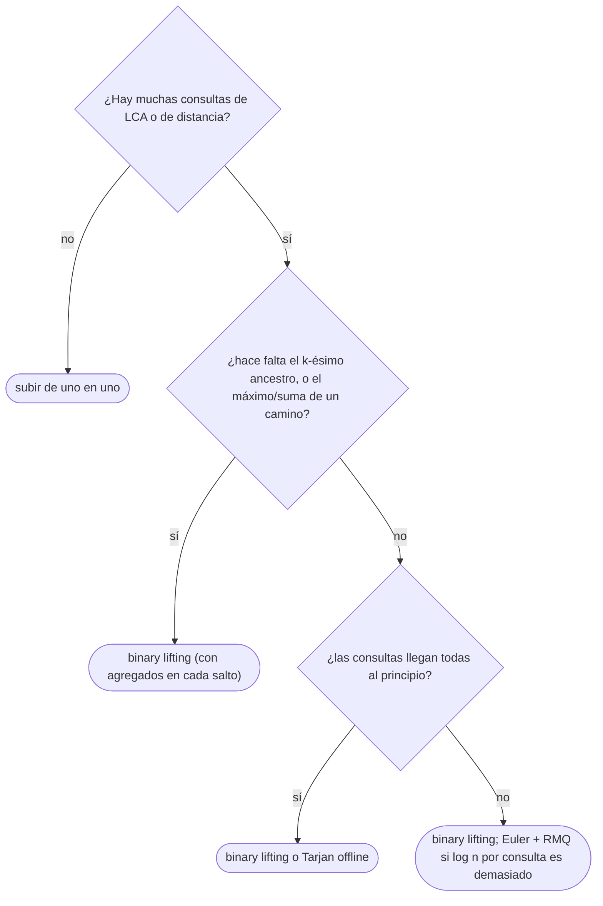

# 05 — LCA

> El ancestro común más bajo de dos nodos y la distancia entre ellos en `O(log n)` por consulta, con
> *binary lifting*: saltos de `2ᵏ` precalculados que suben a cualquier altura en `log n` pasos. Y la
> reducción al mínimo de un rango sobre el recorrido de Euler, que da consultas en `O(1)`.
>
> **Niveles:** *binary lifting* [A] · Euler + RMQ [B].
>
> **📚 Lectura troncal:** Laaksonen, *Guide to Competitive Programming*, 3.ª ed. (Springer, 2024), cap. 10;
> cp-algorithms, [*Lowest Common Ancestor*](https://cp-algorithms.com/graph/lca.html).
>
> **Asume leído:** [`07/01` — Árboles: representación y recorridos](01-arboles-y-recorridos.md).
>
> **Vigencia:** 2026-10-04.

**Salto rápido:** [1](#1--el-problema) · [2](#2--la-teoría) · [3](#3--binary-lifting) · [4](#4--euler--rmq) · [5](#5-️-la-tabla-de-costes) · [6](#6--cómo-se-elige) · [7](#7--señales-del-enunciado) · [🧠](#-preguntas) · [🧩](#-problemas-propios)

---

## 1. 🎯 El problema

En un árbol enraizado, el **ancestro común más bajo** (LCA) de `u` y `v` es el nodo más profundo que es
ancestro de los dos. En el árbol T, `LCA(4, 7) = 2` y `LCA(4, 6) = 1`. Es la pieza que convierte
preguntas sobre caminos en preguntas sobre la raíz: el camino de `u` a `v` sube de `u` al LCA y baja a
`v`, así que

```text
dist(u, v) = prof(u) + prof(v) − 2 · prof(LCA(u, v))
```

Subir de uno en uno desde `u` y `v` hasta encontrarse cuesta la profundidad: `O(n)` por consulta en un
árbol degenerado. Con `q = 2·10⁵` consultas sobre `n = 2·10⁵` nodos, `4·10¹⁰`.

El *binary lifting* precalcula, para cada nodo, su ancestro a distancia `1, 2, 4, …, 2ᵏ`. Con esos saltos,
subir `d` niveles cuesta los bits de `d`, y el LCA se encuentra en `O(log n)`.

---

## 2. 📐 La teoría

**La tabla.** `up[k][v]` es el ancestro de `v` a distancia `2ᵏ` (o la raíz, si se sale del árbol). Se
llena por niveles: `up[0][v]` es el padre, y

```text
up[k][v] = up[k − 1][ up[k − 1][v] ]        subir 2ᵏ = subir 2ᵏ⁻¹ dos veces
```

**Subir `d` niveles.** Se escribe `d` en binario y se aplica un salto `up[k]` por cada bit `k` encendido:
`O(log d)` saltos.

**Teorema (corrección del LCA por saltos).** Tras igualar las profundidades de `u` y `v`, si `u ≠ v`, el
procedimiento «para `k` de mayor a menor, si `up[k][u] ≠ up[k][v]`, saltar los dos» deja `u` y `v` como
hijos distintos del LCA, que es entonces `up[0][u]`.

*Prueba.* Invariante: `u ≠ v`, están a la misma profundidad, y el LCA es un ancestro estricto de los dos.
Si los ancestros a distancia `2ᵏ` son distintos, el LCA está más arriba que ellos, y saltar mantiene el
invariante; si son iguales, ese ancestro común está en o por encima del LCA, y no se salta. Como se prueban
los `k` de mayor a menor, la distancia total saltada es la mayor posible que deja `u ≠ v`: la profundidad
de `u` menos la del LCA, menos 1 (es una representación binaria, como la búsqueda binaria de [`05/04`](../05-orden-y-busqueda/04-busqueda-binaria.md)).
Así `u` y `v` acaban justo debajo del LCA.

**La reducción a RMQ.** El **recorrido de Euler** anota un nodo cada vez que el DFS entra en él o vuelve a
él desde un hijo: `2n − 1` entradas. Entre la primera aparición de `u` y la de `v`, el recorrido va de `u`
a `v` pasando por el LCA y sin salir de su subárbol: el nodo de **menor profundidad** en ese tramo es el
LCA. Con una tabla dispersa ([`09/01`](../09-consultas-sobre-rangos/01-sparse-table.md)), el mínimo de un tramo cuesta `O(1)`.

```text
Euler de T:    1  2  4  2  5  7  5  2  1  3  6  3  1
profundidad:   0  1  2  1  2  3  2  1  0  1  2  1  0
primera vez:   1→0 · 2→1 · 4→2 · 5→4 · 7→5 · 3→9 · 6→10
LCA(4, 7): tramo [2, 5] → 4 2 5 7, mínimo en 2 (prof. 1)
LCA(4, 6): tramo [2, 10] → contiene el 1 (prof. 0)
```

---

## 3. 🧱 *Binary lifting*

**Qué es.** La tabla `up[k][v]` y dos operaciones: subir `d` niveles y el LCA.

**Por qué es correcto.** Por el teorema de §2: igualar profundidades sube exactamente la diferencia, y los
saltos simultáneos dejan a los dos nodos como hijos del LCA.

**Cómo va**, en T con `LOG = 3` (la raíz es su propio padre):

```text
v         1  2  3  4  5  6  7
up[0][v]  1  1  1  2  2  3  5
up[1][v]  1  1  1  1  1  1  2
up[2][v]  1  1  1  1  1  1  1

LCA(4, 7): prof 2 y 3 → sube 7 un nivel: up[0][7] = 5. Ahora (4, 5), distintos.
  k = 2: up[2][4] = 1 = up[2][5]    no salta
  k = 1: up[1][4] = 1 = up[1][5]    no salta
  k = 0: up[0][4] = 2 = up[0][5]    no salta
  LCA = up[0][4] = 2
LCA(4, 6): misma prof. k = 2, 1: iguales. k = 0: up[0][4] = 2 ≠ 3 = up[0][6] → (2, 3). LCA = up[0][2] = 1
dist(4, 6) = 2 + 2 − 2·0 = 4
```

**Cuánto.** Preproceso `Θ(n log n)` en tiempo y memoria; `O(log n)` por consulta.

**La plantilla**, construida desde los padres y las profundidades de un preorden iterativo (`07/01`):

```cpp
#include <vector>

// Binary lifting. parent[root] = root; order = preorden (cada padre antes que sus hijos).
struct Lca {
    int LOG; std::vector<std::vector<int>> up; std::vector<int> depth;
    Lca(const std::vector<int>& parent, const std::vector<int>& dep, const std::vector<int>& order)
        : depth(dep) {
        int n = parent.size();
        LOG = 1; while ((1 << LOG) < n) LOG++;
        up.assign(LOG, std::vector<int>(n));
        up[0] = parent;
        for (int k = 1; k < LOG; k++)
            for (int v : order) up[k][v] = up[k - 1][up[k - 1][v]];
    }
    int lift(int v, int d) const {                          // ancestro a distancia d
        for (int k = 0; d; k++, d >>= 1) if (d & 1) v = up[k][v];
        return v;
    }
    int lca(int u, int v) const {
        if (depth[u] < depth[v]) std::swap(u, v);
        u = lift(u, depth[u] - depth[v]);
        if (u == v) return u;
        for (int k = LOG - 1; k >= 0; k--)
            if (up[k][u] != up[k][v]) { u = up[k][u]; v = up[k][v]; }
        return up[0][u];
    }
    int dist(int u, int v) const { return depth[u] + depth[v] - 2 * depth[lca(u, v)]; }
};
```

```java
// Binary lifting. parent[root] = root; order = preorden (cada padre antes que sus hijos).
static final class Lca {
    final int LOG; final int[][] up; final int[] depth;
    Lca(int[] parent, int[] depth, int[] order) {
        int n = parent.length, lg = 1;
        while ((1 << lg) < n) lg++;
        LOG = lg; this.depth = depth;
        up = new int[LOG][];
        up[0] = parent.clone();
        for (int k = 1; k < LOG; k++) {
            up[k] = new int[n];
            for (int v : order) up[k][v] = up[k - 1][up[k - 1][v]];
        }
    }
    int lift(int v, int d) {
        for (int k = 0; d > 0; k++, d >>= 1) if ((d & 1) != 0) v = up[k][v];
        return v;
    }
    int lca(int u, int v) {
        if (depth[u] < depth[v]) { int t = u; u = v; v = t; }
        u = lift(u, depth[u] - depth[v]);
        if (u == v) return u;
        for (int k = LOG - 1; k >= 0; k--)
            if (up[k][u] != up[k][v]) { u = up[k][u]; v = up[k][v]; }
        return up[0][u];
    }
    int dist(int u, int v) { return depth[u] + depth[v] - 2 * depth[lca(u, v)]; }
}
```

```python
class Lca:
    """Binary lifting. parent[root] = root; order = preorden (cada padre antes que sus hijos)."""
    def __init__(self, parent, depth, order):
        n = len(parent)
        self.LOG = max(1, (n - 1).bit_length())
        self.depth = depth
        self.up = [parent[:]]
        for k in range(1, self.LOG):
            prev = self.up[-1]
            self.up.append([prev[prev[v]] for v in range(n)])

    def lift(self, v, d):
        k = 0
        while d:
            if d & 1:
                v = self.up[k][v]
            d >>= 1; k += 1
        return v

    def lca(self, u, v):
        if self.depth[u] < self.depth[v]:
            u, v = v, u
        u = self.lift(u, self.depth[u] - self.depth[v])
        if u == v:
            return u
        for k in range(self.LOG - 1, -1, -1):
            if self.up[k][u] != self.up[k][v]:
                u, v = self.up[k][u], self.up[k][v]
        return self.up[0][u]
```

- **La raíz es su propio padre**: así los saltos que se pasan de la raíz se quedan en ella y no hace falta
  un valor especial.
- **`LOG`** con `2^LOG ≥ n`: ninguna profundidad pasa de `n − 1`.
- **El orden de llenado**: con `order` en preorden, `up[k − 1]` del ancestro ya está calculado; llenando
  por niveles `k` completos (como en las plantillas), cualquier orden vale.
- **Python**: la lista por comprensión de cada nivel es mucho más rápida que un doble bucle.
- **Memoria**: `n · LOG` enteros; con `n = 2·10⁵`, `18` niveles, unos 14 MB en C++ y Java.

### De la versión ingenua a la buena

**El problema.** Una red de `n = 2·10⁵` estaciones sin ciclos; `q = 2·10⁵` consultas «¿cuántos tramos hay
entre `u` y `v`?».

**La versión ingenua:**

```java
// O(n) por consulta: sube de uno en uno. Con un árbol en cadena, 4·10¹⁰ pasos.
static int distNaive(int[] parent, int[] depth, int u, int v) {
    int d = 0;
    while (depth[u] > depth[v]) { u = parent[u]; d++; }
    while (depth[v] > depth[u]) { v = parent[v]; d++; }
    while (u != v) { u = parent[u]; v = parent[v]; d += 2; }
    return d;
}
```

> «Subir de uno en uno es buscar linealmente la altura del LCA. Si precalculo los ancestros a distancia
> potencia de 2, subo con los bits de la diferencia y busco el LCA como en una búsqueda binaria: `log n`
> saltos.»

**El camino a la buena.** Construir `Lca` una vez y responder `dist(u, v)` en cada consulta.

**Cuándo sí**: LCA y distancias con muchas consultas; el `k`-ésimo ancestro; agregados por caminos (el
máximo de las aristas del camino, guardando junto a `up` el máximo de cada salto). **Cuándo no**: con una
sola consulta, subir de uno en uno basta; con muchísimas consultas, Euler + RMQ las da en `O(1)`.

> **Veredicto:** el *binary lifting* sube con los bits de la distancia y encuentra el LCA como una
> búsqueda binaria: `O(n log n)` de preproceso y `O(log n)` por consulta.

---

## 4. 🧱 Euler + RMQ

**Qué es.** El recorrido de Euler de `2n − 1` posiciones, la profundidad de cada una y la primera aparición
de cada nodo; el LCA de `u` y `v` es el nodo de menor profundidad entre sus primeras apariciones, con una
tabla dispersa para el mínimo.

**Por qué es correcto** (el enunciado y una frase): entre la primera visita de `u` y la de `v`, el DFS
recorre el camino de `u` a `v` sin salir del subárbol del LCA, y pasa por el LCA al volver de la rama de
`u`; ningún nodo de ese tramo es menos profundo que el LCA.

**Cómo va.** Con la tabla de §2: `LCA(4, 7)` es el mínimo del tramo `[2, 5]` del recorrido, que es el 2.

**Cuánto.** Preproceso `O(n log n)` (la tabla dispersa sobre `2n − 1` posiciones); `O(1)` por consulta.

**La plantilla**, con el recorrido iterativo y la tabla dispersa de pares `(profundidad, nodo)`:

```cpp
#include <utility>
#include <vector>

// LCA por Euler + tabla dispersa. adj sin pesos, raíz root. O(1) por consulta.
struct EulerLca {
    std::vector<int> first, lg; std::vector<std::vector<std::pair<int, int>>> sp;
    EulerLca(const std::vector<std::vector<int>>& adj, int root) {
        int n = adj.size();
        first.assign(n, -1);
        std::vector<std::pair<int, int>> eul;                // (profundidad, nodo)
        std::vector<int> depth(n, 0), it(n, 0), parent(n, -1), st = {root};
        first[root] = 0; eul.push_back({0, root});
        while (!st.empty()) {
            int v = st.back();
            if (it[v] < (int)adj[v].size()) {
                int w = adj[v][it[v]++];
                if (w == parent[v]) continue;
                parent[w] = v; depth[w] = depth[v] + 1;
                first[w] = eul.size(); eul.push_back({depth[w], w});      // entra en w
                st.push_back(w);
            } else {
                st.pop_back();
                if (!st.empty()) eul.push_back({depth[st.back()], st.back()});   // vuelve al padre
            }
        }
        int m = eul.size();
        lg.assign(m + 1, 0);
        for (int i = 2; i <= m; i++) lg[i] = lg[i / 2] + 1;
        sp.assign(lg[m] + 1, eul);
        for (int k = 1; k <= lg[m]; k++)
            for (int i = 0; i + (1 << k) <= m; i++)
                sp[k][i] = std::min(sp[k - 1][i], sp[k - 1][i + (1 << (k - 1))]);
    }
    int lca(int u, int v) const {
        int l = first[u], r = first[v];
        if (l > r) std::swap(l, r);
        int k = lg[r - l + 1];
        return std::min(sp[k][l], sp[k][r - (1 << k) + 1]).second;
    }
};
```

```java
// LCA por Euler + tabla dispersa, con el Euler construido como en la versión C++:
// eulNode[i], eulDepth[i] y first[v].
static final class EulerLca {
    final int[] first, lg; final int[][] sp; final int[] eulNode, eulDepth;   // sp guarda índices
    EulerLca(int[] eulNode, int[] eulDepth, int[] first) {
        this.eulNode = eulNode; this.eulDepth = eulDepth; this.first = first;
        int m = eulNode.length;
        lg = new int[m + 1];
        for (int i = 2; i <= m; i++) lg[i] = lg[i / 2] + 1;
        sp = new int[lg[m] + 1][m];
        for (int i = 0; i < m; i++) sp[0][i] = i;
        for (int k = 1; k <= lg[m]; k++)
            for (int i = 0; i + (1 << k) <= m; i++) {
                int a = sp[k - 1][i], b = sp[k - 1][i + (1 << (k - 1))];
                sp[k][i] = eulDepth[a] <= eulDepth[b] ? a : b;
            }
    }
    int lca(int u, int v) {
        int l = Math.min(first[u], first[v]), r = Math.max(first[u], first[v]);
        int k = lg[r - l + 1], a = sp[k][l], b = sp[k][r - (1 << k) + 1];
        return eulNode[eulDepth[a] <= eulDepth[b] ? a : b];
    }
}
```

- **El recorrido de Euler** anota el nodo al entrar y cada vez que se vuelve a él desde un hijo; en la
  versión iterativa, se anota el hijo al bajar y el padre al desapilar un nodo terminado.
- **La tabla dispersa** guarda pares `(profundidad, nodo)` en C++ o índices en Java; las dos solapan dos
  potencias de 2 para cubrir el tramo, que vale porque el mínimo es idempotente (`09/01`).
- **Memoria**: `(2n − 1) · log₂(2n)` entradas; con `n = 2·10⁵`, unos 7,6 millones de pares: más que el
  *binary lifting*.

**Cuándo sí**: muchísimas consultas de LCA, cuando `log n` por consulta pesa. **Cuándo no**: si además hay
que subir `k` niveles o agregar por caminos, el *binary lifting* sirve para todo.

> **Veredicto:** el LCA es el mínimo de un tramo del recorrido de Euler. Con una tabla dispersa, `O(1)`
> por consulta a cambio de más memoria.

---

## 5. ⏱️ La tabla de costes

| Método | Preproceso | Consulta | Memoria | Lo que la tabla no dice |
|---|---|---|---|---|
| Subir de uno en uno | — | `O(n)` | — | Basta con pocas consultas |
| *Binary lifting* | `Θ(n log n)` | `O(log n)` | `Θ(n log n)` | También da el `k`-ésimo ancestro y agregados por caminos |
| Euler + tabla dispersa | `Θ(n log n)` | `O(1)` | `Θ(n log n)` | Solo LCA |
| Tarjan *offline* | `O((n + q) α(n))` | todas juntas | `Θ(n + q)` | Necesita todas las consultas de antemano ([`08/04`](../08-heaps-y-union-find/04-union-find.md)) |

---

## 6. 🧭 Cómo se elige



---

## 7. 🔎 Señales del enunciado

| Señal | Técnica | Por qué |
|---|---|---|
| «Distancia entre `u` y `v`» en un árbol, muchas consultas | LCA | `prof(u) + prof(v) − 2·prof(LCA)` |
| «El jefe del jefe del jefe…», «el `k`-ésimo ancestro» | *Binary lifting* | Saltos por los bits de `k` |
| «¿Está `w` en el camino de `u` a `v`?» | LCA + ancestros (`07/01`) | El camino sube al LCA y baja |
| «Suma sobre los caminos» de muchas consultas | LCA + diferencias en el árbol | `+1` en `u` y `v`, `−1` en el LCA y su padre |
| «A dónde llega tras `k` pasos» en un grafo funcional | *Binary lifting* sobre `f` | `f^(2ᵏ)` precalculado |

---

## ⚠️ Errores frecuentes

| Se dice | Lo preciso |
|---|---|
| «El LCA se saca subiendo de a uno» | `O(n)` por consulta; con *binary lifting*, `O(log n)` |
| «Basta con saltar los dos mientras sean distintos» | Antes hay que igualar profundidades, o los saltos no se encuentran |
| «El LCA es `up[k][u]` cuando `up[k][u] = up[k][v]`» | Ese es **un** ancestro común, quizá no el más bajo; el LCA es el padre de donde se paran |
| «La distancia es `prof(u) + prof(v)`» | Hay que restar dos veces la profundidad del LCA |
| «El recorrido de Euler tiene `n` posiciones» | Tiene `2n − 1`: cada vuelta al padre también se anota |

---

## 📚 Para profundizar

- **Libro** — Laaksonen, *Guide to Competitive Programming*, 3.ª ed. (Springer, 2024), cap. 10: el LCA con
  *binary lifting* y con el recorrido de Euler. *Lectura troncal.*
- **Referencia** — cp-algorithms, [*Lowest Common Ancestor*](https://cp-algorithms.com/graph/lca.html)
  (Euler + RMQ) y [*Binary Lifting*](https://cp-algorithms.com/graph/lca_binary_lifting.html). *Lectura
  troncal.*
- **Referencia** — USACO Guide, [*Binary Jumping*](https://usaco.guide/plat/binary-jump).
- **Artículo** — Bender y Farach-Colton, «The LCA Problem Revisited», LATIN 2000: LCA en `O(1)` con
  preproceso lineal.

---

## 🧠 Preguntas

1. ¿Qué es el LCA de dos nodos? Da `LCA(4, 7)` y `LCA(4, 6)` en T. 🟢
2. ¿Qué fórmula da la distancia entre dos nodos con el LCA? 🟢
3. ¿Qué guarda `up[k][v]`, y cómo se calcula a partir de `up[k − 1]`? 🟢
4. ¿Por qué hay que igualar profundidades antes de saltar los dos nodos a la vez? 🟡
5. ¿Cómo subes `d` niveles con la tabla, y cuántos saltos hace como mucho? 🟡
6. ¿Por qué el recorrido de Euler tiene `2n − 1` posiciones? 🟡
7. ¿Qué memoria necesita el *binary lifting* con `n = 2·10⁵`, y cómo la reduces si no cabe? 🟠
8. Demuestra que los saltos de mayor a menor dejan `u` y `v` como hijos del LCA. 🟠
9. Demuestra que el LCA es el nodo de menor profundidad entre las primeras apariciones de `u` y `v` en el recorrido de Euler. 🟠
10. Compara cómo implementarías la tabla `up` en C++, Java y Python para `n = 2·10⁵`, y su coste real. 🟠
11. ¿Cómo calculas el máximo peso de arista en el camino entre `u` y `v` con *binary lifting*? 🟠
12. ¿Cómo calculas el LCA de un conjunto de `k` nodos con una sola llamada a `lca`, usando los tiempos de entrada? 🔴
13. ¿Se puede responder el `k`-ésimo ancestro en `O(log n)` con memoria `O(n)` en lugar de `O(n log n)`? Esboza cómo. 🔴

---

## 🧩 Problemas propios

### Primos lejanos

**Nivel:** 🟡 · **Formato:** programa completo.

Un árbol genealógico de `n` personas tiene como raíz a la persona 1. Para cada consulta `u v`, imprime el
ancestro común más cercano y cuántos parentescos (aristas) los separan.

- **Entrada.** Una línea con `n` y `q`. Una línea con los padres de `2..n`. Después, `q` líneas con `u v`.
- **Salida.** `q` líneas con dos enteros.
- **Restricciones.** `1 ≤ n, q ≤ 2·10⁵`; el árbol puede ser una cadena.

```text
Entrada            Salida
7 3                2 3
1 1 2 2 3 5        1 4
4 7                5 1
4 6
5 7

Entrada            Salida
3 2                3 0
1 2                1 2
3 3
1 3
```

**Pista 1:** con una cadena de `2·10⁵`, ¿cuánto cuesta subir de uno en uno para cada consulta?

### ¿Está en el camino?

**Nivel:** 🟠 · **Formato:** programa completo.

Dado un árbol enraizado en 1 y consultas `u v w`, imprime `SI` si `w` está en el camino de `u` a `v`
(extremos incluidos) y `NO` si no.

- **Entrada.** Una línea con `n` y `q`. Después, `n − 1` aristas. Después, `q` líneas con `u v w`.
- **Salida.** `q` líneas.
- **Restricciones.** `1 ≤ n, q ≤ 2·10⁵`.

```text
Entrada            Salida
7 3                SI
1 2                SI
1 3                NO
2 4
2 5
3 6
5 7
4 7 5
4 6 1
4 7 3

Entrada            Salida
2 2                NO
1 2                SI
2 2 1
2 2 2
```

**Pista 1:** si el camino sube de `u` al LCA y baja a `v`, ¿qué relación de ancestro tiene que tener `w`
con `u`, con `v` y con el LCA?

---

## 🧩 Práctica externa

> 💡 **Truco.** Antes de enviar una solución con *binary lifting*, prueba el LCA de un nodo consigo mismo,
> de un nodo con la raíz y de dos hermanos; si una IA te sugiere más casos borde, mejor que pedirle el
> código ([`01/06`](../01-oficio-del-competidor/06-protocolo-de-resolucion.md)).

### Núcleo

| ✔ | Problema | Plataforma | Nivel | Patrón | Pista 1 |
|---|---|---|---|---|---|
| [ ] | [Lowest Common Ancestor of a Binary Search Tree](https://leetcode.com/problems/lowest-common-ancestor-of-a-binary-search-tree/) | LeetCode | 🟡 | LCA con la propiedad de BST | ¿Cuándo dejan `p` y `q` de estar del mismo lado? |
| [ ] | [Lowest Common Ancestor of a Binary Tree](https://leetcode.com/problems/lowest-common-ancestor-of-a-binary-tree/) | LeetCode | 🟡 | LCA recursivo, una consulta | ¿Qué devuelve un subárbol que contiene solo uno de los dos? |
| [ ] | [Company Queries I](https://cses.fi/problemset/task/1687) | CSES | 🟡 | `k`-ésimo ancestro | ¿Qué saltos componen `k`? |
| [ ] | [Company Queries II](https://cses.fi/problemset/task/1688) | CSES | 🟡 | LCA con *binary lifting* | ¿Qué haces primero si los dos no están a la misma profundidad? |
| [ ] | [Planets Queries I](https://cses.fi/problemset/task/1750) | CSES | 🟡 | *Binary lifting* sobre un grafo funcional | ¿Qué es `up[k][v]` si cada planeta tiene un solo teletransporte? |
| [ ] | [Kth Ancestor of a Tree Node](https://leetcode.com/problems/kth-ancestor-of-a-tree-node/) | LeetCode | 🟠 | *Binary lifting* | Si `k` es mayor que la profundidad, ¿qué devuelves? |

### Ampliación

| ✔ | Problema | Plataforma | Nivel | Patrón | Pista 1 |
|---|---|---|---|---|---|
| [ ] | [Counting Paths](https://cses.fi/problemset/task/1136) | CSES | 🟠 | Diferencias en el árbol con LCA | ¿Qué cuatro marcas pones por camino para sumarlas después en postorden? |
| [ ] | [Fools and Roads](https://codeforces.com/problemset/problem/191/C) | Codeforces | 🟠 | Diferencias sobre aristas con LCA | ¿Cambia algo respecto de contar nodos si cuentas aristas? |
| [ ] | [Tree Queries](https://codeforces.com/problemset/problem/1328/E) | Codeforces | 🟠 | Ancestros y el nodo más profundo | Si subes cada nodo a su padre, ¿qué tienen que cumplir respecto del más profundo? |
| [ ] | [Minimum spanning tree for each edge](https://codeforces.com/problemset/problem/609/E) | Codeforces | 🔴 | MST + máximo en el camino con *binary lifting* | Si fuerzas una arista, ¿qué arista del MST quitas? |

---

## ✅ Criterio de dominio

- Escribir el *binary lifting* con `lift`, `lca` y `dist` sin mirar.
- Demostrar la corrección de los saltos y la reducción a RMQ por el recorrido de Euler.
- Añadir un agregado (máximo de aristas) a los saltos.
- Resolver Company Queries II y Counting Paths sin pista 2.

---

**Anterior:** [`07/04` — *Tries*](04-tries.md) · **Siguiente:** [`07/06` — Técnicas sobre árboles](06-tecnicas-sobre-arboles.md) ·
**Relacionado:** [`09/01` — *Sparse table* y RMQ](../09-consultas-sobre-rangos/01-sparse-table.md); [`07/06` — Técnicas sobre árboles](06-tecnicas-sobre-arboles.md).
